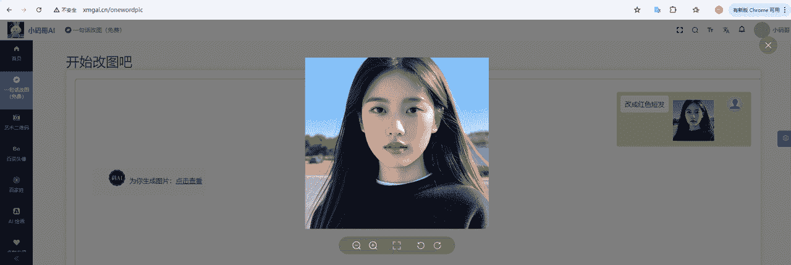

# AI开发了小码哥移动端

> 来源：[https://xmgtoagi.feishu.cn/docx/NbgndoaaJogUFGxQkmPcvVnfnne](https://xmgtoagi.feishu.cn/docx/NbgndoaaJogUFGxQkmPcvVnfnne)

小码哥从事前后端开发近十年，但是随着技术的更新迭代，有时候没有时间和精力去优化UI、实现一些前后端功能，以及解决一些bug。特别是我想开发小码哥AI的移动端，但觉得自己没有那么多时间去研究移动端了，准备放弃了，后来尝试了 国产AI（后面会介绍），测试了一下，完全能满足我的开发需求，AI一边帮我写代码，我一边刷剧，不吹牛P的，可以看看我的成果。

我使用`uniapp`框架，一举多得，可以发布🛰️小程序、h5页面、手机端app，目前🛰️小程序、h5都是已经跑通了，后续测试手机端app，后端统一使用`springboot`框架，统一管理和维护，后台试了试国产的AI大模型，直接帮我开发前端，以及完成和后端的对接。

小码哥承诺，目前一句话改图，免费、免费、免费！，欢迎大家一起来玩，

访问地址：`xmgai.cn`或者`www.xmgai.cn`，如果访问不了，可能是浏览器自动加了`https`，把`https`改成`http`即可。

## 移动端


## PC端

我使用了`vue3`款框架，开发起来还是比较顺畅的




这是原图


这是AI修改后的图，提示词为：改成红色短发


## 效果


这是原图


这是效果图，出图时间大概是20秒左右。


## 代码部分

我使用了`deepseek`和`通义灵码`，大家可以去对比一下，各有各的优势，比如给我实现一个手机号和验证码登录的页面，我的提示词如下：我在使用`uniapp`开发，帮我优化一下UI和功能，第一，点击获取验证码时，必须要输入手机号，手机号必须要校验正确性，点击注册时，必须要输入手机号和验证码，请给我完整代码，方便我复制。


完整代码如下：


```
<template>
  <el-form
    v-show="getShow"
    ref="formSmsLogin"
    :model="loginData.loginForm"
    :rules="rules"
    class="login-form"
    label-position="top"
    label-width="120px"
    size="large"
  >
    <el-row style="margin-right: -10px; margin-left: -10px">
      <!-- 租户名 -->
      <el-col :span="24" style="padding-right: 10px; padding-left: 10px">
        <el-form-item>
          <LoginFormTitle style="width: 100%" />
        </el-form-item>
      </el-col>
      <el-col :span="24" style="padding-right: 10px; padding-left: 10px">
        <el-form-item v-if="loginData.tenantEnable === 'true'" prop="tenantName">
          <el-input
            v-model="loginData.loginForm.tenantName"
            :placeholder="t('login.tenantNamePlaceholder')"
            :prefix-icon="iconHouse"
            :disabled="!tenantNameInputable"
            type="primary"
            link
          />
        </el-form-item>
      </el-col>
      <!-- 手机号 -->
      <el-col :span="24" style="padding-right: 10px; padding-left: 10px">
        <el-form-item prop="mobileNumber">
          <el-input
            v-model="loginData.loginForm.mobileNumber"
            :placeholder="t('login.mobileNumberPlaceholder')"
            :prefix-icon="iconCellphone"
          />
        </el-form-item>
      </el-col>
      <!-- 验证码 -->
      <el-col :span="24" style="padding-right: 10px; padding-left: 10px">
        <el-form-item prop="code">
          <el-row :gutter="5" justify="space-between" style="width: 100%">
            <el-col :span="24">
              <el-input
                v-model="loginData.loginForm.code"
                :placeholder="t('login.codePlaceholder')"
                :prefix-icon="iconCircleCheck"
              >
                <!-- <el-button class="w-[100%]"> -->
                <template #append>
                  <span
                    v-if="mobileCodeTimer <= 0"
                    class="getMobileCode"
                    style="cursor: pointer"
                    @click="getSmsCode"
                  >
                    {{ t('login.getSmsCode') }}
                  </span>
                  <span v-if="mobileCodeTimer > 0" class="getMobileCode" style="cursor: pointer">
                    {{ mobileCodeTimer }}秒后可重新获取
                  </span>
                </template>
              </el-input>
              <!-- </el-button> -->
            </el-col>
          </el-row>
        </el-form-item>
      </el-col>
      <!-- 登录按钮 / 返回按钮 -->
      <el-col :span="24" style="padding-right: 10px; padding-left: 10px">
        <el-form-item>
          <XButton
            :loading="loginLoading"
            :title="t('login.login')"
            class="w-[100%]"
            type="primary"
            @click="signIn()"
          />
        </el-form-item>
      </el-col>
      <el-col :span="24" style="padding-right: 10px; padding-left: 10px">
        <el-form-item>
          <XButton
            :loading="loginLoading"
            :title="t('login.backLogin')"
            class="w-[100%]"
            @click="handleBackLogin()"
          />
        </el-form-item>
      </el-col>
    </el-row>
  </el-form>
</template>
<script lang="ts" setup>
import type { RouteLocationNormalizedLoaded } from 'vue-router';

import { useIcon } from '@/hooks/web/useIcon';

import { setTenantId, setToken } from '@/utils/auth';
import { usePermissionStore } from '@/store/modules/permission';
import { getTenantIdByName, sendSmsCode, smsLogin } from '@/api/login';
import LoginFormTitle from './LoginFormTitle.vue';
import { LoginStateEnum, useFormValid, useLoginState } from './useLogin';
import { ElLoading } from 'element-plus';
import * as LoginApi from '@/api/login';
import * as authUtil from '@/utils/auth';

defineOptions({ name: 'MobileForm' })

const { t } = useI18n()
const message = useMessage()
const permissionStore = usePermissionStore()
const { currentRoute, push } = useRouter()
const formSmsLogin = ref()
const loginLoading = ref(false)
const iconHouse = useIcon({ icon: 'ep:house' })
const iconCellphone = useIcon({ icon: 'ep:cellphone' })
const iconCircleCheck = useIcon({ icon: 'ep:circle-check' })
const { validForm } = useFormValid(formSmsLogin)
const { handleBackLogin, getLoginState } = useLoginState()
const getShow = computed(() => unref(getLoginState) === LoginStateEnum.MOBILE)
const tenantNameInputable=ref(true) //租户输入框是否可以输入

const rules = {
  tenantName: [required],
  mobileNumber: [required],
  code: [required]
}
const loginData = reactive({
  codeImg: '',
  tenantEnable: import.meta.env.VITE_APP_TENANT_ENABLE,
  token: '',
  loading: {
    signIn: false
  },
  loginForm: {
    tenantName: import.meta.env.VITE_APP_DEFAULT_LOGIN_TENANT || '',
    uuid: '',
    mobileNumber: '',
    code: ''
  }
})
const smsVO = reactive({
  smsCode: {
    mobile: '',
    scene: 21
  },
  loginSms: {
    mobile: '',
    code: ''
  }
})
const mobileCodeTimer = ref(0)
const redirect = ref<string>('')
const getSmsCode = async () => {
  await getTenantId()
  smsVO.smsCode.mobile = loginData.loginForm.mobileNumber
  await sendSmsCode(smsVO.smsCode).then(async () => {
    message.success(t('login.SmsSendMsg'))
    // 设置倒计时
    mobileCodeTimer.value = 60
    let msgTimer = setInterval(() => {
      mobileCodeTimer.value = mobileCodeTimer.value - 1
      if (mobileCodeTimer.value <= 0) {
        clearInterval(msgTimer)
      }
    }, 1000)
  })
}
watch(
  () => currentRoute.value,
  (route: RouteLocationNormalizedLoaded) => {
    redirect.value = route?.query?.redirect as string
  },
  {
    immediate: true
  }
)
// 获取租户 ID
const getTenantId = async () => {
  if (loginData.tenantEnable === 'true') {
    const res = await getTenantIdByName(loginData.loginForm.tenantName)
    setTenantId(res)
  }
}
// 登录
const signIn = async () => {
  await getTenantId()
  const data = await validForm()
  if (!data) return
  ElLoading.service({
    lock: true,
    text: '正在加载系统中...',
    background: 'rgba(0, 0, 0, 0.7)'
  })
  loginLoading.value = true
  smsVO.loginSms.mobile = loginData.loginForm.mobileNumber
  smsVO.loginSms.code = loginData.loginForm.code
  await smsLogin(smsVO.loginSms)
    .then(async (res) => {
      setToken(res)
      if (!redirect.value) {
        redirect.value = '/'
      }
      push({ path: redirect.value || permissionStore.addRouters[0].path })
    })
    .catch(() => {})
    .finally(() => {
      loginLoading.value = false
      setTimeout(() => {
        const loadingInstance = ElLoading.service()
        loadingInstance.close()
      }, 400)
    })
}

// 根据域名，获得租户信息
const getTenantByWebsite = async () => {
  const website = location.host
  const res = await LoginApi.getTenantByWebsite(website)
  if (res) {
    loginData.loginForm.tenantName = res.name
    // authUtil.setTenantId(res.id)
    tenantNameInputable.value=false
  }
}

onMounted(() => {
  getTenantByWebsite()

})
</script>

<style lang="scss" scoped>
:deep(.anticon) {
  &:hover {
    color: var(--el-color-primary) !important;
  }
}

.smsbtn {
  margin-top: 33px;
}
</style>
```


这只是一个简单的例子，实现的效果如下：


如果大家感兴趣，欢迎一起交流，后续我将逐步分享我是如何实现AI功能的。
