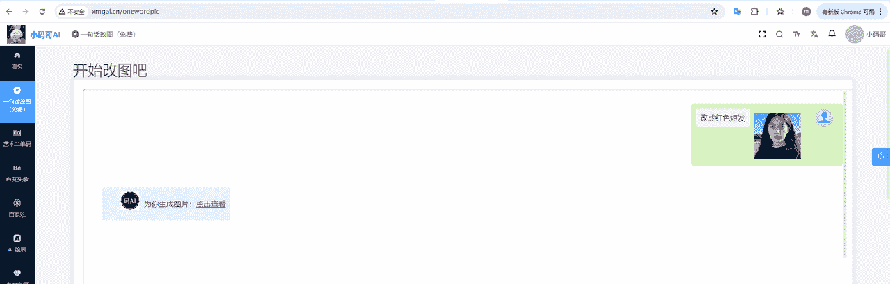
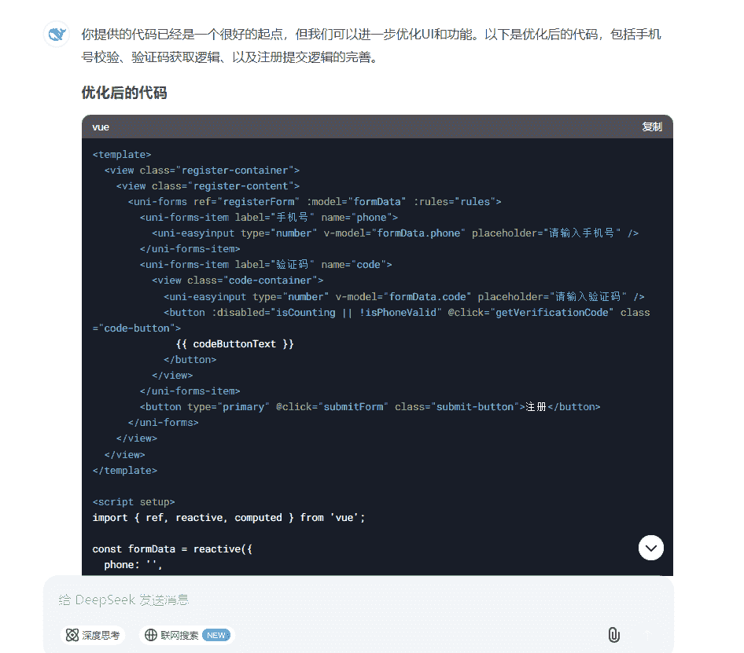
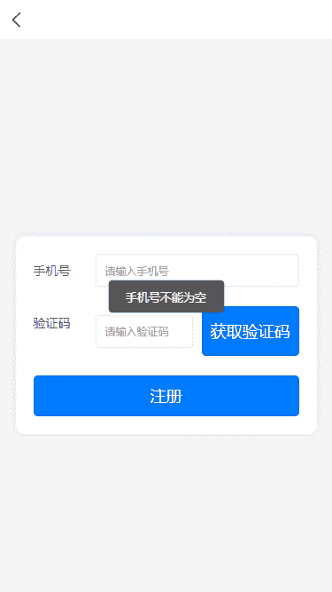
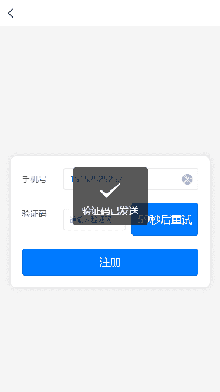

# AI开发了小码哥移动端

> 来源：[https://xmgtoagi.feishu.cn/docx/NbgndoaaJogUFGxQkmPcvVnfnne](https://xmgtoagi.feishu.cn/docx/NbgndoaaJogUFGxQkmPcvVnfnne)

小码哥从事前后端开发近十年，但是随着技术的更新迭代，有时候没有时间和精力去优化UI、实现一些前后端功能，以及解决一些bug。特别是我想开发小码哥AI的移动端，但觉得自己没有那么多时间去研究移动端了，准备放弃了，后来尝试了 国产AI（后面会介绍），测试了一下，完全能满足我的开发需求，AI一边帮我写代码，我一边刷剧，不吹牛P的，可以看看我的成果。

我使用uniapp框架，一举多得，可以发布🛰️小程序、h5页面、手机端app，目前🛰️小程序、h5都是已经跑通了，后续测试手机端app，后端统一使用springboot框架，统一管理和维护，后台试了试国产的AI大模型，直接帮我开发前端，以及完成和后端的对接。

小码哥承诺，目前一句话改图，免费、免费、免费！，欢迎大家一起来玩，

访问地址：xmgai.cn或者www.xmgai.cn，如果访问不了，可能是浏览器自动加了https，把https改成http即可。

# 移动端


# PC端

我使用了vue3款框架，开发起来还是比较顺畅的




这是原图


这是AI修改后的图，提示词为：改成红色短发


# 效果


这是原图


这是效果图，出图时间大概是20秒左右。


# 代码部分

我使用了deepseek和通义灵码，大家可以去对比一下，各有各的优势，比如给我实现一个手机号和验证码登录的页面，我的提示词如下：我在使用uniapp开发，帮我优化一下UI和功能，第一，点击获取验证码时，必须要输入手机号，手机号必须要校验正确性，点击注册时，必须要输入手机号和验证码，请给我完整代码，方便我复制。



完整代码如下：

```
&lt;template&gt;
  &lt;el-form
    v-show=&quot;getShow&quot;
    ref=&quot;formSmsLogin&quot;
    :model=&quot;loginData.loginForm&quot;
    :rules=&quot;rules&quot;
    class=&quot;login-form&quot;
    label-position=&quot;top&quot;
    label-width=&quot;120px&quot;
    size=&quot;large&quot;
  &gt;
    &lt;el-row style=&quot;margin-right: -10px; margin-left: -10px&quot;&gt;
      &lt;!-- 租户名 --&gt;
      &lt;el-col :span=&quot;24&quot; style=&quot;padding-right: 10px; padding-left: 10px&quot;&gt;
        &lt;el-form-item&gt;
          &lt;LoginFormTitle style=&quot;width: 100%&quot; /&gt;
        &lt;/el-form-item&gt;
      &lt;/el-col&gt;
      &lt;el-col :span=&quot;24&quot; style=&quot;padding-right: 10px; padding-left: 10px&quot;&gt;
        &lt;el-form-item v-if=&quot;loginData.tenantEnable === &#x27;true&#x27;&quot; prop=&quot;tenantName&quot;&gt;
          &lt;el-input
            v-model=&quot;loginData.loginForm.tenantName&quot;
            :placeholder=&quot;t(&#x27;login.tenantNamePlaceholder&#x27;)&quot;
            :prefix-icon=&quot;iconHouse&quot;
            :disabled=&quot;!tenantNameInputable&quot;
            type=&quot;primary&quot;
            link
          /&gt;
        &lt;/el-form-item&gt;
      &lt;/el-col&gt;
      &lt;!-- 手机号 --&gt;
      &lt;el-col :span=&quot;24&quot; style=&quot;padding-right: 10px; padding-left: 10px&quot;&gt;
        &lt;el-form-item prop=&quot;mobileNumber&quot;&gt;
          &lt;el-input
            v-model=&quot;loginData.loginForm.mobileNumber&quot;
            :placeholder=&quot;t(&#x27;login.mobileNumberPlaceholder&#x27;)&quot;
            :prefix-icon=&quot;iconCellphone&quot;
          /&gt;
        &lt;/el-form-item&gt;
      &lt;/el-col&gt;
      &lt;!-- 验证码 --&gt;
      &lt;el-col :span=&quot;24&quot; style=&quot;padding-right: 10px; padding-left: 10px&quot;&gt;
        &lt;el-form-item prop=&quot;code&quot;&gt;
          &lt;el-row :gutter=&quot;5&quot; justify=&quot;space-between&quot; style=&quot;width: 100%&quot;&gt;
            &lt;el-col :span=&quot;24&quot;&gt;
              &lt;el-input
                v-model=&quot;loginData.loginForm.code&quot;
                :placeholder=&quot;t(&#x27;login.codePlaceholder&#x27;)&quot;
                :prefix-icon=&quot;iconCircleCheck&quot;
              &gt;
                &lt;!-- &lt;el-button class=&quot;w-[100%]&quot;&gt; --&gt;
                &lt;template #append&gt;
                  &lt;span
                    v-if=&quot;mobileCodeTimer &lt;= 0&quot;
                    class=&quot;getMobileCode&quot;
                    style=&quot;cursor: pointer&quot;
                    @click=&quot;getSmsCode&quot;
                  &gt;
                    {{ t(&#x27;login.getSmsCode&#x27;) }}
                  &lt;/span&gt;
                  &lt;span v-if=&quot;mobileCodeTimer &gt; 0&quot; class=&quot;getMobileCode&quot; style=&quot;cursor: pointer&quot;&gt;
                    {{ mobileCodeTimer }}秒后可重新获取
                  &lt;/span&gt;
                &lt;/template&gt;
              &lt;/el-input&gt;
              &lt;!-- &lt;/el-button&gt; --&gt;
            &lt;/el-col&gt;
          &lt;/el-row&gt;
        &lt;/el-form-item&gt;
      &lt;/el-col&gt;
      &lt;!-- 登录按钮 / 返回按钮 --&gt;
      &lt;el-col :span=&quot;24&quot; style=&quot;padding-right: 10px; padding-left: 10px&quot;&gt;
        &lt;el-form-item&gt;
          &lt;XButton
            :loading=&quot;loginLoading&quot;
            :title=&quot;t(&#x27;login.login&#x27;)&quot;
            class=&quot;w-[100%]&quot;
            type=&quot;primary&quot;
            @click=&quot;signIn()&quot;
          /&gt;
        &lt;/el-form-item&gt;
      &lt;/el-col&gt;
      &lt;el-col :span=&quot;24&quot; style=&quot;padding-right: 10px; padding-left: 10px&quot;&gt;
        &lt;el-form-item&gt;
          &lt;XButton
            :loading=&quot;loginLoading&quot;
            :title=&quot;t(&#x27;login.backLogin&#x27;)&quot;
            class=&quot;w-[100%]&quot;
            @click=&quot;handleBackLogin()&quot;
          /&gt;
        &lt;/el-form-item&gt;
      &lt;/el-col&gt;
    &lt;/el-row&gt;
  &lt;/el-form&gt;
&lt;/template&gt;
&lt;script lang=&quot;ts&quot; setup&gt;
import type { RouteLocationNormalizedLoaded } from &#x27;vue-router&#x27;

import { useIcon } from &#x27;@/hooks/web/useIcon&#x27;

import { setTenantId, setToken } from &#x27;@/utils/auth&#x27;
import { usePermissionStore } from &#x27;@/store/modules/permission&#x27;
import { getTenantIdByName, sendSmsCode, smsLogin } from &#x27;@/api/login&#x27;
import LoginFormTitle from &#x27;./LoginFormTitle.vue&#x27;
import { LoginStateEnum, useFormValid, useLoginState } from &#x27;./useLogin&#x27;
import { ElLoading } from &#x27;element-plus&#x27;
import * as LoginApi from &#x27;@/api/login&#x27;
import * as authUtil from &#x27;@/utils/auth&#x27;

defineOptions({ name: &#x27;MobileForm&#x27; })

const { t } = useI18n()
const message = useMessage()
const permissionStore = usePermissionStore()
const { currentRoute, push } = useRouter()
const formSmsLogin = ref()
const loginLoading = ref(false)
const iconHouse = useIcon({ icon: &#x27;ep:house&#x27; })
const iconCellphone = useIcon({ icon: &#x27;ep:cellphone&#x27; })
const iconCircleCheck = useIcon({ icon: &#x27;ep:circle-check&#x27; })
const { validForm } = useFormValid(formSmsLogin)
const { handleBackLogin, getLoginState } = useLoginState()
const getShow = computed(() =&gt; unref(getLoginState) === LoginStateEnum.MOBILE)
const tenantNameInputable=ref(true) //租户输入框是否可以输入

const rules = {
  tenantName: [required],
  mobileNumber: [required],
  code: [required]
}
const loginData = reactive({
  codeImg: &#x27;&#x27;,
  tenantEnable: import.meta.env.VITE_APP_TENANT_ENABLE,
  token: &#x27;&#x27;,
  loading: {
    signIn: false
  },
  loginForm: {
    tenantName: import.meta.env.VITE_APP_DEFAULT_LOGIN_TENANT || &#x27;&#x27;,
    uuid: &#x27;&#x27;,
    mobileNumber: &#x27;&#x27;,
    code: &#x27;&#x27;
  }
})
const smsVO = reactive({
  smsCode: {
    mobile: &#x27;&#x27;,
    scene: 21
  },
  loginSms: {
    mobile: &#x27;&#x27;,
    code: &#x27;&#x27;
  }
})
const mobileCodeTimer = ref(0)
const redirect = ref&lt;string&gt;(&#x27;&#x27;)
const getSmsCode = async () =&gt; {
  await getTenantId()
  smsVO.smsCode.mobile = loginData.loginForm.mobileNumber
  await sendSmsCode(smsVO.smsCode).then(async () =&gt; {
    message.success(t(&#x27;login.SmsSendMsg&#x27;))
    // 设置倒计时
    mobileCodeTimer.value = 60
    let msgTimer = setInterval(() =&gt; {
      mobileCodeTimer.value = mobileCodeTimer.value - 1
      if (mobileCodeTimer.value &lt;= 0) {
        clearInterval(msgTimer)
      }
    }, 1000)
  })
}
watch(
  () =&gt; currentRoute.value,
  (route: RouteLocationNormalizedLoaded) =&gt; {
    redirect.value = route?.query?.redirect as string
  },
  {
    immediate: true
  }
)
// 获取租户 ID
const getTenantId = async () =&gt; {
  if (loginData.tenantEnable === &#x27;true&#x27;) {
    const res = await getTenantIdByName(loginData.loginForm.tenantName)
    setTenantId(res)
  }
}
// 登录
const signIn = async () =&gt; {
  await getTenantId()
  const data = await validForm()
  if (!data) return
  ElLoading.service({
    lock: true,
    text: &#x27;正在加载系统中...&#x27;,
    background: &#x27;rgba(0, 0, 0, 0.7)&#x27;
  })
  loginLoading.value = true
  smsVO.loginSms.mobile = loginData.loginForm.mobileNumber
  smsVO.loginSms.code = loginData.loginForm.code
  await smsLogin(smsVO.loginSms)
    .then(async (res) =&gt; {
      setToken(res)
      if (!redirect.value) {
        redirect.value = &#x27;/&#x27;
      }
      push({ path: redirect.value || permissionStore.addRouters[0].path })
    })
    .catch(() =&gt; {})
    .finally(() =&gt; {
      loginLoading.value = false
      setTimeout(() =&gt; {
        const loadingInstance = ElLoading.service()
        loadingInstance.close()
      }, 400)
    })
}

// 根据域名，获得租户信息
const getTenantByWebsite = async () =&gt; {
  const website = location.host
  const res = await LoginApi.getTenantByWebsite(website)
  if (res) {
    loginData.loginForm.tenantName = res.name
    // authUtil.setTenantId(res.id)
    tenantNameInputable.value=false
  }
}

onMounted(() =&gt; {
  getTenantByWebsite()

})
&lt;/script&gt;

&lt;style lang=&quot;scss&quot; scoped&gt;
:deep(.anticon) {
  &amp;:hover {
    color: var(--el-color-primary) !important;
  }
}

.smsbtn {
  margin-top: 33px;
}
&lt;/style&gt;

```

这只是一个简单的例子，实现的效果如下：





如果大家感兴趣，欢迎一起交流，后续我将逐步分享我是如何实现AI功能的。