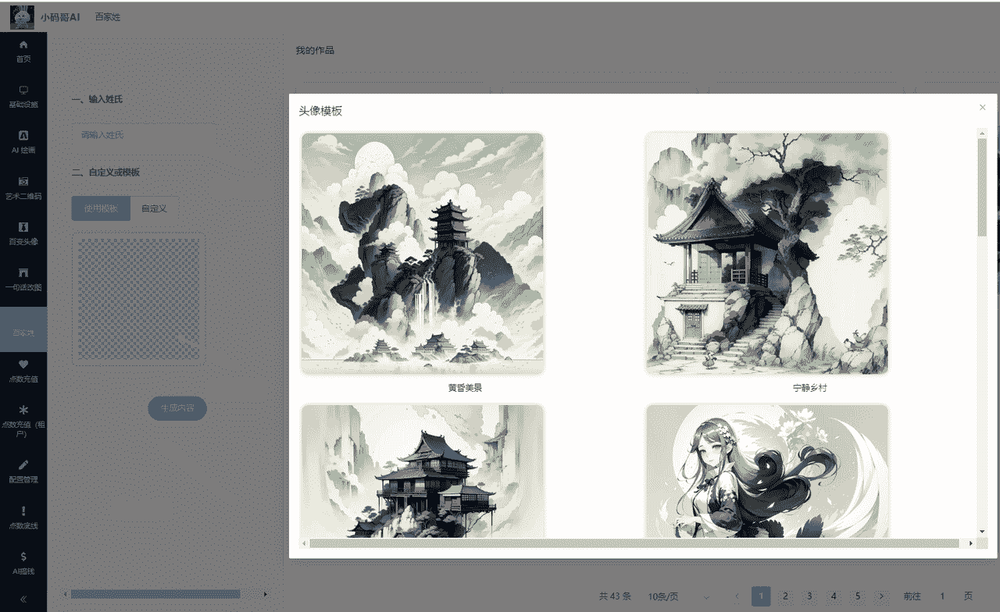
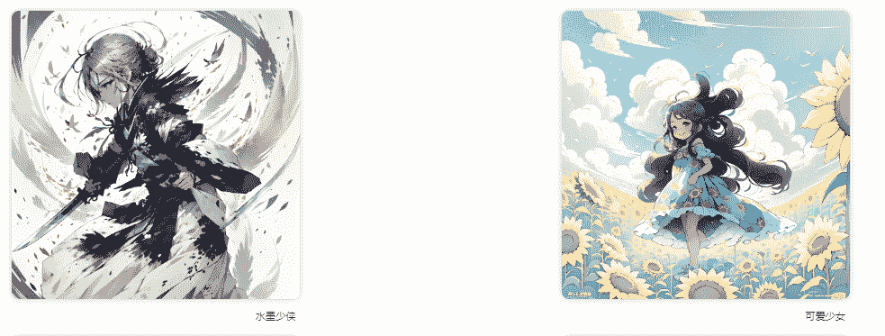
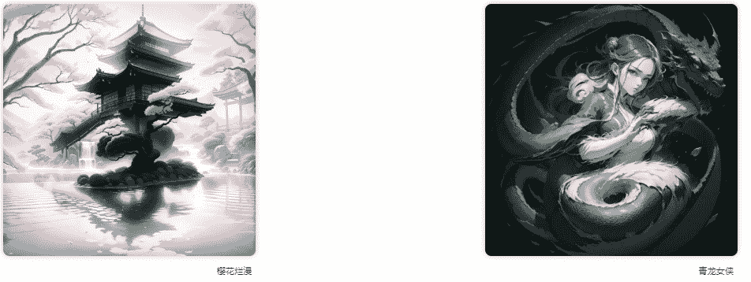
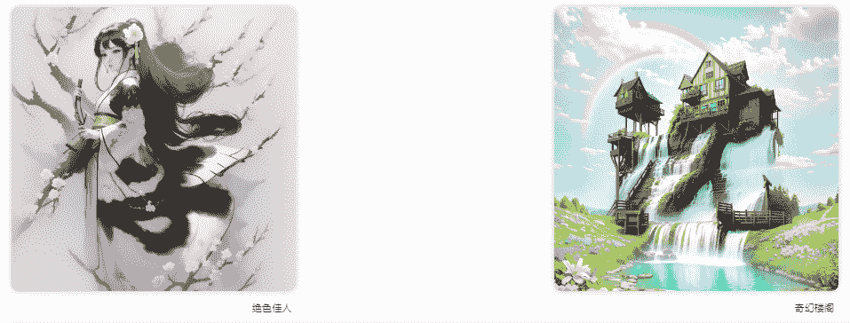
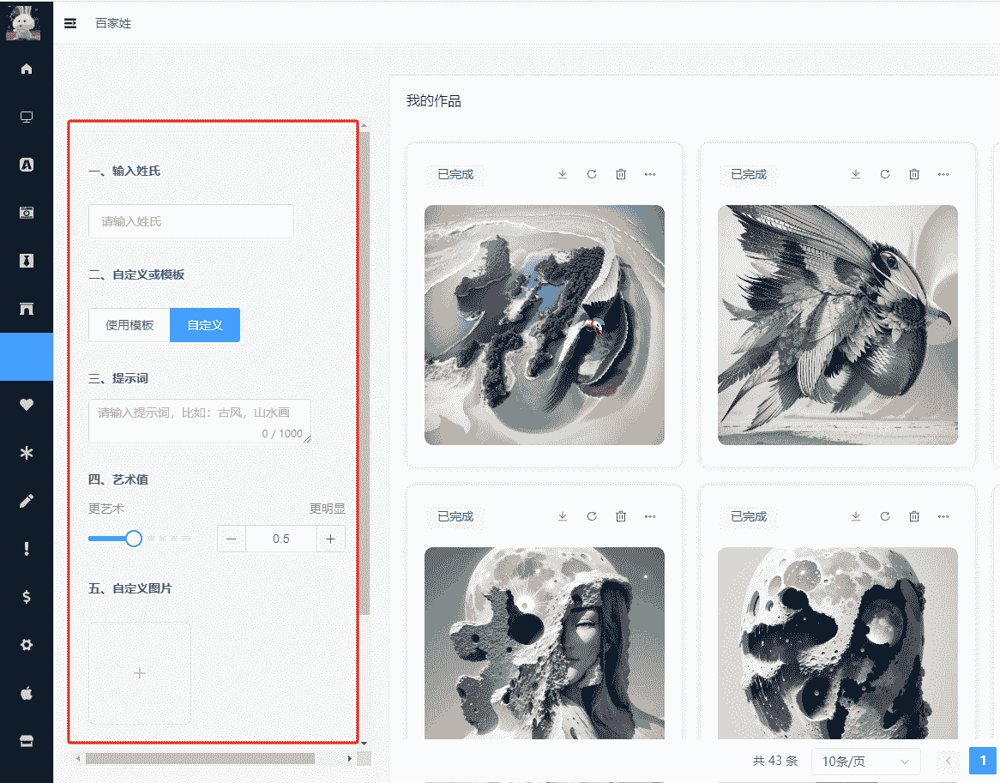

# 个性化设计百家姓

> 来源：[https://xmgtoagi.feishu.cn/docx/KKuEd2nMToFjrWxTebJcCIiHnng](https://xmgtoagi.feishu.cn/docx/KKuEd2nMToFjrWxTebJcCIiHnng)

最近开发了一款百家姓艺术字，目前是免费使用，可以用于某鱼进行定制，几元一张，也可以用于某音、某红书、某频号进行引流。废话不多说，直接看效果。体验地址：www.xmgai.cn

# 一、输出结果


# 二、生成教程

体验地址：www.xmgai.cn

## （1）方式一

直接使用模板，快速生成，如下操作流程，模板有十来种



模板有十来种









## （2）方式二

输入姓氏，提示词，提示词就是描述整幅画面的风格、内容，展示方式，比如简单的：古风、山水画，或者瀑布、阳光、草原等简单的提示词。最后是选择艺术值，值越小，输出的结果就越艺术，越大，字就越明显。



# 三、代码实现

```
String surnamesUrl = &quot;https://dashscope.aliyuncs.com/api/v1/services/aigc/wordart/surnames&quot;;
        Long userId = getLoginUserId();
        String aliApiKey = &quot;xxxxxx&quot;;

        HashMap headMap = new HashMap();
        HashMap dataMap = new HashMap();
        headMap.put(&quot;Content-Type&quot;,&quot;application/json&quot;);
        headMap.put(&quot;Authorization&quot;,&quot;Bearer &quot; + aliApiKey);
        headMap.put(&quot;X-DashScope-Async&quot;,&quot;enable&quot;);

        AliSurnamesReq requestBody = new AliSurnamesReq();

        AliSurnamesReq.Input input = new AliSurnamesReq.Input();
        AliSurnamesReq.Input.Text text = new AliSurnamesReq.Input.Text();
        AliSurnamesReq.Parameters parameters = new AliSurnamesReq.Parameters();

        String diy = alipParamSurnamesReq.getDiy();
        if(!diy.isEmpty() &amp;&amp; diy.equals(&quot;diy&quot;)){
            input.setStyle(&quot;diy&quot;);//当自定义时，必须传diy
            if(null != alipParamSurnamesReq.getFontName()){
                text.setFont_name(alipParamSurnamesReq.getFontName());
            }

            if(alipParamSurnamesReq.getTextStrength()&gt;=0.0){
                text.setText_strength(alipParamSurnamesReq.getTextStrength());
            }


            if(null != alipParamSurnamesReq.getImageUrl()){
                input.setRef_image_url(alipParamSurnamesReq.getImageUrl());
            }
            input.setPrompt(alipParamSurnamesReq.getPrompt());
        }else{
            input.setStyle(alipParamSurnamesReq.getStyle());
        }


        input.setSurname(alipParamSurnamesReq.getSurname());


        if(alipParamSurnamesReq.getNum() != null &amp;&amp; alipParamSurnamesReq.getNum()&gt;0){
            parameters.setN(alipParamSurnamesReq.getNum());
            requestBody.setParameters(parameters);

        }

        requestBody.setInput(input);
        requestBody.setModel(&quot;wordart-surnames&quot;);

        String jsonString = JSONObject.toJSONString(requestBody);

        // 现在requestBody对象已经封装了请求体数据
        System.out.println(jsonString);
        int timeout = 120000;
        //百家姓艺术字
        String res = HttpClientUtil.doPost(surnamesUrl,headMap,jsonString,timeout);
        JSONObject taskObj = JSON.parseObject(res);
        JSONObject task = (JSONObject)taskObj.get(&quot;output&quot;);
        String taskId = task.get(&quot;task_id&quot;).toString();
        log.info(&quot;百家姓ID为：&quot; + taskId);
```