# 搞了3个月决定开源了，AI搞钱项目源码

> 来源：[https://xmgtoagi.feishu.cn/docx/Exa6d7wfeo5hdKxyMiycZMConqb](https://xmgtoagi.feishu.cn/docx/Exa6d7wfeo5hdKxyMiycZMConqb)

# **AI 副业搞钱开源项目**

本开源 AI 副业搞钱项目集成了强大功能，包括 AI 艺术二维码生成、AI 换脸、Delle3 绘画等，同时具备个人收付款、手机登录、金额充值及消费记录查询等实用特性。个人可以充分利用 AI 技术实现变现与搞钱，搭建自己的 AI 副业项目，只有有人使用，就有收益实时到账你个人微信，实时真正的躺赢。

# **项目地址**

码云：https://gitee.com/GreenSoftware/xmgai-like/blob/master/README.md

github：https://github.com/xmgcode/xmgai-like

# **完全开源、免费**

# **完全开源、免费**

# **先来看看页面**

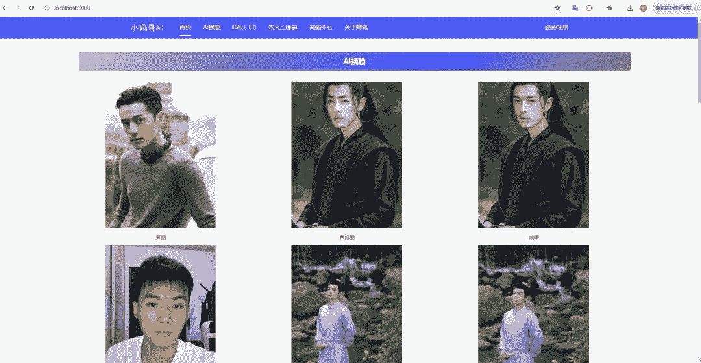

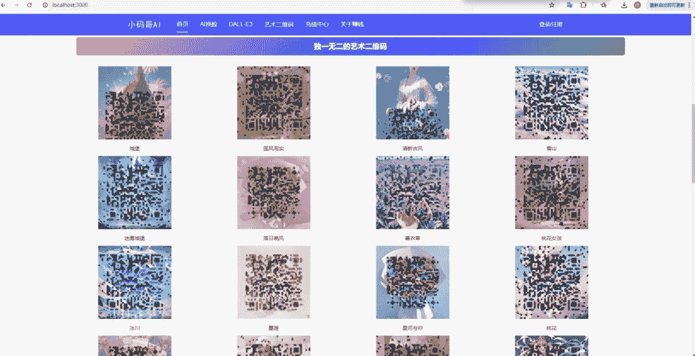

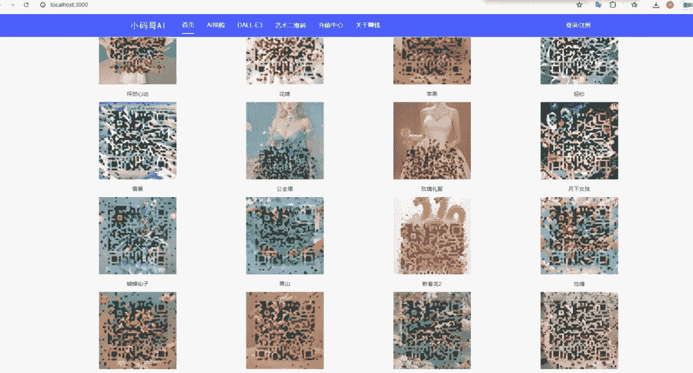

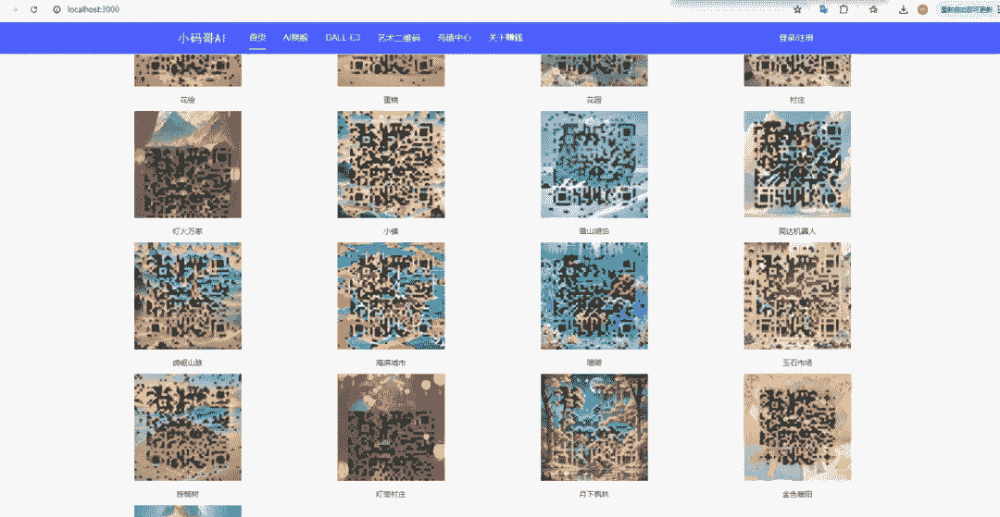

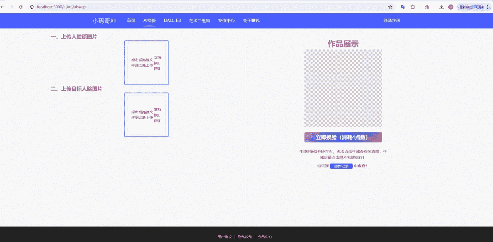

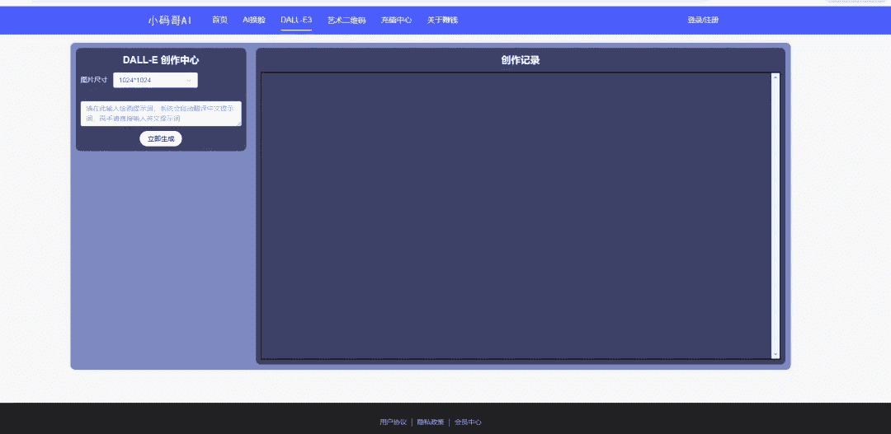

# **项目部署与运行指南**

## **一、服务端部署**

### **环境要求**

**服务端**：

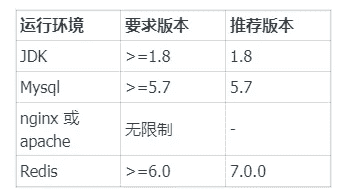

**前端**：

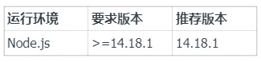

## **二、运行admin管理后台**

1.  通过IDEA导入后台代码server

+   📂admin //Vue管理后台前端源码

+   📂uniapp //小程序/H5的源码目录

+   📂sql //SQL文件所在目录

+   📂pc //Vue前端已编译代码目录（入口目录、上线运行）

+   📂h5 //H5的编译目录

+   📂server //java项目目录（编辑器、IDE打开此目录）

+   📂sql //项目数据库结构

+   📂like-admin //后台模块

+   📂like-common //公共模块

+   📂like-front //前台模块

+   **目录结构**：

### **Mysql数据库配置**

+   **步骤1**：启动并登录Mysql，创建编码为utf8mb4的数据库，导入项目中/sql/ai_xmg.sql文件。

+   **步骤2**：打开文件“/server/like-admin/src/main/resources/application-dev.yml”。

+   **步骤3**：找到datasource项，修改url项的地址为数据库ip地址，地址“/”后面为数据库名称，username项为数据库账号，password项为数据密码，然后保存。

### **Redis缓存配置**

+   **步骤1**：启动Redis。

+   **步骤2**：打开之前复制的文件“/server/like-admin/src/main/resources/application-dev.yml”。

+   **步骤2**：找到redis项，修改host项为Redis的地址，port项为redis的端口，有密码填写密码，无密码则留空，然后保存。

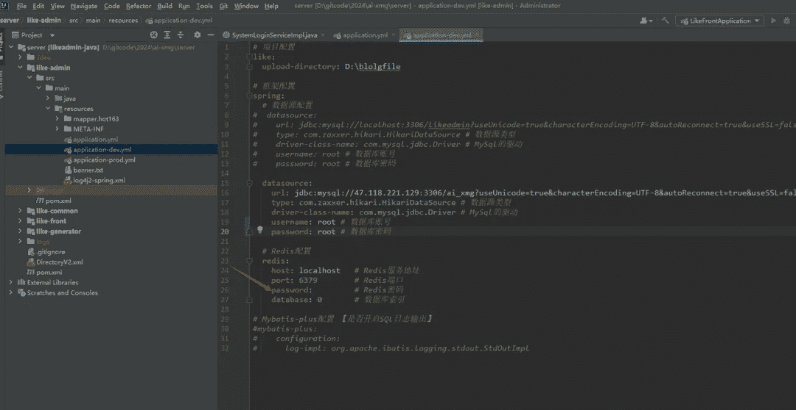

## **三、运行PC****端后台**

+   同理，修改like-front数据库和redis配置，如下图所示：

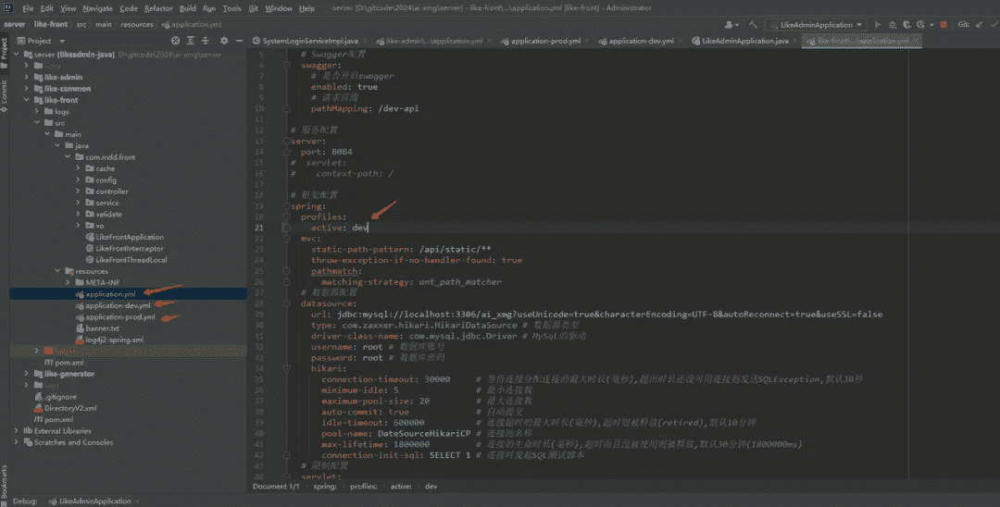

+   找到LikeFrontApplication，右键运行即可。

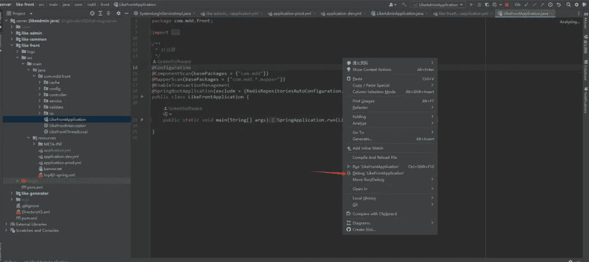

+   后台运行的接口为8084，启动成功如下：

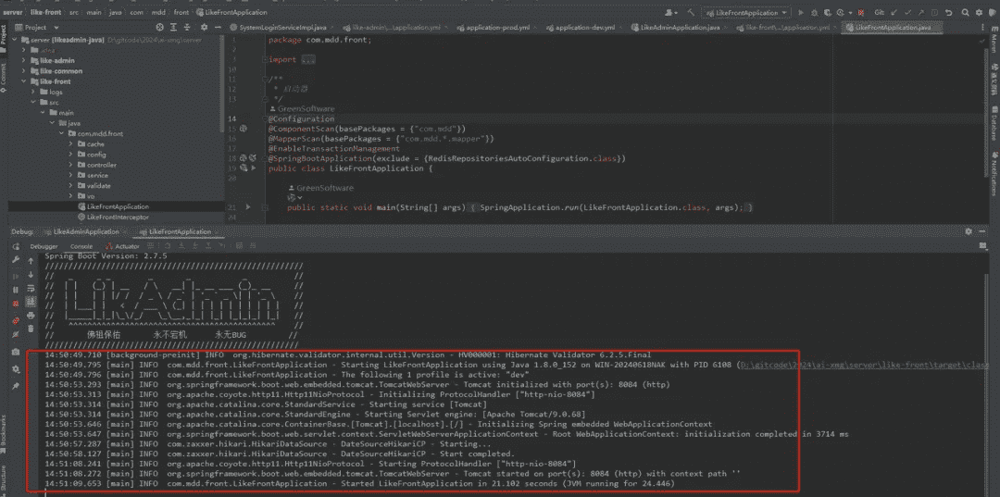

## **四、运行admin前端**

1.  用vscode打开admin前端项目，配置请求配置，如果附件配置为本地，需要配置nginx的代理地址，即http://localhost:8086/

1.  **运行步骤**：

+   **一、安装依赖包，执行命令**：npm install

+   **二、运行**：npm run dev

+   访问地址为：localhost:5173

+   后台登录密码为123456，如果密码错误，请在数据库中执行以下操作：

## **五、运行pc前端**

1.  同样，通过vscode打开pc端，配置后台请求地址localhost:8084

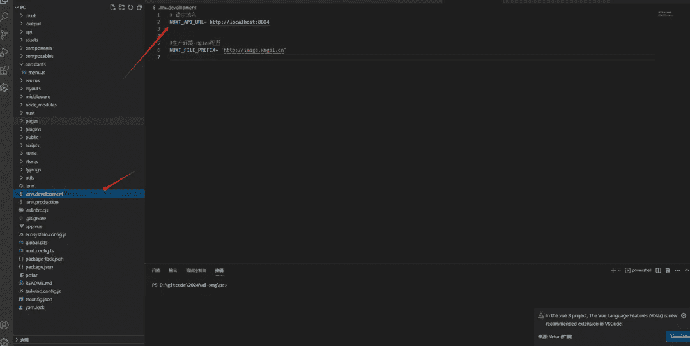

1.  首先npm install安装依赖，然后npm run dev即可运行项目。

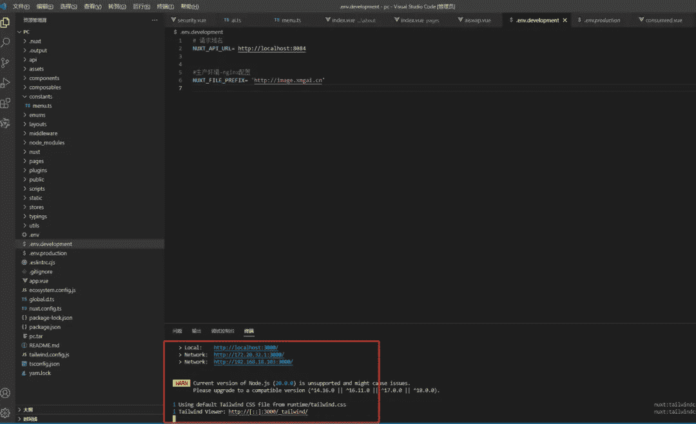

🎯 开**源版功能

**- 前端：

- AI 艺术二维码创作：√

- AI 创作记录（二维码、换脸）：√

- AI 换脸：√

- 点数查看：√

- 充值记录：√

- 消费记录：√

- 手机号登录：√

- 账号登录：√

- 微信登录：√

- 密码找回：√

- 密码修改：√

- 微信绑定：√

- 充值中心（微信充值）：√

- 点数查看：√

- 充值记录：√

- 消费记录：√

- 后台管理：

- 访问量、订单量、新增用户：√

- 模型管理：√

- 用户二维码列表：√

- 用户点数列表：√

- 点数充值记录：√

- 点数使用记录：√

- 消费记录：√

- 订单列表：√

- 用户列表：√

- 部门管理：√

- 岗位管理：√

- 管理员管理：√

- 角色管理：√

- 菜单管理：√

- 素材中心：√

- 网站信息：√

- 网站备案：√

- 政策协议：√

- 默认头像：√

- 注册登录选择：√

- 存储位置：√

- 系统环境：√

- 系统缓存：√

- 系统日志：√

- 登录日志：√

- 定时任务：√

- AI 配置：√

- 字典管理：√

- 代码生成器：√

- 通知设置：√

- 短信设置：√

# **社区版**

技术springboot+vue3框架，功能更丰富、体验更佳、相应更快，支持多租户，灵活的后台配置。

# 开源不易，你的star是我更新的动力！！！

# 开源不易，你的star是我更新的动力！！！

# 开源不易，你的star是我更新的动力！！！

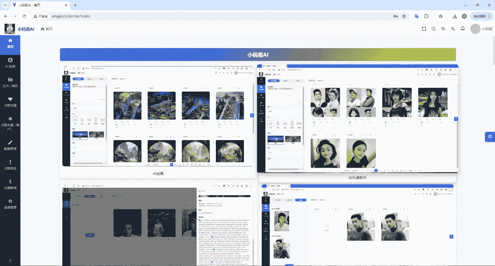

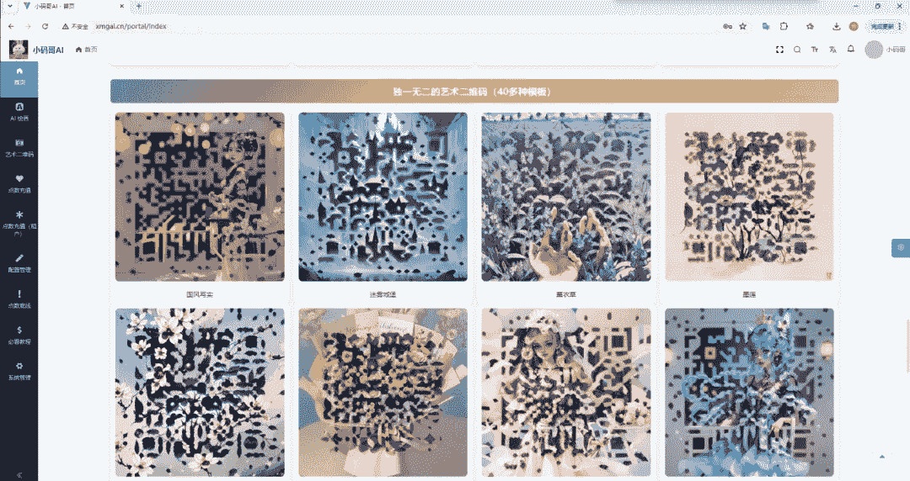

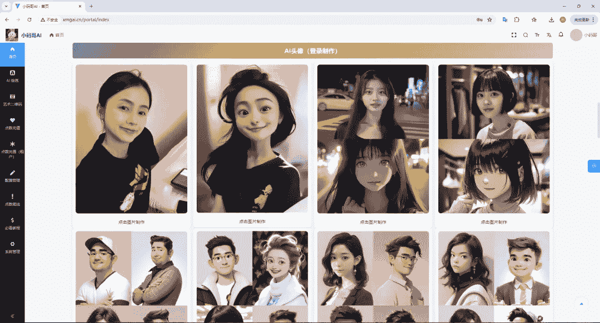

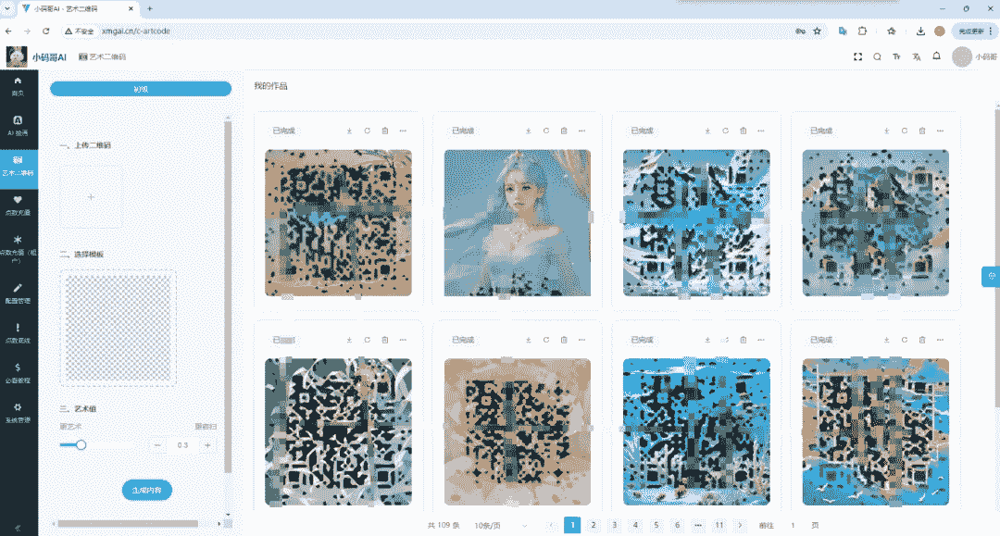

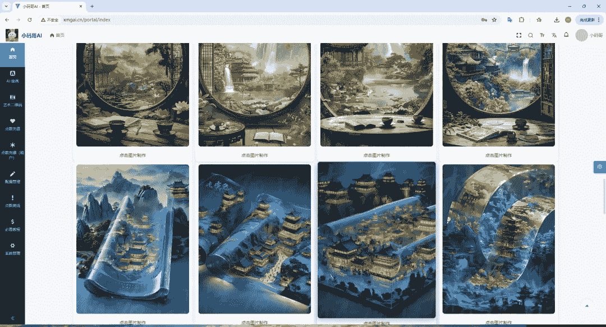

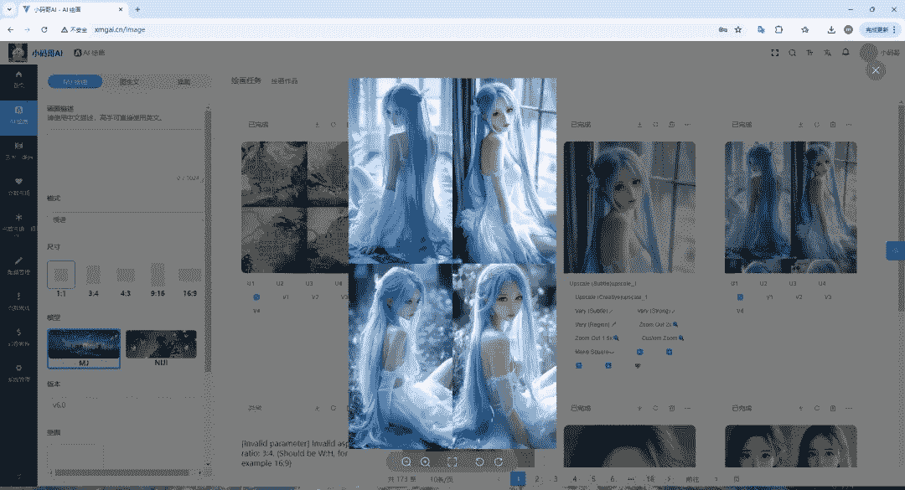

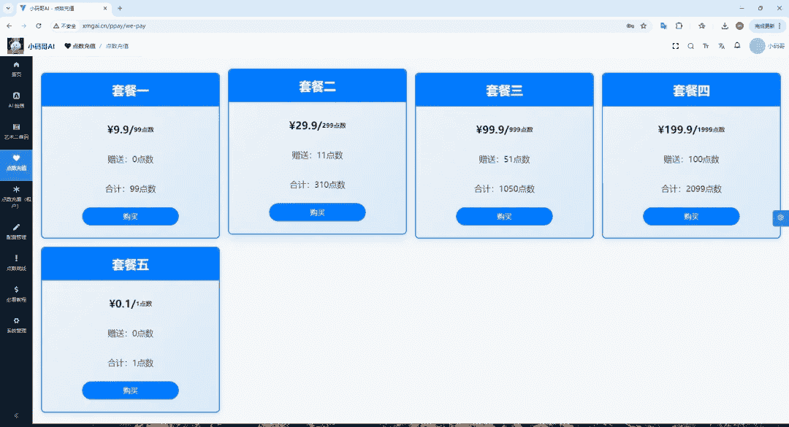

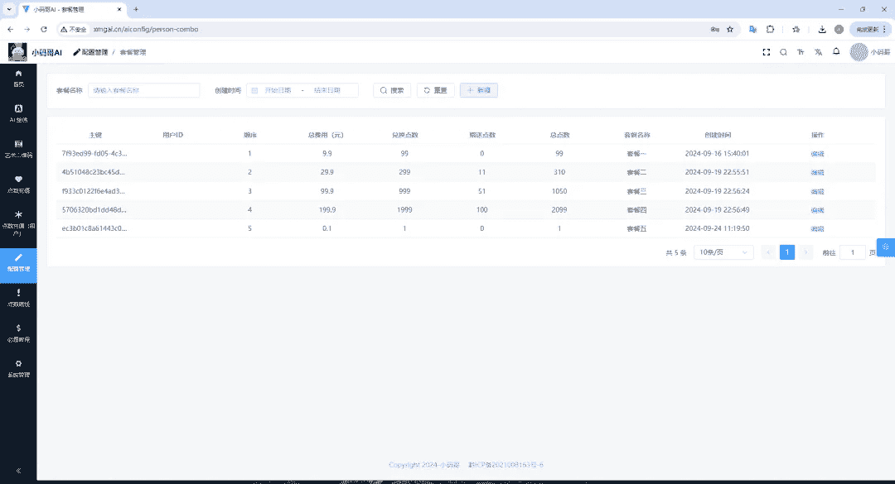

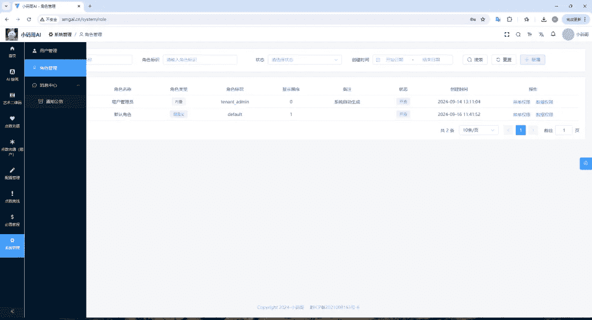

### **社区版功能列表**

功能列表：https://xmgtoagi.feishu.cn/wiki/FNcgwRywfitcO8kVzclchkRanJb?fromScene=spaceOverview

# **更多项目文档**

开源版项目文档：https://xmgtoagi.feishu.cn/wiki/ADjmwTrowic0ojkVl5ScFdfgnUc?fromScene=spaceOverview

# **免费AI知识库**

免费AI知识库：(https://xmgtoagi.feishu.cn/wiki/S9BwwRcXciCz8BkA4uoc67UBnBf?fromScene=spaceOverview

# 欢迎一起AI搞钱

