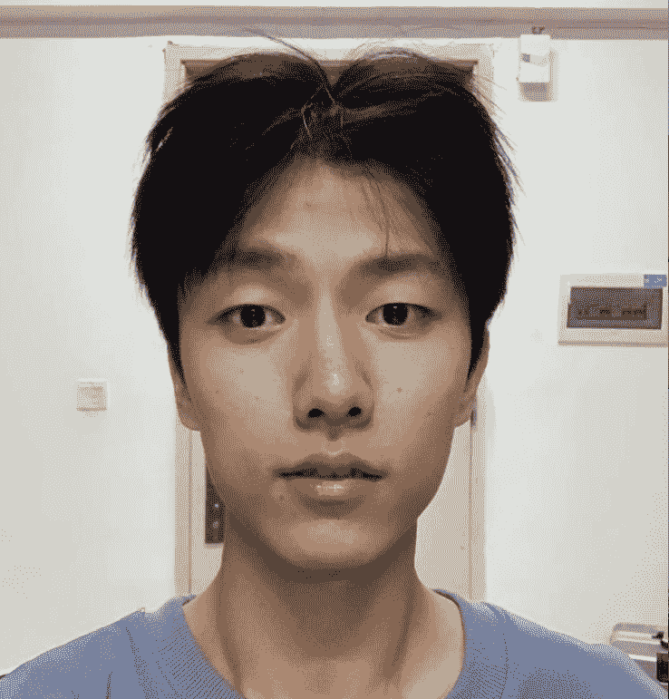
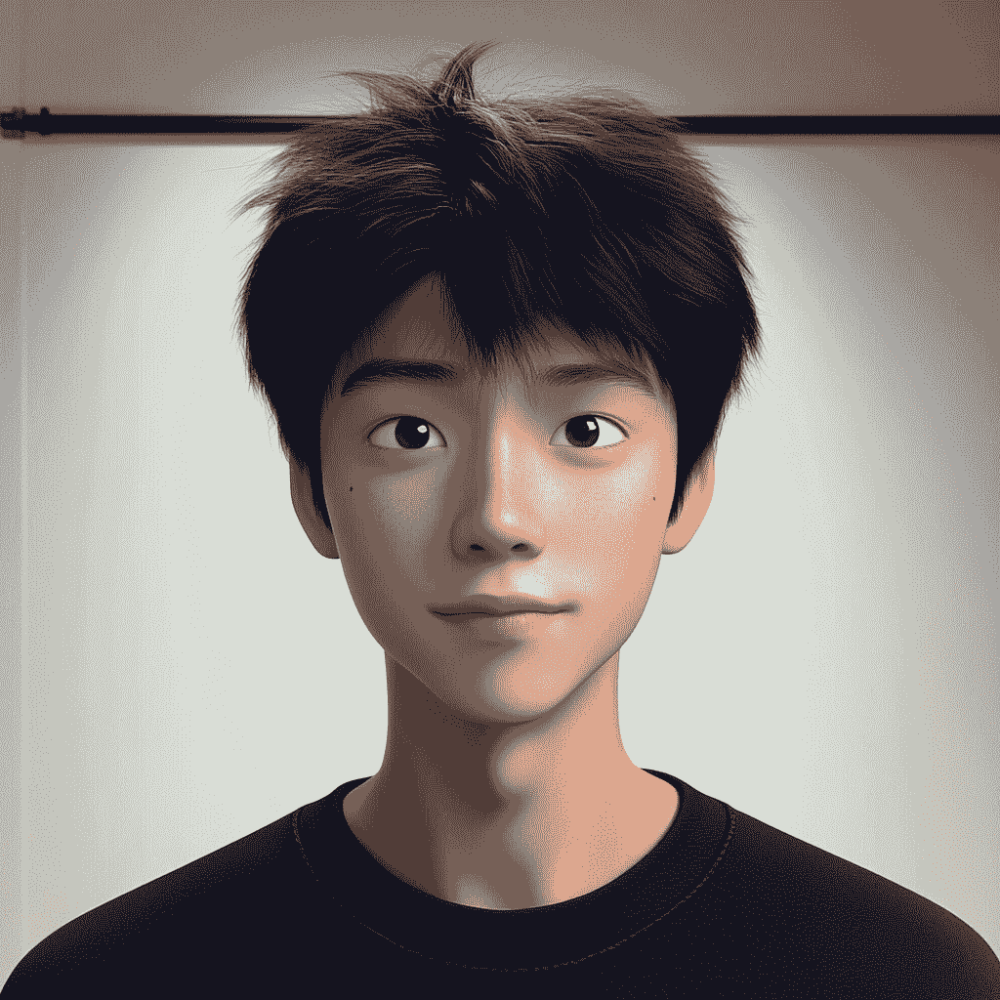
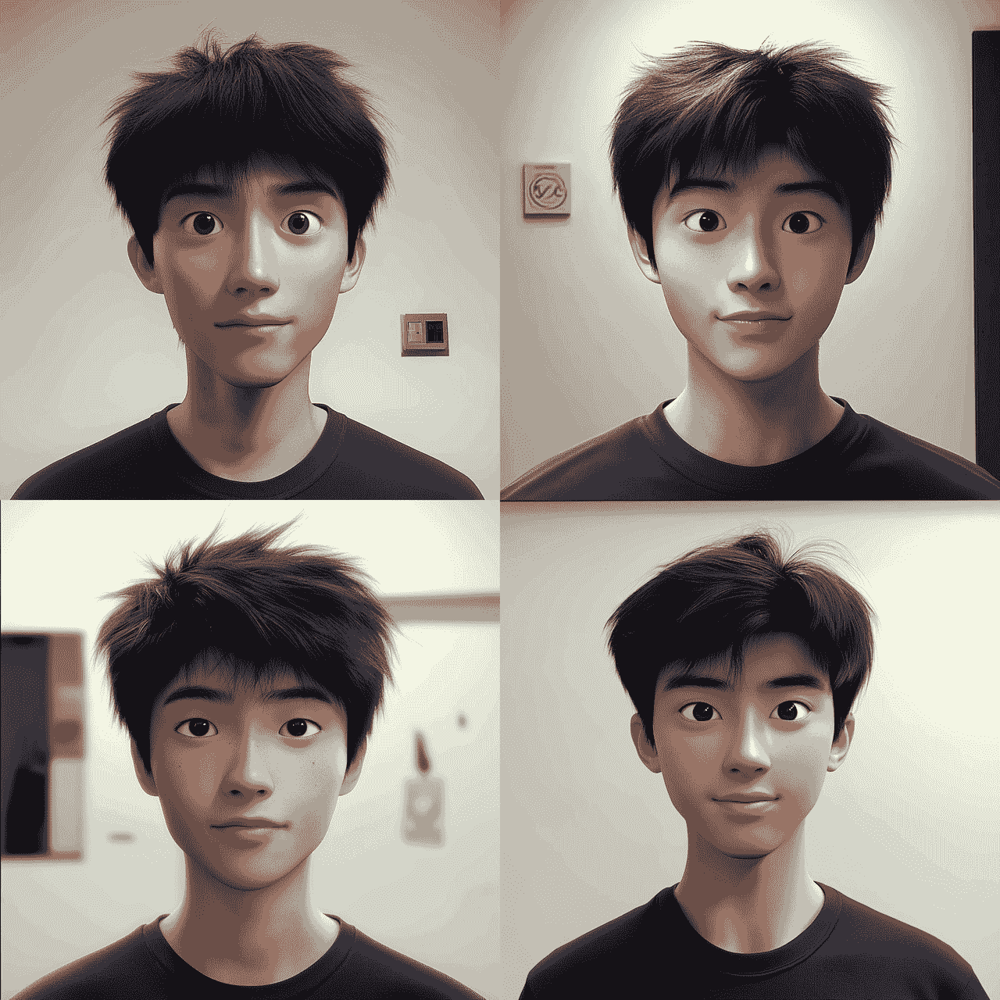
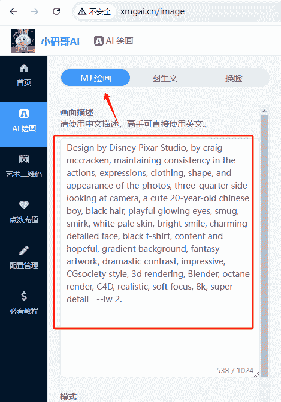
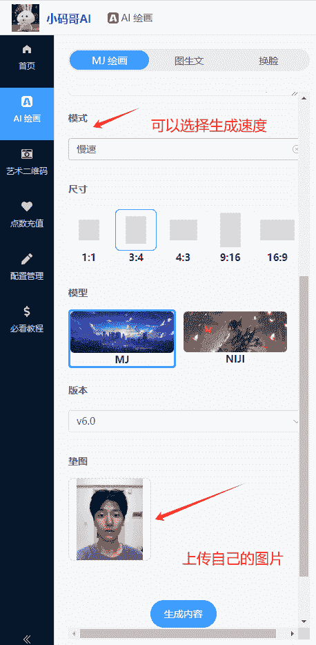
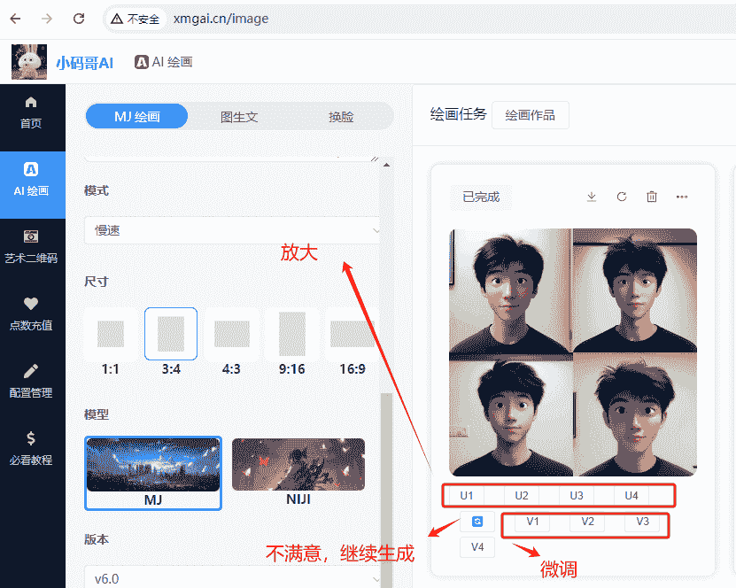
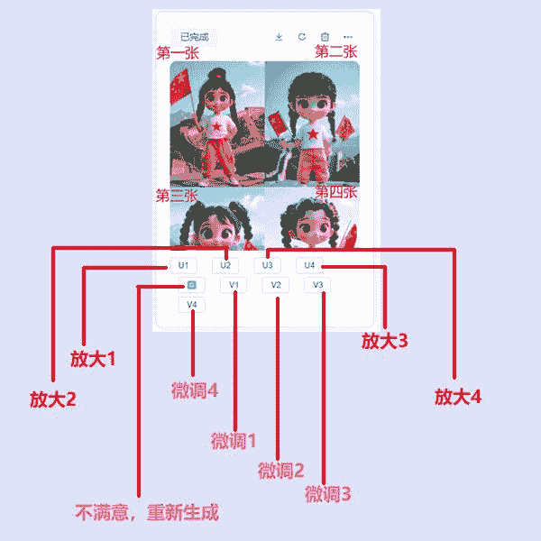

# AI头像——皮克斯风格

> 来源：[https://xmgtoagi.feishu.cn/docx/Hdiadwht3oEe1DxiwOZcvrVJnEh](https://xmgtoagi.feishu.cn/docx/Hdiadwht3oEe1DxiwOZcvrVJnEh)

# 先看看看效果

# 第一步

**登录****www.xmgai.cn****，输入关键词：**

关键词：Design by Disney Pixar Studio, by craig mccracken, maintaining consistency in the actions, expressions, clothing, shape, and appearance of the photos, three-quarter side looking at camera, a cute 20-year-old chinese boy, black hair, playful glowing eyes, smug, smirk, white pale skin, bright smile, charming detailed face,  content and hopeful, gradient background, fantasy artwork, dramastic contrast, impressive, CGsociety style, 3d rendering, Blender, octane render, C4D, realistic, soft focus, 8k, super detail   --iw 2.

中文翻译：由迪士尼皮克斯工作室设计，由克雷格·麦卡肯设计，照片的动作、表情、服装、形状和外观保持一致，四分之三侧面看镜头，一个可爱的20岁中国男孩，黑发，俏皮发光的眼睛，自鸣得意，傻笑，苍白的皮肤，灿烂的笑容，迷人的细节脸，内容和希望，渐变背景，幻想艺术品，戏剧性的对比，令人印象深刻，CGsociety风格，3d渲染，Blender，辛烷值渲染，C4D，写实，柔焦，8k，超级细节——iw 2。

# 第二步

上传自己的图片，点击“生成内容”，等待出图。

# 第三步

选择一张自己满意的进行放大即可，不满意可点击继续生图。

# 操作说明：

