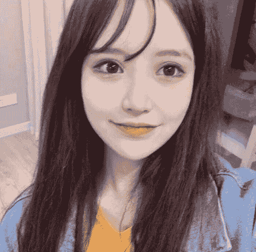
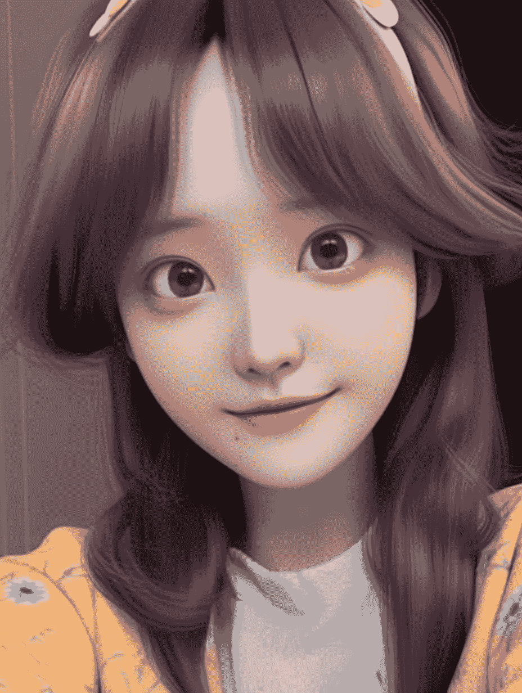
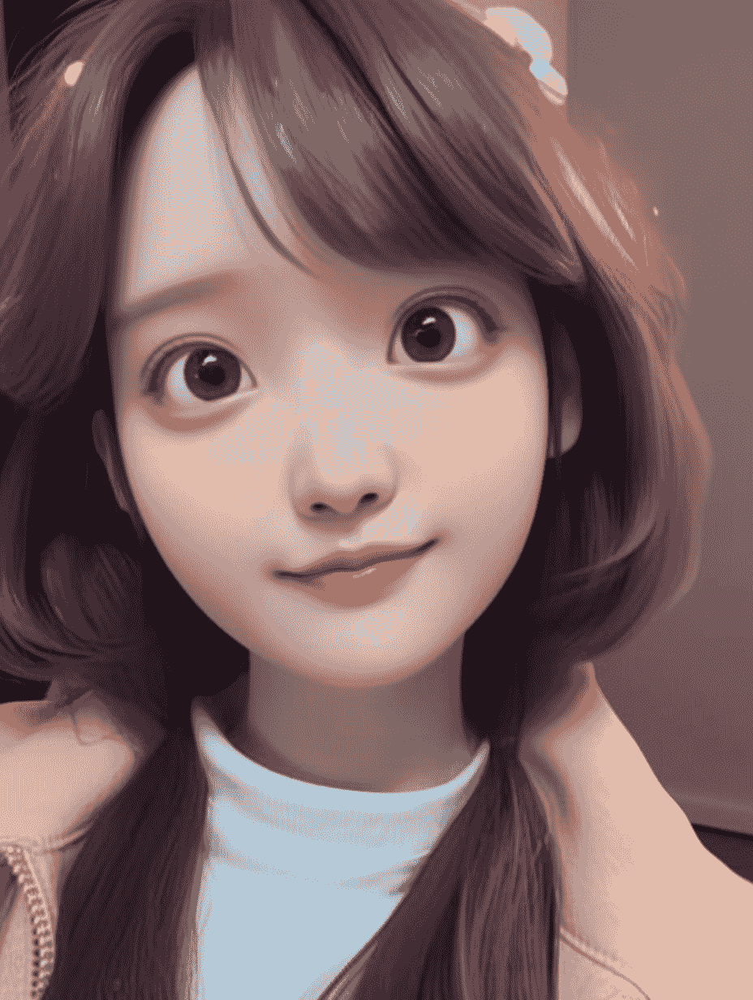
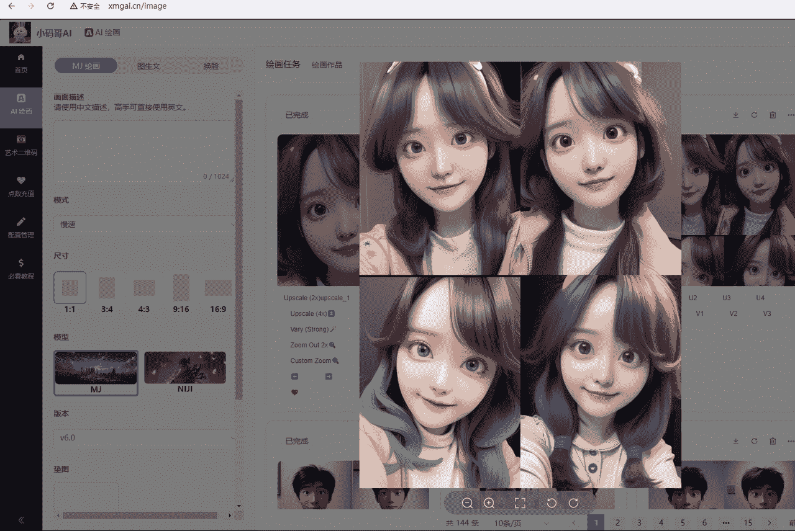
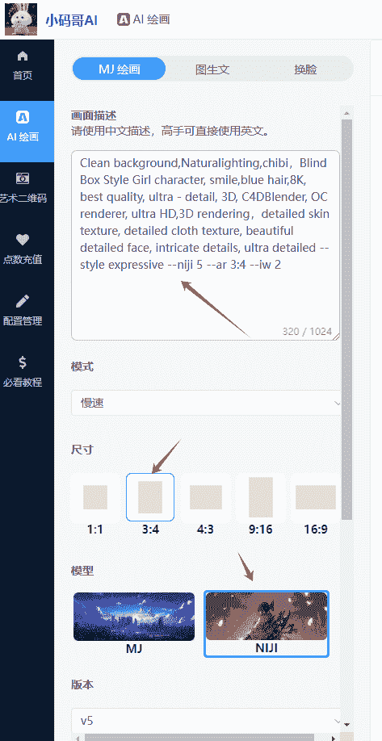
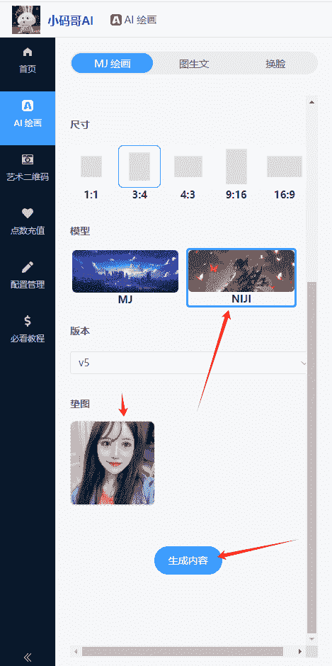
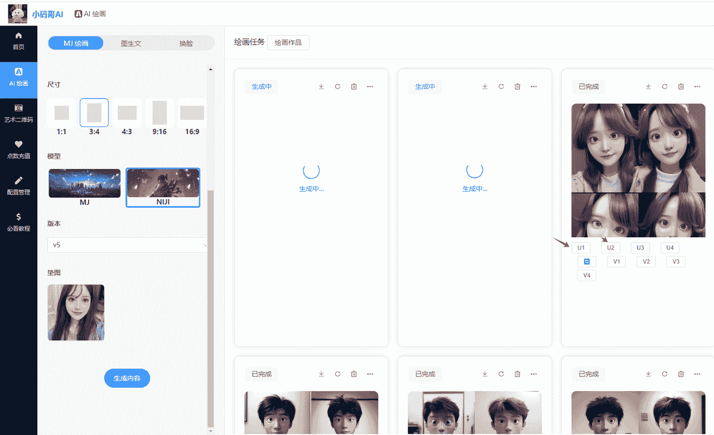
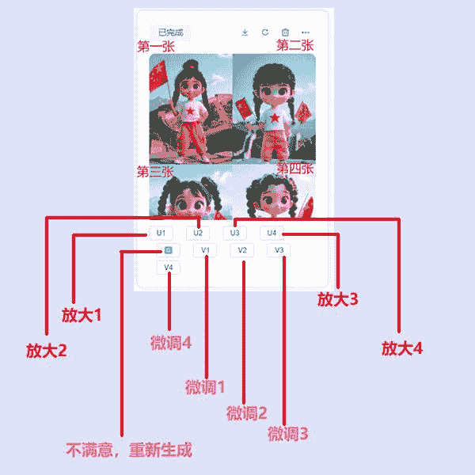

# AI头像——NIJI风格

> 来源：[https://xmgtoagi.feishu.cn/docx/F603dXUxJotaK0xT0m9ckqoDnAE](https://xmgtoagi.feishu.cn/docx/F603dXUxJotaK0xT0m9ckqoDnAE)

# 先看看看效果

这是原图

这是生成的图

# 第一步

登录www.xmgai.cn，输入关键词：

关键词：Clean background,Naturalighting,chibi，Blind Box Style Girl character, smile,blue hair,8K, best quality, ultra - detail, 3D, C4DBlender, OC renderer, ultra HD,3D rendering，detailed skin texture, detailed cloth texture, beautiful detailed face, intricate details, ultra detailed --style expressive --niji 5 --ar 3:4 --iw 2

中文翻译：干净的背景、自然光、赤壁、盲盒风格的女孩角色、微笑、蓝色头发、8K、最佳品质、超细节、3D、C4DBlender、OC渲染器、超高清、3D渲染、详细的皮肤纹理、详细的布料纹理、美丽的细节脸、复杂的细节、超细节——风格表现力

如果是男孩，注意将Girl改成Boy

# 第二步

上传自己的图片，点击“生成内容”，等待出图。

# 第三步

选择一张自己满意的进行放大即可，不满意可点击继续生图。

# 操作说明：

