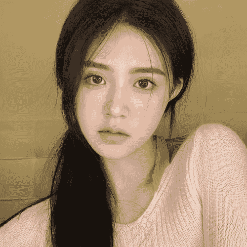
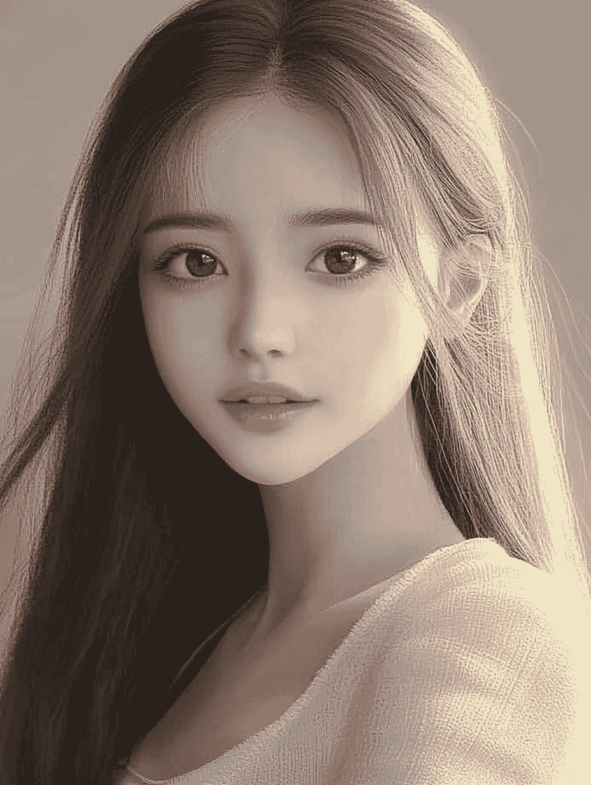
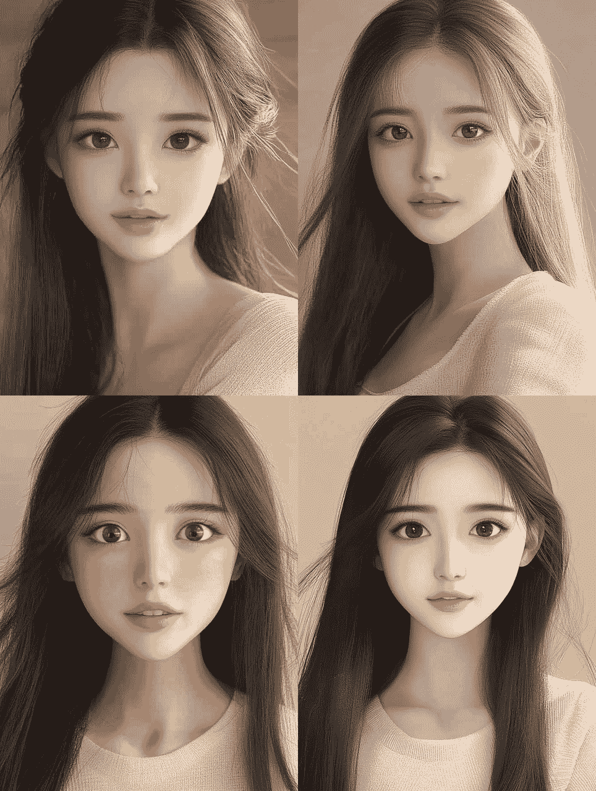
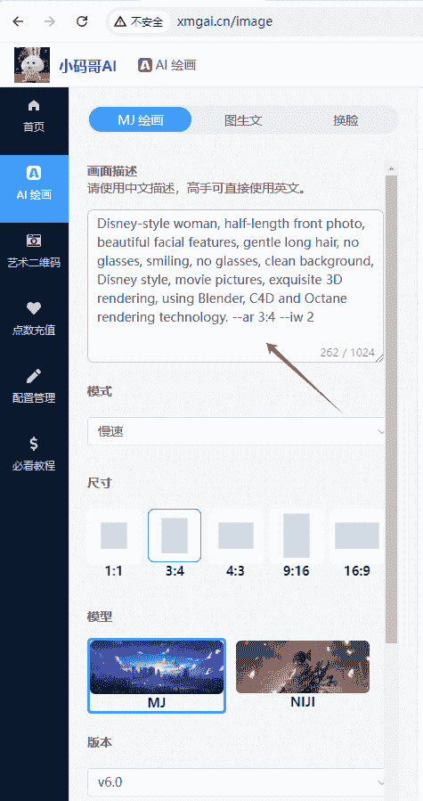
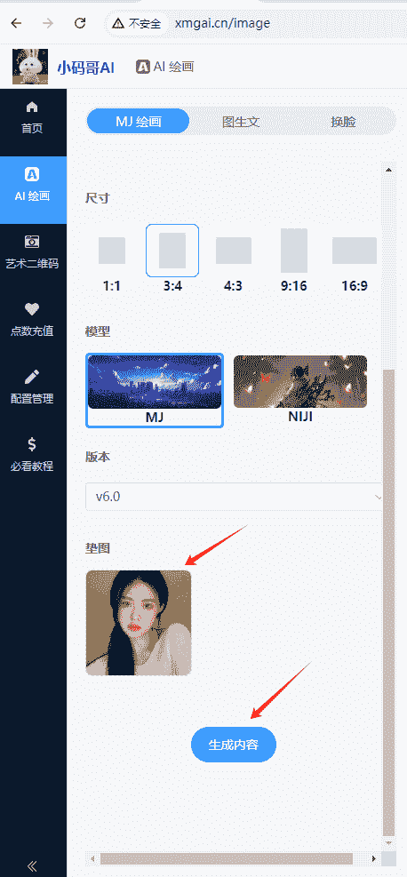
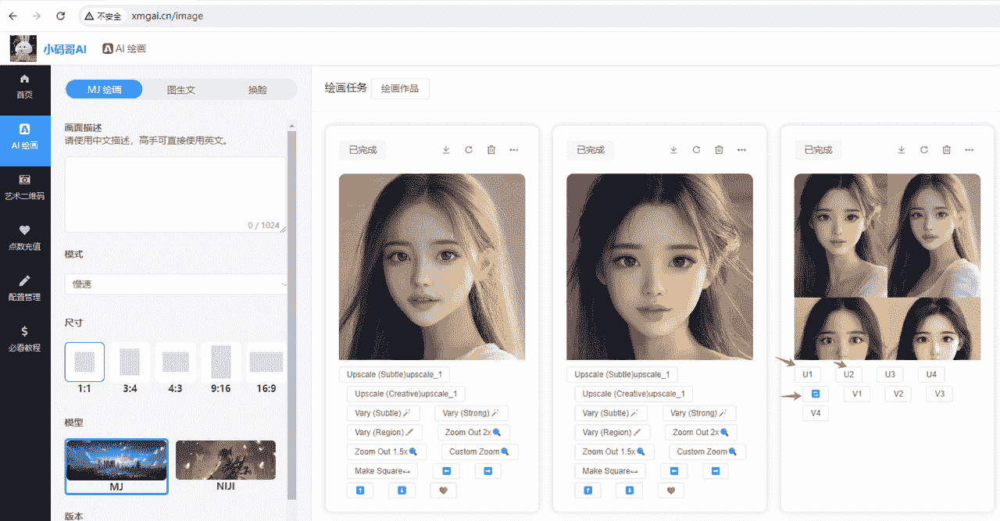

# AI头像制作-迪尼斯风格

> 来源：[https://xmgtoagi.feishu.cn/docx/UcNqdGSnno7fiFxpyG4cs4IEn3d](https://xmgtoagi.feishu.cn/docx/UcNqdGSnno7fiFxpyG4cs4IEn3d)

先来看看效果

# 原图

# 效果图

关键词：Disney-style woman, half-length front photo, beautiful facial features, gentle long hair, no glasses, smiling, no glasses, clean background, Disney style, movie pictures, exquisite 3D rendering, using Blender, C4D and Octane rendering technology --iw 2.0

翻译：迪士尼风格的女人，半身正面照片，美丽的面部特征，温柔的长发，不戴眼镜，微笑，不戴眼睛，干净的背景，迪士尼风格，电影图片，精致的3D渲染，使用Blender、C4D和Octane渲染技术

