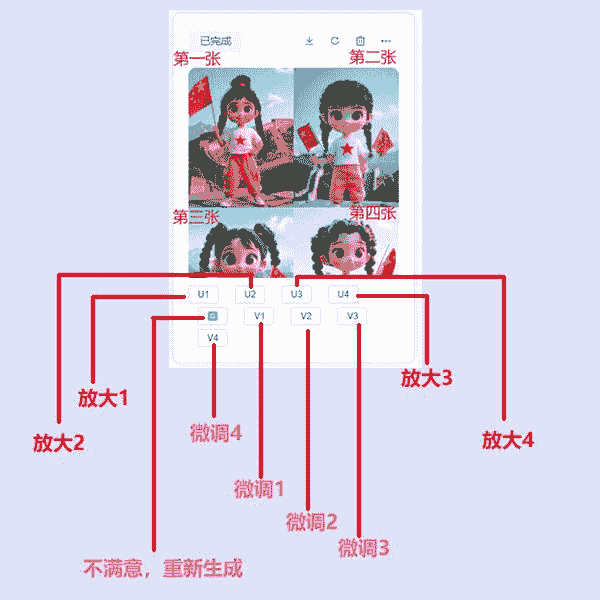
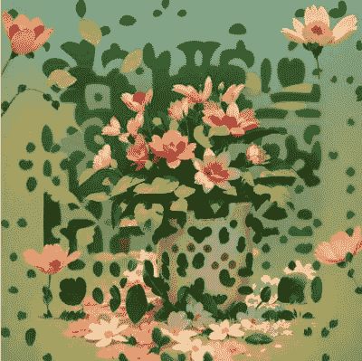

# 头像制作合集

> 来源：[https://xmgtoagi.feishu.cn/docx/WWdtdXIjZoBlMSxFJ8uc5u1enUb](https://xmgtoagi.feishu.cn/docx/WWdtdXIjZoBlMSxFJ8uc5u1enUb)

# 操作说明

# 一、皮克斯风格

[AI头像——皮克斯风格](https://xmgtoagi.feishu.cn/wiki/TmNGwhAtni74ktk2y6JcjaBNnue)

# 二、niji风格

[AI头像——NIJI风格](https://xmgtoagi.feishu.cn/wiki/EURewXPzniBwyPkBB8jcJDDBn8f)

# 三、3D类型

# 四、迪士尼风格

