# 小码哥AI平台开源版

> 来源：[https://xmgtoagi.feishu.cn/docx/PdtgdG298o5jp7xJ4k6cYEYVnse](https://xmgtoagi.feishu.cn/docx/PdtgdG298o5jp7xJ4k6cYEYVnse)

# 一、前言

作为一名年过三十的程序员，我深刻体会到了职场的残酷和不确定性。在这个技术日新月异的时代，我们不仅要在专业领域深耕细作，更要敏锐地捕捉互联网的风口，以确保自己不被时代淘汰。程序员的黄金年龄似乎被限定在35岁之前，但我认为，只要我们能够坚持做自己擅长的事情，并不断学习新技能，特别是处在AI时代，想赚互联网的钱，就必须要来了解他、熟悉他、利用他，互联网搞钱 = 执行力 + 互联网风口，很多人输在了执行了，在做与不做之间徘徊，看准时机，干就完了！

回到正题，为什么搭建小码哥AI平台，其目的和大家一样，就是”搞钱“，而且必须要用上AI技术，跟上互联网的风口，雷军说得好：“站在风口上，猪都能飞起来”。


居然要搞钱，那能不能大家一起搞，有的人说，大家一起搞，市场就小了，其实这句话格局小了，客观来说，且不说中国这么多网民，每个人的圈子、能量场都是不一样的，用户也不一样，你不做，别人也会做，你不做永久都没有市场，永远都拿不到第一桶金。成功 = 好想法 + 执行力 + 机会。

因此，需要的人都可以搭建小码哥AI，拥有自己的AI平台

# AI搞钱

为什么说AI能搞到钱，我们先搞一波初步的市场调研，我在某宝、某鱼、某红书随便搜索了一下，都是基于AI的小项目，但量也不小啊，直接变现的方式。


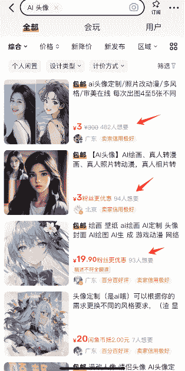

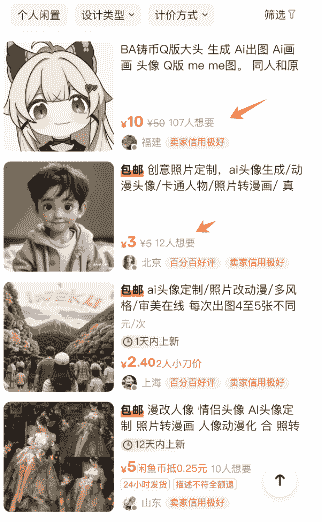

这是通过AI绘画引流，同时很具有视觉冲击效果，应流效果相当不错了，可以私域直接成交或其他方式变现。


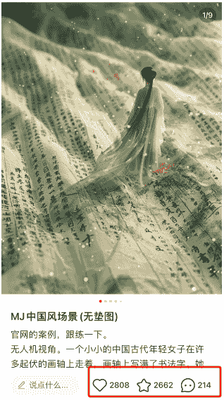

这是我直接实战情况，只是基于艺术二维码，AI头像、AI绘画等方式还没开始弄呢，后续将随平台研发，逐步更新副业项目实战教程。

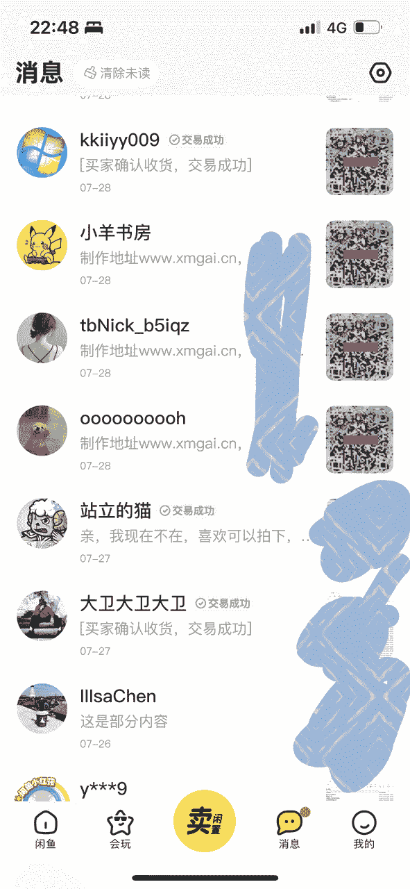


这是我的引流情况

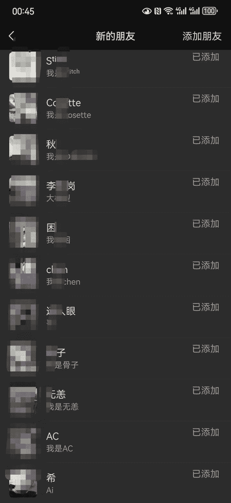

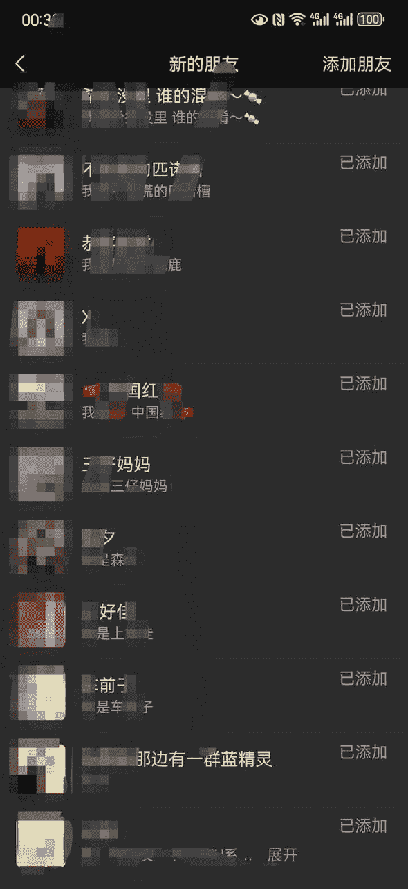

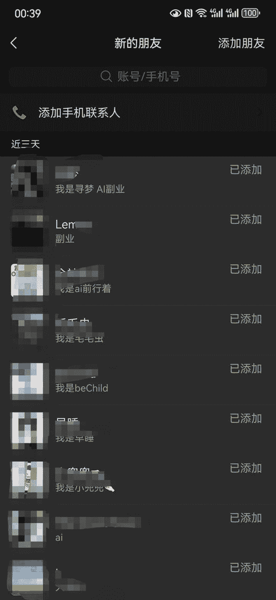

变现的教程我放到了AI副业破局，感兴趣的去看看

[AI副业破局](https://xmgtoagi.feishu.cn/wiki/X9HTwX6RxiAJyEkmTDfcfE1onHe)

# 平台功能

搞一个自己的AI平台，服务于以上副业搞钱的人群，开通在线收款，真正实现躺赚。

**懂技术的更好，小码哥框架前后端**分离，采用主流的springboot+vue3实现，可用来学习+搞钱。

不懂技术没关系，小码哥将提供**免费部署+免费运维，**帮你实现睡后收入。

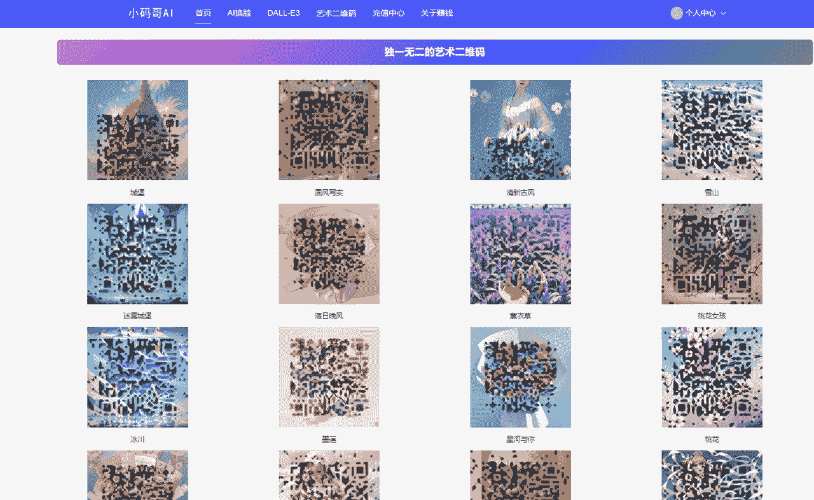

# 一、艺术二维码

什么是艺术二维码呢，为什么会有这个项目呢？艺术二维码是一种通过AI技术将普通的二维码转化为具有艺术美感和创意性图案的技术。这种技术不仅提升了二维码的美观度，还增加了用户的扫码体验和粘性。比如以下这些


### 1、艺术二维码的特点

**美观与实用性的结合**：艺术二维码不仅美观大方，还具有很强的实用性。它们可以作为信息展示的方式，同时保持二维码的基本功能。

**个性化和创意性**：通过AI技术，可以将二维码与艺术品或自然风景进行融合，生成具有独特美感的图案。

**多样化的应用场景**：艺术二维码可以应用于个人名片、网站链接、收款码、广告宣传等多种场景。

### 2、艺术二维码的应用

艺术二维码作为一种创新的营销工具，能够以独特的视觉吸引力和创意性，帮助各大平台在激烈的市场竞争中脱颖而出，实现有效的用户引流和品牌推广。

**社交媒体引流**：在社交媒体平台上，艺术二维码可以作为一种新颖的互动方式，吸引用户扫描并关注品牌或个人账号，从而增加粉丝量和提高用户参与度。

**内容营销**：通过艺术二维码链接到特定的博客文章、视频或播客，可以为内容创作者带来更多的流量和曝光机会。

**电子商务**：电商平台可以利用艺术二维码展示产品详情、促销活动或优惠券，吸引用户扫码后直接跳转到购买页面，提高转化率。

**品牌宣传**：艺术二维码可以作为品牌宣传的一部分，通过独特的设计和创意，加深用户对品牌的印象，提升品牌形象。

**个性化推荐**：根据用户的兴趣和行为，推送个性化的艺术二维码，引导用户访问特定的内容或服务，提高用户满意度和忠诚度。


# 二、AI换脸

AI变得越来越有趣，那通过AI换脸，如何获取变现呢，主要有以下有以下几种方式

**生日或纪念日惊喜**：为客户的朋友或家人制作特别的生日或纪念日视频，将他们的脸替换到特定的场景中，作为惊喜礼物。

**搞笑或创意内容**：制作有趣的换脸视频或图片，发布在社交媒体上，吸引粉丝和流量，通过广告、赞助或粉丝打赏等方式变现。

**品牌合作**：与品牌合作，制作带有品牌元素的换脸内容，进行品牌推广。

**虚拟试穿**：为服装或配饰品牌提供虚拟试穿服务，让消费者看到自己穿着特定服装的样子。

**肖像修复**：使用AI换脸技术修复或更新老旧照片中的人物肖像，为客户提供修复服务。


# 三、DALLE3绘画

DALL-E 3 是由OpenAI开发的一种先进的文本到图像生成模型，它可以根据用户的文本描述创造出逼真的图像和艺术作品。DALL-E 3 是继DALL-E和DALL-E 2之后的最新版本，它在图像质量、细节处理和创意表达上都有显著的提升。

**变现路径：**

**个性化艺术品**：为客户定制个性化的艺术作品，如家庭肖像、宠物画像、风景画等。

**商业插图**：为企业和品牌制作商业插图，用于广告、产品包装、网站设计等。

**数字艺术销售**：创作独特的数字艺术作品，通过在线平台进行销售，如NFT市场。

**版权授权**：将生成的图像授权给其他创作者或企业使用，获取版权费用。

**社交媒体内容**：利用DALL-E 3 生成的图像吸引社交媒体上的关注，通过广告、赞助和品牌合作变现。

**博客和文章配图**：为博客、新闻网站等提供高质量的配图，增加内容的吸引力和阅读量。

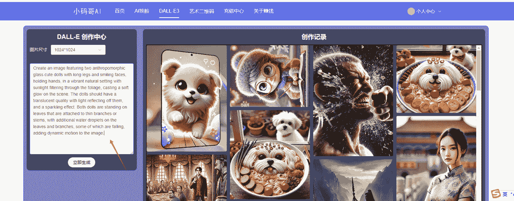

## 提示词

拿到即用

提示词1：一直头戴王冠呆有着漂亮鱼尾巴的可爱白色猫咪，猫咪有着像美人鱼一样的白色尾巴，尾巴如宝石一样闪闪发光，呆萌可爱，超详细，画面温暖干净，情感饱满，唯美，立体光线，高分辨率，8k， --q 5 --v 6 --ar 9:16


提示词2：Crystal lighting effect colorful small stome made of The lighting is combined with the human-shaped bunchy layer of fretsaw , and the shape of a kind and tender scene of a man who accidentally brings an umbrella to a girl who is sitting sadly in the rain is intricately created with the thin lines of light.background the gloosy black wall.


提示词3：Create an image featuring two anthropomorphic glass cute dolls with long legs and smiling faces, holding hands, in a vibrant natural setting with sunlight filtering through the foliage, casting a soft glow on the scene. The dolls should have a translucent quality with light reflecting off them, and a sparkling effect. Both dolls are standing on leaves that are attached to thin branches or stems, with additional water droplets on the leaves and branches, some of which are falling, adding dynamic motion to the image.


## 平台AI功能

| **功能名称** | **开发状态** | 备注 |
| --- | --- | --- |
| AI艺术二维码 | 已开发 | 见：http://xmgai.cn/artcode |
| AI换脸 | 已开发 | 见：http://xmgai.cn/ai/mj/aiswap |
| Dalle3绘画 | 已开发 | 见：http://xmgai.cn/ai/gpt/dalle |

| ### **前端** |  |
| --- | --- |
| AI艺术二维码创作 | **√** |
| AI创作记录（二维码、换脸） | **√** |
| AI换脸 | **√** |
| 点数查看 | **√** |
| 充值记录 | **√** |
| 消费记录 | **√** |
| 手机号登录 | **√** |
| 账号登录 | **√** |
| 微信登录 | **√** |
| 密码找回 | **√** |
| 密码修改 | **√** |
| 微信绑定 | **√** |
| 充值中心（微信充值） | **√** |
| 点数查看 | **√** |
| 充值记录 | **√** |
| 消费记录 | **√** |
| ### **后台管理** |  |
| 访问量、订单量、新增用户 | **√** |
| 模型管理 | **√** |
| 用户二维码列表 | **√** |
| 用户点数列表 | **√** |
| 点数充值记录 | **√** |
| 点数使用记录 | **√** |
| 消费记录 | **√** |
| 订单列表 | **√** |
| 用户列表 | **√** |
| 部门管理 | **√** |
| 岗位管理 | **√** |
| 管理员管理 | **√** |
| 角色管理 | **√** |
| 菜单管理 | **√** |
| 素材中心 | **√** |
| 网站信息 | **√** |
| 网站备案 | **√** |
| 政策协议 | **√** |
| 默认头像 | **√** |
| 注册登录选择 | **√** |
| 存储位置 | **√** |
| 系统环境 | **√** |
| 系统缓存 | **√** |
| 系统日志 | **√** |
| 登录日志 | **√** |
| 定时任务 | **√** |
| AI配置 | **√** |
| 字典管理 | **√** |
| 代码生成器 | **√** |
| 通知设置 | **√** |
| 短信设置 | **√** |

## 1、前端

使用最流性的前后端分离方案typescript、vue3、vite开发，保持了代码的简洁、一致和规范。本项目中使用了eslint去检查代码规范，使用prettier去格式化代码。

```
├──📂 .vscode                          # vscode配置文件
├──📂 scripts                          # js脚本
├──📂 src                              # 源代码
│  ├──📂 api                           # 所有请求
│  ├──📂 assets                        # 字体，图片等静态资源
│  ├──📂 components                    # 全局公用组件
│  ├──📂 config                        # 配置相关
│  ├──📂 enums                         # 全局枚举
│  ├──📂 hooks                         # 全局hook
│  ├──📂 install                       # 插件安装及自定义指令组册
│  ├──📂 layout                        # 布局组件
│  ├──📂 router                        # 路由
│  ├──📂 stores                        # 全局状态管理
│  ├──📂 styles                        # 全局样式
│  ├──📂 utils                         # 全局公用方法
│  ├──📂 views                         # 所有页面
│  ├── App.vue                         # 入口页面
│  ├── main.ts                         # 入口文件 初始化，组册插件等
│  └── permission.ts                   # 路由拦截，权限管理
├──📂 typings                          # ts声明文件
├── .env.xxx                           # 环境变量配置
├── .eslintrc.cjs                      # eslint 配置项
├── package.json                       # package.json
├── postcss.config.js                  # postcss 配置项
├── tailwind.config.js                 # tailwindcss 配置项
├── tsconfig.json                      # ts 配置项
├── vite.config.ts                     # vite 配置项
```

### 编辑器自动校验

使用vscode进行开发，可以搭配vscode的一些插件，实现自动修改一些错误，同时项目中也自带了vscode的一些配置，在 .vscode/setting.json 文件中。 注意：要自动修复错误需要使用vscode打开admin文件夹才行

如果使用vscode格式化后还是出现很多eslint错误，有可能是格式化程序设置有误，只需要设置默认的格式化程序为Prettier ESLint即可

### 手动校验代码

执行命令：

```
yarn lint 
// 如果没安装yarn，使用npm run lint
```


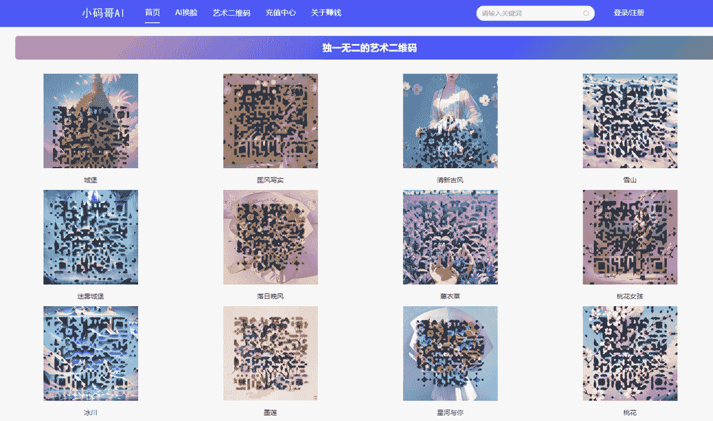

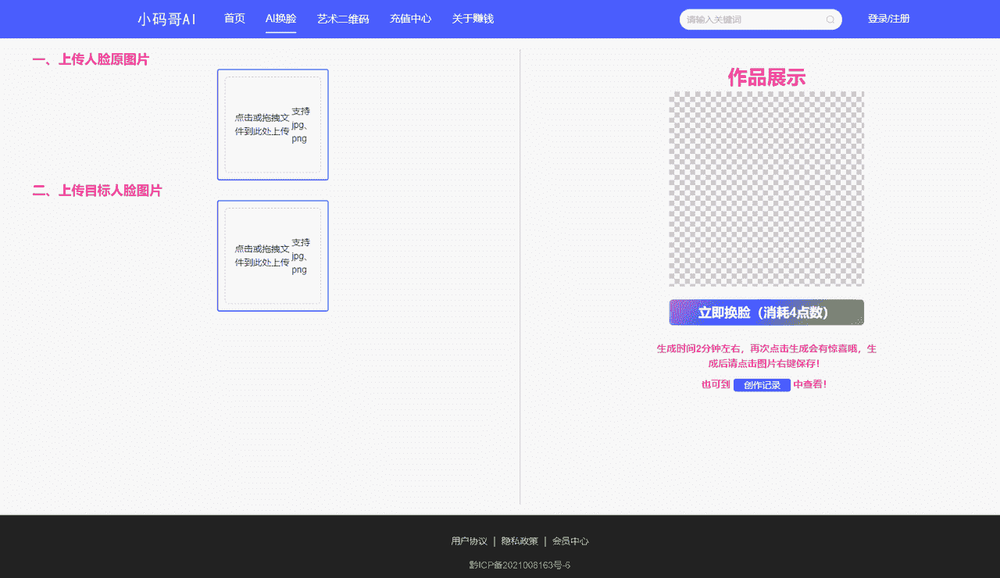

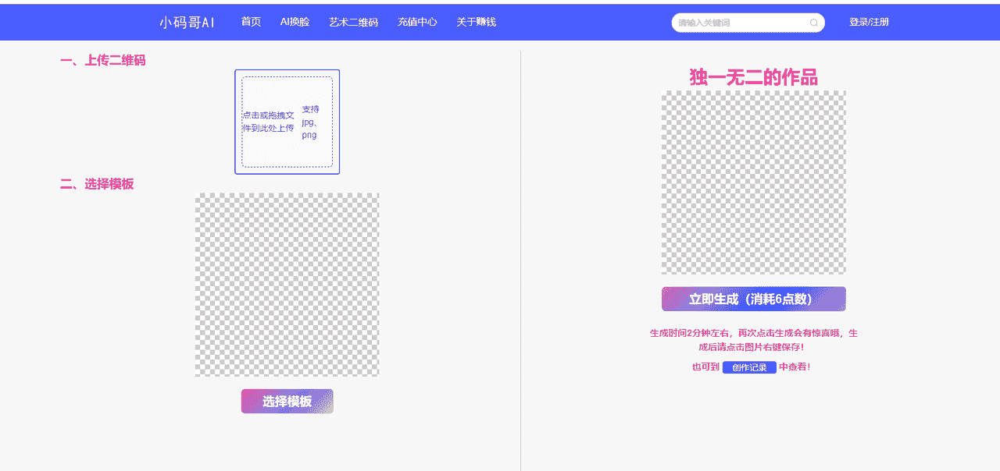

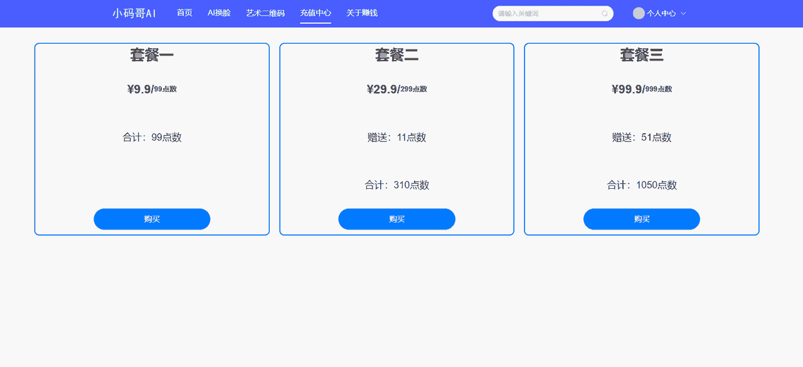

## 2、服务端

1.服务端使用Java8开发，性能有突破性的提升。

2.使用Spring Boot2.7.5框架，目前国内流行的Java框架，高性能、简单易用、支持Mave高级项目管理工具、支持Redis等。

```
├─📂 server  //服务端根目录（管理后台、接口）
│  ├─📂 xmg-admin.src.main           //后台应用
│  │  ├─📂 java.com.mdd.admin         //Java包
│  │  │  ├─📂cache                    //缓存层
│  │  │  ├─📂config                   //配置层
│  │  │  ├─📂controller               //控制器
│  │  │  ├─📂service                  //服务层
│  │  │  │  ├─📂impl                  //实现层
│  │  │  ├─📂validate                 //Dto层
│  │  │  ├─📂vo                       //Vo层
│  │  │  ├─📄LikeAdminApplication     //项目入口文件
│  │  │  ├─📄LikeAdminInterceptor     //项目的拦截器
│  │  │  ├─📄LikeAdminThreadLocal     //项目本地线程
│  │  ├─📂 resources                  //资源目录
│  │  │  ├─📂META-INF                 //配置
│  │  │  ├─📂static                   //静态目录
|  |  |  ├─📄application.yml          //项目配置文件
|  |  |  ├─📄banner.txt               //启动Banner
|  |  |  ├─📄log4j2-spring.xml        //日志配置文件
│  │ 
│  ├─📂 xmg-front.src.main           //前端应用
│  │  ├─📂 java.com.mdd.front         //Java包
│  │ 
│  ├─📂 xmg-common                //公共类库
│  │  ├─📂config                   //全局配置
│  │  ├─📂core                     //核心目录
│  │  ├─📂entity                   //实体目录
│  │  ├─📂exception                //异常目录
│  │  ├─📂mapper                   //Mapper
│  │  ├─📂plugin                   //扩展插件
│  │  ├─📂utils                    //工具目录
│  │  ├─📂validator                //自定验证器
│  |
|  ├─📂 xmg-generator             //代码生成器
```

+   步骤1: 启动并登录Mysql，创建编码为utf8mb4的数据库，导入项目中/sql/xx.sql文件。

+   步骤2: 打开之前复制的文件“/server/like-admin/src/main/resources/application-dev.yml”，

+   步骤3: 找到datasource项，修改url项的地址为数据库ip地址，地址“/”后面为数据库名称，username项为数据库账号，password项为数据密码，然后保存。

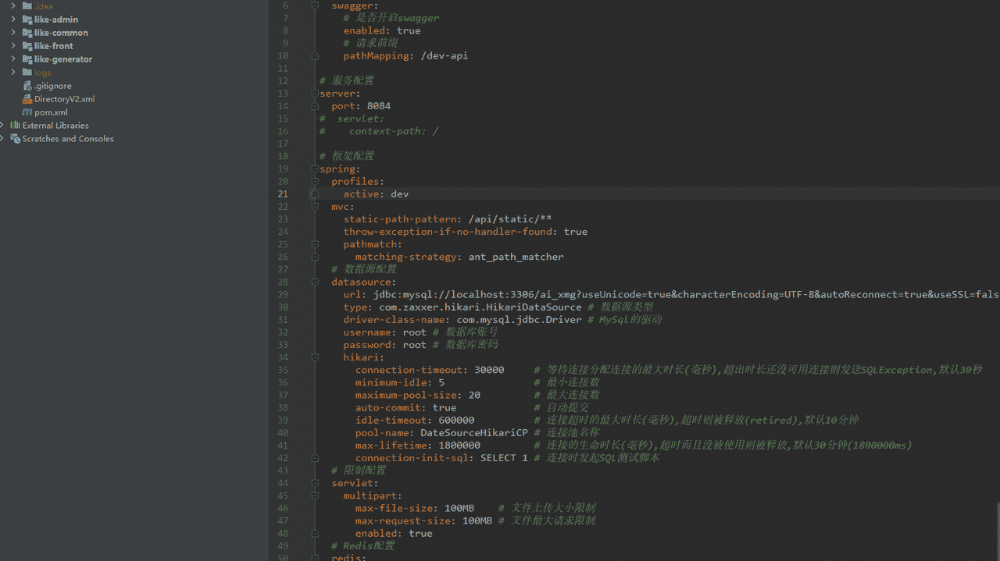

2.后台界面使用element-plus UI框架，简单精美的后台界面，丰富的组件库，方便快速开发，满足各种后台交互。

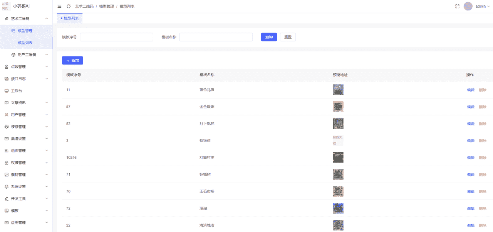

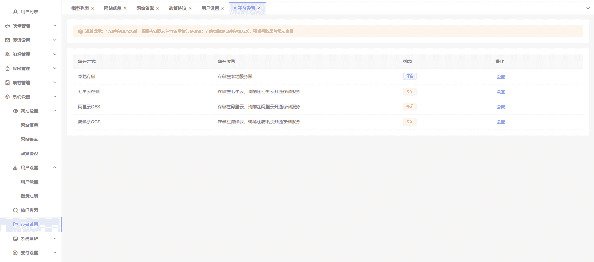

## 3、移动端

```
├──📂 .vscode                          # vscode配置文件
├──📂 scripts                          # js脚本
├──📂 src                              # 源代码
│  ├──📂 api                           # 所有请求
│  ├──📂 components                    # 全局公用组件
│  ├──📂 enums                         # 全局枚举
│  ├──📂 hooks                         # 全局hook
│  ├──📂 pages                         # 所有页面
│  ├──📂 plugins                       # 插件安装
│  ├──📂 router                        # 路由拦截
│  ├──📂 static                        # 静态资源文件
│  ├──📂 stores                        # 全局状态管理
│  ├──📂 styles                        # 全局样式
│  ├──📂 uni_modules                   # uniapp插件市场引入的包
│  ├──📂 utils                         # 全局公用方法
│  ├── App.vue                         # 入口页面
│  ├── main.ts                         # 入口文件 初始化，组册插件等
│  └── manifest.json                   # uniapp各端相关配置
│  └── pages.json                      # 页面配置
│  └── uni.scss                        # 全局scss变量
├──📂 typings                          # ts声明文件
├── index.html                         # H5html
├── .env.xxx                           # 环境变量配置
├── .eslintrc.cjs                      # eslint 配置项
├── package.json                       # package.json
├── tailwind.config.js                 # tailwindcss 配置项
├── tsconfig.json                      # ts 配置项
├── vite.config.ts                     # vite 配置项
```

手机端uniapp前台，可以编译成手机H5网页、微信小程序、安卓App，苹果App等客户端，因PC端功能还没开发完成，移动端目前只搭建了基础框架，待PC段开发完成后，逐步将PC端功能同步至移动端。

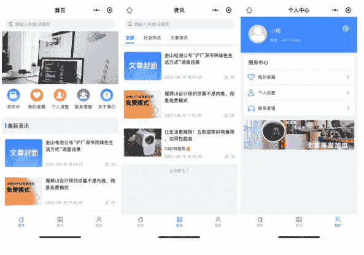

# 三、平台版本

目**前，**小码哥AI社区版源码暂未开源，可通过赞助的方式获取源码授权，详情可添加小码哥微信了解：xmgcode88 (备注：码哥) 。

| # **开源版** |  | ## **社区版** |  |
| --- | --- | --- | --- |
| ### **前端** |  | ### **前端** |  |
| AI艺术二维码创作 | × | AI艺术二维码创作 | **√** |
| AI创作记录（二维码、换脸） | × | AI创作记录（二维码、换脸） | **√** |
| AI换脸 | × | AI换脸 | **√** |
| 点数查看 | × | 点数查看 | **√** |
| 充值记录 | × | 充值记录 | **√** |
| 消费记录 | × | 消费记录 | **√** |
| 手机号登录 | × | 手机号登录 | **√** |
| 账号登录 | × | 账号登录 | **√** |
| 微信登录 | × | 微信登录 | **√** |
| 密码找回 | × | 密码找回 | **√** |
| 密码修改 | × | 密码修改 | **√** |
| 微信绑定 | × | 微信绑定 | **√** |
| 充值中心（微信充值） | × | 充值中心（微信充值） | **√** |
| 点数查看 | × | 点数查看 | **√** |
| 充值记录 | × | 充值记录 | **√** |
| 消费记录 | × | 消费记录 | **√** |
| ### **后台管理** |  | ### **后台管理** |  |
| 访问量、订单量、新增用户 | × | 访问量、订单量、新增用户 | **√** |
| 模型管理 | × | 模型管理 | **√** |
| 用户二维码列表 | × | 用户二维码列表 | **√** |
| 用户点数列表 | × | 用户点数列表 | **√** |
| 点数充值记录 | × | 点数充值记录 | **√** |
| 点数使用记录 | × | 点数使用记录 | **√** |
| 消费记录 | × | 消费记录 | **√** |
| 订单列表 | × | 订单列表 | **√** |
| 用户列表 | × | 用户列表 | **√** |
| 部门管理 | × | 部门管理 | **√** |
| 岗位管理 | × | 岗位管理 | **√** |
| 管理员管理 | × | 管理员管理 | **√** |
| 角色管理 | × | 角色管理 | **√** |
| 菜单管理 | × | 菜单管理 | **√** |
| 素材中心 | × | 素材中心 | **√** |
| 网站信息 | × | 网站信息 | **√** |
| 网站备案 | × | 网站备案 | **√** |
| 政策协议 | × | 政策协议 | **√** |
| 默认头像 | × | 默认头像 | **√** |
| 注册登录选择 | × | 注册登录选择 | **√** |
| 存储位置 | × | 存储位置 | **√** |
| 系统环境 | × | 系统环境 | **√** |
| 系统缓存 | × | 系统缓存 | **√** |
| 系统日志 | × | 系统日志 | **√** |
| 登录日志 | × | 登录日志 | **√** |
| 定时任务 | × | 定时任务 | **√** |
| AI配置 | × | AI配置 | **√** |
| 字典管理 | × | 字典管理 | **√** |
| 代码生成器 | × | 代码生成器 | **√** |
| 通知设置 | × | 通知设置 | **√** |
| 短信设置 | × | 短信设置 | **√** |
| ### **服务** |  | ### **服务** |  |
| 终生免费升级 | × | 终生免费升级 | **√** |
| 一年免费维护 | × | 一年免费维护 | **√** |
| 一对一安装指导 | × | 一对一安装指导 | **√** |
| 一对一技术支持 | × | 一对一技术支持 | **√** |

# 四、环境准备

**服务器（必须）：**用**于**部署小码AI平台，最低**配**置：操作系统windows或linux（建议：Ubuntu 20.04 64位），CPU：2核(vCPU)，内存：2 GiB；

**数据库（必须）：**用于存储系统数据；

**redis（必须）：**缓存系统关键信息；

**个人微信支付功能（必须）：**用于个人微信实时收款，注册地址：https://dwz.cn/wy15q3Lg

**域名：**方便用户访问。

### 后端

无法复制加载中的内容

### 前端

无法复制加载中的内容

# 五、涉及费用

| **名称** | **金额** | **备注** |
| --- | --- | --- |
| 服务器 | 99元/年 | 自行阿里云、腾讯云、华为云等平台购买 |
| 个人微信支付 | 200元/终生 | 项目中使用了yungouOS平台，发生交易时微信官方收取0.6/手续费，yungouOS收取1%的技术服务费，也就是说收款100元，实际到账99.4元。 |
| AI接口费用（AI艺术二维码 、AI换脸 、AI头像制作 、人像动漫化 、动漫人物、 人像风格重绘 、图像风格转换、黑白图像上色 、图像对比度增强 、图像无损放大 、图像修复 、AI艺术字、MJ绘画 、图像画面扩展 ）/每次 | 按次收费 | 已对接好AI大厂接口，按次收费，收费标准请参考API平台（www.dataguan.com） |

# 六、更新日志

2024年8月12，上线功能：Dalle3绘画，版本号：v1.0.2

2024年7月29，上线功能：AI换脸，版本号：v1.0.1

2024年7月15，上线功能：AI艺术二维码，版本号：v1.0.0

# 七、变现路线

[AI换脸副业项目拆解](https://xmgtoagi.feishu.cn/wiki/WNYJwxb7BibsP8kMVe0c1XIEnke)

[AI副业日赚200](https://xmgtoagi.feishu.cn/wiki/UHCuwwoMRia81RkfYhLcUGn8nag)

[高质量AI艺术二维码如何生成](https://xmgtoagi.feishu.cn/wiki/BJzOwOwxOiaz4Vkgyo0cH3s4nre)

[Midjourney 制订专属AI头像](https://xmgtoagi.feishu.cn/wiki/RYHtwNgW9iFRECk9G3AcTm9Qncg)

[AI壁纸号一周增加上千粉丝，轻松变现的成功案例分享](https://xmgtoagi.feishu.cn/wiki/QrQ9wPQcziEkqbkiWXccSA34nGh)

# 八、门槛

## 1、技术佬

当然，懂技术可以对小码哥AI平台进行研究学习，在自己的平台部署、运维方面手到擒来，当然也欢迎技术大佬参与平台的开发，小码哥会给相应的奖励哦。

## 2、技术小白

对于完全不懂技术的小白也没关系，小码哥持续提供免费的技术服务。

# 九、关于我们

小码哥从2023年专注研究AI人工智能、AI副业、AI创业，热衷于互联网，兴趣是最好的老师，欢迎志同道合的人，一起交流学习，一起AI搞钱！

