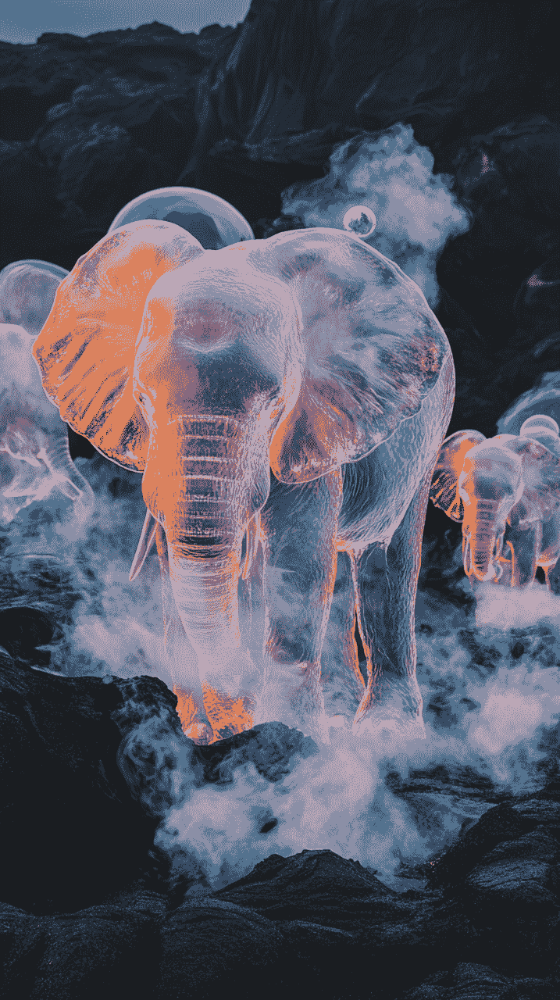
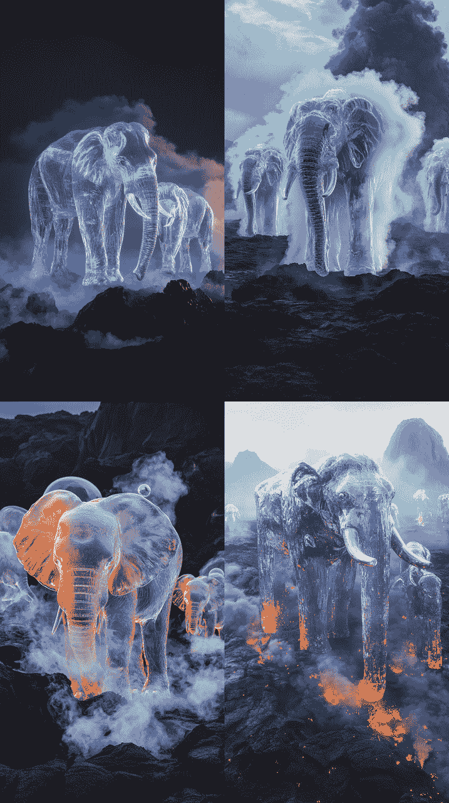

# AI绘画成果20240926

> 来源：[https://xmgtoagi.feishu.cn/docx/TnfUd5c4boxTcvxLg0Xcqqninzc](https://xmgtoagi.feishu.cn/docx/TnfUd5c4boxTcvxLg0Xcqqninzc)

On a black volcanic island, large transparent elephants stand amidst swirling smoke. Surrounding them are transparent objects, enclosing the space. Parts of their bodies glow in cool colors, adding to the surreal and otherworldly atmosphere  --ar 9:16 --v 6.1

中文：在一座黑色的火山岛上,巨大的透明大象矗立于缭绕的烟雾之中。它们周围环绕着透明的物体,将空间包围起来。大象身体的某些部位散发出冷色调的光芒,为这个超现实和异世界般的氛围增添了神秘感。

