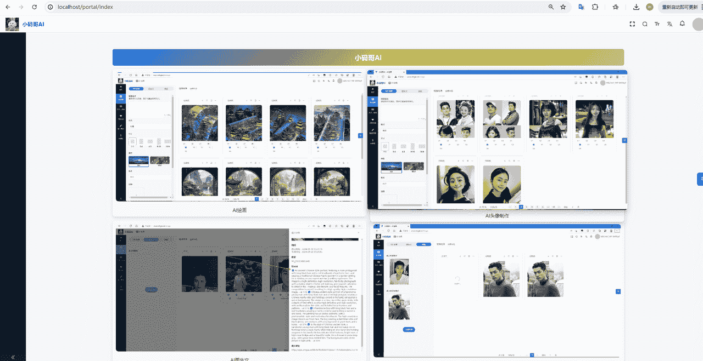
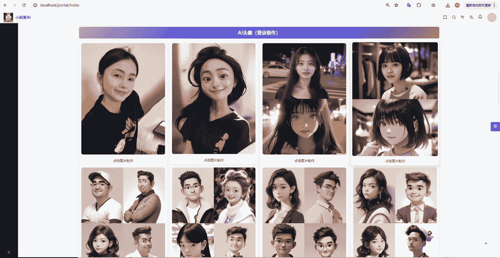
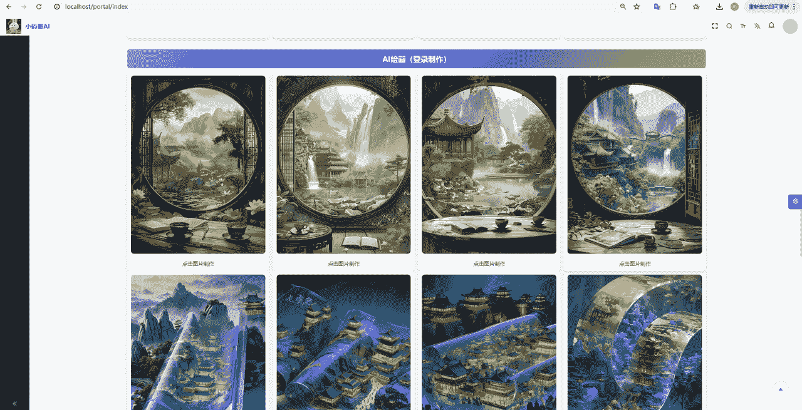
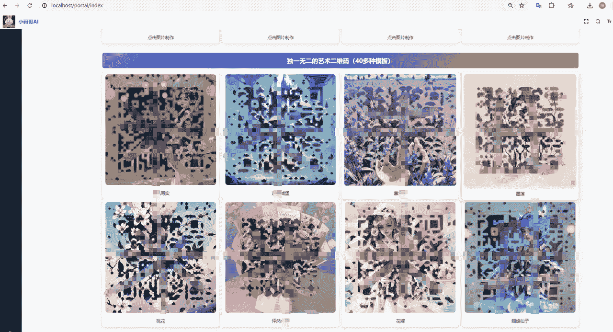
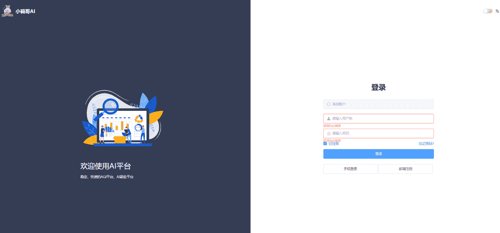
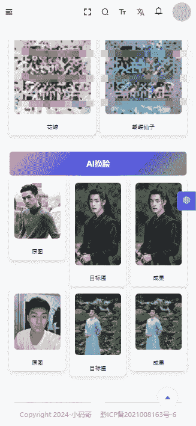
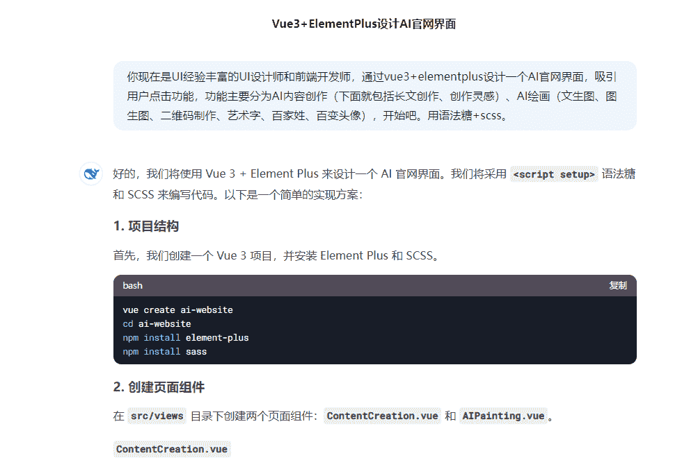
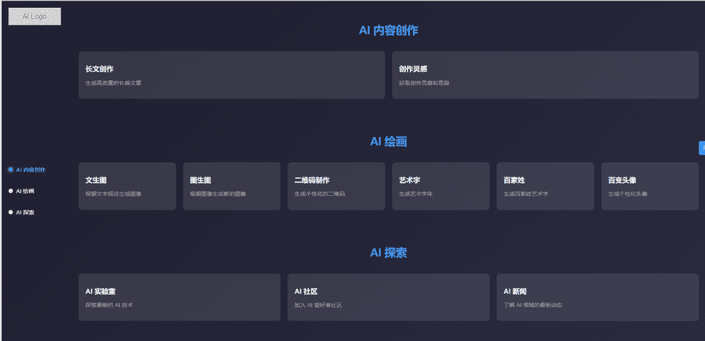
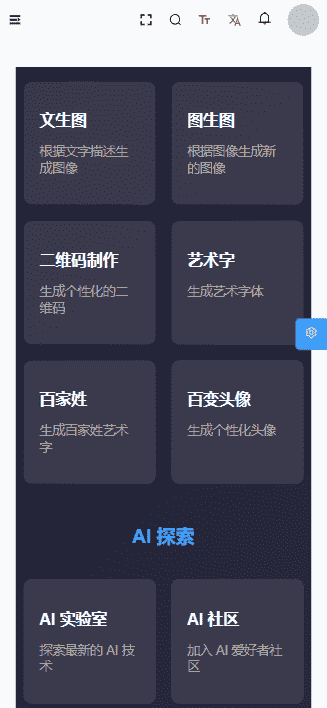

# AI官网设计源码

> 来源：[https://xmgtoagi.feishu.cn/docx/YTwAdGDhnoQzJrx9YJIc3RfPnEc](https://xmgtoagi.feishu.cn/docx/YTwAdGDhnoQzJrx9YJIc3RfPnEc)

# 一、原版

大家好，我是小码哥，喜欢折腾AI的人，访问过xmgai.cn的网站都知道，首页还是比较low的，今天准备重新设计一下，在UI方面，我是不太擅长的，所以这次，还是借助AI来帮我完成官网首页的开发。先来看看我原来的官网，比较low，更多是图片效果的展示。










然后点击图片，跳转登录页面



## 1、通过媒体自适应移动端




## 2、源码

  { src: &quot;http://aipic.xmgai.cn/faceswap/11.png&quot;, description: &quot;原图&quot; },
  { src: &quot;http://aipic.xmgai.cn/faceswap/22.jpg&quot;, description: &quot;目标图&quot; },
  { src: &quot;http://aipic.xmgai.cn/faceswap/33.jpg&quot;, description: &quot;成果&quot; },
  { src: &quot;http://aipic.xmgai.cn/faceswap/1.jpg&quot;, description: &quot;原图&quot; },
  { src: &quot;http://aipic.xmgai.cn/faceswap/2.jpg&quot;, description: &quot;目标图&quot; },
  { src: &quot;http://aipic.xmgai.cn/faceswap/3.jpg&quot;, description: &quot;成果&quot; }
  { previewImg: &quot;http://aipic.xmgai.cn/model/5.png&quot;, name: &quot;国风写实&quot; },
  { previewImg: &quot;http://aipic.xmgai.cn/model/23.png&quot;, name: &quot;迷雾城堡&quot; },
  { previewImg: &quot;http://aipic.xmgai.cn/model/67.png&quot;, name: &quot;薰衣草&quot; },
  { previewImg: &quot;http://aipic.xmgai.cn/model/2.png&quot;, name: &quot;墨莲&quot; },
  { previewImg: &quot;http://aipic.xmgai.cn/model/97.png&quot;, name: &quot;桃花&quot; },
  { previewImg: &quot;http://aipic.xmgai.cn/model/53.png&quot;, name: &quot;怦然心动&quot; },
  { previewImg: &quot;http://aipic.xmgai.cn/model/6.png&quot;, name: &quot;花嫁&quot; },
  { previewImg: &quot;http://aipic.xmgai.cn/model/4.png&quot;, name: &quot;蝴蝶仙子&quot; },
  { previewImg: &quot;http://aipic.xmgai.cn/headpic/1-1.PNG&quot;, name: &quot;点击图片制作&quot; },
  { previewImg: &quot;http://aipic.xmgai.cn/headpic/1-2.PNG&quot;, name: &quot;点击图片制作&quot; },
  { previewImg: &quot;http://aipic.xmgai.cn/headpic/2-1.png&quot;, name: &quot;点击图片制作&quot; },
  { previewImg: &quot;http://aipic.xmgai.cn/headpic/2-2.png&quot;, name: &quot;点击图片制作&quot; },
  { previewImg: &quot;http://aipic.xmgai.cn/headpic/3-1.PNG&quot;, name: &quot;点击图片制作&quot; },
  { previewImg: &quot;http://aipic.xmgai.cn/headpic/3-2.PNG&quot;, name: &quot;点击图片制作&quot; },
  { previewImg: &quot;http://aipic.xmgai.cn/headpic/3-3.PNG&quot;, name: &quot;点击图片制作&quot; },
  { previewImg: &quot;http://aipic.xmgai.cn/headpic/3-4.PNG&quot;, name: &quot;点击图片制作&quot; },
  { previewImg: &quot;http://aipic.xmgai.cn/headpic/5-1.png&quot;, name: &quot;点击图片制作&quot; },
  { previewImg: &quot;http://aipic.xmgai.cn/headpic/5-2.png&quot;, name: &quot;点击图片制作&quot; },
  { previewImg: &quot;http://aipic.xmgai.cn/headpic/5-3.png&quot;, name: &quot;点击图片制作&quot; },
  { previewImg: &quot;http://aipic.xmgai.cn/headpic/5-4.png&quot;, name: &quot;点击图片制作&quot; },

  { previewImg: &quot;http://aipic.xmgai.cn/aipic/1-1.png&quot;, name: &quot;点击图片制作&quot; },
  { previewImg: &quot;http://aipic.xmgai.cn/aipic/1-2.png&quot;, name: &quot;点击图片制作&quot; },
  { previewImg: &quot;http://aipic.xmgai.cn/aipic/1-3.png&quot;, name: &quot;点击图片制作&quot; },
  { previewImg: &quot;http://aipic.xmgai.cn/aipic/1-4.png&quot;, name: &quot;点击图片制作&quot; },
  { previewImg: &quot;http://aipic.xmgai.cn/aipic/2-1.png&quot;, name: &quot;点击图片制作&quot; },
  { previewImg: &quot;http://aipic.xmgai.cn/aipic/2-2.png&quot;, name: &quot;点击图片制作&quot; },
  { previewImg: &quot;http://aipic.xmgai.cn/aipic/2-3.png&quot;, name: &quot;点击图片制作&quot; },
  { previewImg: &quot;http://aipic.xmgai.cn/aipic/2-4.png&quot;, name: &quot;点击图片制作&quot; },

  { previewImg: &quot;http://aipic.xmgai.cn/page/1.png&quot;, name: &quot;AI绘画&quot; },
  { previewImg: &quot;http://aipic.xmgai.cn/page/2.png&quot;, name: &quot;AI头像制作&quot; },
  { previewImg: &quot;http://aipic.xmgai.cn/page/3.png&quot;, name: &quot;AI图生文&quot; },
  { previewImg: &quot;http://aipic.xmgai.cn/page/4.png&quot;, name: &quot;AI换脸&quot; },
  { previewImg: &quot;http://aipic.xmgai.cn/page/5.png&quot;, name: &quot;AI专属二维码&quot; },

```
&lt;template&gt;
  &lt;div class=&quot;container&quot;&gt;

    &lt;el-row&gt;
      &lt;el-col :span=&quot;24&quot; class=&quot;oneTitle&quot;&gt;
        &lt;span&gt;小码哥AI&lt;/span&gt;
      &lt;/el-col&gt;
    &lt;/el-row&gt;
    &lt;el-row :gutter=&quot;10&quot; class=&quot;image-row&quot;&gt;
      &lt;el-col :span=&quot;12&quot; class=&quot;pc-col&quot; v-for=&quot;(item, index) in pageList&quot; :key=&quot;index&quot;&gt;
        &lt;div class=&quot;imageCla&quot;&gt;
          &lt;el-image
            class=&quot;dialog-image&quot;
            :src=&quot;item.previewImg&quot;
            fit=&quot;cover&quot;
            @click=&quot;handleHome(item)&quot;
          /&gt;
          &lt;div class=&quot;image-description&quot;&gt;{{ item.name }}&lt;/div&gt;
        &lt;/div&gt;
      &lt;/el-col&gt;
    &lt;/el-row&gt;

    &lt;el-row&gt;
      &lt;el-col :span=&quot;24&quot; class=&quot;oneTitle&quot;&gt;
        &lt;span&gt;AI头像（登录制作）&lt;/span&gt;
      &lt;/el-col&gt;
    &lt;/el-row&gt;
    &lt;el-row :gutter=&quot;10&quot; class=&quot;image-row&quot;&gt;
      &lt;el-col :span=&quot;6&quot; class=&quot;pc-col&quot; v-for=&quot;(item, index) in headPicList&quot; :key=&quot;index&quot;&gt;
        &lt;div class=&quot;imageCla&quot;&gt;
          &lt;el-image
            class=&quot;dialog-image&quot;
            :src=&quot;item.previewImg&quot;
            fit=&quot;cover&quot;
            @click=&quot;handleHome(item)&quot;
          /&gt;
          &lt;div class=&quot;image-description&quot;&gt;{{ item.name }}&lt;/div&gt;
        &lt;/div&gt;
      &lt;/el-col&gt;
    &lt;/el-row&gt;

    &lt;el-row&gt;
      &lt;el-col :span=&quot;24&quot; class=&quot;oneTitle&quot;&gt;
        &lt;span&gt;AI绘画（登录制作）&lt;/span&gt;
      &lt;/el-col&gt;
    &lt;/el-row&gt;
    &lt;el-row :gutter=&quot;10&quot; class=&quot;image-row&quot;&gt;
      &lt;el-col :span=&quot;6&quot; class=&quot;pc-col&quot; v-for=&quot;(item, index) in aiPicList&quot; :key=&quot;index&quot;&gt;
        &lt;div class=&quot;imageCla&quot;&gt;
          &lt;el-image
            class=&quot;dialog-image&quot;
            :src=&quot;item.previewImg&quot;
            fit=&quot;cover&quot;
            @click=&quot;handleHome(item)&quot;
          /&gt;
          &lt;div class=&quot;image-description&quot;&gt;{{ item.name }}&lt;/div&gt;
        &lt;/div&gt;
      &lt;/el-col&gt;
    &lt;/el-row&gt;

    &lt;el-row&gt;
      &lt;el-col :span=&quot;24&quot; class=&quot;oneTitle&quot;&gt;
        &lt;span&gt;独一无二的艺术二维码（40多种模板）&lt;/span&gt;
      &lt;/el-col&gt;
    &lt;/el-row&gt;
    &lt;el-row :gutter=&quot;10&quot; class=&quot;image-row&quot;&gt;
      &lt;el-col :span=&quot;6&quot; class=&quot;pc-col&quot; v-for=&quot;(item, index) in claasifyList&quot; :key=&quot;index&quot;&gt;
        &lt;div class=&quot;imageCla&quot;&gt;
          &lt;el-image
            class=&quot;dialog-image&quot;
            :src=&quot;item.previewImg&quot;
            fit=&quot;cover&quot;
            @click=&quot;handleHome(item)&quot;
          /&gt;
          &lt;div class=&quot;image-description&quot;&gt;{{ item.name }}&lt;/div&gt;
        &lt;/div&gt;
      &lt;/el-col&gt;
    &lt;/el-row&gt;
    
    &lt;el-row&gt;
      &lt;el-col :span=&quot;24&quot; class=&quot;oneTitle&quot;&gt;
        &lt;span&gt;AI换脸&lt;/span&gt;
      &lt;/el-col&gt;
    &lt;/el-row&gt;
    &lt;el-row :gutter=&quot;10&quot; class=&quot;image-row&quot;&gt;
      &lt;el-col :span=&quot;8&quot; v-for=&quot;(item, index) in faceImages&quot; :key=&quot;index&quot;&gt;
        &lt;div class=&quot;imageCla&quot;&gt;
          &lt;el-image
            class=&quot;faceimage&quot;
            :src=&quot;item.src&quot;
            fit=&quot;cover&quot;
            @click=&quot;handleHome(item)&quot;
          /&gt;
          &lt;div class=&quot;image-description&quot;&gt;{{ item.description }}&lt;/div&gt;
        &lt;/div&gt;
      &lt;/el-col&gt;
    &lt;/el-row&gt;

  &lt;/div&gt;
&lt;/template&gt;

&lt;script lang=&quot;ts&quot; setup&gt;
import { ref } from &quot;vue&quot;;
const router = useRouter(); // 路由对象

const handleHome = () =&gt; {
  router.push({
    path: &#x27;/login&#x27;,
  });
};

const faceImages = ref([
]);

const claasifyList = ref([
]);

const headPicList = ref([
]);

const aiPicList = ref([
]);

const pageList = ref([
]);
&lt;/script&gt;

&lt;style scoped&gt;
.container {
  width: 100%;
  margin: 0 auto;
  padding: 20px 0; /* 修改这里 */
  box-sizing: border-box;
}

.image-row {
  display: flex;
  flex-wrap: wrap;
  justify-content: space-between;
  margin-bottom: 20px;
}

.dialog-image, .faceimage {
  margin-bottom: 10px;
  width: 100%;
  height: auto;
  object-fit: cover;
  cursor: pointer;
  border-radius: 8px;
  transition: transform 0.3s, box-shadow 0.3s;
}

.dialog-image:hover, .faceimage:hover {
  transform: scale(1.05);
  box-shadow: 0 8px 16px rgba(0, 0, 0, 0.2);
}

.imageCla {
  display: flex;
  flex-direction: column;
  align-items: center;
  background: #f9f9f9;
  border-radius: 8px;
  padding: 10px;
  box-shadow: 0 4px 8px rgba(0, 0, 0, 0.1);
  transition: transform 0.3s, box-shadow 0.3s;
}

.imageCla:hover {
  transform: translateY(3px);
  box-shadow: 0 8px 16px rgba(0, 0, 0, 0.2);
}

.image-description {
  text-align: center;
  margin-top: 8px;
  font-size: 14px;
  color: #333;
}

.oneTitle {
  display: flex;
  align-items: center;
  justify-content: center;
  height: 50px;
  font-size: 20px;
  text-align: center;
  margin: 10px 0;
  font-weight: bolder;
  background-image: linear-gradient(135deg, #eb7ace, #2f41e6, #bdd631, #eb7ace);
  background-size: 200% 100%;
  animation: GenerateButton_gradient 10s cubic-bezier(.62, .28, .23, .99) infinite;
  border: none;
  border-radius: 6px;
  color: #fff;
  cursor: pointer;
  overflow: hidden;
  user-select: none;
  transition: all 0.3s ease-in-out;
}

@keyframes GenerateButton_gradient {
  0% {
    background-position: 0% 50%;
  }
  50% {
    background-position: 100% 50%;
  }
  100% {
    background-position: 0% 50%;
  }
}

@media (max-width: 768px) {
  .container {
    padding: 15px 0; /* 修改这里 */
  }
  .el-col {
    margin-bottom: 10px;
  }
  .oneTitle {
    font-size: 18px;
  }
  .pc-col {
    flex: 0 0 50%; /* 移动端一行两列 */
    max-width: 50%;
  }
}

@media (max-width: 480px) {
  .container {
    padding: 10px 0; /* 修改这里 */
  }
  .el-col {
    margin-bottom: 5px;
  }
  .oneTitle {
    font-size: 16px;
  }
  .image-description {
    font-size: 12px;
  }
  .pc-col {
    flex: 0 0 50%; /* 移动端一行两列 */
    max-width: 50%;
  }
}
&lt;/style&gt;
```

# 二、升级版

## 1、提示词

工具使用的deepseek，网址：https://chat.deepseek.com/



## 2、效果



移动端




代码如下：

```
&lt;template&gt;
  &lt;div class=&quot;ai-website&quot;&gt;
    &lt;!-- Logo --&gt;
    &lt;div class=&quot;logo&quot;&gt;
      &lt;img src=&quot;https://via.placeholder.com/150x50?text=AI+Logo&quot; alt=&quot;AI Logo&quot; /&gt;
    &lt;/div&gt;

    &lt;!-- 左侧时间轴 --&gt;
    &lt;div class=&quot;timeline&quot;&gt;
      &lt;div
        v-for=&quot;(item, index) in timelineItems&quot;
        :key=&quot;index&quot;
        class=&quot;timeline-item&quot;
        :class=&quot;{ active: activeSection === item.id }&quot;
        @click=&quot;scrollToSection(item.id)&quot;
      &gt;
        &lt;div class=&quot;timeline-dot&quot;&gt;&lt;/div&gt;
        &lt;div class=&quot;timeline-label&quot;&gt;{{ item.label }}&lt;/div&gt;
      &lt;/div&gt;
    &lt;/div&gt;

    &lt;!-- 右侧内容区域 --&gt;
    &lt;div class=&quot;content&quot;&gt;
      &lt;!-- AI 内容创作 --&gt;
      &lt;section id=&quot;content-creation&quot; class=&quot;section&quot;&gt;
        &lt;h1 class=&quot;section-title&quot;&gt;AI 内容创作&lt;/h1&gt;
        &lt;div class=&quot;feature-grid&quot;&gt;
          &lt;div
            v-for=&quot;(item, index) in contentFeatures&quot;
            :key=&quot;index&quot;
            class=&quot;feature-card&quot;
            @click=&quot;handleFeatureClick(item)&quot;
          &gt;
            &lt;h2&gt;{{ item.title }}&lt;/h2&gt;
            &lt;p&gt;{{ item.description }}&lt;/p&gt;
          &lt;/div&gt;
        &lt;/div&gt;
      &lt;/section&gt;

      &lt;!-- AI 绘画 --&gt;
      &lt;section id=&quot;ai-painting&quot; class=&quot;section&quot;&gt;
        &lt;h1 class=&quot;section-title&quot;&gt;AI 绘画&lt;/h1&gt;
        &lt;div class=&quot;feature-grid&quot;&gt;
          &lt;div
            v-for=&quot;(item, index) in paintingFeatures&quot;
            :key=&quot;index&quot;
            class=&quot;feature-card&quot;
            @click=&quot;handleFeatureClick(item)&quot;
          &gt;
            &lt;h2&gt;{{ item.title }}&lt;/h2&gt;
            &lt;p&gt;{{ item.description }}&lt;/p&gt;
          &lt;/div&gt;
        &lt;/div&gt;
      &lt;/section&gt;

      &lt;!-- AI 探索 --&gt;
      &lt;section id=&quot;ai-exploration&quot; class=&quot;section&quot;&gt;
        &lt;h1 class=&quot;section-title&quot;&gt;AI 探索&lt;/h1&gt;
        &lt;div class=&quot;feature-grid&quot;&gt;
          &lt;div
            v-for=&quot;(item, index) in explorationFeatures&quot;
            :key=&quot;index&quot;
            class=&quot;feature-card&quot;
            @click=&quot;handleFeatureClick(item)&quot;
          &gt;
            &lt;h2&gt;{{ item.title }}&lt;/h2&gt;
            &lt;p&gt;{{ item.description }}&lt;/p&gt;
          &lt;/div&gt;
        &lt;/div&gt;
      &lt;/section&gt;
    &lt;/div&gt;

    &lt;!-- 登录模态框 --&gt;
    &lt;el-dialog v-model=&quot;showLoginModal&quot; title=&quot;登录&quot; width=&quot;30%&quot; center&gt;
      &lt;Login @login-success=&quot;handleLoginSuccess&quot; /&gt;
    &lt;/el-dialog&gt;
  &lt;/div&gt;
&lt;/template&gt;

&lt;script setup&gt;
import { ref, onMounted, onUnmounted } from &#x27;vue&#x27;;
import Login from &#x27;@/views/Login/Login.vue&#x27;;

// 时间轴数据
const timelineItems = ref([
  { id: &#x27;content-creation&#x27;, label: &#x27;AI 内容创作&#x27; },
  { id: &#x27;ai-painting&#x27;, label: &#x27;AI 绘画&#x27; },
  { id: &#x27;ai-exploration&#x27;, label: &#x27;AI 探索&#x27; }
]);

// 当前激活的区域
const activeSection = ref(&#x27;content-creation&#x27;);

// AI 内容创作功能列表
const contentFeatures = ref([
  { title: &#x27;长文创作&#x27;, description: &#x27;生成高质量的长篇文章&#x27; },
  { title: &#x27;创作灵感&#x27;, description: &#x27;获取创作灵感和思路&#x27; }
]);

// AI 绘画功能列表
const paintingFeatures = ref([
  { title: &#x27;文生图&#x27;, description: &#x27;根据文字描述生成图像&#x27; },
  { title: &#x27;图生图&#x27;, description: &#x27;根据图像生成新的图像&#x27; },
  { title: &#x27;二维码制作&#x27;, description: &#x27;生成个性化的二维码&#x27; },
  { title: &#x27;艺术字&#x27;, description: &#x27;生成艺术字体&#x27; },
  { title: &#x27;百家姓&#x27;, description: &#x27;生成百家姓艺术字&#x27; },
  { title: &#x27;百变头像&#x27;, description: &#x27;生成个性化头像&#x27; }
]);

// AI 探索功能列表
const explorationFeatures = ref([
  { title: &#x27;AI 实验室&#x27;, description: &#x27;探索最新的 AI 技术&#x27; },
  { title: &#x27;AI 社区&#x27;, description: &#x27;加入 AI 爱好者社区&#x27; },
  { title: &#x27;AI 新闻&#x27;, description: &#x27;了解 AI 领域的最新动态&#x27; }
]);

// 是否显示登录模态框
const showLoginModal = ref(false);

// 处理功能点击
const handleFeatureClick = (item) =&gt; {
  const token = localStorage.getItem(&#x27;token&#x27;);
  if (!token) {
    showLoginModal.value = true; // 显示登录模态框
  } else {
    alert(`跳转到: ${item.title}`); // 模拟跳转
  }
};

// 处理登录成功
const handleLoginSuccess = () =&gt; {
  showLoginModal.value = false;
  alert(&#x27;登录成功，可以访问功能了！&#x27;);
};

// 滚动到指定区域
const scrollToSection = (id) =&gt; {
  const section = document.getElementById(id);
  if (section) {
    section.scrollIntoView({ behavior: &#x27;smooth&#x27; });
    activeSection.value = id; // 更新当前激活的区域
  }
};

// 监听滚动事件，更新激活的区域
const handleScroll = () =&gt; {
  const sections = timelineItems.value.map((item) =&gt; document.getElementById(item.id));
  const scrollPosition = window.scrollY + 100; // 偏移量

  for (let i = sections.length - 1; i &gt;= 0; i--) {
    if (sections[i].offsetTop &lt;= scrollPosition) {
      activeSection.value = timelineItems.value[i].id;
      break;
    }
  }
};

onMounted(() =&gt; {
  window.addEventListener(&#x27;scroll&#x27;, handleScroll);
});

onUnmounted(() =&gt; {
  window.removeEventListener(&#x27;scroll&#x27;, handleScroll);
});
&lt;/script&gt;

&lt;style lang=&quot;scss&quot; scoped&gt;
.ai-website {
  display: flex;
  min-height: 100vh;
  background: linear-gradient(135deg, #1e1e2f, #2a2a40);
  color: white;
  font-family: Arial, sans-serif;
  position: relative;

  .logo {
    position: absolute;
    top: 20px;
    left: 20px;
    z-index: 10;

    img {
      width: 150px;
      height: auto;
    }
  }
}

.timeline {
  width: 200px;
  padding: 20px;
  position: fixed;
  height: 100vh;
  display: flex;
  flex-direction: column;
  justify-content: center;
  align-items: flex-start; /* 左对齐 */

  .timeline-item {
    display: flex;
    align-items: center;
    margin: 20px 0;
    cursor: pointer;
    transition: all 0.3s;

    &amp;:hover {
      opacity: 0.8;
    }

    &amp;.active {
      .timeline-dot {
        background: #409EFF;
        box-shadow: 0 0 10px #409EFF;
      }
      .timeline-label {
        color: #409EFF;
        font-weight: bold;
      }
    }

    .timeline-dot {
      width: 12px;
      height: 12px;
      background: white;
      border-radius: 50%;
      margin-right: 10px;
      transition: all 0.3s;
    }

    .timeline-label {
      font-size: 16px;
      transition: all 0.3s;
      text-align: left; /* 文字左对齐 */
    }
  }
}

.content {
  margin-left: 200px;
  flex: 1;
  padding: 20px;

  .section {
    margin-bottom: 100px;

    .section-title {
      font-size: 32px;
      margin-bottom: 40px;
      text-align: center;
      color: #409EFF;
    }

    .feature-grid {
      display: grid;
      grid-template-columns: repeat(auto-fit, minmax(250px, 1fr));
      gap: 20px;

      .feature-card {
        background: rgba(255, 255, 255, 0.1);
        border-radius: 10px;
        padding: 20px;
        cursor: pointer;
        transition: all 0.3s;

        &amp;:hover {
          transform: scale(1.05);
          box-shadow: 0 0 20px rgba(64, 158, 255, 0.5);
        }

        h2 {
          font-size: 20px;
          margin-bottom: 10px;
        }

        p {
          color: #aaa;
        }
      }
    }
  }
}

/* 移动端适配 */
@media (max-width: 768px) {
  .ai-website {
    flex-direction: column;

    .logo {
      position: static;
      text-align: center;
      margin-top: 20px;
    }

    .timeline {
      width: 100%;
      height: auto;
      position: static;
      flex-direction: row;
      justify-content: center;
      padding: 10px;
      border-bottom: 1px solid rgba(255, 255, 255, 0.1);

      .timeline-item {
        margin: 0 10px;
      }
    }

    .content {
      margin-left: 0;
      padding: 10px;

      .section {
        margin-bottom: 50px;

        .section-title {
          font-size: 24px;
        }

        .feature-grid {
          grid-template-columns: repeat(auto-fit, minmax(150px, 1fr));
        }
      }
    }
  }
}
&lt;/style&gt;
```