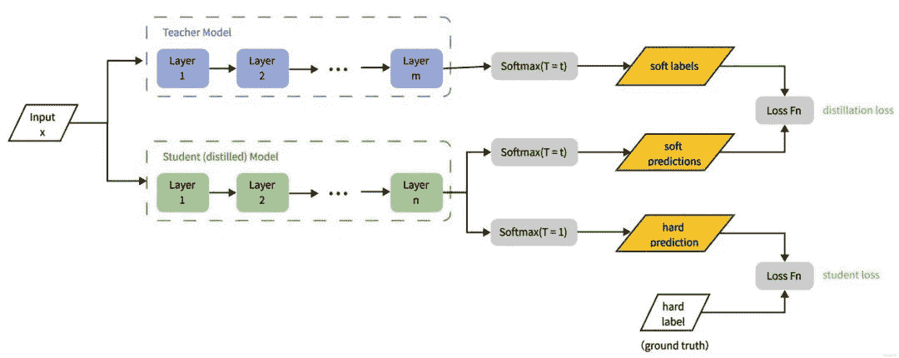
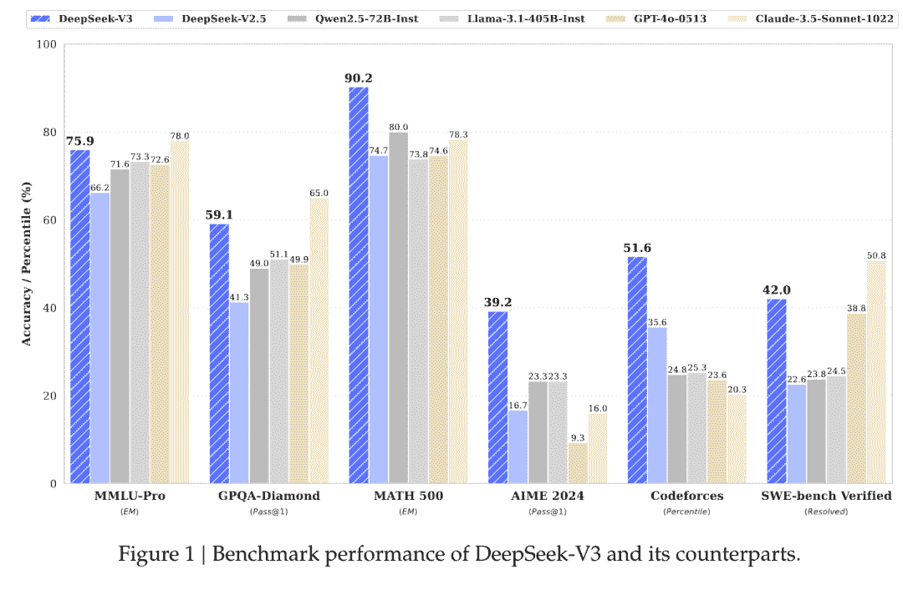
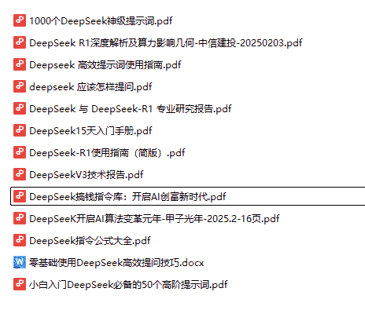

# DeepSeek R1 蒸馏法：大模型“瘦身”不“降智”

> 来源：[https://xmgtoagi.feishu.cn/docx/CfzkdqfwqoZuuMxm5QfcDGqmnyV](https://xmgtoagi.feishu.cn/docx/CfzkdqfwqoZuuMxm5QfcDGqmnyV)

以下是对大模型蒸馏法技术实现细节的进一步扩写和完善：

# 大模型蒸馏法技术实现细节

## 一、模型蒸馏技术基础

### 1.1 知识蒸馏的基本原理

知识蒸馏（Knowledge Distillation）是一种模型压缩技术，旨在将一个大型复杂模型（教师模型）的知识转移到一个小型简单模型（学生模型）中，使学生模型在保持较小规模的同时，能够学习到教师模型的推理能力和知识表示。其核心思想是利用教师模型的输出作为软标签（soft labels），指导学生模型的训练过程，从而让学生模型学习到教师模型对数据的深层次理解和抽象表示。

### 1.2 蒸馏损失函数的设计

蒸馏损失函数是知识蒸馏的关键，它通常由两部分组成：一部分是学生模型与教师模型输出的软标签之间的差异，另一部分是学生模型与真实标签之间的差异。通过合理设计蒸馏损失函数，可以平衡这两部分的权重，使学生模型在学习教师模型知识的同时，也能保持对真实标签的准确性。常见的蒸馏损失函数包括 KL 散度（Kullback-Leibler Divergence）损失、均方误差（Mean Squared Error）损失等。

## 二、DeepSeek R1 的蒸馏技术实现细节

### 2.1 多维度知识提取与传递

DeepSeek R1 的蒸馏技术从多个维度提取和传递知识，实现了全方位的知识迁移。

+   **输出层软标签**：通过 KL 散度损失函数对齐学生模型和教师模型的输出概率分布，使学生模型学习到教师模型对不同类别的概率判断能力。例如，在文本分类任务中，教师模型输出的软标签可以提供更丰富的类别概率信息，帮助学生模型更好地理解类别之间的关系和区分度。

+   **中间层特征图**：使用 L2 范数匹配学生模型和教师模型的中间层特征图。以卷积神经网络为例，中间卷积层输出的特征图包含了图像的不同层次特征信息，通过使学生模型的特征图与教师模型尽可能相似，学生模型能够学习到教师模型对数据特征的提取和表达方式，从而更好地理解数据的内在结构。

+   **注意力权重分布**：通过余弦相似度对齐学生模型和教师模型的注意力矩阵。在 Transformer 架构中，注意力机制对于模型理解输入数据的关键信息至关重要。对齐注意力权重分布可以让学生模型学习到教师模型在处理数据时的注意力分配模式，从而更准确地把握数据中的重要信息。

+   **梯度方向信号**：利用梯度投影技术确保学生模型的参数更新路径与教师模型一致。在模型训练过程中，梯度是参数更新的方向指引，通过让学生模型的梯度方向与教师模型保持一致，可以使学生模型沿着与教师模型相似的学习路径前进，避免陷入局部最优解，更好地收敛到性能优良的状态。

### 2.2 动态权重分配策略

DeepSeek R1 引入了元学习（Meta-Learning）技术，实现了动态权重分配，根据学生模型在不同知识维度的学习进展情况，自动调整不同损失项的权重系数。

+   **元网络**：这是一个轻量级神经网络，输入学生模型在各知识维度的误差，输出相应的权重系数。例如，当学生模型在中间层特征图的学习上表现较差时，元网络会提高对应损失项的权重，使模型在后续训练中更加关注中间层特征图的学习。

+   **训练阶段划分**：将训练过程分为初期、中期和后期，分别侧重不同的学习任务。初期侧重特征图匹配，为后续学习打牢基础；中期加强注意力权重学习，提升模型对关键信息的捕捉能力；后期聚焦输出层优化，确保模型最终输出结果的准确性。

### 2.3 渐进式蒸馏方法

DeepSeek R1 采用三阶段渐进策略，逐步突破学习瓶颈，提升模型性能。

+   **预热阶段**：使用教师模型生成大量伪标签数据，扩展训练集。教师模型对未标注数据进行推理，输出软标签和中间特征，将这些伪标签数据与真实数据结合，可以极大地扩展训练集规模，提升模型的泛化能力。

+   **对抗训练阶段**：引入判别器网络，学生模型试图欺骗判别器，使其认为自己的特征分布与教师模型一致。学生模型的损失函数包括任务损失和对抗损失，通过对抗训练，学生模型能够不断优化特征表达，使其更接近教师模型。

+   **自蒸馏增强阶段**：学生模型对自身预测结果进行再学习，用预测结果作为新标签进行二次训练，强化知识内化，减少对教师模型的依赖，进一步挖掘自身潜力。

### 2.4 硬件级优化措施

DeepSeek R1 在硬件层面进行了多项优化，大幅降低了蒸馏成本。

+   **FP8 混合精度训练**：采用 8 位浮点数（FP8）替代传统的 32 位（FP32），显存占用减少 75%，速度提升 3 倍。这使得在相同的硬件条件下，可以处理更大规模的模型和数据，提高了计算效率。

+   **专家模型架构（MoE）**：每个 Token 仅激活部分专家，计算量减少 60%。这种架构有效降低了计算资源的消耗，提高了模型的运行效率。

+   **跨节点通信优化**：通过 InfiniBand 和 NVLink 技术，通信延迟降低 40%。在分布式训练中，加快了数据在不同节点之间的传输速度，减少了等待时间，提高了整体训练效率。

### 2.5 模型蒸馏性能表现

DeepSeek 的蒸馏模型在推理效率方面实现了显著的提升，这主要归功于模型结构的优化以及蒸馏技术的有效应用。通过将知识从大型复杂模型（教师模型）迁移到小型高效模型（学生模型），DeepSeek 的蒸馏模型在计算资源、内存使用和推理速度等多个关键方面都取得了明显的优化成果。

#### 计算资源优化

蒸馏模型的参数量得到了大幅削减，以 DeepSeek-R1-Distill-Qwen-7B 为例，其参数量仅为 7B，相较于原始的 DeepSeek-R1（671B 参数），计算复杂度有了显著的降低。这一变化使得模型在推理过程中所需的计算资源大幅减少，从而使其更适合在资源受限的环境中进行部署和应用。

#### 内存占用减少

由于参数量的大幅减少，蒸馏模型在内存占用方面也表现出色。以 DeepSeek-R1-Distill-Llama-8B 为例，其内存占用仅为原始模型的约 1/80。这意味着蒸馏模型可以在更小的内存空间中高效运行，从而显著降低了对硬件资源的要求，使得在内存资源有限的设备上部署模型成为可能。

#### 推理速度提升

推理速度是衡量模型效率的重要指标之一，DeepSeek 的蒸馏模型在这一方面同样实现了显著的提升。例如，DeepSeek-R1-Distill-Qwen-32B 在处理复杂的推理任务时，其推理速度相比原始模型提高了约 50 倍。这种速度的大幅提升使得模型能够更快地响应用户请求，并提供实时的推理结果，极大地提升了用户体验和应用的实用性。

## 三、其他相关技术与方法

### 3.1 模型压缩技术

除了蒸馏技术外，模型压缩技术也是提升 AI 模型效率与性能的重要手段。

+   **剪枝**：通过移除冗余神经元或连接，减少模型的复杂性，加快推理速度并降低内存消耗。例如，权重剪枝可以去掉对最终输出影响较小的参数，从而减小模型大小。

+   **量化**：使用更小的数据类型表示参数，如将浮点数参数转换为低位数的整数，减少模型在运行时所需进行的数据处理量，尤其适用于移动设备和边缘计算环境。

### 3.2 模型优化策略

模型优化策略通过参数调整和架构改进，提升模型在实际应用中的表现。

+   **超参数优化**：通过自动化方法如贝叶斯优化或网格搜索，对网络架构、学习率及其他超参数进行调节，以找到最佳设置，提高模型的准确率和适应性。

+   **架构改进**：采用更高效的模型架构，如 Transformer、BERT 和 GPT 的结合，形成多层次的神经网络结构，提高模型对大规模数据的处理能力和在自然语言处理等任务中的表现。

## 四、实战效果与应用案例

### 4.1 文本生成任务

将 1750 亿参数的 GPT-3 蒸馏至 13 亿参数的 DeepSeek-Mini，取得了显著的效果。

+   **体积缩小**：从 700GB 降至 7GB，使模型可以轻松部署在手机等移动设备中运行，拓展了应用场景。

+   **推理速度提升**：单次生成延迟从 500ms 降至 60ms，提升了用户体验。

+   **性能保留**：在代码生成任务中，HumanEval 得分仅下降 6%，表明模型在关键任务上的性能依然保持在较高水平。

### 4.2 数学推理任务

DeepSeek R1 蒸馏后的 Qwen-14B 模型在数学推理任务中表现出色。

+   **MATH-500 任务**：准确率达到 93.9%，超越了 GPT-4 的 74.6%。

+   **AIME 2024 任务**：pass@1 指标达到 69.7%，接近 OpenAI o1 正式版（71.0%）。

+   **成本降低**：API 调用价格仅为 0.1 元 / 百万 Token，远低于 GPT-4 的 5 元，促进了技术的广泛应用。

### 4.3 工业级应用

DeepSeek R1 蒸馏技术在工业级应用中也展现了巨大优势。

+   **智能客服**：将 7B 模型部署在普通服务器上，响应延迟 < 200ms，成本降低 90%，提升了客户满意度。

+   **移动端 AI**：1.2B 模型在骁龙 888 芯片上运行，功耗 < 500mW，续航提升 3 倍，延长了移动设备的使用时间。

+   **金融风控**：蒸馏模型误报率降低 18%，AUC 提升 0.05，每年节省数千万风险损失，帮助金融机构更准确地识别风险。

## 五、技术展望与未来演进

### 5.1 跨模态蒸馏

跨模态蒸馏的目标是将多模态大模型的知识迁移至单模态小模型，实现不同模态之间的知识共享和融合。

+   **目标**：让视觉模型能够理解文本信息，实现 “看图说话” 等功能。

+   **方法**：通过对齐图文联合嵌入空间，将图像和文本映射到同一个向量空间中，使模型学习两者之间的对应关系。

+   **案例**：Kimi 1.5 通过跨模态蒸馏，在 Short-CoT 任务中超越 GPT-4o 550%，展示了跨模态蒸馏技术的巨大潜力。

### 5.2 自动化蒸馏框架

自动化蒸馏框架通过神经架构搜索、动态蒸馏路径和自监督蒸馏等技术，提高蒸馏效率和模型性能。

+   **神经架构搜索**：自动搜索最优学生模型结构，在大量模型结构中寻找最适合蒸馏任务的结构。

+   **动态蒸馏路径**：根据任务复杂度自动调整蒸馏阶段，使模型更好地适应不同任务需求。

+   **自监督蒸馏**：无需教师模型，通过对比学习自生成伪标签，减少对外部教师模型的依赖。

### 5.3 联邦蒸馏

联邦蒸馏在对数据隐私要求极高的场景中具有重要作用。

+   **场景**：医院、银行等敏感数据机构联合训练模型。

+   **方法**：各机构本地训练小模型，仅上传知识参数（非原始数据），中央服务器聚合蒸馏。

+   **优势**：数据不出本地，合规性高，保护用户隐私，满足法律法规要求，为数据敏感行业的 AI 应用提供解决方案。

DeepSeek R1 的蒸馏技术通过多维度知识提取与传递、动态权重分配、渐进式蒸馏和硬件级优化等方法，实现了大模型的高效蒸馏，在多个领域展现了出色的应用效果。未来，随着跨模态蒸馏、自动化蒸馏框架和联邦蒸馏等技术的发展，蒸馏技术将在 AI 领域发挥更重要的作用，推动人工智能的进一步发展和应用。

# AI 学习交流社群

## 私信免费获取

**免费使用****www.xmgai.cn****，一键改写爆款长文。**

