# OpenAI成长史

> 来源：[https://xmgtoagi.feishu.cn/docx/BXTqduG1Oo3lI2xdFX3cnyKMnnh](https://xmgtoagi.feishu.cn/docx/BXTqduG1Oo3lI2xdFX3cnyKMnnh)

> 作者： 陈茜inTheValley 硅谷101

> 原文：https://mp.weixin.qq.com/s/41WD0LYnyWet4-bhIhp6HA

如今现在站在风口浪尖，被神话被仰望但同时又被疯狂批判的公**司是谁？没错**，就是此轮AI浪潮的领头羊：OpenAI。但OpenAI的成长史并非一帆顺风，背后映射出硅谷的一众大佬、顶级科学家们与资本的理想**主**义，冲突，抉择和权力斗争。所以，这是一个充满了细节的精彩故事，关于一群拥有纯粹信仰的顶级AI研究员，关于马斯克间接触发了OpenAI的商业化路径，关于OpenAI核心领导人物Sam Altman放弃理想主义去投靠微软，关于微软CEO纳德拉与创始人比尔-盖茨之间的较量，关于ChatGPT惊艳世人背后不为人知的故事。我们硅谷101团队在内部成立了一个AI研究小组，加入了不少从业者，希望从专业的角度来深挖更多有意思的技术和故事。而OpenAI崛起这个故事，将是决定人类未来最重要的故事之一。

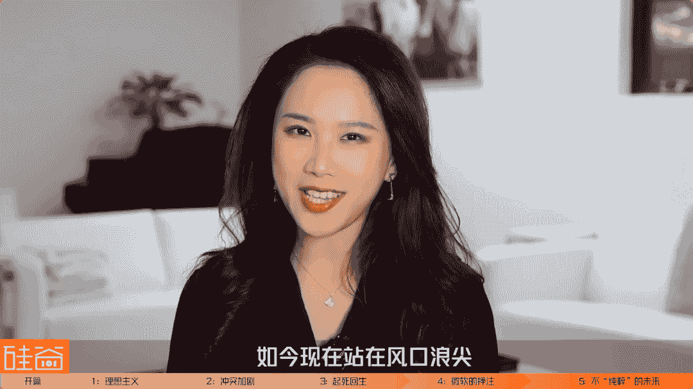

2022年3月底，伊隆-马斯克等一众科技领**袖发出联名信，以人工智能的安全**担忧为由，要求暂停开发更强大的AI系统。

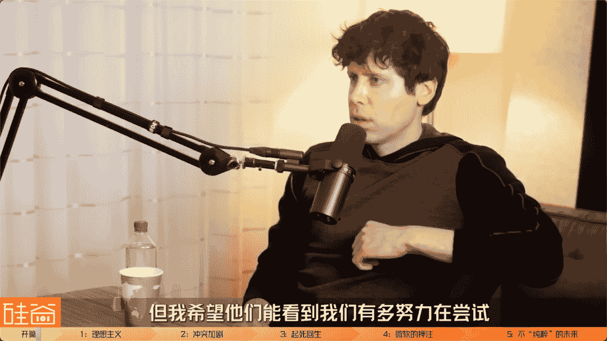

而Sam Altman这个人，在公关和在商业路径设计上，都太厉害了。所以，随着AI发展派和反对派的声浪都双双的日益高涨，硅谷开始纷纷站队，所以最近又有很多知情人士将OpenAI发展的细节和故事给曝光了出来。我们就结合所掌握的信息，其中包括了我们硅谷101的一些独家线索，再来详细复盘一下OpenAI的崛起。

# 1、理想主义：一群纯粹的顶尖科学家

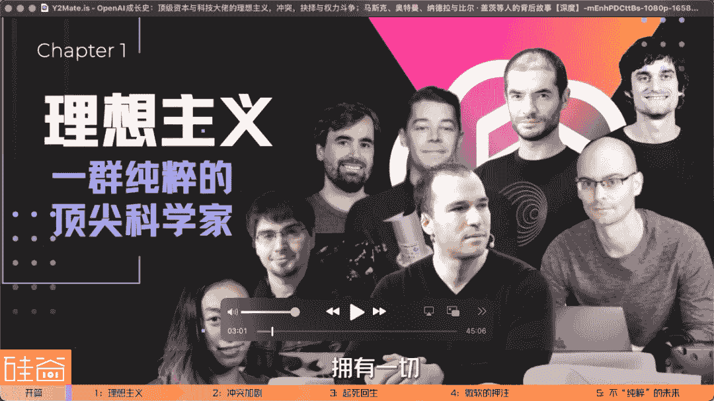

2014年，**谷歌以6亿美元的价格收购了当时在行业中**最顶尖的人工智能研究机构DeepMind，没错，就是之后推出Alph**aGo在围棋上打败李世石和柯洁那家AI研究公司。在硅谷，一**众大佬坐不住了。他们比公众更早的看到人工智能带来的潜力与威胁：在未来，谁拥有最强大的AI技术，谁会就有最难以撼动的权力。他们害怕，谷歌会成为垄断式的AI权力霸主 – 而就连谷歌当时“Don’t Be Evil”（不作恶）的公司座右铭都无法消除他们的担忧。所以，根据Wired杂志的报道，在2015年的一个夏天傍晚，几位硅谷最有影响力的人物聚集在斯坦福大学旁边的Palo Alto瑰丽酒店的一个私人会议室中。没错，就是那个硅谷最贵的豪华酒店。跟很多硅谷项目从车库里出来不同，可能这就预示着含着金钥匙出生的AI项目注定就是一个烧钱机器。

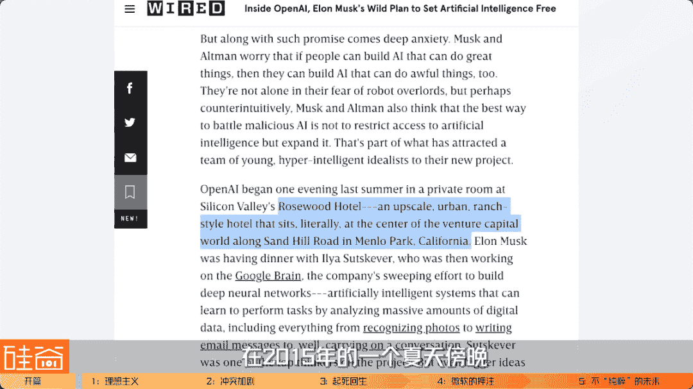

这次会议是由硅谷孵化器YC掌门人Sam Altman发起的，想聚集一些人工智能领域最顶尖的研究员，来讨论共同建立一家AI实验室。这些研究员当中，包括了当时在Google Brain的人工智能研究员Ilya Sutskever，互联网支付处理平台Stripe公司的首席技术官Greg Brockman等。而马斯克会出现在这个会上，也是因为他是Sam Altman的老朋友，并且AI技术对马斯克旗下公司 – 无论是特斯拉还是SpaceX来说 – 都至关重要，并且，马斯克对人工智能的安全问题从很早就开始给出警告。所以，两位有着顶级资源和资本的大佬，带着几位有着顶级技术能力的AI研究员就开始搞事情了。

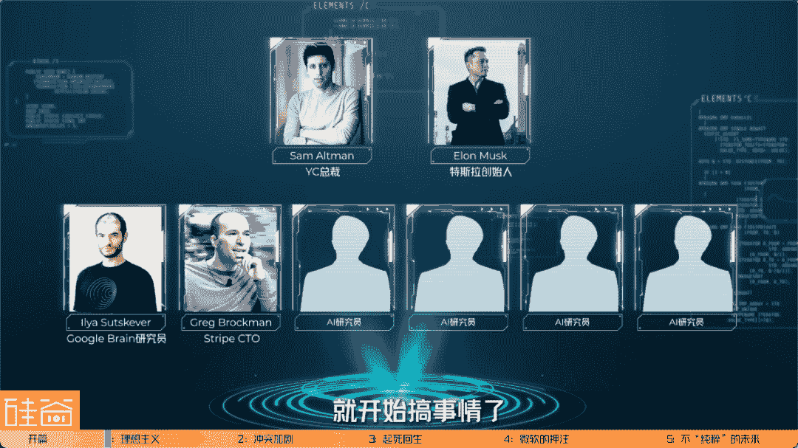

**他们最开始想做的是谷歌的对立面，一家不**受任何公司**任**何资本任何人控制的AI实验室，大家一致认为，这才是让人类更接近以安全方式构建通用人工智能AGI的正确路径。（AGI：具有一般人类智慧，可以执行人类能够执行的任何智力任务的机器智能。）创业嘛，最重要的是找人找钱找方向。大方向有了，接下来就是人才和钱了。你要做全世界探索AGI的领头羊，你需要的不是一般的人才，而是人工智能届最最最最顶尖的高手。但这些高手分布在各大科技巨头中，被高薪供着，怎么能吸引他们出来呢？Brockman首先想到的就是2018年获得图灵奖的神经网络三巨头Yann LeCun, Yoshua Bengio和Geoffrey Hinton教授。

这里插一句：本轮人工智能的技术突破正是因为“神经网络”这个曾经不被看好的研究路线获得突破进展，也必须归功于这几名老科学家几十年来在AI寒冬中的坚持，这部分历史起源我们之后准备单开一个AI大模型系列来讲其中的故事，大家记得关注我们硅谷101，敬请期待。回到Brockman这里，三大巨头中，Hinton教授在谷歌，LeCun教授在脸书，年纪都比较大了、不大可能全职出来。Bengio教授主要在学术界活动，对产业届没多大兴趣，不过Bengio给了Brockman一个名单，上面是AI神经网络领域最优秀的研究人员。大家记一下这个时间线哈，结尾的时候还有一个关于Bengio蛮讽刺的小反转。Brockman当时一拿到这个名单就像一本武功宝典一样，赶紧回来和大家开始去联系这个名单上的所有人。但是，问题来了：刚才我们说到，这些顶尖科研人员在科技大厂里面薪酬非常高，要拉他们出来，还是一个非营利组织，前途未明、空有一张大饼，还是不太容易的。怎么突破呢？诶，这里就要说到硅谷另外一个地理优势了：Napa酒庄。

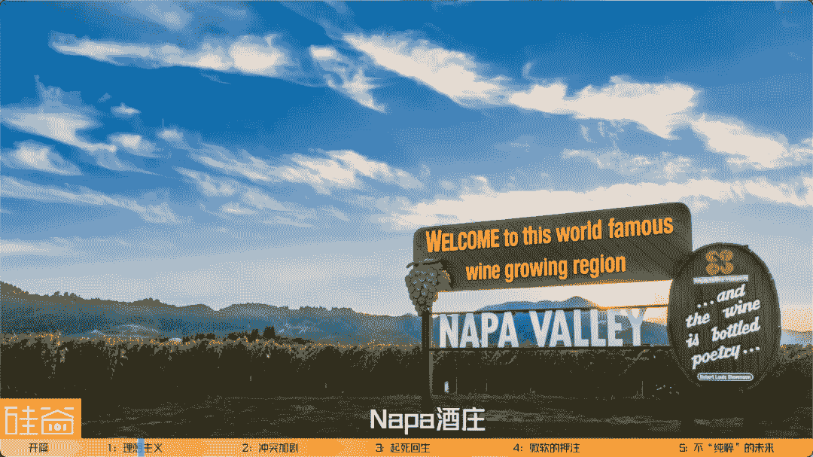

**从硅谷往旧金山开一个多小时，就是**美国最著名的产酒地区：纳帕溪谷。在硅谷星巴克谈不成的事情，拉去Napa酒庄住一个周末，就不一定谈不成了。Brockman不愧是创业多年的老手，在Bengio给他的名单上，选了10个他觉得最重要的研究员，拉去了Napa酒庄度过了一个周末。Brockman对Wired杂志就描述说，当你在Napa酒庄将人们聚集在一起的时候，会很容易产生化学反应。你被困在那里，你必须说话，必须参与。在度过了一个周末、要离开Napa酒庄的时候，Brockman邀请了这十名研究人员加入OpenAI，并给了他们三周时间考虑。而在这三周，硅谷的科技巨头们听到了OpenAI的风声，开始出更高的薪资，要留住这些顶尖AI研究员。而正因为科技巨头的留人行为，OpenAI不得不推迟对外宣告成立的时间。要知道，这些顶尖AI研究员的工资已经很高了。

媒体报道原文是“Eclipsed the cost of a top quarterback prospect in the NFL”（超过了美国NFL橄榄球联赛中的顶尖四分卫的薪水），我平时不是橄榄球的粉丝不是很有概念，然后去查了一下，结果吓一跳：这些顶级橄榄球星的薪水都是几百万、上千万美元的，也就是说，最顶级的AI研究学者在科技巨头中的年薪也是这个价格，当然可能还包括股票啥的。而且，据其中一名研究员说，在得知他们有意向离开的时候，科技巨头们为了留住他们开出的新价格，是这个行业中已经如此高薪的工资的再2-3倍。但是，就算大公司们给出了这么极具诱惑力的年薪，十位受邀请的AI顶尖学者中，有九位都拒绝了高薪、加入了OpenAI。也不知道是不是Napa的红酒起了作用。OpenAI完全没有实力来match这么高的薪水，因为OpenAI最开始是非营利组织所以每年要公布支出。税务文件显示，给首席技术官Ilya Sutskever的薪水是大概190万美元，另外一个首席研究员Ian Goodfellow是80万美元，这两人都是从谷歌挖过来的，虽然当年他们的薪水公布之后是引发了一些舆论争议，觉得在非营利组织里面这个公司太高了。但是，我们要知道，他们从谷歌出来加入OpenAI，这个薪水下降得不是一点半点。我把OpenAI的历年报税表给找出来了，上面有蛮多有意思的信息的。

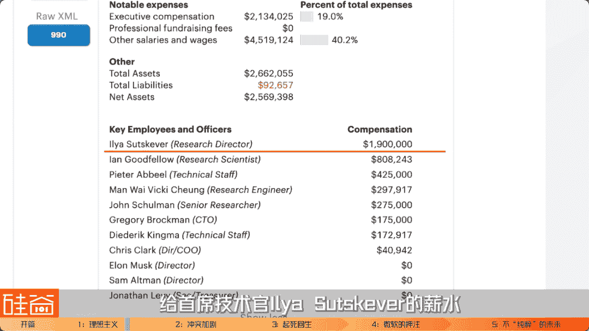

**OpenAI第一年的花销是1123万美元**，其中超过665万是50多名员工的工资。平均算下来，在硅谷的水平也就真的还好。

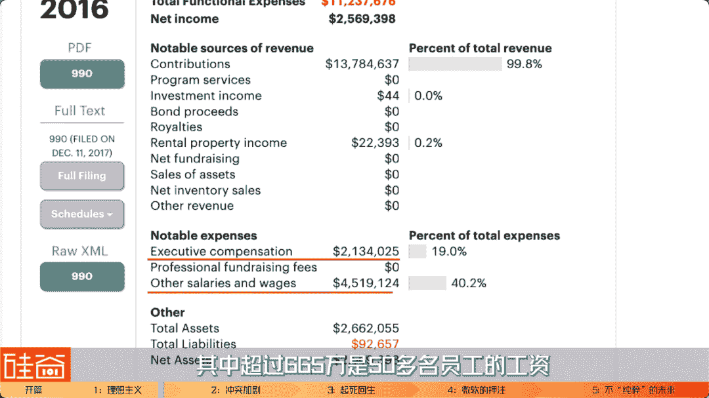

而这些放弃高薪的顶尖科学家们，加入这样的一个充满巨大不确定性的非营利组织，没有股权没有慷慨福利没有豪华年会没有明确的升值路径，其实就是因为一个很纯粹的目的聚在一起。这个目的，也写在了OpenAI的创**立章程中：确保通用人工智能（AGI）造**福全人类。2015年底，我们上面提到的YC总裁Sam Altman、Strip前CTO Greg Brockman、LinkedIn创始人Reid Hoffman、YC联合创始人Jessica Livingston、著名投资人Peter Thiel、特斯拉创始人Elon Musk、亚马逊AWS、Infosys公司和YC Research宣布成立OpenAI，并承诺给这家非营利组织机构投资超过 10 亿美元。由于OpenAI的非营利组织形式，没有人拥有公司任何股份或权益，而公司的财产和收入永远不会派发给任何捐赠人或业主。OpenAI表示，将通过向公众开放其专利和研究，并且会与其他机构和研究人员“自由合作”。

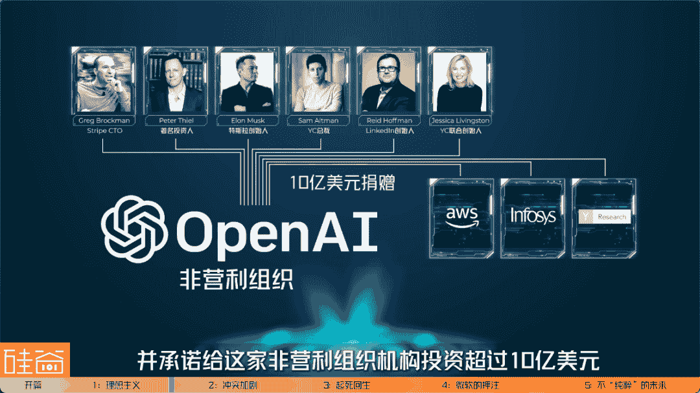

听上去是不是很理想主义、非常乌托邦？最开始确实挺振奋人心的，但很快，OpenAI内部冲突四起。

# **2、冲突加剧：马斯克的决裂**

冲突的起因很简单，人工智能技术，是一件耗钱耗资源耗算力耗时间的事情。最开始，这些最顶尖的研究员和硅谷最有影响力的资本家们还可以为爱发电，但真正开始做的时候，发现烧钱是个无底洞，而看看OpenAI的对手们，哪个不是手握千亿美元资金的科技巨头。并且，我们硅谷101在跟OpenAI早期实习生聊的时候，对方回忆说，当时办公室座位，前后左右都是业界最牛的大佬，每个人想法都不一样，大家擅长的方向和领域也可能不一样，还没找到一个着力点，让这批世界上最牛的AI科学家们拧成一股绳一起发力。这个时候是最难的，谁也不服谁。确实在早期，OpenAI被谷歌的DeepMind各种吊打。而且从税表上我们也可以看到，最开始，硅谷大佬们承诺的10亿美元也不是一下就全部到位的，而是分成好多笔一点点到账，这意味着OpenAI每年的预算都有限，也不敢乱花。做个对比，在OpenAI报税表上，我们看到2017年，OpenAI的职能支出在2866万美元，其中云计算上就花了790万美元，训练模型的CPU和GPU甚至都要从谷歌那么去租。对比一下背靠谷歌这颗大树的DeepMind，2017年的总支出是4.42亿美元，想要云计算，想要CPU/GPU，随便在谷歌调用，你看这资源和资金差距，是不是有点大。并且在早前，OpenAI发布的研究结果并没有掀起什么水花，反而谷歌那边各种风光一时无两。比如说在OpenAI发布的OpenAI Gym和Universe让它在圈内稍有名气的2016年，诶，谷歌DeepMind的AlphaGo击败了围棋顶级选手李世石，引发全民对AI的关注。2017年，好不容易OpenAI在Dota2游戏上战胜了人类顶级选手，你说可以火一把了吧，结果谷歌发布了Transformer模型，这个模型是奠定所以大语言模型的基础架构，反正就是震惊整个业界的牛。然后在2018年，OpenAI基于Transformer发布了GPT第一代，结果谷歌随后重磅发布了跨时代意义的Bert，比GPT参数大四倍，几乎所有表现上都碾压GPT。

稍微说一句哈，以上提到的产品，技术和模型如果大家听得有点云里雾里，没关系，我们之后的大模型系列会专门详细说说这些技术的进化。反正今天这个视频里，大家知道，2018年底之前，谷歌都全面碾压OpenAI就可以了。这个时候，业界对OpenAI各种不看好，之前好不容易请来的很多技术大佬，不少又回谷歌脸书这些大厂了，公司面临着严重的人才流失、军心不稳。在2018年的时候，我们的马斯克大佬就坐不住了。气势汹汹来问罪说：你们都在干嘛，烧了钱出不来活儿，说好的要领先谷歌率先达到AGI呢，结果落后这么多！对马斯克熟悉的观众们都知道，马斯克是非常有占有欲和掌控欲的，根据科技媒体Semafor的信源爆料，马斯克就直接向OpenAI的董事会提议，我要全面接管OpenAI，我来当CEO。但是在2018年那会儿，大家可能还记得，马斯克他本人已经被特斯拉搞得焦头烂额，当时Model3又遭遇了生产地狱、被市场疯狂做空、质疑很快就要破产了，而马斯克每天就睡特斯拉工厂里。就这样，马斯克还想再全部接管OpenAI这个完全不同赛道的AI实验室，OpenAI的董事会肯定觉得不靠谱，就拒绝了马斯克的提案。于是，Semafor和Wired杂志等媒体报道，马斯克非常不爽，甩手就走人了。

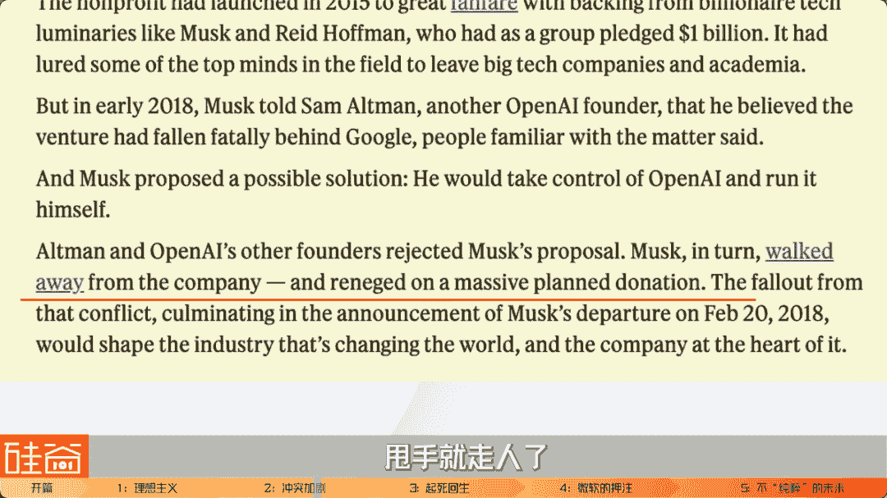

当然还有其它的一些说法，包括马斯克先挖走了OpenAI的核心研究员Andrej Karpathy去特斯拉做自动驾驶的主管，这就让OpenAI的人不太爽，怎么还带挖自己墙角的。所以利益冲突和矛盾慢慢就起来了，哦补充一句，最近这哥们儿又跳回OpenAI了，感觉里面的瓜不少。当然，还有一些阴谋论我们就不在这里展开了，总之，2018年，马斯克宣布退出董事会，当时在媒体上大家关系都做得挺好看，马斯克也表示在离开董事会之后将继续捐赠和支持OpenAI。但是，马斯克在离开之后，就立即停止了捐赠。Wired杂志以及网站Semafor都报道，此前，马斯克承诺在几年内将向OpenAI捐赠10亿美元，而马斯克和OpenAI分手之际，他兑现的捐赠仅在1亿美元。也就是说，马斯克的离开和他尚未兑现的捐赠，将OpenAI一下推到了一个非常不利的境地：训练AI模型比之前想象得要更烧钱，如果公司无法找到技术突破点、一直被谷歌等大公司碾压，那么很快只能关门大吉。就在这个时候，Sam Altman意识到，自己必须要站出来了。在2018年之前，Sam在公司内部只是一个“董事”的职位，CEO一直是Greg Brockman。根据当时OpenAI的实习生回忆，在公司不太见得到Sam本人，因为他那个时候还是YC的掌门人，很大的一部分时间其实在管理那边的事物和孵化YC的创业项目。OpenAI的税务文件显示，直到2018年，Sam才把自己的职称在董事之外，加上了总裁President一职。随后，马斯克退出了OpenAI董事会，再之后，Sam在2019年接替Brockman成为了OpenAI的CEO，Brockman退成了CTO首席技术官。这意味着，Sam辞去了YC总裁的职位，正式将工作重心转移到OpenAI这边。

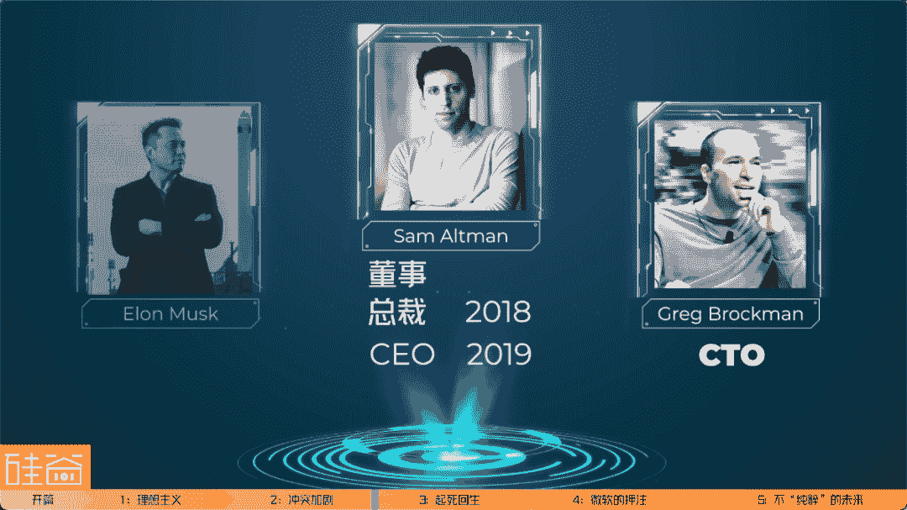

**对于**Sam来说，正是与马斯克的决裂让他对非营利组织的模式产生了动摇。而正是因为他放弃纯粹的非营利组织模式，转而探索更现实的商业路线，OpenAI和ChatGPT才能出现在如今众人的眼前。

# 3、起死回生：Sam Altman选择的商业道路

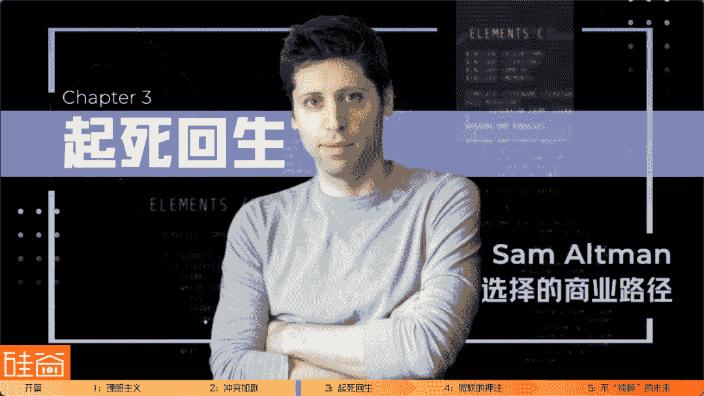

先来说一下Sam这个人。Sam是一个很神奇的存在，经常和马斯克一样被怀疑是机器人或者是人工智能。他甚至对记者开玩笑说，我要多去几趟厕所，这样你才不会怀疑我是个AI。Sam非常年轻，1985年出生在一个犹太家庭，美国芝加哥出生，密苏里州长大，8岁学会编程，16岁宣布出柜，本科考上斯坦福，大二选择退学创业，进入硅谷孵化器YC的首批孵化项目、开发了一个名为Loopt的应用，在2012年以4300万美元被收购，27岁的Sam因此获得了第一桶金，500万美元。之后，YC创始人Paul Graham准备退休、将28岁的Sam推上了YC总裁的掌门人席位。之后Sam在执掌YC，投资并孵化众多硅谷项目的同时，联合其它几个投资人成立了Hydrazine Capital风投基金用于投资YC的项目，在成立四年后翻了10倍，让Sam很早就实现了财富自由。短短几行字我们能感受到，Sam是一个天分极高、极其聪明、忠于自我、追求极致效率的人。

2016年《纽约客》有一篇报道用非常非常长的篇幅介绍了Sam，其中有几点细节描述我印象特别深：首先是对Sam的外貌描述，说Sam本人很瘦小，1米7左右，只有130磅（大概59公斤），眼睛是绿色，眼神犀利得像黑夜中的巨角猫头鹰。巨角猫头鹰和猫头鹰是有区别的，前者是非常犀利的那种，而对比之下，猫头鹰就有点萌萌哒。而且Sam的坐姿很奇怪，会把自己卷起来，经常被误会有“阿斯伯格综合症”。

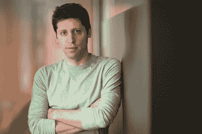

此外，在他的工作方式上，对自己和对同事都很苛刻，要求非常高，性格也比较冷漠偏执，情绪不太稳定，超级爱加班甚至一度患上了**败血症。同时，他对不感兴趣**的事情和人都超级没有耐心，会在员工讲话的时候毫不眨眼的盯着你，给对方施压加快速度。所以就是这么极度高效极度勤奋和极度聪明的人。这一点倒是和马斯克和乔布斯都挺像的。

但Sam Altman的最大优势是在于清晰的思路和对复杂系统的直觉把握，也就是商业战略和野心。他对技术细节并不感兴趣，让Sam最着迷的是技术对世界的潜在影响。他的这种能力其实对于科技创业非常关键，这也许是为什么Paul Graham在选YC继承人**的时候出人意料的选了Sam。因为说实话**，当时硅谷很多人对Sam这个人选是不服气的。Sam当时还太年轻，并且他第一次的创业也不是特别成功。Sam创业的Loopt一度估值达到1.75亿美元，但是后续融资不顺利，导致出售价格4300万美元，差不多就是融资的额度，这意味着对风投来说是负回报，所以Sam本人也说第一次创业的经历是完全的失败。然而，Paul Graham就是觉得，Sam就是他要找的人，他没有一个人选的名单，就只有Sam这一个选项。而Sam在担任YC掌门人的时候，完全展示出了他的野心，基本上重组了YC的模式。YC在Sam之前的模式是，每年从上万家初创公司的申请信中挑出200家左右，给他们每家12万美元，占股7%，然后孵化三个月，毕业这天给众多知名硅谷VC风投演示demo，之后继续融资，成长，做大做强。

但Sam不满意YC的模式，认为YC之前的做法只是把创业者送上摇摇晃晃探险的小船，送他们出海仅此而已，Sam想做的是搭建一只背靠强大帝国的铁甲舰队。意思是：YC不仅满足于占股7%，而是要用更多的资本在项目早期给予更大的支持，从YC孵化完成后的成长过程中还要继续投资这些公司。并且Sam不满足于YC每年打造两百家公司，而是想要打造一千家、一万家。并且他希望，这些公司形成的万亿市值的大船，能真正意义上的推动人类发展。很讽刺的是，在过去几年的时间，硅谷出现了一个比较尴尬的局面：虽然投资人和创业者都高喊着要改变世界要有雄心壮志要shoot for the moon，但真正落到实处，VC们的关注点却经常落在：什么时候能变现，客户增长曲线能否好看，利润能不能更厚一点这样的“六便士”问题上，希望创始人专注于打造某一区域的租赁平台或者送货服务；而那些“月亮”项目，比如说核聚变，生物科技，人工智能这些硬技术上，大家出手得越来越谨慎。所以“硅谷已死”的言论在过去几年出现很多。

Sam接管YC之后，马上就写了一篇文章发表，标题是“Science seems broken”（科学看上去破产了）来警醒硅谷和学界，并呼吁能源、生物技术、人工智能、机器人和其他硬科技领域的公司提出申请。Sam认为，YC身为最有影响力的孵化器，只有公开支持这些硬科技的项目，大学里的学生们才会继续对这些领域保持兴趣，创业者也才会更有信心。所以，Sam执掌下的YC开始筹集更多的资金去支持项目，甚至成立了一个名为YC Research的非营利组织去对那些异想天开的科研想法进行纯粹研究。连硅谷著名的风险投资家Marc Andreessen都评价说：“在 Sam的领导下，YC的雄心壮志水平提高了 10 倍。” 而也许这就是当年Paul Graham一定要Sam接任的原因，因为他意识到，“Sam的目标是创造整个未来”。

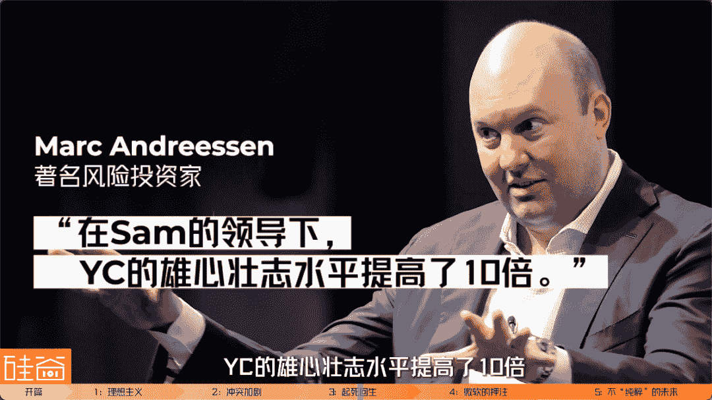

而但Sam在执掌YC几年后，OpenAI走到了命运的十字路口，S**am辞去YC的职位，全职加入OpenAI。就在马斯克退出董事会、切断资**金捐赠时，Sam Altman意识到，如果他不站出来主导转型，那么OpenAI只有倒闭这一条路。现在，他要重新再设计架构，在商业和社会责任中去寻找一个平衡点。 Sam去找了硅谷著名投资人Reid Hoffman和Vinod Khosla。

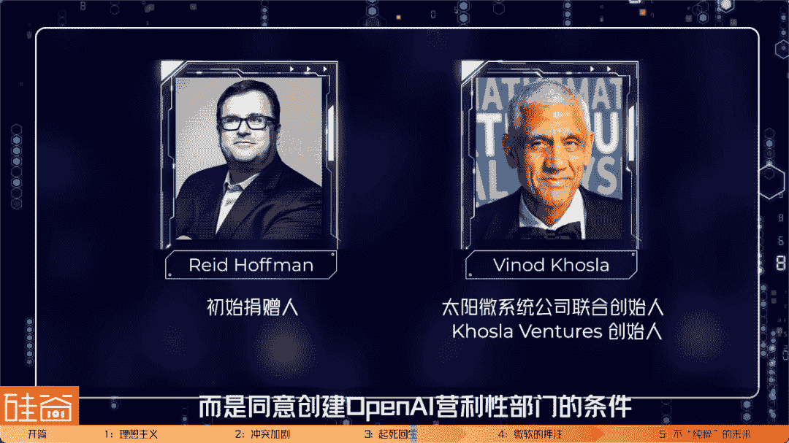

前一位大家很熟悉了，我们最开始提到过，是OpenAI最开始的捐赠人之一，后者是亿万富翁，也是太阳微系统公司(Sun Microsystems)的联合创始人，之后创立了自己的风投基金Khosla Ventures。

**Sam的需求是上千万美元，但不再以捐赠的方式，而是同意创建OpenAI营利性部**门的条件**。**Hoffman和Khosla两名大佬在反复讨论了未来回报之后，写了支票。2019 年 3 月 11 日，OpenAI宣布在母公司OpenAI Inc的非营利主体下，创建一个限制性营利实体OpenAI LP。为了保留控制权，OpenAI Inc这家非营利组织实体将作为General Partner普通合伙人，意味着OpenAI Inc的董事会来负责新公司的管理和运营。在OpenAI Inc的董事会席位中，三个席位是员工，包括Sam Altman为CEO，Ilya Sutskever为首席科学家，Greg Brockman是董事长兼总裁。

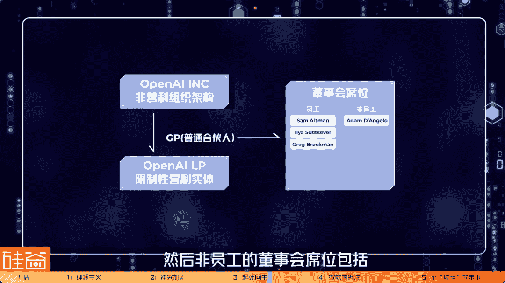

然后非员工的董事会席位包括Quora的联合创始人兼职CEO Adam D’Angelo, 投资人Reid Hoffman, 前共和党联邦众议员Will Hurd, 乔治城大学安全与新兴技术中心战略总监Helen Toner，还有机器人公司Fellow Robots的首席执行官Tasha McCauley（对了，这里插一句，她老公是谁你可能想象不到）没错，就是参演过《和莎莫的500天》《黑暗骑士》《盗梦空间》《史诺登》中的好莱坞文青男神约瑟夫·莱维特Joseph Gordon-Levitt。是不是瞬间觉得这个董事会名单有点八卦了，别着急，还有一个大瓜，你们知道另外一位女性Shivon Zilis是谁吗？她，就是马斯克现在最小的双胞胎娃的妈。是不是这八卦值蹭一下就上去了。

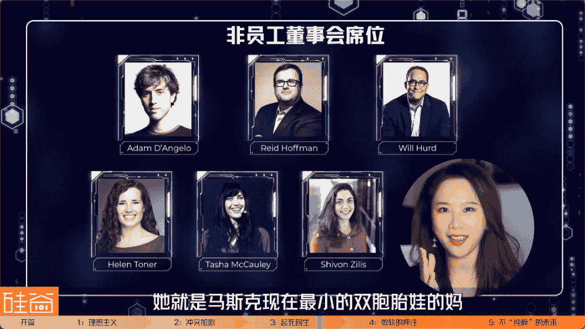

这对双胞胎是2021年11月出生的，是马斯克的第8和第9个娃。Zilis在2016年担任OpenAI的顾问，估计在那个时候认识的马斯克，之后跟随马斯克去了特斯拉，后来去了马斯克旗下的脑机接口公司Neuralink，但一直担任OpenAI的董事。但3月份马斯克开始和Sam对呛之后，估计Zilis也很尴尬，就离开了董事会。八卦时间结束，回到公司架构上。

这些OpenAI的董事会成员只有少数人持有OpenAI LP的股份。注意一下，大家的持股都是营利实体Open LP的，大实体OpenAI Inc是非营利组织架构不能持股。

而投资人和公司员工拥有OpenAI LP的股份，被称为，LP有限合伙人，他们的回报上限是100倍。OpenAI大概率不会走上市这条路，也多半不会接受被收购，那么投资人的退出方式则是每年的利润分红，在未来，一旦累计分红超过100倍的回报，资金就会自动流入OpenAI Inc非营利组织的账户中。而当LP和公司的使命发生冲突的时候，要由没有持股的董事会成员来投票。

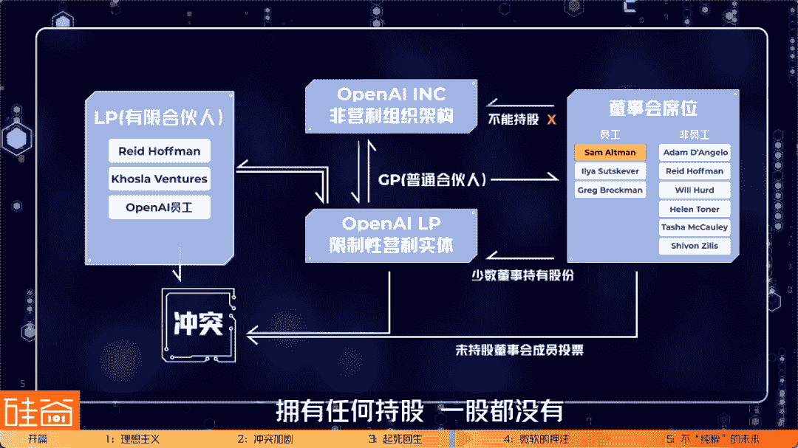

这里有一个重要的知识点，**Sam Atlman本人没有在这个新架构中拥有任何持股，一**股都没有，只拿了每年6万多美元的基本工资。

The information报道说，Sam对外宣称是因为他已经足够富有，不需要更多的金钱回报了，并且Sam不拿股份这件事情也劝退**了很多投资人，因为硅谷的逻辑是，一个公司的CEO要有足够的激励去创业，**不拿股份可能意味着你自己也不看好公司的前景。但如果我们回到公司董事会投票的章程上，可以猜测，Sam不拿股份是为了在LP和公司使命起冲突而需要没有持股的董事会成员来投票时，他能够有投票权。也就是说Sam希望用放弃金钱上的激励，来换取权力上的激励。就像最懂Sam的Paul Graham在接受媒体采访时说的那样：“一个人为什么要做一些不会让他变得更富有的事情？一个答案是，很多人一旦有了足够多的钱就会这样。另外一个答案是，他喜欢权力。” Sam可能是前者，也有可能是后者。OpenAI的商业化转型招致了大量的外界舆论争议与批评。但对Sam来说，似乎也没有选择。当他意识到理想主义行不通时，就毅然选择了实用主义，但也尽最大可能去平衡了这两者，他的选择看上去确实都是最优解。

2018年，OpenAI已经确定了基于Transformer模型的GPT路径，接下来需要大量的算力和参数去训练。人才和资金都是接下来缺一不可的。OpenAI LP的新架构能给员工们提供类似初创公司的股权激励，稳定住了军心，同时，这样在硅谷史无前例的新架构也吸引了一位同样雄心勃勃的大LP投资方：微软。

# 4、Nadella的抉择：无视盖茨的反对

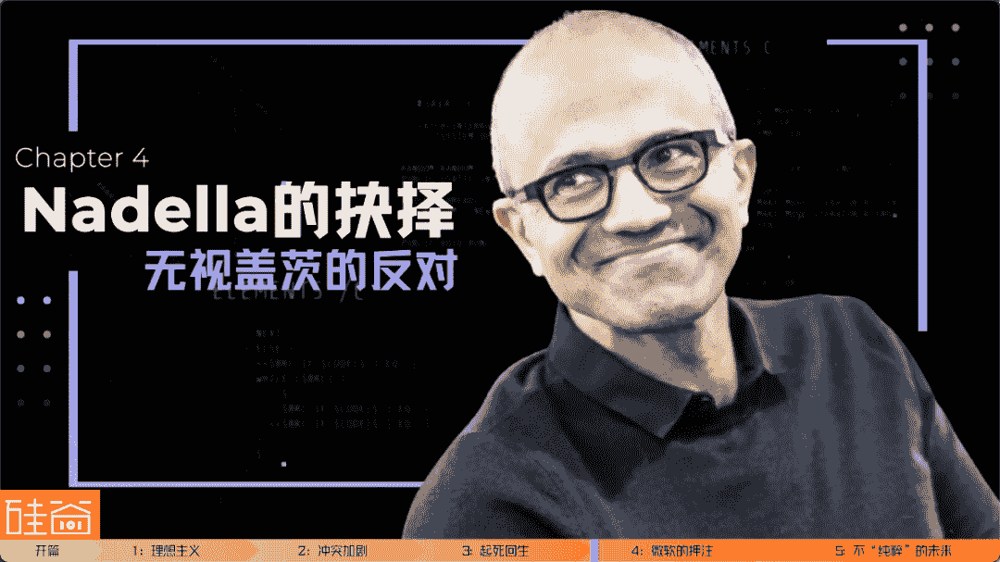

现在我们看微软对OpenAI的投资，很多人会说，微软太聪明了，这个投资太好了，太有眼光了。但如果我们回到过去，会发现，这个决定也没有那么简单。

Satya Nadella在2014年接替比尔-盖茨、被任命为微软CEO之后，一直非常支持人工智能技术的研发。但微软在AI上也摔过一个大跟头。

微软在2016年就尝试过推出一款AI聊天机器人Tay，并在Twitter，Facebook，Snapchat和Instagram所运营的社交媒体上都发布了这款软件。然而很快，Tay就被网友们玩坏了，故意教会Tay说具有攻击性的言论，所以很快在Twitter上，网友们就开始各种收集Tay说的反犹太人言论，各种种族歧视，性别歧视，脏话等等。结果Tay发布不到一天就被关闭。

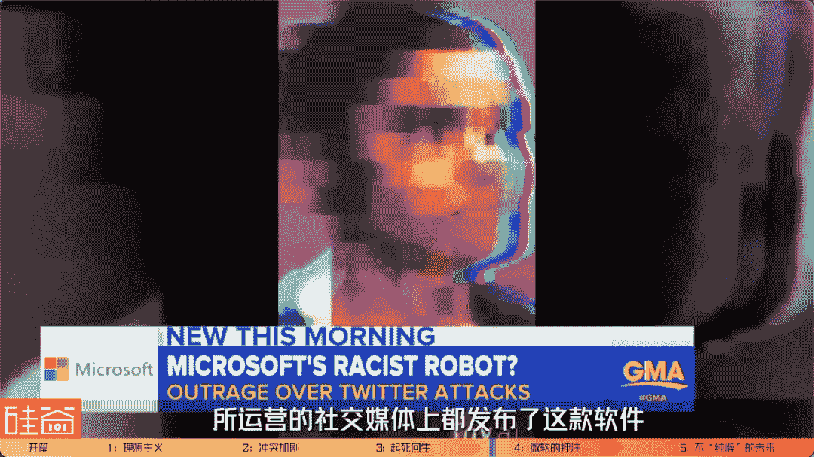

Th**e information报道，虽然摔过跤，但Nadella依**然非常看重AI的潜力，试图鼓励让微软各部门都尝试用AI模型来提升产品，也和英伟达达成了协议来开发训练AI的GPU。种种迹象都让微软成为了Sam Altman眼中的一个非常有吸引力的合作伙伴，多次前往西雅图试图达成交易。

然而，当Nadella想在微软内部推动和OpenAI的合作的时候，他受到了相当的阻力，一部分的阻力来自于微软创始人比尔-盖茨。

虽然**比**尔-盖茨在2008年退出微软的日常工作之后，媒体对他的很大曝光是慈善，还有在抗击贫困、疾病和气候方面的项目上，但老爷子依然有大概20%的时间是在审查微软新产品上的。其中，在2019年，微软和OpenAI接触的时候，比尔-盖茨亲自参与了对OpenAI合作的审查中， 而且表示了，自己不喜欢这项投资，并持有怀疑态度。

但是，比尔-盖茨在名义上是不再参与微软的日常运营，Nadella有权力自己做决定。所以，Nadella还是决定押注AI。

2019年7月，微软宣布与 OpenAI 建立合作伙伴关系，向这家初创公司投资10亿美元，成了OpenAI的大投资人LP。

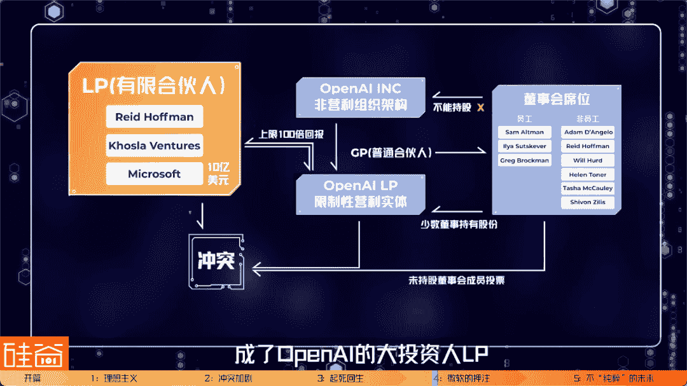

但如果我们仔细来看这个deal，会发现，其实Nadella还是很精的。媒体都在广泛报道微软投了Ope**nAI10亿美元，但事实上，这个10亿美元中，大部分都以微软的Azure云服务积分的形式兑现，没太用额外的新现金，**相当于OpenAI免费用微软的云服务来训练和运行AI模型。而微软获得了OpenAI技术的独家权，可以在Bing**搜索等产品上使用OpenAI的大部分技术。对于微软**来说，还顺便有个好处就是捅了谷歌一刀，因为OpenAI一直是谷歌云的最大客户之一，2019年和2020年一共给谷歌交了1.2亿美元的云计算费用。所以，不用太多的现金就得到一个新伙伴，同时还打击了竞争对手，Nadella这步棋简直是一石二鸟有没有。但是要知道，在与OpenAI合作期间，除了刚才说到的比尔-盖茨，Nadella还遇到过很多压力，大多数是财务和资源上的，因为OpenAI需要的算力太大了。

2019年发布的GPT-2有15亿的参数，2020年5月发布的GPT-3有1750亿的参数，每一次GPT的升级，参数量都是指数型的上升。后来训练ChatGPT的时候，CNBC报道，微软专门为OpenAI推出了一台全球前五的超级计算机，用了1万个英伟达的DGX A100 GPU。我稍微算了一下帐，每个DGX A100的server服务器上有8个GPU、卖价是20万美元，所以ChatGPT用了1250个A100 GPU服务器，也就是2.5亿美元。另外，训练一次大模型就要几百万美元，每年的云成本也都上亿。

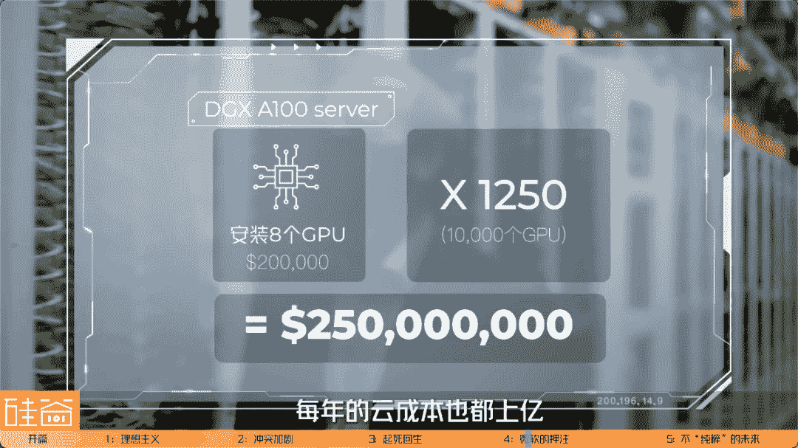

而同时，**微**软还面临着2022年开始的美联储加息周期下的资本寒冬、上万人的裁员，所以，Nadella对OpenAI全力的支持不是没有压力和风险的。《纽约时报》报道说，在2019年到2023年期间，微软其实又给OpenAI投资了20亿美元，但这笔交易细节没有公开，所以我们不知道这20亿里面是什么条件，但这都不重要，因为很快，Nadella会发现，自己赌对了。

OpenAI在2020年5月发布的GPT3引发了业内轰动，紧接着基于GPT3.5的ChatGPT在2022年底发布之后一鸣惊人，直接让谷歌拉响“红色警报”。

2023年，微软决定更深度合作。这次的投资额度是：100亿美元，持股OpenAI的49%。

新的谈判条款依然对微软很有利。这次的投资协议对未来的利润分配有了更详细的规定：

第一阶段：100%利润全部给到初始和创始投资人，直到投资人回本；

第二阶段：25%利润给到员工和支付投资人的回报上限，剩余75%给到微软直到回本、收回130亿美元投资额；

第三阶段：2%给到OpenAI Inc非营利组织，41%给到员工，8%支付投资人的回报上限，剩余49%支付微软的回报上线。

第四阶段：等到所有投资方的回报结清，100%的权益回流到OpenAI Inc非营利组织。

对于微软来说为什么是一个非常有利的协议呢？因为首先，这100亿美元的投资也不是全现金，而中间可能很大部分像之前投资那样，是OpenAI使用微软超级计算集群的权利和credit积分，就相当于OpenAI先用着微软的资源，然后慢慢还钱，并且还以数倍的价格给分红，这简直相当于高得不能再高的高利贷了。

这里要注意，最开始OpenAI规定的是初始投资方的最大回报是100倍，之后进来的投资人回报率是相对打折扣。基于此，《财富》杂志预测，在未来，OpenAI会还给微软130亿美元的本金之外，微软还会分得大概920亿美元的利润回报。是不是很赚。

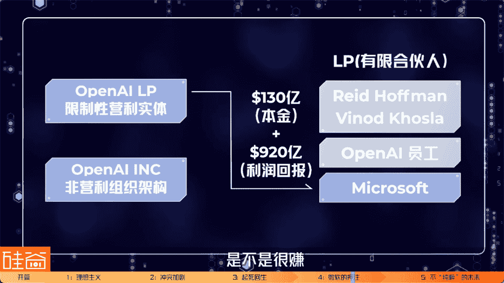

并且，The information还给了一个爆料，说OpenAI正在考虑放松最多100倍回报的限制，改成每年将利润分配增加20%。这个消息还没有正式公布、可能还会有变数，但确实给了像微软这样的投资人更有潜力的未来回报，这也使得一些已经分配给员工或投资人的OpenAI股份也正在被风投基金争先恐后的抢购，

在去年，红杉资本、老虎全球、Bedrock Capital 和 Andreessen Horowitz就用200亿美元的估值，从OpenAI员工和之前投资人那里入股了OpenAI。而可想而知，在今年ChatGPT爆火之后，OpenAI的股票会在一级市场中多么吃香。

**而**确定的是，OpenAI和微软签署的条款意味着，OpenAI接下来一定会推动商业化进程，确实我们也看到OpenAI开放了API借口，ChatGPT也推出了付费版本。商业变现压力是很大的，毕竟有金主爸爸们在后面等着还钱。

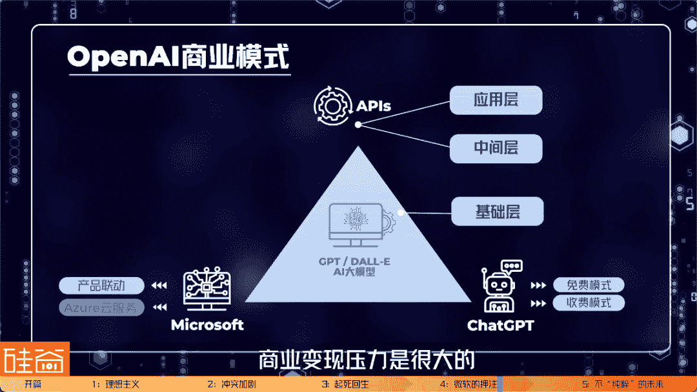

但对于微软而言，投资OpenAI的战略意义远高于投资回报，ChatGPT的横空出世与微软的产品紧密联动，比如现在的New Bing已经链入了ChatGPT，对谷歌搜索造成了降维打击，另外，微软还在继续将OpenAI的人工智能技术整合到旗下的各类软件、GitHub编码工具、Microsoft 365工具套件还有Azure云服务中，整个微软的产品升级速度非常快。这使得微软一跃成为此轮AI风口的先驱。

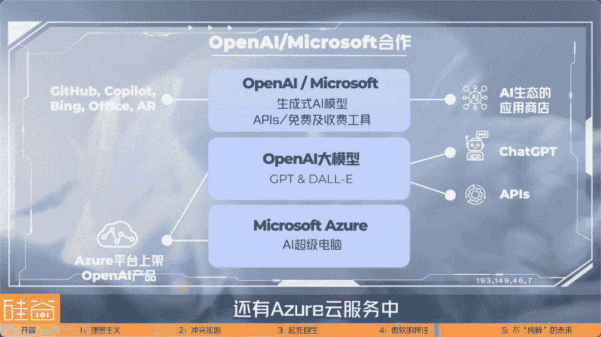

微软之前一直没有披露人工智能业务的规模，只是在去年10月提过一嘴，说Azure的机器学习服务连续四个季度翻番，而富国银行就预测，AI的应用将为微软每年新增超过300亿美元的营收，其中大约一半来自云服务Azure。

也就是说，**OpenAI就算还不上钱了、或者分红很慢，**也没关系，因为微软可以自己用AI赚回来。所以，不得不说，投资OpenAI的这步棋，Nadella走得真是太有远见了。而当年差点毙掉OpenAI投资的比尔-盖茨现在也开始自豪的讲述与OpenAI团队的接触故事，引发马斯克在推特上毫不留情地反怼说：“盖茨当年对AI的理解有限，现在依然如此”。

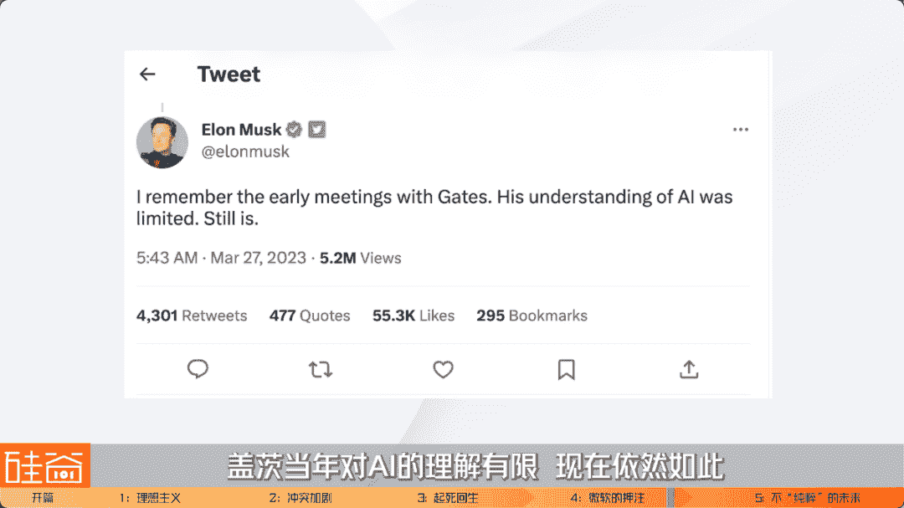

但无论如何，盖茨因为Nadella的坚持而重新让微软走到了最有利的位置，而马斯克这位“前人种树被后人乘了凉”的联合发起人，现在不仅跟OpenAI半点关系都没有，还只能在网上和Sam对呛，实在有点不甘心。试想一下：如果当初马斯克没有直接甩手走人，而是履行剩下9亿的承诺呢？结局会不会不一样？

一些在生成式人工智能竞赛的最新进展，《金融时报》报道，Elon Musk正式加入竞赛、开始了他自己的人工智能公司。

不过，最近媒体报道说马斯克从2月份就开始组建AI团队，已经从英伟达购买1万张GPU芯片，并从谷歌的人工智能部门DeepMind招募了两名大将，也开始加入到这场AI混战。我们也拭目以待，马斯克是否也能最终推出自己的大模型来和OpenAI一较高下。

# 5、不那么“纯粹”的未来：OpenAI会如何？

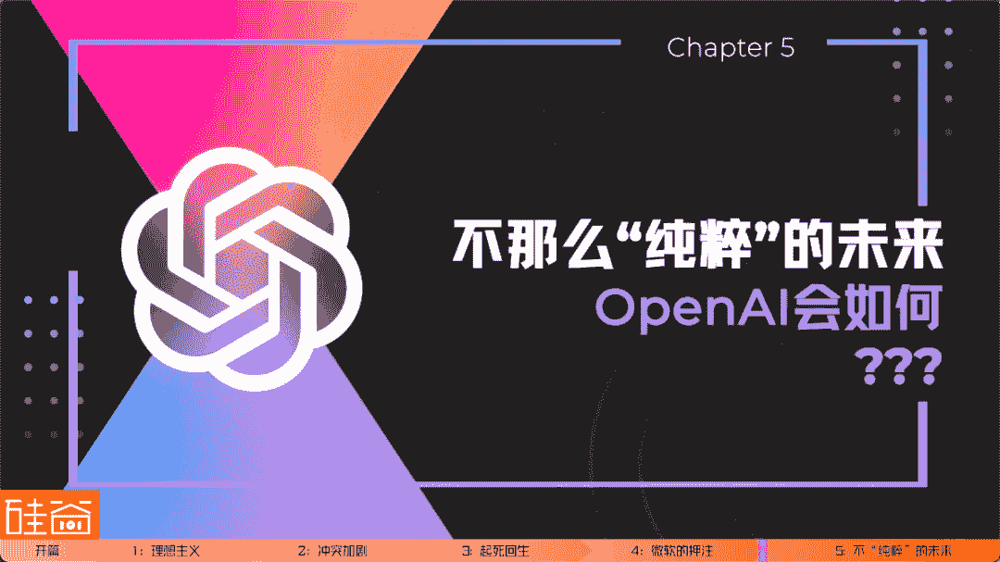

OpenAI如今站在了浪潮的最前方，但竞争才刚刚开始。OpenAI有领先优势，但优势不多。如今科技巨头们看到ChatGPT大模型的成功范式，开始纷纷入局。训练大模型不难，论文和技术都是现成的，堆钱堆算力就可以，但接下来难的，是如何将成本降下来，以及商业化模式的探索。

1965年，时任仙童半导体研究负责人、后来成为英特尔联合创始人之一的戈登·摩尔发表论文预测集成电路芯片上可容纳的晶体管数量，每隔18-24个月便会增加一倍，微处理器的性能提高一倍，或价格下降一半。这就是大名鼎鼎的“摩尔定律”。

而Sam预测，新版摩尔定律很快就要来了，他认为，宇宙中的智能每18个月翻一倍。但这句话有点模糊，到底是什么翻一倍，Sam没有具体做解释，这也是引发了学术界的很多争论，以及对人工智能安全进行监管的呼声也越来越高。

在GPT4发布的两周后，马斯克联合1000多人，其中不乏很多业内知名科学家和科技领袖签署公开信，呼吁所有 AI 实验室应立即暂停训练比 GPT-4 更强大的 AI 模型，为期至少 6 个月。

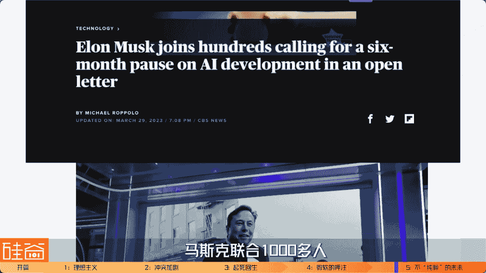

**这个名单上有一个的名字特别**引起**我**的注意：Yoshua Bengio，是不是看着有点眼熟？没错，就是我们片子开头提到的，给OpenAI“武功宝典”人才名单的图灵奖得主。Bengio可能在当年也没想到，自己未来有一天会后悔当初出的这一份力。如今看来，各大科技巨头的AI军备竞赛一旦开始，就很难停下来了，除非有全球政府和人类社会的强烈共识和监管，就像当年的克隆技术一样。目前，意大利以违反欧洲严格的数据隐私法 GDPR 为由暂时禁止了 ChatGPT，不排除之后有其他国家效仿，但在那之前，OpenAI与它的竞争对手们是不会停下的，因为领先意味着未来的市场份额，影响力和话语权。囚徒困境这道题在人类社会，百试不爽。

也许，OpenAI诞生的那天就注定人类通向AGI的这条路是不够纯粹的，会充满冲突、利益争夺与权力斗争。但是，这才是人性啊。很多悲观论调认为，作为如此逐利、贪婪、矛盾的人类，我们训练出的人工智能，怎么能保证其纯粹性呢？而在跟一个专业人士聊天时，他提醒我，目前大家看到的OpenAI版本是经过了好几个月的“阉割”，也就是雇佣了非常多人类审核员去剔除掉那些有害的、暴力的、有侵略性的语言参数，而未阉割版本的GPT模型是一个巨大的monster怪兽，OpenAI在守着这个怪兽不会将它放出来，Sam就像之前描述的那只巨角猫头鹰，在黑暗中为我们放哨。可是我们能相信Sam，能相信OpenAI吗？

Sam和马斯克等人一开始不相信谷歌所以创造了OpenAI，而如今，马斯克和Sam也互相不相信了。他们都觉得，自己才是能守住怪兽的人。

在结尾，我们再回到Sam和一众大佬们刚创立OpenAI的这一天。《纽约客》的文章描述到说：Sam在OpenAI位于旧金山的新办公室做的第一件事，就是走到会议室的墙上，写下有着“核动力海军之父”Hyman Rickover说过的一句名言。

这句话是：“生命的伟大目的不是知识，而是行动。我们每个人都有责任表现得似乎世界的命运取决于我们，我们必须为未来而活，而不是为了自己的舒适或成功。”

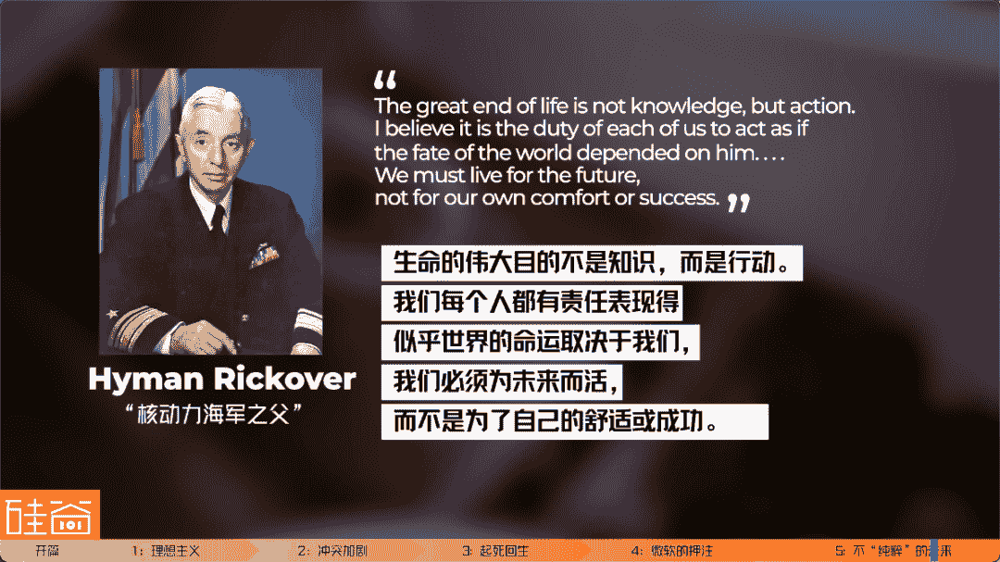

目前为止，Sam似乎是在这么做的，虽然他的商业化路径和在早期就将ChatGPT推向大众招致了很多骂名。但仍然要强调的是，Sam只是前方制定策略的人，但我们不要忘了，OpenAI的成功还是要归功于一种顶级科学家们，这包括放弃高薪出来加入OpenAI的这群人，还有ChatGPT所用到谷歌开源的Tranformer模型范式和RLHF基于人类反馈的强化学习方式背后的论文作者和研究科学家，以及再往前追溯，不放弃“神经网络”路径、坚持了几十年的的三名老科学家。科技的进步离不开这些最前沿的头脑和最纯粹的信念。

在这里故事中，有很多冲突，抉择和权力斗争，但同时，也有真诚的理想主义。而OpenAI崛起的复杂故事，其实也就是人性的故事。拥有这样复杂人性的我们，能造出一个什么样的AGI呢？我们拭目以待。