# Sora技术推演

> 来源：[https://xmgtoagi.feishu.cn/docx/FC0RdjZjko3YCGxd07CcBG7rnEH](https://xmgtoagi.feishu.cn/docx/FC0RdjZjko3YCGxd07CcBG7rnEH)

> 作者： 魔搭ModelScope社区

> 原文地址：https://mp.weixin.qq.com/s/3RnrO7fSMizEl3mN3SXG5w

https://openai.com/sora 工作一出，引起社会各界广泛关注。中美AI的差距进一步扩大，中美人才培养体系的差距等等言论，甚嚣尘上。

其实文生视频领域，华人学者和产业界的参与度还是非常高的，包括魔搭社区的VGen (https://modelscope.cn/models/iic/i2vgen-xl/summary) 系列， HeyGen在数字人场景也得到了大家的认可，清华的朱军老师团队在diffusion transformmers结合场景也深耕多年有很多的产出，例如U-Vit (https://github.com/baofff/U-ViT) 工作。 那么Sora到底是谁做的，怎么做的，本篇文章将从Sora的technical report进行详细分析，给出大致的技术猜测。 同时我们也相信国内同行在有着深厚积累的情况下，也能百家争鸣，紧追不舍。

# **Sora作者**

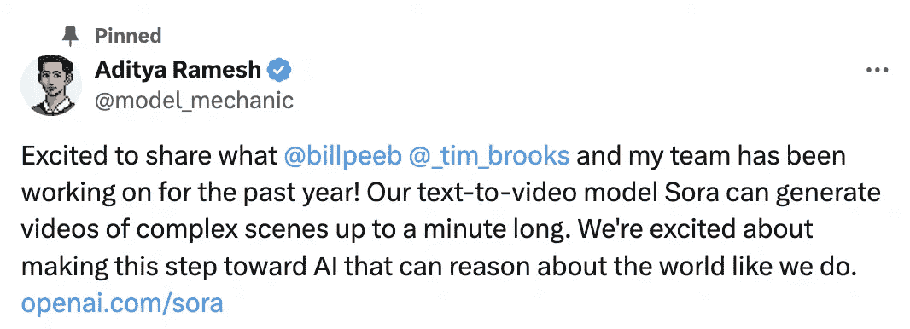

Sora的核心作者是Bill Peebles(https://www.wpeebles.com/)和Tim brooks(https://www.timothybrooks.com/about/)，Bill Peebles 在伯克利人工智能研究所完成了博士学位，导师是Alyosha Efros。在此之前，他在麻省理工学院攻读本科，指导老师是Antonio Torralba。他曾在FAIR、Adobe研究院和NVIDIA实习。

Tim brooks 在伯克利人工智能研究所获得了博士学位，导师是Alyosha Efros，他是InstructPix2Pix的作者。在此之前他曾在谷歌工作，参与Pixel手机相机的研发，在NVIDIA从事视频生成模型的研究。  Sora团队的Leader是Aditya Ramesh(http://adityaramesh.com/)， 他是DALLE、DALLE2、DALLE3的主要作者。

# **模块拆解**

### **Overview**

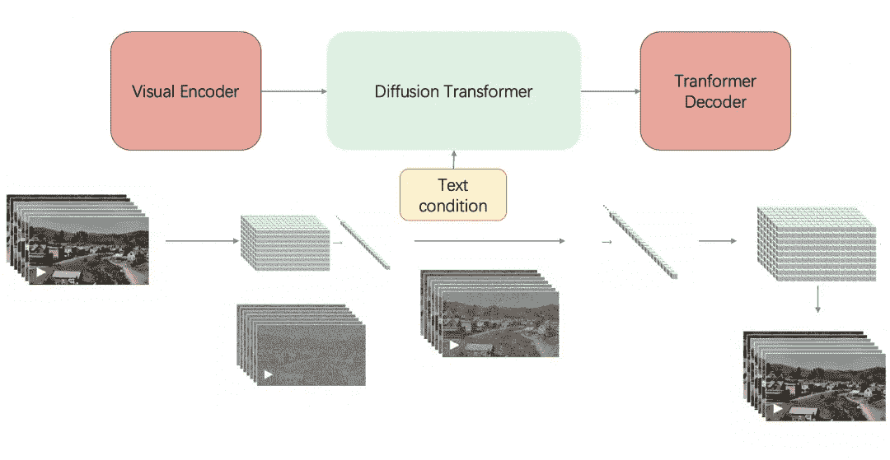

### **Visusal encoder**

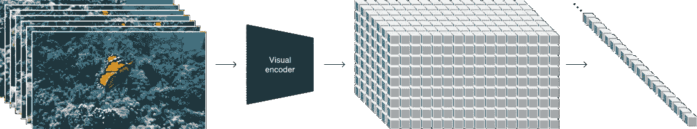

输入的视频可以看成是NxHxW的若干帧图像， 通过Encoder被切分成spatial tempral patch，这些patch最终会被flatten成一维向量，送入diffusion model。

这里的Encoder根据openai的资料来看可能是一个Video transformer，把输入的视频划分成若干个tuplet，每个tuplet会变成一个token，经过spatial temperal attention进行空间和时间建模获得有效的视频表征token，即上面灰色block部分。

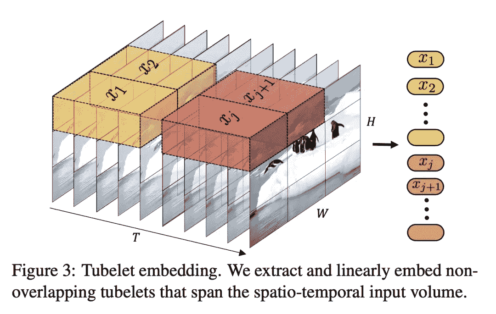

Arnab, Anurag, et al. "Vivit: A video vision transformer." Proceedings of the IEEE/CVF international conference on computer vision. 2021

常见的encoder有如下几种范式，其中第一种是时空联合建模，通过spatial-tempral attention直接建模，这种方式在大数据量情况下效果最好，但是对于小的数据集，factorised方法将时间和空间解耦建模，相当于减少模型参数，会更容易训练和效果更好。基于openai大力出奇迹的惯性，我们推测他们采用了大量的数据，采用了时空联合建模的方式，进行了video encoder的训练。

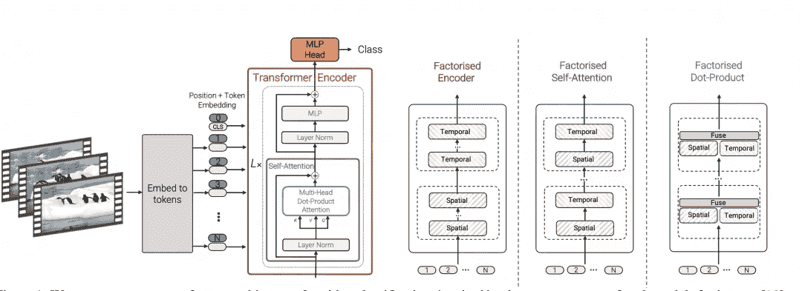

Source: Vivit: A video vision transformer

根据Openai的report，Sora支持不同长度、不同分辨率的输入支持，可以推测在训练的时候，会使用不同分辨率、不同时长的视频进行训练，从而保证推理时在不同长度和分辨率上的效果。

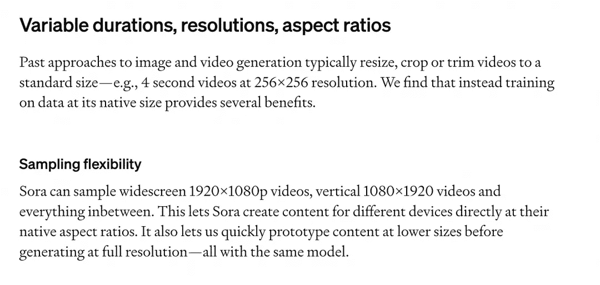

source: https://openai.com/research/video-generation-models-as-world-simulators#fn-20

但是不同的分辨率输入在训练时候带来的是大量的计算负载不均衡，一个最简单的做法就是直接padding到固定大小这种做大会引入大量不必要的计算量， 我们从openai的reference中推测他可能使用了google的NaVit里的技术降低了计算量，支持动态输入。具体展示如下：

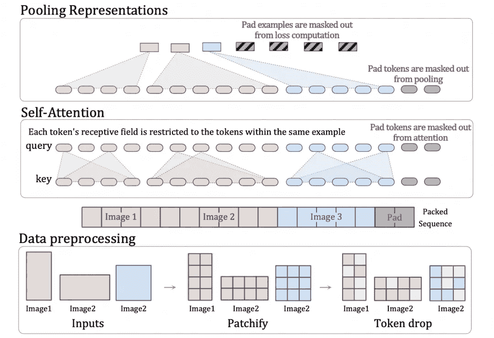

Dehghani, Mostafa, et al. "Patch n'Pack: NaViT, a Vision Transformer for any Aspect Ratio and Resolution." arXiv preprint arXiv:2307.06304 (2023)

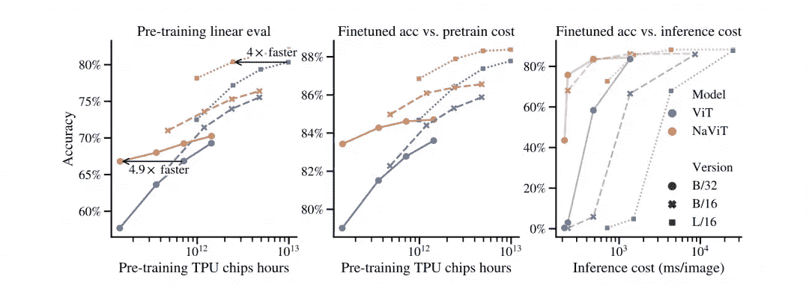

### Diffusion Transformer

Sora的主要作者是Peebles William，他在ICCV上发表了一篇Dit的工作，这篇工作是通过结合diffusion model和transformer，从而达到可以scale up model来提升图像生成质量的效果，这篇文章是在technical report的reference中给出，直观来讲把图像的scaling技术运用到视频场景也非常直观，可以确定是Sora的技术之一。下图也是openai用以展示训练算力scale up后视频生成质量有所提升。

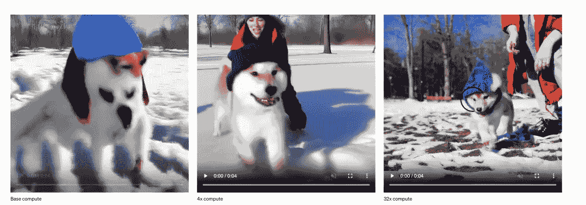

下图展示了Dit的主要原理，输入是一张256x256x3的图片，对图片做切patch后经过投影得到每个patch的token，得到32x32x4的latent(在推理时输入直接是32x32x4的噪声)，结合当前的step t， 输入label y作为输入， 经过N个Dit Block通过mlp进行输出，得到输出的噪声以及对应的协方差矩阵，经过T个step采样，得到32x32x4的降噪后的latent。

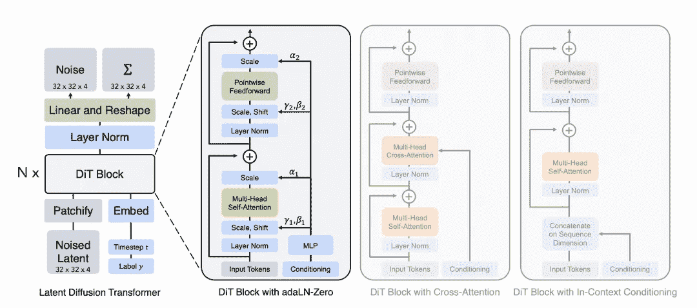

Peebles, William, and Saining Xie. "Scalable diffusion models with transformers." Proceedings of the IEEE/CVF International Conference on Computer Vision. 2023

### Transformer Decoder

“We also train a corresponding decoder model that maps generated latents back to pixel space. ”

这里猜测使用了VAE的思想，结合前面训练得到的visual encoder，对应训练了一个visual decoder，把diffsuion transformer得到的latent decoder到像素空间。

### **如何保证长视频的质量**

我们都被Sora中视频的长度以及视频的一致性所震撼，那么他是如何做到的？

首先训练数据一定是下了很多功夫，从report中我们也看到openai使用了类似DALLE3的cationining技术，训练了自己的video captioner，用以给视频生成详尽的文本描述，进行模型训练。

其次为了保证视频的一致性，模型层应该不是通过多个stage方式来进行视频预测，而是整体预测了整个视频的latent，同时在训练过程中应该引入了auto regressive的task来去帮助模型更好的进行视频特征和帧间关系的学习。具体可以参考谷歌的W.A.L.T ( https://arxiv.org/abs/2312.06662 ) 工作：

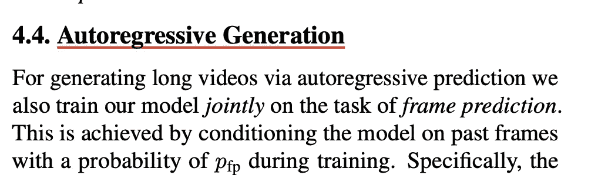

### **下游任务应用**

openAI的网站上也提到了不同任务上Sora的使用和表现，那么背后到底是怎么做的呢？ 这个章节给出详细的介绍。

**文生视频/文+图生视频**

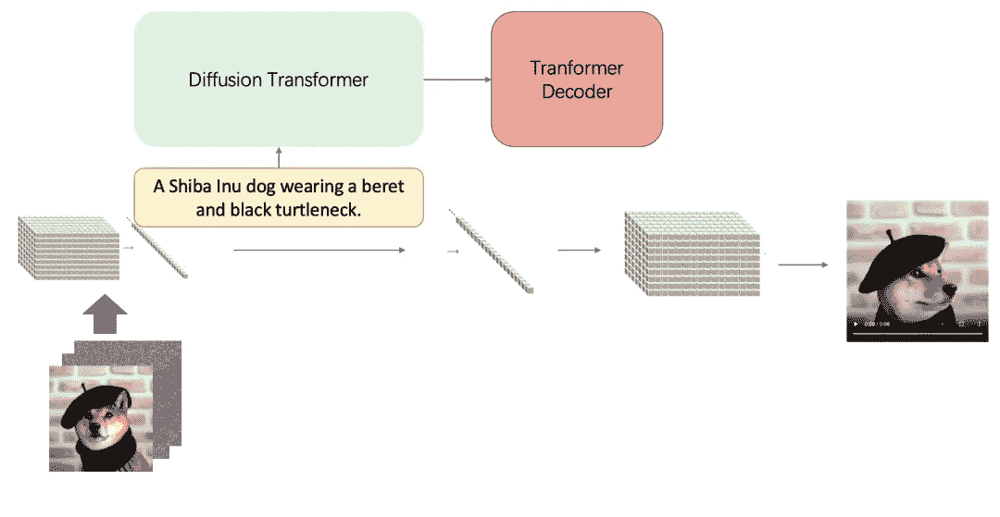

**视频补全**

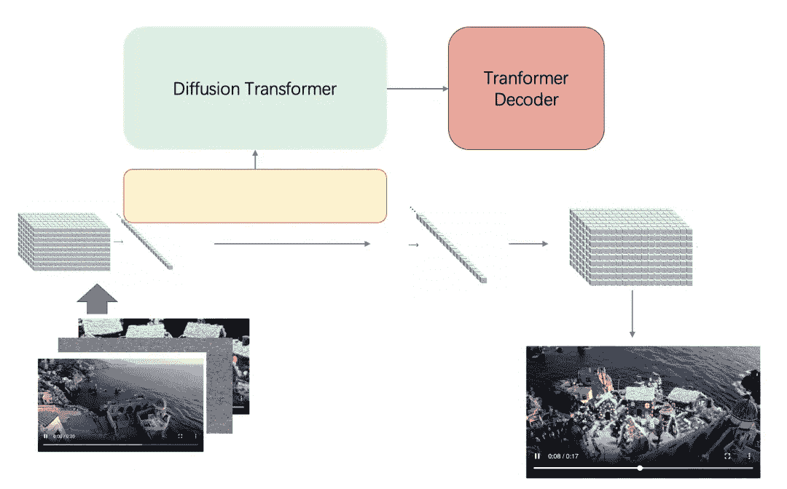

### Computation Cost

一分钟长度、每秒30帧的视频，平均每帧包含256个token，总计将产生460ktoken，34B模型，需要7xA100资源推理

Dit XL 输入512x512， 训练需要TPU v3-256， 按照TFLOPS换算约等于5500个A100。  那么Sora需要的训练和微调的资源会是多少？

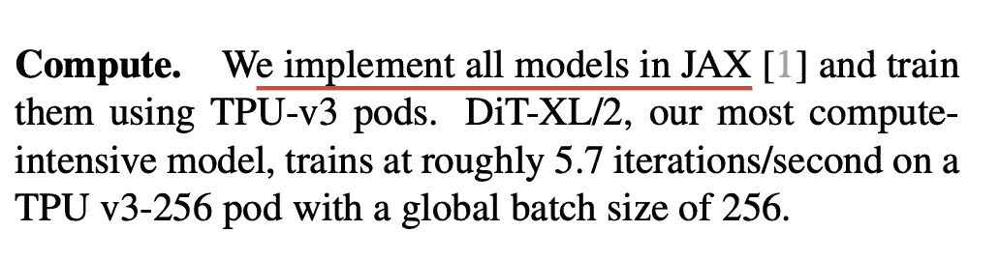

# Last but not Least

“AGI will be able to simulate the physical world, and Sora is a key step in that direction”  by  Tim brooks(https://www.timothybrooks.com/tech/)， 这句话说明当前的Sora还在通用世界模型的方向上努力和前进，但是还并没能完全达到理解物理世界的能力。

**开源社区加油，中国加油！**