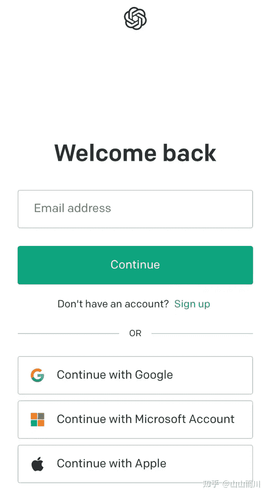
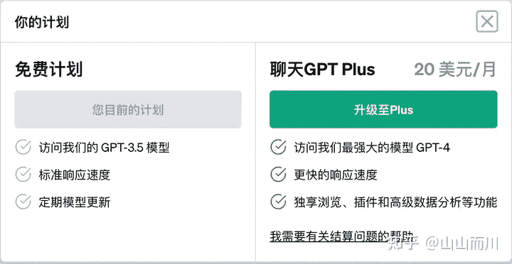
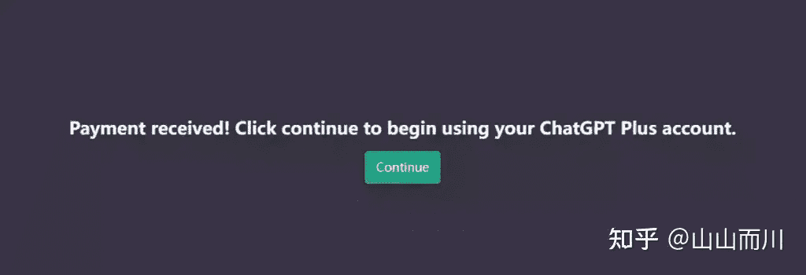
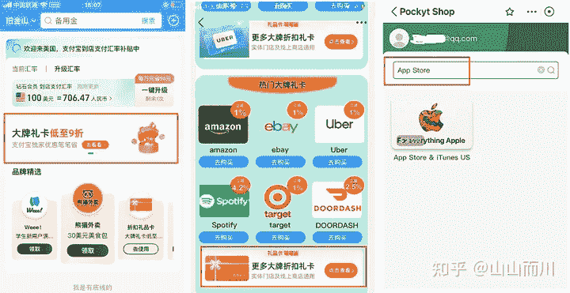
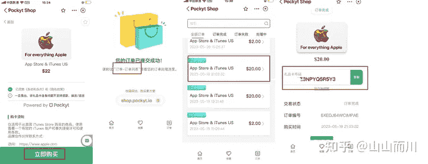
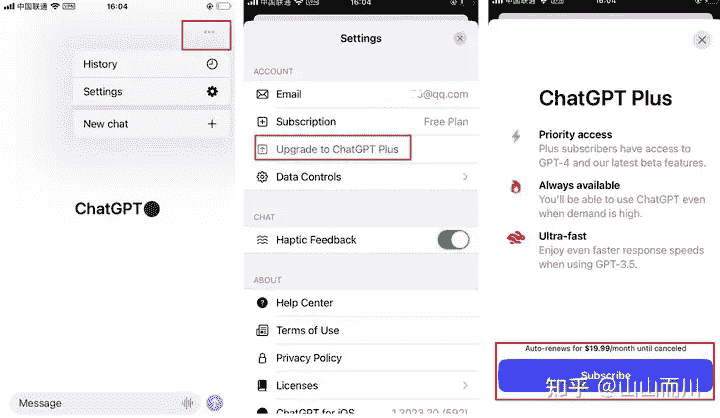
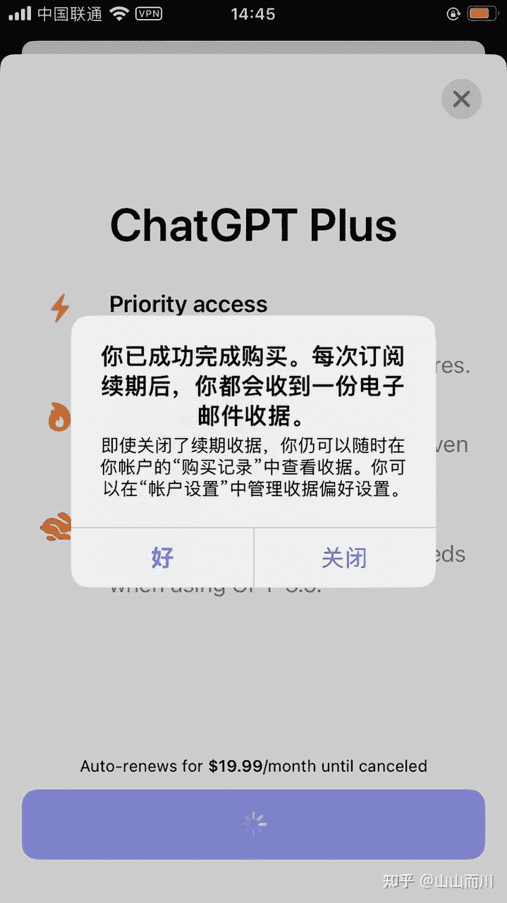
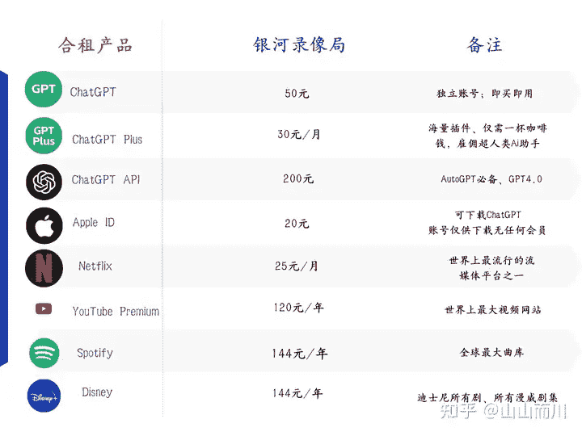
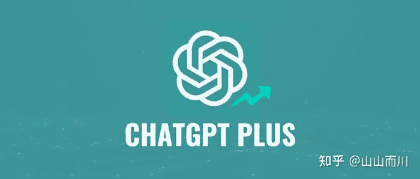
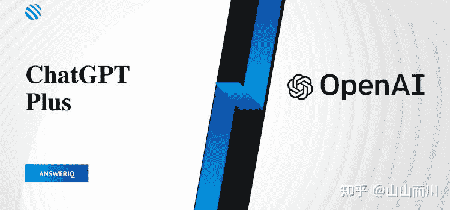

# ChatGPT充值plus会员

> 来源：[https://xmgtoagi.feishu.cn/docx/TeQBdebj0owCarx7qYvck7hHnMm](https://xmgtoagi.feishu.cn/docx/TeQBdebj0owCarx7qYvck7hHnMm)

> 原文：https://www.zhihu.com/question/592103410/answer/3214783185

> 作者：[山山而川](https://www.zhihu.com/people/15-72-78-2-1)

众所周知，ChatGPT Plus比普通版更快、更强，能最先体验新功能，但是它是要付费的，很多小伙伴就卡在了付款这个环节。

> 这里只是给有需要的朋友提供三种充值思路，分别是：

> 官网充值订阅

> 苹果支付宝充值

> 第三方合租平台

C**hatGP**T Plus在各种任务和项目中有广泛的应用。相比免费版本，ChatGPT Plus提供了更多功能和特性，以及使用联网和插件功能，可以帮助用户获得更好的体验和效果。

### **一、官网充值订阅**

1.  **登录****官网****ChatGPT账户。**

> 使用注册的用户名和密码登录ChatGPT官网

1.  **导航至充值页面。**

> 点击左侧侧边栏的升级按钮 "upgrade to plus"

> 接着点击绿色按钮跳转到银行卡信息填写界面

**3.填写您准备好的**[**虚拟信用卡**](https://www.zhihu.com/search?q=%E8%99%9A%E6%8B%9F%E4%BF%A1%E7%94%A8%E5%8D%A1&search_source=Entity&hybrid_search_source=Entity&hybrid_search_extra=%7B%22sourceType%22%3A%22answer%22%2C%22sourceId%22%3A3214783185%7D)**信息。**

> [Cha](https://www.zhihu.com/search?q=%E5%85%8D%E7%A8%8E%E5%8C%BA&search_source=Entity&hybrid_search_source=Entity&hybrid_search_extra=%7B%22sourceType%22%3A%22answer%22%2C%22sourceId%22%3A3214783185%7D)tGPT PLUS目前只支持国外信用卡支付，包括Visa、Mastercard等

> 需要注意的是，如果地址不在美国的五个免税区，还需要支付2美元的税

**4.确认充值。**

> 如果信息无误[，点击确认充值按钮，等待](https://www.zhihu.com/search?q=ChatGPT%20PLUS&search_source=Entity&hybrid_search_source=Entity&hybrid_search_extra=%7B%22sourceType%22%3A%22answer%22%2C%22sourceId%22%3A3214783185%7D)系统处理充值请求。

> 一般情况下，ChatGPT PLUS的充值处理速度较快，只需等待几分钟即可完成充值。

至此，ChatGPT Plus已经购买完成啦，可以尽情享受Plus版本的魅力。

### **二、苹果支付宝充值**

ChatGPT 目前已经正式地作为一款 App 上架了苹果的 App Store，原本以为它只是一个 UI 更精致化的、更便携的 ChatGPT。但未曾想到的是，它居然还附带了对苹果内购的支持，这使得我们有了一个更加可靠、安全的方式来充值 ChatGPT Plus。

如果要完成充值，需提前准备以下工具：

1.  苹果手机

1.  美区Apple ID

1.  ChatGPT账号

1.  魔法工具

1.  支付宝账号

[**第一步**](https://www.zhihu.com/search?q=%E7%A4%BC%E5%93%81%E5%8D%A1&search_source=Entity&hybrid_search_source=Entity&hybrid_search_extra=%7B%22sourceType%22%3A%22answer%22%2C%22sourceId%22%3A3214783185%7D)：在支付宝购买AppStore礼品卡

> [打开支付宝](https://www.zhihu.com/search?q=%E7%B1%B3%E5%9B%BD%E6%97%A7%E9%87%91%E5%B1%B1&search_source=Entity&hybrid_search_source=Entity&hybrid_search_extra=%7B%22sourceType%22%3A%22answer%22%2C%22sourceId%22%3A3214783185%7D)、左上角将支付宝的定位改为米国旧金山

> 首页往下滑找到【大牌礼卡】

> 在新的页面滑动到最下面的【更多大牌折扣礼卡】

> 在新的页面搜索AppStore，点第一个搜索结果

> 输入金额（单位是美金），最低$2，如果是购买Plus账号，最好是大于20

> 点击【立即购买】

> 进入订单列表

> 如果订单状态为订单完成，说明礼品卡购买成功

> 进入订单详情，复制礼品卡号码

立即购买

第二步：在App Store中兑换礼品卡

> 进入Ap[pSt](https://www.zhihu.com/search?q=%E5%85%85%E5%80%BC%E5%8D%A1&search_source=Entity&hybrid_search_source=Entity&hybrid_search_extra=%7B%22sourceType%22%3A%22answer%22%2C%22sourceId%22%3A3214783185%7D)ore，点击右上角小人头

> 点击兑换充值卡或代码

> 手动输入兑换码，输入刚刚购买的礼品卡号码充值

**第三步：升级Plus**

> 这一步需要[魔法网络](https://www.zhihu.com/search?q=%E9%AD%94%E6%B3%95%E7%BD%91%E7%BB%9C&search_source=Entity&hybrid_search_source=Entity&hybrid_search_extra=%7B%22sourceType%22%3A%22answer%22%2C%22sourceId%22%3A3214783185%7D)，首先在设备上登录ChatGPT账号，点右上角的...->Settings->Upgrade To ChatGPT Plus

如果出现如下界面说明订阅成功

订阅成功后，和国内的各种内购订阅一样，你的 Apple ID 会被立刻扣款。

下一次扣款将会发生在需要续费的时候，如果你希望一直续订，需要保证在下一次扣款前 Apple ID 内有足够多的余额。

如果你只是想短期体验一下 GPT-4 的话，那么你可以及时地取消订阅，确保后续不会再被扣款。

### **三、第三方合租平台**

对比官网ChatGPT Plus每月20美元相对昂贵的订阅价格，以及繁琐的购买的流程，不少国内用户考虑选择第三方合租平台：银河录像局  减少使用成本。

这个合租平台进行过网站实名备案，并且背后规模化运营的公司都可查！

在以上合租平台购买会比较方便，可以保证拥有一个相对来说比较安全的网络环境，同时可以使用的较为长久一些。

价格方面各有不同，需要大家结合自身经济实际情况进行相应的选择。

在完成了订阅之后，我们的订阅也会同步到[网页版上，](https://www.zhihu.com/search?q=GPT-4&search_source=Entity&hybrid_search_source=Entity&hybrid_search_extra=%7B%22sourceType%22%3A%22answer%22%2C%22sourceId%22%3A3214783185%7D)在网页版你也可以一样使用基于 GPT-4 的 ChatGPT 了。

需要注意的是，GPT-4 模型仍然还是存在使用限额的，并不像之前一些媒体宣传的那样取消了限额，如果你期望更自由地使用 GPT-4，那么申请 GPT-4 的 API 仍然是更好的选择。

在有条件的情况下，笔者仍然还是更推荐使用网页版，因为目前 App 版还没有跟进网页浏览和插件的支持，网页版的功能相对来说会更全面一些。

不过 App 也有它的优势，它相对而言没有网页版那么严格的访问限制，甚至比 New Bing 还要更松一些，对于一些轻量的使用，用 App 也是能满足需求的。

