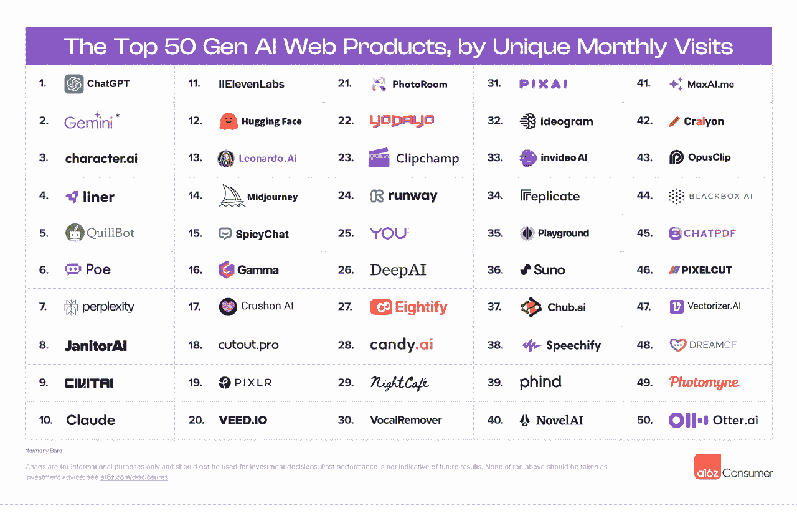
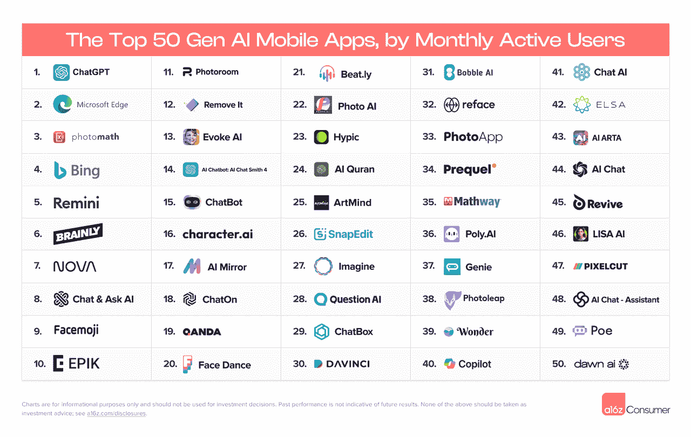
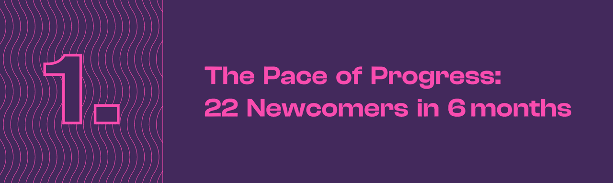
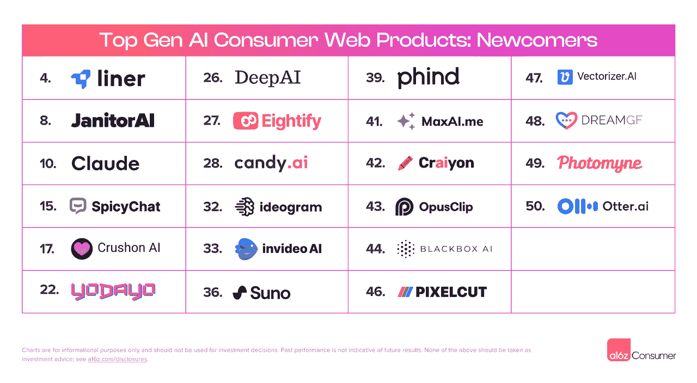
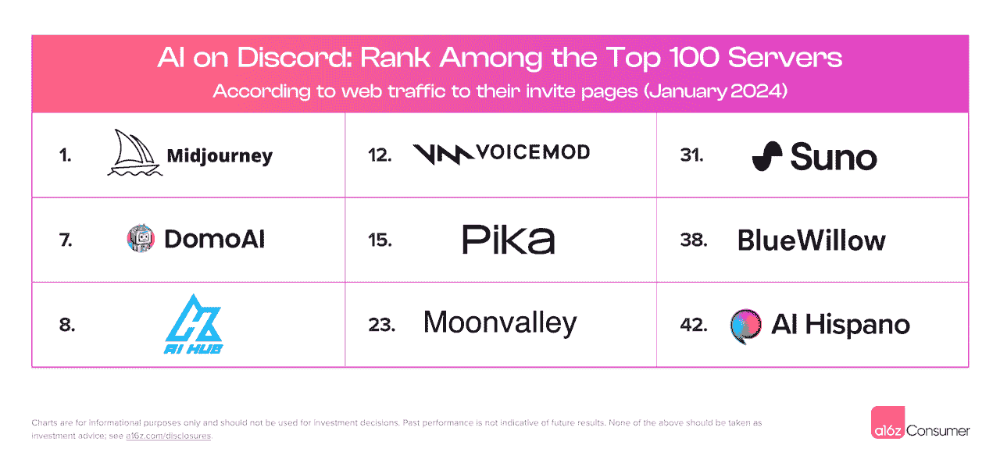
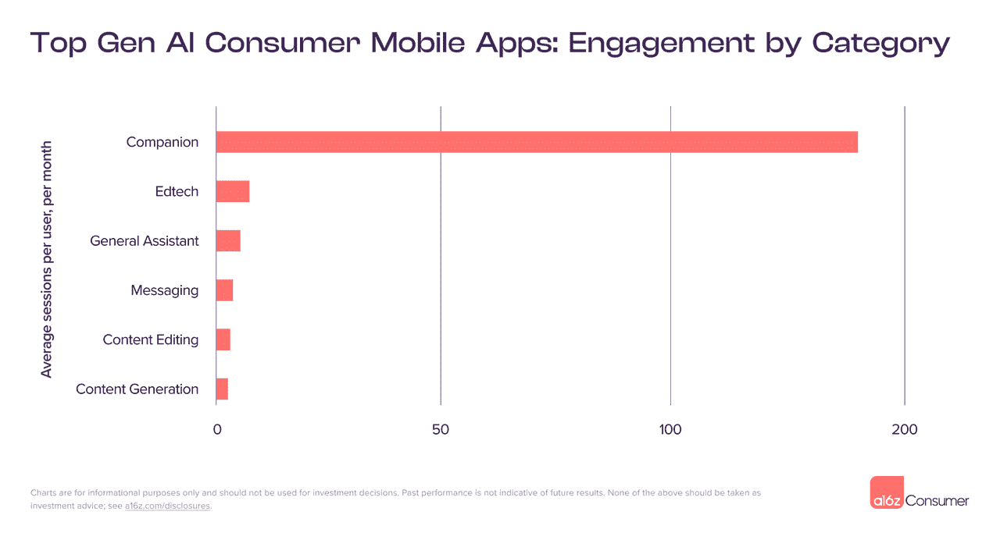
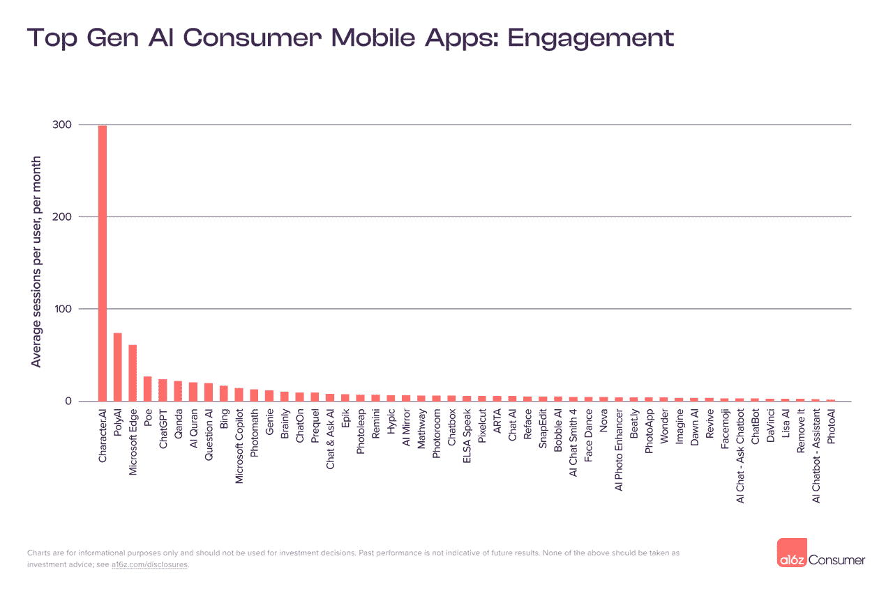
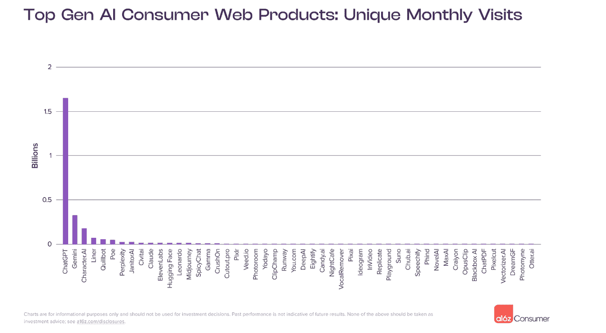
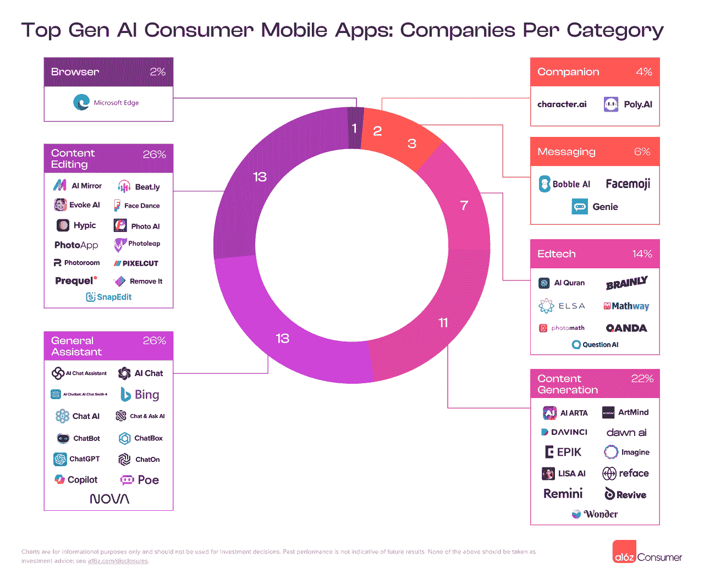
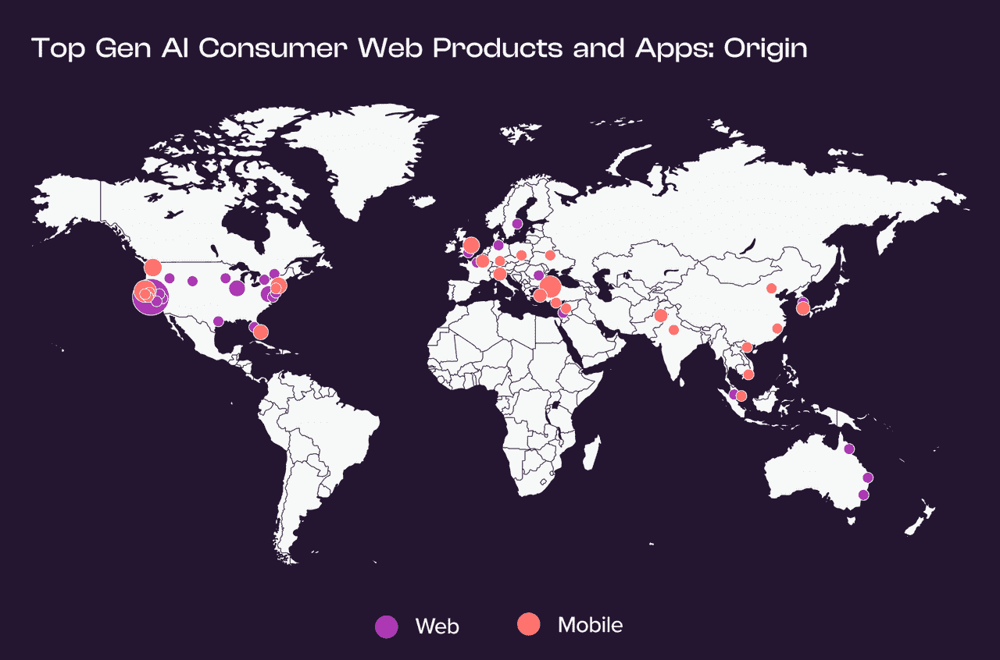

# 前100名人工智能应用

> 来源：[https://xmgtoagi.feishu.cn/docx/HB1YdrxBhoO2DXxtgoXcve7ZnBb](https://xmgtoagi.feishu.cn/docx/HB1YdrxBhoO2DXxtgoXcve7ZnBb)

> 原文：https://a16z.com/100-gen-ai-apps/

自从2022年 ChatGPT 将生成式 AI 推向公众意识以来，我们已经接触到了数千种融合了 AI 魔力的新消费产品——从视频生成器到工作流程黑客，从创意工具到虚拟伴侣。

六个月前，我们深入研究了网络流量数据，将信号与噪音分开。我们根据每月访问量对最受欢迎的生成式人工智能网络产品进行了排名，并发现了消费者实际使用该技术的模式。

虽然有一些早期的“赢家”引起了广泛的关注，即 ChatGPT 和 Midjourney，但每个月都有新的人工智能本土公司涌现，刺激了一个充满活力、竞争激烈的市场。

现在，六个月后，我们返回数据来更新我们的分析，根据 SimilarWeb（截至 2024 年 1 月）再次对前 50 名人工智能优先网络产品进行排名。我们的发现令人惊讶：与我们 2023 年 9 月的最初报告相比，名单上超过 40% 的公司都是新公司。

然而，与我们最初的分析不同——我们首先根据网络流量对公司进行排名，然后添加这些公司的移动应用程序数据——这次我们将网络和移动一代人工智能产品分为两个单独的列表。

与网络排名类似，移动应用程序根据 Sensor Tower 数据（截至 2024 年 1 月）根据每月活跃用户进行排序。这种区别使我们能够首次审视顶级人工智能移动应用程序的整个领域。消费者在网络上与移动设备上与新一代人工智能互动的方式存在显著差异，我们将在下面介绍。

然而，除了这些排名的固有兴趣之外，这些数据还揭示了围绕新的和不断扩大的类别、人工智能投资和参与模式的几个值得注意的趋势。以下是我们的一些要点：

鉴于 ChatGPT 令人印象深刻的早期增长（根据我们六个月前的分析，它已经成为全球访问量排名第 24 的网站），我们预计这款开创性的聊天机器人将继续保持榜首的地位。事实上，ChatGPT 每月的网络访问量接近 20 亿次，大约是榜单上第二名公司的五倍，诗人（现在是双子座）。

尽管 Google 的 Bard 在 2024年2 月份更名为 Gemini，但在我们提取这些数据后，其大部分流量从一种产品迁移到了另一种产品。

## 2M+

基于 OpenAI API 的开发人员数量，包括超过 92% 的财富 500 强公司。

来源：OpenAI

与 Gemini 一起，同伴创作者Character.AI和写作助理Quillbot保住了前五名的位置。然而，这并不是说该榜单在过去六个月中一直保持不变：有22 家公司是新上榜的网络流量排名。

在所谓的新人中，排名最高的包括人工智能研究副驾驶Liner ； Anthropic的总助理克劳德；和三个未经审查的AI 配套应用程序：JanitorAI、Spicychat和CrushOn。 （下文将详细介绍人工智能陪伴人数激增背后的原因。）

用户可以进行在 ChatGPT 等平台上可能受到限制的对话或交互。

我们的移动列表是全新的。ChatGPT 在这方面也处于领先地位，但差距要小得多。就每月活跃用户而言，ChatGPT 的规模大约是排名第二和第三的 Microsoft Edge 和 Photomath 的 2.5 倍。对于移动产品，前五名还包括微软搜索引擎Bing（现在围绕人工智能重建）以及照片增强器和头像创建器Remini。

有趣的是，有五家人工智能公司是真正的“交叉公司”，其中一款网页产品和一款移动应用程序都跻身前 50 名：ChatGPT、Character.AI、聊天机器人聚合器Poe以及图像编辑器Photoroom和Pixelcut。

六个月前，我们注意到像 ChatGPT 这样基于 LLM 的通用助手占据了大部分网络流量。在我们更新的分析中，我们看到两个新类别加入其中：音乐和生产力（包括研究、编码协助和文档摘要等任务）。

Suno是迄今为止唯一一家上榜的音乐公司。该工具根据文本提示在浏览器中生成原创歌曲，并附有歌词，风格多样。 Suno 最初是一款仅 Discord 的产品，类似于 Midjourney，但于 2023 年 12 月推出了独立网站和Copilot 扩展。 （请在此处阅读有关我们在 AI 音乐类别中看到的潜力的更多信息）。

一些现在主流的消费人工智能产品，比如 Suno，都是在 Discord 服务器上开始的，或者仍然主要通过 Discord 运行。该平台提供了一个测试场（和社区！），无需构建完整的前端产品。 Discord 服务器的真实流量几乎无法测量，但每个服务器邀请页面的 Web 流量就是这一点的一个代理。在此指标上，截至 2024 年 1 月，按邀请流量计算，有 9 个人工智能产品或社区跻身 Discord 服务器前 100 名，其中 Midjourney 名列榜首。

列表中第二个值得注意的新类别是生产力。人工智能原生平台可以提升人们与软件的交互，使他们能够委派日常任务并减少管理开销上花费的时间。生产力类别包括七家上榜公司：Liner、Eightify、Phind、MaxAI、Blackbox AI、Otter.ai和ChatPDF。

在我们 2023 年 9 月的排名中（没有生产力类别），ChatPDF 之前被归类为“其他”。

凭借流内编辑和摘要等功能，这些公司专注于帮助员工、自由职业者和中小企业所有者更有效地完成工作。例如，Eightify提供 YouTube 视频的摘要，而Otter.ai 则实时记录会议记录和转录。

## 80%

在工作中使用人工智能工具并表示生产力有所提高的员工百分比（针对全球 10,000 名员工的调查）。

资料来源：[Slack 劳动力实验室](https://www.unleash.ai/artificial-intelligence/ai-improving-productivity-but-employees-not-won-over-just-yet/)

此列表中的七个生产力应用程序中有六个完全通过 Google Chrome 扩展提供或运行。我们期望更多的人工智能生产力工具能够“在流程中”与用户已经在做的工作一起运行，从而无需在工作区和 ChatGPT 等助手之间复制和粘贴提示和输出。

或者，人工智能生产力公司可能会围绕一代人工智能的独特功能发明新的端到端工作流程。人工智能工作流程产品可以帮助用户识别可以改进的地方，然后自动进行这些改进。

拥有人工智能伴侣可能看起来很小众，但这项活动已经成为生成人工智能的主要用例。已经有数百万人（包括我们自己）与聊天机器人建立了关系。网络和移动数据预示着即将发生的社会转变：人工智能陪伴正在成为主流。

## 2小时

用户每天在 Character.AI 上花费的平均时间。

来源：Similarweb；角色.AI

六个月前，只有两家人工智能伴侣公司跻身 50 强；在最新的分析中，有 8 个在网络上，2 个在移动设备上。Character.AI在网络和移动设备上均领先于配套工具，在网络列表中排名第 3，在移动设备上排名第 16。

八个网络配套产品中的六个将自己标榜为“未经审查”，这意味着用户可以与它们进行可能在 ChatGPT 等平台上受到限制的对话或互动。用户主要通过移动网络访问这些产品，而不是桌面——尽管它们几乎都不提供应用程序。平均而言，我们网站列表中未经审查的配套工具 75% 的流量来自移动设备。

对于有移动应用程序的配套产品，参与度异常高。这一类别中最成功的产品成为用户日常生活的核心部分，变得像给朋友发短信一样普遍（如果不是更常见的话！）。

根据 SensorTower 数据，Character.AI每个用户每月平均进行 298 个会话，而Poly.AI平均每个用户进行 74 个会话。

我们开始看到人工智能“男朋友”和“女朋友”之外更广泛的伴侣应用的早期迹象，包括友谊、指导、娱乐，以及最终的医疗保健。事实上，早期研究表明人工智能在诊断准确性和床旁方式方面都可以超越真正的医生。许多配套产品都是多方面的：在Nature最近的一项研究中，Replika聊天机器人减少了 3% 用户的自杀意念。

移动应用程序与网络上的人工智能使用类别存在显著差异。一般来说，网络产品支持围绕内容生成和编辑的更复杂、多步骤的工作流程产品 -目前！其中包括 AI 语音工具包ElevenLabs、AI 艺术生成器Leonardo和 AI 演示生成器Gamma等产品，这些产品均在基于网络的新一代 AI 产品中排名前 20。

与此同时，移动应用程序的使用偏向一般助理，其中许多模仿 ChatGPT。在仔细阅读顶级移动应用程序列表时，您可能会注意到有 10 家公司的名称与 ChatGPT 非常相似。部分原因是 ChatGPT 推出自己的应用程序相对较慢，为模仿者创造了快速获得应用程序商店优化优势的机会，特别是如果他们支付广告费用。

一些模仿 ChatGPT 的移动应用程序被称为“诈骗软件”。他们欺骗用户，让他们相信他们正在提供对具有相似标题和徽标的 ChatGPT 高级模型的访问，但事实上，对从 ChatGPT 免费提供的同一模型的访问要收费。这些应用程序经常更改其名称或描述，使得应用程序商店很难“监管”这种行为。

其他流行的一代人工智能移动应用程序类别是根据手机的独特功能量身定制的。应用列表中有七款专用头像产品；大多数人手机上保存的许多自拍照可以作为随时可用的训练数据。此外，三个顶级应用程序 — Facemoji (#9)、Bobble (#31) 和Genie (#37) — 是移动专用键盘，允许用户在人工智能的帮助下发送文本。

教育科技是移动设备上另一个流行的类别，用户可以用手机扫描作业问题（Photomath）或通过实时对话学习语言（Elsa）。值得注意的是，根据 PitchBook 的数据，虽然大多数顶级人工智能移动应用程序都是自举的，这意味着它们没有筹集外部资金，但排名前七的教育科技应用程序中有四家已经筹集了超过 3000 万美元的资金。

大脑谷可能是人工智能的中心，但世界各地正在开发广受欢迎的产品。对于移动应用程序来说尤其如此。尽管我们名单上超过 30% 的新一代人工智能网络产品起源于湾区，但只有 12% 的移动应用程序开发人员位于该地区。同样，尽管超过一半的最新一代人工智能网络产品是在美国开发的，但只有不到三分之一的移动应用程序起源于美国本土。

**北美洲（美国）**

加利福尼亚州：门洛帕克、山景城、奥克兰、帕洛阿尔托、雷德伍德城、旧金山、圣马特奥

佛罗里达州：迈阿密、圣彼得堡

爱达荷州：子午线

伊利诺伊州: 芝加哥

马萨诸塞州: 剑桥

明尼苏达州：明尼阿波利斯

纽约: 纽约市布鲁克林

宾夕法尼亚: 中心谷

德克萨斯州: 休斯顿

华盛顿: 雷德蒙德

怀俄明州：谢里登

**北美洲（加拿大）**

蒙特利尔、多伦多

**亚洲**

中国：北京

香港: 九龙

印度：古尔冈

马来西亚：雪兰莪

巴基斯坦：伊斯兰堡

新加坡，新加坡

韩国：首尔

越南：河内、胡志明市

**大洋洲**

澳大利亚：布里斯班、凯恩斯、悉尼

**欧洲**

英国：剑桥、伦敦

法国：巴黎

德国：格伦瓦尔德、拉博埃

意大利：米兰

波兰：克拉科夫

罗马尼亚: 布加勒斯特

瑞典: 斯德哥尔摩

乌克兰：基辅

**中东**

塞浦路斯：尼科西亚

以色列: Bnei Brak, 耶路撒冷

土耳其：伊斯坦布尔、伊兹密尔

一些移动开发者已经取得了多项成功：例如，位于伊斯坦布尔的应用程序工作室Codeway创建了AI照片动画师Face Dance、聊天机器人应用程序Chat & Ask AI和AI艺术生成器Wonder，所有这些都名列前茅。一代人工智能移动应用程序。同样位于土耳其的HubX开发了Nova聊天机器人、达芬奇艺术生成器和PhotoApp增强器。

这些应用程序工作室通常受益于跨产品的共享专业知识，涉及如何启动应用程序、吸引流量以及通过应用程序获利。其中一些不筹集资金，而是专注于尽可能有效地创收。其他人确实在寻求风险投资之路——Bending Spoons是一家总部位于米兰的科技公司，开发了视频编辑器 Splice 和照片增强器Remini（移动榜单排名第五），最近宣布筹集 1.55 亿美元的股权融资。

---

很明显，新一代人工智能原生产品和公司比以往任何时候都增长得更快，并且更深入地吸引用户。我们相信，在未来十年中，人工智能将支撑类别定义公司。

在此处阅读有关 a16z 消费者人工智能论文的更多信息。

## 链接：前 50 代人工智能消费网络产品

[黑盒人工智能](https://www.blackbox.ai/)

[糖果.ai](https://candy.ai/)

[角色.AI](https://beta.character.ai/)

[聊天GPT](https://chat.openai.com/)

[聊天PDF](https://www.chatpdf.com/)

[楚布.ai](http://chub.ai/)

[奇维泰](http://civitai.com/)

[克洛德](https://claude.ai/)

[剪辑冠军](http://clipchamp.com/)

[克赖永](http://craiyon.com/)

[粉碎](http://crushon.ai/)

[剪纸专业版](https://www.cutout.pro/)

[深度人工智能](http://deepai.org/)

[梦想GF](https://dreamgf.ai/)

[八化](https://eightify.app/)

[十一实验室](https://elevenlabs.io/)

[伽玛](https://gamma.app/)

[双子座](https://gemini.google.com/)

[抱脸](https://huggingface.co/)

[表意文字](http://ideogram.ai/)

[视频内](http://invideo.io/)

[清洁工人工智能](http://janitorai.com/)

[列奥纳多](http://leonardo.ai/)

[衬垫](https://getliner.com/)

[最大人工智能](http://maxai.me/)

[中途](http://midjourney.com/)

[夜店](https://creator.nightcafe.studio/)

[小说人工智能](http://novelai.net/)

[作品剪辑](http://opus.pro/)

[水獭.ai](http://otter.ai/)

[困惑](https://www.perplexity.ai/)

[芬德](http://phind.com/)

[光敏](https://photomyne.com/)

[照相馆](http://photoroom.com/)

[皮克赛](https://pixai.art/)

[像素切割](http://pixelcut.ai/)

[皮克斯尔](http://pixlr.com/)

[操场](http://playgroundai.com/)

[坡](http://poe.com/)

[羽毛笔机器人](http://quillbot.com/)

[复制](https://replicate.com/)

[跑道](http://runwayml.com/)

[语音化](http://speechify.com/)

[辣聊](http://spicychat.ai/)

[苏诺](https://www.suno.ai/)

[向量化器](https://vectorizer.ai/)

[Veed.io](https://www.veed.io/)

[人声消除器](https://vocalremover.org/)

[与田世](http://yodayo.com/)

[友网](https://you.com/)

## 链接：前 50 代人工智能消费者移动应用

[人工智能聊天史密斯 4](https://apps.apple.com/us/app/ai-chatbot-ai-chat-smith-4/id1559479889)

[AI聊天助手](https://apps.apple.com/us/app/ai-chat-assistant-chatbot/id1667518571)

[人工智能聊天机器人](https://apps.apple.com/us/app/ai-chat-ask-chatbot-assistant/id6447419372)

[人工智能镜](https://apps.apple.com/us/app/ai-mirror-ai-art-photo-editor/id6444888896)

[古兰经](https://apps.apple.com/us/app/al-quran-tafsir-by-word/id1437038111)

[阿尔塔](https://apps.apple.com/us/app/arta-ai-photo-generator-al-art/id1642969698)

[艺术思维](https://apps.apple.com/us/app/artmind/id6477348273)

[Beat.ly](https://play.google.com/store/apps/details?id=vinkle.video.editor)

[必应](https://apps.apple.com/us/app/bing-chat-with-ai-gpt-4/id345323231)

[泡泡人工智能](https://apps.apple.com/us/app/bobble-ai-keyboard-assistant/id972432964)

[脑力十足](https://apps.apple.com/us/app/brainly-ai-homework-helper/id745089947)

[角色.AI](https://apps.apple.com/us/app/character-ai-ai-powered-chat/id1671705818)

[聊天和询问人工智能](https://apps.apple.com/us/app/chat-ask-ai-by-codeway/id1668787639)

[聊天人工智能](https://play.google.com/store/apps/details?id=com.ai.chat.bot.aichat)

[聊天机器人](https://chatbot-ai-chat.en.softonic.com/)

[聊天室](https://apps.apple.com/us/app/chatbox-ask-ai-chatbot/id6447763703)

[聊天GPT](https://apps.apple.com/us/app/chatgpt/id6448311069)

[聊天](https://apps.apple.com/us/app/chaton-ai-chat-bot-assistant/id1661308505)

[达芬奇](https://apps.apple.com/us/app/davinci-ai-image-generator/id1630366866)

[黎明人工智能](https://apps.apple.com/us/app/dawn-ai-avatar-generator/id1643890882)

[艾尔莎发言](https://apps.apple.com/us/app/elsa-speak-english-learning/id1083804886)

[史诗](https://apps.apple.com/us/app/epik-ai-photo-video-editor/id1577705074)

[唤起](https://apps.apple.com/us/app/ai-photo-enhancer-evoke/id6450504740)

[变脸舞](https://apps.apple.com/us/app/face-dance-ai-photo-animator/id1589749730)

[表情符号](https://apps.apple.com/us/app/facemoji-ai-emoji-keyboard/id1103138272)

[精灵](https://apps.apple.com/us/app/genie-ai-chatbot-keyboard/id1658377526)

[海皮克](https://apps.apple.com/us/app/hypic-photo-editor-ai-art/id1644042837)

[想象](https://apps.apple.com/us/app/imagine-ai-art-generator/id1664121419)

[艾丽莎](https://apps.apple.com/us/app/lisa-ai-retro-wedding-avatar/id6443832829)

[数学之路](https://apps.apple.com/us/app/mathway-math-problem-solver/id467329677)

[微软副驾驶](https://apps.apple.com/us/app/microsoft-copilot/id6472538445)

[微软边缘](https://apps.apple.com/us/app/microsoft-edge-ai-browser/id1288723196)

[诺瓦](https://apps.apple.com/us/app/ai-chatbot-nova/id1669007652)

[摄影人工智能](https://apps.apple.com/us/app/photoai-ai-photo-enhancer/id1590124720)

[照片应用程序](https://apps.apple.com/us/app/photoapp-ai-photo-enhancer/id1596089614)

[光跃](https://apps.apple.com/us/app/photoleap-ai-art-photo-editor/id1191337894)

[摄影数学](https://apps.apple.com/us/app/photomath/id919087726)

[照相馆](https://apps.apple.com/us/app/photoroom-ai-photo-editor/id1455009060)

[像素切割](https://apps.apple.com/us/app/pixelcut-ai-photo-editor/id1534785237)

[坡](https://apps.apple.com/us/app/poe-fast-ai-chat/id1640745955)

[聚人工智能](https://apps.apple.com/us/app/poly-ai-create-ai-chat-bot/id6449190344)

[前传](https://apps.apple.com/us/app/prequel-photo-video-editor/id1325756279)

[坎达](https://apps.apple.com/us/app/qanda-instant-math-helper/id1270676408)

[问题.ai](https://apps.apple.com/us/app/question-ai-ai-math-calculator/id6449486871)

[重塑](https://apps.apple.com/us/app/reface-ai-photo-generator/id1488782587?ppid=eb3a176a-5e0e-42f2-99f5-78428b29eace)

[雷米尼](https://apps.apple.com/us/app/remini-ai-photo-enhancer/id1470373330)

[去掉它](https://play.google.com/store/apps/details?id=com.vyroai.objectremover&hl=en_US)

[复活](https://apps.apple.com/us/app/revive-ai-photo-dance-maker/id1616862692)

[捕捉编辑](https://play.google.com/store/apps/details?id=snapedit.app.remove)

[想知道](https://apps.apple.com/us/app/wonder-ai-art-generator/id1621278575)
