# 深入理解Sora技术原理

> 来源：[https://xmgtoagi.feishu.cn/docx/ER8wdVZFboI8BXxXSdPcTLRqnRh](https://xmgtoagi.feishu.cn/docx/ER8wdVZFboI8BXxXSdPcTLRqnRh)

作者： 逅弈

原文：https://mp.weixin.qq.com/s/e1DqTa1Tgyi4OWpgwrj48Q

OpenAI 发布的视频生成模型 Sora(https://openai.com/sora)，能根据文本生成长达一分钟的高质量视频，理论上支持任意分辨率，如 1920x1080 、1080x1920 ，生成能力远超此前只能生成 25 帧 576x1024 图像的顶尖视频生成模型 Stable Video Diffusion。

一起公布的，还有一篇非常简短的技术报告，报告大致介绍了 Sora 的架构及应用场景，并未对模型的原理做过多的介绍。技术报告链接：https://openai.com/research/video-generation-models-as-world-simulators

笔者参考了大量的资料，试着深入理解 Sora 的技术原理，最终将 Sora 生成视频的原理总结成以下大致的步骤：

+   通过收集大量不同分辨率不同时长的视频，并对视频进行降维处理得到视频的潜在空间数据，并在潜在空间中进行文本标注与训练。

+   使用 DALLE3 的重标注技术，对人工标注的文本进行训练，生成能更加详细描述视频的标注信息。

+   视频生成时，获取随机噪声视频，通过训练的视频压缩网络，将噪声视频压缩成低维度的潜在空间数据，以便更好的处理视频数据。

+   将压缩后的潜在空间数据分解成空间时间补丁 Patches，这些补丁包含了视频中空间和时间的关系，并将这些补丁转为一维的 Tokens 数据。

+   将Tokens数据提交给经过扩散模型训练后的Transformer(DiT)，利用 Transformer 的注意力机制，时刻关注文本提示词中的关键信息，结合扩散模型(Diffusion Model)对 Tokens 数据进行去噪声，并循环采样观察去噪音后的结果数据是否符合提示词的要求。

+   将去除噪音后的结果数据，利用视频解码器进行解码，将低维潜在空间数据还原成原始视频数据，这里可以实现不同分辨率的视频解码。

如果你不想查看冗余的细节，看到这里就可以结束了，如果你还希望了解相关的细节，可以继续往下看，可能有理解不全面的地方欢迎大家补充交流。

# 文本生成图片的流程

在理解文本生成视频的原理之前，我们可以先回顾下文本生成图片的原理，笔者的另一篇文章有做过相关介绍：AIGC 文生图原理与实践分享

本文我们不讨论传统的通过对抗网络生成图片的方式，我们主要讨论的是基于扩散模型生成图片的方式，开源的 Stable Diffusion 就是基于 LDM，即 Latent Diffusion Model(潜在的扩展模型)实现的，另外 Stable Diffusion 通过引入 Transformer 架构实现了对提示词的支持，能够在去除图片噪音的过程中进行精确的控制。

# 潜在的扩散模型

Stable Diffusion 背后的技术方案被称为 Latent Diffusion Model，即潜在的扩散模型，此外 Stable Diffusion 模型在原始的 UNet 模型中加入了 Transformer 结构，这么做可谓一举两得，因为 Transformer 结构不但能提升噪声去除效果，还是实现 Prompt 控制图像内容的关键技术。

在深度学习领域中，潜在空间（Latent Space）是指模型学习到的表示数据的抽象空间。这个潜在空间通常是一个低维的向量空间，其中每个点（向量）代表着模型对输入数据的一种表示或特征。潜在空间的概念在各种生成模型和表示学习方法中被广泛应用。

**以下是潜在空间对模型的作用：**

+   **数据的抽象表示**：

潜在空间可以被视为对输入数据的一种抽象表示。通过学习到的潜在空间可以更好地捕捉输入数据的特征和结构，有助于模型更高效地学习和生成数据。

+   **降维和去噪**：

潜在空间通常是一个低维空间，相比原始数据空间具有更低的维度。通过将数据映射到潜在空间，可以实现数据的降维和去噪，将数据的主要特征和模式表示在更紧凑的空间中。

+   **生成和重建**：

在生成模型中，潜在空间扮演着重要角色，可以在潜在空间中生成新的数据样本。模型可以从潜在空间中采样并解码生成具有逼真特征的数据样本，这种生成过程通常通过解码器（Decoder）实现。

+   **插值和操作**：

在潜在空间中，向量表示不同的数据特征或属性，可以通过向量之间的插值或操作来探索数据空间中的变化和关系。例如，通过在潜在空间中沿着不同方向移动向量，可以观察到在数据生成过程中对应的变化。

扩散模型的一个大概的过程可以描述为：对原始图片不断的加噪音可以得到一张噪声图，然后再对噪声图不断的去除噪音的同时再添加其他信息，就可以得到一张新图片。

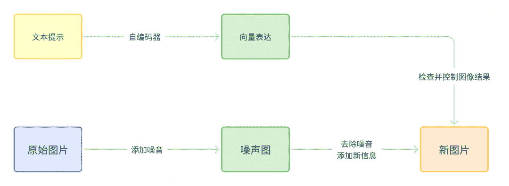

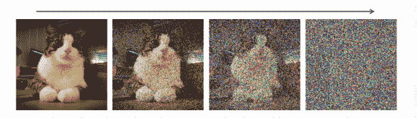

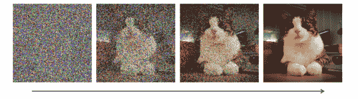

Stable Diffusion 生成图片的大致流程如下：

+   Stable Diffusion 使用一个新颖的文本编码器(OpenCLIP)，将文本输入转换为一个向量表示。这个向量表示可以捕捉文本的语义信息，并与图像空间对齐。

+   Stable Diffusion 使用一个扩散模型(Diffusion Model)，将一个随机噪声图像逐渐变换为目标图像。扩散模型是一种生成模型，可以从训练数据中学习出一个概率分布，并从中采样出新的数据。

+   在扩散过程中，Stable Diffusion 利用文本向量和噪声图像作为条件输入，给出每一步变换的概率分布。这样，Stable Diffusion 可以根据文本指导噪声图像向目标图像收敛，并保持图像的清晰度和连贯性。

+   最后，Stable Diffusion 使用一个超分辨率放大器(Upscaler Diffusion Model)，将生成的低分辨率图像放大到更高的分辨率。超分辨率放大器也是一个扩散模型，可以从低分辨率图像中恢复出细节信息，并增强图像质量。

以下是 Latent Diffusion 模型的技术架构：

Latent Diffusion Models 整体框架如图，首先需要训练好一个自编码模型（AutoEncoder，包括一个编码器 ε 和一个解码器 δ ）。这样一来，我们就可以利用编码器对图片进行压缩，然后在潜在表示空间上做 Diffusion 操作，最后我们再用解码器恢复到原始像素空间即可，论文将这个方法称之为感知压缩（Perceptual Compression）。个人认为这种将高维特征压缩到低维，然后在低维空间上进行操作的方法具有普适性，可以很容易推广到文本、音频、视频等领域。

在潜在表示空间上做 Diffusion 操作其主要过程和标准的扩散模型没有太大的区别，所用到的扩散模型的具体实现为 Time-Conditional UNet。但是有一个重要的地方是论文为 Diffusion 操作引入了条件机制（Conditioning Mechanisms），通过 Cross-Attention 的方式来实现多模态训练，使得条件图片生成任务也可以实现。

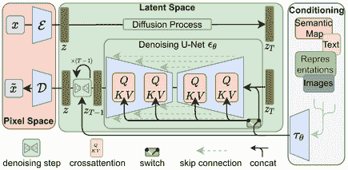

https://github.com/CompVis/latent-diffusion

# Transformer架构

Transformer 架构是 2017 年 6 月由 Google 提出的，是一种基于自注意力机制（Self-Attention）的模型，它有效解决了 RNN 类方法的并行计算和长时依赖两大痛点。原本研究的重点是翻译任务，随后推出了几个有影响力的模型，以下是 Transformer 模型简短历史中的一些关键节点：

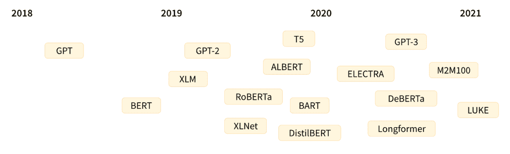

Transformer 的架构设计如下图所示：

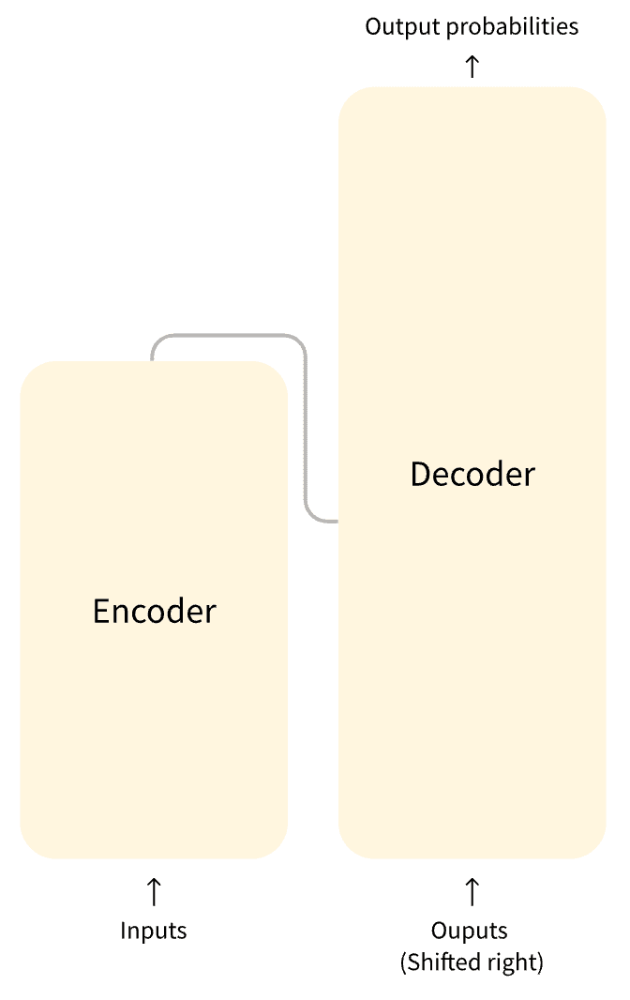

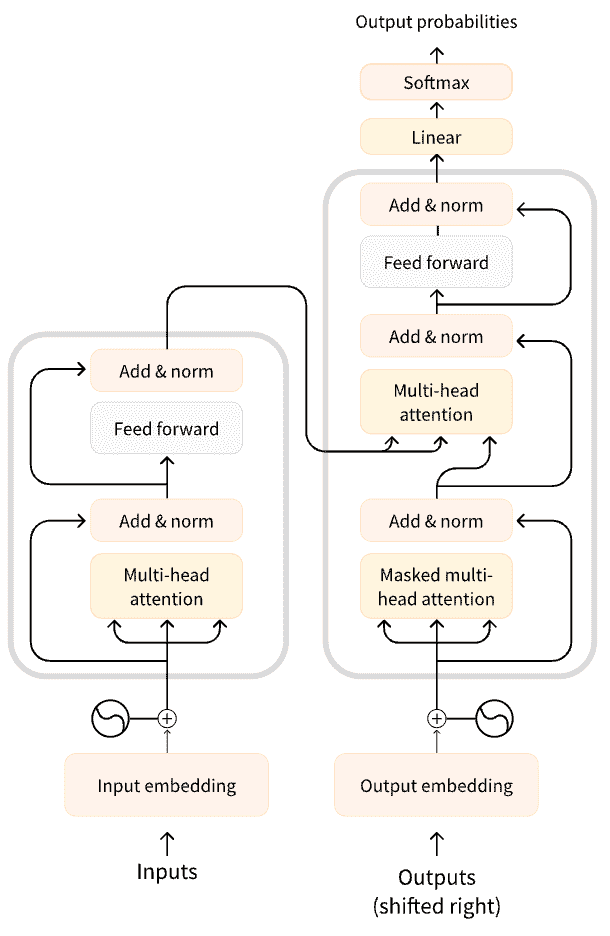

左边的这张图是 Transformers 架构的一个简单表示形式，右边的这张图是 Transformers 架构的一个完整表示形式，其中有一个重要的 Multi-Head Attention组件，称为注意力层。

**Tran**sformer 模型的一个关键特性是注意力层。事实上，谷歌在发布 Transformer 架构的论文时，文章的标题就是“注意力就是你所需要的”。注意力层将告诉模型在处理每个单词的表示时，要特别重视传递给它的句子中的某些单词，也可以是或多或少地忽略其他单词。通过注意力层，模型可以不断修正自己处理的结果，以符合输入的文本的意图。

总结来说 Transformer 通过注意力层，来理解并观察输入文本的上下文，在 Decoder 的过程中，通过多头注意力层来控制结果的输出是符合上下文语境的。

可以参考下面这篇文章，更详细的了解 Transformer 的实现原理：

https://jalammar.github.io/illustrated-transformer/

在回顾完 Stable Diffusion 的原理后，我们可以想象下，对于视频的生成该怎么做呢？

是否可以尝试把预训练 Stable Diffusion 拓展成视频生成模型呢。例如在拓展时，将视频的每一帧都单独输入进 Stable Diffusion 的自编码器，再重新构成一个压缩过的图像序列。这就是 VideoLDM 尝试解决的问题，然而经过 VideoLDM 研究发现直接对视频使用之前的图像自编码器，会令输出视频出现闪烁的现象。为此，该工作对自编码器的解码器进行了微调，加入了一些能够处理时间维度的模块，使之能一次性处理整段压缩视频，并输出连贯的真实视频。

# Sora生成视频的流程

那 Sora 是怎么做的呢？接下来我们通过一张图来了解下 Sora 的工作流程，大概可以简化为三个部分：

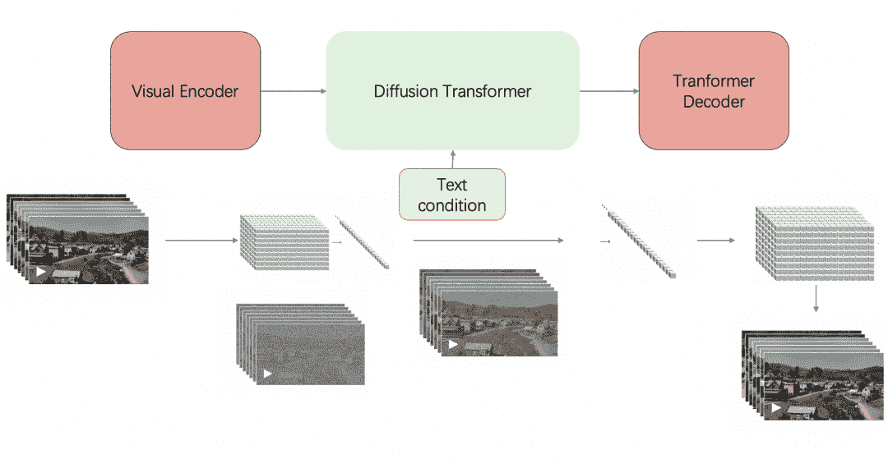

简单来说，Sora 就是依赖了两个模型 Latent Diffusion Model (LDM)  加上 Diffusion Transformer (DiT)。我们先简要回顾一下这两种模型架构。

LDM 就是 Stable Diffusion 使用的模型架构。扩散模型的一大问题是计算需求大，难以拟合高分辨率图像。为了解决这一问题，实现 LDM 时，会先训练一个几乎能无损压缩图像的自编码器，能把 512x512 的真实图像压缩成 64x64 的压缩图像并还原。接着，再训练一个扩散模型去拟合分辨率更低的压缩图像。这样，仅需少量计算资源就能训练出高分辨率的图像生成模型。

LDM 的扩散模型使用的模型是 U-Net。而根据其他深度学习任务中的经验，相比 U-Net，Transformer 架构的参数可拓展性强，即随着参数量的增加，Transformer 架构的性能提升会更加明显。这也是为什么大模型普遍都采用了 Transformer 架构。从这一动机出发，DiT 应运而生。DiT 在 LDM 的基础上，把 U-Net 换成了 Transformer。

总结来说 Sora 是一个视频版的 DiT 模型，让我们看一下 Sora 在 DiT 上做了哪些改进。

## 视频压缩网络

首先，Sora 通过一个叫做“视频压缩网络”的技术，将输入的图片或视频压缩成一个更低维度的数据，即潜在空间数据，为了实现视频压缩，Sora 从头训练了一套能直接压缩视频的自编码器。相比之前的工作，Sora 的自编码器不仅能在空间上压缩图像，还能在时间上压缩视频长度。

输入的视频在经过 Sora 的自编码器后，会被转换成一段空间和时间维度上都变小的压缩视频。这段压缩视频就是 Sora 的 DiT 的拟合对象。

这一过程类似于将不同尺寸和分辨率的照片“标准化”，便于处理和存储，但压缩并不意味着忽略原始数据的独特性，而是将它们转换成一个对 Sora 来说更容易理解和操作的格式。

报告中反复提及，Sora 在训练和生成时使用的视频可以是任何分辨率（在 1920x1080 以内）、任何长宽比、任何时长的，这意味着视频训练数据不需要做缩放、裁剪等预处理，因为 Sora 会把这些视频进行压缩以获得符合模型训练的数据。

# 空间时间补丁

接下来，Sora 将这些压缩后的数据进一步分解为“空间时间补丁”（Spacetime Patches），这些补丁可以看作是视觉内容的基本构建块，例如照片可以分解为包含独特景观、颜色和纹理的小片段。这样不管原始视频的长度、分辨率或风格如何，Sora 都可以将它们处理成一致的格式。

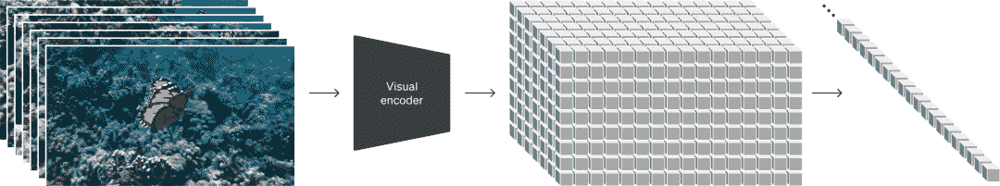

有了空间时间补丁之后，还需要将这些补丁转换成一维的数据序列，以便提供给 Transformer 模型进行处理，因为 Transformer 只能处理一维序列数据。

Sora 的这种性质还是得益于 Transformer 架构。虽然 Transformer 的计算与输入顺序无关，但必须用位置编码来指明每个数据的位置。尽管报告没有提及，我觉得 Sora 的 DiT 使用了类似于 (x,y,t) 的位置编码来表示一个图块的时空位置。这样不管输入的视频的大小如何，长度如何，只要给每个图块都分配一个位置编码，DiT 就能分清图块间的相对关系了。

# Diffusion Transformer

最后，Sora 扩展了 Transformer 模型，以便适用于视频生成，这里的视频就是一帧帧的静态图片加上了时间维度的信息，所以只需要用 Transformer 模型来生成携带时间维度信息的图片。

需要注意的是，Transformer 本来是用于文本任务的，它只能处理一维的序列数据。为了让 Transformer 处理二维图像，通常会把输入图像先切成边长为 p 的图块，再把每个图块整理成一维数据。也就是说，原来边长为 I 的正方形图片，经图块化后，变成了长度为 (I/p)² 的一维序列数据。

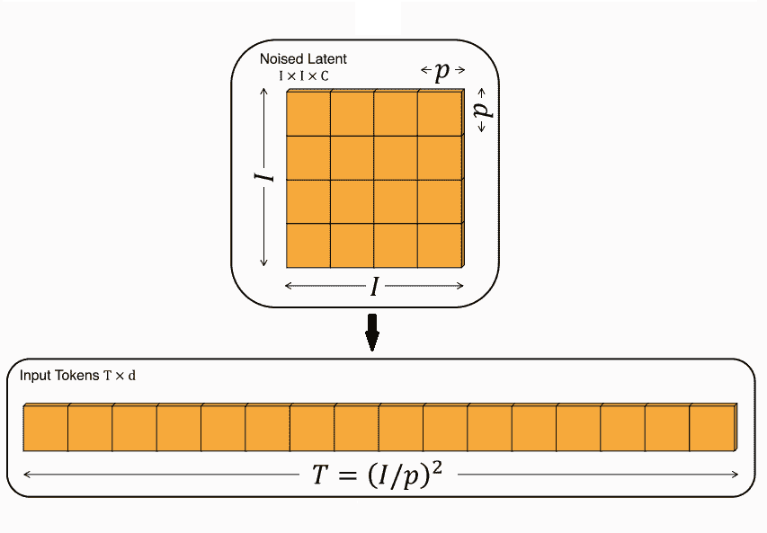

DiT 在处理输入图块(也就是空间时间补丁)时，因为每个视频图块被编上了类似 (x,y,t) 这样的位置编码，输入视频可以是任何分辨率、任何长度。将每个空间时间补丁输入 Transformer，作为输入的 Token，接着 Transformer 会完成每个空间时间补丁的噪声去除，最后所有的空间时间补丁都完成噪声去除后，再通过解码器将 Transformer 处理后的张量数据还原成视频数据。

下图展示了 DiT 的架构，左：我们训练调节的潜 DiT 模型。输入潜变量被分解成几个 Patch 并由几个 DiT 块处理。右：DiT 块的细节。我们对标准 Transformer 的变体进行了实验，这些变体通过自适应层归一化、交叉注意力和额外的输入 Token 做调节。自适应层归一化效果最好。

假设输入是一张 256x256x3 的图片，对图片做 Patch 后经过投影得到每个 Patch 的 Token，得到 32x32x4 的 Latent 潜在空间(在推理时输入直接是 32x32x4 的噪声)。结合当前的 Step t， 将 Label y 作为输入， 经过 N 个 DiT Block 处理，处理中通过 MLP 进行控制输出，得到输出的噪声以及对应的协方差矩阵，经过 T 个 Step 采样，得到 32x32x4 的降噪后的 Latent。

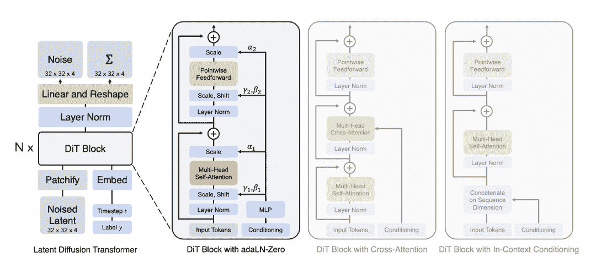

得到处理后的 Latent 之后，通过 Visual Decoder 对 Latent 进行解码，最终得到生成的视频。

# 视频标注与训练

## **收集视频及其文本标注**

初始步骤是收集大量视频数据，并获取或创建这些视频对应的文本标注。这些文本简要描述了视频内容，是训练模型理解视频主题的关键。

+   **预处理视频数据**

对视频进行预处理，包括调整分辨率、格式转换、裁剪长度等，以确保数据格式统一，适合模型处理。

+   **生成高度描述性的文本标注**

使用 DALLE3 的技术，首先训练一个模型，这个模型专门用于为视频内容生成高度描述性的文本标注。这一步是为了提升文本标注的质量，让其更加详细和具体。对训练集中的所有视频应用这个模型，产生新的、更加详细的文本标注。

之前大部分文生图扩散模型都是在人工标注的图片-文字数据集上训练的。后来大家发现，人工标注的图片描述质量较低，纷纷提出了各种提升标注质量的方法。Sora 复用了自家 DALL·E 3 的重标注技术，用一个训练的能生成详细描述的标注器来重新为训练视频生成标注。这种做法不仅解决了视频缺乏标注的问题，且相比人工标注质量更高。Sora 的部分结果展示了其强大了抽象理解能力（如理解人和猫之间的交互），这多半是因为视频标注模型足够强大，视频生成模型学到了视频标注模型的知识。但同样，视频标注模型的相关细节完全没有公开。

+   **扩散模型训练**

Sora 作为一个扩散模型，通过预测从含噪声补丁到原始清晰补丁的转换过程进行训练。这个过程涉及到大量的迭代，逐步提高生成视频的质量。

# 视频生成与处理

## **视频压缩和空间时间补丁生成**

开发并训练一个视频压缩网络，将高维的视频数据压缩到一个低维的潜在空间，简化后的数据表示更容易被模型处理。将压缩后的视频表示分解成空间时间补丁，这些补丁既包含空间上的信息也包含随时间变化的信息。

+   利用 Transformer 架构处理时空关系

基于 Transformer 架构，处理这些空间时间补丁。由于 Transformer 架构在处理序列数据(如文本)方面的强大能力，这里用于捕获视频补丁之间复杂的时空关系。

+   通过 GPT 模型理解并优化提示词

类似于 DALLE3，Sora 在处理用户提供的文本提示时，也可以利用 GPT 模型来扩展或优化这些提示。GPT 模型可以将简短的用户提示转化成更详细、更富有描述性的文本，这有助于 Sora 更准确地理解并生成符合用户意图的视频。

+   **利用扩散模型生成视频**

用户提供一个文本提示，Sora 根据这个提示在潜在空间中初始化视频的生成过程。利用训练好的扩散模型，Sora 从这些初始化的空间时间补丁开始，逐步生成清晰的视频内容。

+   **视频解码与处理**

使用与视频压缩相对应的解码器将潜在空间中的视频转换回原始像素视频。

对生成的视频进行可能的后处理，如调整分辨率、裁剪等，以满足发布或展示的需求。