# AI for everyone笔记

> 来源：[https://xmgtoagi.feishu.cn/docx/DGWpdpgYLoS0UKx6vU0cbXTYnGe](https://xmgtoagi.feishu.cn/docx/DGWpdpgYLoS0UKx6vU0cbXTYnGe)

## 目录

What is AI?

Machine Learning

Supervised Learning

Data

Acquiring data

Use and misuse of data

Data is messy

Terminology form AI

Machine learning

Data science

Deep leaning

AI has many tools

What make an AI compaany

AI Transformation

What machine learning can and cannot do

Optional: Intuitive explanation of Deep Learning

Building AI projects

Workflow of projects

workflow of ML project

workflow of Data Science project

Every job function needs to learn how to use data

Selecting AI projects

Brainstorming framework

You can make progress even without big data

Due diligence project

Build vs. buy

Organizing data and team for the projects

Specify your acceptance criteria

Pitfall:Expecting 100% accuracy

Building AI in your company

Case studies of complex AI products

smart speaker

Self-driving car

Roles in an AI team

Example roles

Getting started with a small team

AI Transformation Playbook

Taking your first steps

(Optional)Survey of major AI application areas

Computer Vision

Natural Language Processing（NLP）

Speach

Robotics

General machine learning

Unsupervised learning

Transfer learning

Reinforcement learning

GANs（Generative Adversarial Network）

Knowledge Graph

AI and society

A realistic view of AI

Limitations of AI

Discrimination / Bias

Why bias matters

Combating bias

Adversarial attacks on AI

Adversarial defenses

Adverse uses of AI

AI and developing economies

Developing economies

How developing economies can build AI

AI and jobs

Congratulation!

## **AI**

**What is AI?**

introduction:

我们应该客观的了解AI ，AI并不是无所不能的。

AI的价值：

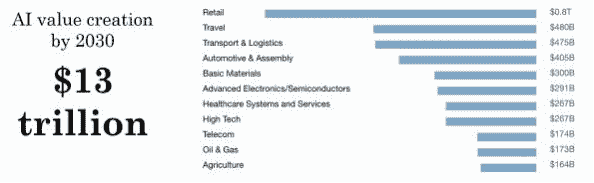

预测在2030年AI能够提供13万亿的价值，目前AI已经在零售，旅游，运输，汽车，材料，制造等方面有 了可观的贡献。

## demystifying AI

AI实际是两个独立的概念：

弱人工智能与强人工智能

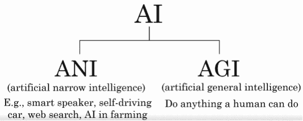

我们目前已经看到了很多弱人工智能的进展，但强人工智能似乎没有动静。弱人工智能的快速发展，导致人们误认为人工智能整体都有了极大的提升，并产生了一些非理性的恐惧。

所以可怕而邪恶的机器人会取代人类这种结论，目前来看是不可能的。强人工智能受到很多技术方面的限制，也许人类还需要几十年或者几百年的探索。

所以目前我们学习的是弱人工智能，探索其有价值的方面，以及了解弱人工智能能做什么，什么做不到。利用其能力去解决实际问题。

## Machine Learning

Supervised Learning

**最常用的**机器学习类型是**监督学习**，即**如何从输入，得到相应的输出**。

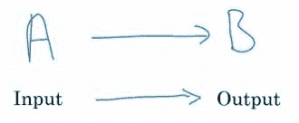

比如目前一些监督学习的列子：

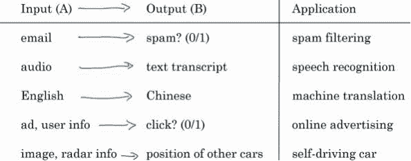

可以看出都是通过输入数据，经过算法，输出相应的结果。特别是当前的网络广告是非常有利可图的， 通过使用者的浏览信息，推送相应的广告。

idea of Supervised learning 已经存在了十几年了，但是在近几年才得到迅猛的发展。 这得益于计算机和互联网的兴起。为什么现在才得到迅猛发展：

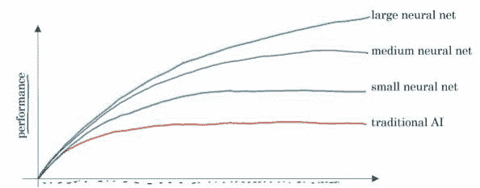

## amount of data

数据量总是多多益善的（Having more data almost always helps），随着大数据，快速计算机的兴起 和专用处理器的发展（graphics processing units or GPU）,很多公司能够获得大量的数据来训练大型  神经网络，已获得更好的性能和商业价值。

The most important idea in AI has been machine learning, which has basi**cally supervised      le**arning, which means A to B or input to output mappings. What enables it to work really well is data.

**Data**

Example of a table of data(dataset)

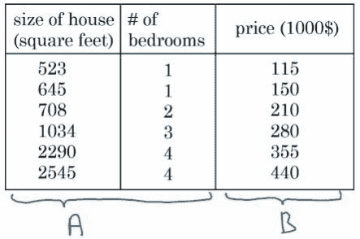

比如说我们现在拿到一些房子的售价表格，我们想要建立一个AI系统或机器学习系统，去帮助设置房子价格，或者检测自己设置的房子价格是否合理，此时我们会通过将房子大小和房间数作为A，将房子的价格作为B，让AI系统去学习如何由A到B的映射（or input to ouput mappings）。所以当我们拿到一 些数据时，这完全有自己决定，或者根据业务所需，来决定什么是A什么是B，以此来增加自己的业务价值。

相反，就是说假如我们有一定的预算，想要去挑选适合的房子，此时我们会将房子价格视为A，房子的大小和房间数视为B（that would be different choice）。这样的AI系统将会告诉你在这样的预算下，什 么样的房子你可能会考虑。

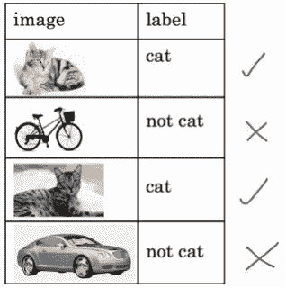

另一个有趣的例子，假如我们想要把一些照片打上标记，这个AI系统将会接收图片A然后输出标签，这样

的想法或许能够实现图片分类。我们现在可以看出，数据对于机器学习来说是多么重要。那我们如何获得数据集呢？

## **Acquiring data**

-Manual labeling

一、获取数据集的方式之一是**手动标记**。

例如，当我们有一系列的图片数据：

如果我们去一一的标记这些图片，现在就有了一个用于构建猫探测器的数据集。实际上这可能需要几十万张照片，但手动标签是一个让我们同时拥有A,B数据集的有效方法。

-From observing behaviors

**二、获得数据**集的另一种方法是从，  观察用户行为或其它类型的行为。

So,for example,假设我们在运行一个购物网站，我们可以观察用户是否购买了我们的产品。

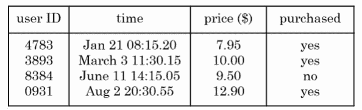

所以仅仅通过观察用户买与不买，就可能收集到这样的数据集（产品用户行为）。可以在用户访问网站 时，存储用户名，你向用户所提供了价格，以及他们是否购买了它。所以仅仅只是用户访问产品这个过 程就生成了这些数据。

我们也可以观察其它事物行为，比如机器。

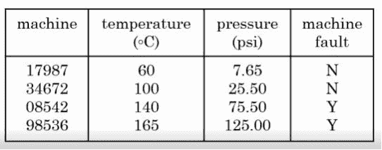

我们仅仅观察机器的表现就能收集到这样一个数据集，观察机器温度，压强，记录下编号和机器之前是 否出现过故障，假设我们要对机器进行预防性的维护，比如我们想要知道一台器是否将要坏掉，那么可 以选择机器温度，压强作为A，将机器是否出现故障作为B，进行训练。

-Download from websites/get it from the partner.

三.从**网上下载或者从合作伙伴那里获取**。多亏了开放互联网，有非常多的数据集可以免费下载。

For example ranging from computer vision or image data sets to self-driving car datasets to speech recognition datasets, medical imaging data sets to many many more.

如果某一需求需要某一类数据，我们遵循网络规则便可以直接从网上下载。

Use and misuse of data

客观，恰当的利用数据

当我们想要用AI去处理一些事情时，不要等IT团队收集到了大量的数据，得到一个完美的数据集时，那 个时候才启用AI。

较好的做法是，当IT团队已经收集到了一些数据可以立马将数据喂给AI团队。因为这样AI团队能够反馈 给IT团队哪些类型的数据是需要收集的以及应该继续构建那种类型的IT基础构架。

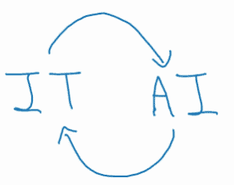

这样的做法是可以使得AI团队能够及时的给出IT团队更好的建议，比如该多长时间收集一次数据，更具 体的去收集哪方面的数据，这样的相互反馈使得工作效率更高。

不要理所当然的认为有大量的数据，  AI团队就能让他们变得有价值。

so, a good piece of advice is don't throw data at an AI team and assume it will be valuable.

**Data is messy**

-Garbage in, garbage out.

如果所给的数据质量很差的话，那么AI是学习不出准确的结果的。

-Data problems

-Incorrect labels

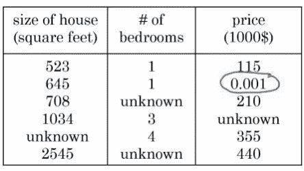

比如上图数据集，出现了不合常理的数据，这明显是错误的，那么AI是学习不出正确的结果的。

**-Missing values**

比如上图的数据中多个unknown，很多数据缺失，所以AI团队需要知道如何清理数据，如何处理这些不 正确的标签，和这些缺少的值。

-Multiple types of data

不同类型的数据，   about images, audio, and text（图片，文本，视频）   .这些非结构化的数据，人类很 容易理解，但AI处理起来要难一些，但无论是哪种数据类型AI技术都表现出色。

所以一个好的AI团队需要具备能够处理好这些数据的能力。

Terminology form AI

Machine learning

Machine learning or data science or network or deep learning. What do these terms mean?

对AI一些术语的简单解释：

Machine learning：

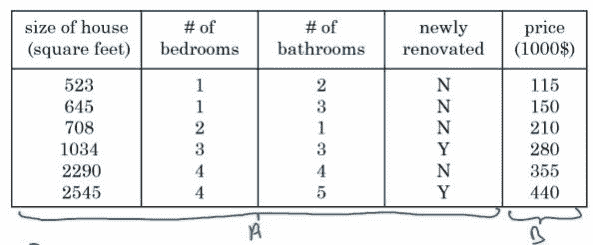

说白了就是：  一个能够通过A->B映射的数据集学习，并能输入新的数据A，产生结果B系统。(能够根据 以往的规律推测出新的数据的系统)。

就比如上图，如果给这个系统输入A，它能对应的输出B的软件。通常来说就是一个机器学习系统。这样 的系统可以帮助我们在建筑房子的时候，帮助我们决策，比如在已知要建造一定面积时，是该考虑建造  多少个卧室，多少卫生间，可以产生最大的价值？

如果要更系统化的讲：

Machine learning is a field of study that gives computers the ability to learn without being explicitly programmed.——Arthur Samuel

**机器学习是一个研究领域，它使计算**机有能力在没有明确编程的情况下进行学习。

所以机器学习通常会带出一个运行软件，用户给定的A，得到输出的B。

今天，几乎所有大型商业平台，都有AI系统在内，以此快速地知道我们最有可能点击的广告是什么。所 以这也是一个机器学习系统，输入是关于我们个人和广告的信息，输出是判断我们是否会点击某一个广 告。

**Data science**

so, what is data science?

in contrast, data science is the science of extracting knowledge and insights from data.

数据科学是挖掘数据来获取见解。

所以通常数据科学得到的是一些采取什么样行动的结论。

数据科学也有很多运用于商业的例子，可以与机器学习的例子进行对比：

例如，数据分析告诉我们，某个旅游业公司没有买足够的广告，这个时候派出更多的销售人员向旅游公 司出售广告，可以说服他们使用更多的广告。

可以发现数据科学往往得出的是一些采取什么样行动的结论或一些决定。

机器学习与数据科学都非常有价值。

**Deep leaning**

so, what is Deep learning?

假设我们要给房子定价，所以我们会有一个输入房子的大小，房间数，装修情况等，然后进过一个人工 神经网络，得到输出结果B。

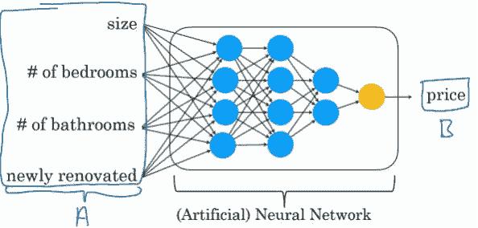

**这个巨大**的神经网络其实是一个大的数学方程，根据输入的A，告诉你如何计算B。其中繁杂的细节之后 会学习。

现在我们需要知道的是，神经网络是一种学习A到B，输入到输出映射的非常有效的方法，当今神经网络 和深度学习基本上在表示同一个意思。Deep learning 只是一个更好听的名字罢了。

实际上人工神经网络和大脑没有任何关系，神经网络最初受到大脑的启发，但工作方式是完全与生物的 大脑工作方式无关的（只是有某些松散的联系罢了）。

AI has many tools

-Machine learning and Data science

-Deep learning/neural network

-Other buzzwords: Unsupervised learning, reinforcement learning, graphical models, planning, knowledge graph,...

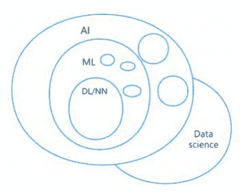

人工智能有太多的工具可以使用，只要大概理解上图就差不多了，数据科学与人工智能使用的一些工具 是重合的，但又各有不同。（数据科学与人工智能有交集，又加上了一些额外的东西，数据科学还有一 些自己的工具来推动商业的发展）

What make an AI compaany

怎样让公司擅长使用AI？

首先我们需要知道什么样的公司称之一个AI公司。

A lesson from the rise of the internet:

shopping mall+webisite ≠ Internet company

一个建立有自己网站的商场是不同于一流的互联网公司的，真正的互联网公司是能够通过互联网业务赋 能的公司。

真正的互联网公司应具备以下能力：

A/B testing（使用不同版本的网站，用于测试哪一个网站效果更好，但一个传统的商场是很难同时 拥有两个平行宇宙的两个商场的）

Shortiniteration time(拥有短的迭代周期，短时间内调整自己的架构，及出售新的产品)

Decision making pushed down to engineers and other specialized roles.(通常把决定交给产品 经理，而传统模式下通常由CEO来决定，这种传统模式并不适用于互联网时代)

那么人工智能时代呢？

AI Era

Any company+deep learning ≠ AI company

真正的AI公司应该具备以下能力：

Strategic data acquisition (战略性的收集一些数据，比如有时AI公司会出售一些并不很赚钱的商 品，只为了获取数据，认真考虑如何获取数据是一个好的人工智能公司的关键成分)

Unified data warehouse(能够建立统一的数据库)

Pervasive automation(十分擅长发现自动化的机会)

New roles and division of labor(有新的分工)

那么一个公司如何变得善于使用AI呢？

AI Transformation

1.  Execute pilot projects to gain momentum. (启动试点项目来获势头，这样可以了解人工智能什么 能做什么还做不到)

1.  Build an in-house AI team(建立一个人工智能团队并提供广泛的人工智能培训) 3. Provide broad AI training

1.  Develop an AI strategy(制定一个人工智能策略)

1.  Develop internal and external communications (保证内外沟通一致)

**What machine learni**ng can and cannot do

客观的了解AI，才能更好地使用AI

通过一些实际的例子更好的了解AI：

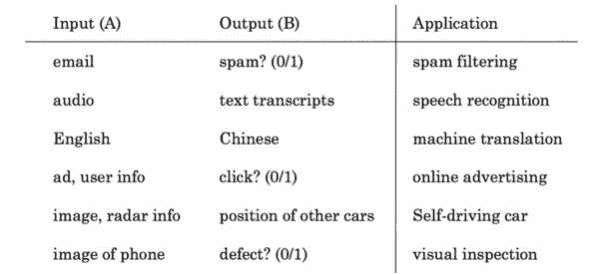

有这样一个不完美的经验准则在监督学习中：

Anything you can do with 1 second of thought we can probably now or soon automate.

某件事如果你只需要短暂的1秒钟就能想出来结果，那么我们可能现在或者很快的将来就可以用监督学习 来完成。

虽然是一个不完美的准则,但是可以帮我们大致的判断哪些事情是AI能做的哪些事情是AI还做不到的。

比较好的锻炼我们直觉的方法就是直接看具体的例子

比如：

网上购物的智能回复

可以发现当顾客对话中提到退货申请时，人工智能是能够识别出来退货请求的（这里输入的A明显就是 客户的语言文字信息，那么输出的B自然就是指明是什么问题，然后可以交给相应的部门处理），但是 要让AI系统去感同身的去写一段回复目前看来仍然是困难的。

这样直接通过看一些AI的应用实例能够更好的帮助我们锻炼直觉，去更好的判断哪些事情能够很好的自 动化。

比如接下来是一些利用深度学习算法做智能回复失败的例子：

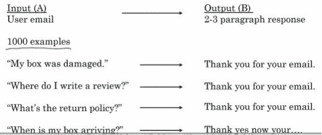

通过大量的数据进行学习，发现AI系统想要完成写出一封感同身受的信件是不容易达成的。

那么什么能够使得机器学习更容易实现：

What makes an ML problem easier

1.  Learning a " simple" concept

1.  lost of data available

接下来再看多一些例子：

self-driving

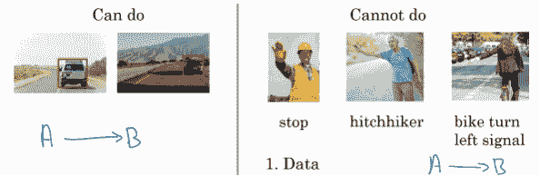

在自动驾驶中也有很多机器学习运用的例子：

可以看出左边只是简单的识别汽车，  AI系统还是可以达到的，但是对于右侧机器对于人类手势行为的解 读依旧很难实现一个简单的伸手在不同的场合对应着不一致的信息，特别是自动驾驶这样设计到安全问

题时，需要AI系统有较高的准确率，这是时候的错误率必然需要极其小，这使得AI系统更加困难。

所以很少会有自动驾驶团队依靠人工智能系统去识别人类的多种多样的手势，并依靠它来安全驾驶。

X-ray diagnosis

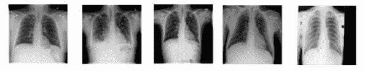

AI系统能够做到的是通过分析大量的数据，比如通过几千张胸部X光片的学习中，诊断出肺炎，但AI系统 做不到的是，通过十几张肺炎照片加上一些医学的理论书籍就能学会判断肺炎。

人类可以看几页书，再看几张肺炎的照片，就能大概理解究竟，但是AI做不到。

或者说我们暂时不知道如何写出一个软件来通过看几页书和几张肺炎照片就能够识别出胸部中的肺炎。

so we can conclude:

Strengths and weaknesses of machine learning

ML tends to work well when:

1.  Learning a "simple" concept

1.  There is lots of data available

ML tends to work poorly when:

1.  Learning complex concepts from a small amount of data.

1.  It is asked to perform on new types of data.(用系统从未见过的新类型数据执行任务时往往表现 不佳)

比如上图如果在不同的医院，医生总是让病人躺在一个奇怪的角度，并且医疗设备不好的话，这样的 新数据交给之前的AI系统效果往往是不好的。  AI系统举一反三的能力可能比不过医生。

**Optional: Intuitive explanat**ion of Deep Learning

深度学习和神经网络这两个术语在AI中几乎可以交替使用，作为人工智能的工具它们很出色但似乎被媒 体炒的有点神秘了。

更直观的理解深度学习

Demand prediction:

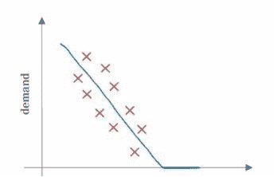

price

如果这是一件衣服价格的示意图的话

如果做一个AI系统通过给出的价格，预测出大致的需求。

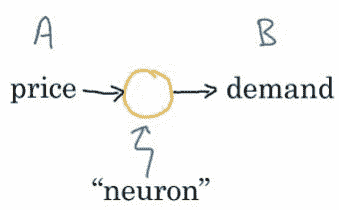

那么输入便是价格，输出便是需求，中间的经过的这个圆形会估算出售出的件数（需求），在人工智能  领域里面这个圆形被称之为人工神经元。它功能就是计算出价格-需求图中的蓝色曲线。这种只有一个神 经元的网络是最简单的神经网络。

当多个神经元组合起来时就构成了一个神经网络，如接下来的例子：

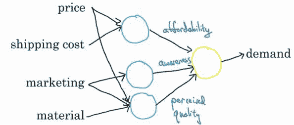

如影响顾客需求的有价格，商场折扣，市场营销（广告），材料等因素。此时价格和商场折扣，通过一 个神经元预测出顾客的承受程度，输入广告费用，通过神经元预测出用户的对该商品的认识了解程度，  价格、广告、材料质量共同影响着顾客对该商品质量的预测，所以通过三个神经元的预测汇总到一个神 经元来预测出用户需求，所以此时输入有四个值，输出为需求的系统，构成了一个神经网络，实际这还 是相对较小的神经网络了，在实际操作中的神经网络要大的多。事实证明只要给它足够多的数据并且训 练一个足够大的神经网路，它能极好的完成A到B的映射。

所以这就是神经网络，  一个神经元可以就是一个相对简单的函数，当你把它如同堆积木一样搭建起来， 它就变成了一个极为复杂的函数，这些函数能够很好的完成A到B的映射。

那么神经网络又是如何分析出图片里面是什么的，或者它听到一段语音，它是如何明白语音想要表达的 内容的?

接下来是一个用神经网络进行人脸识别的例子：

这对于我们来说是一双眼睛，但对于计算机来说是一个由像素亮度值组成的表格，这个表格告诉计算机 图片里的每一个像素有多亮，如果是一个黑白或者灰度图像的话，每一个像素会以一个单独的数来呈

现，来告诉计算机那个像素有多亮，如果是一张彩色图片的话每个像素会以三个数（红蓝绿三原色）来 呈现。

如果这张图片的像素是1000*1000的话，那么这个神经网络需要把一百万个数字作为输入，以此来对应 一百万个像素的亮度，彩色图像的话则需要三百万个数字作为输入。

那么就会需要很多很多的神经元来计算它们，但不需要我们来决定这些神经网络需要计算什么，神经网 路自己会计算出来的，

神经网会逐渐识别出每一个部位，最终将这些元素整合到一起，来分辨出图片中的人是谁。

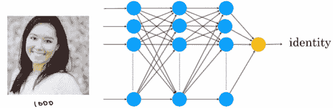

神经网络的奇妙之处就在于你不需要知道里面在干什么，你只需要给它很多像上图这样A的图片数据， 和像B这样正确的身份标签，然后这个学习算法会自动弄清楚每一个神经元需要计算什么。

**B****u**ilding AI projects

Workflow of projects

workflow of ML project

机器学习能够学习从输入到输出的映射，那么我们如何构建一个机器学习的系统呢？

以语音识别为例子：

第一步就是要**收集数据**，你需要各处寻找非常多的音频数据，来自很多不同的人的语句音频。

第二步就是**训练模型**，你需要利用你个机器学习算法，来学习从输入到输出的过程，如当你说“siri”时， 你希望它输出“h**ello**”，但往往第一次训练的模型是达不到理想的效果的，所以很多人工智能团队会尝试 很多次，在人工智能领域我们将它称之为反复迭代，直到模型看起来足够好为止。

第三步自然就是**“派送”模型**了，如语**音识别，你需**要把**这个AI系统放入**一个音箱，然后让群用户进行测  试，很多AI系统到这一步的时候，它开始收集新的数据，但效果不像我们最初希望的那样好，比如说一 个被英式英语训练的AI语音识别系统，但当你将这个智能音箱运送到美国，那么这个语音识别系统可能 就变得不是所期待的那么好用。当这种情况发生时，最好能够将这种情况的数据进行回收，去维护和更 新模型。

总结来说机器学习项目的关键步骤：

1.  Collect data

1.  Train model

integrate many times until good enough

1.  Deploy model

Get data back

Maintain /update mode

workflow of Data Science project

与机器学习不同的是，数据科学的结果往往是一些可以指导行动的观点和见解。所以数据科学与机器学 习的工作流程是不同的。

让我们先看一个数据科学的例子：

比如我们希望优化一个销售漏斗

整一个销售流程是：首先用户会浏览网站，然后进入详情页面，加入购物车，然后提交订单。所以想要 优化销售漏斗，让尽可能多的人经过所有这些步骤，那么数据科学能够帮助我们做到这一点。

第一步是**收集数据**，对于上面这个例子我们后台应该能够拿到这样一个数据集记录，

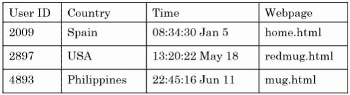

了解到用户的点击页面信息，通过查看IP地址来了解到用户的所在地址。

第二步就是**分析数据**，数据分析团队可能会想到一些会影响销售漏斗的因素，比如很多海外客户点进支 付页面，但最终没有下单，可能由于跨国运费过高的原因，导致海外客户因为运费的问题退出了支付，  如果真是这样可以**考虑是否**将部分邮费加入到商品价格中来，或者适当降低价格。数据分析团队发现在 某段时间在线人数较少，可能大家都去午休了，这个时候就可以适当的较少广告的投放。所以一个好的 数据分析师总是能有很多想法，经过多次迭代测试，去获得更好的见解和观点。

第三步就是**提出建议或指导**，**数据分析团队****将各种想法提炼成一系列的假设，**可**能会对营销上**有帮助。 或者给出经营上的一些建议，将这些建议进行实际应用，此时用户行为可能已经发生了变化，所以数据 团队需要采集新的数据集，分析新的数据 ，定期做出评估，找到更好的假设，甚至更好的经营方法。

Key steps of a data science project

简言之数据科学项目的关键流程：

1.  Collect data

1.  Analyze data

Iterate many times to get a good insight

1.  Suggest hypotheses/action

Deploy changes

Re-analyze new data periodically

数据科学在实际中应用的例子：

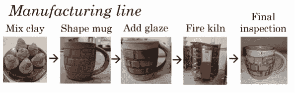

如何优化生产线使得马克杯不产生裂痕或者制造出更好的马克杯。

我们需要收集到一些关于马克生产过程中的数据：

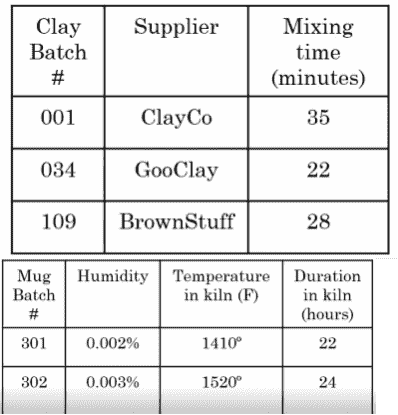

如:不同批次黏土的数据，加入了多少水，窑的温度是多少，杯子在窑中烧了多久

将这些数据交给数据科学团队来进行分析，他们也许会重复多次分析来给出最合适的建议。他们可能会 发现其中一些问题：如温度过高，加入的水过高可能会导致，杯子出现裂痕。这些基于数据分析出来的 问题，使得数据科学团队给出一些假设性的建议，以及如何调整生成线的策略。用以提高生产效率，这 时又会得到新的数据，所以需要进行定期的分析，与反复改进。

可以这么说如今机器学习和数据科学正在影响着每一个行业，接下来我们看一些例子。

**Every job function needs to l**earn how to use data

在过去几十年里社会正在走向数字化，现在几乎每一个行业可能都会需要用到机器学习和数据科学的工 具进行辅助来提高我们的工作效率，接下来我们看一些机器学习和数据科学对于各行业的影响。

**Sales**

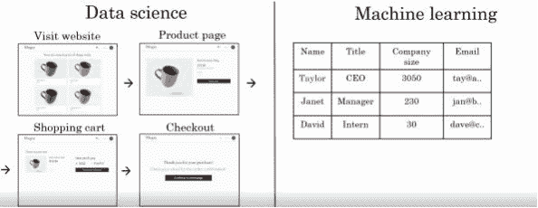

optimize sales funnel                                                                  Automated lead sorting

**在销售行业我们****可以看到**我们能够利用数据科学帮我们优化销售的方式，改进营销的策略。利用机器学 习来自动排序一些潜在客户，输出人员价值优先权，让销售人员变得更有效率。

Manufacturing line

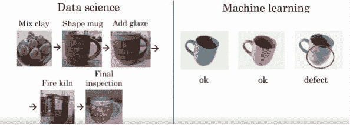

**如果你作为****一名生产线管**理员，通过之前的例子已经能够知道数据科学如何帮助优化生产线。那么机器 学习能够对最后产出的产品进行质量检测，  自动检测产品是否有划痕。既降低了劳动成本有提高了工厂 的生产质量。这种类型的自动视觉检测，应该会是对制造业影响深远的技术之一了。

see more examples

**Recruiting**

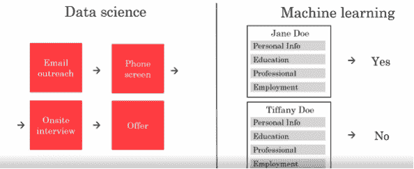

在人**员招聘中，当**你要招聘一个人员进入公司的时候，会有一些列可以预见的流程，包括：猎头，邮件 给候选人，电话面试，现场面试，接着就是拒绝或接受候选人。如同数据科学能够优化生产线一样，数 据科学也能够优化招聘流程，许多猎头组织已经在这么做了。比方说你发现很少有人能够通过电话面试 这一关进入到线下面试，那么你可能会得出结论，也许是电话面试的面试官过于严苛了，所以应该让更 多一点的人来到现场面试，数据科学已经对招聘起到了很大的作用了。

机器学习可以用于**自动筛选简历**，但是这里可能涉及到伦理问题，机器学习系统是否对候选人有偏见，  是否一视同仁，目前机器学习正在进入这个市场，但我们更希望它的系统是合乎伦理与公平的。在最后 一章对一这一方面有更详细的讲解。

**Marketing**

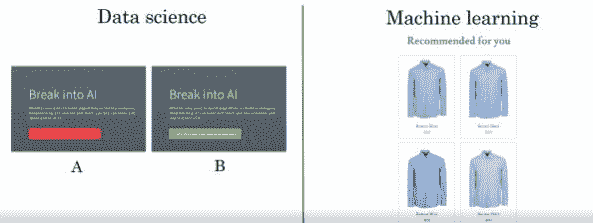

**在市场营销**中，最常见的优化网站的性能的方法是做A/B测试，即启动两个不同版本的网站，看看那个 版本的点击量更多。通过这些数据，数据科学团队能够帮助提出建设性的建议和执行策略。

那么机器学习在如今的市场营销中会针对性的给用户推荐购买率更高的产品。这种营销方式在网站上很 是常见，比如在某**一个服装销售网站**，在观察了用户的个人习惯后发现用户比较喜欢蓝色的衬衫，针对 其它用户又会有不同的针对性的推荐，如今这样的个性化的产品推荐驱动着大型电商平台大比例的销售 额。

**Agriculture**

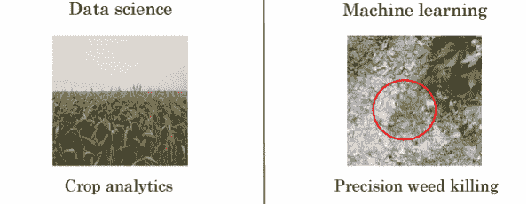

如今在农业，机器学习和数据科学又如何帮助农民提高生产效率呢？

如今数据科学已经应用于**农作物分析了**，你可以从土壤条件，天气条件，及市场上不同的农作物的价格 中获取数据，然后让数据科学团队来给出建议，何时种植，以及种植什么作物来提高生产效率，同时又 保留良好的农田土壤。如今数据科学已经对农业产生了越来越大的影响。

**也许机器学习**应用于农业最令人兴奋的变化之一就是将农业精准化，如上图在棉花旁边有一些杂草，利 用了机器学习使农业机器能够精准的喷洒除草剂，又不会过量。这样的AI系统在帮助农民提高生产率，  降低生产成本的同时，有有助于保护环境。

那么我们又如何选择一个有潜力的AI项目呢？

Selecting AI projects

接下来我们直接来看一个AI项目框架。

我们已经知道目前AI并不能够做所有的事情，只有某些特定的事情AI能够做到。

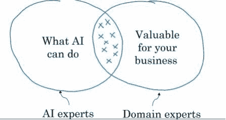

所以我们需要做的是寻找到，对你行业有价值的事情及AI能够做的事情的交集，那么也许会需要一个有 交叉技能的团队，所以这个团队需要包括AI专家和业务专家的团队。

当团队进行头脑风暴去选择一个值得做的项目时，接下来提供一种头脑风暴的框架：

Brainstorming framework

** ** Thinkabout automating tasks rather than automating job.

第一，虽然有很多关于人工智能将会取代工作岗位的媒体报告，这确实是一个需要被社会关注的问题，

**但在考虑具体的人工智能项目时，  **思考如何让人工智能将具体任务自动化，比如何让他取代工作岗位要   有用。 就是说也许在某项工作里面会涉及到多件任务，考虑某些具体的任务也许更适合用机器学习来使   其自动化，让AI来做会变得更加的有效和有价值。举一个实际的例子比如放射科医生，他们有很多的任   务需要处理，比如看X光片，给病人提供指导性的建议，继续教育与其它放射科的医生进行沟通学习，或 指导年轻的医生。那么通过观察放射科医生所做的任务这个时候，如果让识别X光片这件事情使其自动

化，也许是最有效的项目。

所以对于公司业务来说，在所需要执行的任务中，你能否找出那么一两个能使用机器学习进行自动化的 任务？

·  **What are the main driver**s of business value?

**第二，在团队进行头脑风暴讨论**项目时，可以经常去问一个问题：  驱动商业价值的主要因素有哪些?

因为有时通过数据科学和AI来增强这些因素是十分有价值的。

**  What is the main pain poi**nt in your business?

第三，可以问:**公司或业务中有哪些主要的痛点**？也许这些中的某一些可以利用AI来解决，但或许能够成 为创造人工智能项目的最佳起点。

**You can make progress e**ven without big data

对于人工智能项目有一点需要补充的就是：  即使没有大量的数据，也是能够取得进展的。

Having more data almost never hurts.

但不要误会拥有大量的数据往往好处比坏处要多的，除了要多付一些传输和存储数据的费用。

Data makes some businesses(like web search) defensible.

拥有的大量的数据总是有好处的，比如让网络搜索变得更具有防御性。

But with small datasets, you can still make progress.

但是即使我们只有少量的数据依然可以取得进展的。假设你在为咖啡杯做一个自动视觉检查系统：

如果你能够有百万张好杯子和还杯子的照片去喂给AI系统，那当然是很好的，但是像咖啡杯这样昂贵， 我们不会无故去制造一些坏了的杯子，除非真做坏了，所以有时可能只有10个或者是100多个样本，你 也能开启机器学习项目，需要多少数据取决你要解决什么问题，可以多于AI专家进行交流。

有时有的项目确实需要大量的数据才能获得好的解决方案，但不要在一开始没有翔实的数据就放弃。很 多时候，即使只有很小的数据库也是能有进展的。

那么在你投入要做AI项目时，你如何确定这是一个较好且可行的项目呢？

因为有时我们一个AI项目也许几天就能看出进展并能预测到该项目能否可行，但有时一个AI项目需要投 入很长的时间才能知道该项目是否可行。接下来会提供一系列的步骤去检测一个项目是否值得你花费几 个月的努力。

Due diligence project

全面的对所要投入的AI项目进行调查

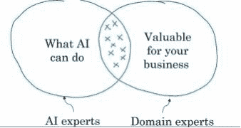

还是之前所讲我们所选择的项目，应该在AI所能做的及对商业有价值的事情上寻找，所以我们就需要对 技术方面和商业方面进行调查。

在技术方面调查以确定技术的可行性

Technical diligence

Can AI system meet desired performance

为了**确定AI系统能否达到预期的效果**，可以与AI专家进行讨论来确定目前的AI技术对于该项目的可 行性。

How much data is needed

另一个更重要的问题就是，  **需要多少数据才能达到理想的水平**？并且你是否有办法获得那么多的数 据吗？、

Engineering timeline

第三，是**开发此系统的时间表**，试图弄清楚需要多少时间，需要多少人来建造一个你想要的系统。

Business diligence

进行全面的商业调查，确保你够想的项目是对企业来说真的具有价值的。

Lower costs

许多AI项目会通过**降低成本来推动价值**，例如通过自动执行一些任务，或者提高系统的运行效率。 （对已有业务的改进）

Increase revenue

许多AI系统也可以**增加收入**，例如让更多网购的人最终把放在购物车里的东西下单。（对已有业务 的改进）

Launch new product or business

或者**推出新产品和新业务**

此外，我们还需要对道德进行考察，让社会和人性变的更好。

**Build vs. buy**

当你计划你的AI项目时，你必须决定你是想亲自建立还是向别人购买。这是IT世界的老问题了，在人工  智能中我们仍然要面对此问题，就比如说现在几乎没有公司会去建立自己的计算机，他们只需购买别人 的计算机，商用路由器。

ML projects can be in-house or outsourced

同样，机器学习项目可以让企业内部做或者外包给别人。有时如果你外包一个机器学习项目，你可以更 快地找到合适的人才，并加速项目的实施，也可以在企业内部建立自己的AI团队并在内部完成这些项

目。

DS projects are more commonly in-house

数据科学项目通常不会外包，因为这与你的企业密切相关，这通常需要对你的业务有非常深入的了解， 才能以最佳的方式开展数据科学。

Some things will be industry standard-avoid building those.

最后在每个行业，某些东西是有行业标准的话，应该避免重新构建它们，构建与购买问题的一个共同的 答案就是，构建对你来说非常专业或完全专业的东西，或许它们将允许你构建独特的防御优势，但如果 所需的是具有特殊的行业标准的，那你应该购买它，而不是内部构建它，这会更加有效。

**“不要在火车前猛跑”**: 说白了就是不要试图偏离行业标准，我们都生活在一个时间有限，数据有限工程资 源有限的世界里，所以我们应该将这些资源利用在我们最独特的项目上，以此带来最大的收益。

那么我们现在如果已经找到了一个不错的项目，我们又如何与AI团队沟通配合完成这些项目呢？

**Organizing data and t**eam for the projects

Specify your acceptance criteria

**首先，如**果我们能够就项目提供一个验收标准的话，这会对人工智能团队有很大的帮助。

接下来是一个机器视觉的例子

假设当我们给定一个项目验收目标比如：检测出咖啡杯的缺陷的准确率为95%。

那么人工智能团队如何测量该准确率呢？

人工智能团队需要一组数据集来测量模型准确率这样的数据集被称为测试集。

所以人工智能团队就是这样看待数据集的，他们通常将一个数据集划分为训练集，  一个划分为测试集。

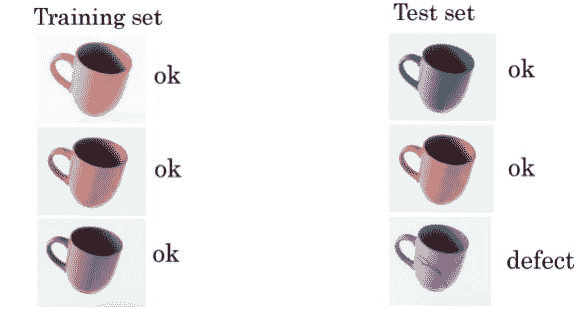

显然实际中的数据集比这大的多，我们可以与AI专家交流去去确定具体会需要多大的数据集。

有时我们会经常听到AI团队提到开发集或者验证集，那便是第二个测试集，至于为什么需要两个测试 集，太深入技术讨论了，之后学下去自然会了解到。

Pitfall:Expecting 100% accuracy

在很多时候，由于某些原因，  AI软件也许不可能达到100%的准确率。

Limitations of ML

首先，尽管现在**机器学习**科技非常强大了，但仍然**有局限性**，它并不是无所不能的。

Insufficient data

第二，数据不足，如果是数据不够的话，特别是训练数据，那么是比较难达到高准确率的。

Mislabeled data

第三， **数据混乱**，因为有时数据可能会被错误标记了，这会损害AI软件的表现。

Ambiguous labels

第四， **数据有时候模棱两可**

，如这个茶杯损坏了那么一点，可能只算为一个次

品，但不是一个失败品，也许不同的咖啡杯检测家会给出不同的结论。

显然以上这些问题大部分是可以改善的，所以有时我们可以去选择一些既能通过技术调研又通过商业调 研并且不必要达到100%准确率的项目。

**B****u**ilding AI in your company

Case studies of complex AI

**smart speaker**

打造一个复杂的人工智能产品是什么体验。

**products**

比如说智能音箱，当我们对智能音箱说出触发词，音箱就会开始识别我们所说的意思。

例如当我们说“hi device tell a jock”

系统就会识别我们的话语，并通过算法输出对应的要求。

以下便是智能音箱处理指令所需的步骤：

1.  Trigger word/wake-word detection(听到唤醒词或者触发词)

1.  Speech recognition(将用户所说的话的音频映射成文本记录)

1.  Intent recongnition(意图识别)

1.  Execute(执行，在一些复杂的指令中也许会用到其它软件来执行指令，比如播放音乐）

像这样有很多步骤的人工智能系统一般由多个人工智能组件构成来一步步处理数据。也许需要四个团队 专注于，四个不同的步骤中。

Self-driving car

人工智能时代最令人兴奋的产品之一便是自动驾驶汽车了

接下来是一个简化的有关于自动驾驶汽车解释,这样我们理解如何将很多个人工智能组件组装到一起而构 成如此神奇的事情。

关键步骤：

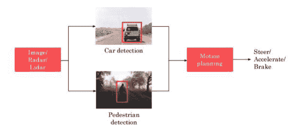

汽车会接受各种各样的**传感器作为输入**，比如汽车前方或侧面后方的图片，以及雷达或激光雷达的传感 器读数，就能**够探测出其它车辆的存**在或所在位置，这样的话我们就可以发现附近人或者车的位置。  汽 车探测或人的探测可以用机器学**习来完成，即**使**用输入输出映射（这里输入可以**是雷达的信息，输出是 其它车辆或者人的信息）。当我们已经知道了人或车的位置信息，这个时候就可以交给另外一个专用软 件（运动轨迹规划软件）来执行，这个软件会帮助规划行驶的路劲，这样就可以避免碰撞和做出到达目 的地的规划，当经过软件的规划，我们可以将其转化成特别的舵机角度，加速度和刹车指令等。

接下来让我们具体了解一下车辆探测，行人探测和动作规划。

Key steps:

主要部分：

1.  Car detection

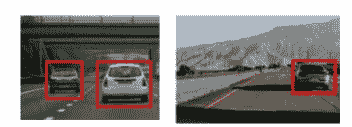

通常对于汽车探测需要多个摄像头与传感器（如雷达）来探测周围的其它车辆

1.  Pedestrian detection

行人探测通常采用的就是比较类似的传感器检测和技术。

1.  Motion planning

简要介绍一下运动轨迹规划步骤：该软件的主要功能就是告诉我们行车路径应该是什么，以及速 度，这样既不会撞到另一辆车，同时还能以合理的速度在路上行驶。

让我们看一下更多的细节，实际的自动驾驶汽车如何工作的：

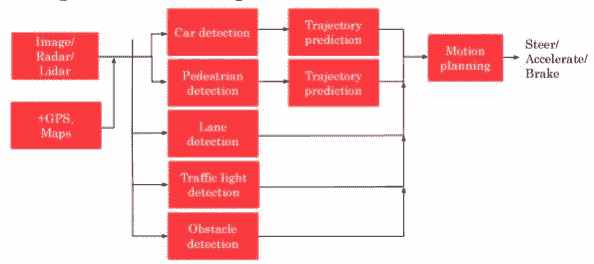

在实际中，作为输入的可能还有其它辅助信息，比如GPS,MAPs，需要探测的东西还有红绿灯，车道标   志，其它障碍物等，当我们等到了四周环境的信息，为了安全驾驶还需要去预测接下来行人和车辆的行  驶路径及速度加速度，这被称为轨迹预测，这是另一个人工智能的部分了,所以在一个大的自动驾驶汽车 设计团队里，通常会让一部分人去分别去负责一个红色方框内的工作。只有把部分做好组合起来才能使  得汽车自动驾驶。

通过这些例子我们会发现有些AI产品可能需要一个庞大的AI团队。接下来我们需要了解一个AI团队所扮 演的角色和承担的责任，这样更加有利于我们明白一个复杂的AI项目会涉及到哪些工作。

Roles in an AI team

需要说明的是，如今AI发展的太快了，它的工作头衔和要承担的责任不是能完全清晰定义的，在不同的 公司可能会有所不同，所以接下来就是社会心理学闲聊。

**Example roles**

Software Engineer

E.g., joke execution, ensure self-driving reliability, …

软件工程师，比如执行讲一个笑话，或者设定计时器，回答天气问题等都是传统软件工程师的工作。 并且这样的工程师占绝大部分在AI团队中。

Machine Learning Engineer

Applied ML Scientist

机器学习工程师，它们一般会写一些用于输入到输出映射的软件或者创建其它机器学习算法，然后运 用于产品之中。因此他们会收集相关数据来训练一个深度学习或神经网络的算法，并且一直迭代，使得 学习算法可以持续提供准确的输出

Machine Learning Researcher

+   Extend state-of-the-art in ML

机器学习研究员，典型的职能就是负责开发机器学习的前沿技术，因为机器学习，  AI在仍然在发展， 所以公司会有需要这样的人负责扩展最新的技术。

Applied ML Scientist

应用机器学习科学家，这个工作头衔介于机器学习工程师和机器学习研究员之间，会同时做一点点前 两者都有的工作内容，他们经常需要负责学术文献或研究文献，寻找到最前沿的技术，并想办法用找到 的这些技术来解决他们目前所面临的问题（比如如何利用最前沿的技术来研究出弱读单词检测算法，并 应用到语音识别中），

Data Scientist

+   Examine data and provide insights

+   Make a presentation to team/executive

数据分析师，目前定义并不明确且存在争议，但是Andrew认为他们的主要任务不仅仅是监测数据并  分析背后的意义，还应包括向其团队或总裁来展示这些数据分析得出的见解和点子，来帮助驱动商业决 策。

Data Engineer

+   Organizedata

+   Make sure data is saved in an easily accessible, secure, and cost-effective way

随着大数据的兴起，也有越来越多的数据工程师，其主要作用就是帮助整理数据，意思是确保数据安 全地保存下来并很容易读取，而且以一种很经济的方式。那为什么保存数据如此重要，为什么不直接把  数据保存到硬盘里？现在在硬盘中存几兆的数据是很容易的，但是要存储千兆的数据，速度就会开始下  降，比如自动驾驶汽车每分钟就要制造很多数据（也许每分钟就相当于从网上下载好几部电影），为了  把运行数据存储起来，需要大量的数据存储工作，当然这是对于相当大的公司来说每天产生几TB甚至几 PB的数据，当随着数据量的增大，如何保证数据以一种安全，经济高效且容易被读取的方式存储起来， 会变得越来越难,这也是为什么数据工程师变得越来越重要了。

AI Product Manager

+   Help decide what to build; what’s feasible and valuable

AI产品经理，他们的工作时帮助决定用AI做什么也就是帮助判断什么是可行且有价值的，传统的产品经 理本来就要决定该打造什么东西，但现在产品经理需要在人工智能领域做这样的决策，而且他们需要学 习新的技能，从而才能决策什么是可行且有价值的。

因为人工智能领域仍然在不断进化，这些着职称并没有说完全板上钉钉，不同的公司又各自不同。

Getting started with a small team

• 1 Software Engineer , or

• 1 Machine Learning Engineer/Data Scientist, or

• Nobody but yourself

最后需要强调的是有些项目并不需要很多人，即使你只有一个小团队，甚至一个人，也是可以通过少量 数据开始尝试训练一些机器学习的模型并建立项目，并开始探索什么样的项目是你可以做的。

AI Transformation Playbook

那么如何让一个公司变成一个好的AI公司呢？

接下来，将谈论AI转型手册的具体细节

Execute pilot projects to gain momentum（第一步是让公司开展试点项目来获得势头）

Build an in-house AI team（第二步是建立公司内部的AI团队）

Provide broad AI training（第三步是提供广泛的人工智能培训）

·   Develop an AI strategy   （第四步发展AI战略）

Develop internal and external communications（第五步，对内外部进行公司与AI的宣传）

这样五个步骤是为了让我们有一个大概的感觉，来推动项目。（在实际中可能又会略有不同）

1.  Execute pilot projects to gain momentum

**如果想让公司在人工智能领域有所发展，  在考虑初期的项**目或几个最初的项目时，最需要考虑的是它们 是否能够成功，而不是它们是否最具有价值。当AI团队能带领公司开一个好头，把整个势头带动起来，  其它企业看到，或者说其公司了解到自己公司能够取得很好的成功时，也许之后他们会更加青睐与我们 的AI团队合作。

More important for the initial project to succeed rather than be the most valuable

所以在项目初期应该尝试成功率较高的AI项目，它们能够把整个势头给带动起来，它们也许不是最有价 值的项目。但这样能最终把最有价值的项目人工智能化。

Show traction within 6-12 months

并且在开启项目后再6到12个月就能展示成效的项目会是很好的，这样能够让你的整一个转型快速的动 起来。

Can be in-house or outsourced

最后，你的第一二个试点项目既可以是由公司内部做的，也可以是外包的。（最初的项目时可以选择外 包来做的，这样可以加快转型的速度，这样能够更快的开启转型的势头，那么超过一定的时间还是需要 你内部的AI团队来做的，开展一系列长期或更多的AI项目）

1.  Build an in-house AI team

去搭建一个集中统一的AI团队

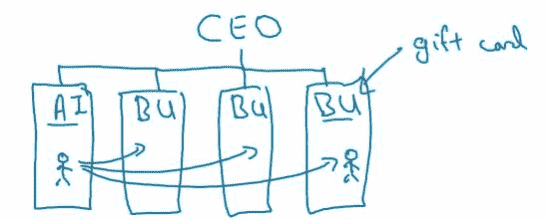

BU = Business Unit

说白了每一个业务团队都有自己单位领导人，他们可能很熟悉他们的业务，创造一个几种统一的AI团队 提供了一个可以相互交流的平台，用以讨论如何能在公司业务范围内应用AI，把统一AI团队里的人才分 配到其它部门，也许是更有效率的，这样他们也许能够与不同业务部门的人一起创建一个有趣的AI项

目。 AI团队的另一个职责是要建造一个全公司范围的平台（如果有什么软件平台，其它工具或是数据基   础设施）能够对业务有用的话，来帮助更多个部门开展业务。最后这个新的AI业务部门可以直接汇报给   CTO或是CIO，首席数据官或者首席数字官，或者可以让一个新的首席AI官来负责。最后一个建议是在最 初的AI部门刚成立的时候，如果公司或者CEO能够提供经费给它，这会是很有帮助的，而不是让AI团队   从其他部门获得资金。在进过最初的建设和上升阶段后，  AI团队是一定要为其它部门展现提供的价值。

1.  Provide broad AI training

建议提供广泛的人工智能培训，随着公司变成一个善于使用人工智能的公司后，公司不同层级的一些人 也需要理解AI是与其它岗位工作互动的。

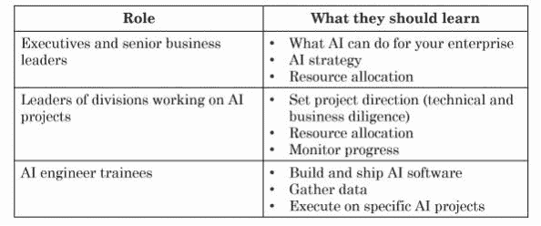

**比如说对于，高管和高级****商业领袖而言，建议让他们学习**了解AI能为你的企业做什么，并让他们了解到 基本的AI战略，足够了解AI以便于来决定如何进行资源分配。

对于在AI项目里展开工作的各个部门的领导们，也应该知道，他们在各自的角色里与AI互动，如何制定 项目方向，即如何进行技术和商业调查。以及如何在各个部门进行资源分配。  知道如何跟进，并且监督 AI项目的进程。

对于AI工程师来说也需要进行更大量的培训来精进自身的技术，目前世界上的AI工程师是远远不够的， 所以内部培训是很多公司构造他们AI能力的关键部分。

网上有很多资源，公司大可不必自己开设课程，利用网上资源进行学习即可。

1.  Develop an AI strategy

为什么将发展AI策略放在第四步？因为通常在不了解AI的情况下，公司有时会做出一些不符合常识 的学识策略。前几步能让公司更加了解AI，并了解它如何适用于公司业务之后，再去制定战略，比 在公司对AI不了解的情况下直接就开始制定战略要很多。特别是高层对AI有一些稍微深入的了解

后，再执行公司战略。

Leverage AI to create an advantage specific to your industry sector（利用人工智能创造针对你 的行业领域的优势）

Design strategy aligned with the “Virtuous Cycle of AI”（设计战略应与 "人工智能的良性循环 "相 一致）

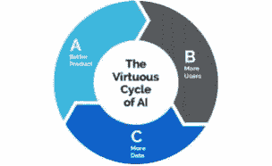

此外，可以**设计一种与AI良性循环相一致**的公司策略。让我们以网络搜索为例子，对于想进入这个市场 的新公司来说跟龙头企业竞争是很艰难的。这是其中一个原因是：如果一家公司有很好的产品，可能仅 仅是稍微好一点的产品，那么该网络搜索引擎可以获得更多的用户，  拥有更多的用户就意味着你可以收 集更多的数据，因为你可以观察到用户在搜索不同术语时所点击的内容，并且可以将这些数据输入AI引 擎以生成更好的产品。这意味着如果某一公司的产品稍微好一点，那么它会拥有更多的用户，这就意味 着可以获得更多的数据，并且通过现代人工智能技术创造出更好的产品。  这使得新进者很难进入这种自 我强化的正反馈循环。客观的讲，今天一个小型新进入网络搜索引擎这一市场的公司很难与谷歌，百

度， bing ，Yandex竞争。

幸运的是，人工智能的这种良性循环也可以用于被小型团队用于进入新的垂直行业。但是如果你正在进   入一个新的垂直领域，  一个新的软件应用领域，在那里还没有一个已经存在的企业，那么你可以制定出   一个策略，让你成为利用这个良性循环的公司，进一步解释的话，如一家名为Blue River的公司被John    Deere(美国农机巨头)以3亿美元的价格收购。Blue River使用AI制造农业技术，他们制造的是这种拖在拖 拉机后面的机器，这台机器能够通过拍摄的庄稼的照片分辨出农作物和杂草，并使用精确的AI来杀死杂   草。（一部分是Andrew的学生），老实说，他们的第一个产品并不是那么好，它是由一个小型的数据集 上训练出来的，但他们成功说服了一些农民，开始使用他们的产品，将机器拖在拖拉机后面，以便开始   杀死杂草。  一旦这东西开始在农场周围运行，他们自然会获得越来越多的数据。在接下来的几年里他们   进入了这个积极的反馈循环，也就是拥有更多的数据，导致拥有了更好的产品，拥有更好的产品便可以   说服更多的农民使用它。几年下来，进入一个像这样的良性循环，可以让你收集庞大的数据资产，  从而   使得你的业务非常具有防御性。可以说一些大型科技公司是没有他们这么多菜地里的白菜照片的。

一些最大的科技公司也许很擅长人工智能，但是这不意味着你必须与这些公司去竞争，因为许多人工智 能需要根据你的行业专业化或者垂直化，因此对于大多数公司来说在你的行业建立专门的AI是最好的，  而不是试图在AI方面相互竞争，这对于绝大多数公司都是不使用的。

其它策略要素：

正确的策略可以帮助你的公司有效应对变化。

Consider creating a data strategy（还可以考虑创建一个数据战略）

**-Strat**egic data acquisition（战略数据采集），比如一些面向消费者的大型AI公司，推出一**些免 费的服务，但这允许他们以**各种方式收集数据，从而更多的了解你，为你提供更多的服务，从而直接货 币化他们关于该产品的数据，这与直接货币化提供服务的产品，是完全不同的方式。  获取数据的方式因 行业垂直而异。

**-Unified** data warehouse （建立统一的数据库），如果一个项目的各种数据分散在不同的数据 库，那么让一个AI工程师去汇总这些数据，并达成一个整体的项目，是几乎不太容易实现的。建立统一 的数据库可以有效的提升工程师全面利用不同数据的能力。

Create network effects and **platform ad**vantages（创造网络效应和平台优势）

-In industries with “winner take all”dynamics, AI can be an accelerator（在具有 "赢家通吃     "动力的行业，人工智能可以成为加速器）今天，像Uber, Lyfts, ola,didi这样的公司似乎都有相对防御性 的业务，因为它们是将驾驶员与乘客联系起来的平台，这对新进者很难，因为需要积累大量的驾驶员并  同时吸引大量乘客是很难的。  Twitter和Facebook等也非常具有防御性，因为它们具有非常强大的网络   效应，在一个平台上有大量的用户，使得该平台对其他人更具有吸引力。因此，新进者很难闯入，在这  样一种行业动态中如果AI可以用来帮助你，你就会更快地成长。

企业策略是特定于公司，行业具体情况的，因此很难为，每一个公司提供一个完全通用的**战略，但这些 原则可以提供一个**大致的框架，使得你知道AI战略有哪些关键因素。  AI也适用于更传统的战略框架 （低 成本和高价值战略的文章），人工智能也许可以减低你的业务成本，或者提高产品价值。

最后，当我们在利用AI建立这些有价值和有防御性的业务时，我希望你只是想要建立出让人们生活变得 更好的企业，做出一个伟大的AI公司，是一件非常强大的事业，所以无论做什么业务，我希望你只是想 让人们的生活变得更好。

1.  Develop internal and external communications(发展内部和外部沟通)

Investor relations(投资者关系)

Government relations(政府关系)

Customer/user education(客户/用户教育)

Talent/recruitment(人才/招聘)

Internal communications(内部沟通)

Detailed AI Trans[formation Playbook: https:](https://landing.ai/ai-transformation-playbook/)//landing.ai/ai-transformation-playbook/

Taking your first steps

Some initial steps you can take（一些你可以采取的步骤）

Get friends to learn about AI（与其一个人做，不如找点朋友一起学习，  一起搞人工智能）

-This course

-Reading group

Start brainstorming projects（寻找一些有工程经验的朋友，开始集思广益一个项目）

-No project is too small（从小项目开始取得成功比从大项目开始后失败要好，通过学习网络课程足够 让你去许多有潜力价值的AI项目了）

Hire a few ML/DS people to help（可以雇佣ML/DL的工程师来帮助你）

Hire or appoint an AI leader (VPAI, CAIO, etc.)，当你准备扩大规模时，可以招聘AI方面的领军人 物来帮助你。仅仅当你团队只有几名工程师时，是没有必要招聘的，小团队的效率会更高一些。

Discuss with CEO/Board possibilities of AI Transformation（与高层讨论一旦公司在AI方面变得 更强，这是否能够产生更多的价值。）

-Will your company be much more valuable and/or more effective

if it were good at AI?

**(Optional)Survey of major **AI application areas

AI如今应用于图像、视频、语言和语音数据等多个领域，接下来介绍AI应用于各个领域的总览报告

**Computer Vision**

深度学习的主要成就之一在于计算机视觉，接下来看一些例子。

• Image classification/Object recognition

**图像分类和图像识别**，将一副类似于这样的图片作为输入，然后告诉我们图片里有什么，像这样将输入

的一副图片归类到某一中类别的能力已经被用到各种应用中。其中一个被广泛认可的技术就是面部识 别。

Face recognition

这是现在的**面部识别**系统的工作方式，  一个用户可以用一张或者多张图片来向AI展示自己的长相，在得 到一张新的图片后AI可以判断这是否为同一个人。这样就可以应用于很多基于个人身份认证的东西，例 如解锁手机，解锁门，人脸支付等。，我们也希望人脸识别能够以尊重个人隐私的方式被使用。

Object detection

**另一种不**同类别的电脑视觉算法被称作物体检测。不仅只是尝试分类或者识别一个物体。你还要检测是 否有物体出现在一个图像中，例如：

例如，在建造一辆自动驾驶汽车过程中，我们可以看到AI系统是如何将这样的图像作为输入，然后不知 是告诉我们这是否是一辆汽车，是否是一个行人，它还会告诉我们那些车辆的位置，还有行人的位置。 所以与图像分类相比物体识别算法将输出一张物体在图像中的位置，及物体的类别。

Image segmentation

**图像分隔**，进一步推进这一技术，给出这样一张图片后，

它不仅告诉我

们车辆和行人的位置，还告诉我们图中所有的像素中哪些是车的一部分，哪些是人的一部分。所以它在   物体周围画出了十分精确的边界。所以在读取X光片的例子中所用的技术是图像分隔算法。这种算法可以 观察X光片，或者其它一些人体影像并且仔细把人体的肝脏，心脏或骨头的位置，在图像中分隔出来。

Tracking

计算机视觉还可以处理视频，而其中的应用之一便是寻迹。

在这个例子中检

测在视频中的奔跑者，他还追踪视频中的奔跑者是否随着时间的推移运动，所以这些红色小尾巴显示了 算法是如何追踪在视频中出现了几秒钟的不同奔跑的人，这种追踪人，车或运动物体的能力，帮助计算 机标算处理物体将会去向哪里。

这便是计算机视觉领域里主要在做的方面，想、也许他们可能对你的项目有所帮助。

Natural Language Processing（NLP）

AI特别是深度学习也在**自然语言处理**领域取得重大的进步。

Text classification

一个例子是**文本分类 **，AI的任务是输入一串文本，然后输出对应的类别。比如说输入邮件，输出垃圾邮 件或非垃圾邮件，同样有一些网站，当你输入对于产品的描述后，它会自动将其分类。

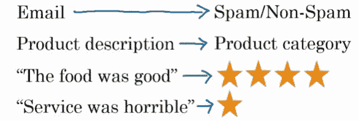

+   Sentiment recognition

其中一个备受关注的技术是情绪识别，比如可以将某一餐馆客人的评价作为输入，将评价等级作为输 出，自动因客户评价划分星级。

Information retrieval

第二种就是**信息检索**。

+   E.g., web search

网络搜索可能是最为人熟知的信息检索方式了，当你输入文本关键词，并希望AI自动地帮助你找出相关 的文档，许多企业同样也会有许多内部的信息检索系统，它可能会提供一个界面帮你在数不清的公司文 档中，找到你需要的文档。

Name entity recognition

**名称实体识别**，是另一种自然语言处理技术，如接下来的例子：

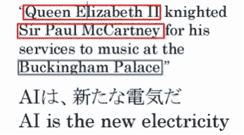

假设你有上图所示的句子，并想找出其中所有的人名，那么它会帮你在文本中标出，如上图红色，名称 实体识别还可以自动提取公司、电话号、姓名和国籍等。

Machine translation

另一个主流的AI应用就是**机器翻译**，例如用日语写的： “AIは、新たな電気だ“,机器接着输出对应的翻 译： ”AI is the new electricity“。

他们便是目前四大类主流的有效的NLP应用。

Others: parsing, part-of-speech tagging

其它的还有解析和语音部分标注技术，例子：

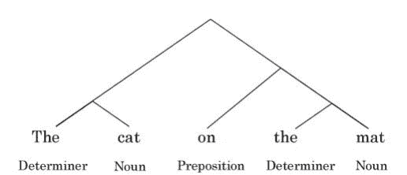

部分语音标注算法将扫描所有单词，并告诉你哪些是名词，哪些词是动词，等等。这都是根据英语语法 理论做出来的。那有什么用呢？举个例子假如你有一家餐厅的客户评价，这时候你可能特别在意一些形 容词，如好的，坏的，美味的，或者你在意一些名词，这样可以更加方便找出。具体细节学到再说。

**Speach**

现代AI技术，尤其是深度学习也完全改变了软件处理音频数据，比如一段语音“Machine Learning”。

语音在计算机中如何表示呢？比如X轴是时间轴，  Y轴是高速的空气压力变化，以函数形式来表示气压一 个人如何说出“Machine Learning”。

Speech recognition (speech-to-text)语音识别，大量语音识别的进展都归功于深度学习。

Trigger word/wake-word detection语音识别中比较热门的一个应用就是触发词检测。

Speaker ID语音身份识别是一种特殊的语音识别，它的任务是倾听某人讲话，接着找出讲话人的身 份，就好像人脸识别一样通过拍照来识别身份。

Speech synthesis (text-to-speech, TTS)最后，语音合成技术，又被称为文本至语音或TTS，即输 入文本文件将其转化为音频文件。

The quick brown fox jumps over the lazy dog.   （这个有趣的句子NPL领域经常看见有人用，因为 这句话包含了A-Z所有单字）现代TTS进步很快，声音也越来越接近自然人声。

**Robotics**

AI同时也应用在机器人领域，  一个例子就是自动驾驶汽车。

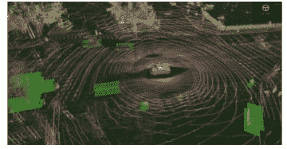

**  **Perception: figuring out what’s in the world around you，术语感知意味着根据你的感官弄清你 周围的世界里有什么，上图便是雷达扫描系统。

**  Mo**tion planning: finding a path for the robot to follow ，运动规划：为机器人找到一条机器人要 行进的路径

**  **Control: sending commands to the motors to follow a path，最后，  控制指的是发送指令给机器 比如方向盘马达，油门踏板，刹车之类的，让他们帮助车子根据规划的路劲顺利前行。

我**们关注了机器**人里软件与AI方面的应用，当然还有其它重要的工作，比如开发硬件来保证机器人的正 常运行，但是大量的AI感知，运动规划和控制将聚焦与软件，而不是机器人硬件。

General machine learning

机器学习也被广泛的应用于其它方面，

Unstructured data (images, audio, text)

在这一章节中主要看到的是非结构化的数据比如图像，音频和文本。

Structured data

机器学习同样也能很好的处理结构化数据，比如下图这些表格，只是由于非结构化数据，比如图片，更 易于人类理解，这种数据对于任何人来说都很容易理解**和感同身受，所以大众媒体更倾向于报道人工智 能在非结构**化数据的进展，而不是在结构化数据的进展，而且结构化数据通常是具体到某公司的业务，  所以大众不易理解，  但AI和机器学习如今正使用结构化数据创造着巨大的经济价值，在AI非结构化数据 中也有同样的影响。

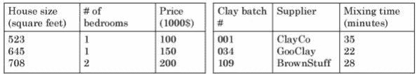

希望上述所举的例子能够对你的项目有所帮助，到目前为止之前大部分时间提到的AI技术，都属于

“supervised learning”(监督学习)即学习A到B的映射，实际上也引出了什么是“unsupervised learning” 无监督学习，即大众媒体所谈论的“强化学习”？

Unsupervised learning

尽管监督是学习，在如今的环境下是最有价值的技术，还有许多其它技术在经济角度也是值得了解的。

在非监督学习力最著名的就是**聚类**（Clustering Potato chip sales）

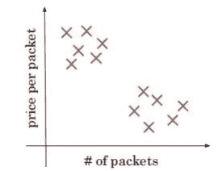

比如在一个杂货店靠近校园，进过统计，会发现许多大学生都在买便宜的薯片，但是他们买的很多，在 数据中也会发现一个完全不同的购物群体，他们购买少量薯片，但是选择价格昂贵的那种。聚类算法以 这种方式分析数据，自动地将数据分成两个群体或者更多群体，它通常应用分析市场分层，算法帮助你 挖掘市场特点，帮助对不同的市场进行划分。

聚类被称为非监督式算法，相比监督学习是寻找A到B的映射，你必须告诉算法，你需要输出的B是什

么，而**非监督学习算发烧并不需要准确地告诉AI系统要什**么输出，你只需要给AI提供一堆数据，如：客 户数据，并告诉AI在里面找到一些有趣的信息，有意义的结论。在这个案例里，聚类算法事先不知道有 大学生和上班族，相反，它只是尝试找到不同的市场分层，而事先不知道有哪些分层。所以无监督学习 算法，是输入无标签的数据，即没有输出标签B，也可以从数据中找到有趣的结论。

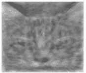

有趣的案例是关于声名狼藉-谷歌猫的故事，在这个案例中使用大量的YouTube视频进行非监督式学习， 我们希望算法告诉我们，在YouTube中找到什么，结果在里里面找到的最多的是猫，因为不知为何，

YouTube有很多与猫有关的视频。这是一个了不起的结果，因为我们没有提前告诉算法去找猫，在AI系   统中，无监督学习算法，可以自动发现猫的概念，仅仅通过分析YouTub的视频，它能告诉你有很多猫的 视频，上面猫的概念图便是系统学习到的内容。

尽管监督学习算法是非常有价值的技术，但对监督学习算法的批评之一便是它真的需要许多标签数据

（即输出B**），比如说你尝试用监督学习算**法去识别马克杯，那么你需要1000个，甚至10000个马克杯  图片，也就是我们需要大量的马克杯图片输入到AI系统中，但可以肯定的是这个星球上不会有哪一个父 母，指着10000个马克杯去教孩子认识什么是马克杯。这就是为什么AI研究者对无监督学习抱有很大的  期望，也许将来AI会更高效，或者更像人的方式学习，采用更少的标签数据的更生物化学习方式。话虽 如此， 无监督学习现在也是很有价值的，例如一些特定的领域和自然语言处理领域中，无监督学习帮助 提升网络搜索质量，但如今无监督学习产生的价值远不如监督学习带来的价值。

Transfer learning

AI技术的另一个重要领域是迁移学习，如下例子：

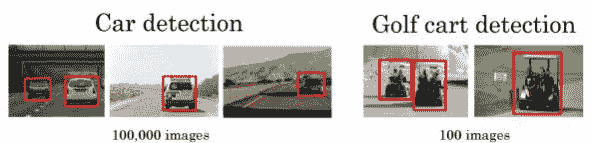

假设你买了一辆自动驾驶汽车，并训练AI系统来检测车辆，但你并没有把新城市的数据部署到这个车

上，比如这个城市有很多高尔夫球车，所以你还需要构建一个高尔夫检测系统，也许你的车检测系统已  经使用了大量的图片进行训练，比如100 ，000张图片，但刚开始驾驶这辆车是，也许只有少量的高尔夫 图片，迁移学习让你从任务A，比如说一般的车辆检测，使用从A中的知识用以完成另外的任务B，比如   说高尔夫车检测。  如果可以从一个车辆检测大数据集（任务A中） ,进行迁移学习，你可以更漂亮的进行  高尔夫车辆家检测，尽管你只拥有少量的高尔夫车辆的数据，因为算法已经从先前的任务重学习到车

辆，车轮的样子，以及车辆是如何移动的。这些对高尔夫球车检测也许很有用，迁移学习并没有受到很 大的关注，但它是当今人工智能中，非常有价值的技术之一。例如，许多计算机视觉系统都是使用转移 学习构建的，这对他们表现有很大影响。

Reinforcement learning

你可能还听说过一种，叫做强化学习的技术，例子：

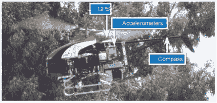

这是一张斯坦福自主飞行直升机的照片，他装备了GPS、加速器和指南针，这使得它能自我定位，假设 你要开发软件，让它自己飞起来，使用监督学习算法，就很难实现这个功能，因为指定它的最佳飞行方 式很难，当直升机出于某一个位置时，给它指定一个最好的架势方式是很难的，强化学习提供了不同的 解决方案，这样的学习方式似乎与训练宠物狗的方式相似，当宠物狗做了正确的事，我们会给予它奖

励，当做错了事情我们会惩罚它，让它下次不要在犯，强化学习采用同样的原则，用于直升机或其它事 情。所以，我们会让直升机在模拟器里飞来飞去，它可以在不伤害任何人的情况下坠毁。但我们会用AI

飞行直升机，若果某次它能驾驶的很好，我们就“奖励它”，当它坠毁，我们就“惩罚它”。AI的**职责就是学 着如何驾驶直升**机，让飞机获得更多的奖励，更少的惩罚。更正式的说，  强化学习算法使用奖励信号，

来教AI该做什么，不该做什么。  这意味着，当它做的很好，就给它一个正数权重作为奖励。每当它做的 很糟糕的时候，就给它一个负数权重作为惩罚。  AI的职责就是自动学习一个行为，以最大限度的提高奖 励。

强化学习还在玩游戏，或者黑白棋，跳棋，围棋方面也应用很多，  Alphago就是通过强化学习使它非常 擅长玩围棋，强化学习在竞技游戏方面也非常厉害。

强化学习的缺点之一就是它需要大量的数据，例如玩电脑游戏，强化学习算法可以玩无限量的游戏，因 为它只是一台玩计算机游戏的计算机，它可以获得大量的数据进行强化学习。尽管媒体聚焦关注在强化 学习上，但到如今，它创造的经济价值明显低于监督学习。但未来有可能突破，改变这种情况。  AI发展 如此迅猛我们当然希望各个领域都将有所突破。

**GANs（Generative **Adversarial Network）

生成对抗网络，是另一种令人兴奋的AI技术，发明者是Andrew的学生Lan Goodfellow创造的，  GANS非

常擅长于在什么都没有的情况下合成全新的图像，比如下面是使用GANs合成的明星脸：

通过在名人图像数据库学习之后，这个算法可以合成全新的图片，娱乐产业对于GANs的应用非常感兴 趣。从计算机图形，到电脑游戏，到多媒体，  一切无中生有，制造出新内容。

**Knowledge Graph**

最后，知识图谱是另一个重要的AI技术，但它常常被低估，如果你在谷歌搜索adv lovelace（艾达罗 夫），你会发现出现了右边这样的信息：

这些信息是从知识图中产生的，这基本上意味着列出这些人和与其有关的关键信息，如今，不同公司已 经建立许多类型的知识图谱，有趣的是，即使知识图谱为大型企业创造了大量的经济价值，但它是学术 界研究相对较少的一个课题。

**A****I** and society

AI是一种超能力，我们都希望AI的应用能够使得社会变得更好，所以我们也需要思考AI与社会的问题。

A realistic view of AI

AI对人类社会和生活都会产生巨大的影响，所以要做出好的决策我们需要对AI有一个客观的认识。  不 能过于乐观，也不能过于悲观。

Too optimistic: Sentient / super-intelligent AI killer robots coming soon

对于AI技术能够做的事我们不能太乐观，比如说，我们过于乐观不顾实际的话，会让人们觉得感知智 能和超人工智能的或强人工智能的时代即将到来，并因此认为我们要投入大量的资源，来抵御可怕的AI 杀人机器，以做学术研究的角度来看，研究未来的可能性并没有什么坏处，但我们不能过度投资资源来 抵御一些中长期内都不会出现的风险，可能几十年，几百年都不会出现，我觉得没有必要去恐惧感知，  超级人工智能，这些不必要的担心会让我们分心而不去关注一些真正的问题。

Too pessimistic: AI cannot do everything, so an AI winter is coming

反过来说我们也不能对AI过于悲观，对于AI极端消极的看法认为AI什么都做不了，所以AI的冬眠期将 要到来了，  AI的冬眠期是指在AI发展历史中，陆续有几段时期AI被过度炒作，而当人们发现AI不能够做 一切的时候，人们就对AI丧失了信心，并减少对AI的投资，如今的AI技术与十几年前的冬眠期不同的

是**，如今AI创造了巨大的价值，我们可以很清楚地**预知它将在继续在很多行业创造出更多的价值，所以 结合以上，  我们能够知道AI将在可预见的未来继续增长，即使我们已经知道了AI并不能做所有的事情。

Just right: AI can’t do everything, but will transform industries

（Goldilocks rule for AI）金发姑娘的故事告诉我们介于两者之间的做法是正确的，就跟贾平凹所说“世  上的事认真不对，不认真也不对”，做事情不能太过于极端，我们知道AI不能够做所有事，尽管很多事情 无法做到，但它将改变行业与社会。

Limitations of AI

人工智能有很多局限性

Performance limitations

在之前的学习中我们已经见到了其**功能的局限性**，例如给定少量的数据，仅依靠AI可能无法完全自动 化呼叫中心并对客户发送来的所有邮件做出非常灵活的响应。

Explainability is hard (but sometimes doable)

AI也有其它方面的限制，其中之一是很难进行解释，许多高性能的AI系统，都是黑盒模型。这意味着 它工作的很好，但AI不能够解释为什么能够如此有效，或为什么会产生这样的结果（类似于人类自己也 解释不清楚自己是如何学会理解文字的具体细节，并能利用文字交流的。）举个例子：

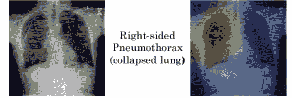

假设AI通过这张X-ray图来诊断病人状态，在这个例子中，  AI系统认为病人有右侧气胸，意味着他右肺塌 陷，那我们怎么知道系统判断是否准确？是否应该相信它做出了正确的判断？现在许多研究试图让AI系  统具有更好的解释性，这个例子中热图是AI表明它用了哪个部分图像来产生这个诊断结果。（人类也并  不擅长解释我们是如何看待并定义一件事物的）另外，如果AI系统效果不好，它如果能够被解读的话，

则可以帮助我们弄清楚如何让AI系统更好的工作，因此可解释性是一大主流研究领域，可解释很难研 究，但也不是一定不可能实现，但我们确实需要更好的工具来帮助AI系统解释其中的原理。

Biased AI through biased data

作为人类社会，我们不希望基于性别或是种族去歧视一个人，而是希望人们得到公平的对待，但如果 我们给AI系统输入的数据不能够反映这些价值时，  AI就会产生偏见，或学会歧视某些人（通过有偏见的  数据导致了有偏见的AI系统）， AI社区正努力想要在这个方面的问题上取得进步，但是任重而道远。

Adversarial attacks on AI

一些AI系统正做出重要的经济策略，  一些AI系统将暴露在对抗性攻击下，就是说某人故意要愚弄你的 AI系统，因此根据你的应用一件很重要的事情是确保你的AI系统没有暴露与这种攻击之下。

关于AI的偏见和对抗性攻击对于你我都很重要，我们是AI社会潜在的开发者和用户。

Discrimination / Bias

对于AI系统产生的偏见，我们应该如何减少或者消除呢？让我们看一个例子。

微软的一个研究小组有这样一个发现，当人工智能从互联网上的文本内容中学习时，它可以学到刻板印 象，值得称赞的是该研究小组还提出了减少这类人工智能系统偏见的技术解决方案。他们发现人工智能 通过阅读互联网上的文本，可以学习单词，并且你可以让它进行推理类比。比如你可以问它：

-Man : Woman as Father : Mother

男人与女人的对应关系，相当于父亲和谁的对应关系？人工智能会回答母亲。

如果你问他，男人与女人的对应关系，相当于国王对应谁的关系？人工智能会回答王后

这基于互联网单词的常用的方式这两个答案是说的通的。

但研究人员发现，  男人对应程序员就像女人对应什么？输出答案是女人对应家庭主妇

我们认为得出这样的答案是很不幸的，对于含有较低偏见的答案应该是，女人也对应程序员，如果我们 想让AI系统理解男人和女人都能是程序员，就和男人和女人都能干家务一样。

那么AI系统是这种偏见是如何产生的呢？让我们从技术层面探讨一下，人工智能系统存储单词的方式是   使用一组数字，比如说男人这个词用数字组（1,1）来代表，人工智能通过统计互联网上男人这个单词的  用法的出这组数字，这里的数字只是假设举例，实践中人工智能可能对数以百计或数千中数字来存储一   个单词，来简化表示例子，通过统计“程序员”在整个互联网中被使用的频率，  AI会的到一对不同的数字比 如(3,2)表示，

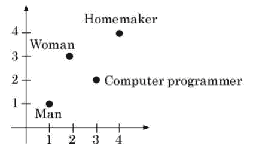

类似地，通过词语“女人”的使用又一次得到不同的数字对，如用（2,3）来表示，当你用类比来询问计算 机，男人对应程序员，那么女人对应什么？接下来就是AI要做的事情，就是构造平行四边形，接着询问 对应的（4,4）坐标时哪一个词语。因为它认为这个点就是类比的答案。

AI系统在如今执行了很多关键的决策，将来也会这样，所以偏见问题值得重视。

Why bias matters

• Hiring tool that discriminated against women（AI招聘工具可能会存在歧视女性，或有种族之类的歧 视）

• Facial recognition matching dark skinned (又比如还有一些AI系统对浅肤色的人特征识别比对深肤色 的人更加准确)

individuals to criminal mugshots，也许这样在刑警侦查的中，这就可能对深皮肤的人造成了极大的偏 见与不公。

• Bank loan approvals（人工智能在银行贷款审批是也可能存在歧视少数民族，开出更高的利息），措 意银行需要努力确保消除或减少系统中存在这种偏见。

• Toxic effect of reinforcing unhealthy stereotypes（AI也可能在某些方面强化不健康的定型观念的毒 害作用，例如一个女孩如果网络上搜索首席执行官，她看到的只有男性或者看不到和她一样的种族，或 者性别的人的图片，我们不希望她的梦想就此被挫伤）

**Combating bias**

对于消除偏见的**方法建议**：

• Technical solutions:

+   E.g.,“zero out”the bias in words（例如，将文字中的偏见 "清零"。）

+   Use less biased and/or more inclusive data（使用偏见较少和/或更具包容性的数据，比如对于人脸 识别系统输入的数据确保包含来自多个种族、所有性别的数据。）

• Transparency and/or auditing processes（透明度和/或审计程序，从而可以随时检查何种类型的偏 见，至少我们能够及时发现，并采取措施来纠正它，也便于进行系统的检查，提高发现问题的机率）

• Diverse workforce（拥有多元工背景的团队，也有助于减少偏见，他们能够帮助使得你的数据更多样 化，更具包容性。）

-Creates less biased applications（创造较少偏见的系统）

我认为减少或消除AI的偏见比减少人类的偏见要更容易。虽然要做的事情还很多，但是我们还是需要保 持相对乐观的态度。

Adversarial attacks on AI

虽然如今的AI已经很强大了，但也有一定的局限性，特别是在深度学习领域。有时它可以被愚弄。  现代 人工智能系统，有时候容易受到对抗性的攻击，有人故意愚弄你的AI系统，让我们看一个例子：

如上图是一张鸟的图片，  AI系统需要识别鸟并进行分类，系统输出的是蜂鸟，但如果我们在图片上做一 点小的改变，这个小改变是指图片像素，小到人眼无法辨别的改动，这同一个AI系统会认为这是一个锤 子，对于我们肉眼来说几乎没有变化，但AI系统看待事物的方式有别于你我，而且差距非常大，因此极 大的可能是如果对手对于图片做出了另我们无法察觉的改动，但它会愚弄AI让其认为这两张图片是完全 不一样的。 这被称为AI智能系统的对抗性攻击。在计算机安全学中，对安全性的攻击意味着让系统规避 做他应该做的事情，同样的，  一种针对AI系统的对抗攻击是试图让它做一些它本来不打算做的事情。比 如试图愚弄它，去输出不正确的分类。

例如：这是一张兔子的照片，但在像素上进行一些小的改动，  AI就会认为这是一个桌子。计算机看待图 片的方式与人类不同，这给了计算机优势和劣势。比如计算机系统比我们都擅长识别读取条形码和二维 码。但是深度学习系统运作的方式，也使得它受到这些特别的，没有人类会被愚弄的攻击。今天AI被用 于过滤垃圾信息，而这类攻击将会减少这一类过滤机制的有效性。像前面两个图片的例子需要攻击方有 直接修改图片的能力，举个例子，垃圾邮件制作者在他们尝试上传它到网站，或是一个邮件里发送它之 前，也许会直接修改一张图片。

有一些攻击方式，是通过改变物理世界：

比如，在卡耐基梅隆的一个小组，设计出这幅眼镜，他可以愚弄一个AI系统让它这是女演员Milla

Jovovich，上层是原始人物，下层是目标人物。仅仅带一副眼镜就可以愚弄AI系统，使得它错误输出。

（文献参考：  Sharif et al. (2016). Accessorize to a Crime: Real and Stealthy Attacks on State-of-the- Art Face Recognition.）

另一组研究发现如果你贴上像下图这样的贴纸，贴在停车标志上你可以愚弄一个AI系统。

让它不认为这是一个停车标志，这只是贴了一些涂鸦在上面，大多数人类都能快速的区分这是一个停车 标志。但如果你有一个自动驾驶识别系统，它将会导致不幸的仅仅是贴了一些涂药，这辆车就不能够认 出这个停车标志。

（参考：  Eykholt et al. (2018). Physical Adversarial Examples for Object Detectors.）

再看一个例子：如果你给一个AI系统看这张图片，它会认为这是香蕉，但研究员若果设计一张贴纸，贴 在图里面，它会错误的分类，  AI系统几乎肯定这是一个烤面包机的照片。不幸的是这个实验说明了任何 人都可以轻松的攻击这些AI系统。

（参考：  Brown et al. (2018). Adversarial Patch.）

Adversarial defenses

Defenses do exist but incur some cost（防御措施确实存在，但会产生一些“代价” ，比如AI系统  运行速度也许会变慢一点。我们距离拥有一个好到足以防护所有AI应用程序的防御系统还有很远的 距离。）

Similar to spam vs. anti-spam, we may be in an a**rms **race for some applications 。   （类似于垃 圾邮件与反垃圾邮件，我们可能正处于一个军备竞赛）因为对于某些AI系统，可能大多人并没有攻  击行为，因为这样做对他们的价值不大，例如工厂中咖啡杯划痕识别系统。当然对于人们试图窃取  金钱和支付系统或制造虚假账户，需要不断的博弈，反复增强系统。但是也有许多AI系统不太可能  受到对抗。

Adverse uses of AI

人工智能的不良使用

**   Dee**pFakes（深度学习视频篡改技术）

-** Synth**esize video of people doing things they never did 。这意味着可以合成虚假视频，里面的内容 是人们从来没有实际做过的行为。如果这个技术用来针对的攻击某一个人的话，那么这个人可能会受到 伤害。

Undermining of de**mocracy** and privacy（破坏民主和隐私）

-Oppressive monitoring of individuals。某些政府可能为了试图改善公民的生活，可能会对对个人进行 压迫性监控。

**   Gen**erating fake comments（产生虚假评论）如今已经可以用AI技术来产生虚假评论了，无论是 商业上对产品的虚假评论，或是政治问题中的虚假评论，有时甚至比人类写的评论还要奏效。

Spam vs. anti-spam and fraud vs. anti-fraud（垃圾邮件与反垃圾邮件，欺诈与反欺诈）

我最终认为还是**邪不压正**的。

AI and developing economies

往往在重大技术的颠覆时期，能给人类重新塑造世界的机会，  AI是一项非常先进的技术不仅仅会发达国 家，也会影响发展中国家，那么我们应该如何确保所有国家都能从人工智能创造的巨大财富中获益？

Developing economies

有这样一张图，很多发展中国家已经成果执行这一套路线图，主要是为了帮助与提高人名的科学技术能 力，已获得更多的经济财富，所有国家都是从低端的农业生产，之后转向低端纺织业制造，随着人均

GDP提高，生活方式的健康化，国家生产会转向低端临零件造业，之后转向低端电子制造业，接着向高 端电子制造业转型，这样一个爬梯步骤，是众多发展中国家希望国民获得的能力从而进入发达国家行

列。

AI可能会引发的一个问题是，  部分较低的台阶通过AI手段，极大程度上能够实现自动化，例如工厂或农 业变得更加自动化，通过AI提供这些层级上的做自动化能力，那么我们有义务去让AI创建类似蹦床的机 制，从而使得发展中国家能够达到🪜的更高部分，早期的很多经济体展现了，他们能够从发达国家跳 到更高科技的经济体，比如在美国大部分人使用以前通过电线连接的通信设备，因为大部分人是有固定 电话，所以从固定电话转移到移动电话时，美国花了不少的时间，相比之下，许多发展中国家包括印度 和中国，不需要费心去铺设电话线，可以直接跳到移动电话。因此这是技术跨越的一个点，发展中国家 可以跳过早期的技术迭代，我们也看到了类似的技术跨越，发生在移动支付上面，很多发达国家，有成 熟的信用卡体系，这也放缓了他们转向手机支付的进程，跟部分发展中国家对比，他们没有那么根深蒂 固的信用卡产业。我们也看到了很多发展中国家的在线教育迅速规模化，在哪些还没来得及铺设国家所 需的线下学校和大学的地方，很多教育界的领导和政府正在更迅速地拥抱在线教育，相比已有完备教育 基础设施的发达国家。

所以在发达国家积极相应这些高新科技的同时，发展中国家所拥有的优势是它们没有根深蒂固的体系， 也许在某些领域他们能够走得更快。

**How developing ec**onomies can build AI

** US and Chin**a are leading, but all AI communities are still immature（美国和中国处于领先地    位，但所有人工智能社区仍然不成熟）这意味着尽管人工智能正在创造巨大的经济价值，但大部分 要创造的价值在未来仍将要消失，这给了每一个国家成为一个重要角色的机会，在这个价值还没有 被创造出来之前，或者能够吃下其中的一块蛋糕。

Focus on AI to strengthen a country’svertical industries（对于发展中的经济体的建议是专注于 人工智能以加强国家的垂直行业产业）例如：当今大多数国家不应该试图建立自己的网络搜索引

擎，因为经过40年的竞争已经有很棒的网络搜索引擎了，相反一个国家如果有非常强大的垂直行   业，比如咖啡豆的制造，那那么这个国家可以说是唯一有资格从事AI咖啡制造工作的国家，而建设 AI能够进一步加强这个国家擅长的领域，和国家想在未来做的事。

**  Pu**blic-private partnerships to accelerate the development（另外注意公私合营）政府和企业共 同努力促进垂直行业的AI发展。

Invest in education(投资教育)因为人工智能还不够成熟，每个国家都有足够空间去学习更多关于   人工智能的知识，甚至可以建立自己的人工智能劳动力，并以一种重要的方式，参与到人工智能驱 动的世界中来。

**AI and jobs**

AI是自动化的进阶版，在人工智能兴起之前，自动化已经对很多工作产生了巨大的影响，随着AI的兴 起，我们可以自动化的东西比以前突然多很多，因此这也加快了对各行各业的影响，将有多少岗位会被 取代，将有多少个新的职位会产生？让我们看一些最新的研究报告，试图看一下未来可能的变化（虽说 没人能够准确预测未来）。

一个研究显示，  2030年（全球）  AI将取代4亿至8亿个工作岗位，这份报告也显示AI创造的工作岗位数量 可能更大。

根据所学，我们也能够预测哪些工作最有可能被取代，哪些工作能够很好的自动化。

建议：

Some solutions

• Conditional basic income: provide a safety net but incentivize learning（有条件的基本收入：提供 一个安全网但鼓励学习）

• Lifelong learning（终身学习）

• Political solutions（政治解决方案）

有时候结合自己的工作在加以在自己的工作中利用AI技术（将AI技术应用到自己的专业领域），可能是 对大多数员工较好的转型方式。

**Congratulation!**

What you’ve learned

What is AI?

Building AI projects

Building AI in your company

AI and society

Keep learning!

Online courses, books, blogs, ...

deeplearning.ai mailing list