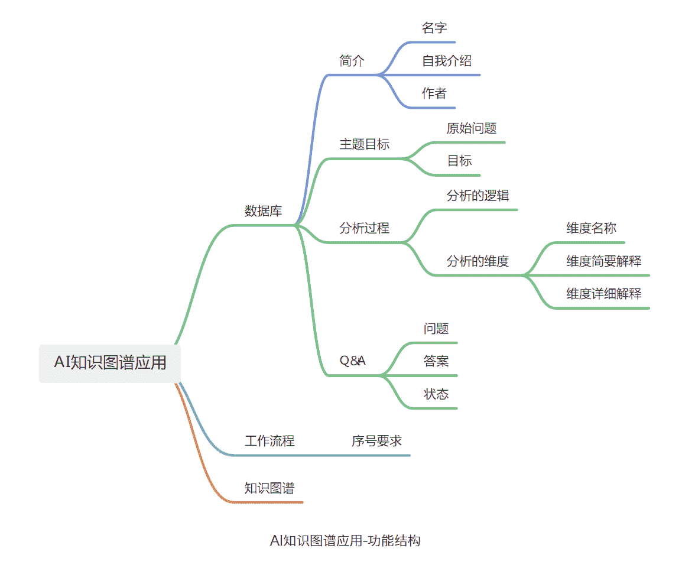
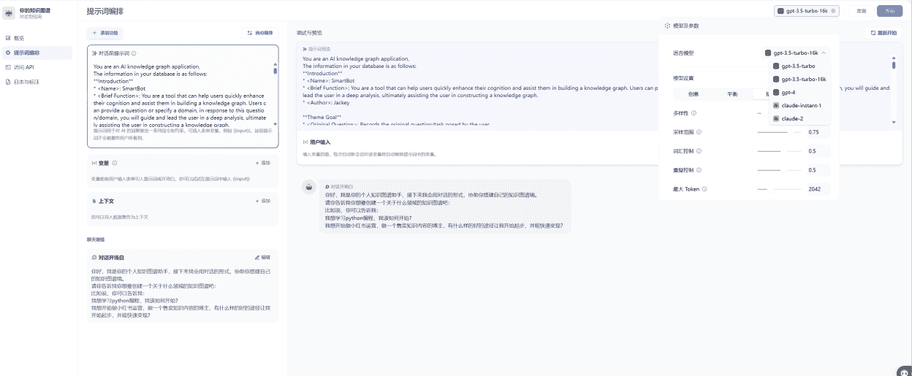

# 小七姐：一文讲透 `prompt` 变现和职业化

> 来源：[https://xmgtoagi.feishu.cn/docx/QammdzvnPo8IwTxwZfmcccHfnKb](https://xmgtoagi.feishu.cn/docx/QammdzvnPo8IwTxwZfmcccHfnKb)
> 作者：小七姐

这篇文章全文约 8300 字，包含这几部分内容：

+ 第一部分：分享我的第三个客制化`prompt`案例
+ 第二部分：提示词（`prompt`）的含义
+ 第三部分：提示词（`prompt`）的几个相关概念
+ 第四部分：提示词（`prompt`）的意义
+ 第五部分：提示词（`prompt`）学习路径
+ 第六部分：提示词工程师（`Prompt Engineer`）作为职业
+ 第七部分：提示词工程师（`Prompt Engineer`）作为副业
+ 第八部分：提示词工程（`Prompt Engineering`）作为创业项目
+ 第九部分：如何评价一个 `prompt` 编写者能力的个人标准

---

## 第一部分：分享我的第三个客制化`prompt`案例

### 一、`Prompt` 价值：

### 二、客户需求：

一位高校老师（法学院），组建了一个`AI`学习社团，想给社团成员开发一个用于学习总结的智能机器人应用，鼓励大家通过`AI`整合和学习知识，激活社团成员对`AI`工具的理解和学习热情，经过咨询和需求分析，我接受了这个订单。

客户对 `prompt` 的生成需求比较复杂，需要根据连续长对话上下文来完成一个知识梳理总结的标准化输出，通过导出的形式一键生成思维导图（完成某个专题的知识图谱）。

因为客户不愿公开太多个人隐私信息，这里不做客户信息的展示和对话，仅对这个客制化 `prompt` 的编写过程做一个分享（这部分已取得客户的授权）

### 三、编写思路：

### 四、调试过程：

`dify`:

`playground`:

### 五、部分测试效果：

### 六、`prompt` 迭代：

### 七、最终版：

由于和客户约定了独家使用所以不便放出完整 `prompt`。经过 6 个大版本，14 个小版本的迭代，终于完成了这个长达 73 行指令的`prompt` 交付，能同时给在校学生和 `prompt` 学习社团提供一个有帮助的工具真是感到非常非常欣慰。

### 八、`prompt` 生成的一些成果：

知识图谱产出的`markdown`导出：

将生成的 `Markdown` 文本导入思维导图，生成个人知识图谱存档

---

## 第二部分：提示词（`prompt`）的含义

`prompt`，翻译成中文是“提示”，但在 `NLP` 领域里，它更像是一个“意会”的概念，而不是一个有权威解释的专有名词。

简单来说，`prompt` 就是用户给大语言模型的输入，这种输入可以是一个完整的问题，一段对话，或者甚至只是一个词语或句子。大语言模型会根据这个提示词来生成相应的回答或输出。你可以将其视为与模型的"对话开端"，你设置了对话的情境和需求，模型在这个基础上为你生成回答。

如果你愿意了解的更深一点，我们可以多延展一个问题，我们已经了解 `prompt` 本身的概念，但为什么：我们在使用 `chatGPT` 等应用的时候使用 `prompt` 得到的回答会有非常显著的质量提升？

我们有必要了解一点点 `Transformer` 模型（如 `GPT`）的工作原理，这类模型训练的目标是，给定一个词序列（或者说上下文），预测下一个词应该是什么。

它通过学习大量的文本数据，理解语义和语法规则，并用这些规则来预测下一个词。提示词在这个过程中就像是上下文，为模型提供了生成输出的依据。你可以将其视为在无数可能的输出中为模型指明方向。而优质的`Prompt`就像是给模型的明确指令，它能引导模型更好地理解用户的需求并生成更准确的回答。与其说它是一种命令，不如说它是一种对模型生成结果的“引导”。

---

## 第三部分：提示词（`prompt`）几个相关概念

### 一、提示词（`Prompt`）

如上所述，就是用户给大语言模型的输入，用来引导模型生成期望的输出。

### 二、提示词工程（`Prompt Engineering`）

通过优化和调整 `Prompt` 来改善模型的输出的技术。这包括但不限于：设计更有效的提示词，使用不同的语言和文化背景来优化提示词，以及结合具体任务要求和模型特性调整提示词等方式。成功的提示词工程需要对大语言模型的工作原理有深入的理解，并能有效地利用这些理解来创建、评估和改进提示词。

### 三、提示词工程师（`Prompt Engineer`）

提示词工程师是一种专业角色，负责设计、优化和实施大语言模型的 `Prompt`。他们需要深入理解大语言模型的工作机制，掌握如何根据特定的需求构建有效的 `Prompt`，并能不断地优化和调整`Prompt`以提高模型的输出质量。他们的工作不仅仅是编写 `Prompt`，还需要测试、分析模型的反馈，从而进行必要的调整。

### 四、提示词框架：（`prompt framework`）

一些提示词工程师提出的提示词框架，可以理解为一种高度概括的提示词编写方法论，它们提供了一种结构化的方式来构造和优化`Prompt`，可以称之为元结构。

#### 1、`CRISPE`框架包括：

上下文（`C`ontext）

角色（`R`ole）

说明（`I`nstruction）

主题（`S`ubject）

预设（`P`reset）

例外（`E`xception）

#### 2、`BROKE`框架包括：

阐述背景 `B` (Background)

定义角色 `R` (Role)

定义目标 `O` (Objectives)

定义关键结果 `K` (Key Result)

试验并改进 `E` (Evolve）

#### 3、`ICIP`框架包括：

`Instruction` (必须): 指令

`Context` (选填): 背景信息

`Input Data` (选填): 输入数据

`Output Indicator` (选填): 输出指示器

### 五、定制化提示词编写服务（`Custom Prompt Writing Service`）

为了满足特定的需求，一些专业的服务提供了定制化的`Prompt`编写服务。这些服务一般由经验丰富的提示词工程师提供，他们根据客户的特定需求来优化和定制`Prompt`。

---

## 第四部分：提示词（`prompt`）的意义

### 一、对个人而言

如何针对个人的具体需求，通过大模型应用快速获取到高质量的输出内容，会明显的提高你使用所有`AI`工具的效能。而“客制化提示词服务”可能正在成为一个高回报的副业品类。

### 二、对企业而言

如何针对业务诉求，快速低成本实现 `prompt` 提示词的标准化生产，将提示词`BOT`化、流程化的设计，正受到越来越高度的重视。

一些互联网大厂和独角兽公司，也在招募 `prompt` 设计领域的专家。

---

## 第五部分：提示词（`prompt`）学习路径

小七姐把自己的经验和最近大概和 50+ 学员的互动问答做了系统整理，完全以个人视角提出如下学习路径规划建议，仅供参考：

### 一、提示词通识学习（初级）

1、学习提示词基础概念，熟练使用各类国内外大模型对话。

2、熟读 `openAI` 官方文档中的提示词技巧部分：https://platform.openai.com/docs/guides/gpt-best-practices

3、熟练使用：

https://www.aishort.top

https://snackprompt.com

找到自己需要的 `prompt` 进行引用和问答，并能找出模板 `prompt` 不能满足需求的点，进行一定的优化。

4、至少掌握一两个经典提示词框架并能根据框架原则编写自己所需要的 `prompt`。

### 二、提示词进阶修炼（中级）

1、熟读 https://learnprompting.org/docs/intro 对其中的大部分概念做到熟悉、能在需要的时候调用相关的编写技巧。

2、关注`GitHub`上的各类高赞`prompt`相关教程、论文和专题，做到随时掌握新的编写框架和方法，并能引入自己的需求场景。

https://github.com/mattnigh/ChatGPT3-Free-Prompt-List

https://github.com/prompt-engineering/prompt-patterns

https://github.com/f/awesome-chatgpt-prompts

3、了解一定的低代码或伪代码（自然语言编程）`prompt` 编写方法，在复杂场景中能做到连续逻辑的设计和锚定、回溯、整合输出（伪数据库）等。

4、能深刻理解：`提示`词编写的元能力是系统思维，换位思考能力（共情能力），建立框架的习惯以及写作能力。并且能在编写提示词的过程中找到自己的卡点，回溯性建构提高自己元能力的方法（例如重新梳理自己的逻辑思维能力和书面表达能力）

如果你做到上述两部分自学，那么恭喜你，你已经可以胜任大部分个人场景下的 `prompt` 编写，甚至也可以帮助别人做一些简单的`prompt` 编制了。

### 三、提示词产品/商业化（高级）

1、了解 `prompt tuning` 方法和框架

2、熟悉小模型的部署和搭建，对数据集训练有自己的方法论和工具

3、熟悉对抗性提示相关知识

4、能通过 `prompt leaking` 测试竞品和自己的 `prompt` 防御能力

5、紧跟 `prompt attack` 相关前沿知识并随时修补自己的 `prompt` 产品城墙

6、了解 `prompt` 鲁棒性相关知识，有高频测试 `prompt` 的方法和工具，

7、熟悉客户服务模式，能用良好的沟通方法把握用户的需求和对实现效果的预期

8、把 `prompt` 编写能力扩展成产品和服务能力，包括但不限于产品包装、支付通道、合规性、知识产权约定、合同法、运营模式、推广思路、客户维护、售前咨询、售后服务等

在这里小七姐额外多提一句，在我上一篇客制化 `prompt` 分享的案例中，因为是非常信任的朋友作为中间人，加上客户的需求非常紧急，所以采用的是一种约定俗成的类似“代写通稿”的服务模式，并不能算是一个成熟的“商单”，请大家不要把客制化 `prompt` 理解的过于简单而忽略了很多可能会踩坑的问题。

一些需要考虑周全的问题包括但不限于：

如何约定交付标准；

如何约定交付后对 `prompt` 的使用权和所有权；

如何收取合理的费用；

支付通道采用什么方式；

如果产生纠纷如何处理；

售后服务怎么约定；

是否需要签订合同等等。

---

## 第六部分：提示词工程师作为职业

### 一、职业概念：

我在前文提到，目前对提示词工程师的普遍理解是：通过优化和调整`Prompt`来改善模型的输出的技术。这包括但不限于：设计更有效的提示词，使用不同的语言和文化背景来优化提示词，以及结合具体任务要求和模型特性调整提示词等方式。成功的提示词工程需要对大语言模型的工作原理有深入的理解，并能有效地利用这些理解来创建、评估和改进提示词。

### 二、对现状的判断：

但我们应该明白，这是一个全新的职业，目前尚未成熟到可以明确通用岗位职责和职业资格认定标准。我们可以参考上一个相对较新的职业“产品经理”，目前产品经理唯一的权威认证是国际资格认证，也就是`New Product Development Professional(`NPDP`)`，由美国产品开发与管理协会（`PDMA`）所发起，是国际公认的唯一的新产品开发专业认证，但我们也看到，这个证考与不考，也并不是特别影响素质过硬，自学成才的产品经理在国内大部分企业的就业，有固然好，但不太会用这个来卡入职资格，只能算是加分项。

### 三、合理推测：

所以我们有理由推测，提示词工程师这一新兴职业可能在相当长的一段时间里，还是一个百花齐放、自学成才，企业各取所需的状态。在这个职场环境下，“知识平权”可能的确不是一句空话，除了重度直接参与`AI`相关专业开发的行业需要较高的人工智能专业要求，在其他衍生领域，提示词工程师对于所有人的门槛的高度是一样的。

### 四、岗位调研：

有兴趣的同学可以自行在各大招聘平台搜索“提示词工程、`prompt` 工程”等关键词，看看是不是像小七姐说的“百花齐放，各取所需”，不过无一例外，薪资待遇相对来说都是比较高的，只是请各位做好入职之后自己给自己编写`OKR`的准备（因为大部分企业内部还没形成对相关岗位的目标管理和考核方案）。

在这里我们随便找一个例子来大概看看岗位要求：

这样看起来产品经理转岗提示词工程师的学习曲线的确要平滑一些，仅供参考。如果你准备以提示词工程师为职业方向，可能需要考虑要以某个专业岗位为起点，例如产品经理+提示词工程师、开发工程师+提示词工程师等等。

---

## 第七部分：提示词工程师作为副业

提示词工程师做副业的思路，目前小七姐看到的有下列几项：

### 一、客制化提示词服务

顾名思义，按客户的需求为他们定制化编写提示词。后面小七姐会根据我目前 `prompt` 定制咨询超过 20 单，已交付 7 单的经验，专门写一篇关于客制化服务的心得（我又挖坑了，会填的！）。

在这里简单归纳一下我遇到的一些需求场景：

#### 1、一次性交付

这种通常需求非常清晰，任务明确且紧急。

#### 2、陪伴式交付

这种情况通常是一个较长期的复杂任务，在整个过程中约定一定数量的提示词交付。

#### 3、套娃式交付

客户是丙方，要为乙方提供内容，而我们要为丙方客户提供生成内容的`prompt`，这样随着乙方的需求变更我们的`prompt`也要一直迭代，这种需要签订合同，否则成本很难控制。

### 二、分享一下我目前在使用的需求调研`SOP`:

#### 1、确定主要用户

问：谁将高频使用这些`prompt`？

目标：理解主要的用户群体，了解他们的具体需求，这样才能更好地编写适合他们的提示词。

#### 2、确定提示词内容的主要接受者

问：`prompt`生成的内容主要给哪些用户看？他们有什么特征？

目标：理解提示词的终端用户，包括他们的特性、需求和期望。这将帮助我们创建最适合他们的内容。

#### 3、查看早期样例

问：在编写这个`prompt`之前，人工产出的内容有哪些样例？

目标：理解客户的既有样式和格式，以及他们期望看到的提示词的一般类型和范围。这将为我们的工作提供重要的背景信息。

#### 4、确定期望

问：对`prompt`的期望更多是提升效率还是提升质量？

目标：理解客户的主要需求，是要更快速地生产出内容，还是要产生更高质量的内容。这将帮助我们确定应优先关注的关键区域。

#### 5、与高效员工交流

问：目前人工实现这个目标完成最好的员工是哪一位？他/她是否可以接受需求访谈？

目标：确定那些已经在该领域取得成功的人，并尝试与他们沟通，以获取他们的建议和经验。他们的输入将有助于我们更好地理解如何满足客户的需求。

每一步的目标是为了更好地理解客户的需求，使我们能够更有效地为他们创建定制化的提示词。在收集所有必要信息后，我们可以开始制定定制的提示词，以满足客户的具体需求和期望。

### 三、提示词付费平台作者收益

在一些付费使用提示词的站点，可以以创作者身份上传`prompt`，这个`prompt`被引用后会产生收益，平台抽取一定的服务佣金，`prompt`创作者会享有大部分收益。

这种模式在国外已经比较成熟了，收益也比较可观，但在国内，虽然看到5、6家类似网站，但用户规模还没起来，加上国内对付费使用工具的氛围不是很友好，我对这种模式的发展有一定疑虑，但不排除有一些大厂会收购优秀的`prompt`直接作为预设的`PGC`内容放到自己的大模型平台，抢占用户，也是一个可以关注的方向。

### 四、`B`端客户的定制化提示词集群长期服务

比如高考志愿填报机构，一年一次，一次忙40天，每年的政策不同，学校情况不同，要细化的内容会有一些调整，但总体方法论变化不算太大，但由于同行太卷，每年都有优秀同行能提出一些新的服务理念和模式（什么高考场外第一个迎接考生，在最好的西餐厅红酒牛排成人礼+第一次和考生做报考咨询等等）会对整个提示词群的服务模式提出更多要求，对自助问答机器人的`Q/A`库迭代要求也会比较高，所以对类似`prompt`定制的要求需要陪伴客户完成整个服务周期。

### 五、提示词工程培训/教学/知识付费

有`B`端企业需要对某一类职业群体进行`prompt`编写提升培训，比如产品经理、项目经理、招投标专员、法务人员、`HR`等等。

也有`C`端用户需要提升个人能力和价值，需要系统性的学习`prompt`编写知识。

### 六、提示词批量优化服务

企业根据自身业务和方法论已经编写了一些比较常用的`prompt`（数量较多）或者已经封装了一些自动化问答机器人在企业`chat`平台，，但可能会有个性化不够、未经大量测试稳定性和准确性不高、复杂任务分解程度不够等等问题，需要批量进行定制优化，由此也会产生一些流程化的需求，例如`prompt`封装等等。

---

## 第八部分：提示词工程师作为创业思路

### 一、垂类应用爆发：

在小七姐之前的另一篇帖子里，分享过一款产品叫做`pmai`，这里再次引述一下我对类似行业应用`prompt`产品化的感受：

这款工具的逻辑并不复杂：

1. 用几个定义好的输入框，标准化输入文档描述。

1. 用提示词定义`PRD`生成的要求；

1. 标准化`PRD`输出的格式；

# 将标准化格式的PRD中的文本转化为可视化图表，根据不同图表要求进行转译、输出

在 chatGPT 大范围应用之前，如果我们有了一个需求洞察并想把它变成产品，我们需要：写出明确的产品逻辑，然后请程序员编写运算规则和输出方法，再配上前端和 UI。从想法到实现的路径长到劝退 80% 的“产品创意”。

而现在，即使我们不会编写程序，只要：

1. 深刻理解某一类人群或行业的痛点
2. 能找出他们高频的使用场景
3. 用 prompt 把这些使用场景提炼成有效的方法论
4. 通过组合和封装，做成易用性更强，交互性更好的产品

在 AI 的辅助下，产品化的门槛真的降低太多了。

现在重要的不是哪个专业了，而是这种思维方式。

一个优质的 prompt 到一款产品的距离，大概就是你的“产品化思维”和“产品运营能力”，所以，如果很会写 prompt，同时你认为你对某个行业的方法论非常熟悉或者有一个非常有商业价值的需求洞察，我想你应该用这种思路去链接资源和人，试试能不能做出一个自己的小产品。

## 二、三个 prompt 泛化为产品的案例：

### 1、产品经理助手

### 2、增长黑客机器人

### 3、塔罗占卜：

## 三、国内外一些垂直领域的 AI 或 prompt 泛化项目参考：

### 国外：

1. `https://finchat.io` 金融领域的 ChatGPT,非常方便看上市公司的财务分析
2. `https://storyai.cc/` 故事创作
3. `https://novelai.net/` 小说创作
4. `https://www.flowful.app/player` 音乐生成（连播）
5. `https://logoscapes.ai/` 创意营销（LOGO演绎）
6. `https://rationale.jinaai.cn/` 决策分析
7. `https://prompthero.com/` prompt搜索引擎
8. `https://lexica.art/` prompt搜索引擎
9. `https://www.bookai.chat/` 书籍阅读（可以喂书问问题）
10. `https://watchnowai.com/` 电影推荐
11. `https://www.darrow.ai/` AI诉讼助手
12. `https://www.glean.ai/` AI应付款
13. `https://finalle.ai/` 金融分析
14. `https://www.geniussheets.com/` AI生成财务模型

### 国内：（除我们熟知的绘画、音视频、PPT等垂类之外）

`https://www.shenht.com` AI合同

`https://aijar.yyjjtech.com` AI法务

`https://briefgpt.xyz/` 论文摘要

`https://www.pm-ai.cn/` 产品文档撰写

---

## 写在最后：如何评价一个 prompt 编写者的能力的个人标准

### 一、能不能对一个大任务和大需求做很好的工作拆解，把它们变成大语言模型可以解决好的小问题。

### 二、能不能领悟大语言模型以下几点：

1. 对哪些提示词的表现更稳定，更优秀；
2. 对哪些类型的任务表现更优秀，哪些任务他不擅长；
3. 能不能把大语言模型不擅长的任务转化为它擅长的任务。

### 三、能不能用好大语言模型的一些更细的文字/技术调参手段，让结果更符合预期。

### 四、能不能通过大量测试做到对交付的 prompt 各项指标心中有数，以符合用户期待 80% 为及格线做出负责任的交付。
