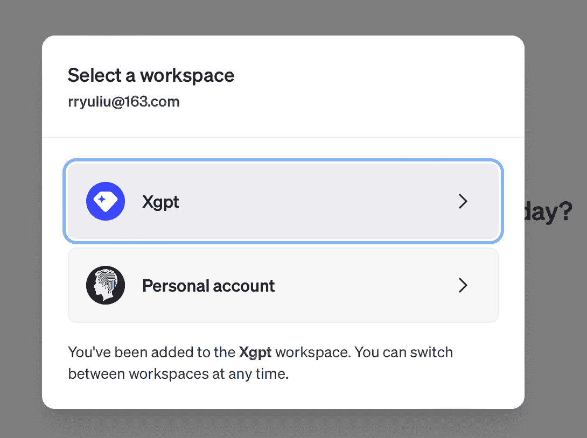
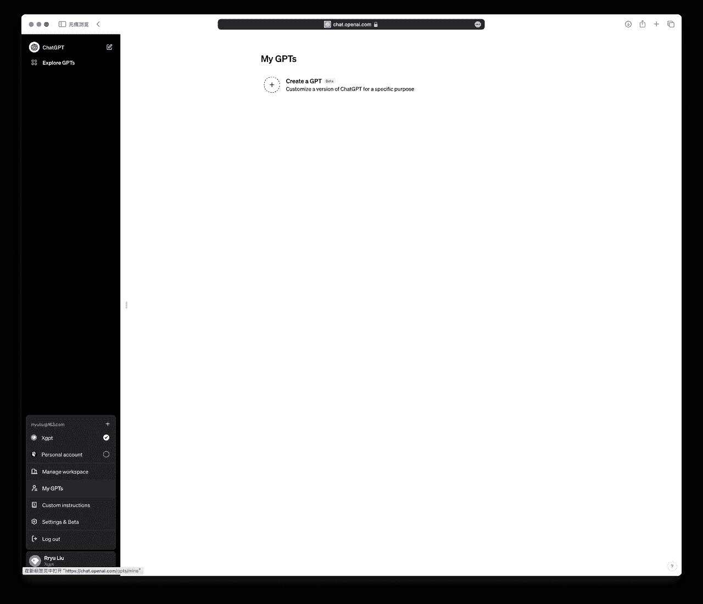
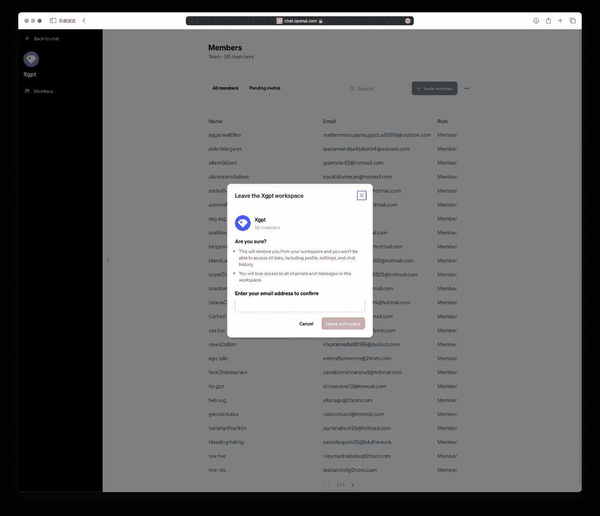
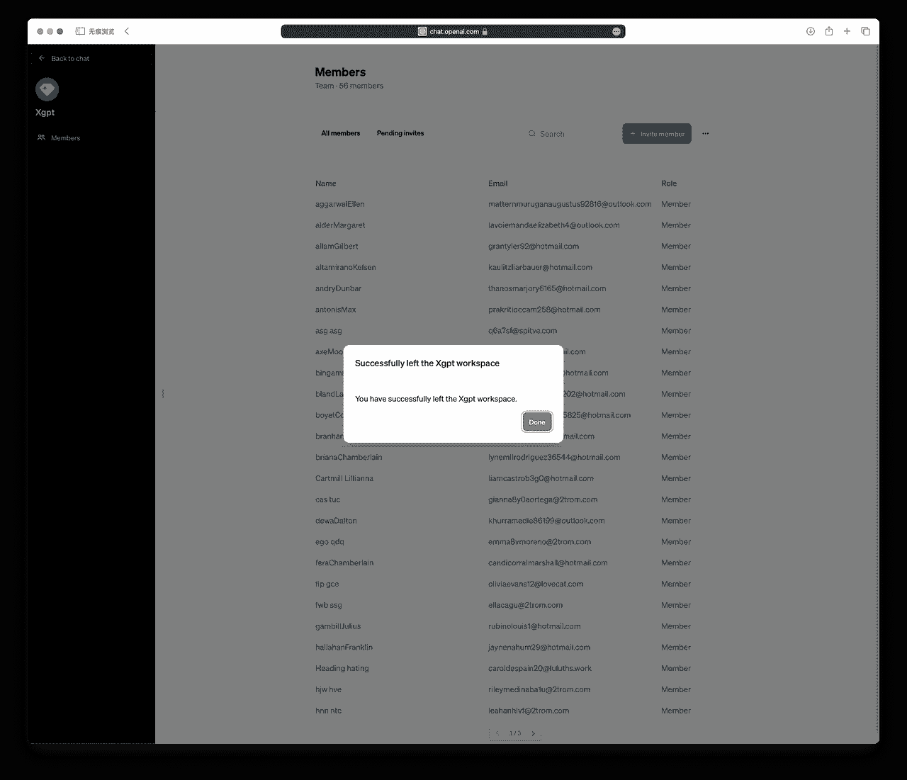

# ChatGPT Team (团队版）使用测试

> 来源：[https://xmgtoagi.feishu.cn/docx/XqY3dOzGEoIDqqxuBTTcBk7PnUd](https://xmgtoagi.feishu.cn/docx/XqY3dOzGEoIDqqxuBTTcBk7PnUd)

ChatGPT Team (团队版）使用测试

| 作者：小七姐 &amp; 刘宇龙 |
| --- |

大家对这版本产生了各种各样的疑虑和问题，但是因为**不用就不知道，用了就得花****钱**。** 所以我**和 GPTGeeker刘宇龙 在@所罗门 同学 的赞助下开通了2个团队版账号给大家测评了一下。结论附飞书：

# 1. **最关心的几件事**

## Teams Plan 是什么，和 GPT Plus 有什么不同

|  | 普通会员 | GPT Plus | GPT Team Plan |
| --- | --- | --- | --- |
| 适合用户群 | +   尝鲜用户 | +   中重度用户 | +   中小团队 |
| **用量** | GPT-3.5 | GPT-4-32K | GPT-4-32K |
| **费用** | 免费 | 20美元 / 月 | +   **年付**：300美元 / 年（折合 25美元 / 月） |
| **续费周期** | 无 | 开通后每月续费 | +   **年付**：每年续费，适合固定团队 |
| **支付方式** | 无 | +   海外信用卡 | +   海外信用卡 |
| **账号** | 自己的账号 | 自己的账号升级 | 填写邮箱，自动发邮件邀请给已有的 GPT 会员 |
| 隐私 | 对话数据会被用于训练 | 对话数据会被用于训练 | +   不会被用于训练 |
| GPTs | 无 | +   署名可以选择个人名字或者认证域名 | +   署名只能使用自己的名字 |
| 其它 |  |  | 一个账号可以加入多个团队，每个团队账号都是相对独立的 |

+   期间每多1个人 + 300美元

+   随时可以加入和移除成员

## **值不值得买**

受众，问题，对比

【普通人（非团队）不值】

# 2. **购买和组建 Team**

## **邀请和邀请人的关系**

## **邀请人能做什么，不能做什么**

和正常 GPT 一样使用

发布 GPT 署名只能使用自己的名字

# 3. **使用**

# 4. **退出 Team**

1.  **使用感受对比**

如果你现在已经/正在使用 GPT plus，采用团队版会带给你这些影响：

+   原有的个人账号和新增的团队账号是两个独立的体系，并不会融合数据

+   所以你原有的对话记录和你个人创建的GPT都不会迁入团队版，而依然保留在你的个人版中

+   如果你既要团队版的100条/3小时真香，又要保有原来的记录和GPTS，你需要两个账号都支付费用/续费

+   团队版中每个子账号下的对话是独立的，互相并不可见

+   团队版中每个子账号创建的GPTs也是独立的，对外显示的是你个人的名字，其他子账号并不能干预其他人的GPTs

+   团队版中的对话数据不会被用于训练，相对安全那么一些些

如果你还没使用过GPT plus而准备新开一个，团队版意味着

+   更多的对话次数（100次/3小时）

+   年付贵5美元/月/人

+   月付贵10美元/月/人

+   和团队版发起人共担账号风险（连坐）

+   隐私数据相对安全一些

+   可以有仅供团队内部共享的GPTS