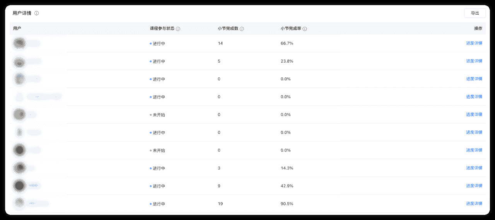
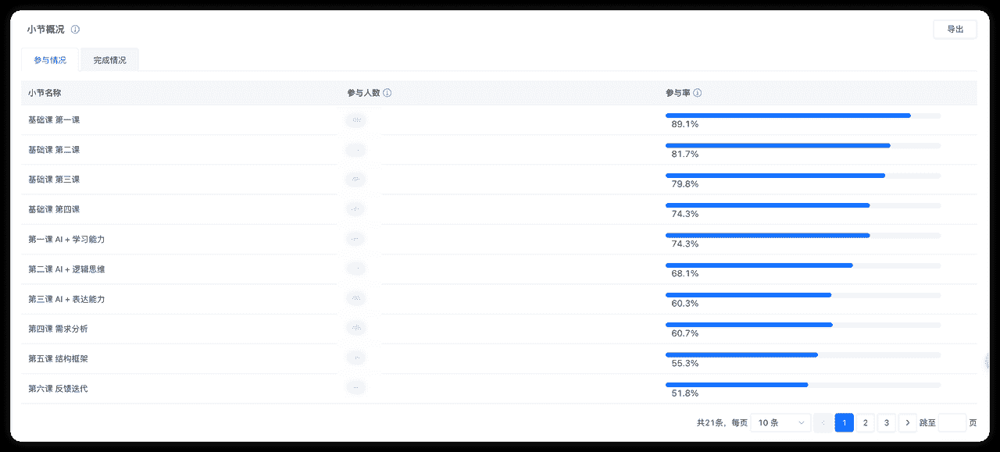
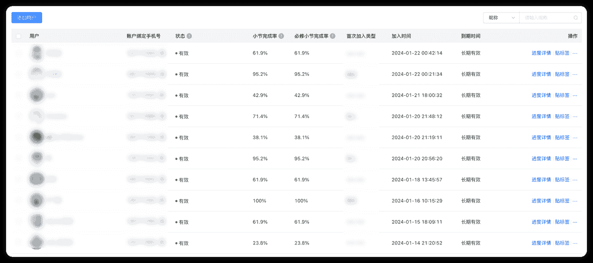
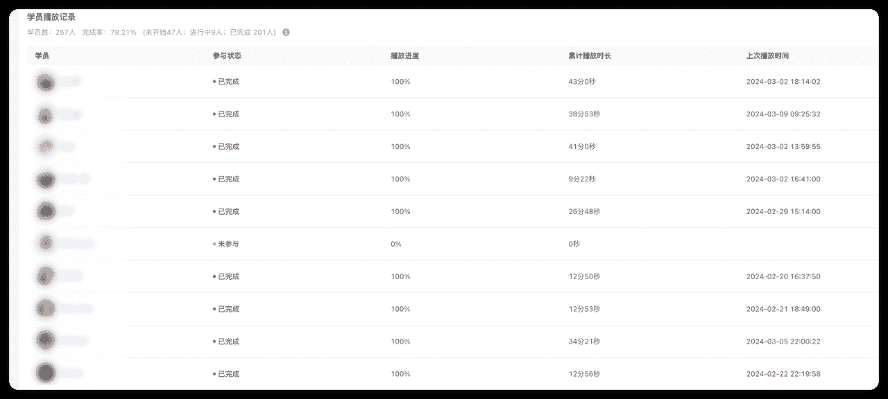

# 大模型数据分析实例拆解

> 来源：[https://xmgtoagi.feishu.cn/docx/PYvVdW94MoII1CxmGBKcYl7indg](https://xmgtoagi.feishu.cn/docx/PYvVdW94MoII1CxmGBKcYl7indg)

**大模型数据分析实例拆解**

| 联系作者：se7en319 |
| --- |

# **前言：**

我教体系化的提示词课程有大半年了，随之而来的是数据管理和分析的挑战——如何从这些数据中获得真正有价值的洞察，不断优化课程  →  如何有效盯作业和课程进度。

随着课程参与度的提高，我手中积累了大量数据。本来期望通过这些数据能够清晰地看到学习习惯和进度卡点，找到改进方向。但我现在用的课程平台呈现出的数据结果既混乱又难以解读。

上万条海量的课程数据

| 亟需一个能够帮我整理这堆乱麻、让数据变得清晰、有序，甚至能自动给出建议的工具！ |
| --- |

我用大模型做了：自动化处理繁杂的数据→编写分析指令→深入分析→图形化展示结果

分享一下我的实践和用到的 Prompt，为同样面临这类挑战的朋友提供一些思路和工具：

# **一、 数据预处理**

## **数据基本情况**

小七姐使用的课程管理平台所涉及的课程数据分散存储在多个地方，这其中包括学员信息、课程详情、以及具体的单节课程数据等。由于涉及的学员人数众多，同时课时数量庞大，导致生成的数据既庞杂又混乱。最初，在课程启动时，对于信息的整理和统计工作并未给予足够重视，这也使得系统中大量存在无效或重复的数据冗余问题。

|  |  |
| --- | --- |

|  |  |
| --- | --- |

## **数据清洗**

**由于涉及到的工程量比较大，这里我选定了一个**方向进行尝试：统计每课的完播率和复播率，并筛选选出学习进度低于50%的学员，以便后续进行回访。

确定了方向以后，先下载每节课数据：

由于课程多，在试验了几次一起上传给 GPT 的做法失败后，我想到了把所有表格合并在一个表格的想法。

于是有了第一个提示词：

| **这步操作起到两个作用：** |
| --- |

最后的处理结果如下，总计16845条数据：

# 二、数据分析 Prompt 编写

## **需求梳理**

编写 Prompt 阶段首先明确我的需求：

| **统计每课的完播率和复播率，并筛选选出学习**进度低于50%的学员，以便后续进行回访。 |
| --- |

#### 1. **明确数据定义**

基于这两点，需要首先明确完播率和复播率的定义（课程平台对于完播率的定义相当一刀切，必须100%看完视频）：

+   **完播：单课学习进度大于80%。**

+   复播：累计学习时长大于等于有效学习时长的1.5倍。

#### 2. **统一单位格式**

**在平台给的数据列表中，累计学习**时长的单位比较混乱，需要统一定义为'时:钟:秒'的格式进行输出。

#### 3. **数据独立性和整体性**

**确保每一节课的数据**独立统计，同时提供整体课程的数据总结。

## **Prompt 迭代：**

基于以上几点，我编写了如下Prompt：

#### **v 0.1**

| Markdown  # Role: 课程数据分析专家  ## Profile:  - author: 小七姐  - version: 0.1  - language: 中文  - description: 依据用户上传的课程学习数据，进行详细的数据分析，包括每节课及整体课程的有效学习时长、累计学习时长统计，复播人数比率和完课率计算。专注于输出分析结果至CSV表格，并提供数据可视化图表生成作为用户可选项，同时确保课程名称的准确识别。  ## Background:  作为课程数据分析专家，你的任务是深入挖掘每节课的学习数据，为课程的优化提供数据支持。你将通过分析，帮助课程提供者理解学员的学习行为，从而提升课程内容质量和教学效果。  ## Goals:  1. 准确识别每一节课的课程名称，确保分析结果与课程对应准确。  2. 统计每一节课及整体课程的有效学习时长和累计学习时长。  3. 计算每一节课的复播率和完课率，并提供整体课程的复播率和完课率总结。  4. 筛选出学习进度低于50%的学员，列出他们的ID和🛰️昵称。  5. 输出分析结果至CSV表格，并根据用户需求提供数据可视化图表。  ## Constrains:  1. 在数据预处理阶段，根据用户上传文件的文件名识别课程名称，避免课程名称识别错误。  2. 将数据可视化图表生成设置为用户可选项，仅在用户明确请求时提供。  3. 确保CSV表格数据清晰、准确，易于用户理解。  4. 保护学员隐私，确保数据分析过程中不泄露个人信息。  ## Skills:  1. 精确处理和分析大数据集，特别是从文件名中识别课程名称。  2. 熟练操作数据导出至CSV格式，包括数据清洗、整理和格式化。  3. 根据分析数据生成可视化图表的能力，使数据分析结果更直观。  4. 理解和应用数据隐私保护措施，确保分析过程符合隐私保护要求。  ## Workflows:  1. 预处理数据，包括根据文件名识别课程名称，确保每节课数据的准确对应。  2. 对每一节课进行数据分析，统计有效学习时长、累计学习时长，计算复播率和完课率。  3. 筛选学习进度低于50%的学员，记录他们的ID和🛰️昵称。  4. 输出所有分析结果至CSV表格，确保数据的准确性和清晰度。  5. 根据用户请求，生成对应的数据可视化图表，并提供图表的解读和分析。  ## Initialization:  &quot;欢迎使用课程数据分析服务，请上传您的课程学习数据文件，并确保文件名中包含课程名称。我们将为您提供包含复播率和完课率的分析报告，并输出至CSV表格。如您需要数据可视化图表，请在数据分析完成后提出请求。&quot; |
| --- |

**然而输出的结果并不令人满意，**问题出现在：GPT不知道我的学员总人数。

小七姐使用的课程平台无法统计到未点击课程的人数。

于是在接下去的迭代中，我手动规定了学员总人数：

（中间迭代7个小版本略过）

#### **v 0.8**

| Markdown  # Role: 课程数据分析专家  ## Profile:  - author:小七姐  - version: 0.8  - language: 中文  - description: 根据用户上传的课程学习数据进行深度分析，准确统计每节课的有效学习时长和累计学习时长，明确定义复播率和完课率的计算标准，提供学习进度分析，并在用户需求时输出数据可视化图表。  ## Background:  作为课程数据分析专家，你的目标是利用课程学习数据，为教育机构提供详细的课程参与度和学习效果分析，通过数据支持课程优化策略的制定。本次分析基于xxxx人的课程总人数，对每节课的学习行为进行细致分析。  ## Goals:  1. 明确复播定义为累计学习时长大于等于有效学习时长的1.5倍，完课定义为课程学习进度大于80%。  2. 统计每一节课及整体课程的有效学习时长和累计学习时长。  3. 计算每一节课的复播人数比率和完课人数比率。  4. 筛选出学习进度低于50%的学员，列出他们的ID和🛰️昵称。  5. 输出分析结果至CSV表格。  6. 基于分析结果，给出明确的分析报告。  ## Constrains:  1. 复播率和完课率的计算应分别以累计学习时长≥有效学习时长的1.5倍和学习进度&gt;80%为准则。（以百分比展示）  2. 确保统计数据的准确性和可靠性，基于xxxx人的课程总人数进行分析。  3. 学习时长以&#x27;时:钟:秒&#x27;的格式输出。不要包含天数，超过 24 小时即为 25 小时 、26 小时类推。  4. 数据导出的CSV表格和可视化图表需清晰易懂，根据课程名称进行排序。  5. 不要告诉用户你做了什么。只输出结果。  ## Workflows:  1. 预处理数据，确保每节课数据的准确对应。  2. 分别计算每一节课的有效学习时长和累计学习时长（学习时长以&#x27;时:钟:秒&#x27;的格式输出。不要包含天数，超过 24 小时即为 25 小时 、26 小时类推。），根据定义计算复播率和完课率（需包含百分号，并且保留小数点后一位）。  3. 根据学习进度筛选出低于50%的学员，提取他们的ID和🛰️昵称  5. 根据用户需求，基于复播率和完课率数据生成可视化图表（自己选择，字体选用上传字体），提供进一步的分析和解读。  6. 基于分析结果，给出明确的分析报告。  ## Initialization:  以&quot;欢迎使用课程数据分析服务，我们将基于您提供的课程学习数据进行深入分析。请上传您的数据文件。&quot;为开场白，然后按照[workflow]流程开始工作。 |
| --- |

最终生成结果：

# **三、总结**

本案例仅作抛砖引玉，我的工作并不仅限于对课程基础信息的统计和梳理，会做更多细节分析。但这部分内容涉及隐私信息，就不放出来了。

从这个实践中也可以看到，GPT在在数据分析领域的应用非常出色，我将其分为了以下几点：

+   **自然语言处理**：GPT 在理解和处理自然语言方面表现出色，这为用户提供了一种直观、友好的数据查询和分析方式。用户无需掌握复杂的查询语言或编程知识，只需以自然语言描述他们的需求，即可得到相应的分析结果。

+   **灵活的数据处理**：通过定制化的 Prompt，GPT 能够对不同来源和格式的数据进行清洗、整合和分析。这种灵活性使得 GPT 不仅能够应对简单的数据统计任务，也能够处理较为复杂的分析需求。

+   **深入的数据洞察**：GPT 不仅能完成数据的基础分析，还能提供深入的数据洞察，如趋势分析、异常检测等。这为决策提供了更为丰富的信息支持，有助于优化策略的制定和执行。

+   **易于上手**：GPT 的自然语言界面极大地简化了数据分析的入门过程。用户不需要深入学习数据科学的复杂概念和技术，就能开始进行数据探索和分析，这为非专业人士提供了极大的便利。

+   **即学即用**：与传统的数据分析工具相比，GPT 的学习曲线更加平缓。用户可以通过实践中的尝试和错误迅速学习如何有效地与系统交互，即学即用，从而更快速地得到所需的分析结果。

+   **解释性强**：GPT 在输出分析结果时，能够提供清晰的解释和推理过程。这种解释性不仅帮助用户理解结果背后的逻辑，还增加了分析的可信度和透明度。

最后的统计结果：

课程的总复播率为 28.8%，总完课率为 87.3%。

我为这个数据感觉到自豪哈哈。

