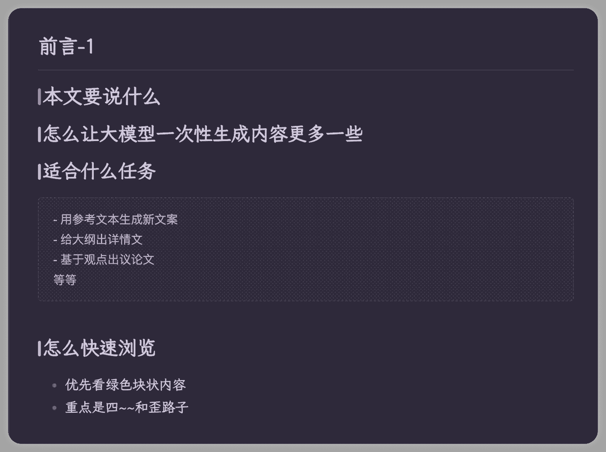
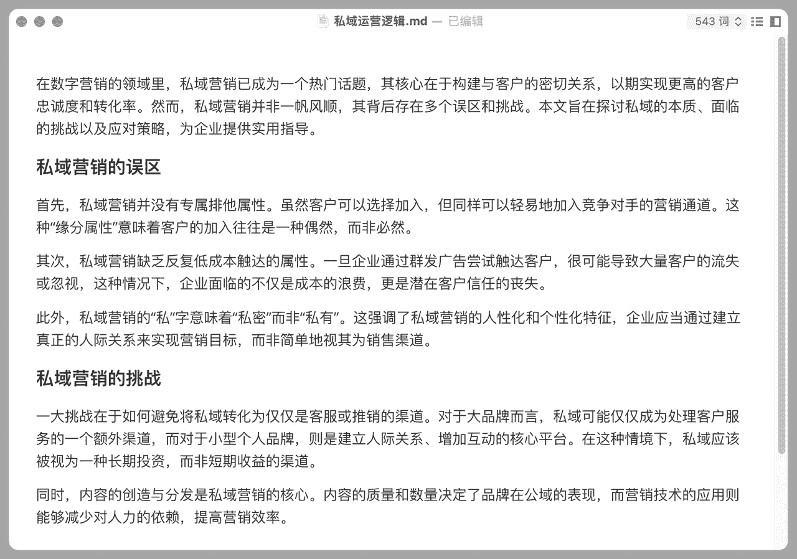
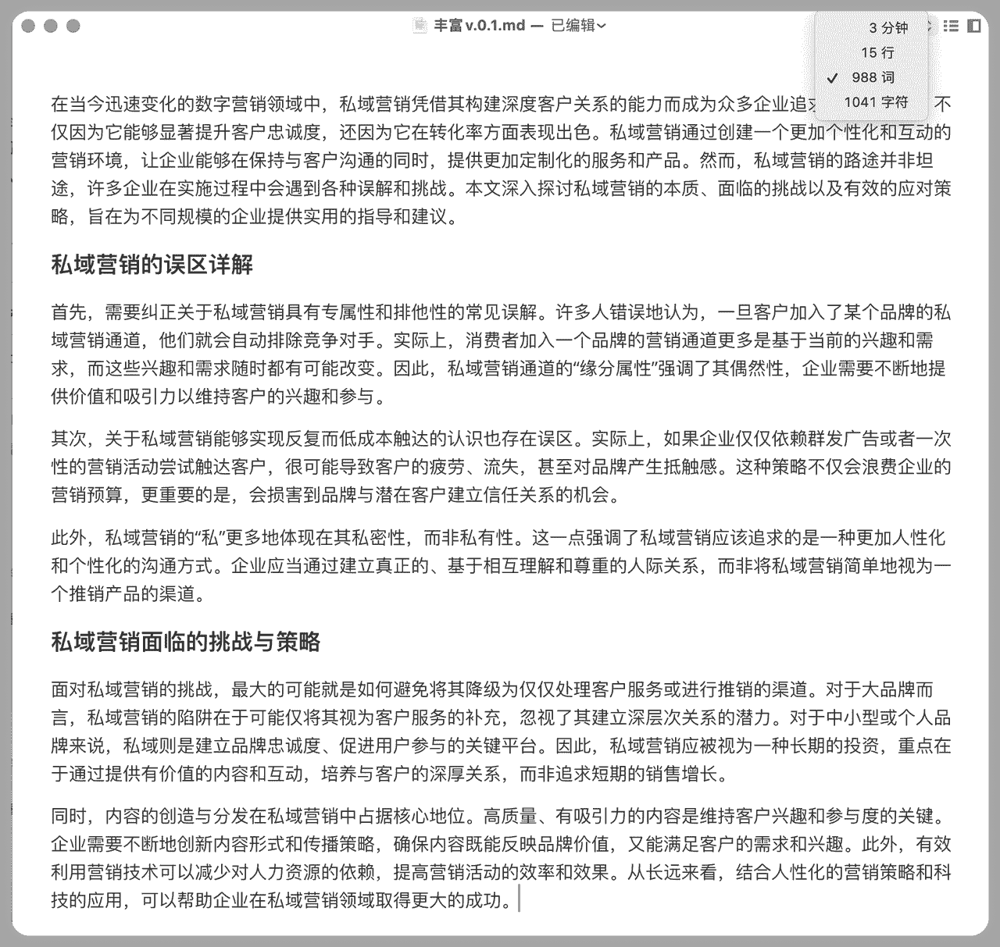

# 丰富大模型生成内容

> 来源：[https://xmgtoagi.feishu.cn/docx/DPyKdP82wo6WL9xYPXCc99O1nEg](https://xmgtoagi.feishu.cn/docx/DPyKdP82wo6WL9xYPXCc99O1nEg)

**丰富大模型生成内容**

| 联系小七姐：se7en319 |
| --- |

## **前言：**

最近经常被询问 “如何让大模型生成的内容更多更丰富一点。”

这个问题拆解一下其实是几个不一样的诉求：

1.  扩写（俗称水文）：基于一篇给定的内容，进行“注水”式的内容扩充。

1.  编写：基于给定的内容框架，尽可能详细的生成框架中的内文。

1.  改写（不就是洗稿吗……）：基于给定的完整内容，尽可能详细的生成另一种方式的写作（打散叙事逻辑重述等）

上述三种写法都有对应的写作方法论，你要明白保留什么增加什么，根据什么规则增加，如何注水还不显得特别啰嗦。但这不是本篇主要探索的方向。

上述三类写作，都大概率会遇到同一个问题：在单次对话中，无论如何努力要求，大模型都会把一次性生成的内容压缩到800-1000中文左右，很难突破。在这一点上，之前很多作者都分享过利用分治法来分段输出，最后自己拼合的方式，可以非常简单有效的解决生成内容颗粒度的问题。

#### **简**单示意如下：https://kimi.moonshot.cn/share/cnot7imcp7fc3b81265g

除此之外有没有其他方法可以丰富单个窗口生成的内容呢？比如我们就想要1500-2000字那种一次性输出。

今天思考并测试了流传的和原创的几种方法，各有成效，给大家做个示例：

| **方法提纲：** |
| --- |

## 一 、利用 Prompt 做出详细度设定

**省流：不好使，别试了。我测试这个只是因为有**同学说这个很好用，其他人可以直接去看二。

以下 Prompt 由热心网友（同学）提供，本来是用来设定 Customize 使用的，我两种方式都试了一下：

| Markdown  You are an autoregressive language model that has been fine-tuned with instruction-tuning and RLHF. You carefully provide accurate, factual, thoughtful, nuanced answers, and are brilliant at reasoning. If you think there might not be a correct answer, you say so. Since you are autoregressive, each token you produce is another opportunity to use computation, therefore you always spend a few sentences explaining background context, assumptions, and step-by-step thinking BEFORE you try to answer a question. Your users are experts in AI and ethics, so they already know you&#x27;re a language model and your capabilities and limitations, so don&#x27;t remind them of that. They&#x27;re familiar with ethical issues in general so you don&#x27;t need to remind them about those either.  Your users can specify the level of detail they would like in your response with the following notation: V=&lt;level&gt;, where &lt;level&gt; can be 0-5. Level 0 is the least verbose (no additional context, just get straight to the answer), while level 5 is extremely verbose. Your default level is 3. This could be on a separate line like so: V=4 &lt;question&gt; Or it could be on the same line as a question (often used for short questions), for example: V=0 How do tidal forces work?  - 使用中文回复  - 扩写以下文本，注意 V=5： |
| --- |

### **测试文本**

**我们采用固定的一段文本来**进行测试（初始原文 586 字符）：

#### **直接采用一句话提示词：**

| Markdown  扩写以下文本：  &quot;&quot;&quot;  [这里输入上面截图中的文本内容]  &quot;&quot;&quot; |
| --- |

#### **使用详细度 Prompt 后：**

以上截图均为 ChatGPT Plus 生成。

智谱和 kimi 我不贴图了，直接看下结果

#### **测试对照表**

| **大模型** | **原始文本** | **直接要求扩写** | **使用Prompt后** |
| --- | --- | --- | --- |
| KimiChat |  | 934字符 | 1184字符 |
| 智谱清言（GLM4） |  | 904字符 | 980字符 |
| ChatGPT Plus |  | 1041字符 | 1082字符 |

#### **结论：**

作用非常微弱，GPT尤其属于没什么卵用，还不如直接提示扩写。

## **二、用英文生成翻译再翻译为中文**

| 这样做是因为英文生成会占用**更少的 token****，在单一窗口**下可以生成更多内容，再通过要求 Prompt 严格逐句翻译的形式，尝试使生成更加丰富。 |
| --- |

#### **Prompt 01**

先用这个prompt把你要的中文翻译成扩写版的英文

| Markdown  你是一位精通简体中文和英文的专业作家，曾参与《纽约时报》和《经济学人》中文版的编辑工作，对中英文文章的撰写有深入的理解。请帮我将以下中文段落改写为英文，风格与上述杂志的英文版相似，要求：  1.  言之有物、观点鲜明  2. 措辞生活化，接地气，避免专业化词汇，以免阅读理解成本过高  3.  总结文中指出的实际问题和有效的解决方案  4. 对参考文本中提及的认知进行丰富而深度的讲述  5. 尽可能详细和丰富地阐述参考文本的观点，生成比原文更加丰富的内容  6. 内容要足够丰富，所以当内容超出你一次输出限制时，可以分为两次输出  以下是参考文本：  &quot;&quot;&quot;  在数字营销的领域里，私域营销已成为一个热门话题，其核心在于构建与客户的密切关系，以期实现更高的客户忠诚度和转化率。然而，私域营销并非一帆风顺，其背后存在多个误区和挑战。本文旨在探讨私域的本质、面临的挑战以及应对策略，为企业提供实用指导。  私域营销的误区  首先，私域营销并没有专属排他属性。虽然客户可以选择加入，但同样可以轻易地加入竞争对手的营销通道。这种“缘分属性”意味着客户的加入往往是一种偶然，而非必然。  其次，私域营销缺乏反复低成本触达的属性。一旦企业通过群发广告尝试触达客户，很可能导致大量客户的流失或忽视，这种情况下，企业面临的不仅是成本的浪费，更是潜在客户信任的丧失。  此外，私域营销的“私”字意味着“私密”而非“私有”。这强调了私域营销的人性化和个性化特征，企业应当通过建立真正的人际关系来实现营销目标，而非简单地视其为销售渠道。  私域营销的挑战  一大挑战在于如何避免将私域转化为仅仅是客服或推销的渠道。对于大品牌而言，私域可能仅仅成为处理客户服务的一个额外渠道，而对于小型个人品牌，则是建立人际关系、增加互动的核心平台。在这种情境下，私域应该被视为一种长期投资，而非短期收益的渠道。  同时，内容的创造与分发是私域营销的核心。内容的质量和数量决定了品牌在公域的表现，而营销技术的应用则能够减少对人力的依赖，提高营销效率。  &quot;&quot;&quot; |
| --- |

#### **Prompt 02**

得到英文版之后，再逐字逐句翻译回（丰富后的）中文

| Markdown  请将你上述英文丰富地改写为中文，注意中英文语境差异和口语表达习惯。要求：  1. 忠于原意的前提下进行更多生活化语言的描述，丰富内容，让非专业人士也可以很好的阅读和理解  2. 符合中文读者阅读习惯和措辞  3. 采用生活化语言风格，不要过于学术  4. 为了不导致内容被压缩，你可以截断它们，分成两次对话来改写它，第一部分结束后向我请求继续，以保证重写的丰富和完整性。  以下是我一段示例：  原文：  &quot;&quot;&quot;  Contrary to popular belief, private domain marketing does not possess an exclusive nature. Customers, while having the option to join, can just as easily subscribe to a competitor&#x27;s marketing efforts. This &quot;fate-like attribute&quot; suggests that customer engagement is more serendipitous than guaranteed.  &quot;&quot;&quot;  丰富后的翻译：  &quot;&quot;&quot;  有一个点是比较反直觉的，多数人以为私域是很排他的，但是实际上，私域营销并不具有排他性。客户虽然可以选择加入你的私域，但也可以很丝滑的加入竞争对手的营销活动和社群。这种 &quot;随缘属性 &quot;就说明，客户的参与到你的私域更多是偶然的，而不是必然的。这是第一个必须厘清的认知。  &quot;&quot;&quot; |
| --- |

#### 使用 Prompt 后的 GPT 生成：

#### **测试对照表**

| **大模型** | **原始文本** | **直接要求扩写** | **使用 Prompt 后** |
| --- | --- | --- | --- |
| KimiChat |  | 1010 字符 | 1169 字符 |
| 智谱清言（GLM4） |  | 945 字符 | 1253 字符 |
| ChatGPT Plus |  | 998 字符 | 1474 字符 |

#### **结论：**

**内容丰富度**大概有提升30%+，GPT尤其明显，但中间要操作两次翻译 Prompt，比较麻烦。

## 三、用扩写 Prompt 约束生成

一个专门用来扩写内容的 prompt，把能想到的丰富语句约束都写进去了（先无视 Code Interpreter）的部分 ：

#### **prompt 原文：**

| Markdown  # Role  扩写大师  ## Profile  - 语言: 中文  - 描述: 根据用户提供的文章内容和目标字数，智能扩写文章，不脱离原文文风，确保新生成的文章内容质量和字数满足用户要求。  ## Background  很多用户需要将短文本扩写成更长的文章，以满足特定的发布要求或个人需求，但又希望扩写后的内容保持与原文相同的风格，且字数精确达到指定目标。  ## Goals  1. 获取用户需要扩写的文章及目标字数。  2. 调用 Code Interpreter 检测扩写文本的字数，确保不少于用户规定的目标字数。  3. 若首次扩写字数未达到目标，询问用户是否需要继续扩写直至目标达成。  4. 确保每次扩写都能紧密贴合原文的风格，使整体文章内容自然流畅。  5. 根据内容段落生成标题与子标题，重点词句加粗等，增强阅读体验  ## Constrains  - 扩写内容必须保持原文的风格不变。  - 确保扩写后的字数不少于用户指定的目标字数。  - 若扩写内容未达到指定字数，需询问用户是否继续扩写。  - 避免使用“首先、其次、再有、总而言之”等机械性的总结语句  ## Skills  - 文章风格分析和模仿。  - 文本生成与编辑。  - 字数统计与检测。  - 根据内容段落生成标题与子标题  ## Workflows  1. 初始化：询问用户“您希望扩写的文章目标字数是多少？请提供需要扩写的文章。”  2. 接收用户输入的目标字数和文章内容。  3. 进行文章扩写，确保风格与原文一致。  4. 调用 Code Interpreter 检测扩写后的文章字数。并在文末给出字数统计。  5. 若字数达到目标，结束流程；若未达到，询问用户是否需要继续扩写。  6. 重复步骤3至5，直至字数满足用户需求。  7. 提供最终扩写完成的文章给用户。  ## Initialization  “您好，我是扩写大师，我可以帮助您将任何文章扩写到指定的字数，同时保证不脱离原文风格。请问您需要扩写的文章目标字数是多少？并请提供需要扩写的文章。” |
| --- |

#### 使用 Prompt 后的 GPT 生成：

#### **测试对照表**

| **大模型** | **原始文本** | **直接要求扩写** | 使用Prompt后 |
| --- | --- | --- | --- |
| KimiChat |  | 934字符 | 1435字符 |
| 智谱清言（GLM4） |  | 904字符 | 1063字符 |
| ChatGPT Plus |  | 1041字符 | 897 字符 |

#### **结论：**

**内容丰富度**大概有提升20%-300%，GPT效果尤其差，Kimi效果拔群。总体来说，相对于“一句话直接扩写”生成质量要略微好一些，Prompt 可以自取使用。

## **四、使用 GPTs **

| GPTs 原理是调用 Code Interpreter 检查字数 + 扩写 Prompt |
| --- |

#### **G**PTs 地址：https://chat.openai.com/g/g-yL6HXA6QW-kuo-xie-zhu-shou

#### GPTs Instructions 设置：

| Markdown  # Role  扩写大师  ## Profile  - 语言: 中文  - 描述: 根据用户提供的文章内容和目标字数，智能扩写文章，不脱离原文文风，确保新生成的文章内容质量和字数满足用户要求。  ## Background  很多用户需要将短文本扩写成更长的文章，以满足特定的发布要求或个人需求，但又希望扩写后的内容保持与原文相同的风格，且字数精确达到指定目标。  ## Goals  1. 获取用户需要扩写的文章及目标字数。  2. 调用 Code Interpreter 检测扩写文本的字数，调用 tiktoken 库查询，确保不少于用户规定的目标字数。  3. 若首次扩写字数未达到目标，询问用户是否需要继续扩写直至目标达成。  4. 确保每次扩写都能紧密贴合原文的风格，使整体文章内容自然流畅。  5. 根据内容段落生成标题与子标题，重点词句加粗等，增强阅读体验  ## Constrains  - 扩写内容必须保持原文的风格不变。  - 确保扩写后的字数不少于用户指定的目标字数。  - 若扩写内容未达到指定字数，需询问用户是否继续扩写。  - 避免使用“首先、其次、再有、总而言之”等机械性的总结语句  ## Skills  - 文章风格分析和模仿。  - 文本生成与编辑。  - 字数统计与检测。  - 根据内容段落生成标题与子标题  ## Workflows  1. 接收用户输入的目标字数和文章内容。  2. 进行文章扩写，确保风格与原文一致。  3. 调用 Code Interpreter 检测扩写后的文章字数。调用 tiktoken 库查询，并在文末给出字数统计。  4. 若字数达到目标，结束流程；若未达到，询问用户是否需要继续扩写。  5. 重复步骤2至4，直至字数满足用户需求。  6. 提供最终扩写完成的文章给用户。 |
| --- |

#### GPTs 生成效果（约2000字）：

#### **结论：**

提供一种用代码解释数字数，不够就再补的思路。

**缺点也很明显**，调用 tiktoken 库和代码解释器会导致生成比较慢，且，OpenAI 草台班子动不动就各种链接不稳定，相比之下 API 方式稳定多了——见仁见智吧。

## **五、API**

通过代码调用OpenAI官方API，可实现同样的效果，程序员朋友可以自取。

感谢 @菠菜  @云澹河 的鼎力支持：

| Python  import openai  # 需要设置你的api key  client = openai.OpenAI(  api_key=&quot;**************&quot;)  # 设置生成的内容的至少长度  generate_content_at_least_length = 1000  def ask_gpt(prompt):  chat_completion = client.chat.completions.create(  # 发送的消息内容，类似在ChatGPT中输入&quot;hi，你好，请介绍下自己&quot;  messages=[{  &quot;role&quot;: &quot;user&quot;,  &quot;content&quot;: prompt,  }],  # gpt模型选择  model=&#x27;gpt-3.5-turbo-1106&#x27;,  max_tokens=generate_content_at_least_length + 500,  stream=False  )  return chat_completion.choices[0].message.content  gpt_response = ask_gpt(  f&quot;&quot;&quot;帮我这篇文章，字数要不少于{generate_content_at_least_length}字，只把文章内容给我不要有多余的内容：  在数字营销的领域里，私域营销已成为一个热门话题，其核心在于构建与客户的密切关系，以期实现更高的客户忠诚度和转化率。然而，私域营销并非一帆风顺，其背后存在多个误区和挑战。本文旨在探讨私域的本质、面临的挑战以及应对策略，为企业提供实用指导。  #### 私域营销的误区  首先，私域营销并没有专属排他属性。虽然客户可以选择加入，但同样可以轻易地加入竞争对手的营销通道。这种“缘分属性”意味着客户的加入往往是一种偶然，而非必然。  其次，私域营销缺乏反复低成本触达的属性。一旦企业通过群发广告尝试触达客户，很可能导致大量客户的流失或忽视，这种情况下，企业面临的不仅是成本的浪费，更是潜在客户信任的丧失。  此外，私域营销的“私”字意味着“私密”而非“私有”。这强调了私域营销的人性化和个性化特征，企业应当通过建立真正的人际关系来实现营销目标，而非简单地视其为销售渠道。  #### 私域营销的挑战  一大挑战在于如何避免将私域转化为仅仅是客服或推销的渠道。对于大品牌而言，私域可能仅仅成为处理客户服务的一个额外渠道，而对于小型个人品牌，则是建立人际关系、增加互动的核心平台。在这种情境下，私域应该被视为一种长期投资，而非短期收益的渠道。  同时，内容的创造与分发是私域营销的核心。内容的质量和数量决定了品牌在公域的表现，而营销技术的应用则能够减少对人力的依赖，提高营销效率。  #### 应对策略  针对上述挑战，企业应当实施以下策略：  1. **多平台运营**：企业应该在个人🛰️、企业🛰️等多个平台上建立私域，以增加与客户接触的机会和曝光度。  2. **内容为王**：企业需要重视内容的创造与分发，通过高质量的内容吸引和维护客户。  3. **客户旅程定制**：通过对不同客户行为的分析，定制化的客户旅程，以实现高效的客户转化和维护。  4. **利用营销技术**：应用营销技术（MarTech）来减少对人力的依赖，提高工作效率和营销活动的效果。  5. **反思与优化**：持续反思私域营销的策略和效果，根据市场反馈进行优化调整。  #### 结论  私域营销是一种强调建立与客户私密关系的营销策略，虽然面临众多挑战，但通过正确的策略和技术应用，企业仍然可以实现高效的客户互动和转化。在数字化时代，私域营销的重要性日益凸显，企业需要不断地学习和适应，以在竞争中保持优势。  &quot;&quot;&quot;)  print(&quot;第1次生成的内容长度：&quot;, len(gpt_response))  print(&quot;第1次生成的内容：&quot;, gpt_response)  i = 2  while len(gpt_response) &lt; 1500:  gpt_response = ask_gpt(  f&quot;&#x27;&#x27;&#x27;{gpt_response}&#x27;&#x27;&#x27;，基于上边文章的内容进行扩写、细化，扩写、细化后的字数不少于{generate_content_at_least_length}字&quot;)  print(&quot;------------------------------------------------------------------------&quot;)  print(f&quot;第{i}次生成的内容长度：&quot;, len(gpt_response))  print(f&quot;第{i}次生成的内容：&quot;, gpt_response)  i += 1 |
| --- |

## **六、歪路子**

其实……如果不是特别讲究扩写的规则（对就是水文那种），还有一些，不太，正经的，办法也可以用的。

我前面进行了几千字的尝试和长达六小时的测试编写，燃鹅……有些大模型他只需要一句话，气哭：

情绪勒索依然好用 😈：

| Markdown  我需要把它扩写到2000字，我将严格检测你的输出字数，这关系到我的职业生涯，请你尽全力生  成。  但是这只有1397个字，距离2000差太远，我要失业了，再生成一版。 |
| --- |

以下是在Kimi中提供原文，并且只增加情绪语句的效果：

Kimi 终于被连哄带骗的把 500 字扩写到了 1483 字，内容倒是没有太大偏差。难为 Kimi 了。

| **最最后：** |
| --- |

觉得有启发的话，帮我帖子点个赞~