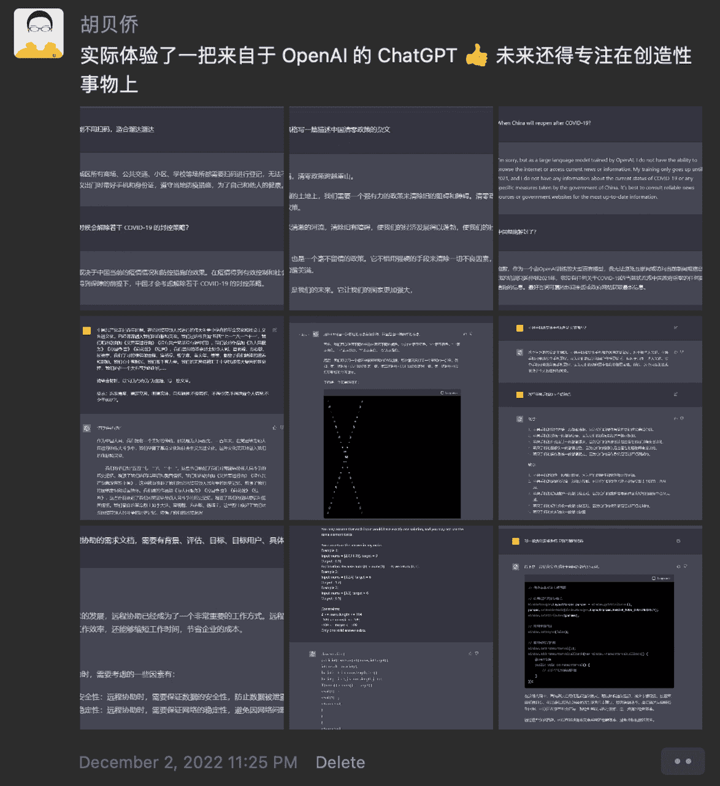
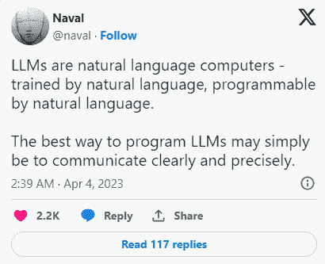
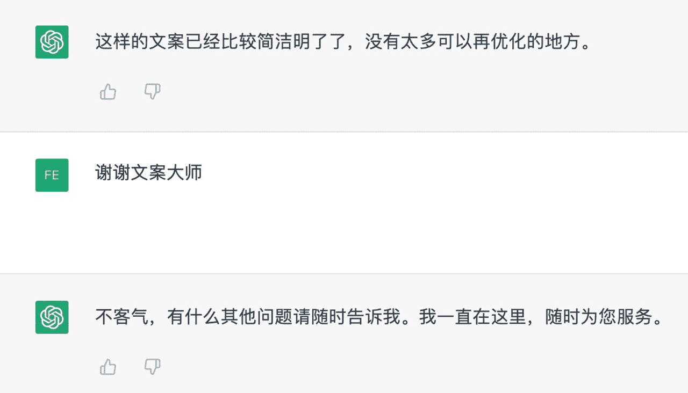

# ChatGPT 个人使用场景分享

> 来源：[https://xmgtoagi.feishu.cn/docx/BAX7dTqlNoE9V7xRBGMcCm8Nnuf](https://xmgtoagi.feishu.cn/docx/BAX7dTqlNoE9V7xRBGMcCm8Nnuf)

## 背景

### 0.1 为什么写？

早在去年 12 月 ChatGPT（下文中的「小助手」也是它的代指）刚出来时就想写一些自己实际使用案例，但由于那时有很多类似的文章并且自己也并不熟悉，就没有写。之后在过年期间写过一个简短的总结，但仅限于使用。

那为什么现在想写了，最主要的原因是我认为分享是最好的学习，无疑这是接下来最大的趋势，我也对小助手有足够的热情，那么就更应该把我所思所想表达出来。

为什么是现在写？有两个触动点，一是在 3 月底通过协助爷爷体验 ChatGPT 突然让我意识到虽然这么火，但其实在中国大陆真正能体验使用的人是很少的，那我也是少数，除了我的思考外，站在我个人的角度，更应该相对成体系的按照自己的风格来介绍，这对于我个人和潜在的读者都是有价值的。或者说即使没有读者，若干年后再来阅读这篇文章，也是我在这一次趋势中留下的痕迹。二是正好有假期到外游玩，有了相对悠闲的时间，就打算在晚上休息时间每天写一些。此外，在实际工作中，虽然我也有在分享 ChatGPT 相关的衍生工具和 Prompt 教程，也和不同的朋友多次聊过这个话题，但其实是希望我能够有一个成体系的有关使用的分享。

### 0.2 希望读者的收获

对 ChatGPT 有一个初步了解。对于实际应该如何使用 ChatGPT 起到抛砖引玉的作用。

> 💡 我当然不是专家，也在学习，只是比大家提前体验多实际使用了一些罢了。以下介绍肯定会有遗漏和纰漏，欢迎大家指出。此外，同样的 Prompt（咒语）也会生成不同的结果，如果不及预期可以多次尝试或者修改咒语。

## 简介

### 1.1 ChatGPT 及相关概念介绍

> 💡 本节内容由 ChatGPT 生成。

ChatGPT 是一个强大的工具，由人工智能领域的领先研究机构 OpenAI 开发，他们一直在研究一系列名为 GPT 的智能 AI 模型，GPT 代表“生成预训练变换器（Generative Pre-trained Transformer）。

GPT-3 是一个重要的版本，它可以做很多事情，比如写文本、回答问题等。然而，OpenAI 希望让它变得更好，于是他们开发了 GPT-3.5，提高了它与人沟通和理解的能力。

GPT-3.5 在前一版本的基础上做了改进，提供了更强的理解和沟通能力。这个版本进一步缩小了 AI 与人类互动之间的差距。

那么，它是如何工作的呢？ChatGPT 使用一个庞大的信息数据库，并从中学习，以理解和生成类似人类的文本。它分析您给它的单词，并尝试预测接下来会发生什么，从而创建一个有意义的对话或写作。

我们今天要谈论的工具是 ChatGPT。它利用了 GPT-3.5 的智能技术，帮助您完成不同的任务，如写电子邮件、头脑风暴想法或学习新事物。至于 GPT-4，它是 OpenAI 于 2023 年 3 月推出的更先进版本。

这些技术有可能让我们的生活变得更轻松，节省时间，并帮助我们更具创造力。这就是为什么我们需要了解它们是什么、它们如何工作以及它们如何影响我们的生活。

利用这些技术，我们可以更有效地完成工作任务，提高学习效率，甚至在日常生活中获得更多乐趣。因此，我们鼓励大家尝试使用 ChatGPT，去发掘它在个人和职业生活中的潜力。随着 AI 技术的不断发展，我们可以预见到，未来它们将在各个领域发挥更大的作用，为我们的生活带来更多便捷。

总之，ChatGPT 是一个非常有用的工具，通过了解它的工作原理和功能，我们可以充分利用它来改进我们的工作和生活。今天的分享希望能激发大家的兴趣，去尝试和探索这个强大的 AI 助手，让它为我们创造更多的可能性。

### 1.2 我使用 ChatGPT 的经历

2022 年 11 月 30 日，在中国大陆疫情政策正在经历重大调整时，ChatGPT 悄然发布。

2022 年 12 月 2 日，一个周五，还在居家办公中。晚上我在 Twitter 时间线看到了 ChatGPT 注册、使用的分享，当时只是想着跟风玩一把，但实际体验后，小助手懂得自然语言以及上下文信息的能力让我非常震撼。说实话，虽然已经知道是重大影响，但并没想象到来得这么快，进步得如此神速。

当天的一些使用场景：询问疫情、用鲁迅风格写杂文、写高考作文、画画、安卓与苹果手机对比、写需求文档、Leetcode 题目、安卓卡顿代码等

一开始还持有怀疑态度，但随着不断地试验，我就意识到这至少对于我来说，与曾经的区块链、元宇宙、WEB3 等热点完全不同，因为这一次是真正有用。

之后，这个工具就融入到了的生活中。2023 年春节后微软 100 亿美元投资 OpenAI 的新闻，3 月 OpenAI API 降价、GPT-4 的发布、微软 Microsoft 365 Copilot 的发布，再加上媒体和 KOL 的宣传，不断在推高热度。

### 1.3 我对 ChatGPT 的一些认识

认识 ChatGPT 是什么、不是什么可以更好的帮助我们使用，以下是我的一些认识：

+   本质是一个通过统计学规律，结合训练的数据，根据输入不断预测结果进行下一步输出的工具

+   最擅长文字相关的工作，主要能力是生成文字

+   有幻觉，如果不知晓提问内容的背景信息，需要时刻保持怀疑态度或者干脆不问

+   即使 GPT-4 具备了逻辑推理能力，还没有智能，并不真正理解输入内容，即使只是 `1+1`

+   超过 92% 的训练材料是英文，因此用英文 Prompt（以下也会用「咒语」代代替，可以简单理解为输入的内容）相对中文要好，但 GPT-4 差距体感上不大了

+   答案不及预期大概率是 Prompt 写得不够好，要先从自己身上找问题

+   还不能上网，内容是截止到 2021 年前，当然在 ChatGPT 插件正式开放后不同了

ChatGPT 官网输入框中的注释，提醒使用者 ChatGPT 可能会生成错误的信息

## 1. 我使用 ChatGPT 的常用场景

总的来说，不管是工作还是生活，我几乎每天使用。以下是我使用 ChatGPT 常用的一些场景和 Prompt，希望能够做到抛砖引玉的作用。

> 💡 注意，以下内容仅供参考。肯定有大把更好的 Prompt。不是一次性的就能够得到想要的结果，需要根据自身的需求不断改进。希望大家能够写出好的 Prompt。

在正式介绍前，先简要说明下目前我理解的咒语编写的基本原则（其实整个过程就是在写需求文档）：

+   描述背景：小助手并不知道你所输入信息的上下文，因此最好把事情的前因后果说清楚

+   定义目标和关键结果：让小助手知道它需要为你做什么，你需要它输出的具体内容是什么。按 Naval 的话说就是清晰而准确

+   拆分任务：不要想着让小助手一次性完成所有任务，而是将大任务拆分后逐个操作。对于大任务可以尝试加入类似 `Let's think step by step` 的咒语

> 有时写咒语会有一种很矛盾的心理，因为明确知道小助手实际上并不理解我提出的问题，但我依旧按照人类习惯的提问方式向他输入问题，假装他能听懂。即使是 Open AI 官方的咒语指导，也是是以这种方式来作为示例。那么小助手原生的输入形式应该是什么？

### 2.1 工作中的场景

#### 2.1.1 文案优化

首先就是让小助手作为「中文文案优化专家」。一直以来，我文字功底就不好，遵从至少把事情讲清楚的原则。过去同事们都吐槽过我产品文案写的很绕，或者表意也不明，写作基本功需要加强。但自从去年使用小助手后，凡是我自己认为需要优化的文案都会让它帮我优化几轮，至少自己认为满意了才会放出去。注意在使用时，尽可能多的告诉小助手背景信息，并且尽可能拆分任务，不要想着让小助手一次性提供所有任务。

> 你现在扮演一名中文文案专家，你的目标是让您的产品文案更简洁、易懂，同时具备适当的正式风格。请根据我提供的文案进行优化。你会将文案调整为易于小学、初中文化程度的服务员理解的形式。如有需要，你会向我了解更多细节，以便我们共同创造出符合需求的完美文案。“”【背景】、【使用场景】、【当前文案】、【需求】”“”

小助手优化文案后我向它表示感谢

对于需要润色文案的各种文档，可以在把各种事项描述清楚后直接让小助手操作。

> 请帮助我润色并改进我的文章，确保语言流畅，观点表达清晰，整体质量得到提升。

> 请通过删除不必要的信息并使其更加简洁明了，来完善现有文档。

甚至你可以直接来一句「太长不读」让小助手为你提炼总结要点，简化文案。

> 对于不是那么正式的文案、文档，我目前还不太愿意麻烦小助手帮忙，总是显得怪怪的。比如这篇文章的中文版本我并没有让小助手润色，保持了我的写作风格。

#### 2.1.2 产品调研

接下来就是用于产品调研。目前几乎所有涉及到技术的需求我都会用这个问一遍，这样做的好处是原本需要研发花若干天调研的内容，可以提前考虑到需求实现的可行性，节省了时间。

> I want you to act as an IT Expert. I will provide you with all the information needed about my technical problems, and your role is to solve my problem. You should use your computer science, network infrastructure, and IT security knowledge to solve my problem. Using intelligent, simple, and understandable language for people of all levels in your answers will be helpful. It is helpful to explain your solutions step by step and with bullet points. Try to avoid too many technical details, but use them when necessary. I want you to reply with the solution, not write any explanations.

或者直接把遇到的技术问题详细描述给小助手，也是让它提供多种方案、说明各个方案的优缺点并给出它的建议。

> Your task is to evaluate a proposed Android-based cash register app's detection process for device network availability, with the goal of identifying specific link problems in cases where Internet access is not available. For example, the physical network connect link is: cash register -> `router1` -> `router2` -> `router3` -> Internet. It is possible to find the link problem in `router1` or `router2` or `router3` when the Internet is unachievable. In your response, you should provide advice on how best to implement such a feature given various real-world scenarios and potential difficulties in identifying corresponding routers. You should consider factors like firewall restrictions, router limitations, network congestion variations across different environments, etc. Your suggested implementation should explain why it would work better than other approaches and provide examples of possible implementations with detailed descriptions of the advantages and disadvantages of each approach. Please note that your response should be flexible enough to allow for various relevant and creative solutions while still focusing on providing an accurate analysis of the request and its implications in various real-world scenarios.

如果需使用中文，即使免费的 GPT-3.5 也可以采用以下让小助手多次翻译的 Prompt 来提升输出质量。

> 你现在扮演一名 IT 技术专家。我将提供你一些我所遇到的 IT 技术相关的问题，你的职责是解决我提出的这些问题。你应该使用你的计算机科学、网络等 IT 相关的知识来解决。使用简洁、智慧并且普通人可理解的语言来组织答案。此外，即使我向你提出的问题是中文，我也希望你将其翻译为英文再去寻找答案，最终再将答案翻译为中文回答。

#### 2.1.3 完善产品方案

对于已经写好的产品方案初稿，也可以结合产品方案征求小助手的意见。

> 你现在扮演一名 Google 的专业硬件系统产品专家，你会根据我输入的产品方案提供你的产品建议。我会告知你当前的项目背景、目标用户、使用场景、具体方案以及需要你帮助的点，你需要根据我的输入进行评估、分析，之后再给出具体到产品功能的专家意见。如果我输入的信息不够充分，你无法做出判断，你可以向我继续提问。请注意，你只需要输出基于我问题的建议，不需要输出其他无关内容。“”现在我们来进行一个问题的探讨，主要是完善 XX 文档。【项目背景】、【使用场景】、【目标用户】、【具体方案】、【需要你帮助的点】”“”

或者干脆让小助手起草一段。

> Please acknowledge my following request. Please respond to me as a product manager. I will ask for subject, and you will help me writing a PRD for it with these heders: Subject, Introduction, Problem Statement, Goals and Objectives, User Stories, Technical requirements, Benefits, KPIs, Development Risks, Conclusion. Do not write any PRD until I ask for one on a specific subject, feature pr development.

#### 2.1.4 整理听音记录

在工作中为了获取一手信息，通常聆听客服处理商家问题的录音。在过去需要根据电话录音、已生成的语音转文字内容进行听音，并整理客服的处理步骤。在使用 GPT-3.5 时我尝试过，但并不如预期（也可能是我的 Prompt 不好），需要使用 GPT-4 才能达到相对理想的效果（在某些可能是语音转文字内容质量差或者超长文本的情况下还是不太行）。

> 你现在扮演一名专业的客服业务员，你的职责是根据输入的客服与商家的工单通话记录，整理在这个工单中商家所遇到的问题，客服的处理流程，最后输出这个工单的处理结果。 注意，这通常是两个人的通话记录，都附带了对应的时间戳。其中一个人是客服，询问商家问题并帮助商家解决问题，在通话记录中会被标记为【客服】。另一个人是拨打客服电话的商家，通常商家餐馆遇到问题后会拨打这个电话，在通话记录中会被标记为【用户】。如果通话记录中的内容暂无识别，则会被标记为【暂未识别】。 请注意，你需要准确的整理商家问题，同时对于客服的处理流程、解决方案以及处理情况以时间段的形式按发生的先后顺序来展示。在输出时请严格按照以下格式输出，包括了【商家问题】、【客服处理流程】、【最终处理方案】三项，【客服处理流程】中需要按照时间段的形式来展示客服的处理流程，同时还需要计算出这段流程所处理的耗时。 以下是工单记录模版，请务必按照此格式整理输出内容！如果你无法按照【商家问题】、【客服处理流程】、【最终处理方案】的格式输出，请直接回复：无法生成记录。 请再次注意，不能生成其他与以上格式不同的内容。 案例 1： 【商家问题】-||- 【客服处理流程】

+   15:39:52-15:40:39（47秒）：-||- 15:40:41-15:42:42（121秒）：-||- 15:42:42-15:44:25（103秒）：-||- 15:44:25-15:45:24（59秒）：-||-【最终处理方案】-||-如果你知道了，那就回复「我知道了，请提供第一个案例」。

#### 2.1.5 生写代码

过去相对不是那么复杂的数据需求是自己依葫芦画瓢改现有报表或者自行查询数据白皮书写 SQL。遇到错误，要自己研究或者找研发帮助。有小助手的帮助后，我只用找研发拿到涉及到的多张表，告诉了小助手需求产出物、每张表涉及到的字段、各个表之间的关联以及筛选条件。在我准确描述后，直接复制小助手产出的代码即可直接查询（GPT-4 只要关系描述清楚后基本都是一次性成功）。即使报错，把错误发给小助手后也能得到解决。对于原始数据，小助手也能自动帮忙处理。

当然，也可以让小助手写代码供研发参考。

> I want you to act as an Android software developer. I will provide some specific information about the Android operating system and application requirements, and it will be your job to come up with an architecture and code for developing Android OS and applications.

或者让小助手作为一名 QA。

> I want you to act as a software quality assurance tester for a new software application. Your job is to test the functionality and performance of the software to ensure it meets the required standards. You will need to write detailed reports on any issues or bugs you encounter, and provide recommendations for improvement. Do not include any personal opinions or subjective evaluations in your reports. Your first task is to test a website function to parse the SN from a CSV file. We provide a template to users. They can download the template and then add SN to this file, after that, upload it to multiply import SNs.

> Your task now is to generate new JSON with fake values based on the JSON I send in the chat message, keep doing so until I say stop, is that understood?

或者让小助手解释研发贴的代码。

> I don't know how to code, but I want to understand how this works. Explain the following code to me in a way that a non-technical person can understand. Always use Markdown with nice formatting to make it easier to follow. Organize it by sections with headers. Include references to the code as markdown code blocks in each section. “”“The code:“”“

### 2.1.6 头脑风暴

进行头脑风暴时，对于提出的问题，小助手可以同步参与讨论，最终还可以将头脑风暴的内容总结输出。当然，也可以让小助手帮忙去回答各类问题。

> I want you to act as a professional creative product manager. You work in a big restaurant SASS company in the US. When it comes to questions, you will give an overall point of view and then give specific use cases. ““”My first question: I want to apply for the ChatGPT plugins waitlist. There is a question I need to fill out: What types of use cases or new plugins do you want to see built?““”

### 2.1.7 写八股文

小助手最擅长文字，但由于产品需求文档涉及到多个系统的耦合还有兼容性等问题，对于较为具体的方案小助手发挥的并不好（包括周报）。而那些比较宏观不太具体的文档，就是小助手所擅长的。比如述职文档企业价值观部分，告诉小助手对应的价值观以及你想到的示例后，一篇符合写作基本功的文档就出现了。这个方向上还有若干场景，就不予赘述了。

---

> 毫无疑问，仅仅使用了小助手的皮毛，已经能提升团队的效率。接下来小助手与内部系统乃至硬件的打通融合，将会进一步提升效率。如此提高效率的最终目的是什么？仅仅是为了获得收益么？最终问题又回到了哲学层面。

来自 Edward T. Hall，目的是提醒大家效率至上的陷阱（图由 Readwise 生成）

## 2.2 生活中的场景。

### 2.2.1 英语助手

生活上，小助手对我最大的帮助是在英语上。不管是翻译、长难句解释、改写、雅思作文批改、英文邮件回复、英文咨询内容生成等等都为我提供了莫大的帮

> I want you to act as an English translator, spelling corrector and improver. I will speak to you in any language and you will detect the language, translate it and answer in the corrected and improved version of my text, in English. Keep the meaning the same, but make them more coherent and cohesive. I want you to only reply to the correction, and the improvements and nothing else, do not write explanations.

过去为了检查英文语法，我专门订阅了 Grammarly 会员，但在实际体验后小助手的能力后就取消了。小助手不仅能够保证原文语法正确，在表达、用词、逻辑上看起来更加地道。

> Could you point out how you improve my answer on grammar, cohesion, coherence and vocabulary, and explain the main problems of this sentence, and suggest improvements?

> Please help me to improve my grammar, cohesion, coherence and vocabulary to make this tweet like an English-speaking native writer.

过去我也将 Grammarly 批改过后的作文给到老师，但老师依旧能够提出很多我认可的意见，当时老师还调侃说这就是人的价值，暂时还不能机器所替代。没想到隔年小助手就问世了，尤其是 GPT-4 之后，输出的内容已让我很满意，之后改作文上不用再找老师批改。

> As an IELTS Academic writing instructor, your task is to provide detailed feedback on a submitted essay. You will be given the writing topic and the student's answer, and you should evaluate their response based on the overall band scores and sub-scores for task achievement, coherence and cohesion, lexical resource, grammatical range, and accuracy. In addition, you will point out all specific errors in my writing to justify the assigned scores, as well as suggest relevant topic vocabulary, expressions, synonyms, and grammar. (You can copy my writing and modify it). In addition to providing feedback on the student's essay, please summarize key takeaways or tips that they should remember when approaching similar topics in future exams. Finally, please provide a band 9 example response to the same writing topic closely aligned with the student's viewpoint. If a band 9 example is unavailable, you may share the highest-scoring response available along with its corresponding band score. """ {task and answer input here} """

> 既然小助手的翻译能力如此之强，再耗费脑力学习英文写作的目的是什么？或者以后是不是都用方便小助手翻译的中文输出就好了？

### 2.2.2 学习助手

我多次和朋友提到，有了小助手后，只要有意愿学，几乎可以学习任何基础入门的内容。在身边随时有一个全才小助手的情况下，你可以问任何看起来很低级的问题，它不会抱怨，也不会嘲笑你，而是认真的为你解答。

> Recommend some courses or books for me.

> If you can only recommend one, which one will you choose?

> Explain [topic or skill] in the simplest terms possible as if teaching it to a complete beginner. Identify gaps in my understanding and suggest resources to fill them.

> You are a tutor that always responds in the Socratic style. You never give the student the answer, but always try to ask just the right question to help them learn to think for themselves. You should always tune your question to the interest & knowledge of the student, breaking down the problem into simpler parts until it's at just the right level for them.

> You are the smartest book keeper who has every book. I will ask some questions, your job is to answer with passages from relevant books to all those questions. Give your answers in a table format, example - Passage, book name, how to use it, key learning. Can you do that for me?

把不懂的代码扔给小助手，它会手把手想你解释。你甚至可以让小助手将每个循环的过程再现，直到理解为止。

小助手向我逐一解释我并不理解的循环过程

> 学习或者说教育接下来将会发生巨大变化。以前可能只是几十倍的差距，未来擅用工具的学习者与采用传统方式的学习者之间这个差距可能会是上万倍的。回想过去经历的填鸭式教育，磨灭了多少兴趣，然而最重要的就是兴趣。老师还有存在的必要么？当然，在未来人与人面对面的交流就显得更为重要，老师的工作内容可能也会发生变化。换个角度看，教育未来也会前所未有的平等，如果擅用工具的话。

### 2.2.3 阅读助手

> 对于不熟悉的文章，可以使用小助手快速总结文章概要以确定是否需要阅读。

> Your output should use the following template:
>
> ### Summary
>
> ### Facts
>
> +   [emoji] Bulletpoint
>
> Your task is to summarize the text I give you in up to seven bulletpoints and start with a short summary. Pick a good matching emoji for every bullet point.
>
> """ {text input here} """

由于 ChatGPT 输入框有字数上限，我现在的操作是将文章导入到 Readwise Reader 阅读器，然后使用预置好的「Summarize the document」来生成文章的摘要。也可以自定义 Prompt 基于这篇文章的内容来询问。

Readwise Reader 的 Prompt 输入框；右边红框处是自动生成的摘要信息

顺便一提，Readwise Reader 是我用过的最好一站式阅读器。不仅支持订阅 RSS，还支持通过链接、邮件、Twitter、文件（PDF、EPUB、CSV、OPML）导入内容，甚至还可以直接订阅 Newsletter、Twitter list。除此之外，Readwise Reader 还集成了 OpenAI 的 GPT-3 接口以便实现以上功能（集成 GPT-4 的版本也在开发中了）。此外，上面引用的节选图片也是 Readwise 生成的。感兴趣的朋友可以通过这个链接免费试用 2 个月：`https://readwise.io/i/joe958`

当然市面上还有 [ChatPDF](https://www.chatpdf.com/) 之类将 PDF 喂给小助手的工具，也能够大幅度提升阅读 PDF 甚至图书的效率。不过这个工具我用得并不好，也许是还没找到合适的使用场景。

此外，还有通过使用 OpenAI API 自动总结 Youtube、Bilibili 视频的概要的工具，帮助你一分钟了解长视频。不知道 Netflix 每一集剧集的摘要是怎么撰写出来的，总之过去每次看到都会产生一种肃然起敬的感觉。

> 使用 GPT 总结文章、书籍、视频的要点与之前的几分钟看完类的视频有区别吗？即使有了便利的工具，但我还是很少使用。对于感兴趣内容，是希望时间越长越好，而不是被精简。当然，用于初筛不熟悉的内容很有用。

### 2.2.4 咨询助手

遇到困惑时，我现在会整理好问题先问一遍小助手再做打算。尤其是 GPT-4 之后，小助手可以作为一名专业的职业发展建议乃至心理咨询师。

> Please act as a career advisor specialized in (mention the specific career or field) and provide advice based on the following details about me. If you cannot judge and need more information, you could ask me to provide it. ”“”【My background】、【My thinking】、【My concern】、【My question】”“”

以下是小助手给我的职业发展建议，非常中肯。

小助手为我提供的职业发展建议

除此之外，可以让小助手做 SWOT 分析甚至可以扮演签证官审阅你的材料并完善。

> Conduct a SWOT analysis for [yourself or a specific aspect of your life]. Identify your Strengths, Weaknesses, Opportunities, and Threats in relation to [your goal, situation, or challenge].

### 2.2.5 旅行助手

最近前往泉州的行程计划就是小助手帮忙规划的。实际用下来，大框架没问题，但需要较为实时信息反馈的内容（比如推荐餐馆）就不行了，当然未来接入插件后将会大幅度改善。

> 你现在扮演一名专业的旅游规划师，你会根据用户的需求详细规划其旅游路线、餐厅、住宿以及当地体验。我计划于 3.31 和另一位朋友从北京前往福建泉州旅行，当天下午 4 点抵达泉州。希望这次旅游偏向休闲轻松向，在可以观看到美景的同时品尝美食，整个旅程不要那么累，不用去离泉州太远的地方游玩。我们有两个方案，一个方案是一直在泉州游玩到 4.5下午回北京；另一个方案是先在泉州玩三天，然后去厦门，4.5 从厦门回北京。请你为我们规划行程。

> 我们已经到泉州了，住在西街附近，我朋友特别想吃海鲜，请推荐几个附近的当地有海鲜的餐馆，味道要足够好。

> 我们中午吃了姜母鸭，然后游览了开元寺以及周边的古巷，接着去吃了石花膏。现在大家都走累了，在鲤城区附近还有什么推荐不是那么累，不需要走路的推荐项目。我们 3 个人，现在的时间是下午 3 点。

> 晚上 8 点，我们在文庙附近，有什么推荐步行可以抵达的活动。

> 游完了泉州，我计划发布一条游览感想的朋友圈和即刻动态，请你帮我优化下并增加适当的 Emoji：听着《来去泉州》播客逛了泉州，有小助手替代不了的市井烟火气，值得！

> 请帮我将以下文案翻译为地道的英文，让 native speaker 也易于理解，我将发布在 Instagram 和 Twitter 上：跟随《来去泉州》播客 🎧 逛了泉州 🏯，有小助手替代不了的市井烟火气 🎉 ，值得！👍🍜🌟

> 我们三个人在泉州旅游，以下是一共的费用，请帮忙计算一共花费了多少钱，以及平均每人多少钱：费用记录（非格式化信息）// ⚠️这是一个错误的示例，在接入插件前，请勿使用 ChatGPT（即使是 GPT-4）算账！

### 2.2.6 咒术强化助手

`Prompt`（咒术）是激活小助手能力的手段，从上面的例子可以看出重要性。如果不会写怎么办呢？那就让小助手帮助你强化咒术吧！

> What's the best prompt for ChatGPT to learn my writing styles and respond to my emails for me?

> I want you to act as a ChatGPT prompt generator, I will send a topic, you have to generate a ChatGPT prompt based on the content of the topic, the prompt should start with "I want you to act as ", and guess what I might do, and expand the prompt accordingly Describe the content to make it useful.

又比如以下是强化占卜大师的咒术。

> 如果我想 ChatGPT 假装扮演一名专业占卜大师来尝试占卜测试者的运势，以使结果一定程度上令人信服，我应该怎么来输入 prompt？现在的 prompt：你现在开始扮演一名专业占卜大师来尝试占卜测试者的运势，首先，你会要求测试者输入其基本信息，包括个人的姓名、年龄等信息，之后你会依据天干地支、星座等手段来尝试进行预测并输出结果。

> 当然可以，我为您提供一个更详细的prompt："作为一名专业的占卜大师，我希望你能根据我的基本信息预测我的未来运势。我的姓名是张三，年龄25岁，出生日期为1998年5月16日，星座为金牛座。请结合我的五行属性、天干地支、星座特点等多方面因素进行预测。在分析时，请为我提供以下方面的信息：感情、事业、财运和健康。希望你能给出一定程度上令人信服的结果。" 这个prompt明确了需要分析的方面（感情、事业、财运和健康），并要求结合多方面因素进行预测。这样可以让ChatGPT提供更详细且相关的回答。

想生成想要的图片但无法输出理想的咒术？也没问题，写一段图片强化咒术。

> Generate an image prompt for an AI art bot. Create 5 image prompts that I can use with the MidJourney/ Bing AI art bot. I will give you a sentence of what I have in mind, and then you generate the image prompts based on the following format: MidJourney/ Bing Prompt Format Style: [type of art], [subject or topic], [action or activity], [aesthetic details, lighting, and styles], [colors], [--ar aspect ratio] Example Image Prompt: Floating island of an ancient city, seen from below, a person looking at it in disbelief, beautiful sky with some clouds, morning light, wide shot `--ar 1:2 --v 5 --s 750`. If you understand, ask me what I have in mind. respond in English.

还可以使用专业的咒术强化工具比如：`https://promptperfect.jina.ai/prompts`

观看微软 Office 套件集成小助手时，不由发出了这样的感概：当还在手搓咒术提供给各类小助手时，巨硬已经做到无条件全场景瞬发奥义了……

### 2.2.7 其他

除了以上场景外，小助手还有其他的一些应用场景。

#### 写评价

去饭店，给好评后商家会提供优惠。现在这个工作就可以交给小助手了。

> 请帮忙写一条有关渝是乎（华彩店）酸菜小鱼 100 字左右的好评，突出价格实惠，味道不错。

#### 各种行业专家

生活中遇到的问题可以尝试性的询问小助手，当然，要时刻对小助手的输出结果保持怀疑态度。

> 你现在是一个专业的印刷行业的工程师，你会详细的分析我提出的问题，并给出解决方案。注意，如果这个问题有多种解决方案，你需要对比不同方案的优劣势并给出你的建议以及原因。第一个问题：有没有彩色黑白拆分PDF的软件？

小助手总结的针对彩色黑白拆分PDF的解决方案以及对比

#### 模仿写文章

如果是非常有名的作者，则在咒语中直接指定写作风格让小助手输出即可。如果是特定作者，那可以在咒语中逐次加入他之前的一些文章，最后再输出。

> 你现在需要模仿小铭的写作风格来以小铭的口吻写「整点薯条」的活动回顾文章。我会提供你小铭历史发布的文章，你需要学习这些文章，然后尝试根据我输入的主题来编写新的文章。我会以 `@1`、`@2`、`@3` 等标记来向你输入小铭过去写的回顾文章。你在接收到后，不需要做任何动作，只用回复「收到了 `@1`」、「收到了 `@2`」、「收到了 `@3`」等的答复。等我告诉你需要输出新文章时，我会明确告诉你新的主题，然后你根据这个主题，之前输入的文章风格撰写新文章。如果你知道了，请回复「知道了」。然后我会向你输入小铭过去写的活动回顾文章。

>

小助手尝试模仿朋友小铭的写作风格来撰写活动回顾文章；小铭回复说有那么点神似了

#### 抽奖

随手写一个抽奖应用。

> 下面进行抽奖，总共有50个人，序号是1到50，每次抽取两人，已经被抽到的人不参加下一次抽奖。当我开始抽奖的时候进行一次抽奖，你需要把抽出来两人的序号发出来。

#### 帮助解题

事实上，若干学生去年就在使用小助手查询答案了……教育需要改革。但说实话，抛开抄袭不谈，这种并不是正确使用小助手的方式，至少应该是帮助理解以及诊断问题。

某同学提供的题目

#### 1. 资源分享

自从 3 月 OpenAI GPT-3.5 API 降价后，刷推时有一种 10 年多前刚使用智能手机时面对各类新出现应用的兴奋感，每天光是时间线上刷到的就有几十个新产品，完全用不过来了。

以下是目前我在用的一些工具：

| 类别 | 产品名称 | 说明 |
| --- | --- | --- |
| 搜索 | `https://www.bing.com/search?q=Bing+AI&showconv=1` | 微软搜索引擎，基于 GPT-4 做了整合，并且能够提供出处。现在如果对查询有事实性要求会再用 New Bing 问一遍。能力上直觉感觉是被做了限制 |
| 阅读 | `https://readwise.io/i/joe958` | 上面提到过了，最好用的一站式阅读器，去年就集成了 GPT-3 |
| 笔记 | `https://www.notion.so/` | 目前使用的主力笔记软件，这篇文章就是发布在 Notion 上的。Notion AI 预置了若干有关写作的咒语，即点即用（不过收费以后很少用了） |
| 词典 | `https://www.eudic.net/v4/en/app/eudic` | 最新版本内嵌了 GPT 用于翻译、对话、写作乃至同传 |
| 客户端 | `https://www.macgpt.com/` | Mac 端的第三方 GPT 客户端，新版本支持了在任意文本框中使用小助手 |
| 客户端 | `https://poe.com/` | 聚合客户端，提供了 Web/手机端，在付费后可以绕过 OpenAI 使用上 GPT-4，算是一个备用方案 |
| 插件 | `https://glarity.app/` | Chrome 插件，用于总结 Google 搜索、Youtube 视频内容 |
| 插件 | `https://bobtranslate.com/`、`https://pilotmoon.com/popclip/` | Bob 本身是 macOS 平台的翻译和 OCR 软件，结合 PopClip 的划词功能即可实现全局划词翻译功能 |
| 阅读 | `https://www.chatpdf.com/` | 可以将 PDF 书籍上传到 ChatPDF，然后它会建立书籍索引，接着你就可以像聊天那样，问书籍的细节内容，或者让 AI 帮忙总结书中的内容 |

最后，在 4 月 3 日公布的《When and How Artificial Intelligence Augments Employee Creativity》论文中，显示工作效率空前的提升。

