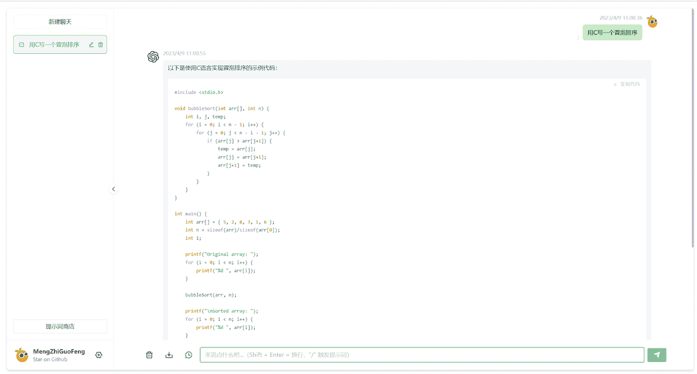
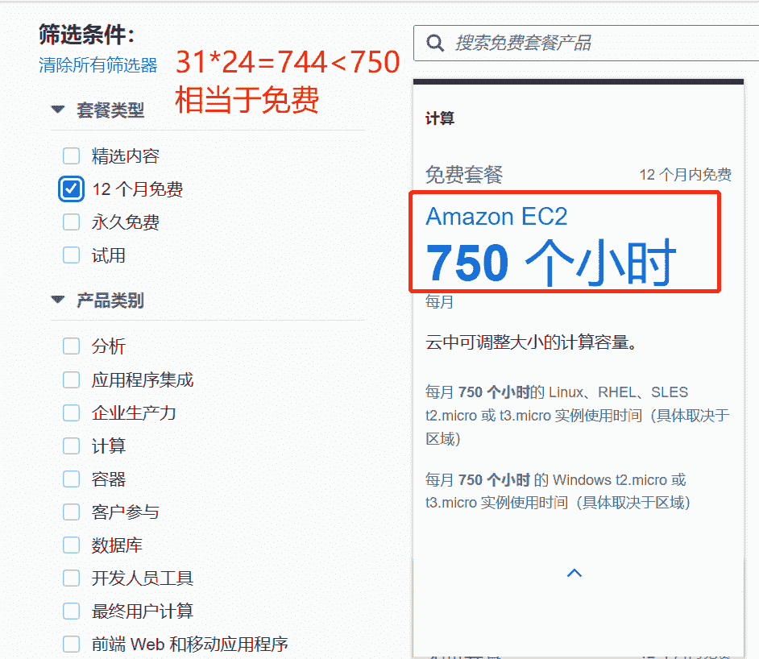
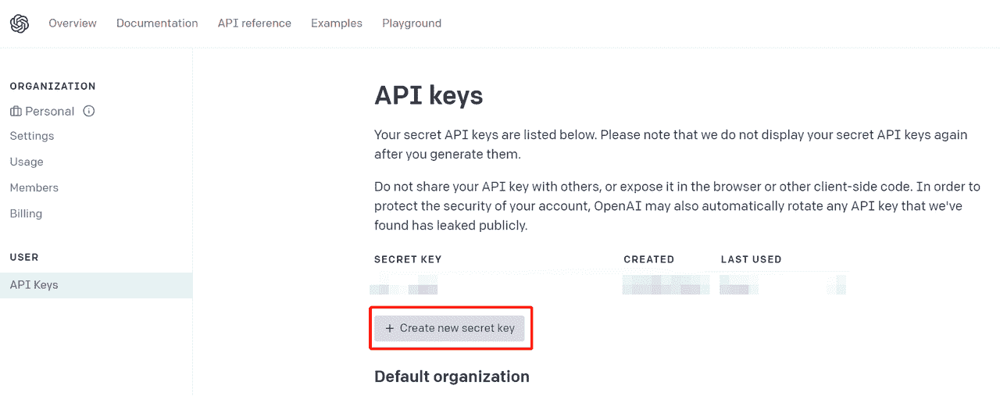
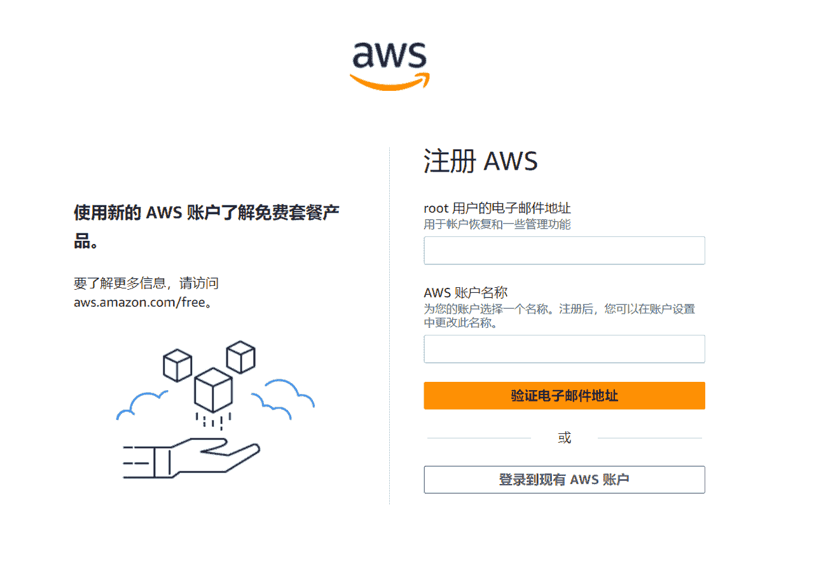
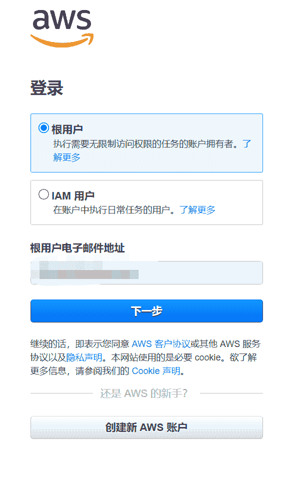

# ChatGPT专属网页版（免🪜）

> 来源：[https://xmgtoagi.feishu.cn/docx/K4zodrZJloRgbJx9zq2ckRtBnSb](https://xmgtoagi.feishu.cn/docx/K4zodrZJloRgbJx9zq2ckRtBnSb)

# 前言介绍

## 部署完是什么样子的？



## 免费的是什么样的服务器？

1 核心 1GB 内存  20GB硬盘，自己玩玩足够用了。

国内云计算服务提供商包括阿里云、腾讯云、华为云、百度云、京东云等，而国外也有像亚马逊旗下的 AWS 云这样的服务商。重点是，AWS 提供了免费的云服务，任何人都可以使用。

在 AWS 的免费套餐页面，用户可以免费使用多种产品和服务，例如云服务器、数据库、函数计算、机器学习等。这个免费套餐对于学生、初学者或小规模企业等用户来说非常有吸引力。网址为：https://aws.amazon.com/cn/free



**需要注意的是：**

AWS 免费套餐中的 EC2 云服务器只提供了 1 核心和 1GB 的内存，在安装 Docker、Portainer 和一个 Java SpringBoot 应用程序后，运行正常并且稳定。

申请 AWS 免费套餐时需要提供银行卡信息，但使用其他银行卡也是可以的。有些营销文为了卖服务器会夸大其扣费情况，但实际上 AWS 免费套餐并没有恶意扣费的问题。本人也搜索了相关信息并验证了一段时间，发现使用十分顺畅。

当使用时间接近 1 年时，用户可以停止服务并重新申请一个新的账户，以继续使用 AWS 免费套餐。

如果以上注意点没有问题，用户可以按照接下来的教程进行申请和使用。需要注意的是，由于 AWS EC2 和国内一些服务器使用的方式略有不同，因此需要按照教程创建并使用实例。

# 1.申请Key(OpenAI)

1.访问ChatGPT官网：https://platform.openai.com/account/api-keys

[AIGC从入门到精通教程汇总](https://y3if3fk7ce.feishu.cn/docx/QBqwdyde7omVf4x69paconlgnAc)没有账号？来看看这篇完整的注册教程：

2.点击 Create new Secret Key



# 2.创建免费服务器

以下是在 AWS 上创建免费服务器的简要攻略：

1.  注册 AWS 账户：前往 AWS 官网（https://aws.amazon.com/）进行注册。需要提供一些基本信息并设置账户密码。



1.  登录 AWS 控制台：注册完成后，使用账户密码登录 AWS 控制台（https://console.aws.amazon.com/）



1.  进到IAM控制面板

在创建 Amazon EC2 云服务器前，需要在控制面板中创建；用户组、用户、角色，这样在后面创建服务器的时候才能把用户信息给关联上。

方式一、点击这里进入IAM控制面板：

[https://us-east-1.console.aws.amaz](https://us-east-1.console.aws.amazon.com/iamv2/home?region=us-east-2#/home)on.com/iamv2/home?region=us-east-2#/home -

方式二、或者搜索 IAM 并进入，就是IAM控制面板。


### 3.1 添加用户

用户=》添加用户


指定用户详细信息


设置权限


下一步即可。


下载.csv文件

说明：首先你需要在IAM控制面板下的访问管理中的用户下，创建一个自己的用户。你可以创建用户名为 admin 或者其他你喜欢的名字。

### 3.2 创建用户组


策略这部分，搜索AdministratorAccess，然后如下图勾选后创建组，即可。


1.  创建部署实例：

访问**ECS控制台**地址如下：https://us-east-2.console.aws.amazon.com/ec2/home?region=us-east-2#KeyPairs:

在创建应用实例之前，需要先创建一个密钥对，并在创建应用实例时将其关联。同时，该密钥对也是本地 SSH 登录的重要凭证，如果没有密钥对，将无法登录实例。

创建密钥对后，AWS 会自动将其下载到本地，因此需要确保将其保存好


写一个名称后，默认创建即可。


创建完成后，会自动下载一个名为 后缀名字为 ppm 的文件，保存好它，后面用。

### 4.2 创建安装组

用于访问服务器的端口都需要在安全组中开通，比如 SSH 22、Portainer 9000、Docker 2375 所以需要自己创建一个安全组。

地址：https://us-east-2.console.aws.amazon.com/ec2/home?region=us-east-2#SecurityGroups:


+   以后你想控制各个端口的访问，就在安全组中操作就可以了。

1.  创建ECS实例

注意：如果在使用中把自己的应用实例搞坏了，没关系。直接干掉它，重新启动新实例就可以了。


1.  连接到实例：

启动实例后，您需要使用 SSH 客户端连接到实例。您需要下载密钥文件，然后使用该文件连接到实例。可以在 EC2 控制台中的“实例”页面中查找实例的公共 IP 地址。

Amazon EC2 云服务器提供了 EC2 在线连接、会话管理器、SSH 客户端、EC2 串行管理器。我们这里主要用在线的和 SSH 客户端。

+   EC2 在线连接，直接点上连接就可以了。SSH 客户端需要按照引导进行操作。


通过此方式就可以本地连接了，还是非常方便的。如果你有连接工具也可以配置到工具中操作

# 3.搭建环境，部署应用耍起来

+   开源ChatGPT-WEB聊天版项目：https://github.com/Chanzhaoyu/chatgpt-web - 点个 Star 支持作者

+   开源代理项目：https://github.com/geekr-dev/openai-proxy - 点个 Star 支持作者

1.  安装 Docker，以下命令不是全部都要执行。

```
#安装依赖
sudo yum install -y yum-utils device-mapper-persistent-data lvm2

#配置yum仓库
sudo yum-config-manager --add-repo https://download.docker.com/linux/centos/docker-ce.repo

#查看docker的镜像
yum list docker --showduplicates | sort -r

#安装docker
sudo yum install docker

#启动docker
sudo systemctl start docker

#设置开机启动
systemctl enable docker

#查看docker版本
docker --version
```

1.  用Docker部署网页版 ChatGPT

通过以下方式，你可以自己部署一个网页版**的 ChatGPT，让自己使用**。 注意：OPENAI_API_KEY 需要申请

从这里申请[**OPENAI_API_KEY ：https://**](https://platform.openai.com/account/api-keys)platform.openai.com/account/api-keys

sk-6c923828383**** 这个换成你自己的就行.

+   海外服务器：

+   d**ocker run --na**me chatgpt-web -d -p 3002:3002 --env OPENAI_API_KEY=sk-6c923828383**** chenzhaoyu94/chatgpt-web

+   海内服务器：**- 需要添加代理**

+   d**ocker run --na**me chatgpt-web -d -p 3002:3002 --env OPENAI_API_KEY=sk-6c923828383**** --env OPENAI_API_BASE_URL=https://open2.aiproxy.xyz chenzhaoyu94/chatgpt-web

也可以不使用Key方式部署，这个方式的好处是免费，都免费！

[从这里获取AccessToken： ht](https://chat.openai.com/api/auth/session)tps://chat.openai.com/api/auth/session

**eyJh**bGciOiJSUzI1**** 这个换成你自己的就行。

# 4.上线

**访问方式：**

http://你的ip:3002

注意：记得开启3002端口的访问权限

最终效果：


# [⛳️](https://y3if3fk7ce.feishu.cn/docx/CQuYdHo0qoByq3xzSRfcOduZn2g)资料领取/问题交流群

花了几十天收集了很多关于ChatGPT和其他AI的教程和资料，精心整理的一些资料


