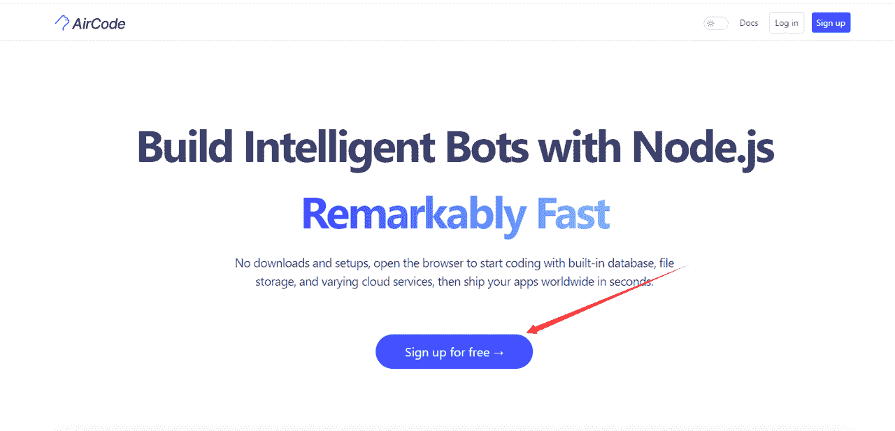
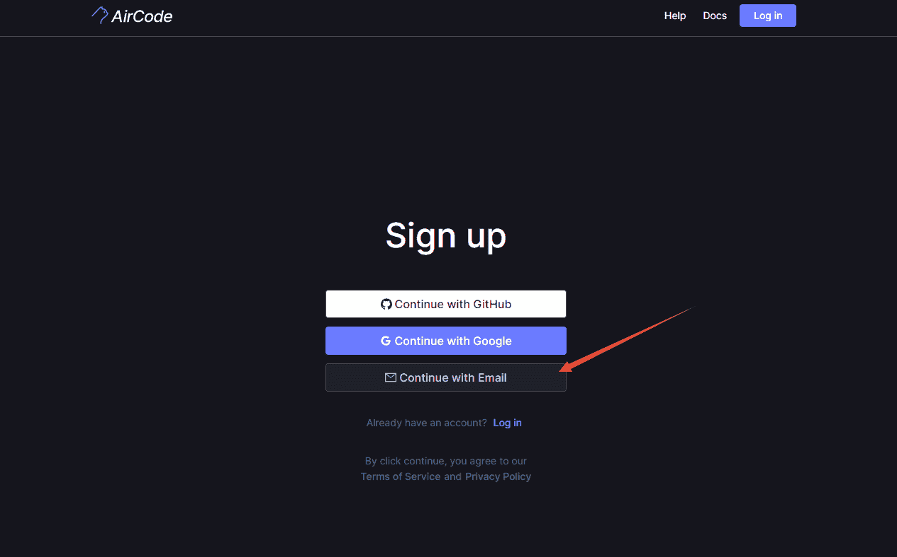
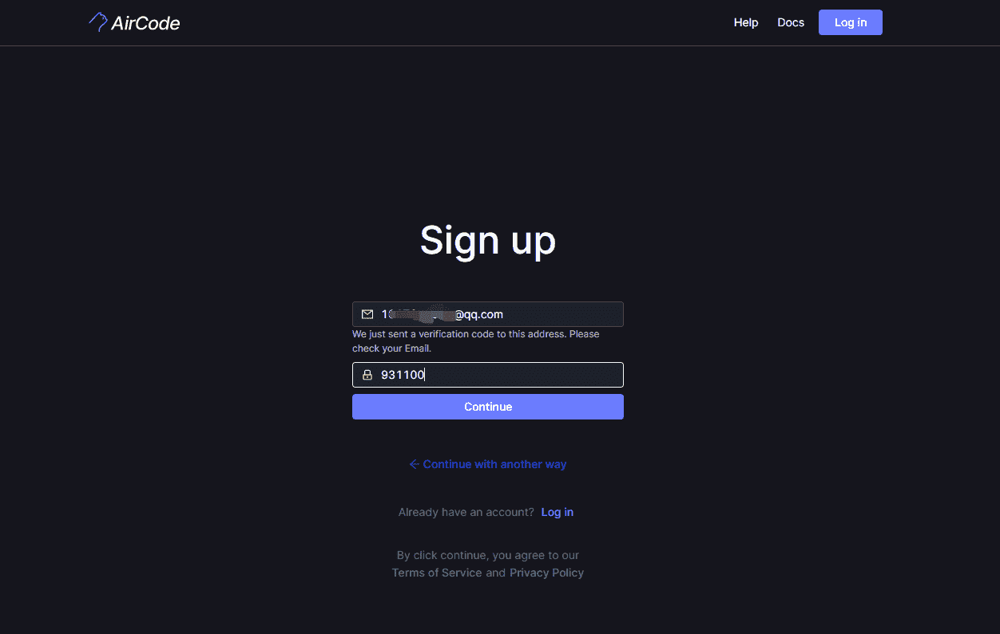
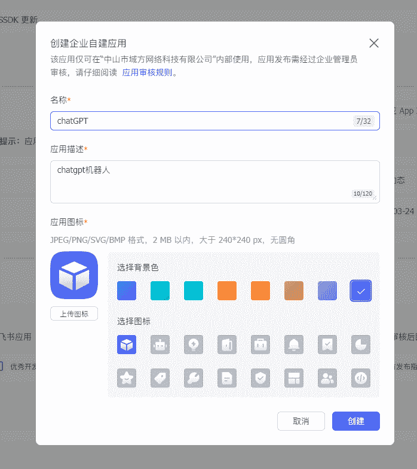
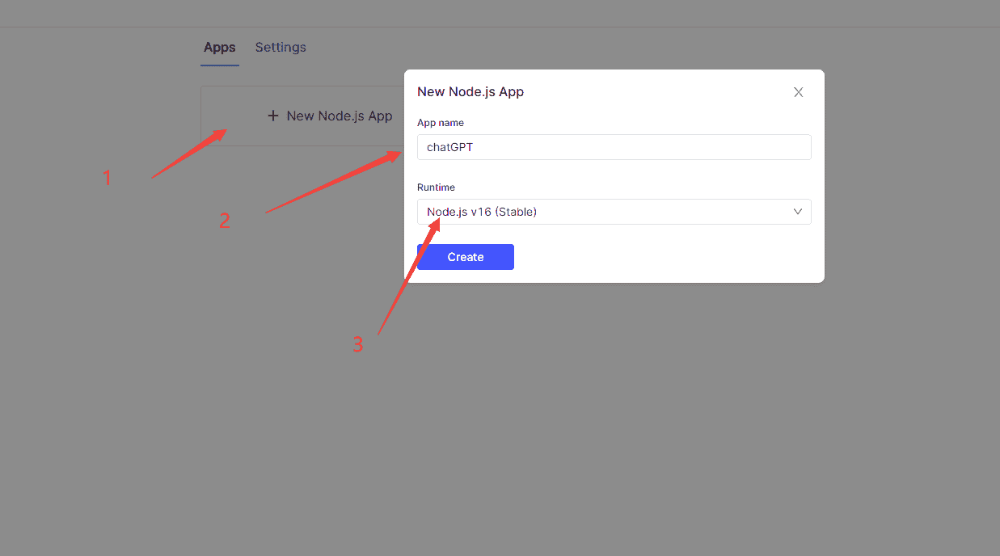
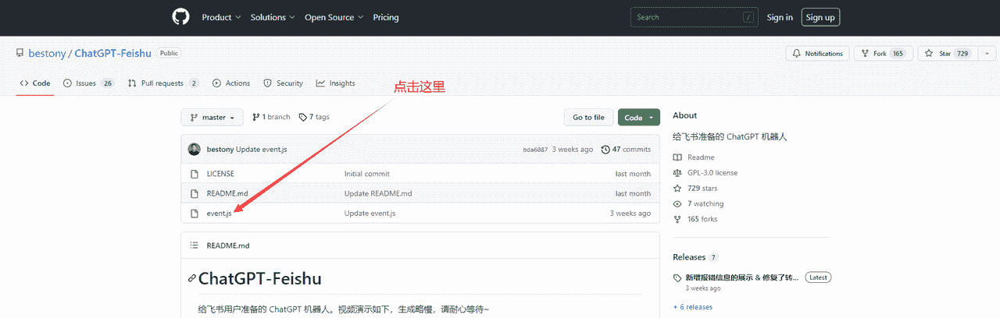
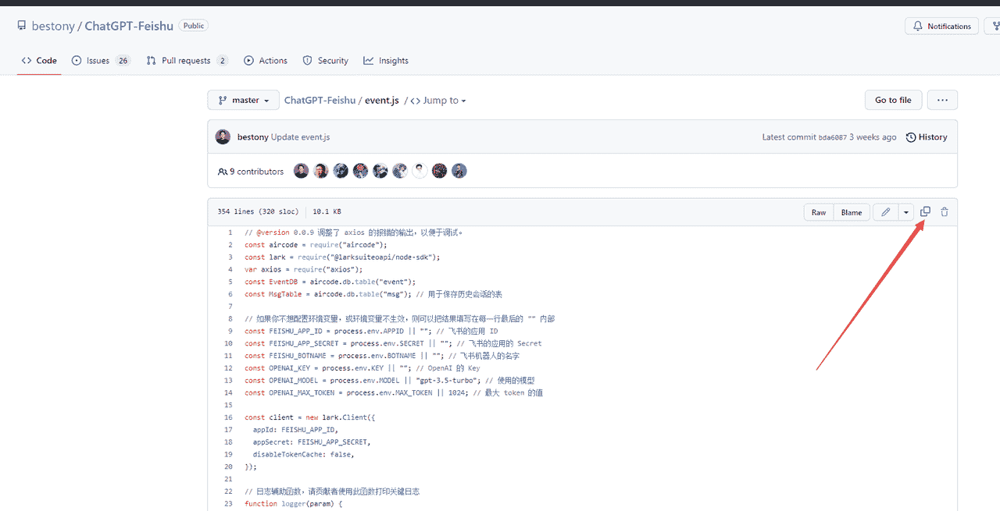

# ChatGPT 接入飞书教程，创建自己的聊天机器人（保姆级教程）

> 来源：[https://xmgtoagi.feishu.cn/docx/RsgMdvKYfozGLNxNcQScDJ2cnRg](https://xmgtoagi.feishu.cn/docx/RsgMdvKYfozGLNxNcQScDJ2cnRg)

首先，准备三个账号：ChatGPT账号、飞书账号和Aircode账号。

飞书账号请自行注册，访问链接 https://www.feishu.cn/ 即可登录。

Aircode账号注册方式如下：访问网站 https://aircode.io/ ，点击页面上的“免费注册”按钮，填写表单并选择相应的选项即可。

然后选择邮箱注册。

然后输入邮箱，下一步。然后等几秒，邮箱会收到验证码，验证一下就完成注册了。

重点来了！接下来讲搭建教程。

# 第一步，飞书进入开发者平台。点击创建应用。

填写应用名称和描述，还有头像也可以自己修改。

然后点击左边的添加应用，添加机器人。

# 第二步，打开Aircode，点击创建应用，上面输入名字，下面选择Node.js v16.

创建后页面会有一些代码，我们全选，然后把他删除掉，然后打开下面的源码地址，进去复制代码。

源码地址：[https://github.com/be](https://github.com/bestony/ChatGPT-Feishu)stony/ChatGPT-Feishu

复制代码之后粘贴到Aircode，然后点击Deploy。输入一些日志变更。

等几秒钟布署，下面出现这行代码，或者右侧这里也出现描述则表示完成布署。

然后在左下角这里搜索 axios和 @larksuiteoapi/node-sdk   然后进行安装，等一会安装完成后再点击Deploy进行布署。

#  第三步，配置环境，点击Environments，创建四个变量，全部要大写。

APPID 、SECRET 、 BOTNAME、KEY

KEY，是 OpenAI 的 KEY

[打开这个链接，然后登陆你ChatGPT账号  h](https://platform.openai.com/account/api-keys)ttps://platform.openai.com/account/api-keys

登陆后点击这里创建，然后复制回去Aircode粘贴。

全部粘贴后，点击Deploy进行布署。

布署完成之后，点击复制这个网站，然后打开，看看是否配置成功。

成功之后，打开飞书，配置一下权限，以下6个都要开，有些人账号不一样，某些权限要审核。

im:message

im:message.group_at_msg

im:message.group_at_msg:readonly

im:message.p2p_msg

im:message.p2p_msg:readonly

im:message:send_as_bot

开启之后，再返回AirCode ，复制函数的调用地址，然后再返回飞书，点击事件订阅，把网址粘贴到配置地址。

然后点击添加事件，找到 消息与群组，选择接收消息v2.0，添加即可。

然后打开版本管理与发布，创建版本，输入版本号，还有输入刚刚Aircode的调试地址，点击保存，然后点击右上角申请发布即可。我这里已经申请了，所以变成了撤回。

然后你的飞书就会收到消息，点击进入管理后台审核，通过就可以了。

审核用过后，打开应用，你就可以使用你的ChatGPT机器人了。

