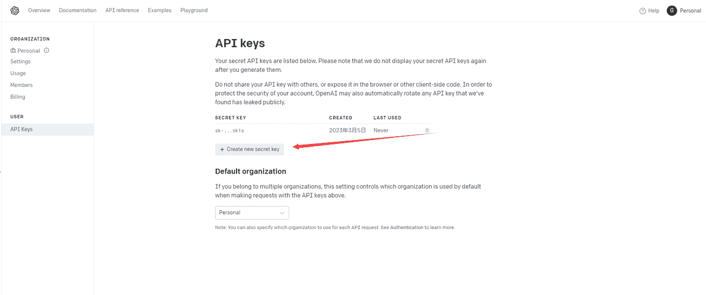
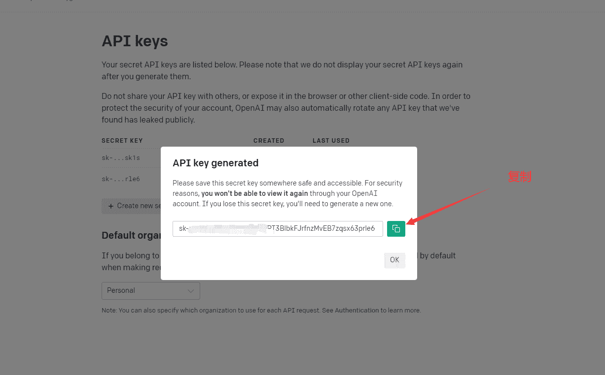
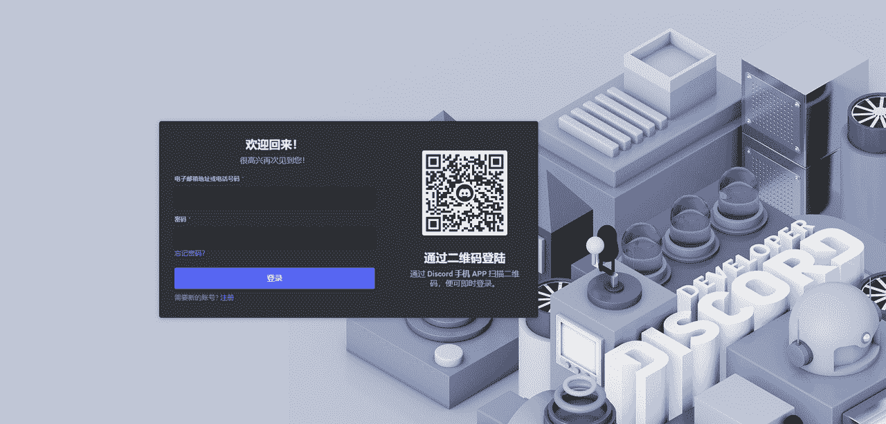
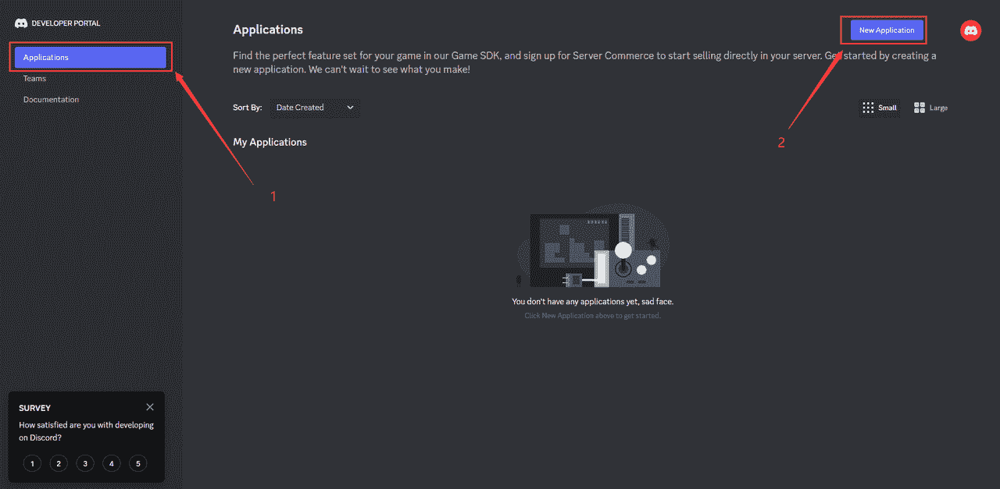
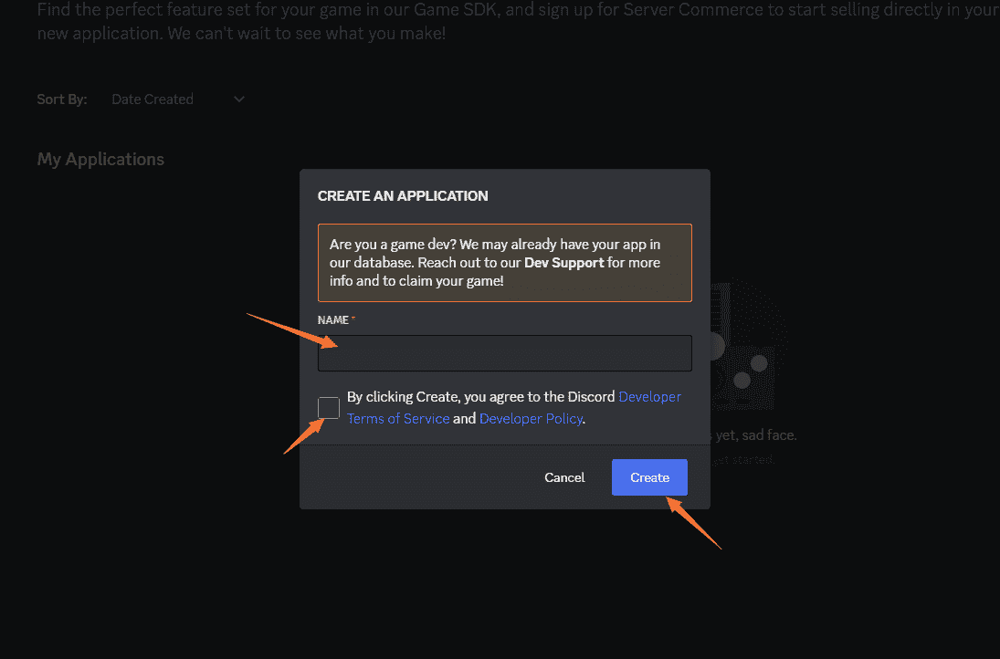
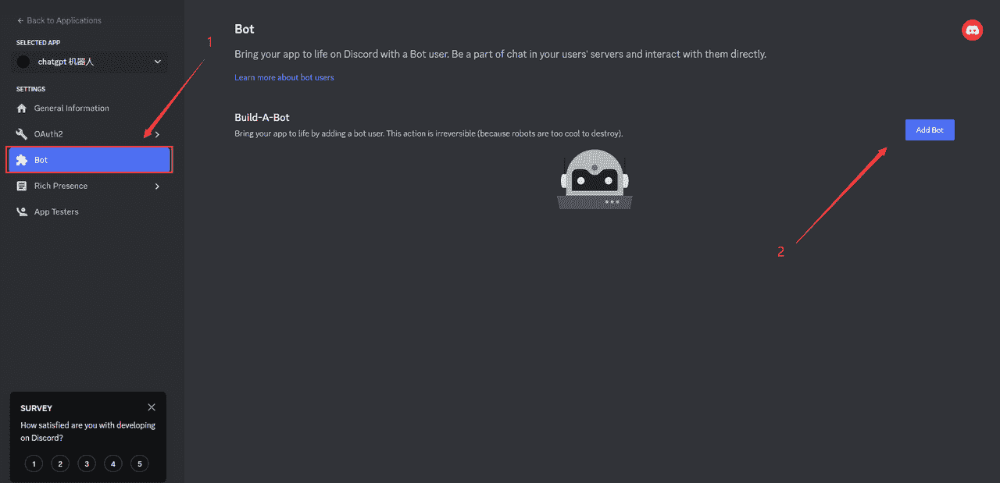

# ChatGPT与Discord无缝接入指南（保姆级教程）

> 来源：[https://xmgtoagi.feishu.cn/docx/KFdCdkiBHoEmvFx2f7kcwNAbnpg](https://xmgtoagi.feishu.cn/docx/KFdCdkiBHoEmvFx2f7kcwNAbnpg)

ChatGPT和Discord都非常流行，而在Discord内使用AI绘画也很受欢迎。如何将ChatGPT与Discord对接，在Discord内实现一个聊天机器人。

## 第一步：获取OpenAI API密钥。请按照以下步骤操作：

1.  打开此链接 [https://platform.openai.](https://platform.openai.com/account/api-keys)com/account/api-keys

1.  请按照页面上的提示进行身份验证，然后登录您的ChatGPT账号。

1.  点击“这里创建”以创建一个新的API密钥。

1.  复制生成的API密钥以备将来使用。

## 第二步：获取Discord Token。请按照以下步骤操作：

1.  打开网站[https://discord.com/dev](https://discord.com/developers/applications)elopers/applications

1.  登录您的Discord账号。

1.  点击右上角的“New Application”按钮创建一个新的应用程序。

1.  在新页面上，输入您的应用程序名称，并点击“Create”按钮。

1.  选择“Bot”选项卡，并点击“Add Bot”按钮，然后点击“Yes, do it!”以确认添加机器人。

创建完机器人之后，可以编辑一些资料，比如头像、名字，还有各种权限。

T**oken 这里可能**是查看令牌 View Token 或者是重置令牌 Reset Token 的按鈕，点击一些就，复制令牌出来备用。

1.  往下拉，找到MESSAGE CONTENT INTENT，打开，然后点击Save Change。

1.  然后设置OAuth2。按照下图步骤设置。

1.  然后点击复制链接，浏览器打开。

1.  然后选择要加入的服务器。

请注意，您的Discord Token是私密信息，请勿与他人分享。

## 第三步：注册GitHub，有账号的可以直接登录。

无账号注册，有账号跳过以下步骤，直接登录即可：

1.  打开网站https://github.com/

1.  如果您已经拥有GitHub账号，请在右上角登录。否则，请单击右上角的“Sign up”按钮创建一个新账号。

1.  在新页面上，输入您的用户名、电子邮件地址和密码，并完成验证过程。

1.  点击“Create account”按钮以创建您的GitHub账号。

**请注意，您的GitHub账号可以让您**与其他开发者协作，并分享您的代码和项目。

注册/登录，然后请按照以下步骤操作：

1.  打开网站[h](https://github.com/TheExplainthis/ChatGPT-Discord-Bot)ttps://github.com/TheExplainthis/ChatGPT-Discord-Bot。

1.  点击页面右上角的“Fork”按钮，以将该项目复制到您的GitHub账号下的存储库中。

**请**注意，在Forking存储库后，您将在自己的账号下创建一个新的存储库副本，您可以在其中进行更改，而不会影响原始存储库。

## **第四步：****在线开发环境搭建Replit：****请按照以下步骤操作**

**请**注意，Replit是一个在线开发环境，它可以让您在浏览器中编写、运行和分享代码，而无需安装本地开发环境。

1.  打开网站https://replit.com/

1.  点击页面右上角的“Sign Up”按钮，用github直接授权登录即可。

1.  登录之后，选择一下基本的东西。

1.  进入首页之后点击创建Repi

1.  跳出选择框之后，选择右上角这个Import from Github。

1.  然后再点击这个Connect GitHub to import your private repos，

1.  弹出这个页面，根据下图一样，选择好了就安装。

1.  然后返回这个页面，可以选择刚刚安装的代码了。

1.  安装需要一段时间，安装完成之后跳过教程。

1.  跳过了，点击右侧的tools，然后在里面找到Secrets，再点击右边的Got it。

1.  然后会弹出一个框，key：OPENAI_API，  value填写你的 openai  key，sk开头的

1.  然后继续添加，key:OPENAI_MODEL_ENGINE      value:gpt-3.5-turbo

1.  继续添加，key:SYSTEM_MESSAGE      value:You are a helpful assistant.

1.  再添加最后一个。key:DISCORD_TOKEN      value:  前面Discord的令牌 MTA开头的。

1.  添加完四个之后，点击上面的Run 运行。

1.  运行等一会，成功之后右边会出现有Hel**lo. I am alive!** 的页面，然后我们复制上面的地址出来备用。有效时间一小时，后面的步骤需要一小时内完成。

## 第五步：注册cron-job.org。请按照以下步骤操作：

**请注意，****cron-job.org**是一个在线计划任务管理工具，它可以让您定期运行代码和脚本。

1.  注册如下，如有账号可跳过：

打开网站https://cron-job.org/en/

如果您已经拥有账号，请在页面右上角登录。否则，请单击页面右上角的“Sign Up”按钮创建一个新账号。

在新页面上，输入您的用户名、电子邮件地址和密码，并完成验证过程。

点击“Create Account”按钮以创建您的cron-job.org账号。

1.  登录之后，点击右边的CREATE CRONJOB。

1.  Title输入ChatGPT-Discord-Bot，网址输入上一步的网址，选择五分钟，然后点击CREATE 创建。

注意：输入的网址不要含有s,否则定时任务会运行失败。

以上步骤完成搭建，然后打开Discord，你就能看到ChatGPT机器人在线了。

/chat        在输入框直接输入会后/chat直接message输入文字，机器人就会回复了。

/reset        ChatGPT 会记住前十次的提问记录，调用此指令则会清除。

/imagine        在输入框输入/imagine会prompt后直接输入文字，可以生成图片。