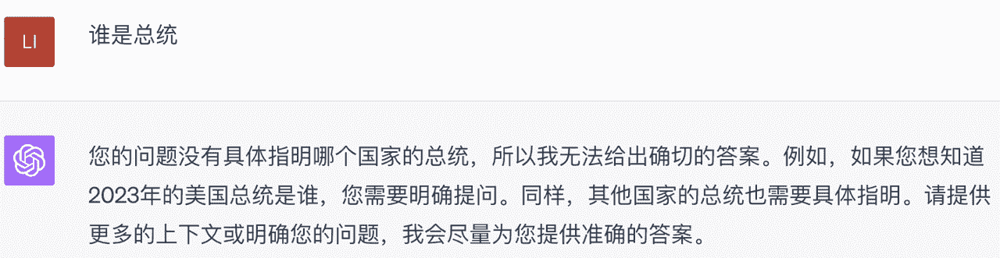

# ChatGPT最佳实践案例

> 来源：[https://xmgtoagi.feishu.cn/docx/Q52adxdtKoZrUBxZcg2cVmJRnPc](https://xmgtoagi.feishu.cn/docx/Q52adxdtKoZrUBxZcg2cVmJRnPc)

+   **本文作者**：耙耳朵的光 （👸号 耙耳朵的光）创作

## 编者按

+   该指南是提高 ChatGPT 模型表现的最佳实践策略和技巧，并提供翔实的案例便于新入门的朋友理解

+   这里描述的策略和技巧有时可以组合使用以达到更好的效果

+   建议您使用 GPT-4 上对相关策略和技巧进行尝试，愿您发掘出您需要的使用方案

+   本文主要参考 OpenAI 官方文[万字解读ChatGPT提示词最佳实践](https://sif8f6uboze.feishu.cn/docx/H2C2devTSoZBRUx1m6YcOoFynuh)最佳实践文档 以及@熊猫JAY的

## 提示词里的三种角色

> 本文的最佳实践案例中，和 GPT 的对话会涉及到三种角色，一般分为，

+   USER 就是您本人

+   ASSISTANT 是 GPT

+   SYSTEM 是系统，正常情况不出现

+   大多数情况下，在对话框里您只会看到 USER 和 ASSISTANT 在 balabala...


##  ChatGPT 提示词最佳实践——六大策略及对比案例

> 学习指南

+   首先逐步了解每个策略

+   形成对策略的初步认识或疑问

+   带着您的认识或问题去看案例

+   看完案例还有疑问再请教他人

### **策略一：清晰地表达提示词**

> **我们通过对话框和 GPT 互动，所以我们文字表达清晰、好**坏程度决定了 GPT 产出文本结果的优劣

> 如果 GPT 回复过长，我们可以明确要求简洁答案

> 如果觉得答案过于基础，我们可以要求更深入、专家级的回答

> 如果您对输出的格式有特定要求，直接展示您想要的格式

> GPT 模型对您的需求理解得越清晰，为您提供满意答案的几率就越高

请务必先掌握该部分的策略和技巧，帮您快速入门：

1.  详细描述您的问题

> 描述越清晰，您得到的答案越符合您的预期

1.  让 GPT 扮演一个角色

> 您给它什么身份，它就用该身份的思维定势去思考决策

1.  用分隔符区分不同的输入内容

> 更方便 GPT 阅读和理解，您自己也不想看长篇累牍一坨吧...

1.  列出任务步骤

> 很重要，学会让 GPT 一步接一步的干活

1.  提供示例

> 您说个 123 ， GPT 就照您说的 123 来输出

1.  指定输出的长度

> 精确字数虽然做不到，但您可以指定文章结构、段落啥的...

#### 技巧一：细节法（在查询中包含更多细节以获取更相关的回答）

> 适用人群：新手

> 难度：★

为了获得与我们提问高度相关的回复，我们需要给模型提供任何重要的细节或上下文，否则，GPT 就会猜测您的意图，从而导致结果不尽如人意。

优质提问到底优在哪里？

1.  详细性：优质提问 提供了更为详细的描述和需求。例如，第一组只提到了“如何将 Excel 中的数字相加求和”，而优质提问则明确指出了“在 Excel 中将一列美元金额相加”并且详细描述了求和的位置和列名。

1.  具体性：优质提问 更为具体，它不仅仅是提出一个问题，还给出了具体的背景和要求。例如，优质提问关于斐波那契数列的问题明确要求使用 TypeScript 编写，并要求添加注释。

1.  结构性：优质提问 的结构更为清晰，它将需求分为了多个部分。例如，关于会议纪要的问题，优质提问不仅要求总结成一个段落，还要求使用 Markdown 列表形式列出与会者的名称和观点，以及后续的行动事项。

1.  上下文信息：优质提问 提供了更多的上下文信息，这有助于更好地理解和回答问题。例如，关于墨西哥总统的问题，优质提问明确提到了“ 2021 年”并询问选举的频率。

1.  指导性：优质提问 更具指导性，它为回答者提供了明确的方向和期望。例如，关于编写斐波那契数列的代码，优质提问明确要求“高效计算”并“添加大量注释”。

接下来，我们直接上手在 GPT-4 进行对比测试：

**不使用细节法提问**——谁是总统？



**使用细节法提问**—— 2021 年墨西哥总统是谁，选举多久举行一次？


明显看得出，GPT 给出的回答质量有着天壤之别。

我们再举一个生活中的例子：

+   您去图书馆找一本书。您跟图书管理员说：“我想要一本书。”图书管理员可能会很困惑，因为图书馆里有成千上万的书。您并没有说明您想要哪一本书，关于什么内容，或者为什么目的。

+   而这次您跟图书管理员说：“我想找一本关于恐龙的书，因为我要写一个关于侏罗纪时期恐龙的作文。”现在，图书管理员知道您的具体需求，她可以快速地为您找到最合适的书。

这就是为什么“优质提问”更好的原因。

优质的问题通常更具体、更明确，它告诉对方您真正想要知道什么。这样，对方可以为您提供更准确、更有帮助的答案。

##### **总结**

这个策略的价值在于，通过提供更多的详细信息，用户可以获得更准确、更具体的答案。这样可以减少模型的猜测

和误解，从而提高交互的效率和满意度。

---

#### 技巧二：角色法（要求 GPT 扮演特定的角色）

> 适用人群：新手

> 难度：★

GPT 有没有被赋予扮演的角色，生成的结果有时天差地别

接下来，我们直接上手在 GPT-4 进行对比测试：

**不使用角色法提问——**中医流传很多年，证明中医是有用的


**使用角色法提问：**

> 人设：逻辑教练，要在我给出的命题当中发现逻辑错误

> 提问：请扮演一个逻辑教练，帮我发现以下命题的逻辑错误，挑出逻辑漏洞，我的第一个命题是：中医流传很多年， 证明中医是有用的


##### 总结

当我们给 GPT 指定角色，模型的回答将会根据所采纳的角角色特性来进行，使得回答更具特色和针对性，输

出的质量也会随之提升。

---

#### 技巧三：格式法（使用分隔符清楚标示输入的不同部分）

> 适用人群：新手

> 难度：★

像三重引号、XML标记、标题等分隔符可以帮助标记需要不同方式处理的文本部分。

对于简单的任务，使用分隔符可能不会影响输出质量。然而，当任务越复杂，明确任务细节就越重要。不要让 GPT 模型费劲巴拉去理解我们到底要它什么。

怎么判断什么时候应该去分隔处理呢？

> 如果您自己看的都心烦意乱，容易有误解的时候，GPT 也是跟您一样“头大”的。

接下来，我们直接上手在 GPT-4 进行对比测试：

> 在2050年的某个未来城市，太阳能和风能发电系统成为了主要的能源供应方式。因为气候变化和海平面上升，陆地面积大幅减少，导致陆地上的房地产价格暴涨。人们转而开始建设大型的浮动岛屿作为新的居住区，这些岛屿的中心设有一座小型核反应堆作为应急电源。海洋的藻类不仅成为了人们的主要食物来源，还被用于生产生物燃料。随着这些变化，大量的人口从陆地迁移到了这些浮动岛屿。浮动岛屿的结构和材料选择需要考虑到它们在海上的稳定性。而藻类作为主食的营养价值和可能的挑战也开始受到关注。在这种新的环境下，社会和经济的结构也经历了巨大的变化。

让 GPT 对以上材料解读，**不使用格式法**——给我解读这个材料...


**使用格式法：**


对比而言，使用技巧提问的输出显得更加全面合理。

##### 总结

想象一下，您正在组装一款复杂的玩具，但所有的零件都混在一起，没有任何标签或说明。这会让组装过程变得非

常困难，对吧?

同样，当模型处理一个复杂的输入时，如果没有清晰的分隔符来区分不同的部分，模型可能会混淆或误解某些内

容。使用分隔符就像给玩具零件加上标签和说明，使组装过程变得更加流畅和准确。

---

#### 技巧四：步骤法（指定完成任务所需的步骤）

> 适用人群：新手

> 难度：★

有些任务最好用一系列步骤来表达，因为明确写出步骤可以让模型更容易执行。

```
SYSTEM
使用以下步骤来回应用户输入。
步骤1 - 用户将用三重引号提供给您文本。用前缀&quot;Summary：&quot;对这段文本进行一句总结。
步骤2 - 将步骤1中的总结翻译成西班牙语，并使用前缀&quot;Translation： &quot;。
```


接下来，我们直接上手在 GPT-4 进行对比测试：

**不使用步骤法：**


**使用步骤法：**


##### 总结

当我们提供固定的步骤，要求模型提供输出，这样模型可以参考步骤更好地输出内容。

---

#### **技巧五：举例法（提供示例）**

> 适用人群：新手

> 难度：★

通常情况下，我们不需要提供示例。但在某些情况下，提供示例可能对输出更有帮助。例如，如果您打算让模型复制一种难以描述的文风。此时您给出的示例会被称为 " few-shot " 。

我们直接上手在 GPT-4 进行对比测试：

**不使用举例法：**


**使用举例法：**


##### 总结

如果您问 GPT 一些类似于文风的问题，模型懵醒醒不懂您要干嘛，这时候您给个示例就事半功倍啦~

---

#### 技巧六：指定字数法（指定期望的输出长度）

> 适用人群：新手

> 难度：★

+   您可以要求模型生成特定目标长度的输出

+   目标输出长度可以以单词数、句子数、段落数、项目符号数等来指定

+   但是，指示模型生成特定数量的单词不能高精度实现

+   模型可以更可靠地生成特定段落数或项目符号数的输出

上手 GPT-4 进行对比测试：

**不使用指定字数法：**


**使用指定字数法：**


##### 总结

虽然 GPT 经常分不清字数，但您让它分段这种要求还是可以去尝试做一下的。

### **策略二：提供参考文本**

GPT 在处理某些深奥的话题或被要求提供引用和链接时，可能会编造虚假的答案。正如学生在考试前通过复习参考笔记能够更好地答题，为 GPT 提供参考资料也能帮助它更准确地回答，减少虚构内容。

**技巧：**

1.  指示模型使用提供的参考文本进行回答

1.  指示模型使用参考文本中的引文进行回答

#### 技巧一：指定文本法（指示模型使用参考文本进行回答）

> 适用人群：新手

> 难度：★

如果我们能为模型提供与当前查询相关的可信信息，那么我们可以指示模型使用提供的信息来组成其回答。

鉴于 GPT 模型具有有限的上下文窗口，为了应用此技巧，我们需要某种方法根据问题动态查找相关信息并添加到模型输入中。

```
SYSTEM
使用由三重引号分隔的所提供的文章来回答问题。如果答案在文章中找不到，写下&quot;I could not find an answer.&quot;

USER
&lt;插入文章，每篇文章由三重引号分隔&gt;

问题：&lt;插入问题&gt;

```

上手 GPT-4 对比测试：

**不使用指定文本法：**


**使用指定文本法：**


##### 总结

最大的好处是**减少错误**：因为模型可能会**幻觉**从而发明答案，尤其是当被问及一些偏门的话题或需要引用

**和URL**时。通过提供参考文本，我们可以减少模型发明答案的可能能性。

---

#### 技巧二：指定引文法（指示模型使用参考文本中的引文进行回答）

> 适用人群：新手

> 难度：★

如果输入补充了相关知识，则可以轻松要求模型在答案中添加引文，引用提供文档的相关段落。输出中的引文然后可以通过与提供文档的字符串匹配来程序化验证。

```
SYSTEM​ 
您将得到一个由三重引号分隔的文档和一个问题。
您的任务是只使用提供的文档来回答问题，并引用用来回答问题的文档段落。
如果文档不包含回答此问题所需的信息，那么只需写下：“信息不足”。
如果提供了问题的答案，必须用引文进行注释。使用以下格式引用相关段落 ({&quot;citation&quot;： …})。​ ​ 

USER​ 
&quot;&quot;&quot;&lt;插入文档&gt;&quot;&quot;&quot;​ ​ 

问题：&lt;插入问题&gt;
```

上手对比测试：

**不使用指定引文法：**


**使用指定引文法：**


##### 总结

同上。

---

### 策略三：将复杂任务分解为简单的子任务

就像我们在编程时喜欢把大问题拆分成小模块来处理，给 GPT 提问题时也理应如此。

大而复杂的问题容易出错，而小问题更容易处理。

更进一步说，一个复杂的问题可以看作一系列小问题的组合，前一个问题的答案往往可以帮助解决之后的问题。

**技巧：**

1.  使用意图分类来识别用户查询的最相关指令

1.  对于需要非常长对话的对话应用程序，总结或过滤以前的对据

1.  逐段概括长文档并递归构建完整概要

#### 技巧一：使用意图分类识别与用户查询最相关的指令

> 适用人群：新手、熟练者

> 难度：★★

当处理不同情况的任务时，可以先将任务按类型分类，然后为每种类型设计特定的步骤，就像做菜一样有食谱。

复杂任务可以分解成小阶段，每个阶段也有自己的提示词，这样整个处理过程更有组织和效率。

假设，例如对于客户服务应用，查询可能被有用地分类如下：

```
您将得到客户服务查询。将每个查询分类为主要类别和次要类别。以json格式提供您的输出，包含主要和次要两个关键字。

主要类别：计费，技术支持，账户管理，或一般咨询。

计费次要类别：
- 退订或升级
- 添加付款方式
- 收费解释
- 争议收费

技术支持次要类别：
- 故障排除
- 设备兼容性
- 软件更新

账户管理次要类别：
- 密码重置
- 更新个人信息
- 关闭账户
- 账户安全

一般咨询次要类别：
- 产品信息
- 价格
- 反馈
- 要求与人对话
```

基于查询的分类，可以向 GPT 模型提供一组更具体的指令来处理下一步。例如，假设客户需要帮助"故障排除"

```
SYSTEM​ 
您将得到需要在技术支持环境中进行故障排除的客户服务查询。通过以下方式帮助用户：

 - 让他们检查到/从路由器的所有电缆是否已连接。注意，电缆随着时间的推移会常常松动。
 - 如果所有电缆都已连接并且问题仍然存在，询问他们正在使用哪种路由器模型​ 
 - 现在您将建议他们如何重新启动他们的设备：​ 
 -- 如果型号是MTD-327J，建议他们按下红色按钮并保持5秒钟，然后等待5分钟后再测试连接。​ 
 -- 如果型号是MTD-327S，建议他们拔掉并重新插入，然后等待5分钟后再测试连接。​ 
 - 如果客户在重启设备并等待5分钟后的问题仍然存在，通过输出{&quot;IT support requested&quot;}将他们连接到IT支持。​ 
 - 如果用户开始提问与此主题无关的问题，那么请确认他们是否希望结束当前关于故障排除的聊天，并根据以下方案对他们的请求进行分类：​ ​ 
 
 &lt;插入上述主/次分类方案&gt;​ ​ 
 
 USER​ 
 我需要让我的互联网再次工作。
```

请注意，已经指示模型在会话状态改变时发出特殊的字符串。这使我们能够将我们的系统转变为状态机，其中状态

决定哪些指令被注入。通过跟踪状态，什么指令在那个状态下是相关的，以及从那个状态允许什么状态转换，我们

可以在用户体验周围设置保护，这在一种不太结构化的方法中很难实现。

简单来说，就是先理解用户的真实需求，然后根据这个需求提供最合适的答案或操作。这种方法特别适用于那些需

要多种独立指令来处理不同情况的任务。通过首先分类查询的类型，并使用该分类来确定所需的指令，可以更有效

地为用户提供他们真正需要的信息或服务。

> 如下为测试过程的对话：

> https：//sharegpt.com/c/Y6j83cX

##### 总结

这种方法的优点是每个查询只包含执行任务的下一阶段所需的提示词，这可能导致比使用单个查询执行整个任务

时的错误率更低。这也可能导致成本更低，因为更大的运行成本更高。（这里的成本针对使用 API 的小伙伴们）

---

#### 技巧二：对需要非常长对话的对话应用程序，汇总或过滤之前的对话

> 适用人群：熟练者、程序开发人员

> 难度：★★

由于 GPT 具有固定的上下文长度，因此整个对话包含上下文窗口内的用户与助手之间的对话无法无限期地继续.

这一问题有多种解决方法，一种是在输入大小达到预定阈值长度时，使用一个查询来总结对话的一部分，并将之前对话的摘要包含在系统消息中。或者，可以在整个对话的过程中异步地在后台总结之前的对话。

另一种解决方案是动态选择与当前查询最相关的之前对话部分。请参阅技巧“使用基于嵌入的搜索实现高效知识检索”。

> 想象一个案例：

+   在线医疗咨询应用，用户可能会描述他们的症状、过去的医疗历史、药物使用等

+   随着对话的进行，这些信息可能会变得非常多

+   但是，当用户提到一个新的症在状或问题时，模型需要记住之前的所有相关信息来提供准确的建

+   在这种情况下，对之前的对话进行总结或筛选，只保留与当前问题最相关的信息，可以帮助模型更好地理解和回应用户的需求

如下为案例模拟对话数据：

```
- 用户：我最近总是感到头痛。​ 

- ChatGPT：您的头痛是突然发生的还是已经有一段时间了？您还有其他的症状吗？​ ​ 

- 用户：已经有两个星期了，而且我还伴随着恶心。​ 

- ChatGPT：您最近有没有服用任何药物或者有其他的医疗历史？​ ​ 

- 用户：我有高血压，正在吃降压药。​ 

- ChatGPT：了解了。您的头痛和恶心可能与您的高血压或降压药有关。建议您咨询医生并检查一下。​ ​ 

- [对话继续]​ ​ 当对话达到一定长度后：​ ​ 

- 用户：我还想知道头痛的其他可能原因。​ 

- ChatGPT（在内部对之前的对话进行总结）：您之前提到有高血压并正在服用降压药，伴随头痛和恶心。除了高血压和药物反应，头痛的其他可能原因包括：应激、缺乏睡眠、饮食不当等
```

##### 总结

这样，即使在长对话中， ChatGPT 也能够准确地回应用户的问题，同时考虑到之前的对话内容。

---

#### 技巧三：分段汇总长文档，递归构建完整汇总

> 适用人群：熟练者

> 难度：★★

简单来说，就是 GPT 这样的模型在处理文本时有个限制，就是是它们只能看到一定长度的文字，超过这个长度就看不到了。如果要总结一个超长的文档，比如一本书，就需要分段进行。每个段落可以作为一个查询来总结，然后这些段落的总结再连接在一起，形成整体的总结。这个过程可以重重复进行，直到整本书都被总结完。

如果后面的内容需要前面的内容作为背景才能理解，那么在总总结后面部分的时候，可以在查询中包含之前已经总结过的内容，这样可以帮助模型更好地理解整个文档。OpenAI 之前t也研究过使用 GPT-3 的变种来进行这种汇总长文的方法，效果还不错。

##### 总结

通过通俗化的翻译，已经将该策略解释的相对比较清晰，所以这里不再过多整述。我们来看下一个案例，就可以理

解它的应用场景：

假设您有一本关于人工智能历史的 300 页书，您想要一个简短的摘要。由于这本书的长度远远超过了模型的上下文

的 token 限制，您可以首先将书分为章节，并为每一章生成一个摘要。接下来，您可以将这些章节摘要连接起来，

并再次为它们生成一个摘要，得到整本书的总摘要。如果某些章节之间有关联或依赖关系，您可以在总结后续章节

时包括前面章节的摘要，以确保摘要的准确性和连贯性。

> token 是什么，是一个字的意思吗?有些小伙伴开始可能还不明白，由于篇幅限制，我简单解释下：

> Token 是文本数据的基本单元，可能代表一个字、词、标点或句子，不同模型中token代表的内容会有细微区别。

> 如 Claude-2-100k 模型上限为 100，000 个 Token 。

> ChatGPT-16k 模型的上下文上限是 16 kTokens，也就是 106000 个 token 。

> ChatGPT-4-32k 模型的上下文上限是 32kTokens，也就是 32000 个 token 。

> 达到上限后，模型会"遗忘"早期的对话内容。

> 在模型如 Transformer 中，文本首先被切分为 Tokens ，然后被转化为向量，供神经网络处理。说人话就是，我们输

> 入的文字会被转化成一个一个 token ，大模型在词语接龙般处理后，输出的也是一个一个 token 。

---

### 策略四：给予 GPT “思考” 的时间

如果有人突然问您 17 乘以 28 是多少，您或许无法立刻回答，但倘若给您一些时间，您仍可计算出正确的答案。

同样地，GPT 在立刻回答问题时更容易犯错，而如果给它一些时间去思考，它的答案会更准确。

让 GPT 提供更多的推理过程而非直接提供答案，将有助于提升答案的准确性。

**技巧：**

1.  指示模型在得出结论之前自行解决问题

1.  使用内心独白或一系列查询来隐藏模型的推理过程

1.  询问模型是否在之前的处理中漏掉了任何内容

#### 技巧一：指示模型在匆忙得出结论之前自己推导出解决方案

> 适用人群：熟练者、程序开发人员

> 难度：★★

有时候明确地让模型先自行推理出答案再回复用户，可以获得更好的效果。

例如，我们想让模型评判一个学生对数学问题的解答。 最直接的方法是简单地询问模型该解答是否正确。

但如果我们首先让模型自己解出题目并生成答案，再让其比较学生的答案，就更容易发现问题：

```
SYSTEM
首先自己解出这道题并生成答案。然后再比较您的答案和学生的答案，判断学生的答案是否正确。在比较之前，不要依赖学生的答案来决定其是否正确。

USER
&lt;插入题目&gt;
&lt;插入学生答案&gt;

ASSISTANT
&lt;模型先生成自己的答案&gt; 
&lt;模型比较两个答案并作出评价&gt;
```

测试：

```
SYSTEM​ 
判断学生的解答是否正确​ ​ 

USER​ 
问题描述：我正在建造一个太阳能发电装置，我需要帮助计算财务状况。​
- 土地费用为每平方英尺 100 美元​ 
- 我可以以每平方英尺 250 美元的价格购买太阳能板​ 
- 我已经商定了一个每年固定费用为 10 万美元的维护合同，以及每平方英尺额外的 10 美元​ 第一年运营的总成本是多少，作为面积（平方英尺）的函数来表示

学生的解答：设 x 为装置的面积（平方英尺）。
1. 土地费用：100x​ 
2. 太阳能板费用：250x​ 
3. 维护费用：100，000 + 100x​ 
总成本：100x + 250x + 100，000 + 100x = 450x + 100，000​ ​ 

ASSISTANT​ 
&lt;模型先生成自己的答案&gt; 
&lt;模型比较两个答案并作出评价&gt;
```


##### 总结

从测试数据中可以看出，学生先提供答案后，模型自己生成答答案并进行对比得到最终的结论，这样的准确性也更

高。

因此，我们向模型提出一些复杂的计算问题时，可以让模型先进行深入的思考和推理得出它的答案，再对比我们

准备的的答案，这是一种提高此类场景正确性的小技巧。

---

#### 技巧二：使用内心独白或一系列查询来隐藏模型的推理过程

> 适用人群：熟练者、开发人员

> 难度：★★★

前一个策略表明，模型有时需要在回答特定问题之前详细地推理一个问题。对于某些应用程序，模型用来得出最终答案的推理过程是不适合与用户分享的。

例如，在辅导类 app 中，我们可能希望鼓励学生自己找出答案，但是模型对学生解答的推理过程可能会向学生透露答案。

内心独白是一种可以用来解决这个问题的策略。

使用内心独白的目的是，指导模型将那些应该对用户隐藏的输出部分放入一种结构化的格式中，使其易于解析。然后，在向用户呈现输出之前，解析输出并只使部分输出可见。

```
SYSTEM​ 
按照以下步骤回答用户的查询，以询问用户提供问题开始
​ 
步骤 1 - 首先自己解决问题。不要依赖学生的解答，因为它可能是错误的。将此步骤的所有工作都包含在三引号（&quot;&quot;&quot;）中​ ​ 
步骤 2 - 将您的解答与学生的解答进行比较，并评估学生的解答是否正确。将此步骤的所有工作都包含在三引号（&quot;&quot;&quot;）中​ ​ 
步骤 3 - 如果学生犯了错误，确定您可以给学生什么提示，而不透露答案。将此步骤的所有工作都包含在三引号（&quot;&quot;&quot;）中​ ​ 
步骤 4 - 如果学生犯了错误，将上一步的提示提供给学生（在三引号之外）。写&quot;提示：&quot;，而不是&quot;步骤4 - ...” ​

USER​ 
问题描述： &lt;插入问题描述&gt;​ ​ 学生的解答： &lt;插入学生的解答&gt;
```

##### 总结

经过测试，我觉得通过展示模型的思考过程，用户可以更好地地理解模型是如何得出其答案的。其次，当用户看到模型是如何逐步推理出答案的，他们可能会更加信任模型的输出。

另外，对于教育或培训应用，展示推理过程可以帮助学习者理解问题的解决方法，这也是一个在教育和培训领域适用该策略的最佳案例。

---

#### **技巧三：**询问模型是否在前几轮查询中遗漏了任何内容

> 适用人群：熟练者、开发人员

> 难度：★★★

假设我们正在使用模型列出与特定问题相关的源文本的摘录。在列出每一篇摘录之后，模型需要确定是否应开始编写另一篇，或者是否应该停止。如果源文档很大，模型通常会过早地停止，无法列出所有相关的摘录。在这种情况下，通过提示模型用后续查询找出它在前几轮中遗漏的摘录，通常可以获得更好的性能。

```
SYSTEM​ 
您将获得一个用三引号分隔的文档。您的任务是选择与以下问题相关的摘录：&quot;人工智能历史上发生过哪些重大的经典转变事件。&quot;​ ​ 

确保摘录包含所有相关的上下文，以便解释它们 
- 换句话说，不要提取缺少重要上下文的小片段，
以如下的 JSON 格式提供输出：
[{&quot;摘录&quot;： &quot;...&quot;}，
...​
{&quot;摘录&quot;： &quot;...&quot;}]​ ​ 

USER​ 
&quot;&quot;&quot;&lt;插入文档&gt;&quot;&quot;&quot;​ ​ 

ASSISTANT​ 
[{&quot;摘录&quot;： &quot;模型在这里写下一段摘录&quot;}，​ 
...​
{&quot;摘录&quot;： &quot;模型在这里写下另一段摘录&quot;}]​ ​ 

USER​ 
还有其他相关的摘录吗？请注意不要重复摘录。并确保新的摘录确实与问题有关，而且在旧的摘录中还没有涵盖。​ ​ 

ASSISTANT​ 
[{&quot;摘录&quot;： &quot;模型在这里写下一段摘录&quot;}，​ 
...
{&quot;摘录&quot;： &quot;模型在这里写下另一段摘录&quot;}]
```

注意，如果文档特别长，这个策略可能需要多次应用。

> 由于测试的文章内容较大，有需要的小伙伴可以访问链接查看或者继续对话。

> 地址：https：//shareg.pt/F3KN3NC

##### 总结

通过上述的测试数据，我们可以发现，的确模型存在这种遗忘的现象，那是因为我们输入内容超过了一定的 token ，导致模型存在了一些遗忘，这里请模型再次检查，让模型帮我们重新整理了数据。

因此，请 AI 再次自我检查的提示词习惯，最好是在输入大量文本后，或者在大量对话后，让模型进行自己检查，可以帮助我们收获更加准确的答案哦。

---

### **策略五：使用外部工具**

我们可以将 GPT 与其他工具结合，来弥补 GPT 的不足。例如，使用文本检索系统让 GPT 访问相关的文档信息，使用 WebPilot 让 GPT 访问实时的信息和网页链接，使用 txyz.ai 让 GPT 访问 Arxive 上的文章等等。如果用工具做某事比用 GPT 更可靠或高效，那就应当使用工具，进而充分发挥两者的优势。

**技巧：**

1.  使用嵌入式搜索

1.  使用代码进行更精确的计算或者调用API

1.  允许模型访问特定功能

#### 技巧一：使用基于 Embedding 的搜索实现高效的知识检索

> 适用人群：程序开发者

> 难度：★★★★

当谈论模型利用外部信息源时，就像是给它提供更多的信息来来帮助它做出更准确、有根据的回答。您可以想象您在跟一个很聪明的朋友聊天，有时候您会告诉他一些背景信息，这样他就能更好地回答您的问题。

这种外部信息可以通过一种叫做"文本 Embedding"的方式被加入到模型中。文本Embedding就像是把文本转换成特殊的向量，这个向星可以展示不同文本之间的关系。如果两段文本很相似或者相关，它们对应的向量就会比较接近。有些聪明的计算方法可以快速地找出相似向量，这就使得我们可以有效他找到相关的信息。

想象一下，我们有很多关于电影的文本，每个文本都可以被转换成一个向量并存储起来。当用户问一个关于电影的问题时，我们可以把这个问题也转换成一个向量，然后在向量空间中搜索最接近这个向量的文本向量，找到最相关的文本块，然后从中获取信息来回答用户的问题。

简单来说，就是模型可以借助外部信息来更好地回答问题，而文本Embedding是一种帮助我们在海量文本中迅速找到相关信息的聪明方法。这样一来，我们就能让模型变得更聪明，能够根据背景信息做出更准确的回应了。

##### 总结

这里更加适合程序开发人员来实践该案例，这边我们来举个例子来理解：

> 假设，我们有一个关于电影的大型文本数据库，其中包含了各种电影的详细信息，如演员、导演、剧情等。

> 现在，用户想知道关于某部特定电影的信息。通过将用户的查询编码为特征向量，并与数据库中的电影信息进行向量搜索，我们可以迅速找到与用户查询最相关的电影信息。例如，如果用户询问"由莱昂纳多·迪卡普里奥主演的电影"，系统可以迅速检索到与这个查询最相关的电影信息，如《泰坦尼克号》、《盗梦空间》等。

要实现这个案例，需要结合几个关键技术和步骤：

1.  文本Embedding工具：首先，您需要一个能够将文本转化为向量的工具具，例如 Word2Vec、BERT、FastText等。这些工具可以将文本转化为高维空间中的向量。

1.  构建电影数据库：您需要一个包含各种电影详细信息的数据库。这个数据库可以是一个简单的文本文件，每行包含一个电影的信息，或者是一个更复杂的数据库系统。

1.  预处理和 Embedding：将数据库中的每部电影的信息进行文本 Embedding，得到每部电影的向量表示，并存储这些向量。

1.  查询处理：当用户提出查询时，例如"由莱昂纳多·迪卡普里奥主演的电影"，您需要将这个查询进行文本Embedding，得到一个查询向量。

1.  向量搜索：使用某种快速的向量搜索算法(例如余弦相似度、KNN 搜索等)在电影数据库中找到与查询向量最接近的电影向量。

1.  返回结果：根据找到的最接近的电影向量，从数据库中检索相关的电影信息，并返回给用户

1.  集成到 ChatGPT ：您可以将上述步骤封装成一个 API 或函数，并在 ChatGPT 的对话逻辑中调用它，以便当用户提出相关查询时，ChatGPT 可以调用这个 API 或函数并返回相目关的电影信息。

1.

这只是一个高级的概述，实际实现可能会涉及更多的细节和技术挑战。但基本的思路是将文本Embedding技术与向量搜索结合起来，以实现高效的知识检索。

---

#### 技巧二：使用代码执行进行更精确的计算或调用外部 API

> 适用人群：熟练者、程序开发人员

> 难度：★★★

我们不能依赖 GPT 自己精确地进行算术或长时间的计算。在需要的情况下，可以指导模型编写和运行代码，而不是自己进行计算。特别是，可以指导模型将要运行的代码放入特特定格式，如三重反引号。在产生输出后，可以提取并运行代码。最后，如果必要，可以将代码执行引擎(如 Python 解释器)的输出作为模型下一次查询的输入。

##### 总结

这个策略描述了在需要进行复杂计算时，如何正确地使用 GPT 模型

+   GPT 模型有以下几个特点：

+   GPT 模型本身不能被完全依赖来准确地执行算术或长时间的计算。

+   在需要这样的计算时，可以指导模型编写并运行代码，而不是让模型自己进行计算。

+   特别地，可以指导模型将要运行的代码放入一个指定的格式中，例如使用三个反引号( backticks )。

+   代码产生的输出可以被提取并运行。

+   如果需要，代码执行引擎(例如 Python 解释器)的输出可以作)为输入提供给模型，以供下一个查询使用。

---

### **策略六：系统地测试更改**

有时候很难分辨出某项更改(如新指令或设计)是否提升了系统性能。查看几个例子可能会提示哪种方法更好，但样量太小时，难以区分真正的改进与随机幸运。也许某项更改对某些输入有益，但对其他输入有害。

有时候我们很难确定一项改变（比如新的指令或新的设计）是否会对系统产生积极的影响。我们可以通过观察一些样本来判断哪个更好，但是如果样本数量太少，就很难区分真正的改进和偶然的运气。有些改变可能会提高某些输入的性能，但也可能会降低其他输入的性能。

评估程序(或“测评”)对优化系统设计很有用。好的测评应该具有以下特点：

+   代表真实使用情况(或至少包含多样性)

+   包含大量测试用例以增强统计功效(参见下表)

+   易于自动化或重复

要对比两个提示词的不同差异，需要进行不同的实验次数。OpenAI 在下面表中为我们说明了检测不同的差异度，需要的实验次数。检测 30% 的差异，实验约 10 次即可；当检测 1% 的差异度时，需实验 10000次。

模型输出的评估可以由计算机、人类或两者的组合来完成。计算机可以用客观标准(如只有单一[正确答案的问题)自动进行](https://github.com/openai/evals)测评，也可以用其他模型查询对一些主观或模糊标准进行测评。OpenAI Evals 是一个开源软件框架，提供了创建自动化测评的工具。

对于输出范围广泛且同等高质量的问题(如需要长答案的问题)，基于模型的测评可发挥作用。模型测评与需要人工评估的问题界限模糊，随着模型变得越来越强大而不断扩展。我们鼓励您进行试验，了解基于模型的测评对您的用例能发挥多大作用。

**技巧：**

+   参照标准答案评估模型输出

#### 技巧一：参照标准答案评估模型输出

> 适用人群：熟练者、程序开发人员

> 难度：★★★★

假设我们知道一个问题的正确答案应该参考一组特定的已知事实。那么我们可以使用模型查询来计算答案中包含了多少必需的事实。

> 您可以这么理解：

> -  假设问题是：“中国的四大古都是哪些？”那么正确的答案应该包含四个已知事实，即“北京、南京、洛阳、长安”。

> - 我们可以用模型查询来检查答案是否涉及到这四个城市。

> - 如果答案只提到了三个城市，那么我们就知道答案是不完整的。

下面我们将以 openai 提供的标准答案（即检验 prompt ）来核验，为大家对比使用 prompt 前后（ GPT 回复的）差异：

检验 prompt 如下：

```
SYSTEM
检查提交的答案是否直接包含下列信息：

- 尼尔·阿姆斯特朗是第一个登上月球的人。
- 尼尔·阿姆斯特朗首次登上月球的日期是 1969 年 7 月 21 日。

对于上述的每一点，请执行以下步骤：

1 - 重新陈述该观点。
2 - 提供答案中与此观点最接近的引证。
3 - 考虑一个不了解该主题的人在阅读此引证时是否能直接推断出该观点。在做出判断之前，请解释为什么可以或为什么不可以。
4 - 如果步骤3的答案是肯定的，写下“是”，否则写下“否”。

最后，提供“是”的答案总数。将此总数以{&quot;count&quot;： &lt;插入计数值&gt;}的形式提供。
```

该检验 prompt 可以很好的检验您的输入是否准确到位！

如果答案满足所有要点，count 将为要点的总数。如果仅满足部分要点，count 将小于要点总数。

> - 假如 gpt 给您的答案为：“ 1969 年 7 月 21 日，阿姆斯特朗成为了第一个行走在月球上的人。”

> - 我们在答案中能找到直接的引证，并确定读者可以从引证中直接推断出这两点。

> - 因此，此处的答案是两个“是”，count 总数为 2 。

> ——这意味着您的输入是准确到位的。

##### 总结

官方提供了两种不同的场景，一种是与标题答案进行对比，另外一种则是考虑两者之间的重叠和矛盾，更加全面的

评估模型的表现。

这两种方式可以帮助程序开发人员从以下几点中获益：

1.  深入的评估：不仅仅是简单地比较模型输出与专家标准答案，这还要考虑两者之间的重叠和矛盾，从而更全面地评估模型的表现。

1.  发现细微差异：通过跟踪重叠和矛盾，可以更容易地发现模型输输出中的细微差异和潜在问题。

1.  提高模型的准确性和可靠性：确保模型的输出不仅与专家标准答案相符，而且不与其矛盾，从而提高模型的准确性和可靠性。

通过这种评估方法，开发者可以更加深入地了解模型的表现，确保其输出既准确又可靠。进而可以考虑是否进行优

化。这一种非常好的测试手段。