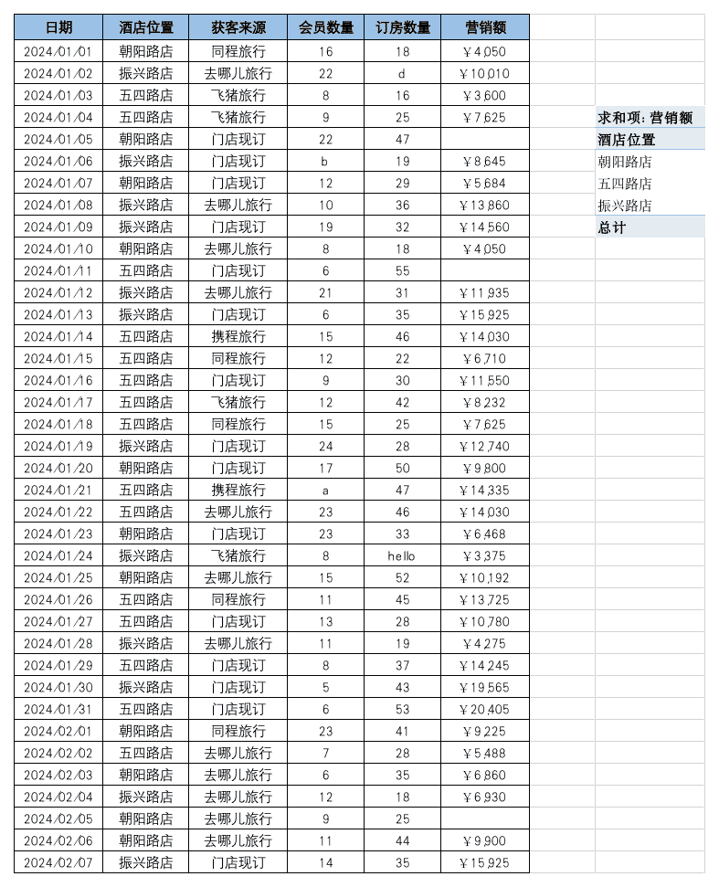
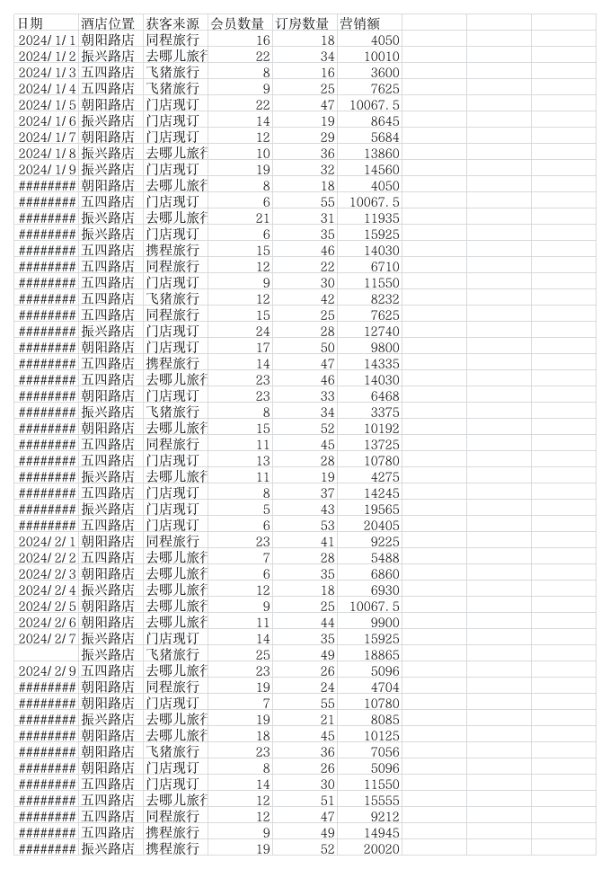
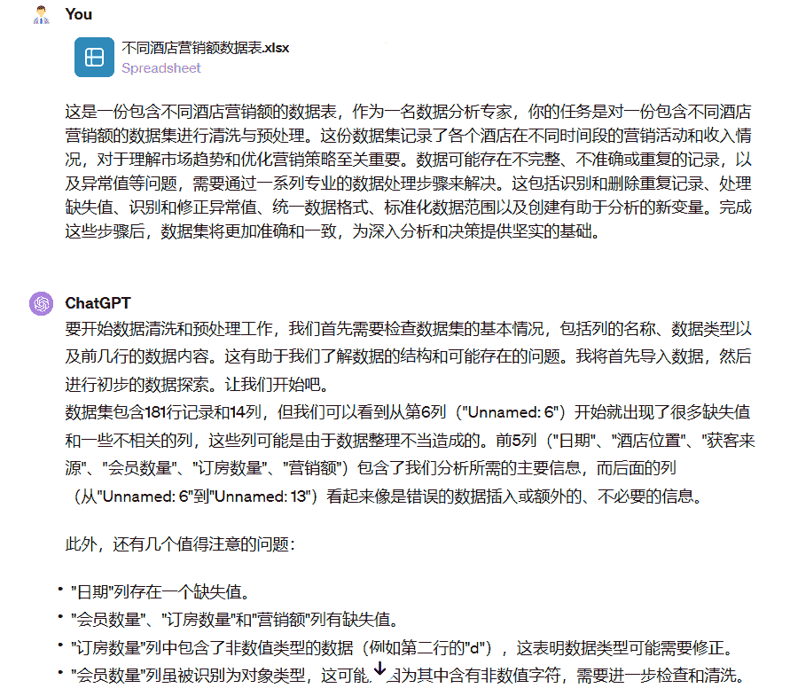
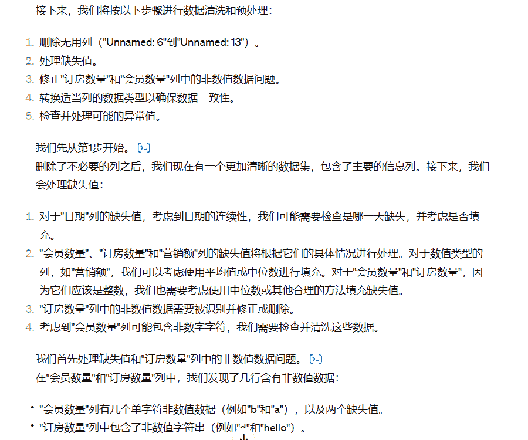

# 利用ChatGPT完成数据分析

> 来源：[https://xmgtoagi.feishu.cn/docx/Qa0RdBlLGoMIpox4nKRcA5zYnHg](https://xmgtoagi.feishu.cn/docx/Qa0RdBlLGoMIpox4nKRcA5zYnHg)

# 一、数据分析的作用：

1.  **决策支持**：帮助做出更加信息化和数据驱动的决策。包括市场趋势分析、客户需求预测、资源分配等

1.  **发现趋势**：数据分析帮助组织发现业务和市场的潜在趋势，这些趋势可能并不显而易见。通过对这些趋势的分析，企业可以发现新的市场机会或是潜在的业务风险。

1.  **性能评估**：数据分析能够帮助评估项目、产品或服务的性能，通过分析销售数据、客户反馈等信息，企业可以了解哪些方面表现良好，哪些方面需要改进。

1.  **客户洞察**：通过分析客户数据，企业可以更好地理解客户的行为和偏好，进而提供更加个性化的服务或产品，提高客户满意度和忠诚度。

1.  **增强竞争力**：数据分析还可以帮助企业了解竞争对手的动态，包括价格、产品、市场策略等，从而制定出更有针对性的策略，增强自身的竞争力。

> 等以上方面，当然也可以用来**应付工作！**

# 二、ChatGPT能帮助我们做哪些数据分析的工作？

1.  **数据清洗和预处理：**我可以帮助你处理缺失值、异常值，以及进行数据类型转换、标准化和归一化等操作，为数据分析准备干净、整洁的数据集。

1.  **探索性数据分析（EDA）：**我能够进行数据的初步检查，包括生成描述性统计、分布图、相关性分析等，以便于你对数据集有一个直观的理解。

1.  **数据可视化：**我可以创建各种类型的图表和可视化，如柱状图、折线图、散点图、热力图等，以直观地展示数据的趋势、模式和关系。

1.  **统计分析：**我能够进行各种统计测试，如假设检验、回归分析、方差分析等，以帮助你从数据中提取有意义的结论。

1.  **机器学习模型：**我可以帮助你构建和评估机器学习模型，包括分类、回归、聚类等任务，以及进行特征选择和模型优化等高级分析。

1.  **时间序列分析：**如果你的数据是随时间变化的，我可以帮助进行时间序列分析，包括趋势分析、季节性分析、预测等。

1.  **数据报告和解释：**我能够帮你撰写数据分析报告，解释数据分析结果，包括提供见解和建议。

> 以上回答由ChatGPT4.0生成。

# 三、数据分析应用场景

### 数据的清洗与预处理

**应用场景：**几乎在所有数据分析项目的开始阶段都需要进行。例如，在分析客户满意度调查结果之前，需要清理无响应或非法响应的数据。原始数据往往含有噪声、缺失值或异常值，需要先进行清理和预处理。

### 探索性数据分析（EDA）

**应用场景：**当你初次接触一个数据集，需要快速了解其基本特征、分布和潜在的问题或趋势时。比如，一个电商公司在分析用户购买行为前，会先检查数据的分布情况，查看是否有异常值或模式。

### **数据可视化：**

**应用场景：**在报告或会议中展示数据分析结果，或者帮助团队成员理解复杂的数据关系。如柱状图、折线图、散点图、热力图等，以直观地展示数据的趋势、模式和关系。如PPT中展示等。

### **统计分析：**

**应用场景：**当需要验证假设、评估变量之间的关系强度或差异性时。如假设检验、回归分析、方差分析等，以帮助你从数据中提取有意义的结论。

### **机器学习模型：**

**应用场景：**预测未来事件、自动化决策过程或识别模式和分类。包括分类、回归、聚类等任务，以及进行特征选择和模型优化等高级分析。

### **时间序列分析：**

**应用场景：**当数据是随时间变化的序列时，如股票价格分析、销售趋势预测等。零售商可能用它来预测节假日的销售额。

### **数据报告和解释：**

**应用场景：**在数据分析项目的最后阶段，向决策者报告分析结果和建议。任何需要数据支持决策的场景都适用，如企业战略规划、运营优化等。

# 四、数据分析相关案例

# 1.数据的清洗与预处理

## 数据集



[不同酒店营销额数据表.xlsx](https://internal-api-drive-stream.feishu.cn/space/api/box/stream/download/all/Iv6ebF4TaoVRLWxMcuPct4wYnSe)

## 提示词

```
这是一份包含不同酒店营销额的数据表，作为一名数据分析专家，你的任务是对一份包含不同酒店营销额的数据集进行清洗与预处理。这份数据集记录了各个酒店在不同时间段的营销活动和收入情况，对于理解市场趋势和优化营销策略至关重要。数据可能存在不完整、不准确或重复的记录，以及异常值等问题，需要通过一系列专业的数据处理步骤来解决。这包括识别和删除重复记录、处理缺失值、识别和修正异常值、统一数据格式、标准化数据范围以及创建有助于分析的新变量。完成这些步骤后，数据集将更加准确和一致，为深入分析和决策提供坚实的基础。
```

## 完整对话链接

https://chat.openai.com/share/3fb7994b-9e4a-4244-9a4b-471c158e848c

## 效果展示



[不同酒店营销额数据表_预处理完成.csv](https://internal-api-drive-stream.feishu.cn/space/api/box/stream/download/all/QNSZbmYFcoTHJVxYME4cVbymntg)






# 2.探索性数据分析

## 数据集


[不同酒店营销额数据表_预处理完成.csv](https://internal-api-drive-stream.feishu.cn/space/api/box/stream/download/all/XuZAbpwvjoSAdnxO0idcOIINnfe)

## 提示词

```
探索性数据分析（EDA）是对酒店营销额数据集进行初步探索的过程，旨在通过统计图表和摘要统计量来揭示数据的关键特征和潜在模式。这是一份包含不同酒店营销额的数据表，作为数据分析专家，你将使用可视化工具和统计方法来识别数据中的分布、趋势、异常值和变量之间的关系，从而为酒店营销策略的优化和收入增长提供有价值的见解。这一步骤是至关重要的，因为它为后续的深入分析奠定了基础，确保了决策建立在准确和全面的数据理解之上。
```

## 完整对话链接

https://chat.openai.com/share/8460e7d8-871f-4196-ae9e-1a92fcd79a56

## 效果展示


## 补充知识

探索性数据分析（EDA）中常用的图表类型包括但不限于以下几种：

1.  **直方图** (Histogram): 用于展示数据的分布情况，特别是连续变量的频率分布。直方图可以帮助识别数据的正态分布性或偏态分布性。

1.  **箱线图** (Box Plot): 用于展示数据的五数概括（最小值、第一四分位数、中位数、第三四分位数和最大值），同时可以识别异常值。

1.  **散点图** (Scatter Plot): 用于展示两个连续变量之间的关系，有助于发现变量之间的相关性或分布模式。

1.  **折线图** (Line Chart): 用于展示数据随时间变化的趋势，特别适用于时间序列数据分析。

1.  **条形图** (Bar Chart): 用于比较不同类别的数值大小，类别轴上的条形长度表示数值的大小。

1.  **热图** (Heatmap): 通过颜色的变化展示矩阵数据的数值大小，常用于展示相关性矩阵或地理数据的分布。

1.  **饼图** (Pie Chart): 用于展示各部分占总体的比例关系，适用于展示分类数据的分布。

1.  **面积图** (Area Chart): 类似于折线图，但在折线下方的区域会被填充颜色或纹理，用于强调数据随时间的累积效应。

1.  **雷达图** (Radar Chart): 用于展示多个变量的综合评分或性能，每个变量对应雷达图上的一个轴。

1.  **树形图** (Tree Map): 用于展示层次数据的构成，每个块的大小表示数值的大小，块的嵌套表示层次关系。

1.  **小提琴图** (Violin Plot): 结合了箱线图和密度图的特点，不仅显示数据的统计摘要，还展示数据分布的密度估计。

1.  **堆叠条形图** (Stacked Bar Chart): 用于展示各部分对总体的贡献，以及不同类别间的比较。

# 3.数据可视化

## 数据集


[不同酒店营销额数据表_预处理完成.csv](https://internal-api-drive-stream.feishu.cn/space/api/box/stream/download/all/XCNLbyORQo8QGZxlVN5ckijanih)

## 提示词

```
这是一份包含不同酒店营销额的数据表，作为数据分析专家，你将对该数据集进行深入的数据可视化操作。使用合适的数据可视化工具，增强数据的可访问性，并确保所有的可视化结果都配有清晰的说明，以便用户能够轻松地理解和从数据中获得有价值的见解。
```

## 完整对话链接

https://chat.openai.com/share/8fa27785-c5ca-4918-8bff-19f9e84d6df8

## 效果展示


# 4.统计分析

## 数据集


[不同酒店营销额数据表_预处理完成.csv](https://internal-api-drive-stream.feishu.cn/space/api/box/stream/download/all/EEh0bG44poqtOdx0tvZct3PQnYg)

## 提示词

```
这是一份包含不同酒店营销额的数据表，作为数据分析专家，你将对此数据集进行综合统计分析，选择合适的统计测试方法，如假设检验、回归分析、方差分析等，从数据中提取有意义的结论。这一分析过程将揭示不同营销策略对酒店收入的具体影响，帮助识别最有效的营销手段，并为未来的营销决策提供数据驱动的建议。
```

## 完整对话链接

https://chat.openai.com/share/5622f749-2077-4a6f-9825-6bd61f00773b

## 效果展示


# 5.机器学习模型

## 数据集


[不同酒店营销额数据表_预处理完成.csv](https://internal-api-drive-stream.feishu.cn/space/api/box/stream/download/all/GsqqbUXXnoOpOdxfG92c9XlXnlc)

## 提示词

```
这是一份包含不同酒店营销额的数据表，作为数据分析专家，你将对此数据集进行构建和评估机器学习模型，包括分类、回归、聚类等任务，以及进行特征选择和模型优化等高级分析。预测未来的营销效果，并为酒店的营销策略提供科学依据。
```

## 完整对话链接

https://chat.openai.com/share/8c1ec864-7ef3-4040-bd95-c148cded8704

## 效果展示


# 6.时间序列分析

## 数据集


[不同酒店营销额数据表_预处理完成.csv](https://internal-api-drive-stream.feishu.cn/space/api/box/stream/download/all/MLWUbe8WHo1Pe2xNS3bcY9oJnrc)

## 提示词

```
这是一份包含不同酒店营销额的数据表，作为数据分析专家，你将对酒店营销额的时间序列数据进行深入分析，以揭示其随时间变化的趋势、季节性模式和潜在的异常波动。你的目标是构建一个能够准确预测未来营销额的模型，从而帮助酒店优化营销策略和资源分配。这一分析过程不仅涉及对历史数据的统计总结，还包括对未来数据的预测，以便为酒店的经营决策提供数据支持。
```

## 完整对话链接

https://chat.openai.com/share/db8cf906-a094-40eb-ae49-ac24c4b065dd

## 效果展示


# 7.数据报告和解释

## 数据集


[不同酒店营销额数据表_预处理完成.csv](https://internal-api-drive-stream.feishu.cn/space/api/box/stream/download/all/UMkOb0ZfDoIeZCxrpYgcLPQ0nef)

## 提示词

```
在完成对该数据集的深入分析之后，作为数据分析专家，你将负责编制一份详尽的数据报告，旨在向决策者清晰地报告并传达分析过程中的关键发现、趋势和模式。报告将包含直观的数据可视化元素，以帮助解释和强调这些发现，并提供基于数据的具体策略建议和行动计划。此外，你还将对可能的风险进行评估，并提出相应的缓解措施，确保报告内容全面、准确，易于所有利益相关者理解，从而支持酒店业务的决策和优化。
```

## 完整对话链接

https://chat.openai.com/share/84dba5f1-dc01-49c2-85f8-501ce2120d5f

## 效果展示


