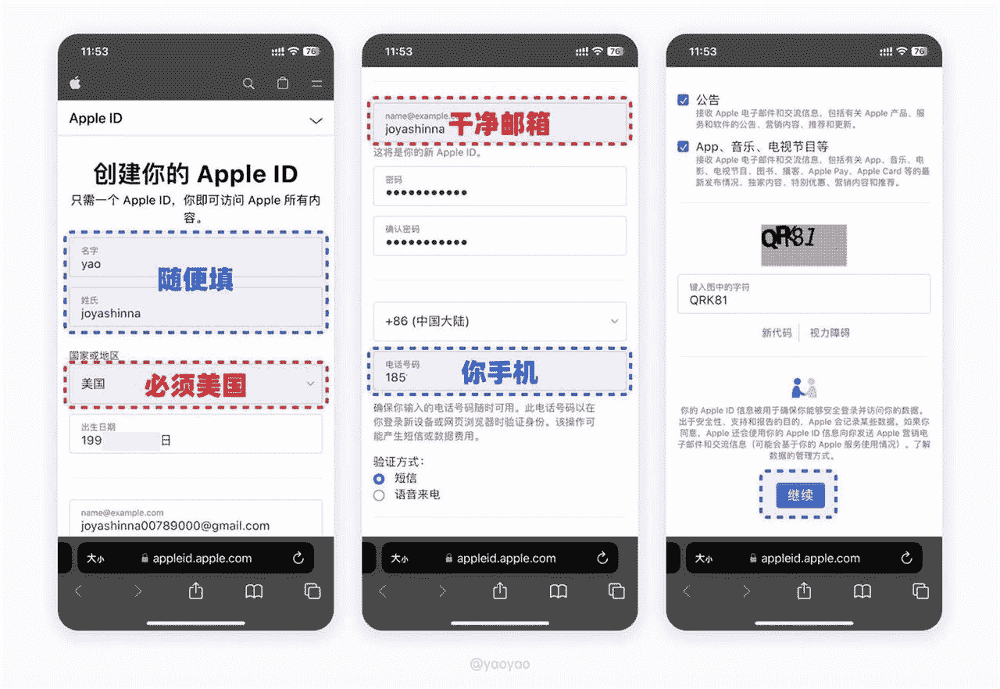
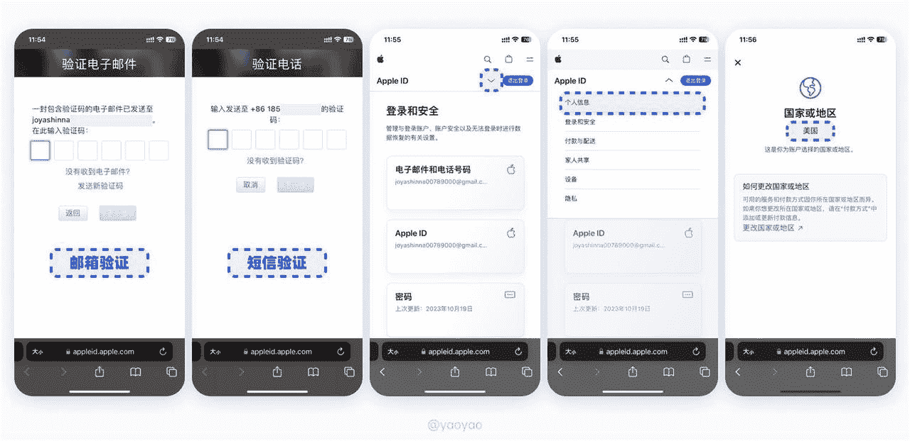
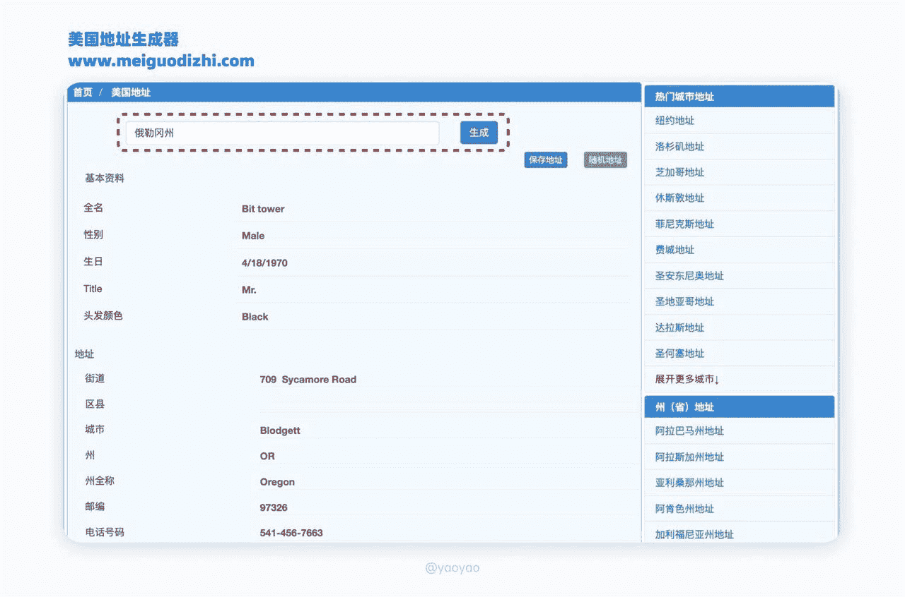

# ChatGPT-4 会员充值攻略大揭秘！

> 来源：[https://xmgtoagi.feishu.cn/docx/BHSSdnan1osBP3xoAufcSegAn1g](https://xmgtoagi.feishu.cn/docx/BHSSdnan1osBP3xoAufcSegAn1g)

第一部分：美区 APP Store 准备

第二部分：礼品卡充值

第三部分：礼品卡使用方式

彩蛋：更多方法查看文末哟～

[ChatGPT](https://www.uisdc.com/tag/chatgpt) APP下载地址：[https://apps.apple.com/us/app/](https://link.uisdc.com/?redirect=https%3A%2F%2Fapps.apple.com%2Fus%2Fapp%2Fchatgpt%2Fid6448311069)chatgpt/id6448311069

注意需要使用美区的App store

#### **一、美区APP Store准备**

邮箱：1个未曾注册过Apple ID的邮箱

手机号：1个手机号码（国内的或曾用于注册Apple ID的都可）

浏览器：苹果系统推荐使用Safari，安卓和Windows系统推荐使用Chrome

步骤 1: 创建 Apple ID

①美区 Apple ID 注册地址：https://appleid.apple.com/account

②国家地区必须「美国」

③未曾注册过 Apple ID 的邮箱

**步骤 2: 验证邮箱和手机号**

①验证邮箱和手机号

②点击右上角「更多」

③选择「个人信息」

④选择国家或地区「美国」

**步骤 3: 填写付款信息**

①点击更改国家或地区

生成免税区地址，美国地址生成器：www.meiguodizhi.com

提示：美国的免税州包括阿拉斯加州、特拉华州、蒙大拿州、新罕布什尔州、俄勒冈州

②请先复制后再生成地址

步骤 4: 切换 App Store 账号

①点击头像

②滚动到页面最底部「退出登录」

③再滚到最上面登录

步骤 5: App Store 验证

①点击「检查」

②「同意」条款与条件

③然后点击「下一页」恭喜你，现在可以使用啦！

④搜索「Chat GPT」下载～完成

到这一步～恭喜你！下载完成！

接下来开始充值

#### **二、礼品卡充值**

**步骤 1: 切换城市**

①切换到「旧金山」城市

②搜索选择「出镜小程序」

步骤 2: 寻找 App Store 礼品卡

①寻找「折扣礼卡」

②滚动到「大牌礼卡折上折」

③点击 App Store「去购买」

**步骤 3: 充值礼品卡**

①输入金额：GPT 20 美刀（注意: 充值后无法退款）

②填写并验证邮箱

③ZFB 付款完成购买

④获取礼品卡号「复制」

#### **三、礼品卡使用**

**步骤 1: 兑换礼品卡**

①打开 App Store

②点击头像，然后选择「兑换充值卡或代码」

③手动输入兑换码「粘贴并且兑换」

④恭喜你！完成充值！

步骤 2: ChatGPT 充值

①来到 GPT 点击 GPT-4

②更新会员

③充值完成！成为尊贵的 GPT-4 大会员～

彩蛋：更多方法～

