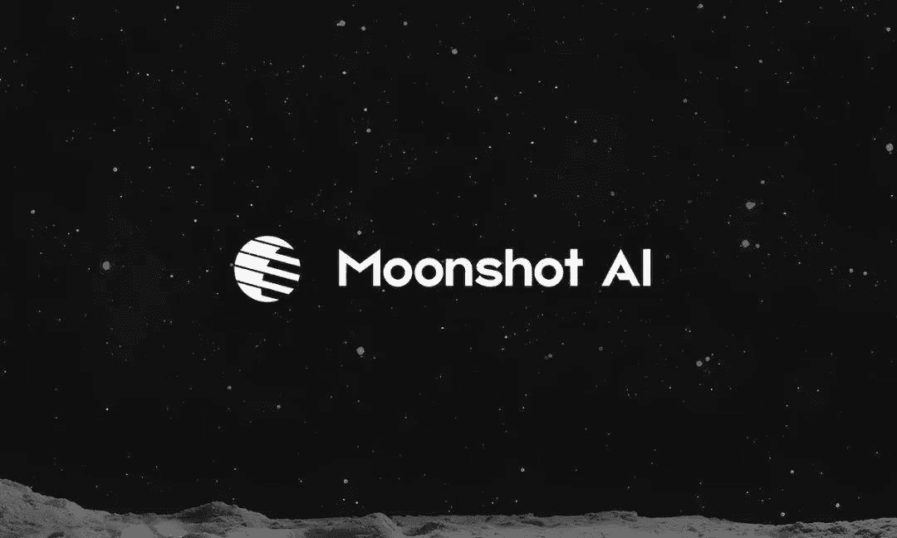
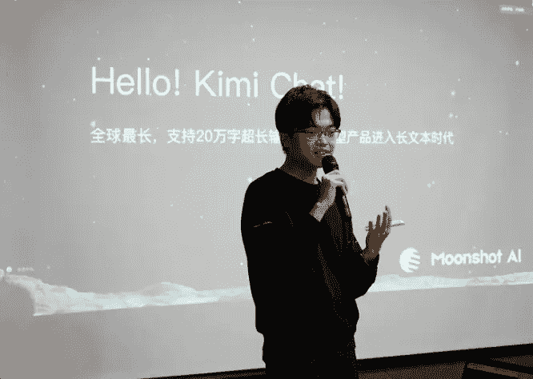
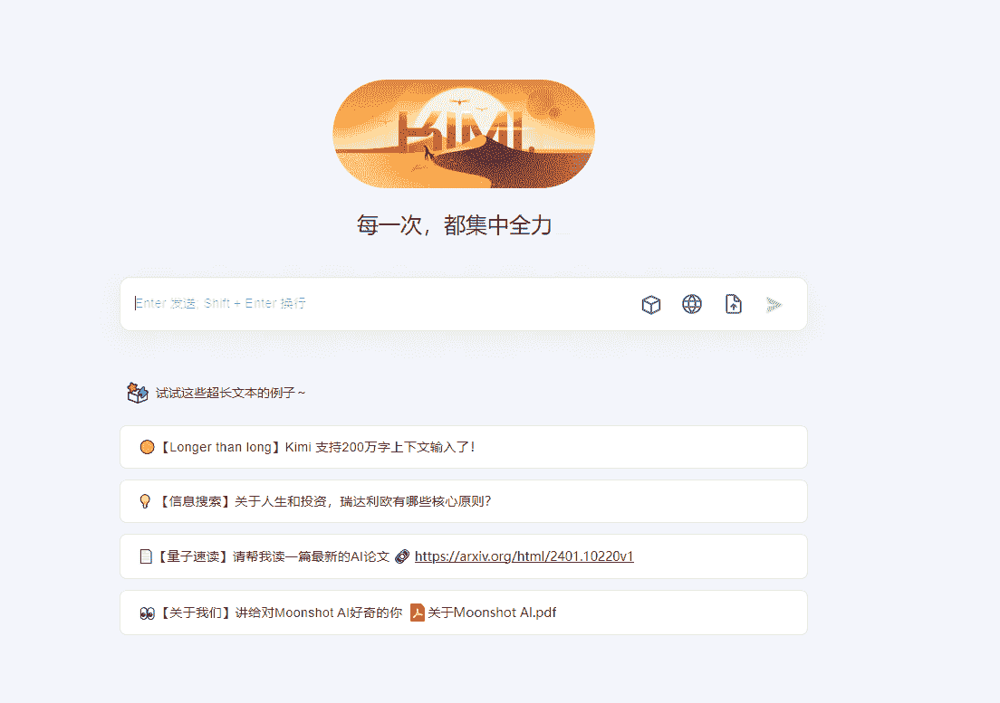

# Kimi实战

> 来源：[https://xmgtoagi.feishu.cn/docx/FpjEdOAgiosDfFxnFCEcoOlbn9b](https://xmgtoagi.feishu.cn/docx/FpjEdOAgiosDfFxnFCEcoOlbn9b)

月之暗面科技有限公司（Moonshot AI）自2023年4月由清华大学交叉信息学院的智源青年科学家杨植麟领衔成立以来，迅速成为人工智能领域的瞩目焦点。公司总部设立在北京，并在上海临港设有分公司，以其独特的名字和前沿的技术突破吸引了业界和资本市场的高度关注。

在公司成立仅2个月时，月之暗面就完成了天使轮融资，获得了近20亿元人民币的投资，投资机构包括了最头部的几家VC，如红杉资本、今日资本、砺思资本等。这一轮融资不仅为公司的发展注入了强大的动力，也体现了资本市场对月之暗面未来潜力的认可。

杨植麟，31岁的创始人，是一位典型的学院派创业者。他的学术背景和职业经历在AI领域中堪称翘楚。高中时期，他通过信息学奥林匹克竞赛保送进入清华大学，并以年级第一的成绩毕业。之后，杨植麟前往美国卡内基梅隆大学攻读博士，师从苹果AI研究负责人Ruslan Salakhutdinov和谷歌首席科学家William Cohen。他的研究成果，包括Transformer-XL和XLNet，成为AI领域的里程碑，被广泛引用。

在职业道路上，杨植麟曾在Google和Meta Platforms的人工智能实验室工作，并共同创立了循环智能（Recurrent AI），获得了红杉中国的投资。他的这些经历为月之暗面的发展提供了坚实的技术和经验基础。

月之暗面的产品首秀是推出了全球首个支持输入20万汉字的大模型moonshot，以及搭载该模型的智能助手产品Kimi Chat。这一技术突破解决了大模型输入长度受限的问题，为AI的应用场景带来了新的可能性。Kimi Chat能够处理大量的文本信息，无论是公众号文章的总结分析，还是出差发票的整理，甚至是根据论文复现代码，都能轻松应对。

杨植麟对公司的未来发展有着清晰的规划。他表示，月之暗面将专注于To C产品的研发，同时也会对B端方向保持开放态度。他认为，大模型公司不可能只局限于一个狭窄的方向，而应该在娱乐、生产力工具、多模态等多个领域进行尝试。月之暗面的目标是在C端找到产品、技术和市场的方向，打造基于自研模型的超级应用。

月之暗面的团队成员在50人左右，公司的发展策略是利用高人才密度和组织力量，快速迭代产品，开发出优秀的技术产品。杨植麟认为，大模型的发展趋势将是从现在的小内存模型向未来的大内存模型发展，这将是决定模型应用最关键的因素之一。

在AI领域的竞争中，月之暗面展现出了强大的竞争力。公司的愿景是通过AI给个人提供更便捷、更强大、更个性化的普惠产品。杨植麟相信，尽管短期内国内大模型公司与美国存在差距，但长期来看，中国的AI公司完全有机会在特定场景中超越国际竞争对手。

月之暗面科技有限公司（Moonshot AI）的发展历程充满了创新和突破。在杨植麟的带领下，公司不仅在技术上取得了显著成就，更在商业模式和市场战略上展现了远见卓识。杨植麟本人的学术背景和职业经历为公司的快速成长提供了坚实的基础，而他的领导力和对AI技术的深刻理解也使得月之暗面在众多创业公司中脱颖而出。

公司的首个产品，Kimi Chat，不仅是技术上的一次飞跃，也是对AI应用场景的一次深刻探索。Kimi Chat的长文本处理能力，使得它在信息总结、数据分析、代码复现等多个领域都有着广泛的应用前景。这款产品的推出，不仅为用户带来了便利，也为月之暗面打开了更广阔的市场。

月之暗面的商业模式和发展战略同样值得关注。公司坚持以To C产品为核心，致力于打造能够满足消费者需求的超级应用。这种以用户为中心的发展理念，使得月之暗面能够更好地理解市场动态，快速响应用户需求，从而在激烈的市场竞争中保持领先地位。

在资本市场的支持下，月之暗面得以快速扩张团队，加大研发投入，不断提升产品的技术含量和市场竞争力。公司的估值在短时间内实现了飞跃，成为了AI领域的独角兽企业。这一成就不仅证明了月之暗面的技术和产品实力，也反映了资本市场对公司未来发展的乐观预期。

月之暗面的团队由一群有着共同愿景和目标的人才组成。他们不仅在技术上有着深厚的积累，更在产品开发和市场推广上展现出了强大的执行力。公司内部鼓励创新思维和开放交流，这种文化氛围为团队成员提供了广阔的发展空间，也为公司的持续创新提供了动力。

展望未来，月之暗面将继续在AI领域深耕细作。公司计划推出更多基于大模型技术的创新产品，拓展AI技术的应用场景，为用户提供更加丰富和便捷的服务。同时，月之暗面也将积极参与国际合作，与全球的AI研究机构和企业共同推动人工智能技术的发展。

在杨植麟的领导下，月之暗面科技有限公司（Moonshot AI）正以坚实的步伐迈向未来，不断探索人工智能的无限可能。随着公司的不断发展和壮大，月之暗面有望成为AI领域的领军企业，引领中国乃至全球的AI技术创新和产业发展。