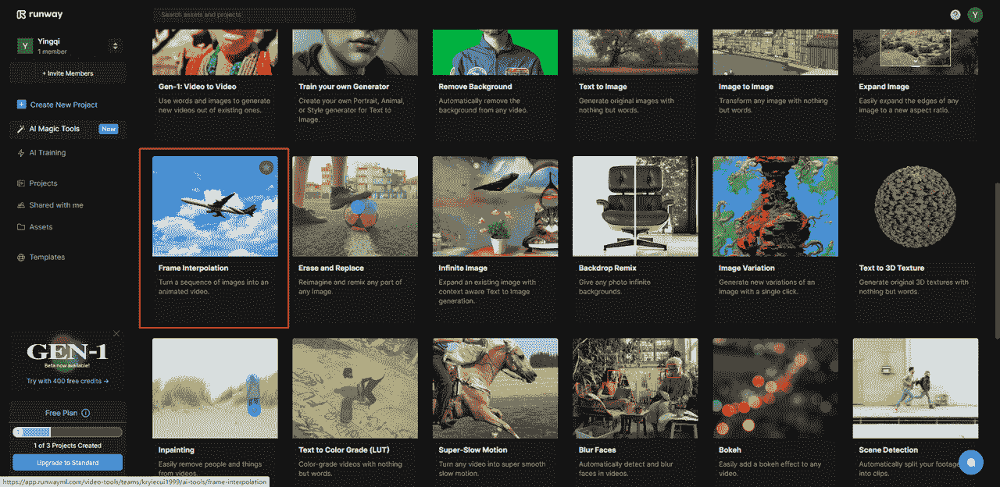
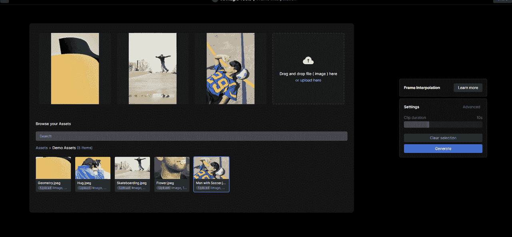

# 让图片动起来

> 来源：[https://xmgtoagi.feishu.cn/docx/NPyRd1Ctdosrp2xO7IackJ4Vnue](https://xmgtoagi.feishu.cn/docx/NPyRd1Ctdosrp2xO7IackJ4Vnue)

该工具将一连串的图像串成一个动画视频。

在Runway工具界面中选择Frame Interpolation工具。

这里我们选择若干张图片，图片数量大于等于2即可。

这里由于笔者缺少合适的素材，于是生成的效果很魔幻，大家在使用此工具时使用连续相近的照片效果会更好。

