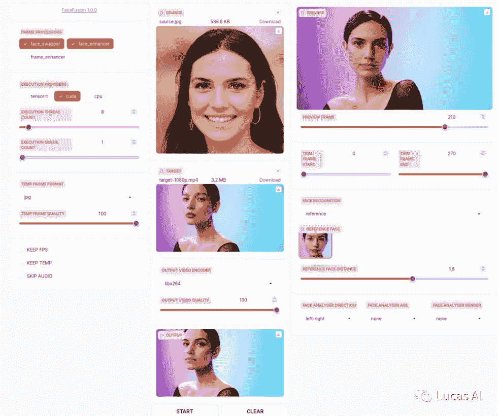
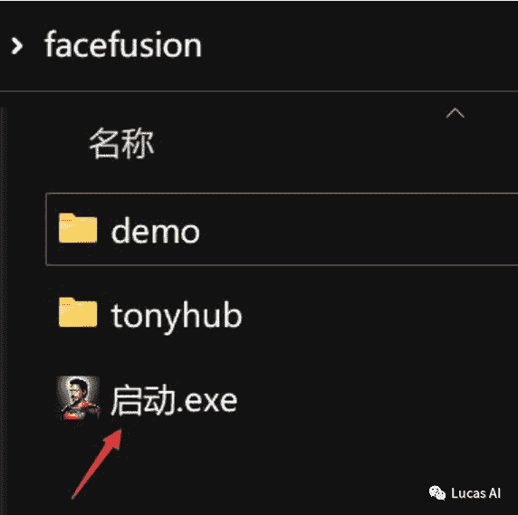
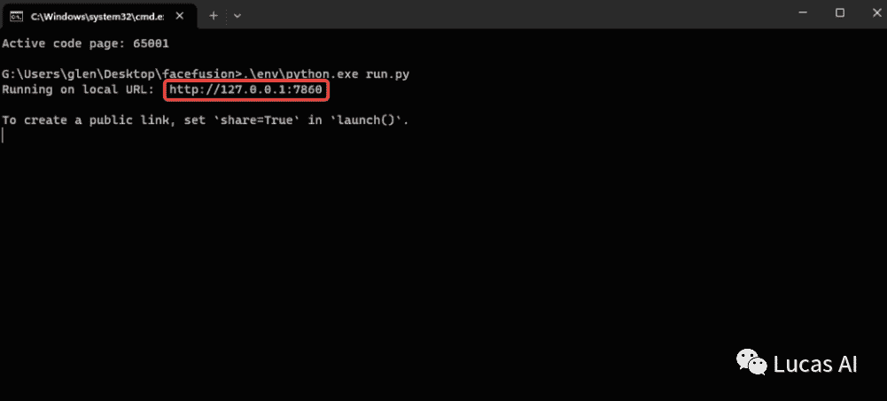
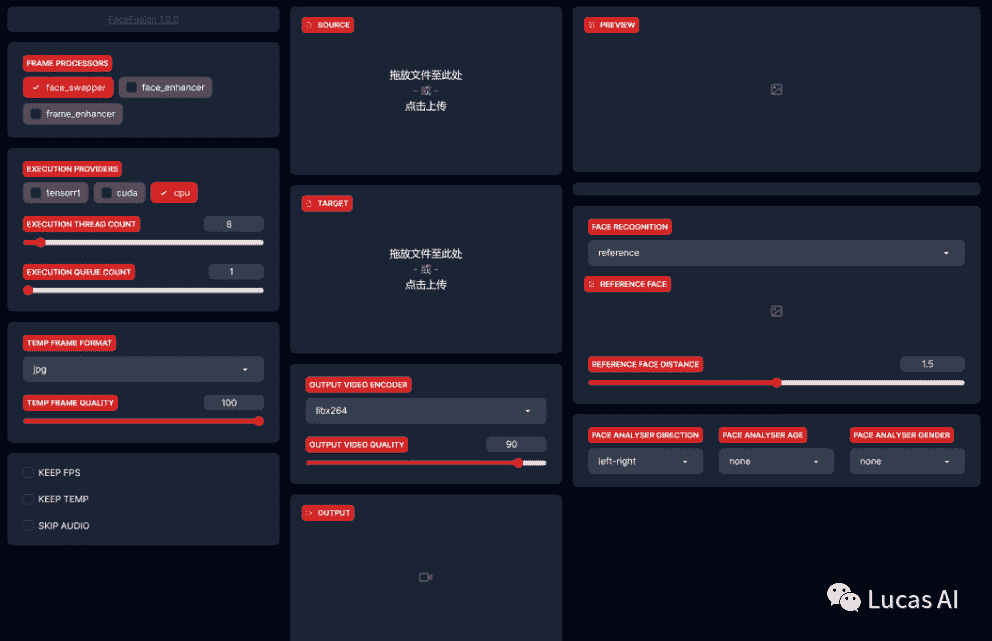
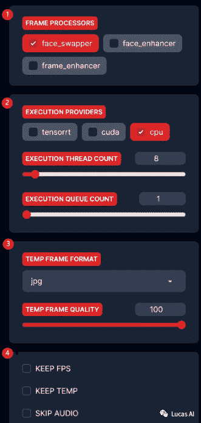
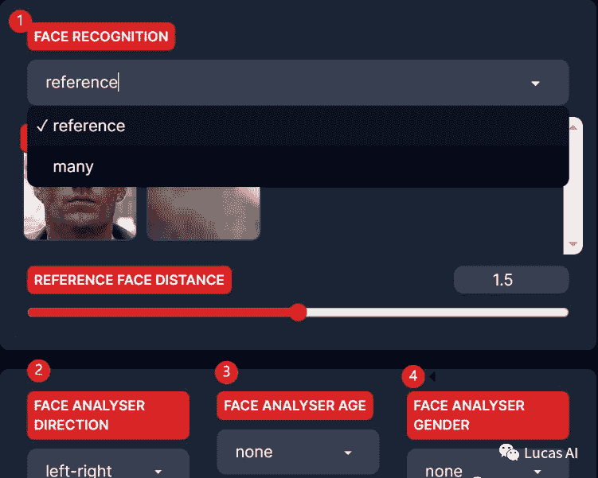

# Facefusion视频/图片换脸

> 来源：[https://xmgtoagi.feishu.cn/docx/VMbBdv8mxopOV4xFw🐧cfk5TnIb](https://xmgtoagi.feishu.cn/docx/VMbBdv8mxopOV4xFw🐧cfk5TnIb)

> 作者：Lucas AI

> 原文：https://mp.weixin.qq.com/s/4UD5GrflvO96v2dZMaNG9w

Facefusion是一款最新的开源AI视频/图片换脸项目。是原来ROOP的项目的延续。项目官方介绍只有一句话，下一代换脸器和增强器。采用了全新的界面设计，可以像Stable Diffuison一样，在网页打开操作页面，更加方便。

首先，安装**Python**建议是3.10版本以后。winget install -e --id Python.Pyth**on.3**.10可以使用其他方式安装，Facefusion推荐的安装方式比较简单。pip python -m ensurepip 安装各种依赖包的必备

根据文末的方式获取软件并解压，请注意要解压到一个英文路径下，最好是放非C盘的根目录，比如D盘下面。

解压之后只需要点击"启动.exe"

启动之后会出现一个网址http://127.0.0.1:7860

复制到浏览器，打开就可以看到界面了，注意在操作页面操作时，不要关闭这个启动页面。

完整的界面如下：

① 设置人脸

只要点击这个框框就会跳出文件管理器，选择一张带清晰完整人脸图片就可以了。注意图片名字用英文和数字。

② 设置目标

方法同上，目标可以是图片，也可以是视频。

③ 效果预览

一定选中目标之后，软件里面就开始运行，运行之后会把合成预览显示在这个区域。换的是图片，其实预览区域就是换脸后的结果了。

换的是视频的话，会截取某一帧作为预览效果。

④ 开始换脸

一切就绪之后，就可以点击按钮开始换了。

⑤ 查看结果

换脸成功之后，会把结果显示在这里。点击右上角的下载图标，就可以把结果保存下来了。

下面说一下左侧的参数设置。

①处理器

包含了换脸，人脸增强，帧增强的功能，人脸增强勾选后会更清楚，相似度有所下降，消耗更多的硬件资源。帧增强这是新加入的一个增加方式，会对整个画面进行修复。

②执行器

执行器就是运行设备，可以选择Tensorrt，Cuda，cpu。启动之后默认只勾选了CPU，一般来说大家都是用显卡跑。

③缓存帧

缓存帧主要是针对视频，在视频换脸过程中，会先把视频的每一帧都转换成图片。这个时候就会涉及到图片质量和图片格式的问题了。

④开关参数

保持帧率最好开启，否则可能会声音和画面不同步。

缓存数据不需要勾选。

音轨，不勾选，代表保留音轨。

下面再说一下右下方的参数。

① 人脸识别方式选择

主要是两种方式，一种是制定人脸，一种是全部替换。指定人脸，默认使用人脸相似度来指定。

② 通过方向选择

通过人脸在图片中的位置和大小选择要替换的人脸。

③通过年龄选择

④通过性别选择

## 下载安装包

AI人脸mac：https://pan.quark.cn/s/93c7d5b6fe5a#/list/share

AI人脸替换工具V4.9完整包：https://pan.quark.cn/s/960c35e7495b#/list/share