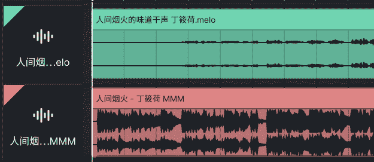
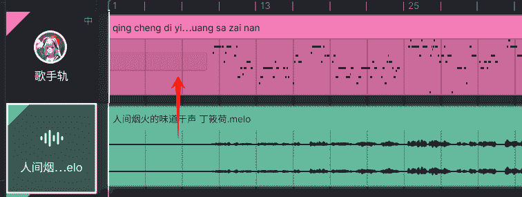
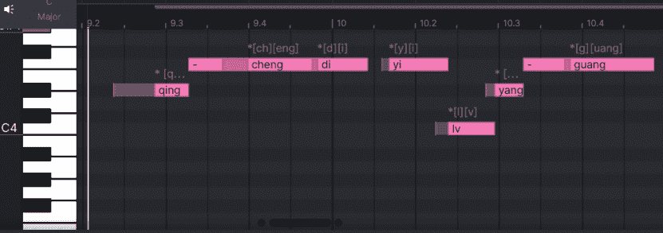
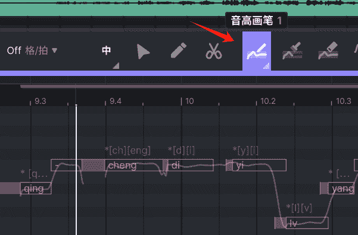
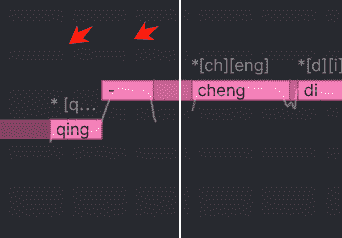
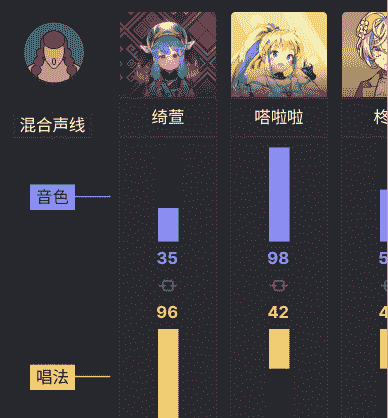
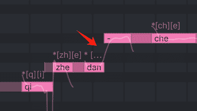
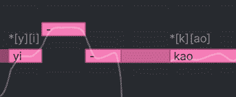
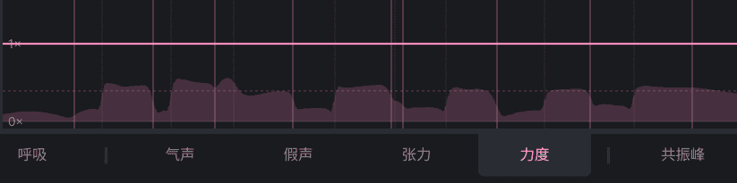

# AI音乐教程

> 来源：[https://xmgtoagi.feishu.cn/docx/Ai7HdmeFQo6BkKxA4BkcCSHOn9e](https://xmgtoagi.feishu.cn/docx/Ai7HdmeFQo6BkKxA4BkcCSHOn9e)

> 张吃吃Joy 2024-02-21 21:10

> 原文地址：https://mp.weixin.qq.com/s/TUPOPL8MJsJsCElFqty1LQ

在第一届AI春晚，我策划的音乐节目《人间烟火的味道》，使用的是ACE Studio的茶鸢翻唱，不少朋友听到后想学习，于是写一篇教程，分享我平时使用ACE的方法。

<https://player.bilibili.com/player.html?bvid=18u4m1P7xc&spm_id_from=333.999.0.0>

# **一、ACE简介**

ACE Studio是由时域科技开发的歌声合成软件，其技术基础是SVS（Singing Voice Synthesis），即将乐谱（MIDI）和歌词（音素集）等信息转换为歌声。

官网下载地址：https://www.acestudio.ai/

官方使用手册：https://ec26ubh65w.feishu.cn/docx

官方手册对软件的操作介绍的很清楚，在具体操作有不明白的可以直接查看ACE官方使用手册。而本篇教程则偏向于工作流介绍，包括前期素材准备、工作流推荐、使用技巧等，大家可以结合起来看噢。

# **二、小白快速上手**

## **1、名词解释**

（针对零乐理基础用户，音乐达人可跳过）

**干声**  没有伴奏也没有效果器的人声

**MIDI**  可以理解为给计算机看的乐谱，包含歌曲每个音的音高、节奏信息

**变调**  歌曲升调或降调，1个key=1个半音。

**BPM**  歌曲的速度，数字表示一分钟多少拍。

## **2、推荐工作流**

**干声转换-选择歌手-微调**

**由于AC**E有一个非常方便的功能：干声转换，也就是将人声音频转MIDI，这比手动输入一个个音符要好用太多啦！我在使用ACE制作的歌曲，大部分都是通过干声转换来获取MIDI初稿的。当然AI识别的音高、节奏、发音会有误差，所以接下来的工作主要是修复这些识别错误的瑕疵。其实，只需要干声转换-选择歌手-微调三个步骤，一首AI演唱的歌曲就做好了。小白快速上手篇会细讲这三个步骤，如果有更高的要求，比如需要个性化声线或更自然的演唱效果，可以参考后面的进阶篇。

## **3、实操步骤**

### **第一步：准备音频素材**

**使用干声转换，**我们需要在软件中分别导入人声干声和伴奏[文件-导入-导入音频]，放在两个轨道上。干声是用来转成MIDI做AI演唱的。如下图所示：

注意，如果是男歌女唱或者女歌男唱，请在导入前先进行变调后再导入（不会变调的看下方工具推荐）。通常女声比男声高5个key左右，不绝对，大家根据听感测试调整即可。

有两个工具我在进行前期音频素材准备时较常用：

**TME Studio**

**腾讯音乐**开发的AI音频工具箱，其中我最常用的是音频分离，可用于将人声和伴奏从歌曲中提取出来。

地址：https://y.qq.com/tme_studio/index.html#/editor

**Vocalremover**

**包含音频分离、变**调、BPM查询等功能，我使用较多的是变调和BPM查询。建议在准备素材阶段，就将音频调整到所需调，并获取到BPM。

地址：https://vocalremover.org/zh/key-bpm-finder

### **第二步：干声转换**

**在转换之前，有一个很重要的动**作：请先将工程BPM设置为与歌曲一致，就是界面顶部这个东东，前面是BPM后面是拍数，请把BPM修改为上述操作获取到的数字，这一步是为了后续微调的时候方便音符对齐节奏：

**设置完成后，将**音频轨道的文件拖入到空白的歌手轨道，即可进行干声转换。

### ** 第三步：选择歌**手

软件左侧有歌手可以选择，长按拖动到歌手轨道的头像处即可切换歌手。

### **第四步：微调**

完成歌手选择后，我们需要一边试听，一边对转换出来的MIDI进行微调，微调基本都在下方钢琴卷帘中完成，以下几点是微调过程中需要考虑的：

**

1）歌词发****音：AI识别**的发音有可能不准确，听到识别错误的，双击音符修改为正确的拼音即可。

**2）音准****：在听的过程中，如果**发现有音高不准，点击音符按键盘上下**键即可调**高或者调低。如果音准偏差小于1key，就需要点击钢琴卷帘上方工具栏的音高画笔，画出音符的音高线。

**3）节奏**：在听的过程中，如果发现节奏不准，可将音符拖动到对其节奏线。

但我并不会把所有音符都拖到对齐节奏线，因为人在真实演唱中，本来就会有一点点节奏错位，这种微小的错位在普通听众听来是自然的，甚至有些风格会故意为之。当然这个关乎主观审美和作品表达需要，没有对错。

### **第五步：导出**

完成发音、音高、节奏的瑕疵修复后，歌声完成度其实就已经很高了，用来当作品发布完全没问题。

点击**文件-导出音频**，即可将歌曲渲染导出。如果是用于做视频，建议格式选mp3，这样文件体积较小。如果是为了发行到🐧音乐之类的平台，格式建议选wav。

# **三、进阶技巧**

## **1、自定义声线合成**

除了使用软件自带歌手，ACE Studio也支持自定义声线，可以听听我合成的虚拟歌手季言的声音：

在软件中，点击左上方的[轨道面板]，即可使用声线合成功能。

ACE Studio将歌手声线分为音色和唱法两个部分，可以分别调整混合比例。

关**于声线种**子的选择，我有以下建议：

如果需要男声的唱法更**细腻**一些，可以加入偏硬朗的女声声线，比如长歌。

如果需要增加更多**胸腔共鸣**，可以加入美声歌手Barber的声线。

如果需要声音更**可爱**，可以加入童声声线，比如绮萱、嗒啦啦。

如果需要听起来更有**唱功**，可以加入唱功好的雀河。（没错，AI也是有唱功的）

其实就是需要什么样的特质，就添加拥有此特质的种子就行。建议在合成声线之前，脑子里要有想要的声音雏形然后按需添加种子，会比随机添加要高效得多。

## **2、让人声更自然的技巧**

**如何让人声**演唱听起来更自然？其实我最常使用的方法是微调音高线，本质上其实就是“装饰音”。

一首歌如果每一个音都按本来的音高唱，听起来会很机械化。人在真实演唱的时候，常常会有个别音，是从前一个字的音滑过去的。还是拿《人间烟火的味道》举例，比如“骑着单车路过的少年”这句，大家注意“单”这个音，音高是#A。但是看MIDI，却是从G滑到#A的，这样处理会让这个字听起来更加人性化。具体哪些音需要这样做，就靠听感了。

还有个技巧是把一个音中间再拆成几个音最后落回来，就是类似R&B常说的转音。

比如“最温暖的依靠”这句词，“依”字的音从#A到C又回到#A。

## **3、情感参数**

钢琴卷帘最下方有一个可以折叠展开的情感参数调节面板。包括呼吸、气声、假声、张力、力度、共振峰几个参数。除非有特殊设计或必须通过参数来修瑕疵，我一般都不使用，因为AI自动生成的已经非常自然了，手动修改很容易修改得不自然。

如果需要调整，请从左往右按顺序调整，因为左侧参数修改后会联动影响右侧的。下面是官方对这几个参数的介绍：

**呼吸**：用来控制歌手在何处换气

**气声**：演唱时气息含量

**假声**：演唱时假声含量

**张力**：演唱时声带的紧张/松弛程度

**力度**：演唱时的力量大小

**共振峰**：每个时刻的共振峰偏移

# **四、商用条件**

使用ACE Studio创作的作品如需商用，根据所使用的歌手，分两种情况：

**免费授权**

**软件中大**部分歌手订阅工具后均可免费授权，但需要署名。如需申请授权书，在歌手处点击“查看授权许可”进行操作即可。填写信息后，官方会自动发送授权书到您邮箱。

**

第三方授**权

部**分歌手需要联系版权方获**取授权，目前需要第三方授权的歌手有洛天依、言和、乐正绫、乐正龙牙，这些歌手需前往vsinger.com申请商用授权。

以上就是关于ACE Studio歌声合成的简易工作流介绍。