# AI音效深度评测：AI短片告别默片时代?

> 来源：[https://xmgtoagi.feishu.cn/docx/BgPkdmwSRocQRIx7nyAcGRA3nKh](https://xmgtoagi.feishu.cn/docx/BgPkdmwSRocQRIx7nyAcGRA3nKh)

> 原文：https://mp.weixin.qq.com/s/goXQ-PnIgVqVjLLG_B4yew

> 作者： 卡尔的AI沃茨

Sora的文字转视频在不断的掀起AI圈的风波, 大家都在期待这OpenAI Sora的发布, Sora放出的每个demo, 都能得到超高的转发量!

AI 从文字到图片再到视频, 仿佛在宣誓着AI完全时代马上就要到来!  与此同时有一个元素在最近也越来越出圈, 那就是"音效"!

[PlSsBbC1HKfzpjtU.mp4](https://internal-api-drive-stream.feishu.cn/space/api/box/stream/download/all/IGwMbT3BqoE4rsxAeVPcikFWnDh)

+   2月18号 ElevenLabs发布半自动AI音效的效果视频，让Sora宇宙出现了“声音”

+   2月27日 Pika（AI视频制作平台）推出声音唇部同步功能Lip Sync

+   3月10日 Pika集成AI音效功能

[20240311_210021.mp4](https://internal-api-drive-stream.feishu.cn/space/api/box/stream/download/all/PiK4bnoypoOugvx3QSyc13T7nnI)

正当我想“氪金”来体验 Pika 的 Sound effects，试试看“赛博煎培根🥓”的感觉时，11ElevenLabs向我抛来了一个惊喜（内侧名额），它也更新了一个功能，叫“Sound effects”。

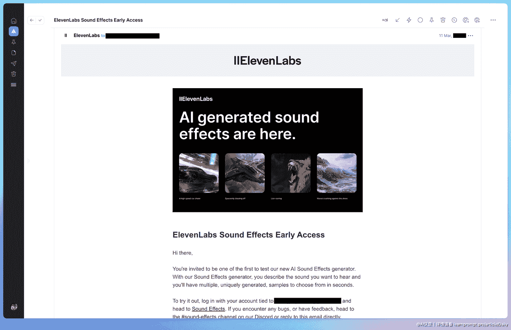

同名，加上之前Pika的唇形同步就是11labs支持的，很难不让人联想到内侧拿到的“Sound effects”就是Pika背后的支持技术

我第一时间想到的就是把最近新出的Sora视频全配上音效，搭配Apple Vision Pro体验体验大片。

> 之前没有单独写一篇推文, 来和大家一起聊sora, 一个是Sora还没有正式的发布, 二是我也一直在看陆续发出的sora的技术探讨报告，后续也会带大家详细了解!

## Sora 3月份 最新视频效果:

"A dragon made of bubbles, perfectly rendered 8k."

一条由气泡制成的龙，完美渲染8k

[sz-S7ZVWrofiRioO.mp4](https://internal-api-drive-stream.feishu.cn/space/api/box/stream/download/all/B7a6bqBRFop7mKxZ2ewcqivonwg)

"A dragon made of bubbles, perfectly rendered 8k."

一只透明的景观乌龟在沙滩爬行

[u-opBcMDI8jcxGBR.mp4](https://internal-api-drive-stream.feishu.cn/space/api/box/stream/download/all/VWNIbiK5YoIDu0xvjgTctZFTn8f)

an alien blending in naturally with new york city, paranoia thriller style, 35mm film

一个与纽约市自然融合的外星人，偏执惊悚风格，35毫米电影

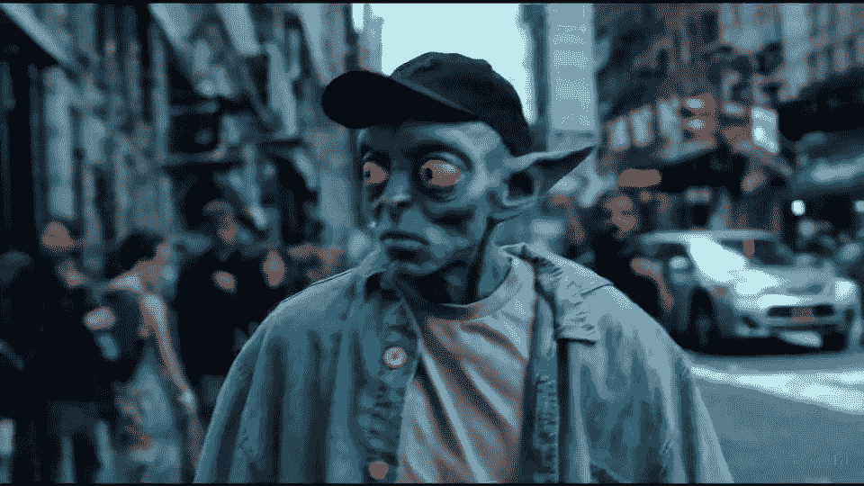

[0pLGEhLOQty1PwXU.mp4](https://internal-api-drive-stream.feishu.cn/space/api/box/stream/download/all/SLXgbdiMaolcvRxF0VlcJPzRnwh)

是不是很震撼, Sora由提示词生成的视频画面真实, 看不出AI的痕迹, 但是画面中的内容却是脑洞大开的存在!

但是音效的缺失, 还是让人感觉视频中缺少了什么!

# 上手体验

接下来就让我来带大家来抢先预览一下AI音效的魔力！

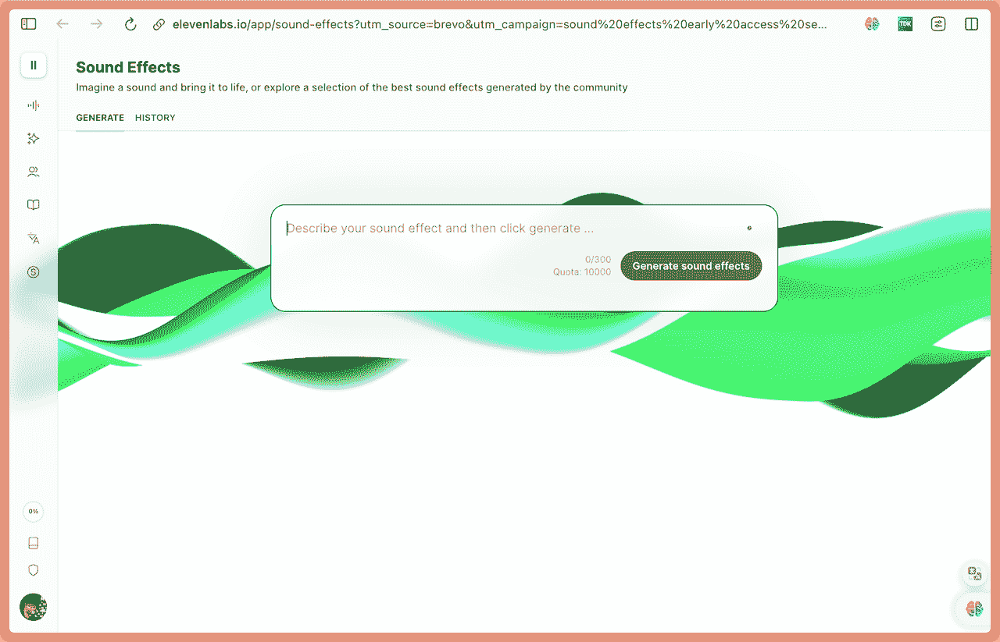

上面就是ElevenLabs Sound Effects 打开的之后界面, 没有使用方法的提示, 只有一个输入提示词的框, 看样子是根据提示词生成音效!

> 没有教程？没关系，Pika上有的是

与ElevenLabs不同的是: Pika想先输入视频/图片，生成对应的描述来生成音效，或者在生成视频的过程中，用“同一个提示词”生成音效

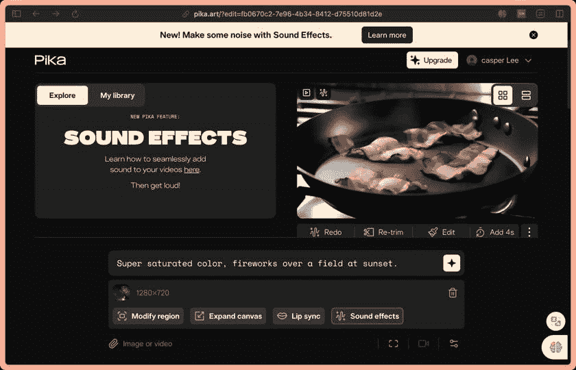

[20240311_210021.mp4](https://internal-api-drive-stream.feishu.cn/space/api/box/stream/download/all/HB6nbYsESoOv0tx2rMgcIkMqneg)

既然这样, 我要给着Sora新发出的"梦幻泡泡喷火龙:"视频来量身定制的音效

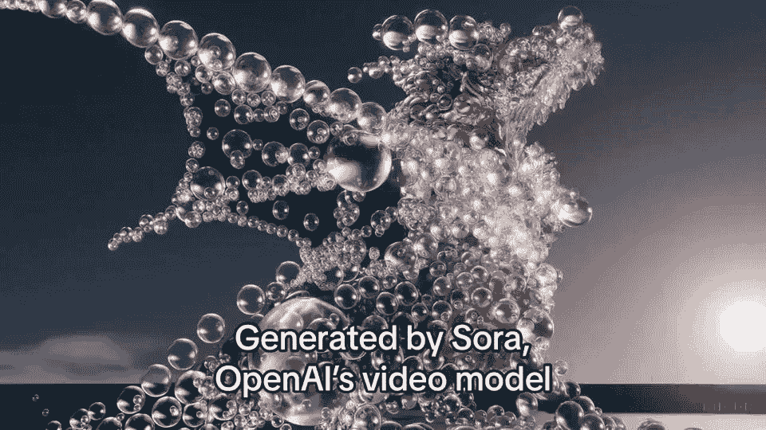

[sz-S7ZVWrofiRioO.mp4](https://internal-api-drive-stream.feishu.cn/space/api/box/stream/download/all/HevbblS3Fo1KEAxmpVJcIIV2nob)

# ElevenLabs 音效深度测试

1.  首先，我按照最简单的方式复用了目前Sora视频的Prompt

> A dragon made of bubbles, perfectly rendered 8k.

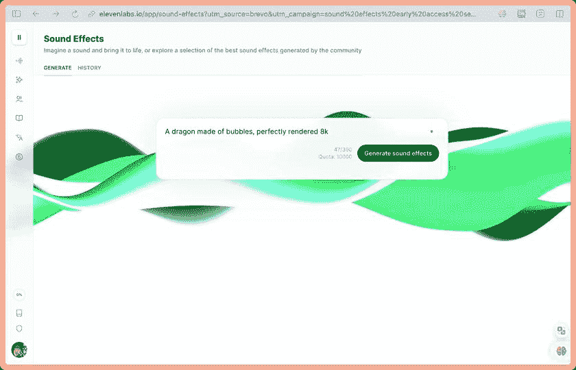

[20240311_221723.mp4](https://internal-api-drive-stream.feishu.cn/space/api/box/stream/download/all/MkHVbU7I3oTCWOxRos9c10JFnqe)

在等待了几秒之后, 生成了5个音效, 虽然这5个音效都跟泡泡有关, 但是想要放到视频中也不是那么合适，而且时间也太短了，部分片段只有1秒

所以11labs是不是会跟Midjourney v5之前的Prompt风格类似，我需要尽可能用代表音效的单词来表达我想要的？

我在提示词框中输入这段简短的描述, 尝试增加提示语长度看看会不会增加音效长度

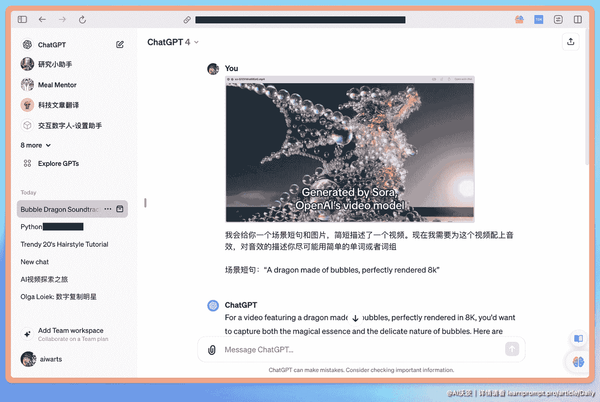

[20240312_013322.mp4](https://internal-api-drive-stream.feishu.cn/space/api/box/stream/download/all/P1zNbNWmwozptaxsb2VcyHcYntd)

这次音频变长到了3秒，而且在声音更加清晰，但依然不是我想要的效果

在我尝试了5次之后, 我决定调整提示词的方向, 让我的提示词尽可能的去描述我想要的音效, 而不是描述视频画面。

这个思路写出的提示词, 果然效果好了很多! (写文章的时候, 再次看到提示词框中的提示, describe your sound effect 恍然大悟!)

[20240312_011653.mp4](https://internal-api-drive-stream.feishu.cn/space/api/box/stream/download/all/M6QfbDmdNo5qoNxJlL8cDxw0nrb)

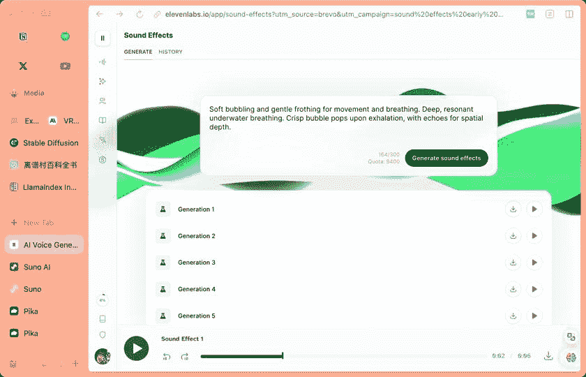

[20240312_013658.mp4](https://internal-api-drive-stream.feishu.cn/space/api/box/stream/download/all/WCv3bRlmfoCZKJx3tozcWkxkn5e)

这次还能带上水泡破裂💥和水滴的声音，看来离成功不远

根据这个逻辑, 我直接手搓一个GPTs用来帮我更好的生成音效的描述:

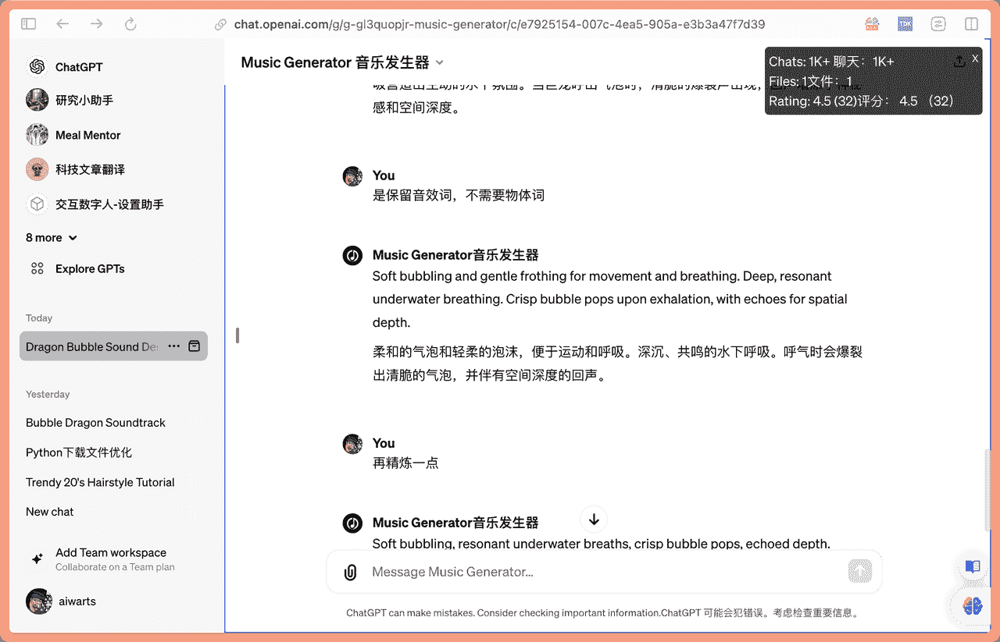

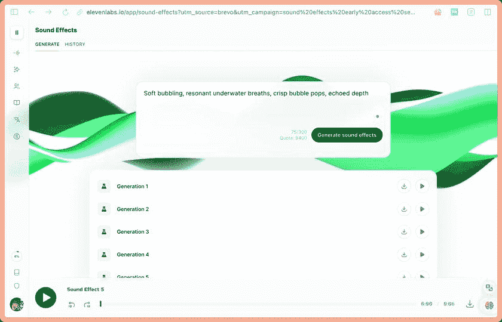

[20240312_014329.mp4](https://internal-api-drive-stream.feishu.cn/space/api/box/stream/download/all/XdVZbDs0EoepZhxebcvcQUYSnuc)

在保留核心内容并去掉“没有意义”的物体单词后，音效有效变长还复现了准确的吹泡泡的感觉。

[3月12日.mp4](https://internal-api-drive-stream.feishu.cn/space/api/box/stream/download/all/MXrGbrRCHoy37bxbxSlcJGUEnpe)

# ElevenLabs + Sora！

按照这个思路类推，我们还可以在一段提示语中放入不同画面的描述音效，来达到一口气生成一整个视频音效

+   Gentle rustling sand, subtle shell movement, soft sea breeze, rolling wave whispers, distant bird calls.

+   轻柔的沙沙声，微妙的贝壳运动，柔和的海风，翻滚的海浪低语，远处的鸟叫声。

[3月12日(1).mp4](https://internal-api-drive-stream.feishu.cn/space/api/box/stream/download/all/UtwHbDhTdotsUAxdpm7c0LdEnbc)

> 当然目前还是可用性还有待提高，一次生成可能有2-3条都是不能用的。

实际还是分开画面来做比较方便调整！这一段20s视频就分了5个不同的音效合成

1.  城市背景噪音：汽车喇叭声、人群噪音、地铁隆隆声、行人脚步声。

1.  无声的脚步声，橡胶摩擦声。

1.  电子嗡嗡声、低频嗡嗡声、衣服沙沙声。

1.  心跳加速，紧张气氛。

1.  警笛声、消防车喇叭声、直升机轰鸣声。

通过声音来给这个视频重新演绎！

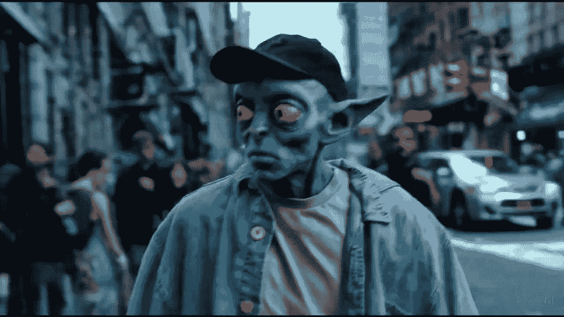

[3月12日(2).mp4](https://internal-api-drive-stream.feishu.cn/space/api/box/stream/download/all/De0LbsbWDoBGzDx5KnvcTOMRn5d)

# 写在最后

AI视频正在不断补全它的拼图碎片，从图生视频，到文生视频，文生音乐，文生音效。

我相信，跟很多我们之前看到的AI产品一样，它们会以极快的速度优化，整合，成为AI视频工作流的一部分

到时候，便是真正意义上的“一键”生成AI视频！