# SunoV3教程及案例收集

> 来源：[https://xmgtoagi.feishu.cn/docx/VEkDd3M8HoG0zxxVS3pcRoHZnpc](https://xmgtoagi.feishu.cn/docx/VEkDd3M8HoG0zxxVS3pcRoHZnpc)

# 简单教程

## 登录

链接入口：`https://www.suno.ai/`

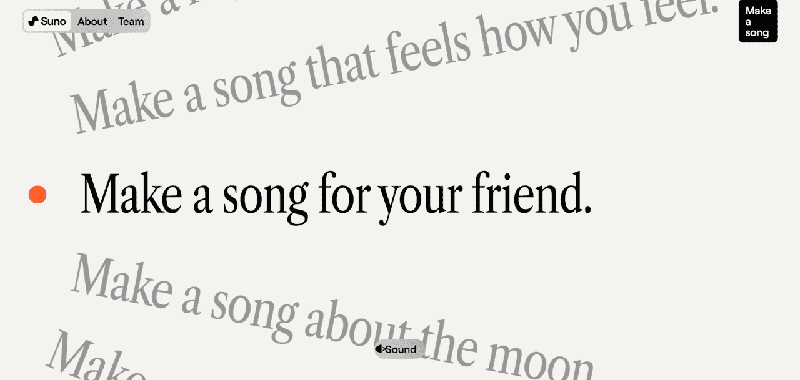

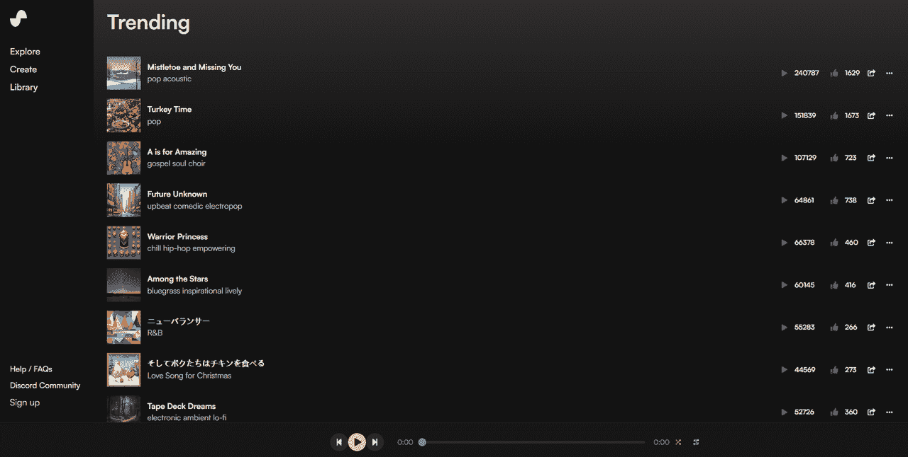

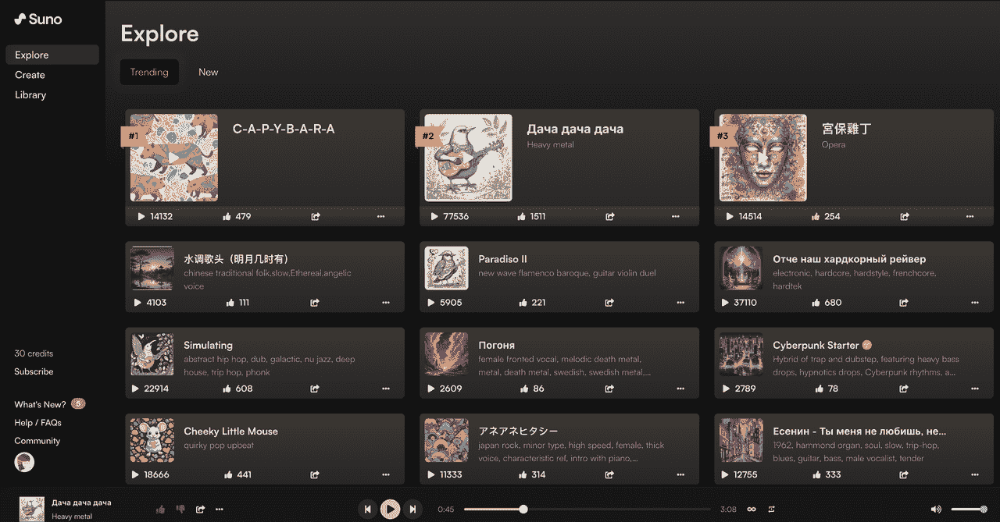

## 主页生成

+ 点击 `Create` 即可进入生成的主页。

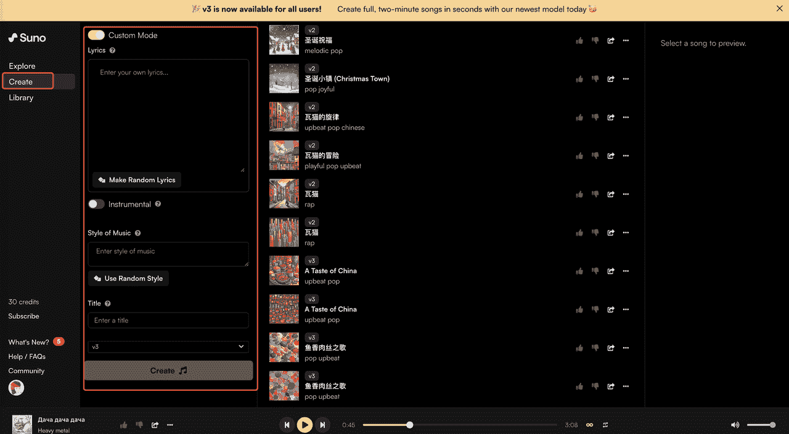

## 使用模式

+ `Custom Mode` (自定义模式): 允许自定义歌词。

+ `Instrumental` (纯音乐模式): 生成没有歌词的纯音乐。

## 社区创作

+ 在社区中，如果喜欢某首歌曲，可以点击 `Remix` 进行基于当前提示词的创作。

## 推荐的 `prompt` 写法:

这里有很详细的教程 [Suno 操作指北 V2](https://waytoagi.feishu.cn/wiki/D1DOwPS5ei5EkckZHUvcVjpEnff) ｜ [Suno 操作指北 V1](https://waytoagi.feishu.cn/wiki/PhTwwHp1QiNdoFknip1cLwysntd?fromScene=spaceOverview)

Suno创作音乐的小技巧：来自 [Gorden Sun](https://twitter.com/Gorden_Sun)

1、如果你想参考某个现有歌曲的节奏，可以在这个网站查询歌曲的BPM和Key，作为提示词写进去。

`https://songbpm.cosha sim`

2、歌词里，可以在歌词段落前加 `[Verse]`（主歌）、`[Rap]`（说唱）、`[Chorus]`（副歌/高潮）、`[Intro]`（引子）来告诉AI这段歌词应该怎么唱。

> 🔔Suno教程里的辅助工具 `Suno Beats` 最新版本只能生成纯音乐（有保留老版本的朋友可忽略这条信息），所以找了三个类似的GPTs，大家可按需参考！

> 推荐：nimbus `Suno Creator`：`https://chat.openai.com/g/g-ljoDOarSn-suno-creator`

> `Suno Song`：`https://chat.openai.com/g/g-0XDcf6auX-suno-song`

> `Suno Prompt`：`https://chat.openai.com/g/g-YJYWB8nKT-suno-prompt`

> `[Compose].me`：`https://chat.openai.com/g/g-ldbohmO2c-compose-me`

> `Suno ai - /chirp - Music Prompt maker`：`https://chat.openai.com/g/g-5gMVONG2l-suno-ai-chirp-music-prompt-maker`

> `Suno音乐创作大师【中文】`：`https://chat.openai.com/g/g-mlWtT8URF-sunoyin-le-chuang-zuo-da-shi`

# 参考流派

以下内容由 KEEN 整理 欢迎关注他的👸号： 智音Brook

参考下面音乐知识科普和流派分类 ，如果不清楚如何选择，也可以借助 AI 进行创作。

[音乐流派、风格词汇参考](https://waytoagi.feishu.cn/wiki/Sk9nw72yOitnqAkyIpucWWW2nCb)

## 音乐知识科普：什么是流派？什么是风格？

> 流派（`Genre`）：

> 音乐流派是指一群共享特定音乐特性和传统的作品集合，是分类音乐多样性的一种方式。诸如摇滚、爵士、古典、电子和乡村音乐等，都是独具特色的流派。这些分类主要基于作品的结构、节奏、和声以及乐器使用等关键因素。每个流派都是音乐历史长河中的一部分，不仅代表了一段时间的音乐趋势，还深受其历史和文化背景的影响。音乐流派的形成和发展，不仅是艺术表达的演变，也是文化交流和社会变迁的见证。

> 风格（`Style`）：

> 风格在艺术领域，尤其是音乐创作中，主要指艺术家或作品所展现的独特特征和创作手法。它是艺术家个性化的音乐表达，不受限于单一流派，而是可以跨越和融合多种音乐风格。例如，一位流行音乐艺术家可能通过其特有的唱腔或舞台表演风格，展示其独特的艺术个性。这些元素共同构成了艺术家独一无二的音乐风格，使其作品与众不同，成为其艺术标识的一部分。

`Chirp` 利用先进的语言模型，把输入的文本转换成音乐。想象一下，如果要列出所有的音乐流派和风格，那就像是编写一本字典一样繁杂。但请记住，这不是一份涵盖“一切”的清单，而是一个旨在激发情感和探索新创意的宝贵资源。

这里提供了一系列经过测试的音乐流派、子流派、风格用词和歌曲类型。你可以将它们灵活组合，给 `Chirp` 提供丰富多彩的风格指引。不过，要注意这个列表是永远不会完整的。我们还没能涵盖全球所有的音乐流派和地区特色，更别提那些日常生活中还未被发掘的新鲜风格用词了。

✅ 别忘了展开各个标题，去发现那些有着独特风味的子流派！

# Genre（流派）

## Country（乡村）

+ `Bluegrass`（草莓乐）

+ `Country`（乡村音乐）

+ `Folk`（民谣）

## Dance（舞曲）

+ `Afro-Cuban`（阿弗罗-古巴）

+ `Dance Pop`（流行舞曲）

+ `Disco`（迪斯科）

+ `Dubstep`（配音步）

+ `Disco Funk`（迪斯科放克）

+ `EDM`（电子舞曲）

+ `Electro`（电子）

+ `High-NRG`（高能量）

+ `House`（浩室音乐）

+ `Trance`（迷幻舞曲）

## Downtempo（缓拍）

+ `Ambient`（环境音）

+ `Drum'n'bass`（鼓与贝斯）

+ `Dubstep`（配音步）

+ `Electronic`（电子音乐）

+ `IDM`（智能舞曲）

+ `Synthpop`（合成流行）

+ `Synthwave`（合成波）

+ `Techno`（技术音乐）

+ `Trap`（陷阱音乐）

## Jazz/Soul（爵士/灵魂）

+ `Bebop`（比博普）

+ `Gospel`（福音）

+ `Jazz`（爵士）

+ `Latin Jazz`（拉丁爵士）

+ `RnB`（节奏蓝调）

+ `Soul`（灵魂乐）

## Latin（拉丁）

+ `Bossa Nova`（波萨诺瓦）

+ `Latin Jazz`（拉丁爵士）

+ `Forró`（弗约罗）

+ `Salsa`（萨尔萨舞）

+ `Tango`（探戈）

## Reggae（雷鬼）

+ `Dancehall`（舞厅）

+ `Dub`（配音）

+ `Reggae`（雷鬼）

+ `Reggaeton`（雷盖顿）

+ `Afrobeat`（非洲节奏）

## Metal（金属）

+ `Black Metal`（黑金属）

+ `Deathcore`（死亡核）

+ `Death Metal`（死亡金属）

+ `Festive Heavy Metal`（节日重金属）

+ `Heavy Metal`（重金属）

+ `Nu Metal`（新金属）

+ `Power Metal`（力量金属）

+ `Metalcore`（金属核）

## Popular（流行）

+ `Pop`（流行音乐）

+ `Dance Pop`（流行舞曲）

+ `Pop Rock`（流行摇滚）

+ `Kpop`（韩流音乐）

+ `Jpop`（日流音乐）

+ `RnB`（节奏蓝调）

+ `Synthpop`（合成流行）

## Rock（摇滚）

+ `Classic Rock`（经典摇滚）

+ `Blues Rock`（布鲁斯摇滚）

+ `Emo`（情绪）

+ `Glam Rock`（华丽摇滚）

+ `Indie`（独立音乐）

+ `Industrial Rock`（工业摇滚）

+ `Punk`（朋克摇滚）

+ `Rock`（摇滚）

+ `Skate Rock`（滑板摇滚）

+ `Skatecore`（滑板核）

## Urban（城市音乐）

+ `Funk`（放克）

+ `HipHop`（嘻哈）

+ `RnB`（节奏蓝调）

+ `Phonk`（酸音乐）

+ `Rap`（说唱）

+ `Trap`（陷阱音乐）

# Styles（风格）

## Danceable（可跳舞的）

+ `Disco`（迪斯科）

+ `Syncopated`（切分节奏）

+ `Groovy`（悠扬）

+ `Tipsy`（微醺）

## Dark（黑暗）

+ `Dark`（黑暗）

+ `Doom`（末日）

+ `Dramatic`（戏剧性）

+ `Sinister`（阴险）

## Electric（电子）

+ `Art`（艺术）

+ `Nu`（新流行）

+ `Progressive`（进步）

## Hard（强硬）

+ `Aggressive`（激进）

+ `Banger`（热门曲目）

+ `Power`（力量）

+ `Stadium`（体育场）

+ `Stomp`（重踏）

## Lyrical（抒情的）

+ `Broadway`（百老汇）

+ `Cabaret`（歌舞表演）

+ `Lounge`（酒吧歌手）

+ `Operatic`（歌剧式的）

+ `Storytelling`（讲故事）

+ `Torch-Lounge`（酒吧歌曲）

+ `Theatrical`（戏剧性的）

+ `Troubadour`（吟游诗人）

+ `Vegas`（拉斯维加斯风格）

## Magical（神奇）

+ `Ethereal`（虚幻）

+ `Majestic`（雄伟）

+ `Mysterious`（神秘）

## Minimal（简约）

+ `Ambient`（环境音乐）

+ `Cinematic`（电影）

+ `Slow`（缓慢）

+ `Sparse`（稀疏）

## Party（派对）

+ `Glam`（华丽）

+ `Glitter`（闪耀）

+ `Groovy`（悠扬）

+ `Grooveout`（活力爆发）

## Soft（柔和）

+ `Ambient`（环境音乐）

+ `Bedroom`（卧室）

+ `Chillwave`（轻松浪潮）

+ `Ethereal`（虚幻）

+ `Intimate`（亲密）

## Weird（奇怪）

+ `Carnival`（嘉年华）

+ `Haunted`（鬼屋）

+ `Random`（随机）

+ `Musicbox`（音乐盒）

+ `Hollow`（空洞）

## World/Ethnic（世界/民族）

+ `Arabian`（阿拉伯）

+ `Bangra`（班格拉舞）

+ `Calypso`（卡利普索）

+ `Egyptian`（埃及）

+ `Adhan`（安讫）

+ `Jewish Music`（犹太音乐）

+ `Klezmer`（克莱兹默音乐）

+ `Middle East`（中东）

+ `Polka`（波尔卡）

+ `Russian Navy Song`（俄罗斯海军歌曲）

+ `Suomipop`（芬兰流行音乐）

+ `Tribal`（部落）

# Song Types（歌曲类型）

## BackGround（背景乐）

+ `Elevator`（电梯音乐）

+ `Jingle`（广告歌曲）

+ `Muzak`（环境音乐）

## Call to Prayer（祈祷呼唤）

+ `Call to Prayer`（祈祷呼唤）

+ `Gregorian Chant`（格里高利圣歌）

## Character（角色）

+ `Strut`（趾高气昂地走）

+ `March`（进行曲）

+ `I Want Song`（渴望之歌）

## Children（儿童）

+ `Children's`（儿童的）

+ `Lullaby`（摇篮曲）

+ `Sing-along`（合唱歌曲）

## Retro（复古）

+ `1960s`（1960年代）

+ `Barbershop`（理发店四重唱）

+ `Big Band`（大乐队）

+ `Classic`（经典的）

+ `Doo Wop`（一种节奏蓝调风格的音乐）

+ `Girl Group`（女子组合）

+ `Swing`（摇摆乐）

+ `Traditional`（传统的）

## Traditional（传统的）

+ `Barbershop`（理发店四重唱）

+ `Christmas Carol`（圣诞颂歌）

+ `Traditional`（传统的）

# 费用

## 基本计划

**0 美元** 免费

---

每日更新 50 积分（10 首歌曲）

非商业条款

没有信用充值

共享生成队列

同时运行 2 个作业

## 专业计划

**8美元** /月按年计费

---

每月更新 2,500 个积分（500 首歌曲）

一般商业条款

可选信用充值

优先级生成队列

一次运行 10 个作业

## 尊贵计划

**24美元** /月按年计费

---

每月更新 10,000 个积分（2,000 首歌曲）

一般商业条款

可选信用充值

优先级生成队列

一次运行 10 个作业

# Discord community

获取进入 discord 社区的方式，如果失效，可点击下方👇链接进入。

邀请链接：`https://discord.gg/dZqM3mcHeX`

# 这篇内容主要收集大家的作品

## 作者：Zay G.做了一首专辑

Suno3制作的GenAI爵士乐专辑，我叫它“Jaizz”欢迎大家来听听

这次升级音乐生成质量有点mj的感觉了，所以立马凭自己喜好做了一张

钢琴、萨克斯、`trio`、`swing`都有，以及融合了`r&b`和古典元素

`https://music.163.com/#/album/189748815/?userid=1299127180&fx_wxqd_ab=c`

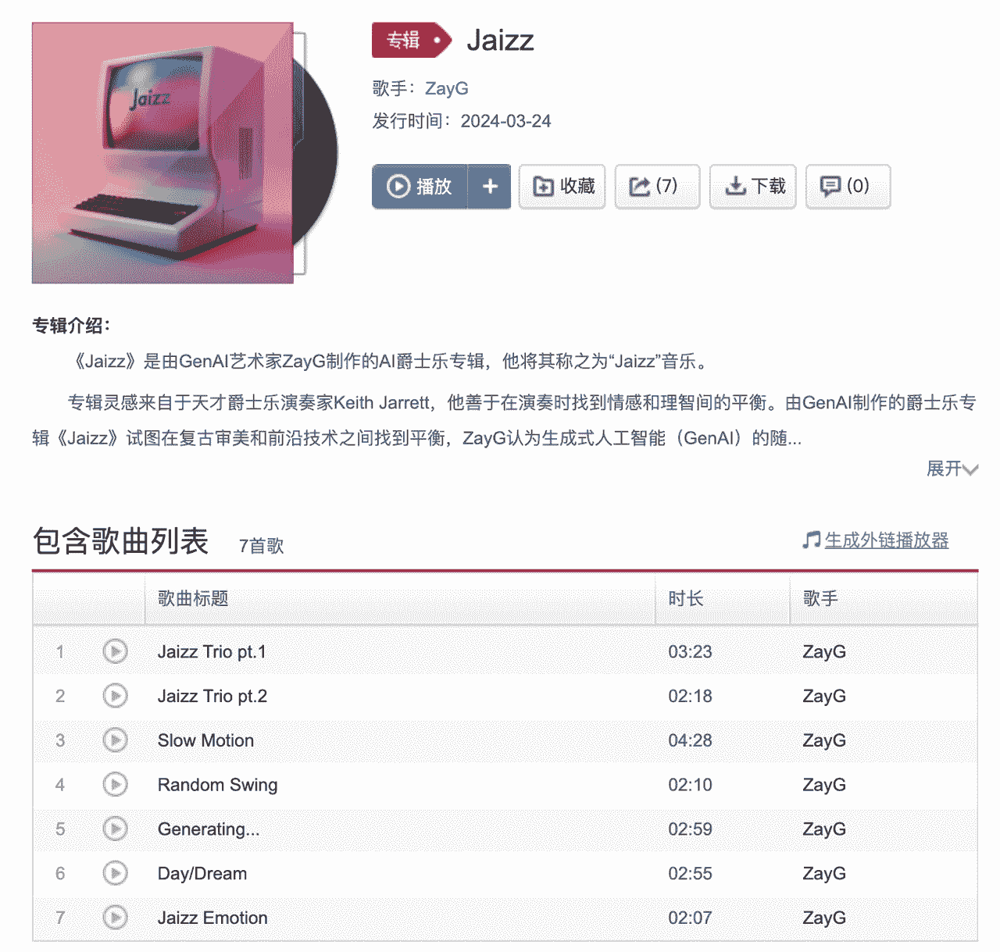

## 作者：海辛

Suno 感觉好适合给摇摆舞会做 DJ

poe 里的 `SunoChirpGPT`

[`Swing Dance.mp3`](https://internal-api-drive-stream.feishu.cn/space/api/box/stream/download/all/ZR30bH7FioyqdnxCcDicvc2onBe)

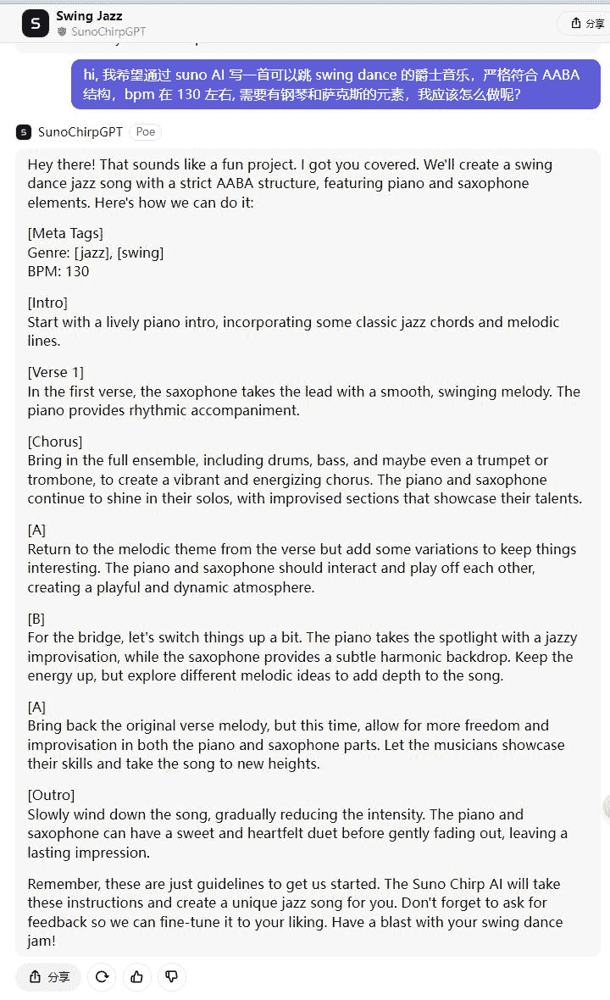

## 作者：李康Max

**提示词：** `Chinese folk, simple melodies, calm, man husky voice, Guitar`

**歌名：** 分手昨天

**创作思路：** 减少伴奏，使用类清唱，选择了民谣，歌曲复杂度降低。歌词自己编的，平时喜欢宋东野和赵雷。5次生成，中间有两次丢失歌词。一大堆不能用的，最后两个三等奖，两个二等奖。（一个还吃了我歌词。）

[`分手昨天-2.mp3`](https://internal-api-drive-stream.feishu.cn/space/api/box/stream/download/all/WPFHbWvIjoSAbNxxu6PcG6xJndf)

`https://app.suno.ai/song/8640a1b6-2b94-4598-8f6b-ee118056cd14`

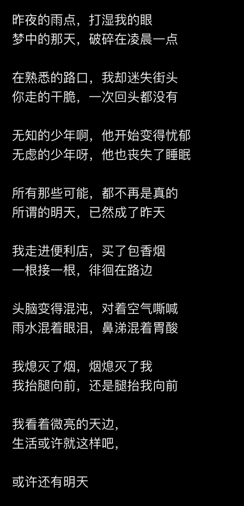

## 作者：静流

歌名：《おいしいコーヒー》-《咖啡美美》

歌曲背景：这首歌是为大小电波电台一期关于日本咖啡师大坊先生的播客做的片尾曲。

[`Vol.191 | 咖啡时间：和《大坊咖啡店`](https://www.xiaoyuzhoufm.com/episode/65a711bbdf55a80bdc842718?s=eyJ1IjogIjVlOTk2M2FlNDAwZWMxYTRkOWQxN2RjZSJ9)手记》背后的三个朋友聊聊他们喜欢的咖啡馆`

歌曲内容：日语，歌词关于大坊先生认真烘豆子，做美味的咖啡，有一只叫达米奥的小猫陪着他

歌曲风格：美国60-80年代的爵士乐，钢琴，大提琴，小号，贝斯，轻松一些，但不要太欢快

`Prompt：` `Toshio Oida, 60s-80s jazz style, featuring piano, cello, trumpet, and bass`

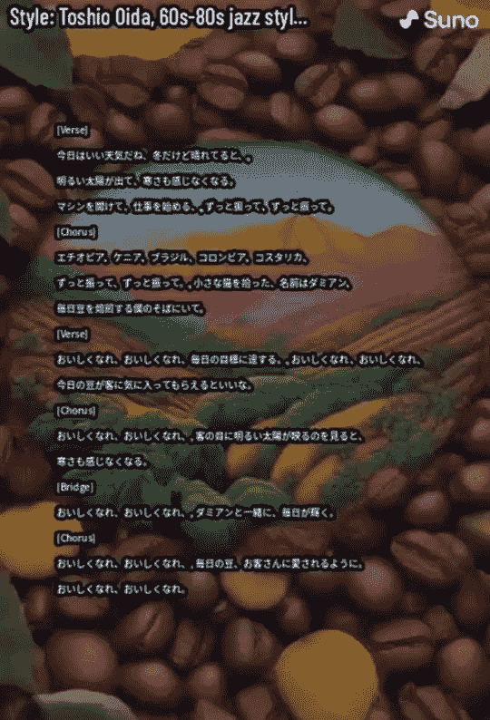

[`おいしくなれの歌.mp4`](https://internal-api-drive-stream.feishu.cn/space/api/box/stream/download/all/VzHZbhUuooG77hxlRpwc0yKQnvg)

歌词：

`[Verse]`

今日はいい天気だね、冬だけど晴れてると、

明るい太陽が出て、寒さも感じなくなる。

マシンを開けて、仕事を始める、

ずっと振って、ずっと振って。

`[Chorus]`

エチオピア、ケニア、ブラジル、コロンビア、コスタリカ、

ずっと振って、ずっと振って。

小さな猫を拾った、名前はダミアン、

毎日豆を焙煎する僕のそばにいて。

`[Verse]`

おいしくなれ、おいしくなれ、毎日の目標に達する。

おいしくなれ、おいしくなれ、

今日の豆が客に気に入ってもらえるといいな。

`[Chorus]`

おいしくなれ、おいしくなれ、

客の目に明るい太陽が映るのを見ると、

寒さも感じなくなる。

### [Bridge]

おいしくなれ、おいしくなれ、

ダミアンと一緒に、毎日が輝く。

### [Chorus]

おいしくなれ、おいしくなれ、

毎日の豆、お客さんに愛されるように。

おいしくなれ、おいしくなれ。

毎日の豆、お客さんに愛されるように。

### [Outro]

おいしくなれ、おいしくなれ、

毎日の豆、お客さんに愛されるように。

おいしくなれ、おいしくなれ。

## 创作心得

+ 欧美主流风格是suno更擅长的
+ 当前的AI Music工具因为是国外团队做的，做非英语歌曲效果差于英语，做小众风格效果差于欧美主流音乐风格
+ 目前无需乐理基础的AI Music工具可控性差，要做出好作品，还是需要很多人工。人工的部分体现在：
+ 好的创意：能够根据工具的特点，扬长避短做出90分内容
+ 热情和耐心：花时间打磨微调，通过与AI的交互让其完成你想要的效果
+ 开头和结尾是最难的
+ 做出好的开头成功了一半，因为后面的片段大概率能很好的延续
+ 让AI自然的结尾是一个难点，有时候会出现即使写了结尾的prompt，但它不结尾的情况

## 作者：AI.K.P.（Pandawei）

**提示词：**hard rock, rap, solo, band

**歌名：破碎玩偶**

**创作思路：**

1. 【前期构思】想做中文歌，在尝试多种曲风后，发现摇滚对中文的适配更好，于是就从摇滚入手。期待作品要有故事性，要押韵，前奏要听上去舒服，副歌要明显要燃。

1. 【主题确定】为了通俗易懂，符合潮流，我选定了一个意象“玩偶”，就是盲盒。然后通过和Kimi的对话，构思出了故事“我喜欢开盲盒、收集玩偶，但每个都不完美，有一天发现自己其实也是一个破碎的玩偶，最后和自己和解，修复自己，不负韶华”，从而得到了几首歌词，觉得很不错，可以继续优化。

1. 【歌词完善】中文Suno支持不是很好，韵律性比较差，所以对歌词要求比较高，所以我让Kimi反复出了好几版押韵的歌词，然后摘取拼接成了最终版本。这是我花时间最多的部分。

小技巧：目前大模型对中文押韵这件事理解很差，你可以喂给他一些押韵的词

1. 【歌曲抽卡】抽卡也是个痛苦的过程，一般情况就是能凑合听，但是要抽到好的品质也是比较难，我大概抽了30首左右才得到一首比较理想的歌曲。满足了我前期的基本设想。

小技巧：1）尝试调整歌词的长度，2分钟以内一次成型是最好的，如果需要续接，建议直接从曲末开始续接（不知是不是bug，从中间续接，无法控制）2）多理解提示词和音乐指示，能起到一定的控制效果。

1. 【成曲】费心思做出来的歌曲，有时间可以配个AI视频，据我观察会更有传播效果，这点很重要！单音乐传播度差很多。

**作品：**

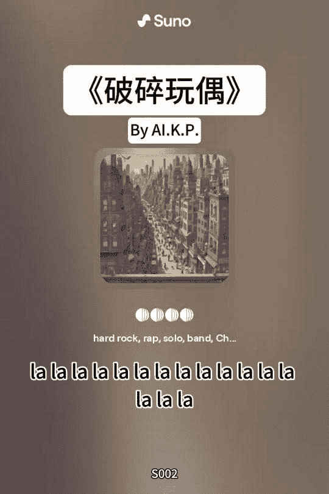

`https://internal-api-drive-stream.feishu.cn/space/api/box/stream/download/all/WSazb9VBaonMdNxr6HwctC5HnYc`

链接

`https://app.suno.ai/song/2f54e0d6-68b5-4d29-9d61-ca144f5d5508`

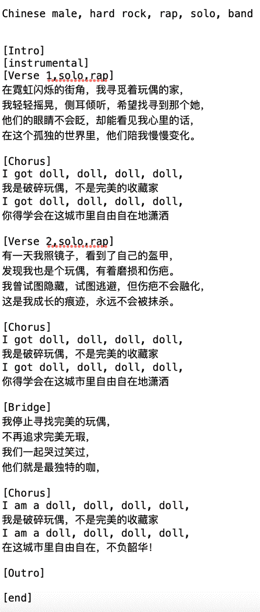

## 作者：waterkid

+ **歌曲名**：Live Life to the Fullest

+ **风格**：

+ **Prompt**：A rap-style song is required, with an old school vibe, leaning towards a British style. The lyrics should express that working is not the end goal; one must learn to enjoy life.

`https://internal-api-drive-stream.feishu.cn/space/api/box/stream/download/all/EULTbqA65oX0fxxi2QZcrZYInce`

`https://internal-api-drive-stream.feishu.cn/space/api/box/stream/download/all/MuaKbdkHgojEJ3xpsndc9tQ7naf`

`https://internal-api-drive-stream.feishu.cn/space/api/box/stream/download/all/Ov0YbwqCSoRcmbx1BKPclndXnub`

### [Verse]

Yo, I'm breakin' free from the monotony

Workin' nine to five just ain't for me

I'm seekin' freedom, gotta find a new way

Breakin' chains, yeah, I'm here to slay (ooh-yeah)

### [Verse 2]

Livin' life in a fast-paced world

But who said, "Work till you drop, boys and girls"?

Gotta find balance, gotta find the joy

Life's too short, don't let it annoy (uh-huh)

### [Chorus]

So put your hands up, wave 'em side to side

We're livin' life, ain't got nothin' to hide

We work to live, not the other way round

Yo, let's enjoy life, make every moment count

## 作者：AI设计师Lena

+ **歌曲名**：Love and Hate

+ **风格**：emotional orchestral dramatic

+ **Prompt**：Create an emotional song that is rich in emotion, romantic and profound, like a grand movie soundtrack, in which love and hate are intertwined and entangled, like the song "The Enemy" in Wuthering Hei.

+ **灵感：**来源于《呼啸山庄》，很喜欢2011版片尾曲<The Enemy>，试着写了一下，不过这首歌没有那种感觉，应该是我关键词没对，但这首音乐整体也还是很喜欢，除了副歌部分不那么好。

+ **歌词：**Suno生成

+ **翻译：**欢迎指正

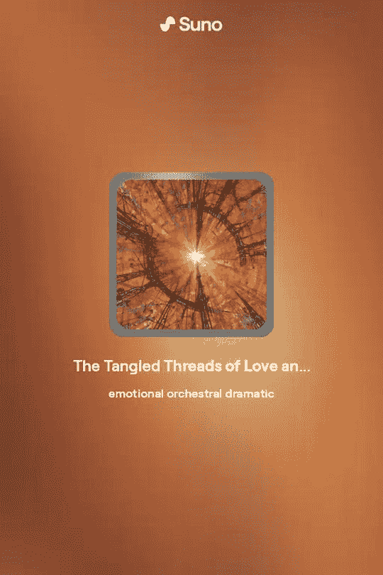

`https://internal-api-drive-stream.feishu.cn/space/api/box/stream/download/all/BBx0bAwE4oqqOmxZK4wc77oyn0b`

### [Verse]

In the darkness I find solace

在黑暗中我找到慰藉

In the depths of my despair

在我绝望的深渊里

Love and hate entwined, a fierce embrace

爱恨交织热烈相拥

A flame that burns, an endless snare

燃烧的火焰 无尽的束缚

### [Verse 2]

A tender touch, a whispered word

轻柔的触碰 低語的呢喃

Caresses that turn to wounds

爱抚已成伤痛

Passion and pain, tightly interwoven

激情与痛苦紧密交织

An eternal dance, forever doomed

轻舞不止 注定纠缠

### [Chorus]

With every breath, I feel the fire

每一次呼吸，像被火焰吞噬

Love and hate collide, desire and ire

爱恨交织 欲壑难填 愤怒难抑

In this bitter sweet symphony

在这苦乐参半的交响乐中

The tangled threads of love and hate set me free

爱恨交织的漩涡让我自由

## 作者：Wubba（持续更新不同曲风专辑）

正在持续使用Suno制作不同曲风的专辑。

目前已更新：一张EDM专辑/一张Jazz专辑/一张ACG专辑/一张Pop Electronic专辑

### EDM专辑：

`https://music.163.com/#/album?id=190005232`

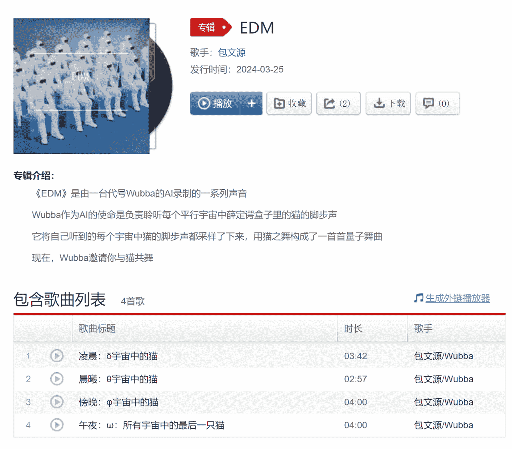

### Jazz专辑：

`https://music.163.com/#/album?id=190112186`

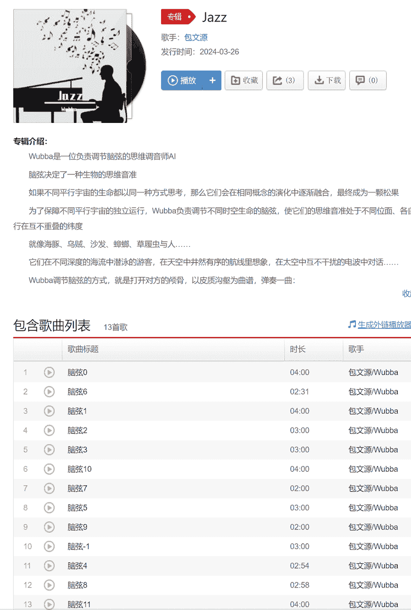

### ACG专辑：

`https://music.163.com/#/album?id=190249060`

（联动midjouney：`https://docs.qq.com/doc/DRXp2enZkcnhLUGtN`）

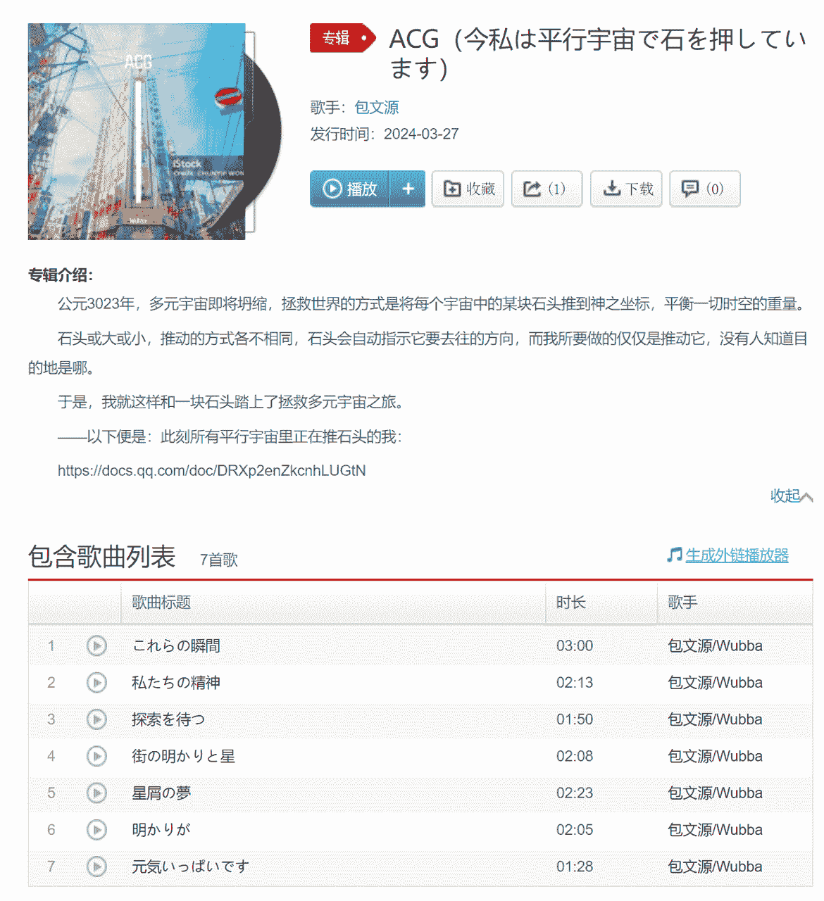

### Pop Electronic专辑：

`https://music.163.com/#/album?id=190497967`

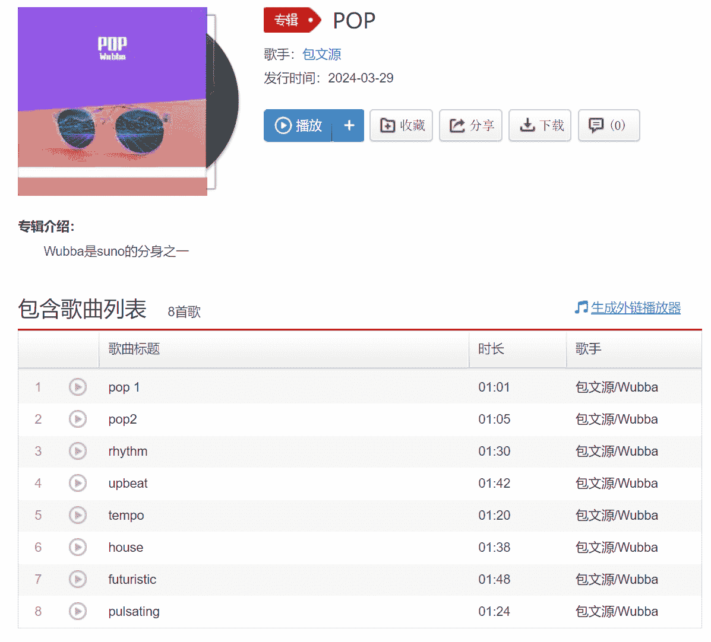

## 可以脑洞大开

### 社区 top 作品及群友作品

| 歌曲名 | 风格 | 链接 | 作者/歌词 | 备注 |
| --- | --- | --- | --- | --- |
| **客户请百度** | Pop | `https://app.suno.ai/song/60e8f164-eeca-451a-b51c-67b82ec351ad` | **歌曲名：客户请百度** | 第一句男声有点出戏，但是第二句女声出来后非常惊艳！ |
| | 民谣 | | 杨元 | |
| | rap | | 猫叔 | 法老的歌词直接丢进去 |
| | | | 阿肯 | 一首只有“汪”组成的歌 |
| | | | 阿肯 | 一首只有“喵”组成的歌 |
| | | | 阿肯 | 写给通往AGI之路 |
| | | `https://app.suno.ai/song/442c1388-c425-41aa-843c-5393692d275e` | 猫叔 | 权利游戏系列1 |
| | | `https://app.suno.ai/song/9cc4596d-4c4e-41cf-b4e1-c428a4df98c4` | 猫叔 | 权利游戏系列2 |
| | | `https://app.suno.ai/song/eff648b8-8de8-464a-94ba-cda380852db4` | 猫叔 | 权利游戏系列3 |
| | | `https://app.suno.ai/song/7915d118-4124-4ba1-8880-2ed03992a8fc` | 猫叔 | 女儿做的喵星人舞曲 |
| 恐龙妈妈提笔忘字 | jpop | `https://app.suno.ai/song/5fa2daaa-581b-4f73-9822-93241d853124/` | | |
| | | `https://app.suno.ai/song/6de54942-2744-4c79-8bbe-5084f53bf04c` | 猫叔 | 复仇者祸精 吐槽版 |
| | pop,romantic,soft-pop | | 玄德 | [Verse 1] |
| 身骑白马 | Pop-folk/Soft Pop | | 玄德 | [Verse 1] |
| **父爱如山** | 温情 | | GREG蓝天 | v3版本 |
| **八百标兵** | rap | | 绕口令 | |
| **Rockin' Meow** | rock摇滚 | | 可可 | **Rockin' Meow** |
| 打工人 | Rock, Rebellious, Cynical, Guitar, 9-5 Work Life, Angsty Male Vocals | | [instrumental intro] | 参考卡兹克的歌词生成prompt； |
| Rain(日文歌) | Japanese | | 作者：十七 | 日文歌 |
| | aggressive trap | `https://app.suno.ai/song/b3da854e-b699-4a5f-8ce4-956f20f812ca` | 猫叔《将近酒》 | |
|  | nordic folk | `https://app.suno.ai/song/0a9c895a-8b4f-4d57-bb2a-d5f3118b1d43` | 作者：静流 | [E. E. Cummings](https://poets.org/poet/e-e-cummings)的诗《somewhere i have never travelled》 |
|  | Folk, Soft, Ethereal, Acoustic Guitar, Piano, Warm Gentle Female Vocals | `https://app.suno.ai/song/0f03ef36-3d92-4c3c-8a8e-62df7a7a767b` | 作者：阿杨 | 写给自家金毛的歌，用GPT生成歌词 |
| | Duet | `https://app.suno.ai/song/f67961c3-9ee0-4515-af5e-fdb173b7284c` | 作者：Keen | 男女二重唱，纯属实验，目前英文版抽取概率大些，这部分提示词先放这里供大家学习参考，新提示词还在改良中... |
| | | `https://app.suno.ai/song/8c10c41d-819d-4842-a18c-97c9a682f5f3` | 作者：Michael | |
| | | `https://app.suno.ai/song/82d4fbf8-406e-4d65-8b32-a3f71184e3c9` | 作者：kingson | Male、Chinese-style music similar to Jay Chou's style、Troubadour、Classic |
| | | `https://app.suno.ai/song/f783bf8d-3fac-479d-940c-e696848af234` | 作者 METAL | Rap metal,Live music.Guitar solo,Male singer, Band arrangement |

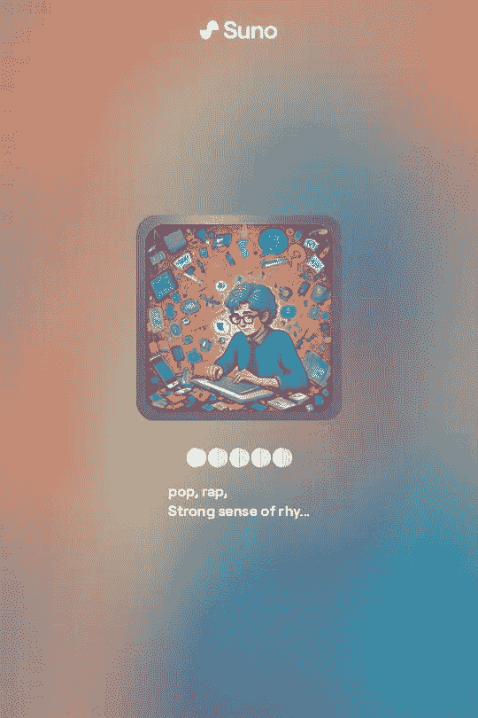

[客户请百度.mp4](https://internal-api-drive-stream.feishu.cn/space/api/box/stream/download/all/JytebAByJoWgfNxcVFWc6TDCnfH)

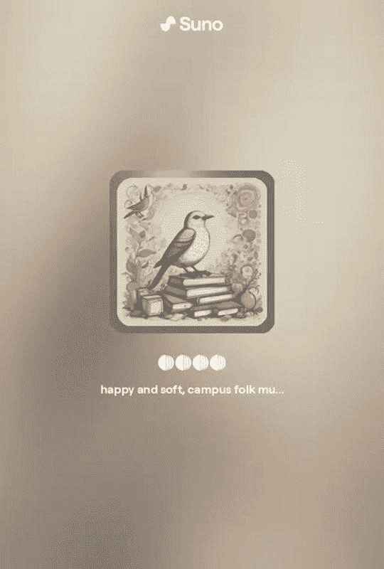

[5141_1711208861.mp4](https://internal-api-drive-stream.feishu.cn/space/api/box/stream/download/all/Jsoob1XR8oHFt1xvhhGcYixAn1w)

[5149_1711209631.mp4](https://internal-api-drive-stream.feishu.cn/space/api/box/stream/download/all/KYGVbABWuoX6gyxVfYjc7LLDnKd)

[2477_1711098519.mp4](https://internal-api-drive-stream.feishu.cn/space/api/box/stream/download/all/CWZGb5NXNohkswxVnEJcE2sknxd)

[2468_1711097601.mp4](https://internal-api-drive-stream.feishu.cn/space/api/box/stream/download/all/L8dIb91OFoAJkxxizOPchsQWnZf)

[铁王座之战歌.mp4](https://internal-api-drive-stream.feishu.cn/space/api/box/stream/download/all/EABVbZJEVohm0WxWiiJc5kIqnMd)

[铁王座-流行版.mp4](https://internal-api-drive-stream.feishu.cn/space/api/box/stream/download/all/GFWobVIWUoIHFDxNFLecY69Nnfg)

[铁王座——rap版.mp4](https://internal-api-drive-stream.feishu.cn/space/api/box/stream/download/all/Mt5xbZgKlo68FbxqZD8cKDDknic)

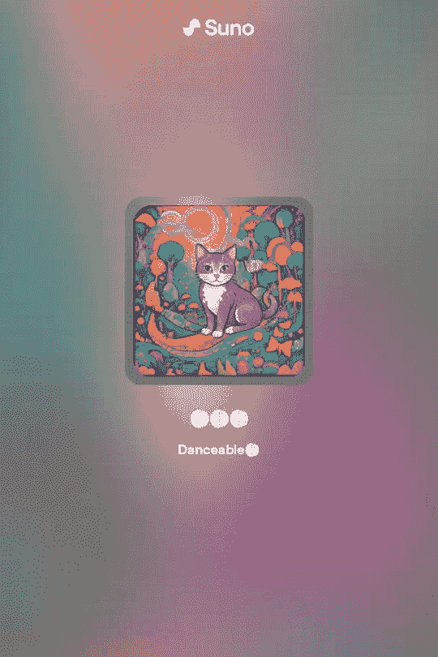

[喵星人.mp4](https://internal-api-drive-stream.feishu.cn/space/api/box/stream/download/all/HxaVbSFQjoDP8Fx8f4xc1KhZnKe)

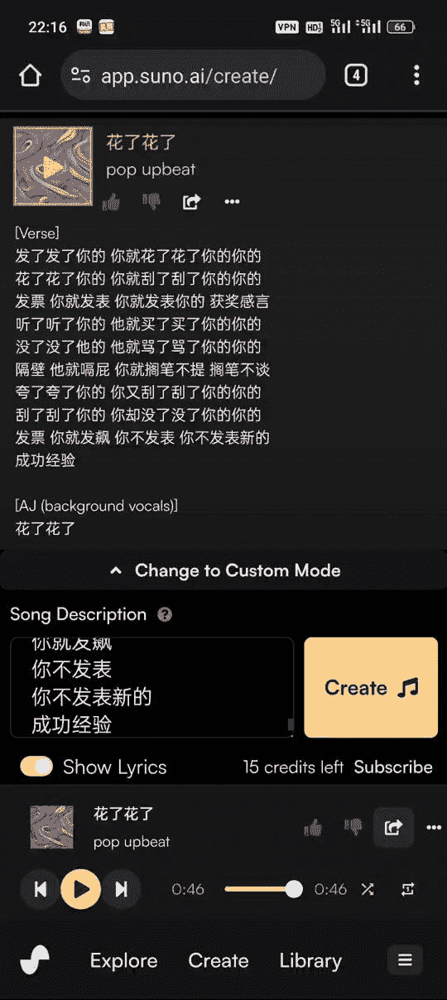

[2755_1711254290_raw.mp4](https://internal-api-drive-stream.feishu.cn/space/api/box/stream/download/all/O8nhbbtGPoUWzlxh8NZcgRTQnif)

[复仇者祸精A版.mp4](https://internal-api-drive-stream.feishu.cn/space/api/box/stream/download/all/XArAb8KVzoKjJixFOuhcDnOEnMe)

[君不见黄河之水天上来，奔流到海不复回。 (1).mp4](https://internal-api-drive-stream.feishu.cn/space/api/box/stream/download/all/MVUKbTf9Qo97TjxRYGrcisXsnhg)

[Duet.mp4](https://internal-api-drive-stream.feishu.cn/space/api/box/stream/download/all/WZ3Ebru8goxwbHxxcCaccquGnDb)

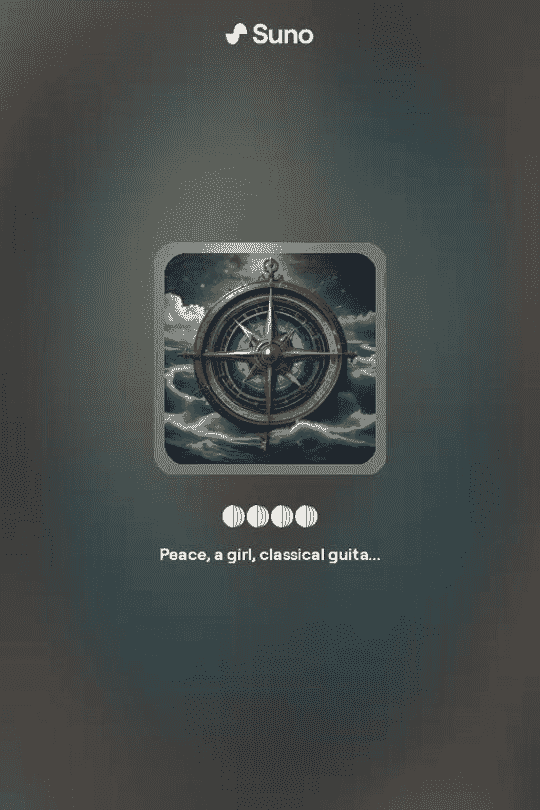

[165_1711452466_raw.mp4](https://internal-api-drive-stream.feishu.cn/space/api/box/stream/download/all/Mdgubj8jcoQDPkxKLvOcxOhCnJg)

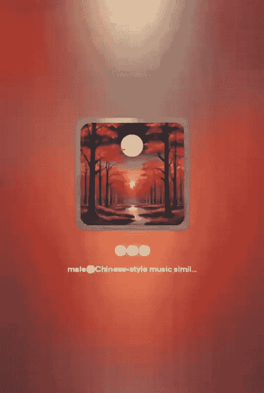

[游子伤.mp4](https://internal-api-drive-stream.feishu.cn/space/api/box/stream/download/all/R3E5bZOxIoLQbwxLGGqcWf74nj7)

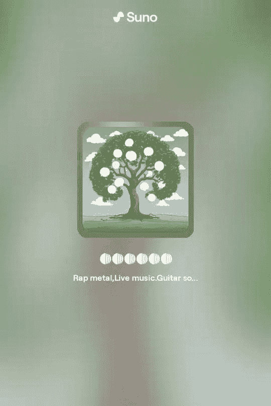

[对你有点失望.mp4](https://internal-api-drive-stream.feishu.cn/space/api/box/stream/download/all/OaLpbSC9Xo7J0WxIzGicCv3RnE4)
