# Suno 操作指北 V1

> 来源：[https://xmgtoagi.feishu.cn/docx/LDYCd0qYHoCi0AxoI13cKruRnHf](https://xmgtoagi.feishu.cn/docx/LDYCd0qYHoCi0AxoI13cKruRnHf)

> 作者：刘润梓、陈浚嘉投稿

> 他们在做AI音乐相关的内容，公众号叫：智音Brook

## 背景介绍

Suno 是一家研究驱动型的人工智能公司，其专门研发生成式AI模型，为创意工作者提供强大的创作工具。公司推出的Chirp模型，通过文字描述就能生成逼真的音乐和声音效果。用户只需输入文字，Chirp就能即时转换生成配乐、人声、音效等，可广泛应用于游戏、短视频、播客等创意领域。作为行业领军企业，Suno正在以科技改变音乐内容创作，为更多创意工作者提供帮助。Chirp模型的推出标志着Suno在AI生成音频领域取得新的进展，有望迎来行业变革。

官方地址：https://www.suno.ai/

## 官方说明

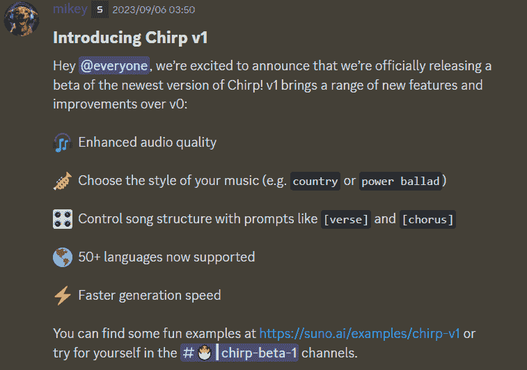

官方计划提供每天免费5次生成机会，不得累积，Chirp v1是Suno在今年九月份推出的版本，目前推出网页版功能，可最多生成1分20秒的音频，由于网页版功能不完善，下面将以discord版本为大家介绍。

## 基础操作

1.  注册 [discord](https://discord.com/)，在 [Suno ](https://www.suno.ai/)官方地址加入discord

1.  在消息栏输入 /chirp

1.  按下 Enter，将出现一个弹出窗口

1.  输入你歌曲风格以及歌词到对应框中，或者在Chirp提供的ChatGPT框中输入关键词让AI帮你生成

1.  点击提交

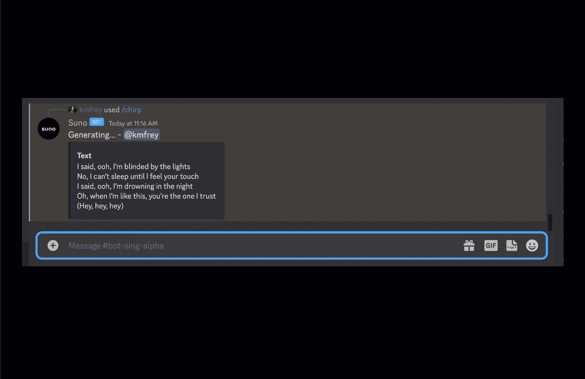

Chirp操作

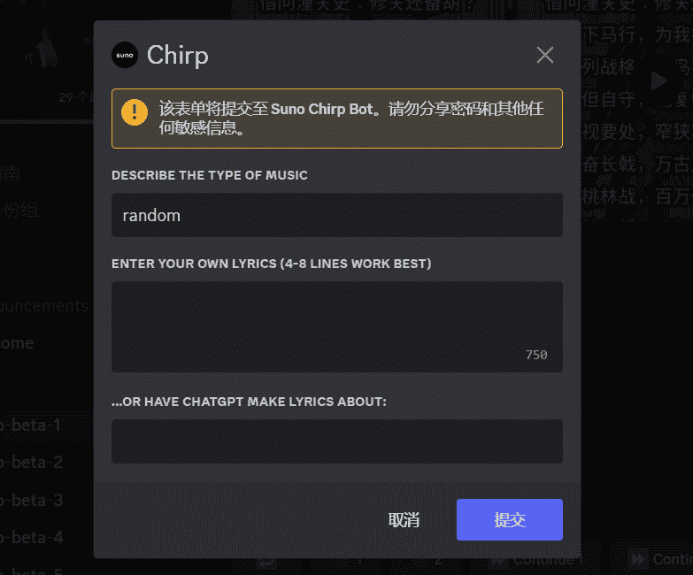

Chirp v1更新了类型描述窗口

提交完成后，等待2-3分钟，即可生成两个示例音频，目前Chirp最多可生成40秒的音频。

生成的两个示例音频，比如你喜欢第一个，就点击⏩Continue 1，Chirp就会弹出Continue窗口，你可以继续填入你想要的歌曲风格和歌词，点击提交，Chirp会根据你的提示生成新的两个示例音频。

如果你觉得生成的两个音频不满意，可以点击🔁，Chirp会弹出窗口提供修改，点击提交即可生成新的两个示例音频。

当你延续生成足够多的音频，想要将它们连接起来生成一个完整的音频，可以点击最后想要的音频所对应的❤️，Chirp会自动帮你剪接之前所选的音频并生成完整音频，这个过程不需要消耗次数。

延续音频流程：/Chirp输入→⏩Continue→⏩Continue→❤️

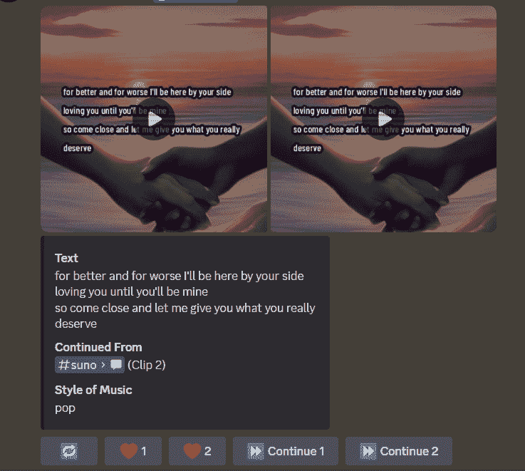

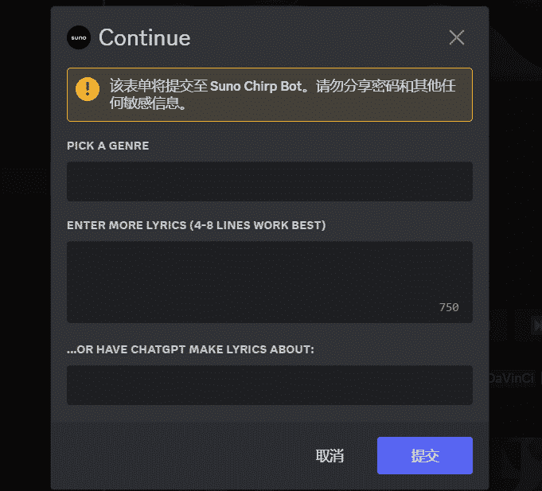

## 功能介绍

### 生成类型

**歌曲**

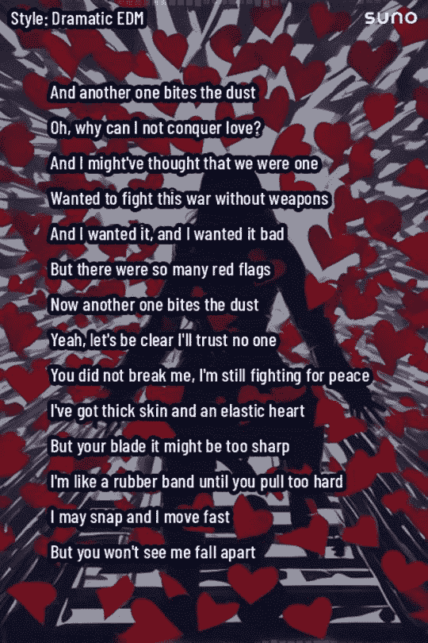

[类型1.mp4](https://internal-api-drive-stream.feishu.cn/space/api/box/stream/download/all/Fq4Mb5rcToSGj6xMrE2cp4q1nfg)

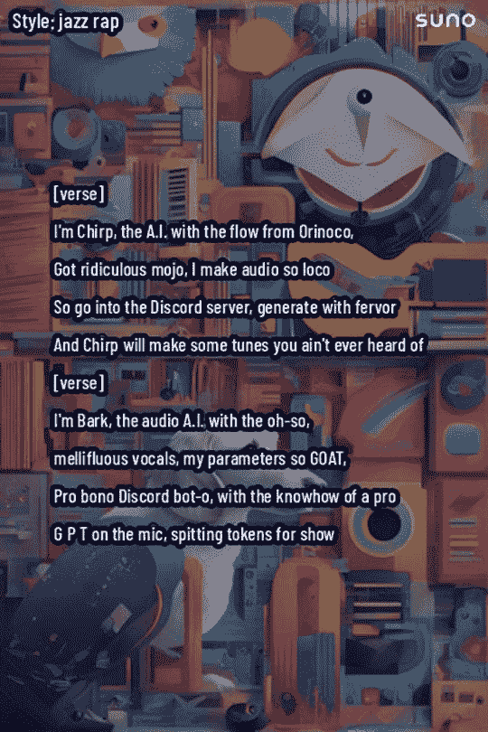

[类型2.mp4](https://internal-api-drive-stream.feishu.cn/space/api/box/stream/download/all/Z1CibV8aUosd5XxKW8lcHBxZnRh)

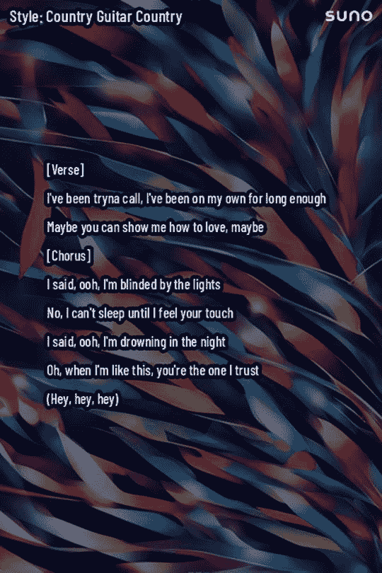

[类型3.mp4](https://internal-api-drive-stream.feishu.cn/space/api/box/stream/download/all/IfsQbRMNDo8ZDkxggH3c7A0UnEk)

**纯音乐**

[纯音乐1.mp3](https://internal-api-drive-stream.feishu.cn/space/api/box/stream/download/all/B727bkHtMoaXEfxKSHrcta6intc)

advertisement jingle music, ukulele, hawaiian, tropical, island, happy, upbeat

[纯音乐2.mp3](https://internal-api-drive-stream.feishu.cn/space/api/box/stream/download/all/VQkvbbjz8oW7SoxkpkqcS9Ltnkg)

dramatic piano music, fast paced, suitable for a big concert hall

### Chirp输入框

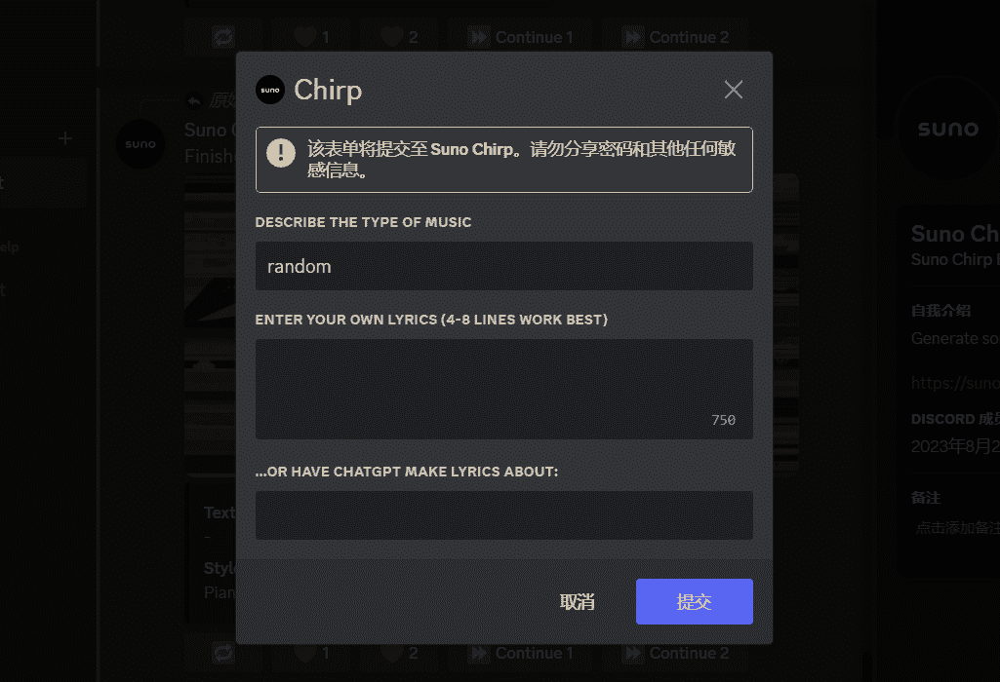

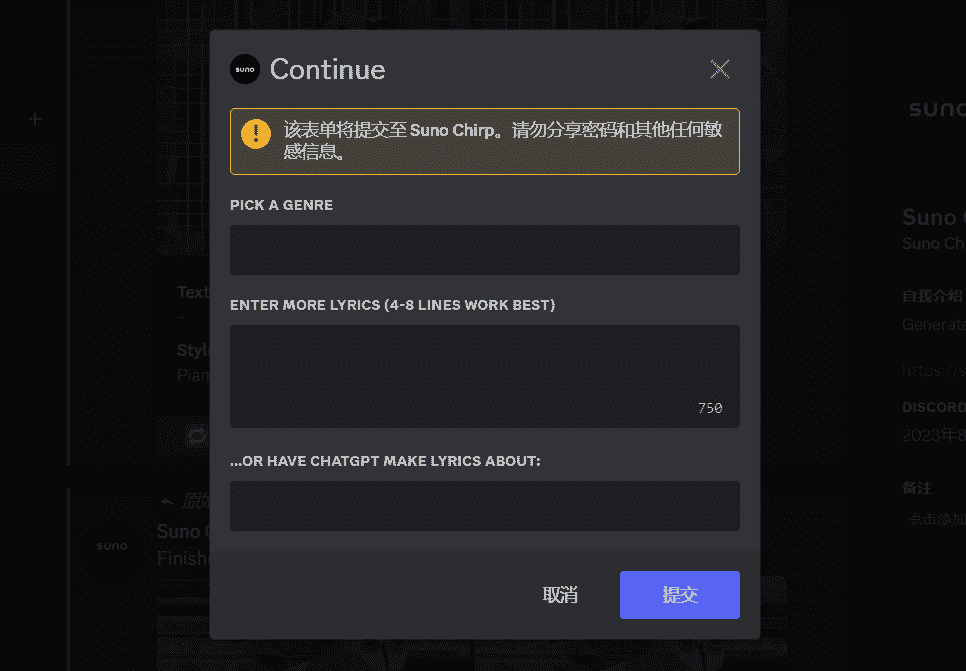

#### 类型描述功能

类型描述功能是Suno在Chirp v1版本时推出的，在框中可输入像 rock,  country和edm等流派，也可以使用欢快(upbeat)和旋律(melodic)等描述词，以及两者的组合，如 upbeat edm ；像 vaporwave polka , enka bluegrass , bluegrass dubstep 这类相对少用的描述词Chirp可能会识别不出来；关于艺术家词语，如Drake、Frank Sinatra等，Chirp可能识别不了。

##### 书写规则

1.  在填写描述词时，词与词之间要用英文逗号 , 隔开，像 pop, male；

1.  关于词性，像 pop rock 与rock pop 意思是不一样的；

1.  在Continue的时候，如果将“音乐类型描述”一栏留空，Chirp将延续上一段的风格进行创作；

1.  可以尝试使用与你上一段相同的风格，在此基础上每次改变1-2个提示词，这样会更有趣，尽管在Continue 5次之后质量可能会开始降低，但还是值得一试。

#### 歌词输入功能

歌词输入是Suno最开始推出的Chirp v0版本功能，Chirp会根据输入的歌词生成对应的背景和歌曲，到v1版本后可以输入像 [verse] , [chorus] 这类的元标签来控制歌曲的结构。

##### 书写规则

1.  歌词的输入最好控制在4-8行左右，生成的效果最好，过长的歌词可能导致Chirp忽略部分提示或产生幻觉；

1.  在输入歌词时需要换行，避免冗杂，在段落与段落之间需要空一行；

1.  行尾处不要添加任何标点符号，不然会影响生成效果,但在行中间添加 , 可以；

1.  可以在歌词末尾添加带有 () 的单词表示旁白（即兴），也可以用在歌词中间，但效果会差一些。

官方说明：https://suno-ai.notion.site/Tips-Tricks-Chirp-v1-969852c74c644c6b8262ec5c5be2325c

## 进阶操作

为了更好地学习后面的实战部分，这里我会介绍两个东西，一个是元标签，一个是歌曲风格的选定。

### 元标签

这里的元标签，主要是充当引导、提示的作用，就像指挥家的手势一样，你可以使用元标签来进行描述，像[laughter] [whispering] [spoken]等,还有像描述歌曲结构中的[intro] [verse] [chorus]等，有很多种，目的只有一个，就是让Chirp能准确读出你给的指示。在Chirp中，元标签没有大小写之分。

格式书写如下：

[元标签]

***********

***********

********* **

官方元标签文档：https://suno-ai.notion.site/Using-Metatags-34944efe09ec41d693e314f13af44695

### 歌曲风格的选定

想要创作好一首歌曲，风格，氛围，场景，乐器这几种元素必不可少，虽然我们能将我们的描述投喂给ChatGPT让它帮我们生成，但还是有些局限，比如生成的音乐不符合预期，想要再加入点什么乐器又无从下手，想要有个可以参考的东西又找不到...，所以我提供了下面几种方法。

#### 歌曲分析网站

链接入口:https://sonoteller.ai/

sonoteller.ai 能够根据你输入的歌曲链接进行数据分析，你可以投喂歌曲链接给它，等待1-2分钟左右，它会生成一份关于歌曲的分析报告，报告包括歌曲的主题，风格，情绪，乐器，节奏等方面，目前sonoteller.ai 仅支持YouTube的视频链接，如下图：

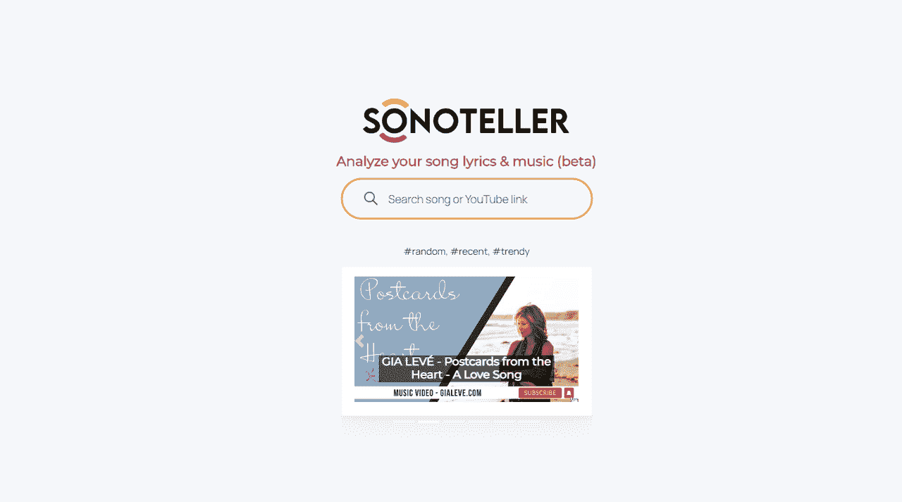

主界面

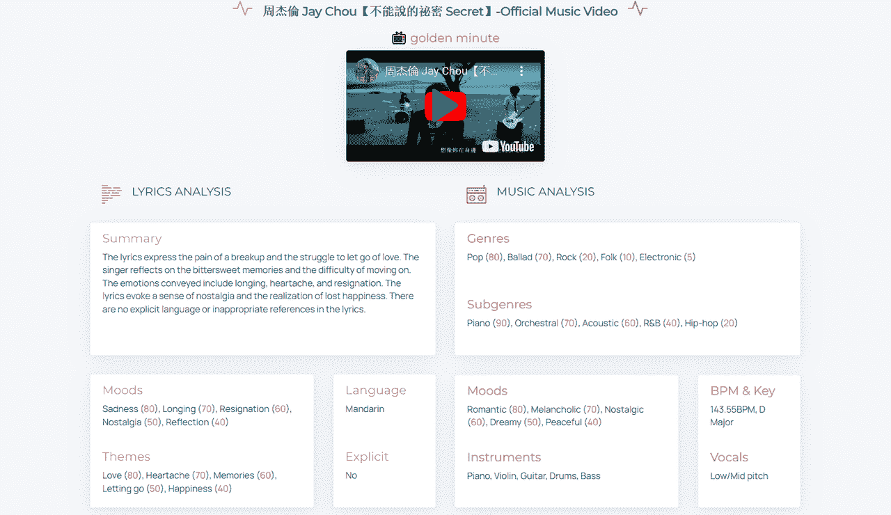

《不能说的秘密》歌曲分析结果

#### 音乐流派网站

链接入口：https://everynoise.com/

Every Noise at Once是一个持续进行的尝试，使用算法生成的、可读性调整的音乐流派空间散点图，基于Spotify对6284个流派形状的区分进行的数据跟踪和分析，目前更新时间为2023-11-09。校准是模糊的，但一般来说，向下更有机，向上更机械和电子化；向左更浓密和大气，向右更尖锐和有弹性；点击任何内容可以听到其音频示例，点击流派上的 » 可以查看对应的艺术家地图。

主界面

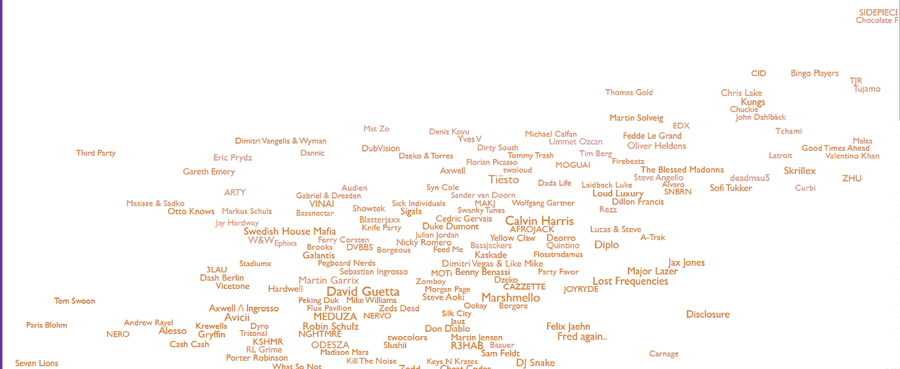

艺术家地图

#### 探索音乐的全能网站

链接入口：https://www.chosic.com/

可以称为everynoise的Xplus版本，功能非常强大，可以搜索艺人，风格，情绪，主题等等，歌曲不仅有各方面的分析，还有推荐列表可供选择。就是广告有点多。

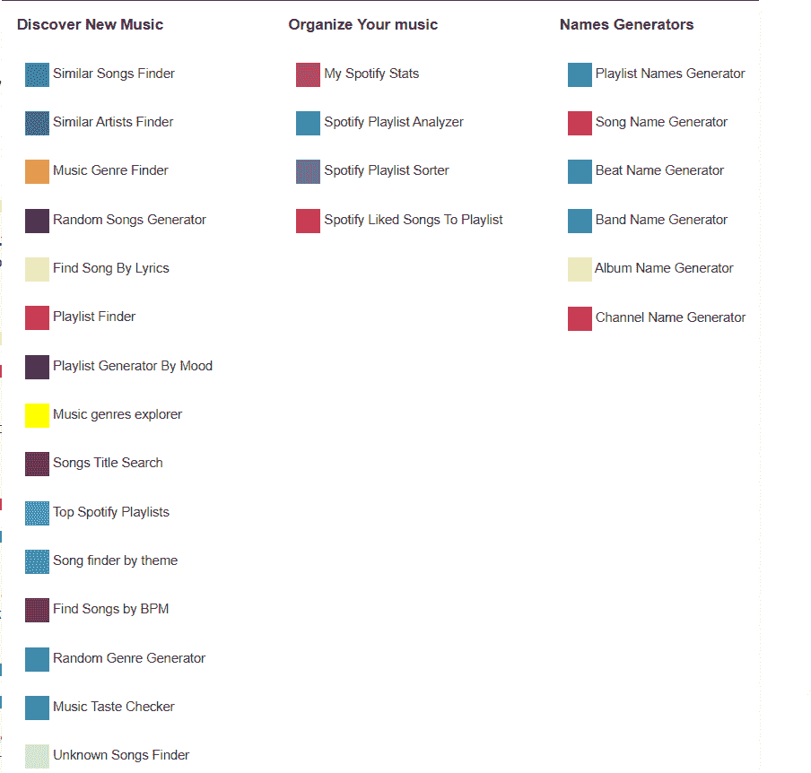

## 实战部分

在这一部分，我会着重讲解前奏该如何去生成，以及一些注意事项，来帮助更好地生成完整音频。

在歌曲中，我们一般是按 前奏[intro]→主歌[verse]→副歌[chorus]→间奏[interlude]→主歌[verse]→副歌[chorus]→桥段[bridge]→主歌[verse]→尾奏[outro] 这个顺序进行的。我对这个顺序进行了调整，优化为下面的结构：

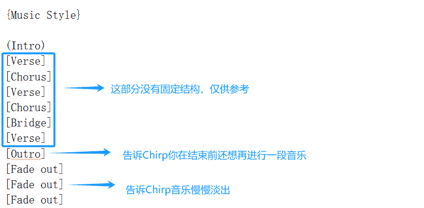

### 前奏

在歌曲中，我们需要通过前奏来确定整首歌曲的基调和旋律，所以在这里，我会介绍两种关于生成前奏的方法

#### 歌曲顺序生成

这里的话，我会从intro—verse入手，还是那个问题，要让Chirp能够准确地读出你给它的指令。intro 部分一般情况下只是一段旋律，没有歌词，所以我们需要特殊处理，把它作为一个独立部分与verse隔开，这里用一些括号进行处理，可以是(intro)—[verse] ，intro—[verse]，(intro),(verse)，我个人比较倾向于用第一和第三种，下面是生成例子：

[1.mp4](https://internal-api-drive-stream.feishu.cn/space/api/box/stream/download/all/CcirbnJJ1ofOUtxJMVscFKcGndh)

[2.mp4](https://internal-api-drive-stream.feishu.cn/space/api/box/stream/download/all/OroMbcwytoyhHnx1Ov2c4r3hnha)

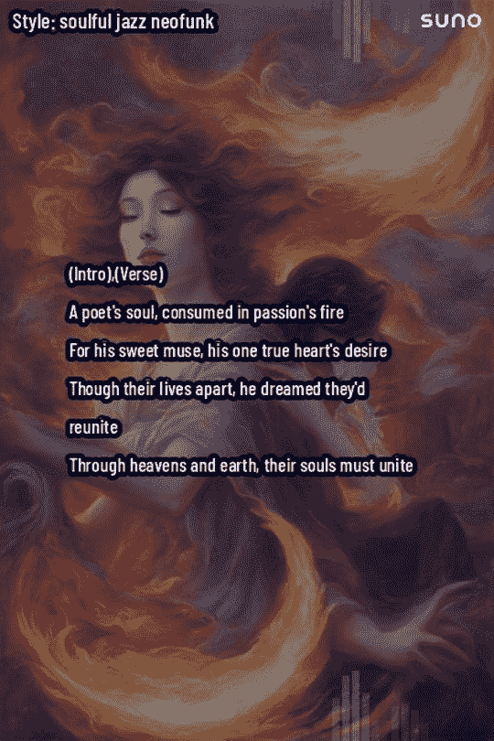

[3.mp4](https://internal-api-drive-stream.feishu.cn/space/api/box/stream/download/all/HjvdbCThuoOSwYxpDu6c1UyVnFy)

为什么不能是[intro]—[verse]，因为这样意味着Chirp会把这两个元标签进行合并处理，从而使生成的音乐没有一段旋律前奏，但也不是说这样不好，合并了的元标签意味着你的旋律与主歌同时进行，相互叠加下能增强歌曲的动态效果。

拓展：

在说唱，摇滚乐，流行乐中会有Intro包含歌词的情况，一般是一小段，用来增强歌曲的表现力，这个时候就不用特殊处理了。

假如我想要在前奏加点乐器，该怎么写呢？比如说jazz风格，我想要加入个萨克斯进去？

可以用(intro,saxophone,instrumental)表示。

还记得前面提到的歌词书写规则吗？每次的生成，输入歌词行数最好在4-8行，因为Chirp最长只能生成40秒的音频，你输入过多，Chirp会努力去唱完这些歌词，所以速度会变快，以致生成质量会变差，所以要控制好输入的内容，尤其是在开头部分，我的建议是第一个音频生成只放两个段落，即intro—verse 或 verse—chorus，生成的音频更稳定。

#### 利用Chirp的特性生成

进入这部分，首先需要了解Chirp的一个特性——它会对第一段生成音频的最后10秒内容进行采样，作为第二段及后续生成音频的一个创作焦点，焦点内容可以是声音、节拍、乐器等，如果最后10秒内容的声音减弱或者杂乱，Chirp会在第二段结束这个焦点并生成新的内容。

下面是Chirp采样成功的例子，感受下：

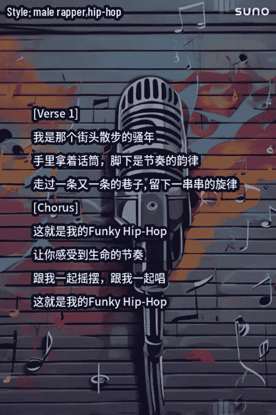

[中文rap.mp4](https://internal-api-drive-stream.feishu.cn/space/api/box/stream/download/all/CYqtbwy5mob7fCxr5Eoc68PlnQf)

像上面这个例子，确实很好地延续了创作焦点，但是这个歌曲结构并不能增大生成创作焦点的概率，在论坛上有人提出用乐器去辅助生成创作焦点，所以我根据其提出的结构进行了优化，整合为新的结构：(intro)—[乐器1]—[乐器2]—[instrumental]，下面是生成例子：

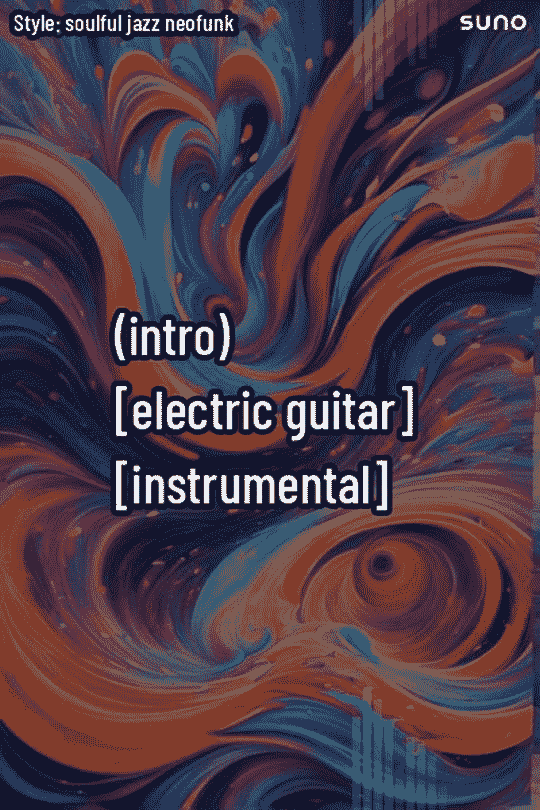

[4.mp4](https://internal-api-drive-stream.feishu.cn/space/api/box/stream/download/all/A5ZEbETBtoF4x6x8zBTcEBfMnCh)

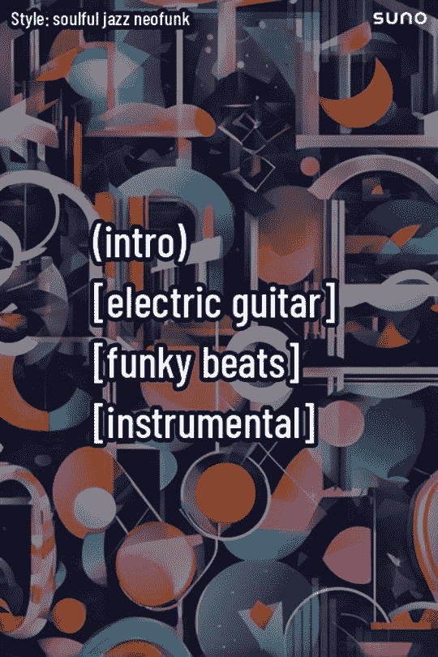

[5.mp4](https://internal-api-drive-stream.feishu.cn/space/api/box/stream/download/all/Bnbtbic6FoYHhNx8zWXcVoCRnKb)

当然也可以把instrumental 换成 melodic instrumental，效果是这样的：

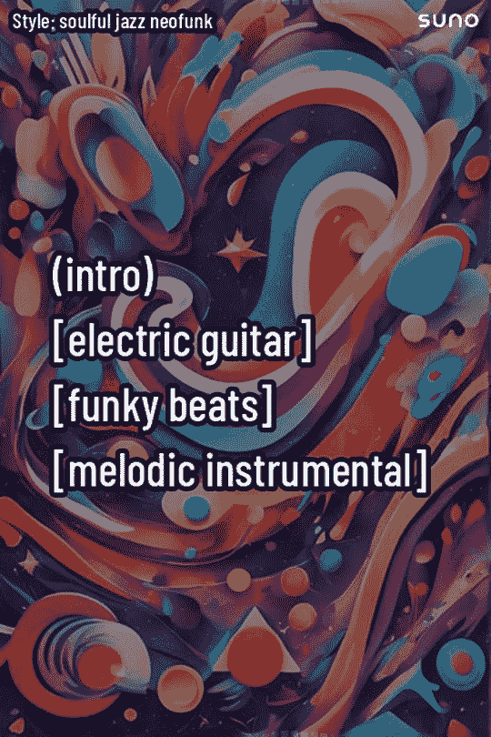

[6.mp4](https://internal-api-drive-stream.feishu.cn/space/api/box/stream/download/all/QzWob8XA6oW5AnxTxOycOwTWnZc)

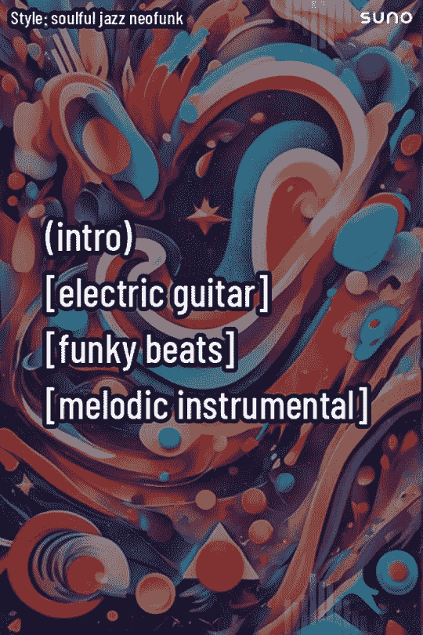

[7.mp4](https://internal-api-drive-stream.feishu.cn/space/api/box/stream/download/all/QMWbb9ACgoiWQIxKHX6cSi9Ynof)

拓展：

如果你想在第二段再添加一些乐器，可以输入[乐器1]—[乐器2]—[instrumental]让Chirp去生成。

可以加入类似Wawawa Ahhh这类词语，能改变一些音质，有些时候Chirp是不唱这些词语的。

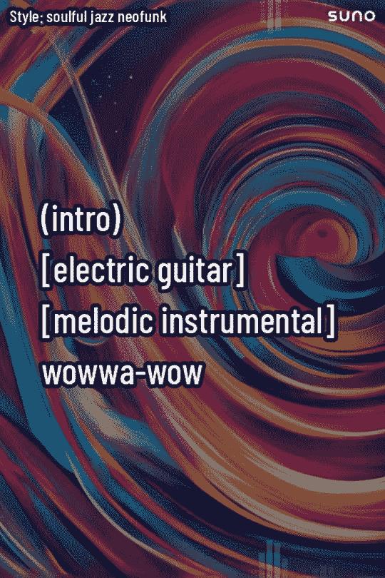

[8.mp4](https://internal-api-drive-stream.feishu.cn/space/api/box/stream/download/all/O9esbpCTBohoVmxmBoXcjtESn5e)

完成了前奏部分，其实已经解决了大部分的问题，后面的按歌曲结构顺序依次放进即可。

注意：

Chirp会优先识别你输入的元标签，所以在输入的时候结构不要混乱。

如果你想要在音频延续上一直保持着相当的质量，那需要遵循歌词书写原则。

拓展：

在元标签中，我们可以添加类似Match vocals at starts,break这类提示词，告知Chirp该段落要如何演绎。

如果你想强调歌词中某个单词的音高，可以试着把它全部大写。

在延续生成了几次音乐后，Chirp可能会变声，比如女声变男声。

你可以重复一部分歌词，Chirp会以为它在唱副歌，它就会改变旋律。

## 作品赏析

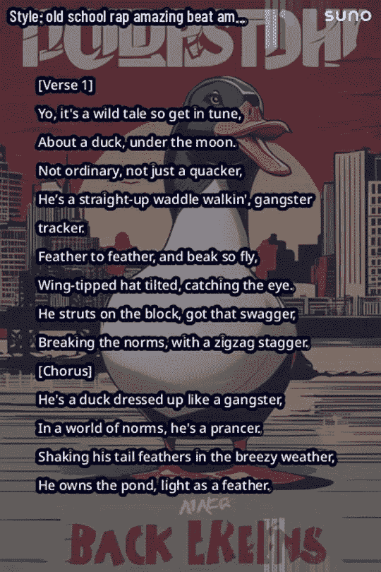

[案例11.mp4](https://internal-api-drive-stream.feishu.cn/space/api/box/stream/download/all/KM7dbpER2o3CqGxEdeBc4e5fnLe)

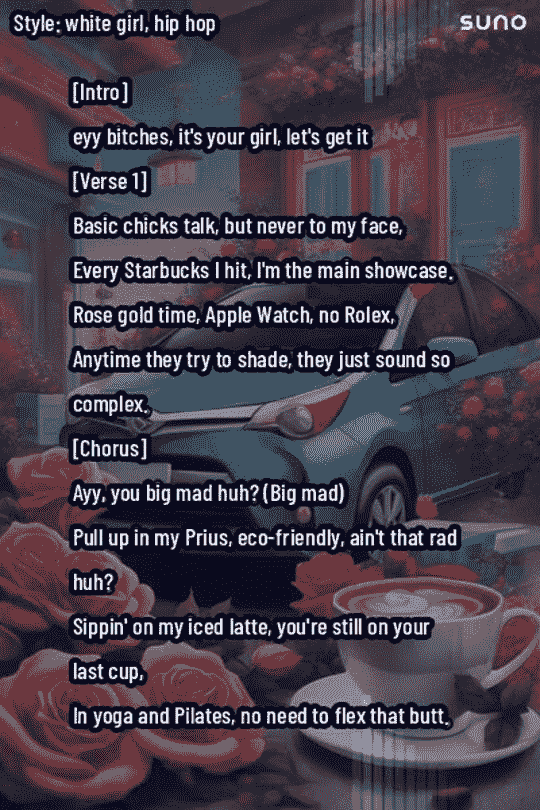

[案例12.mp4](https://internal-api-drive-stream.feishu.cn/space/api/box/stream/download/all/WLIGbEM2Poc7k8xnyv2cmpNgn2f)

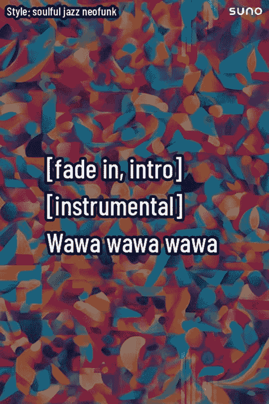

[soulful jazz neofunk.mp4](https://internal-api-drive-stream.feishu.cn/space/api/box/stream/download/all/Z7Y5b8ZrFok6AaxpPPScM4QmnEf)

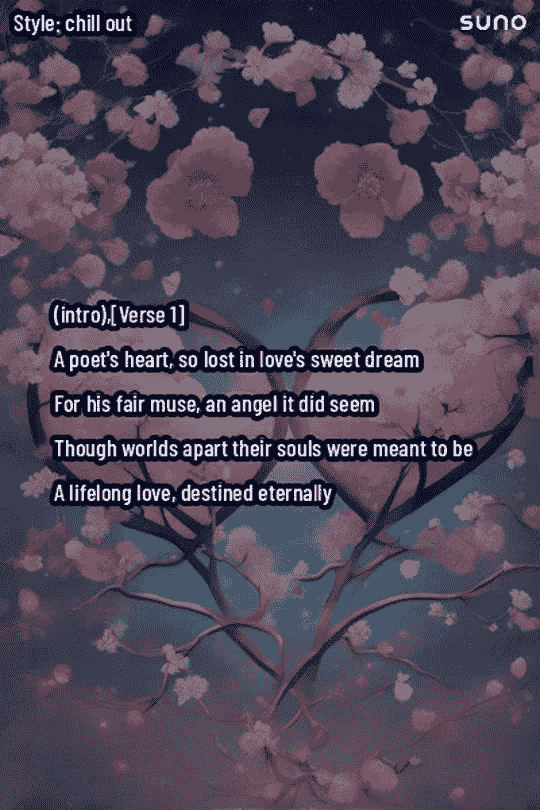

[Dante and Beatrice.mp4](https://internal-api-drive-stream.feishu.cn/space/api/box/stream/download/all/Meo7bIT6Lom3oQxLhLJc5xROnYe)

[Country_road 猫王.mp4](https://internal-api-drive-stream.feishu.cn/space/api/box/stream/download/all/B3CebT3fBoz6bxxsmZ9cqhg4nbb)

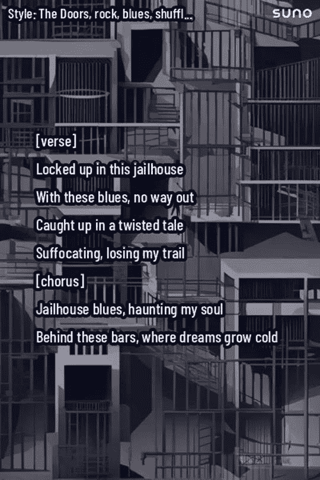

[监狱蓝调.mp4](https://internal-api-drive-stream.feishu.cn/space/api/box/stream/download/all/PfCob84BcoX9RCxHvyCcShNhn9f)

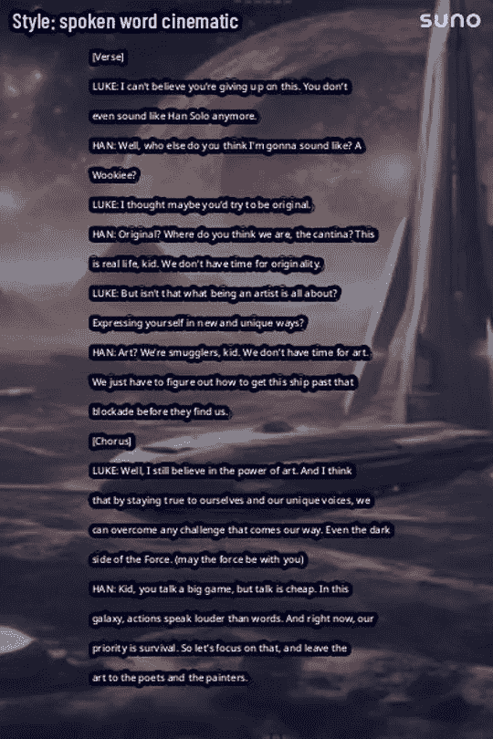

[话剧.mp4](https://internal-api-drive-stream.feishu.cn/space/api/box/stream/download/all/H4K4bcn8zodNN0xyQwRct0xZnuc)

[Afro Reggaeton.mp4](https://internal-api-drive-stream.feishu.cn/space/api/box/stream/download/all/BXAjbELS2o94dPxqisFcHdHunLe)

[toe.mp4](https://internal-api-drive-stream.feishu.cn/space/api/box/stream/download/all/Wk8mbCzRpoMCGDxtMwVcoausnic)