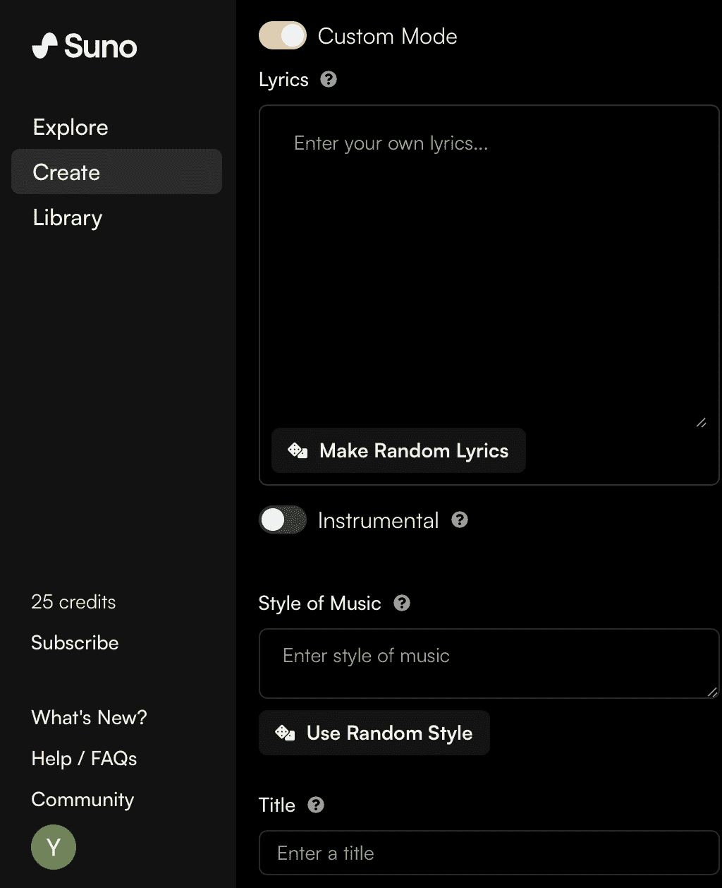
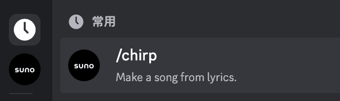
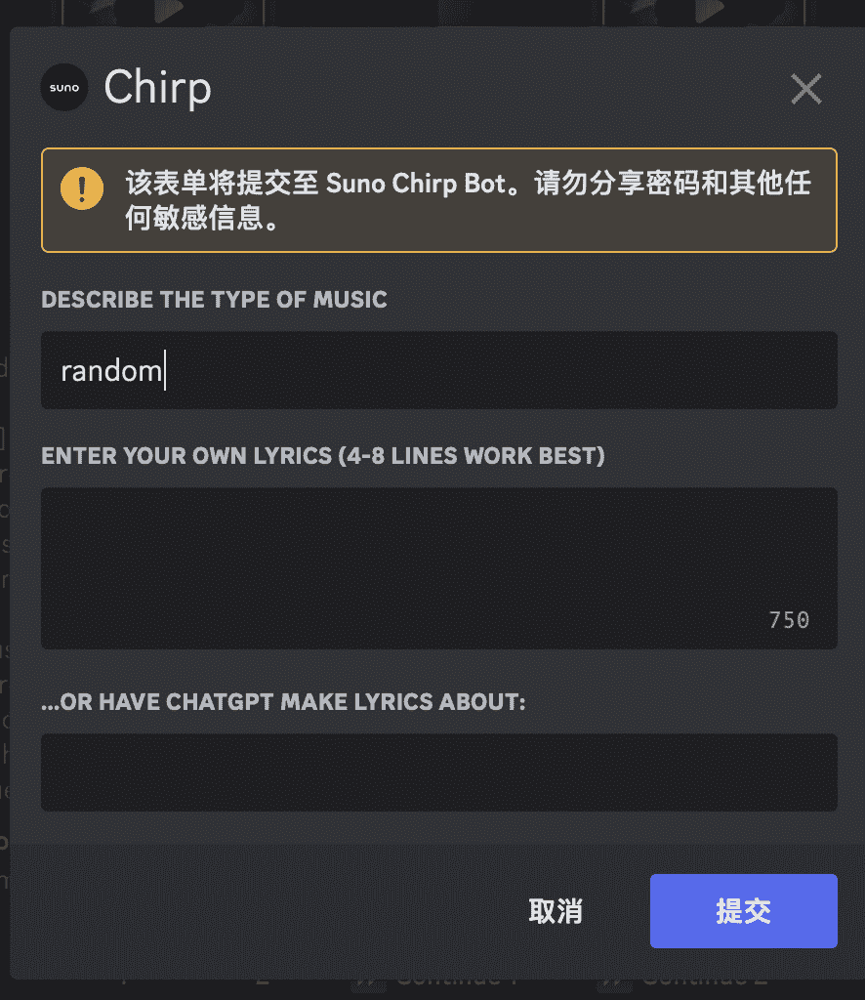
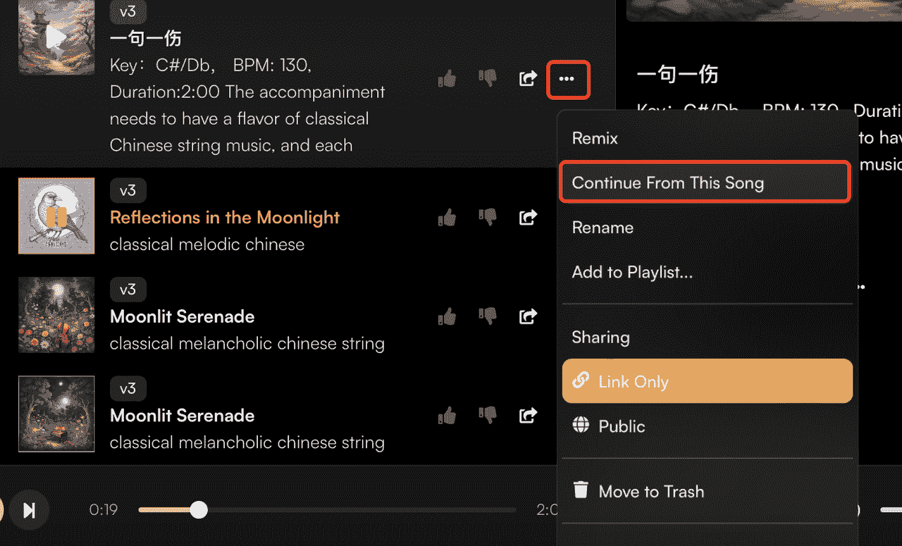
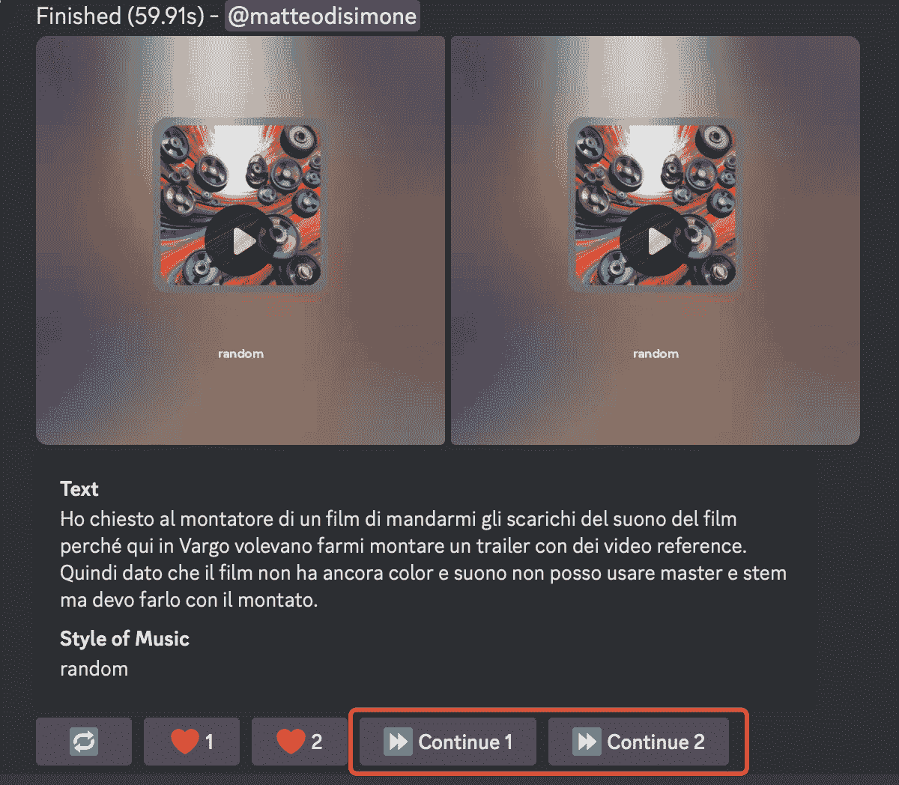
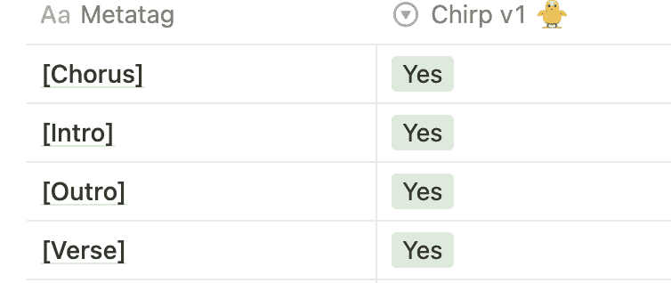
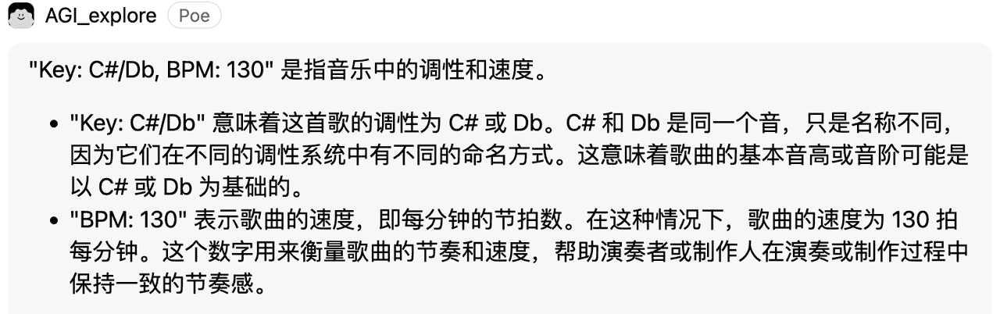

# 小白的Suno探寻笔记

> 来源：[https://xmgtoagi.feishu.cn/docx/BxFddRof3o4ryIxpXYtcdMpynlh](https://xmgtoagi.feishu.cn/docx/BxFddRof3o4ryIxpXYtcdMpynlh)

## 先有个号

官方网址：https://accounts.suno.ai

Discord：https://discord.com/channels/1069381916492562582/1149728729740882080

注册方法：Gmail注册即可

免费次数

+   官网：每天5次，一次2min

+   Discord：每天5次，一次30s

## 开始瞎玩

### 第一首音乐的诞生

#### **平台限制：**

+   官网额度为50credit/per day，一首歌5 credit

+   但是每次生成会有2首，根据同样提示词生成的不同风格，所以总计每天10首、5次

+   官网生成时间<=      2min，这个可以自己调整（注意，Discord生成时间限制为1min）

#### **官网：**



Custom Mode： 开启为自己有歌词，关闭则给你随机生成歌词，你只要填描述

Lyrics：直接填歌词即可，可以用熟悉的、喜欢的歌曲原词先感受一下产品功能，会有对比性。我的测试歌词在下面可以找到，是自己填的词，测试的话可以随便拿去用

Instrumental：不要歌词、直接出纯音乐的曲子

Style of Music：写Prompt的地方，1句简短的自然语言描述即可，注意最多100字符

#### **Discord:**

Discord =》/chirp

不管你在/chirp后面输入什么，都会弹出表单，这个表单和官网是一样的

describe放在了最前面，并且歌词是750字符的限制

Or have chatgpt make lyrics则是官网上把customized mode关掉一样的效果





#### **成品**

总之基于这个步骤，很快就可以有第一首歌，我的第一首歌是这样的，虽然很粗糙，但是已经有个歌曲的样子了，很惊喜。

[h](https://app.suno.ai/song/e2695c2d-d1ef-40de-a723-e494ca7abdd3)ttps://app.suno.ai/song/e2695c2d-d1ef-40de-a723-e494ca7abdd3

####

## 精致一点

最初的惊艳过去之后，打算细致一点，发现随意地生成就不能满足需求了，我遇到了如下问题

1.  歌词吐字不清楚

1.  风格和预想的有差别

1.  生成不完一首完整的歌

1.  预想的断句/高潮和它生成的完全不一样

所以开始研究细节文档，官方文档比较简单，但是对初学者够用了

[https://suno-ai.notion.site/Using-M](https://suno-ai.notion.site/Using-Metatags-34944efe09ec41d693e314f13af44695)etatags-34944efe09ec41d693e314f13af44695

#### 歌词控制

在description最后加一句“clear pronunciation/enunciation”会好一点

不同的风格歌词清晰度也不一样，英文发音会比中文好一点

中文的现代民谣风又比中国古风好一点

中文的发音如果歌词比较简练的话，有的时候像粤语和闽南语，或者就是乱码

如果试出一首发音清晰的歌，就把它的description保存，再留下标注，之后可以基于它做继续生成

我下面这个description生成的发音是我试出来相对清楚的

A relaxed campus folk song with clear enunciation, vivid and happy

[h](https://app.suno.ai/song/672c3f96-8f44-49ae-a8e4-a15313ab1483)ttps://app.suno.ai/song/672c3f96-8f44-49ae-a8e4-a15313ab1483

#### 风格控制

当试出一个不错的风格，想基于这个风格持续生成，或者是一首歌没有生成完想继续生成的时候，可使用这个功能。

基本风格能保持一致，剪剪就能是一首歌

第一次生成的：https://app.suno.ai/song/672c3f96-8f44-49ae-a8e4-a15313ab1483

continue后生成的：https://app.suno.ai/song/4392dde0-bbde-4b5d-b142-909e09cbfacc

官网：continue From this song



Discord： continue



#### 节奏控制

我自己的填词是有主旋律和高潮的，而这些东西可以用metatags来区分。

如果要弄出一首完整的歌，必须做好切分，可以使用”metatags“

主要的标签是这四个



所有的标签在这里了：

[https://suno-ai.notion.site/Using-M](https://suno-ai.notion.site/Using-Metatags-34944efe09ec41d693e314f13af44695)etatags-34944efe09ec41d693e314f13af44695

比如这一小段可以这么搞

[Intro]

[Verse]

缩在教室一角

老师在台上说教

思想早已经落跑

听窗外 知了叫

偷偷开了窗放进一只小鸟

引教室视线飘

趴在最后捂着嘴笑

[Chorus]

游戏打得正好

却总把饭点忘掉

嘟着嘴把饼干咬

月亮像在嘲笑

小小的人心也是很小

装不下所谓忧郁的味道

难过神马的统统漏掉

[Outro]

基本上这么一搞，大节奏是可以控制的，如果还要控制每句话的换气和停顿，暂时还做不到。

另，中文歌词很容易开头有部分歌词被吞掉，大概率是被判定放到Intro里面去了

#### 时间控制

一般一首歌曲为3-5分钟，因为系统的限制，第一次最多生成2分钟的歌曲，continue 则最多生成1min+20seconds （在discord里面只有30s的信仰续签）

所以我们可能需要了解一下时间、key、BPM的概念，交替使用create + continue 来完成一首歌



万事不决先问问GPT吧，Key是在风格生成的时候有点影响，然后BPM可以给我们时间控制一下，比如130这个，节奏比较适合校园民谣，吐字也算清晰，可以基于这个基准，多生成几次试试看自己比较喜欢的速度，而这个速度决定了2分钟能唱完多少歌词、之后要continue几次

我自己测试下来的话，这样生成的比较完整，也保障了一致性

+   可以限定第一次的生成时间在1min 40min左右（这个不能够设置，只能大致自己盘盘歌词节奏试试看），刚好是包括intro和一个小节主旋律+高潮的时间

+   然后再continue 1：20秒的主旋律+高潮      （continue时间可以自定义）

+   最后再continue 1：00左右的高潮+outro

#### 其他功能和备注

除了生成音乐，suno还可以生成语音，在doscord

/fun_fact 可以具体用来调教和获得声音的，可以试试看，但是内容是自动生产，不能自己控制

/bark，不需要词，13-14s限制，可以试着用来做一下纯音乐

## 一些碎碎念和可以自取的材料

### 现成Descripbe

```
Key：C#/Db， BPM: 130, Duration:2:00 The accompaniment needs to have a flavor of classical Chinese string music, and each
```

### 现成的歌词

```
缩在教室一角
老师在台上说教
思想早已经落跑
听窗外 知了叫
偷偷开了窗放进一只小鸟
引教室视线飘
趴在最后捂着嘴笑
 
游戏打得正好
却总把饭点忘掉
嘟着嘴把饼干咬
月亮像在嘲笑
小小的人心也是很小
装不下所谓忧郁的味道
难过神马的统统漏掉
 
悄悄把课来翘
却总赶上点到
急急向教室跑
踩着铃喊报告
无辜朝老师笑
藏好刚咬了一半的面包
真的真的是因为肚子闹
 
怎么还没长高
唱歌还是跑调
一不小心跌倒
赖着要个抱抱
可以尽情去笑
可以去任性去装疯胡闹
这样的日子是多么逍遥
傻傻的就挺好
 
怎么还没长高
唱歌还是跑调
一不小心跌倒
赖着要个抱抱
可以尽情去笑
可以去任性去装疯胡闹
这样的日子是多么逍遥
不长大好不好
```

### 测试总结

+   唱的清楚和不清楚相对是随机的

+   中文歌词很容易开头有部分歌词被吞掉，大概率是被判定放到Intro里面去了

+   限定好key和频率是确实有用的，可以考虑，也可以基于此来盘时间

+   一个歌曲反复细节上的改动或许会有惊喜

+   直接用它生成还不够，以后可以再剪辑部分来用是好用的

+   官网上的效果会比discord要好一些，时间也长一些

+   继续生成这个东西还是挺靠谱的，风格基本能保持一致，听起来是一首歌，但是要非常注意，基于前的生成是1分钟-1：20秒，不是2分钟了

+   控制力略差，但是初次生成那种还好，可以有2段素材，开始做剪辑

**基于这些东西，创作流程应该是**

1.  把词填进去，随机出一首还算好听的歌

1.  基于这首歌，往后持续生成，持续调整

1.  在后面反复尝试其它的关键词，能用的目前不多，标签只是增加随机因素权重比的东西

1.  最后还是要有些音乐剪辑的能力才行