# AI数字人教程

> 来源：[https://xmgtoagi.feishu.cn/docx/ZNVodnQDqojF4IxVIfpcciUcnHb](https://xmgtoagi.feishu.cn/docx/ZNVodnQDqojF4IxVIfpcciUcnHb)

> 作者： 全栈技术探索

> 原文：https://mp.weixin.qq.com/s/eYJn64m6aCod4jERDyDDNg

本篇文章会介绍一种方法，无需编程、无需视频制作专业技能就能够以非常低的成本快速制作出一个数字人视频。

# **一、整体流程介绍**

数字人视频的整体制作流程，大致分为三步：

1.  创建视频内容。通过输入文稿内容，确定数字人播出的内容。

1.  生成数字人。通过工具，以及视频内容生产数字人形象及播放语音。

1.  AI换脸。通过AI工具，将数字人的脸，转换成你指定宣传的形象，以便以自己的品牌形式宣传。

# **二、创建视频内容**

**2.1 准备内容**

我们需要先准备一段视频中播放的内容文字。内容可以是产品介绍、课程讲解、游戏攻略、等任何你希望推广，让大家了解的文字。

当然，你也可以利用AI来生成这段文字。

我准备的内容如下大约有500字，制作出的视频大约为1分30秒：

1.  你是否遇到初入创业、经营效率低下、热血满满地做一个新项目，却发现身后无人响应!新官上任，想要提高部门凝聚力，却发现团队一盘散沙，无从下手!管理老套，竞争力下降，不知如何打造战斗力爆棚的团队!好不容易培养出来优秀人才，流失率却居高不下!被惯性认知局限，无法找到企业新的增长点！《创业领导力训练》从认知提升入手，通过一整套系统化训练，直到拿到自己想要的结果！选择《创业领导力训练》的五大好处:协助创业者找到自我认知局限性，打破瓶颈。提升识人用人的能力，让优秀人才为你所用。建立目标管理、精力管理和团队管理能力。增加个人自信度，打造个人影响力。改善家庭关系和人际关系。四种人适合学习：不懂管理的初创企业高管、负责人。发展遇到瓶颈的创业领导者。想打造自己个人影响力的创业新星。想成为行业和身边人脉核心的企业家。人生重大机遇只会给你一次机会，遇到了你就要毫不犹豫的把握住。准备好，全心投入的时间给到训练，空杯开放的心态给到老师，积极参与的行动给到自己。我在《创业领导力训练》等你来!探索自我认知边际，提升创业认知维度。

注：视频文字内容由 [新域创业](http://mp.weixin.qq.com/s?__biz=Mzg4ODUzMjk4NA==&mid=2247500743&idx=2&sn=8756d6aa9d338aad662b06c6a936f741&chksm=cffb3950f88cb046c0c56308eec30295d8c07c38e4ff609d9dfa4c7392b01f0c470d1887b1e0&scene=21#wechat_redirect) 提供。


新域创业领导力训练

新域创业

68篇原创内容

👸号

**2.2 制作视频**

我们使用剪映App来对视频进行简单的处理。这是一款功能强大的视频编辑软件，个人免费版就足够我们实现制作目的。电脑端打开剪映App，点击“开始创作”。

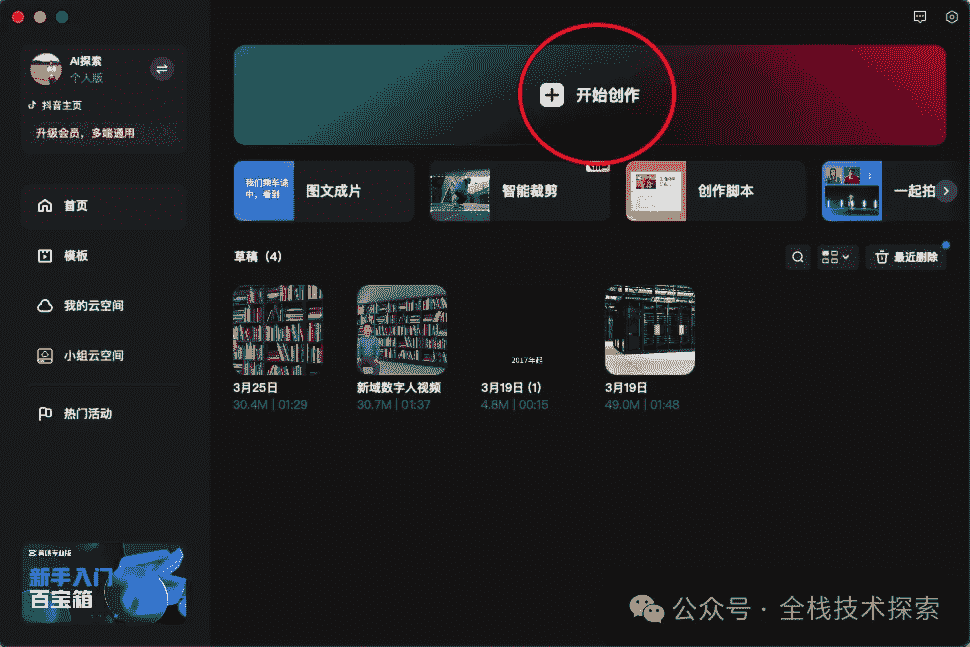

进入创作页面：

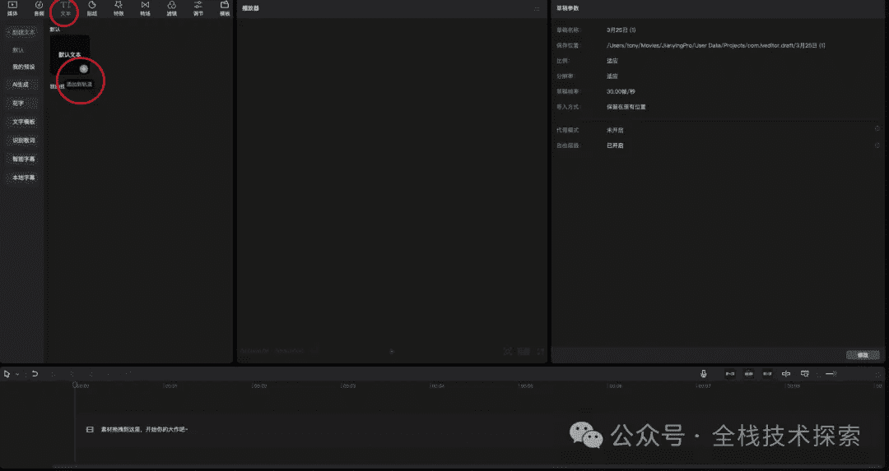

我们选择顶部工具栏中的：文本，并点击默认文本右下角的“+”号，这个动作代表了为视频添加一个文字内容的轨道。


添加完成后，在界面的右侧。我们将准备好的文字内容替换默认文本内容。界面变化如下：

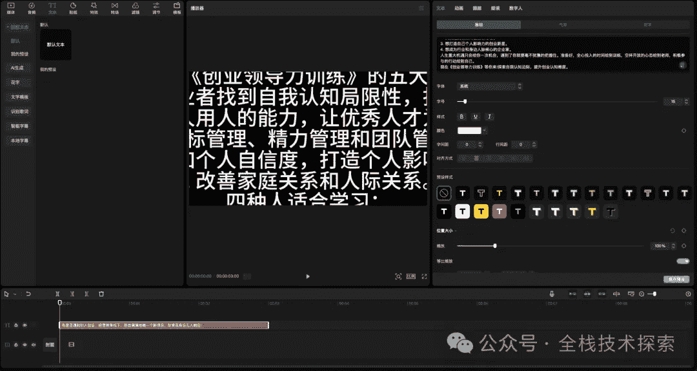

**视频内容就准备好了，这将为数字人提供语音播放**的内容，以及生成与文字内容相对应的口型。

# **三、生成数字人**

**3.1 生成数字人**

在剪映右侧窗口顶部，我们打开“数字人”选项，选取一位免费的、适合的数字人形象，这里我选择“婉婉-青春”。

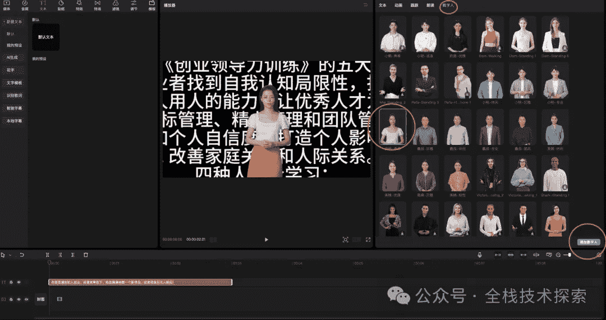

当你选择一个数字人形象时，软件会马上播放出该数字人的声音。你可以判断是否是你需要的，点击右下角的“添加数字人”，就会将选择的数字人添加到当前视频中。剪映App将会根据之前提供的内容，来生成对应音视频，并添加到当前视频文件的轨道中。

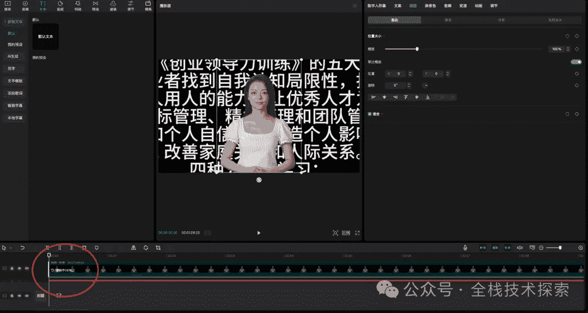

左下角会提示你渲染何时完成。然后你可以点击预览按钮，查看生成的数字人效果。

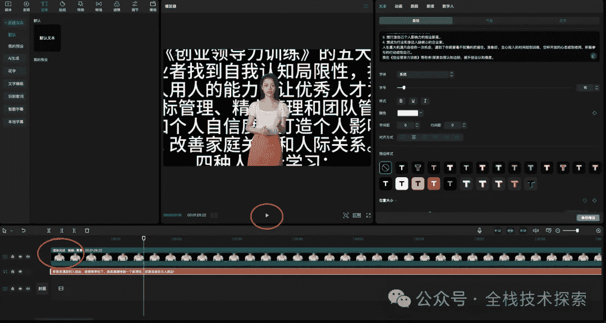

**3.2 增加背景图片**

接下来，可以直接删除先前导入的文本内容。这是因为视频中的音频中已经包含文字内容了。

鼠标点击下方代表文字的轨道，或者点击软件中间文字内容，按删除键删去文字：

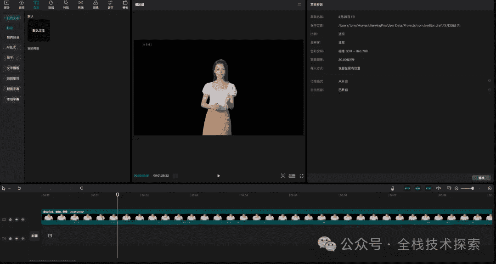

为了让视频更美观，我们为视频增加背景图片。当然你可以增加多个背景图片，为简化演示，这里增加1张图片。点击左上角的“媒体”菜单，并点击“导入”按钮，来选择本地的一张图片上传：

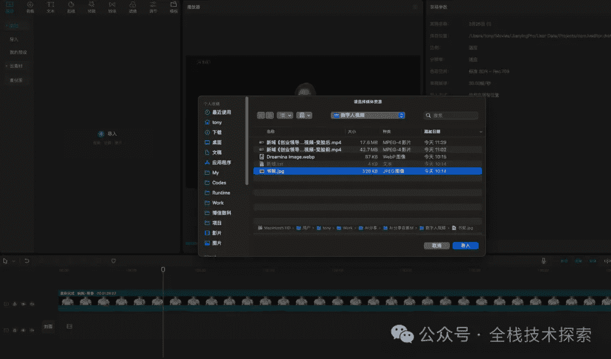

我选择一张书架图片上传，然后像添加文字内容一样，点击图片右下角的加号，将这个图片添加到视频的轨道上（会覆盖数字人）：

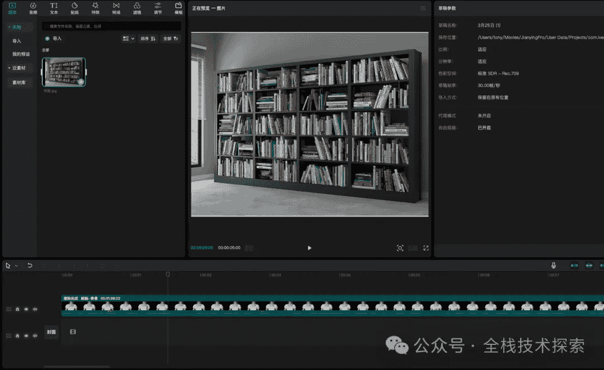

此时，书架图片就会在视频轨道的下面，添加一条新轨道：

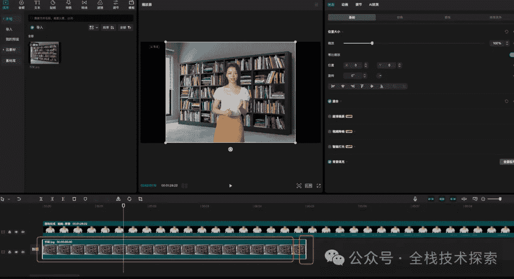

为了让图片在整个视频播放的时候都显示，可以点击这个轨道最右侧的竖线，向右拖拽，直到视频的最后，也就是和视频对齐：

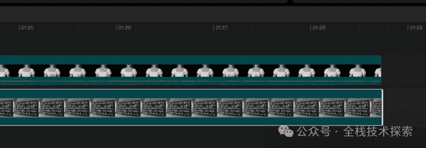

此时，背景图片所在的轨道是选中状态。如果没选中，鼠标点击一下这个规定即可。

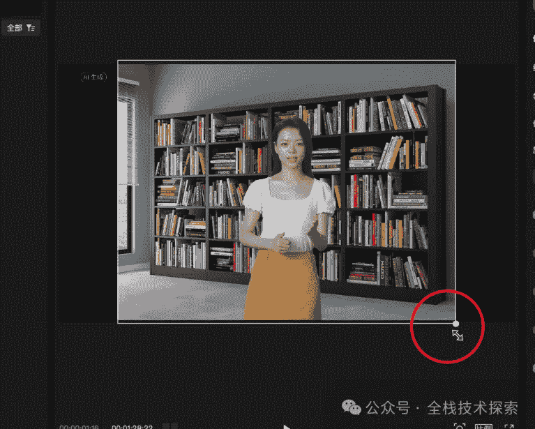

在显示区域，拖动背景图的一个角，将图片放大到适合的尺寸，比如覆盖视频窗口。并将数字人拖动到合适的位置:

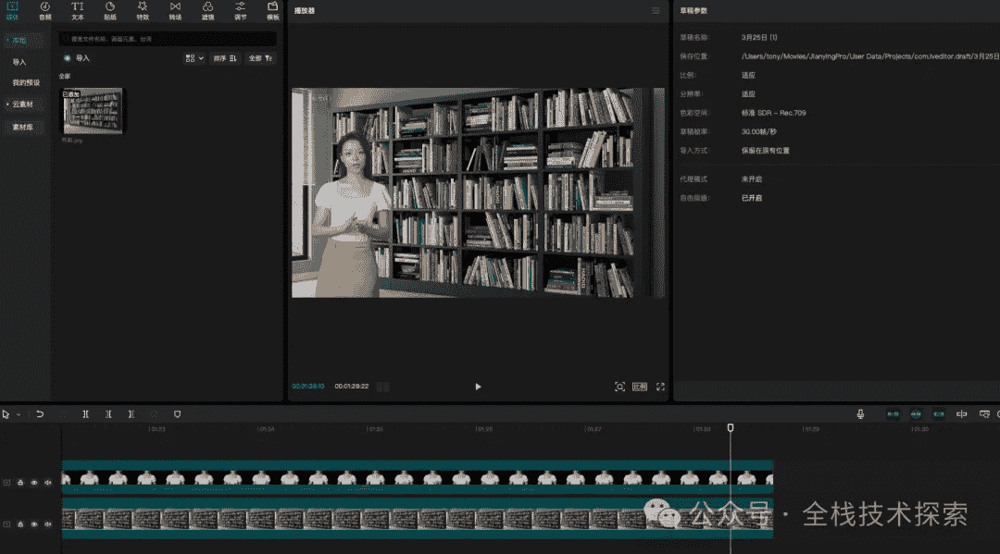

**3.3 增加字幕**

点击文本 - 智能字幕 - 识别字幕，点击开始识别：

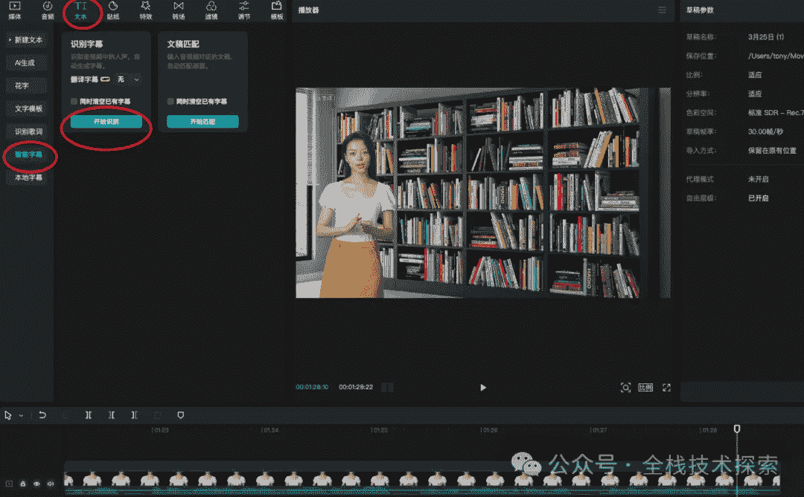

软件会自动将文字智能分段并形成字幕：

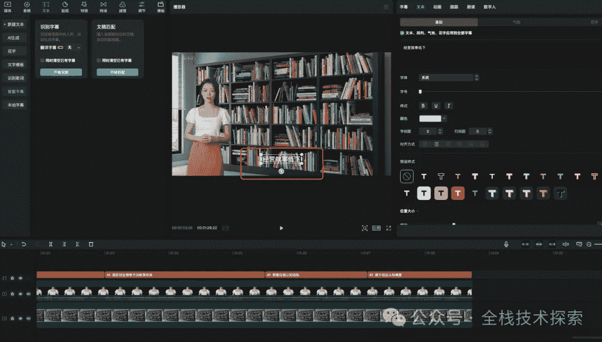

至此，数字人视频就完成了。点击右上角的“导出”按钮，导出视频以作备用。

如果你希望数字换成自己希望的面孔，比如这个：


就需要用另一个工具来进行换脸了。

# **四、AI换脸**

有多个AI产品可以实现换脸效果，这里介绍一个开源、免费的解决方案：facefusion

开源地址：https://github.com/facefusion/facefusion

**4.1 本机解决方案**

这个软件需要python环境，以及要安装视频解码器等多个依赖的软件，因此如果你想在本地电脑上安装，需要一定的编程知识。可以参考网站：https://docs.facefusion.io/ 说明来进行本地的安装。

由于facefusion的运行推理计算的速度，非常依赖于GPU，因此如果本地计算机没有GPU或者GPU显存较小，那么执行的速度将会非常缓慢。

我的笔记本是Macbook Pro M1 16GB内存，集成GPU。对一个1分30秒的视频换脸，需要1300秒。

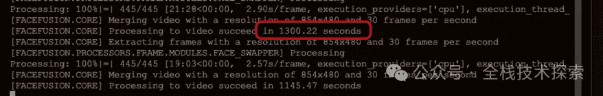

所以，无论从环境配置还是计算速度来说，都不推荐本地化安装实现。

**4.2 云服务解决方案**

另一个可选的方案，是利用云厂商已经提供好的大模型运行环境和计算能力。比如阿里云的PAI和AutoDL。注：这种方案需要产生一定的费用。

我选择的是AutoDL，其官网是：https://www.autodl.com/home

**4.2.1 租赁GPU服务器**

注册完成后，在 算力市场 中，选择你能接受价格的算力服务器。建议选取GPU配置更高的算力设备。


4.2.2 通过模型镜像启动GPU服务器

在算法社区查找 facefusion 镜像：


这些已经制作好的镜像，包含了模型所需要的各种环境软件的安装，可以直接启动facefusion。

点击右侧的这个镜像（左侧的试过，有问题不好使）：


点击右下角的创建实例按钮。创建实例，并启动这个实例（就是启动一台服务器）。将会看到在容器实例列表中，刚才创建的实例。


点击快捷工具中顶部的：JupyterLab，打开这个工具。这个工具提供了执行python程序的说明和控制服务器的终端使用。我们需要通过终端来启动 facefusioin。此处是唯一需要一点技术能力的地方。

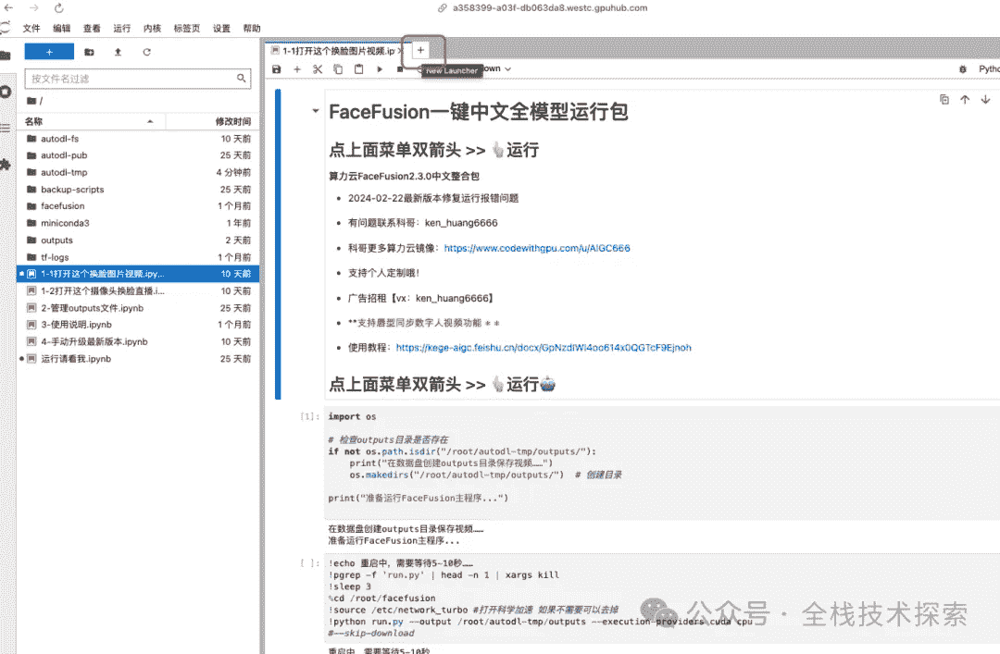

点击顶部的+号选项卡，我们新打开一个终端窗口:

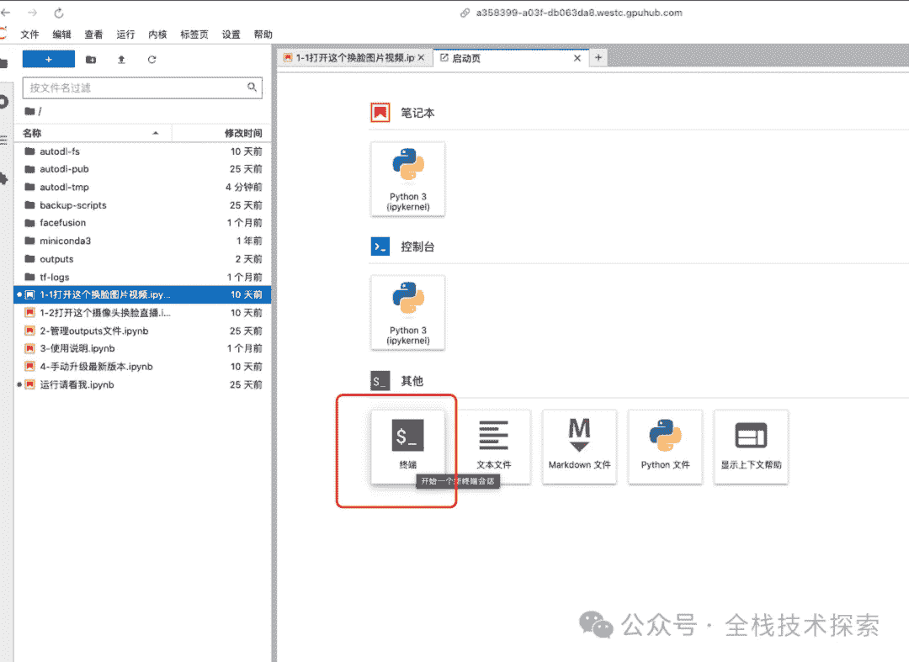

点击终端区域，启动一个终端的选项卡：

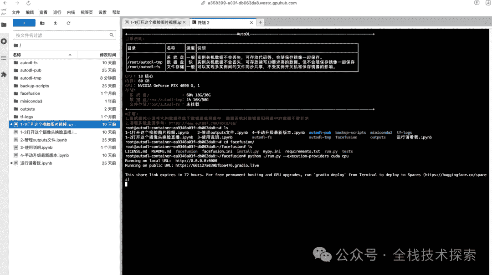

在打开的终端窗口中，输入3条命令做3件事情：

1.  查看文件列表。输入 ls 并按回车，显示当前位置所在目录下的文件列表。

1.  进入facefusion目录，输入cd facefusion并按回车，进入程序目录

1.  启动facefusion。  输入：python ./run.py --execution-providers cuda cpu 启动程序

注意：后面的参数 --execution-providers cuda cpu  非常重要，如果不加cuda，则默认不使用GPU能力，推理将非常慢。

当出现这个提示信息时，说明启动成功：

+

+

```
Running on local URL:  http://0.0.0.0:6006Running on public URL: https://661127a039bfb5a476.gradio.live
```

4.2.3 打开facefusion软件

打开facefusion软件，需要返回实例列表，点击自定义服务按钮。


这样，我们才能够通过web浏览器来访问facefusion提供的UI界面：

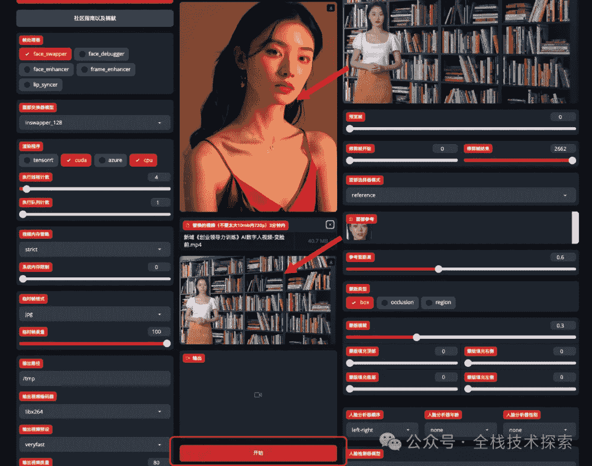

在facefusion软件上，上传准备好的图片，视频后，在右侧可以看到预览效果。 点击下方的开始按钮，执行换脸处理。

执行完成后，在输出的位置，会出现处理后的视频，你可以导出到本地。

最后来看看效果：

通过剪映制作的数字人视频

，时长01:28

变脸后的数字人视频

，时长01:28

**

最终花费**：


1.  时间：大约10分钟

1.  制作数字人视频：免费

1.  数字人换脸：约0.8元

如上图所示，GPU服务器此次整体运行时长所需花费0.97元，facefusion软件运行其实只占服务器运行时长的一部分，所以换脸的成本应该在0.8元左右。