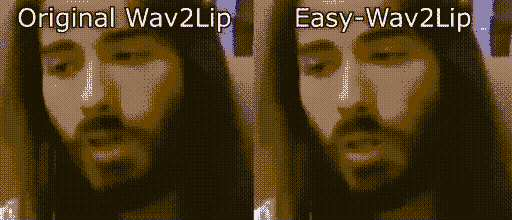
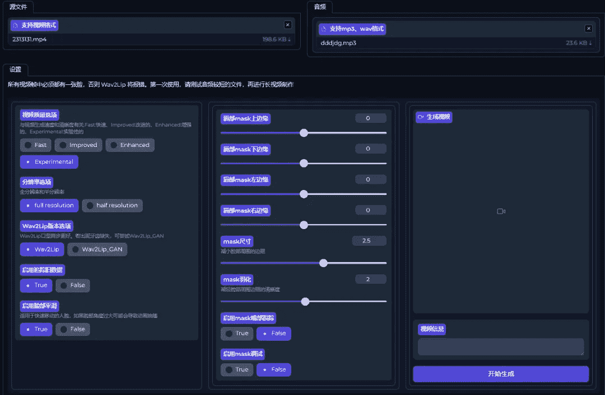
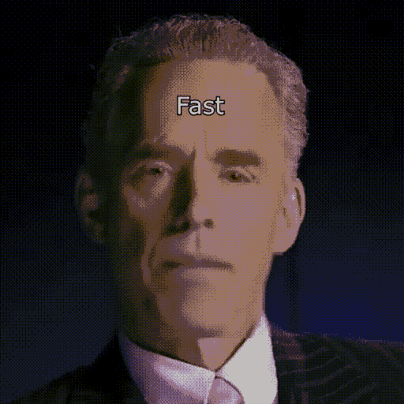
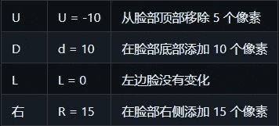
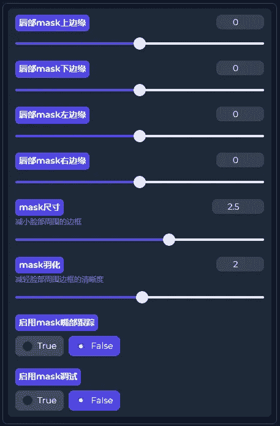

# 离线一键批量数字人制作工具！

> 来源：[https://xmgtoagi.feishu.cn/docx/XvjwdnG4woBSHbxkbOKcPhxxnjd](https://xmgtoagi.feishu.cn/docx/XvjwdnG4woBSHbxkbOKcPhxxnjd)

> 原文：https://mp.weixin.qq.com/s/Bm4VK1DFEiGenaV7APV6qg

> 作者：嘟嘟实验室

数字人其实也有很多种，比如我分享的这个就是视频形式的数字人，那还有用UnrealEngine制作的三维模型数字人，它们的应用的地方也都不同。感兴趣的可以去了解下，这里不过多讲解。

什么？压根不知道什么是数字人？（请→百度）

话说回来，今天分享的这个实际上是在原有Wav2Lip项目的基础上进行优化的，而部署下来中我也发现很多问题，例如缓存、界面、执行效率问题等，并针对性的做了优化。

# 配置要求

**Windows**

N卡必须N卡！！CPU不支持！

**MAC**

开发中，目前还在解决mps问题！尝试了好几天了！所以MAC的朋友们再等等？

朋友们真别嫌我慢，我每个整合包做好后都会进行大量测试和看看有没有能优化的地方！

# 更新内容

相较于原版的新增内容

1.增加了webui界面。

2.支持批量处理。

3.优化了原版缓存问题。

4.优化了处理效率问题。

# 使用方法

### **准备**

需要准备音频和视频文件。

**音频文件**：

+   建议音频长度与视频的长度相同（比如你是10秒钟的视频，那么你的音频长度建议是10秒。如果音频长度比视频长度长，视频会自动向后循环延长）。

+   音频文件格式:wav 和mp3

**视频文件**：

+   你选择的视频帧中必须都有一张脸，否则将报错。（比如你视频总时长10秒，中间有2秒没有人脸的画面，就会报错）

+   推荐H264编码的mp4视频格式

提示：该版本支持批量。批量支持多段视频多段音频、多段视频单段音频。

举个例子：

+   你有3个视频，3段音频，那么会按照你选择的顺序视频1对应音频1、视频2对应音频2进行处理。

+   你有3个视频，1段音频，那么会按照你上传的所有视频都对应这个音频进行处理。视频1对应音频1、视频2对应音频1、视频3对应音频3。

### **开始处理**

最简单的方式：

将视频和音频拖拽到对应的文件框内，点击开始生成，完毕！

如果你想深入了解各个参数的作用，请继续往下看！

# 参数详解

### **视频质量：**

Fast快速：Wav2Lip音频转口型模式。

Improved改进：Wav2Lip音频转口型模式 +唇部周围带有遮罩羽化，去除唇部周围边框。

Enhanced增强：Wav2Lip音频转口型模式 + 遮罩羽化 + GFPGAN高清脸部增强

Experimental实验性:在增强的模式上优化执行效率。

如果不是机器配置太差默认推荐选**Enhanced**和**Experimental**

### **分辨率选项**

full resolution全分辨率

half resolution半分辨率

注意：

测试下来半分辨率会在某些情况下存在不兼容问题，建议这个选项选全分辨率

### **Wav2Lip版本选项**

**Wav2Lip**

优点：更准确的口型同步、在没有声音时会保持嘴巴闭合。

缺点：有时会产生牙齿缺失（部分情况下）。

**Wav2Lip_GAN**

优点：效果看起来更好，保留说话者原有表情。

缺点：不太擅长遮盖原始的嘴唇动作，尤其是在没有声音的情况下。

建议：

先尝试 Wav2Lip，如果遇到口齿上有很大缝隙的效果，再切换到Wav2Lip_GAN版本。

### **启用脸部平滑**

启用后，wav2lip 将独立裁剪每个帧上的脸部。

适用于视频中的快速移动或剪辑。

如果脸部角度奇怪，可能会导致抽搐。

禁用后，wav2lip 会在 5 帧之间混合检测到的人脸位置。

适合缓慢移动，尤其是对于不常用角度的脸部。

当脸部在画面中快速移动时，嘴巴可能会偏移，在切割之间看起来很可怕。

Padding **（填充）**：

此选项控制在每个方向上从面部裁剪中添加或删除的像素数。

此选项可以帮助去除下巴或脸部其他边缘的硬线条，但填充过多或过少都会改变嘴巴的大小或位置。通常的做法是在底部添加 10 个像素，建议尝试不同的值，找到最佳效果。

### **Mask遮罩部分**

### **Mask尺寸**

将增加蒙版覆盖的区域的大小。（脸部周围有边框可以减少此数值，例如：1.5）

### **Mask羽化**

决定了蒙版中心和边缘之间的混合量。（脸部周围有边框也可以增加此数值 ）

### **启用Mask嘴部跟踪**

会将遮罩的位置更新到嘴巴在每一帧上的位置（速度较慢）

注意：

由于帧被裁剪到脸上，嘴巴位置已经很近似了，只有当发现视频的遮罩似乎没有跟随嘴巴时，才启用此功能。

### **启用Mask调试**

开启后将使背景灰度和蒙版变彩色，可以看到蒙版在框架中的位置。（此参数改成True后，可以更直观的看到参数效果）

# 资源下载

百度网盘

链接：https://pan.baidu.com/s/1OC4lIxZVnwDeReMns3HmJA?pwd=bk25

夸克网盘

https://pan.quark.cn/s/542eff807940