# 喂饭级数字人教程，无限且免费！

> 来源：[https://xmgtoagi.feishu.cn/docx/PYa1d2Sdeo0mDYxnhF8cVjiCnRd](https://xmgtoagi.feishu.cn/docx/PYa1d2Sdeo0mDYxnhF8cVjiCnRd)

> 原文链接：https://mp.weixin.qq.com/s/rHUywz_GCdm2bCZa4zP7Ug

最近一种新的趋势正在短视频、直播平台上流行，那就是通过AI生成数字人，直接进行直播或**者短视频制作。这种玩法越来越**流行，今天，我详细地向你介绍如何在5分钟内制作一个你专属的AI数字人，无限且免费！

### **第一步：安装CrazyTalk**

首先**，我们**需要安装一些工具。我们主要使用的工具是CrazyTalk和剪映。CrazyTalk是一款能够让人物照片开口说话变成动态照片的工具，而剪映就不用做过多介绍了。首先，下载安装CrazyTalk，公众号回复“数字人”即可获得安装包。下载到本地，首先双击安装主程序。

接受协议，点击“Next”进入下一步。

到了选择安装目录这一步，需要注意“一定不要更改安装位置”，不然后续破解和汉化会失败。

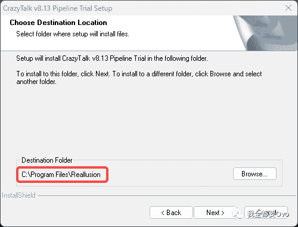

同样的，不要更改任何目录位置。

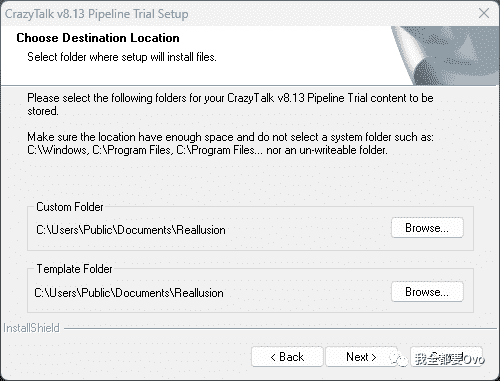

正式进入安装，等待片刻即可。

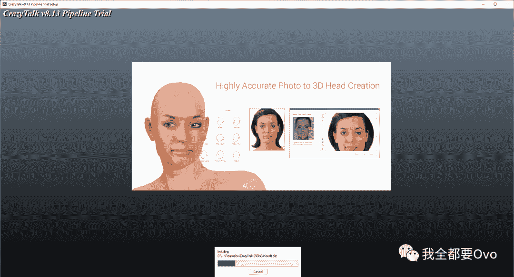

安装完成后，在下面的页面中，取消两个勾选框，点击“finish”。

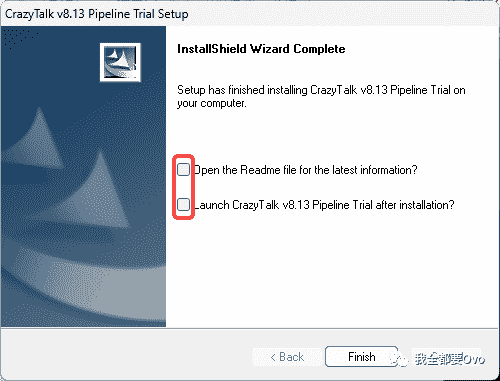

继续点击“否”。

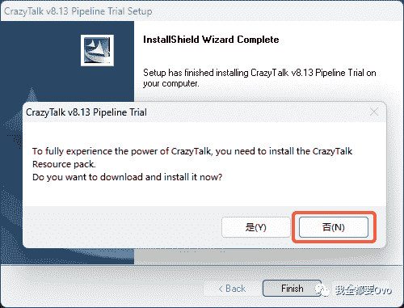

至此，CrazyTalk软件安装完成，接下来进入破解流程。对下图中的文件，选择“右击管理员权限运行”。

在弹出的蓝框中，选择“仍要运行”。

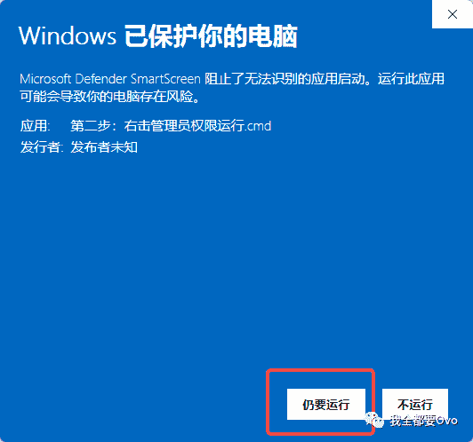

然后继续，双击第三步的文件，需要根据你自己的电脑系统选择适合自己的版本程序。

然后直接点击“解压”。

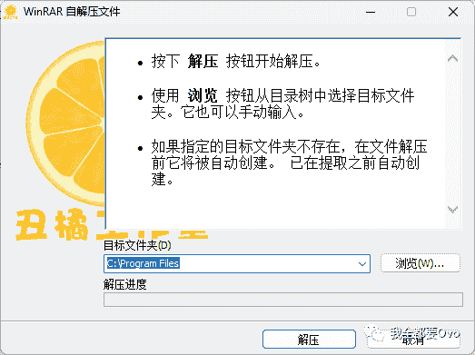

这里会要求你输入解压密码，密码在“安装说明”中。

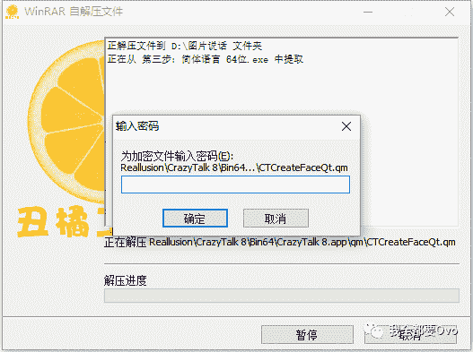

输入密码后，会自动将软件进行破解和汉化，那么我们就彻底安装成功了！

### **第二步：用图片制作数字人**

接下来，我们开始制作图片数字人。先打开CrazyTalk软件，看到以下弹框，选择“不要，谢谢”。

选择一张你喜欢的照片，用AI生成一张也很方便。我选择了下图：

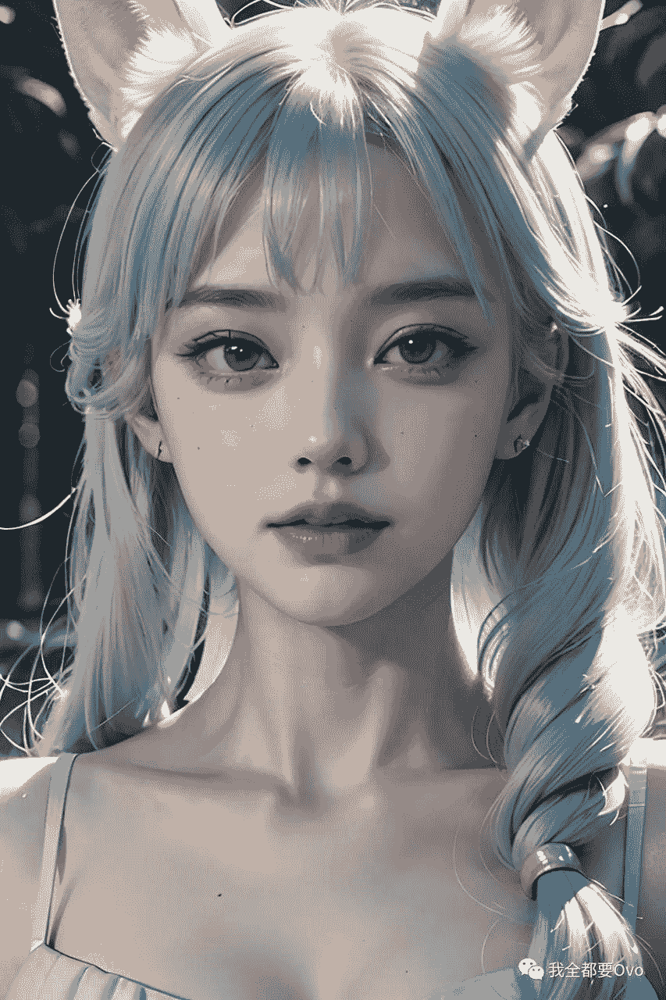

把照片拖入CrazyTalk，先试试选择“2D”，然后使用图片裁剪工具，把图像的头部画面截取下来

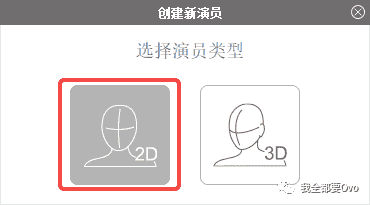

使用图片裁剪工具，把图像的头部画面截取下来。

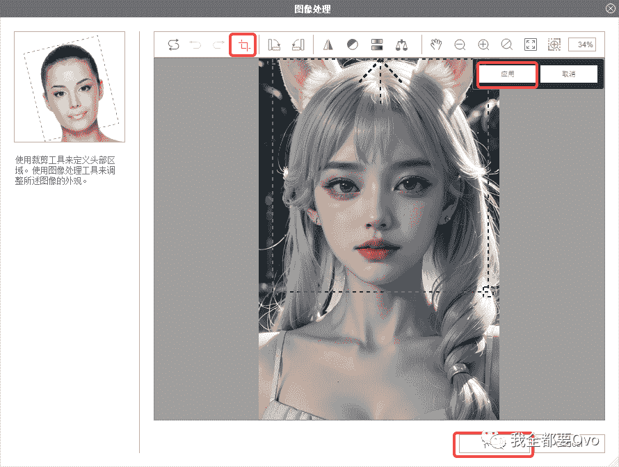

接着，按照提示，标记图片对应的眼角和嘴角，然后调整头像的脸部轮廓和方向，点击“下一步”。

按照左上角的提示，再调整一下脸部的轮廓和方向。

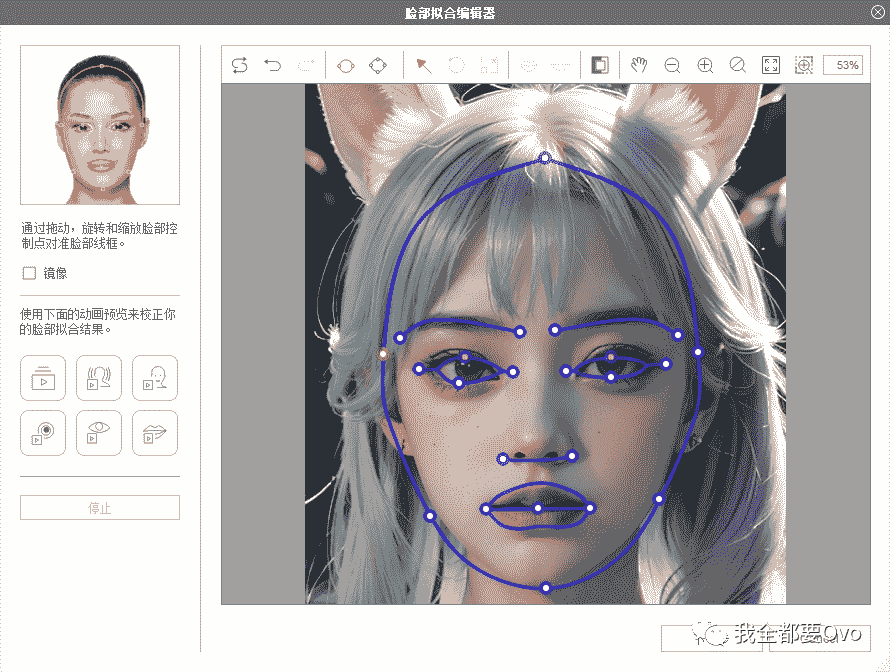

继续调整脸部方向，使得轮廓尽量局中对齐。

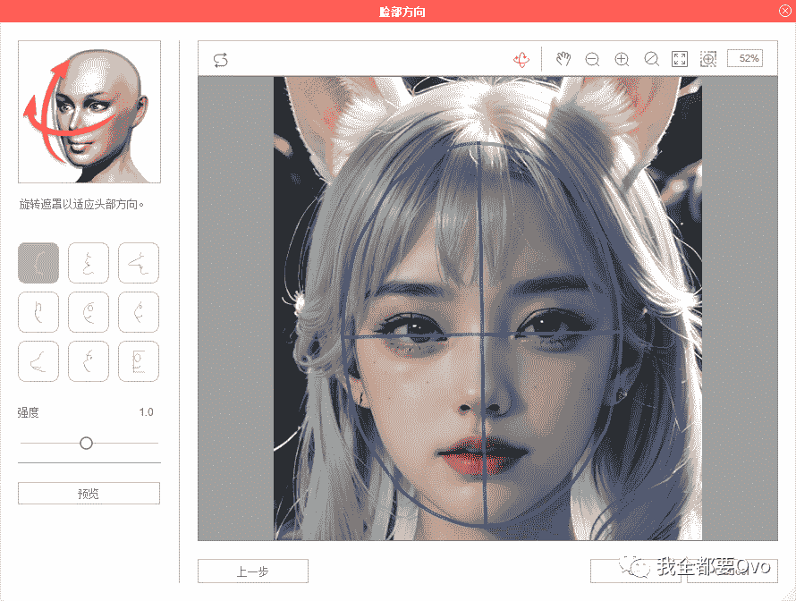

接下来，我们需要导入声音。你可以选择自己录音或者直接导入声音文件。

然后选择动作，一般是会选择“说话模式”或者“仅嘴唇同步”。这样，一个头部说话的动态视频就做好了。之后，可以选择导出为MP4

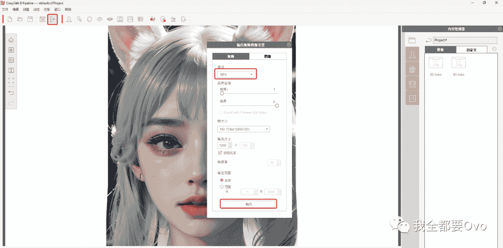

最后一步是用剪映或者其他视频软件来合成视频。我们需要将这个动态头部视频导入到剪映里，把图片和这个头部动态视频合成一个完整的视频。你可以把一开始的照片导入到剪映，然后再把刚刚做好的动态头部视频导入进来。把头像调整到和原图差不多的比例，这样一个简易的动态视频就做好啦！

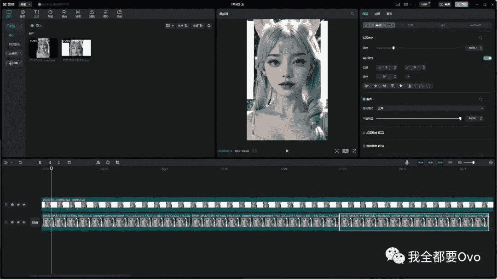

分享一下，整个流程中我遇到的坑：

首先，安装软件时不要随意更改安装位置，不然破解汉化会失败。

其次，选择的照片尽量选择正面照，不然合成效果会很差。

第三，选择的照片最好用其他软件把背景图扣掉，不然最后合成视频比较难处理。

总的来说，通过CrazyTalk制作数字人并不是一个复杂的过程，只需要一些基本的工具和技巧。通过这种方式，谁都可以快速地制作出有趣的视频。这也是人工智能技术的魅力之一，它能让我们以前所未有的方式创造和分享内容。

## **结语**

在这个数字化的时代，我们有无数的工具和技术可以帮助我们创造和分享内容。制作数字人只是其中的一种方式，但它却能带来无比的乐趣和满足感。无论你是一个创作者，还是一个观众，我都希望你能从这个过程中学到一些新的东西，也希望你能享受到这个过程带来的乐趣。记住，创造是一种能力，但更重要的是，它是一种态度。只要你有创造的欲望和决心，你就能创造出属于你自己的世界。

# 安装包下载地址

安装包下载链接：https://pan.quark.cn/s/57eef3ff681e