# GPT-SoVITS一分钟素材AI语音克隆

> 来源：[https://xmgtoagi.feishu.cn/docx/DqUEdd8YRoDx92xhuwFcfe2pnFc](https://xmgtoagi.feishu.cn/docx/DqUEdd8YRoDx92xhuwFcfe2pnFc)

> 作者：Lucas AI

> 原文：https://mp.weixin.qq.com/s/GLVyaPFO9sJ_zFYHL35Drg

`GPT-SoVITS` 是一个开源的 `TTS` 项目，只需要 1 分钟的音频文件就可以克隆声音，支持将汉语、英语、日语三种语言的文本转为克隆声音，部署方便，训练速度很快，效果很好，项目发布不到 1 个月就有了 9.3k star。

下面讲 3 种使用方式：

- 使用 `colab`（需要魔法，免费）
- 使用 `AutoDL`（在线付费租网卡，方便）
- 本地部署（硬件要求高）

## 使用 `colab`

使用条件：

- 能够🪜
- 一个谷歌账号
- 使用推荐的浏览器（✅Chrome / Edge / Firefox）
- 关闭浏览器自带的网页翻译功能

点击 `GPT-SoVITS` 的 `colab` 链接：https://colab.research.google.com/github/RVC-Boss/GPT-SoVITS/blob/main/colab_webui.ipynb

这个界面类似于电脑的控制台，各种信息都会出现在这上面。如果运行失败，这上面也会有报错信息，靠着报错信息去解决问题。

如果是 Chrome 浏览器已经登陆账号的，那么就会自动登陆。没登陆的点击右上角登陆谷歌账号即可使用。

点击环境配置的开始键，跳出警告点仍然运行。显示是运行中>


，一直在转圈，不要动。出现一行黄字就代表完成了，如果中途跳出让你切换为标准模型，不要点！请始终使用 `GPU` 模式！

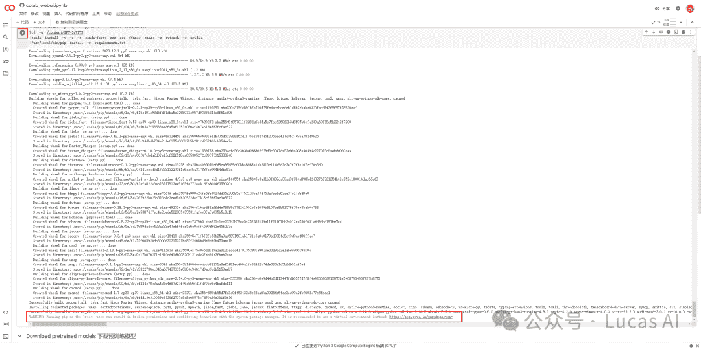

### 3. 下载预训练模型

还是点这开始，稍微等待一会……

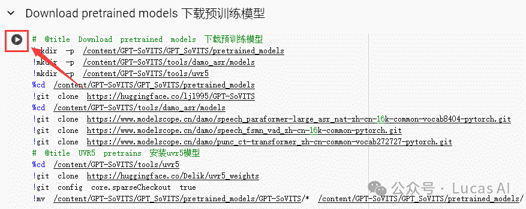

### 4. 上传音频

在等待的时候可以先上传好所需的音频。点击第一个键上传音频，上传的速度取决于你🪜的上传网速。

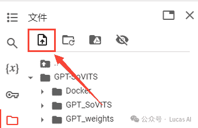

上传的过程中左下角会有这个圈


消失后就是上传完成了。

新建一个文件夹，建议命名 `input`，将音频拖进去。

### 5. 开启 `WebUI`

在下载完预训练模型后点击开启 `WebUI` 的开始键

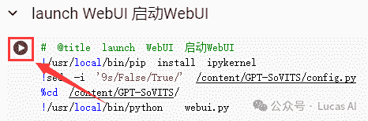

点击最下面第二个链接，注意是第二个链接！第一个打不开的！

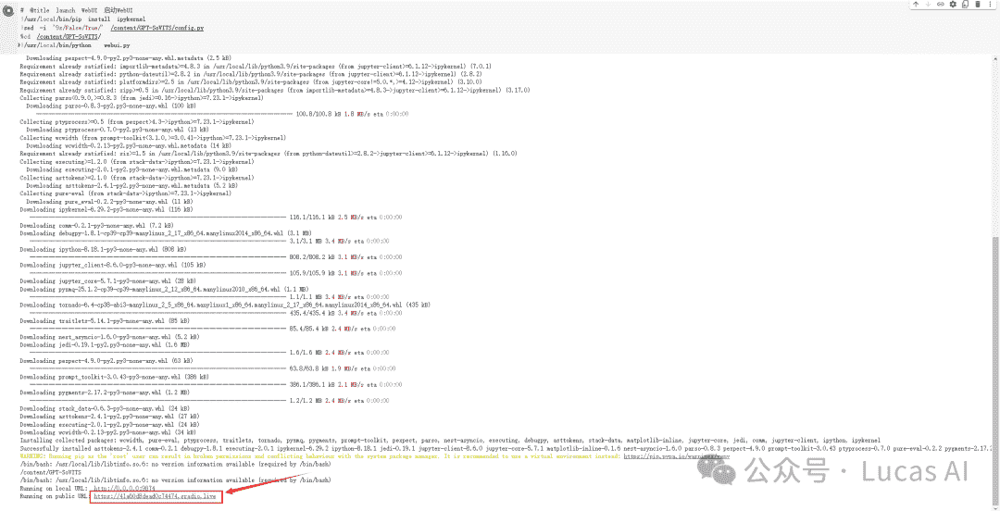

打开后是英文界面，这没法改。实在看不懂，可以打开浏览器自带的翻译，虽然不推荐，很有可能会翻译出歧义。

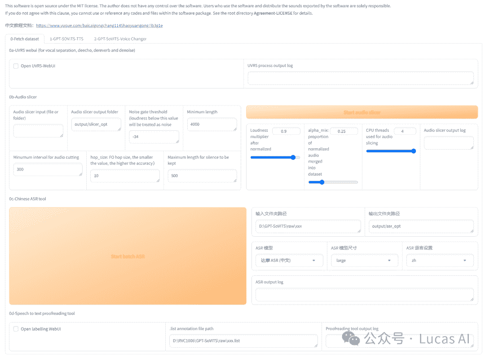

这是中文对照图片↓

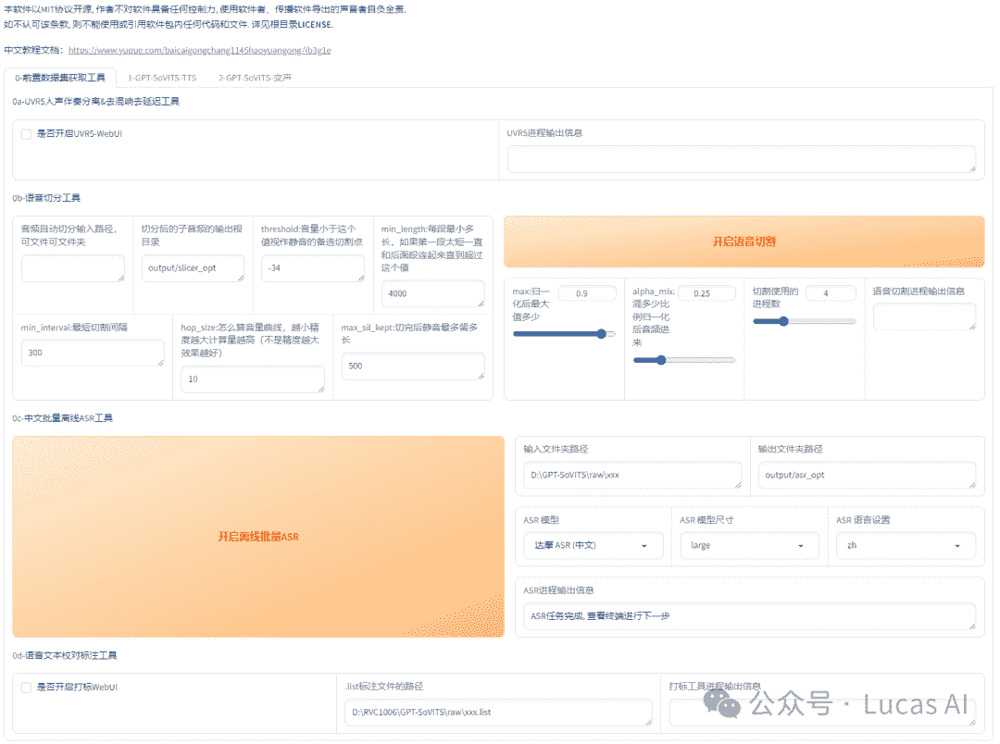

### 6. 数据集处理

请认真准备数据集！以免后面出现各种报错，和炼出不理想的模型！好的数据集是炼出好的模型的基础！

#### 6.1 使用 `UVR5` 处理原音频（如果原音频足够干净可以跳过这步，比如游戏中提取的干声）

##### 6.1.1 方法 1：使用自带的 `UVR5` 处理音频

点击 `Open UVR5-WebUI`

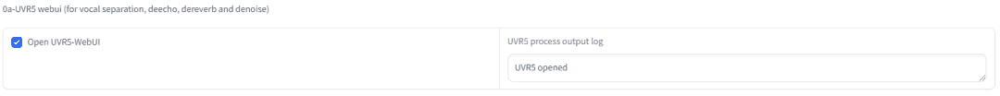

回到刚才的控制台界面，最下面会出现新的网站，点击他进入 `UVR5` `WebUI`

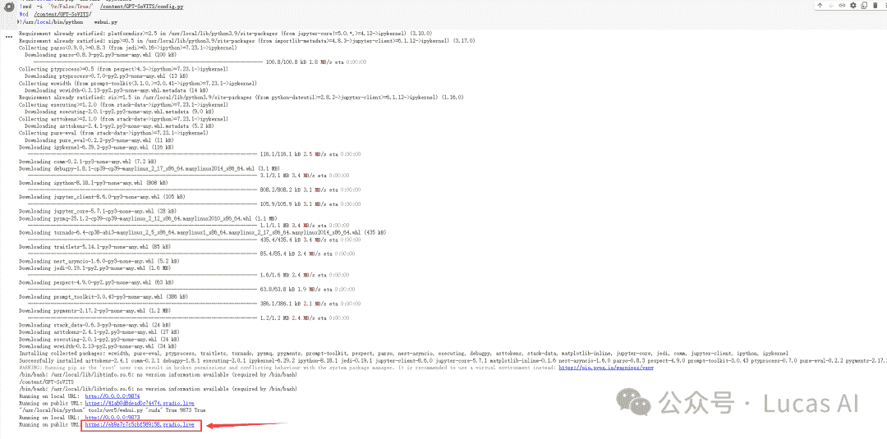

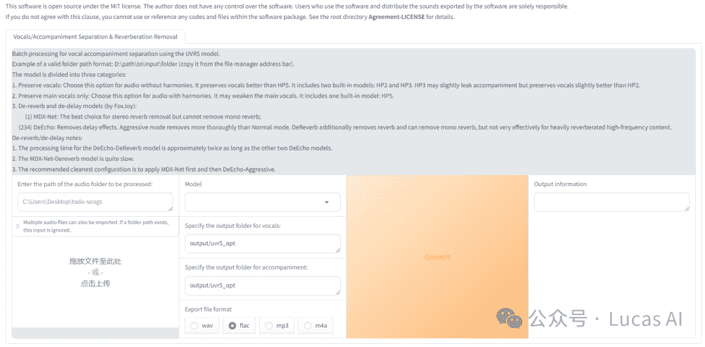

这是中文对照图片↓


复制刚才上传音频的文件夹路径，粘贴到 `Enter the path of the audio folder to be processed:` 中，中文是 `输入待处理音频文件夹路径`，每个浏览器可能翻译的不同。注意是文件夹路径！

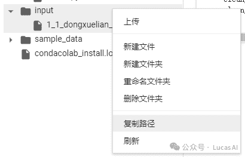

先用 `HP2` 模型处理一遍（提取人声），然后将输出的干声文件再用 `onnx_dereverb` 最后用 `DeEcho-Aggressive`（去混响），输出格式选 `wav`。输出的文件默认在 `GPT-SoVITS-beta\GPT-SoVITS-beta\output\uvr5_opt` 这个文件夹下，处理完的音频（`vocal`）的是人声，`(instrument)` 是伴奏，记得把 `instrument` 删掉。结束后记得到 `WebUI` 关闭 `UVR5` 节省显存。

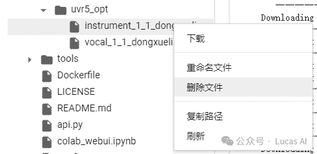

如果没有成功输出，报错了。那么推荐使用下面一种方法——`UVR5` 客户端。（✅可能兼容性有问题，但是效果是和 `UVR5` 对齐的，不要瞎黑内置工具效果有问题）

打开 `UVR5` 首先要下载模型，建议下载我打包好的，里面有几乎所有模型，包含 vip 模型。下载解压后先把 `models` 文件夹删了，再把解压的文件夹直接拖进 `Ultimate Vocal Remover` 根目录替换 `models` 文件夹

模型包：https://www.123pan.com/s/UHp9-Qfi8H.html（下载精简版就好，里面有要用到的模型了。完整版是 `UVR5` 的所有模型，可能以后会用到）

如果觉得模型包太大，也可以自己下载（需要🪜，且速度很慢，一次只能下一个）。点击左下角的小扳手，打开设置界面，点击第三个下载模型。需要下载的模型有：`MDX23C-InstVoc HQ`（`HQ2` 是需要赞助后才能下载的 vip 模型，效果提升不大）、`VR Architecture：UVR-De-Echo-Normal` 选 `No Echo Only`（轻度混响）、`VR Architecture：UVR-De-Echo-Aggressive` 选 `No Echo Only`（重度混响）、`VR Architecture：UVR-De-Echo-Dereverb` 选 `No Echo Only`（变态混响）、`UVR-DeNoise`


下载完模型后开始处理音频，`select input` 选择输入文件 `select output` 选择输出文件夹，输出格式选 `WAV`，记得点上 `GPU Conversion`，首先使用 `MDX23C`（目前最好的提取人声的模型）提取人声（根据音频长度和个人显卡选择 `HQ1` 或者 `HQ2`，`HQ2` 处理速度慢了几倍效果提升了一点，`4090` 显卡 `HQ1` 处理 5 分钟音频大约需要 1 分钟，`HQ2` 处理 5 分钟音频大约需要 3 分钟）。处理完的音频（`vocals`）的是人声。然后把人声再输入去混响（下面三选一）：`VR Architecture：UVR-De-Echo-Normal`（轻度混响）、`VR Architecture：UVR-De-Echo-Aggressive`（重度混响）、`VR Architecture：UVR-De-Echo-Dereverb`（变态混响），最后用 `UVR-DeNoise` 降噪一下。这套流程弄完会比自带的 `UVR5` 在人声提取方面好一点。

#### 6.2 切割音频

在 切割音频 前建议把所有音频拖进音频软件（如 `au`、剪映）调整音量，最大音量调整至 -9dB 到 -6dB，过高的删除

复制输入原音频的文件夹（不要有中文），如果刚刚经过了 `UVR5` 处理那么就是 `uvr5_opt` 这个文件夹。粘贴到 `Audio slicer input (file or folder)` 中，中文是 `音频自动切分输入路径（可文件可文件夹）`，每个浏览器可能翻译的不同。建议可以调整的参数有 `min_length`、`min_interval` 和 `max_sil_kept` 单位都是 ms。`min_length` 根据显存大小调整，显存越小调越小。`min_interval` 根据音频的平均间隔调整，如果音频太密集可以适当调低。`max_sil_kept` 会影响句子的连贯性，不同音频不同调整，不会调的话保持默认。其他参数不建议调整。当然也可以使用其他切分工具切分。

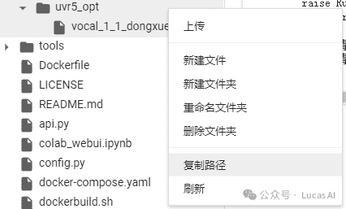

切分完后文件在 `GPT-SoVITS\output\slicer_opt`。打开切分文件夹，排序方式选大小，将时长超过 显存数 秒的音频手动切分至 显存数 秒以下。比如显卡是 `4090` 显存是 `24g`，那么就要将超过 `24` 秒的音频手动切分至 `24s` 以下，音频时长太长的会爆显存。如果语音切割后还是一个文件，那是因为音频太密集了。可以调低 `min_interval`，实在不行用 `au` 手动切分。

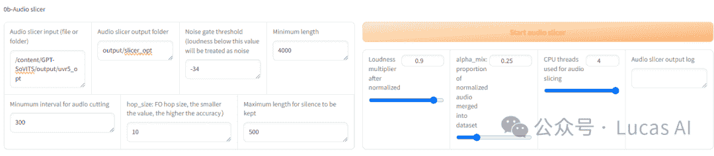

#### 6.3 打标

为什么要打标：打标就是给每个音频配上文字，这样才能让 `AI` 学习到每个字该怎么读。这里的标指的是标注

这步很简单只要把刚才的切分文件夹输入，然后选择 `达摩 ASR` 或者 `fast whisper`。`达摩 ASR` 只能用于识别中文，效果也最好。`fast whisper` 可以标注 99 种语言，是目前最好的英语和日语识别，模型尺寸选 `large V3`，语种选 `auto` 自动就好了。然后点开启离线批量 ASR 就好了，默认输出是 `output/slicer_opt` 这个路径，ASR 需要一些时间，看着控制台有没有报错就好了

如果有字幕的可以用字幕标注，准确多了。内嵌字幕或者外挂字幕都可以，教程使用字幕标注（更准确）

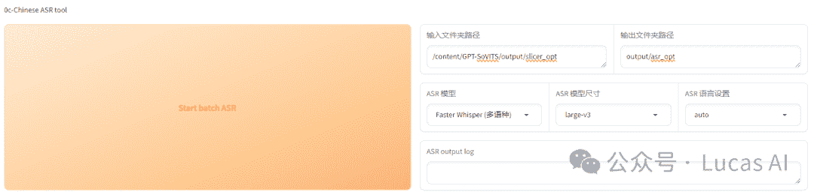

#### 6.4 校对标注（这步比较费时间，如果不追求极致效果可以跳过）

输入标注文件的文件路径，注意是文件路径！不是文件夹路径！示例：`/content/GPT-SoVITS/output/asr_opt/slicer_opt.list` 注意后面的文件名必须要输进去！打不开就再三检查路径是否正确！必须要有 `.list` 的后缀！！！然后开启打标 `webui`

打开后就是 `SubFix`（这个教程晚点更新）先看别人的教程视频：https://www.bilibili.com/video/BV1My4y1P7WX/

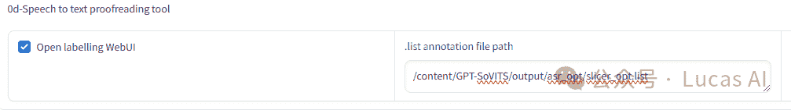

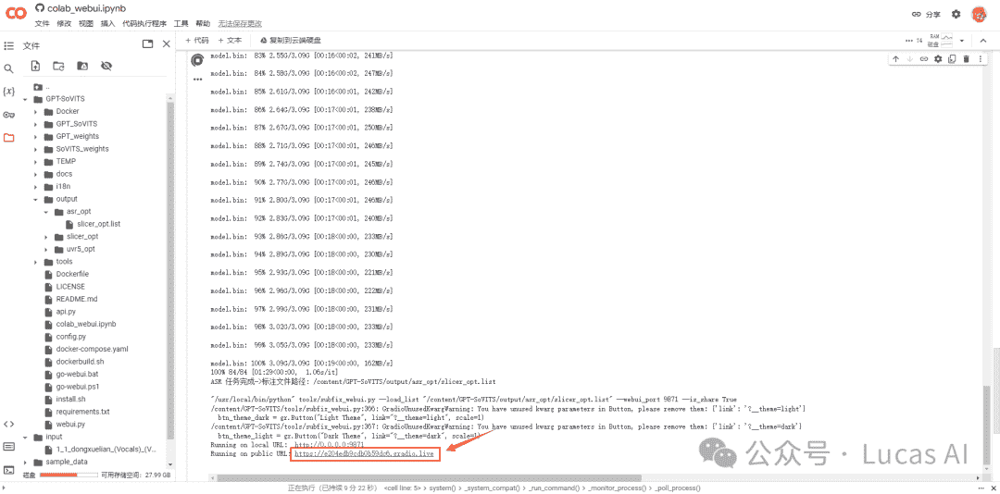

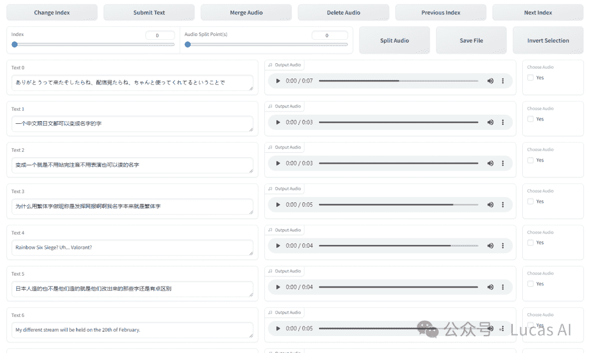

### 7. 训练

#### 7.1 输出 `logs`

来到第二个页面

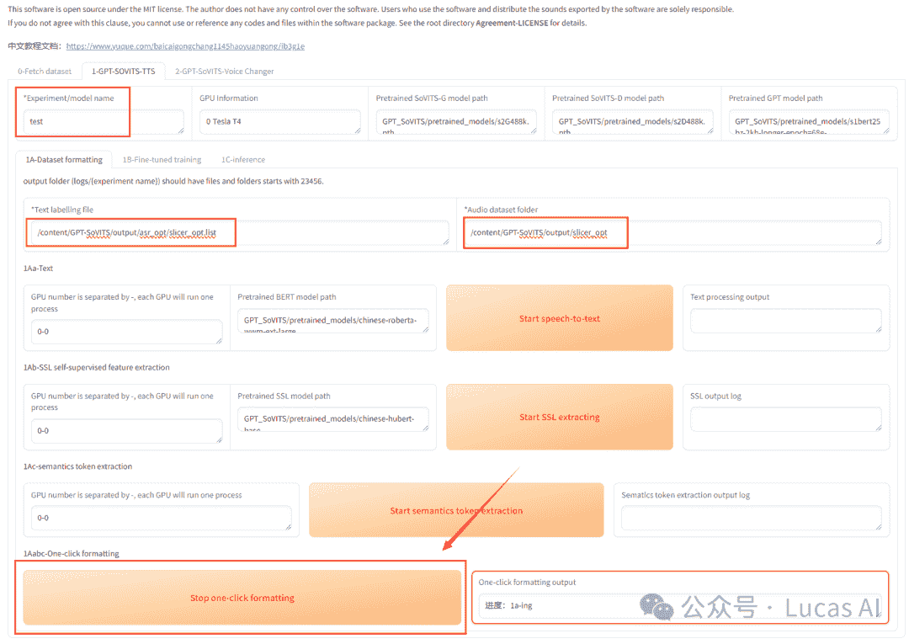

中文对照图↓

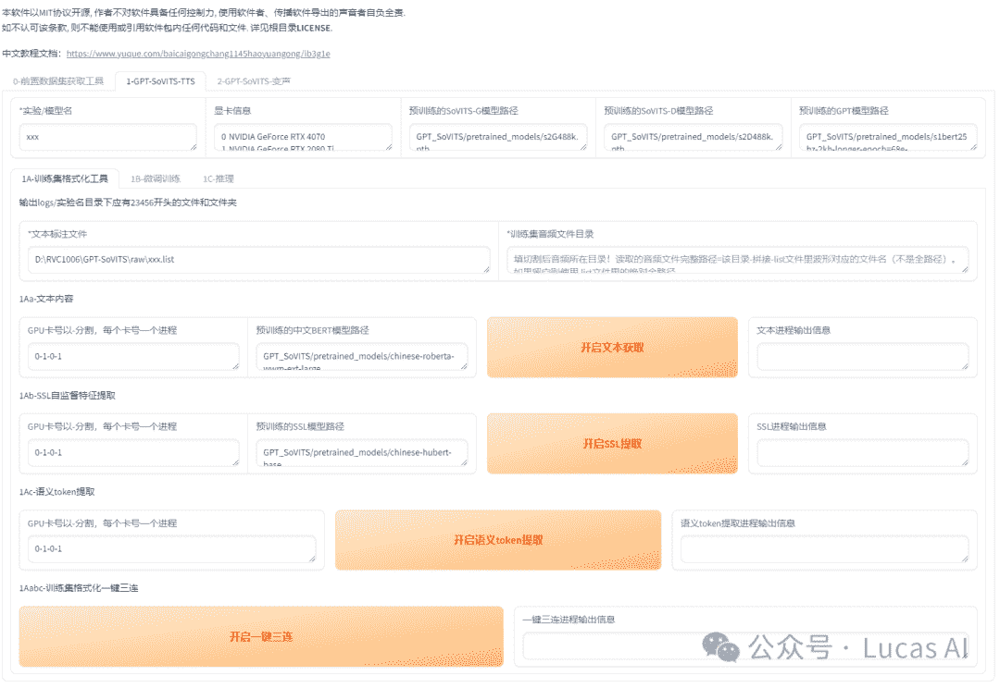

先设置实验名也就是模型名，不要有中文！然后第一个输入的是标注文件路径，注意是文件路径！不是文件夹路径！示例：`/content/GPT-SoVITS/output/asr_opt/slicer_opt.list` 注意后面的文件名必须要输进去！打不开就再三检查路径是否正确！必须要有 `.list` 的后缀！！！第二个输入的是切分音频文件夹路径 示例：`/content/GPT-SoVITS/output/slicer_opt`。注意复制的路径都不能有引号！！！千万不能有引号！然后点一键三连。

#### 7.2 微调训练

首先设置 `batch_size`，建议 `batch_size` 设置为显存的一半以下，高了会爆显存。`colab` 免费的卡是 `Tasla T4` 是 `16g` 显存，所以设置 `8` 差不多。`bs` 并不是越高越快！`batch_size` 也需要根据数据集大小调整，也并不是严格按照显存数一半来设置，比如 `6g` 显存需要设置为 `1`。如果爆显存就调低。当显卡 `3D` 占用 `100%` 的时候就是 `bs` 太高了，使用到了共享显存，速度会慢好几倍。`GPT` 模型训练的时候可以把 `bs` 再调低点。

接着设置轮数，`SoVITS` 模型轮数可以设置的高一点，反正训练的很快。`GPT` 模型轮数千万不能高于 `20`（一般情况下）建议设置 `10`。然后先点开启 `SoVITS` 训练，训练完后再点开启 `GPT` 训练，不可以一起训练！（除非你有两张卡）如果中途中断了，直接再点开始训练就好了，会从最近的保存点开始训练。

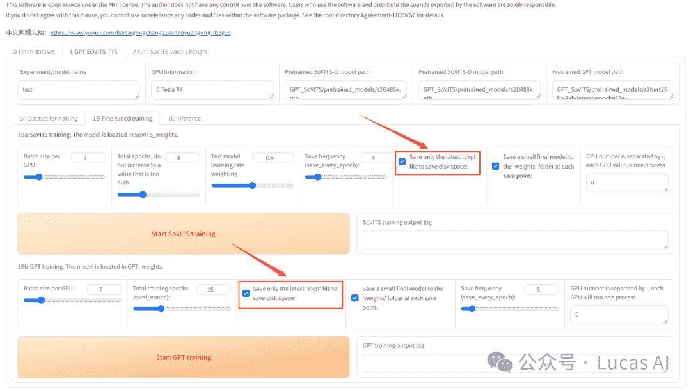

中文对照图↓

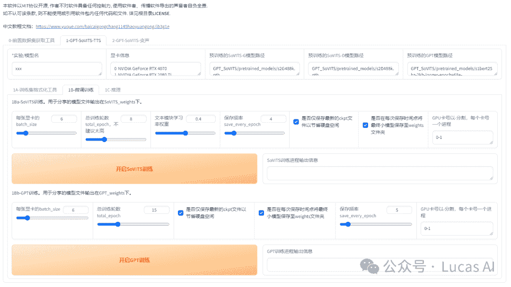

这是运行时的控制台截图

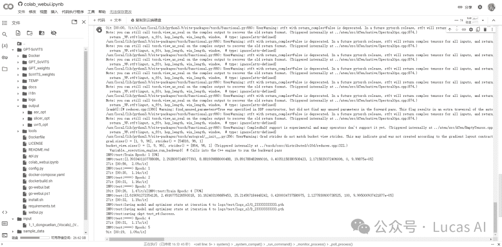

这样就显示是完成了，训练完成会显示训练完成，并且控制台显示的轮数停在设置的（总轮数 - 1）的轮数上。

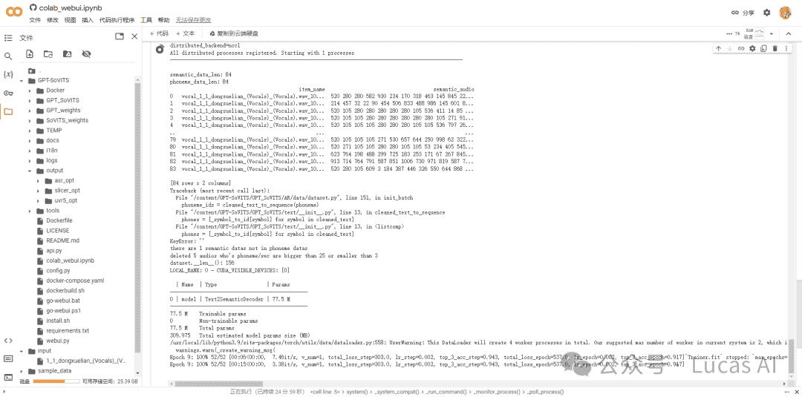

关于学习率权重，轮数该多少好，如何制作出好模型，`Tensorboard` 都在整合包教程训练章节

### 8. 推理

#### 8.1 开启推理界面

先点一下刷新模型，下拉选择模型推理，`e` 代表轮数，`s` 代表步数。不是轮数越高越好。选择好模型点开启 `TTS` 推理，在控制台点最下面的链接。

请严格区分轮数 (`Epoch`) 和步数 (`Step`)：1 个 `Epoch` 代表训练集中的所有样本都参与了一次学习，1 `Step` 代表进行了一步学习，由于 `batch size` 的存在，每步学习可以含有数条样本，因此，`Epoch` 和 `Step` 的换算如下：

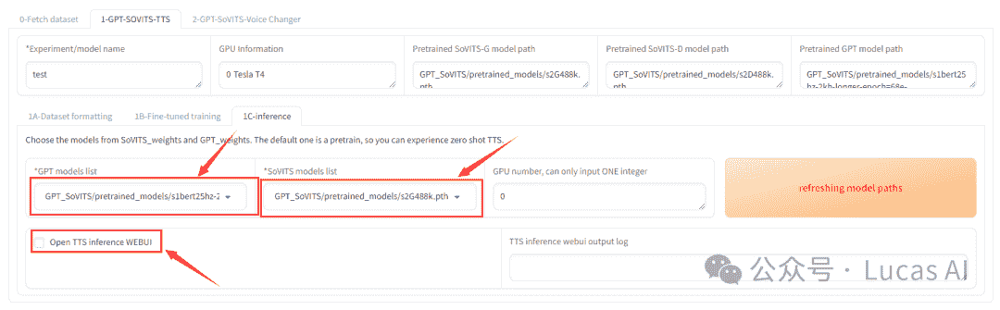

中文对照图↓

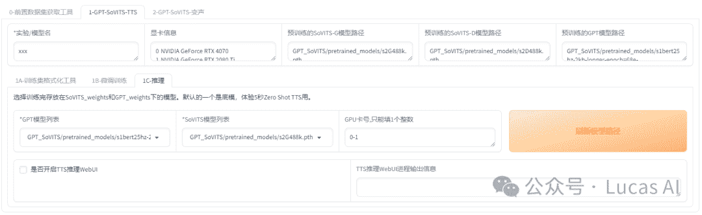

#### 8.2 开始推理

最上面可以切换模型，在刚练完挑模型的时候很重要

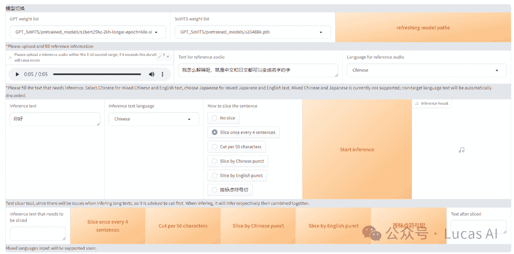

中文对照图↓

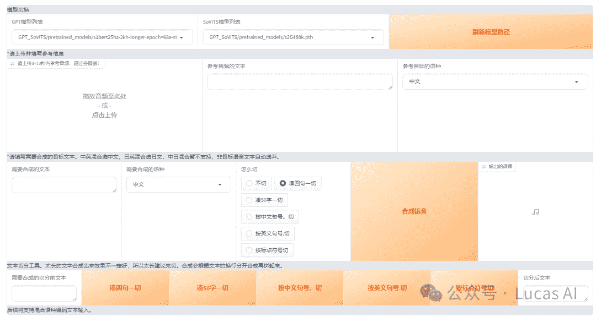

然后上传一段参考音频，建议是数据集中的音频。最好 `5` 秒。参考音频很重要！会学习语速和语气，请认真选择。参考音频的文本是参考音频说什么就填什么，必须要填。语种也要对应

接着就是输入要合成的文本了，注意语种要对应。目前可以中英混合，日英混合和中日英混合。切分建议无脑选 `50` 字一切，低于 `50` 字的不会切。如果 `50` 字一切报错的话就是显存太小了可以按句号切。如果不切，显存越大能合成的越多，实测 `4090` 大约 `1000` 字，但已经胡言乱语了，所以哪怕你是 `4090` 也建议切分生成。合成的过长很容易胡言乱语。如果出现吞字，重复，参考音频混入的情况，这是正常现象。不是模型炼差了，不用为模型担心。改善的方法有使用较低轮数的 `GPT` 模型、合成文本再短点、换参考音频。官方也在努力修复这个问题。

点击音频右边的三个点可以下载

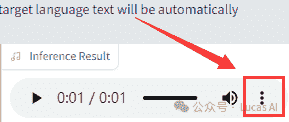

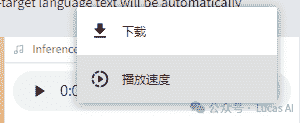

### 9. 下载模型到本地

模型存放在 `GPT_weights` 和 `SOVITS_weights` 里，右键下载即可。下载速度取决于你🪜的速度……

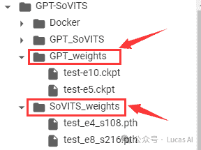

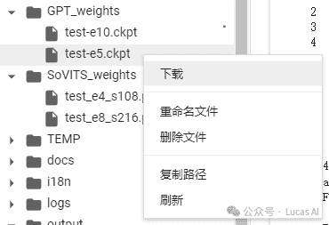

下载的时候会转圈，圈转完就是下载好了。在浏览器的下载里看下载内容。

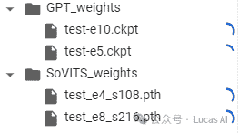

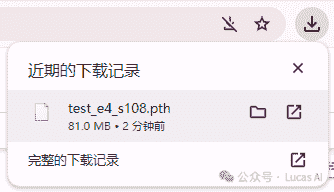

### 10. 关机

为了下次还有免费的显卡用，所以要关机。点击代码运行程序—断开链接并删除运行时。

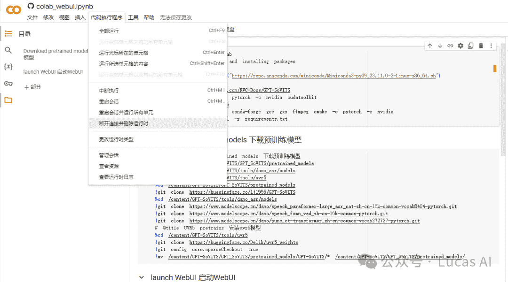

### 11. 本地推理

将 `GPT` 模型（`ckpt` 后缀）放入 `GPT_weights` 文件夹，`SoVITS` 模型（`pth` 后缀）放入 `SoVITS_weights` 文件夹，刷新下模型就能选择模型推理了。

## 使用 `AutoDL`

### 使用条件

打开 `AutoDL` 官网 https://www.autodl.com/home 注册账号登陆，先充值几块钱，差不多 `10` 块钱就够炼好几次了，熟练的话一次一块钱不到

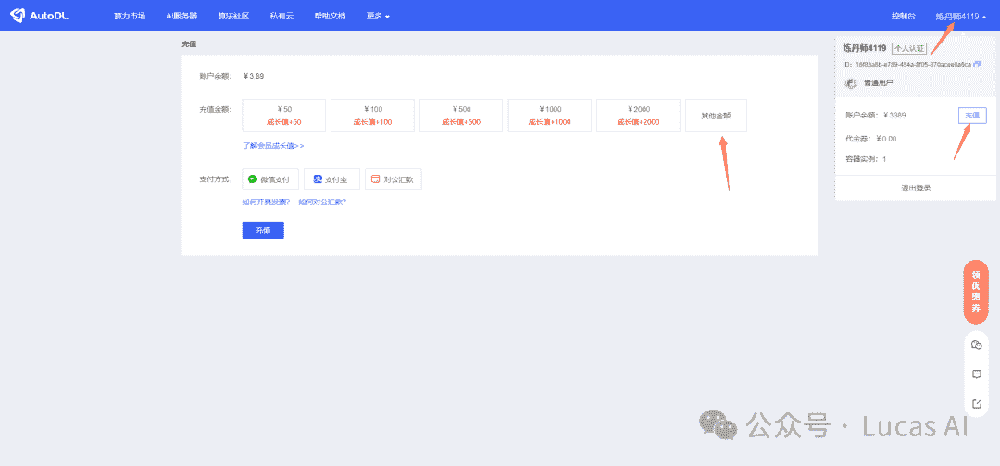

然后回控制台点租用新实例，租显卡炼

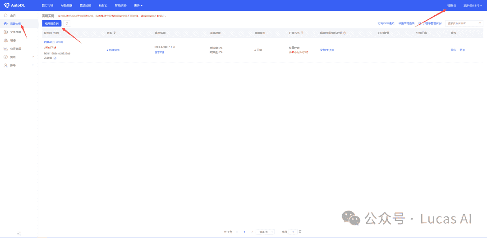

官方测试通过 `3080ti`，推荐租用: `A5000`（性价比最高）、`4090`、`3080ti`。如果没显卡了就换个区租，一般 `4090` 最多。

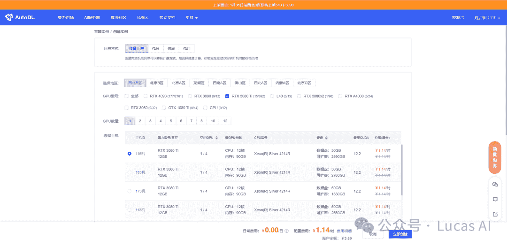

下面镜像选择社区镜像，搜索 `GPT-SoVITS` 会出来一堆镜像，选择用户 `RVC-Boss` 上传的镜像，版本选择最新的

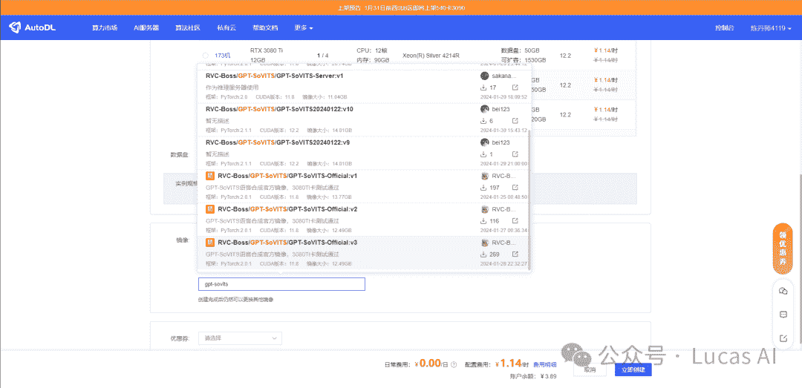

### 2. 处理数据集

请认真准备数据集！以免后面出现各种报错，和炼出不理想的模型！好的数据集是炼出好的模型的基础！

#### 2.1 上传原音频

开机后点 `JupyterLab` 和 `AutoPanel`。`JupyterLab` 就是操作界面，`AutoPanel` 用来网盘传东西


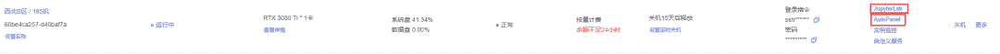

来到AutoPanel—公网网盘，建议选择阿里网盘（百度网盘要申请），用阿里网盘app扫码登陆，下载上传好的原音频


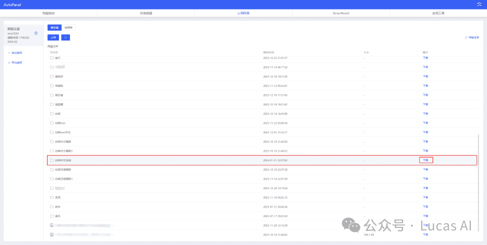

## 2.2：开启WebUI

然后来到JupyterLab打开的页面，在终端中输入`echo {}> ~/GPT-SoVITS/i18n/locale/en_US.json && source activate GPTSoVits && cd ~/GPT-SoVITS/ && python webui.py`

WebUI所有新窗口均使用public URL的gradio地址打开，点击下面那个链接就会弹出网页，不是上面那个9874的链接。然后就是和整合包一样的内容，更详细的看整合包教程

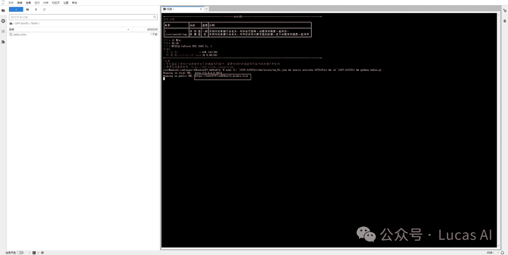

## 2.3：UVR5提取人声

### 2.3.1：方法1：使用自带的UVR5处理音频

点击开启UVR5-WebUI，回到终端，点最下面那个链接就会自动跳转UVR5的页面。

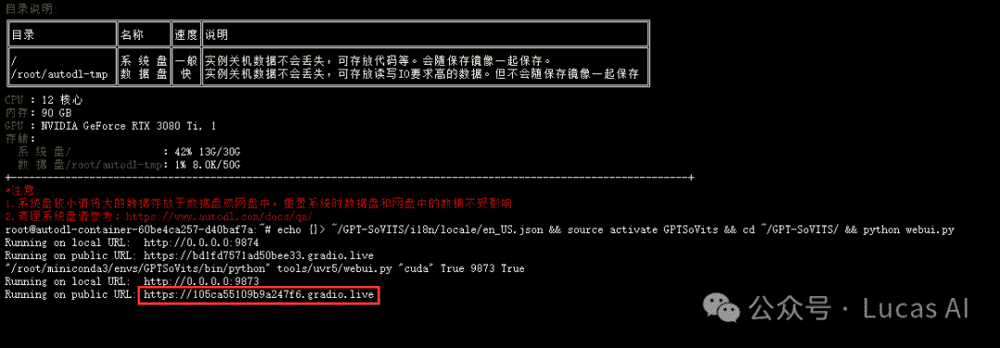

左边是文件管理器，回到最开始的菜单，点击autodl-tmp，这是数据盘，下载的东西默认都在这里

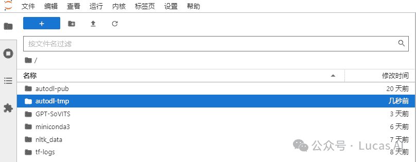

右键复制下载的原音频的路径

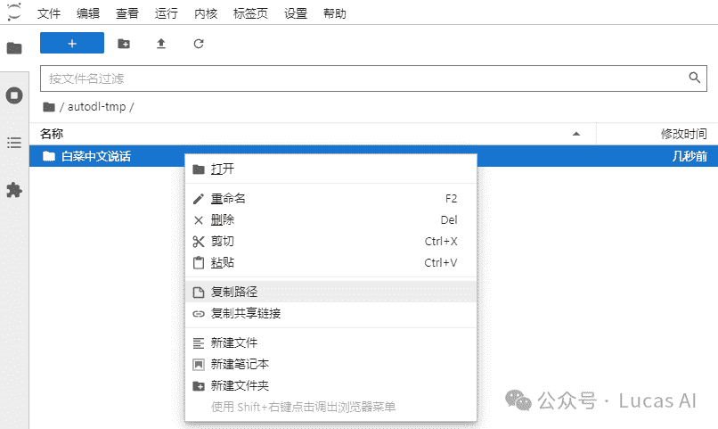

到网页端粘贴路径进去的要在路径前加上`/root/`，例如：复制的路径是`autodl-tmp/1.wav`，那么就要加上`/root/`变成`/root/autodl-tmp/1.wav`。`autodl`里的所以路径都要加上`/root/`

先用`HP2`模型处理一遍（提取人声），然后将输出的干声文件再用`onnx_dereverb`最后用`DeEcho-Aggressive`（去混响），输出格式选`wav`。输出的文件默认在`GPT-SoVITS-beta\GPT-SoVITS-beta\output\uvr5_opt`这个文件夹下，处理完的音频（`vocal`）的是人声，`(instrument)`是伴奏，记得把`instrument`删掉。结束后记得到WebUI关闭UVR5节省显存。

如果没有成功输出，报错了。那么推荐使用下面一种方法——UVR5客户端。（✅可能兼容性有问题，但是效果是和UVR5对齐的，不要瞎黑内置工具效果有问题）

### 2.3.2：方法2：在本地电脑使用UVR5客户端（没有bug，可能性能需求会更高点）

官方下载地址：`https://github.com/Anjok07/ultimatevocalremovergui/releases/tag/v5.6`

网盘下载（包含Windows和macOS）：`https://www.123pan.com/s/UHp9-9fi8H.html`

macOS和Liunx的使用方法

由于苹果的严格管控应用程序的安全性，您可能需要按照以下步骤打开UVR：

首先，使用终端运行以下命令，允许应用程序从所有来源运行：

```
sudo spctl --master-disable
```

其次，运行以下命令来绕过验证：

```
sudo xattr -rd com.apple.quarantine /Applications/Ultimate\ Vocal\ Remover.app
```

Linux：嗯？都用Linux了，用Git拉代码自己部署不是难事吧？欸嘿~

### 警告：安装路径必须为全英文！！！不推荐修改默认安装路径，否则会有权限问题！！！

详细教程：`https://www.bilibili.com/read/cv27499700/` 作者@bilibili@bfloat16

打开UVR5首先要下载模型，建议下载我打包好的，里面有几乎所有模型，包含vip模型。下载解压后先把`models`文件夹删了，再把解压的文件夹直接拖进`Ultimate Vocal Remover`根目录替换`models`文件夹

模型包：`https://www.123pan.com/s/UHp9-Qfi8H.html`（下载精简版就好，里面有要用到的模型了。完整版是UVR5的所有模型，可能以后会用到）

如果觉得模型包太大，也可以自己下载（需要🪜，且速度很慢，一次只能下一个）。点击左下角的小扳手，打开设置界面，点击第三个下载模型。需要下载的模型有：`MDX23C-InstVoc HQ`（`HQ2`是需要赞助后才能下载的vip模型，效果提升不大）、`VR Architecture：UVR-De-Echo-Normal`选`No Echo Only`（轻度混响）、`VR Architecture：UVR-De-Echo-Aggressive`选`No Echo Only`（重度混响）、`VR Architecture：UVR-De-Echo-Dereverb`选`No Echo Only`（变态混响）、`UVR-DeNoise`

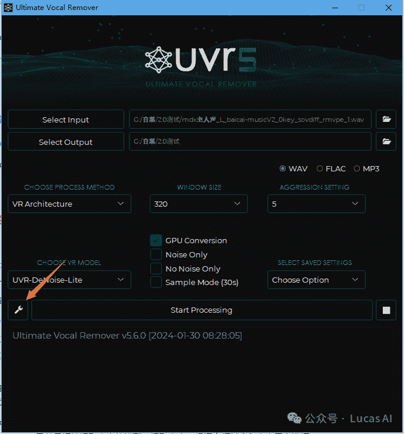

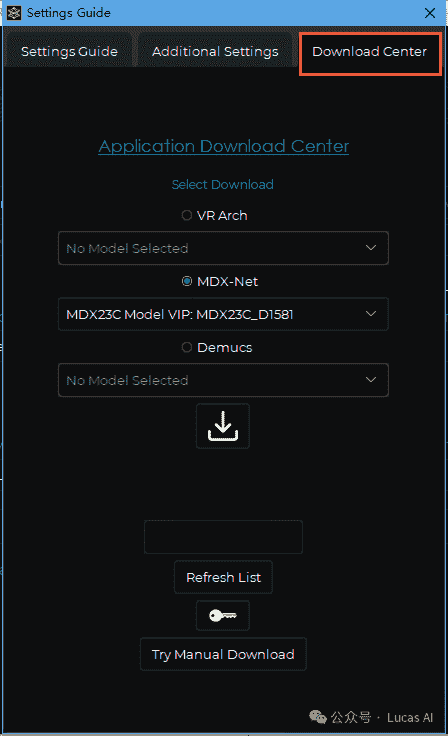

下载完模型后开始处理音频，`select input`选择输入文件`select output`选择输出文件夹，输出格式选`WAV`，记得点上`GPU Conversion`，首先使用`MDX23C`（目前最好的提取人声的模型）提取人声（根据音频长度和个人显卡选择`HQ1`或者`HQ2`，`HQ2`处理速度慢了几倍效果提升了一点，4090显卡`HQ1`处理5分钟音频大约需要1分钟，`HQ2`处理5分钟音频大约需要3分钟）。处理完的音频（`vocals`）的是人声。然后把人声再输入去混响（下面三选一）：`VR Architecture：UVR-De-Echo-Normal`（轻度混响）、`VR Architecture：UVR-De-Echo-Aggressive`（重度混响）、`VR Architecture：UVR-De-Echo-Dereverb`（变态混响），最后用`UVR-DeNoise`降噪一下。这套流程弄完会比自带的UVR5在人声提取方面好一点。

## 2.4：切分

在切割音频前建议把所有音频拖进音频软件（如`au`、`剪映`）调整音量，最大音量调整至-9dB到-6dB，过高的删除

输入路径是上面的原音频的文件夹路径，如果刚刚经过了UVR5处理那么就是`uvr5_opt`这个文件夹。输出路径默认是`output/slicer_opt`。建议可以调整的参数有`min_length`、`min_interval`和`max_sil_kept`单位都是ms。`min_length`根据显存大小调整，显存越小调越小。`min_interval`根据音频的平均间隔调整，如果音频太密集可以适当调低。`max_sil_kept`会影响句子的连贯性，不同音频不同调整，不会调的话保持默认。其他参数不建议调整。当然也可以使用其他切分工具切分。

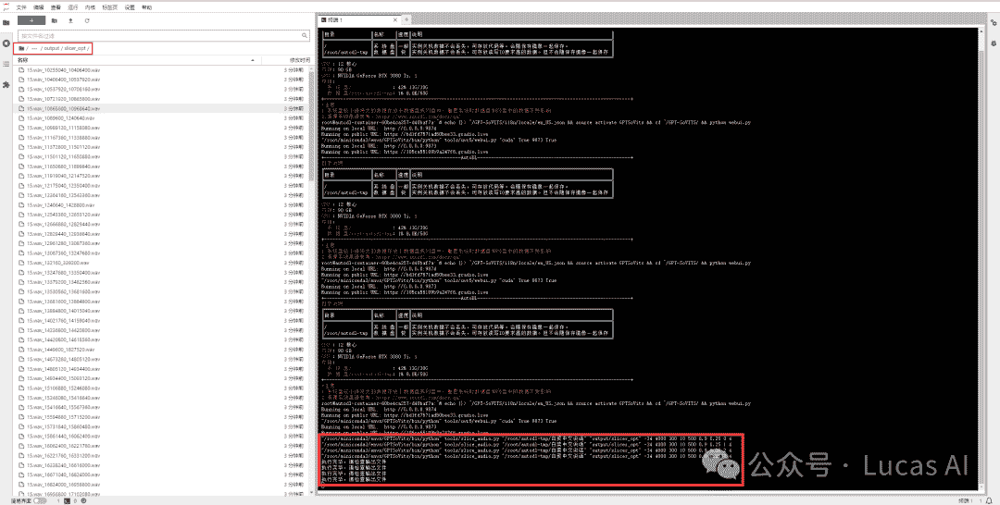

切分完后文件在`GPT-SoVITS\output\slicer_opt`。打开切分文件夹，排序方式选大小，将时长超过 显存数 秒的音频手动切分至 显存数 秒以下。比如显卡是4090 显存是24g，那么就要将超过24秒的音频手动切分至24s以下，音频时长太长的会爆显存。如果语音切割后还是一个文件，那是因为音频太密集了。可以调低`min_interval`，实在不行用`au`手动切分。

## 2.5：打标

### 2.5.1：开启标注

路径输入就是上面的切片输出路径，默认是`/GPT-SoVITS/output/slicer_opt`，还是记得要加上`/root/`。终端中有进度条就说明在跑，不在跑就会`Error`报错

如果有字幕的可以用字幕标注，准确多了。内嵌字幕或者外挂字幕都可以，教程使用字幕标注（更准确）

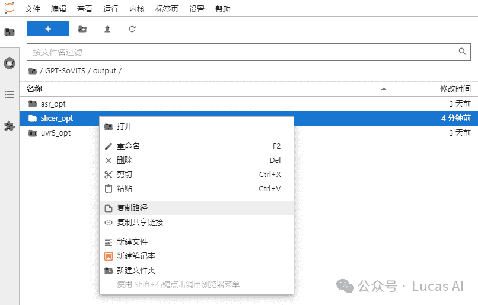


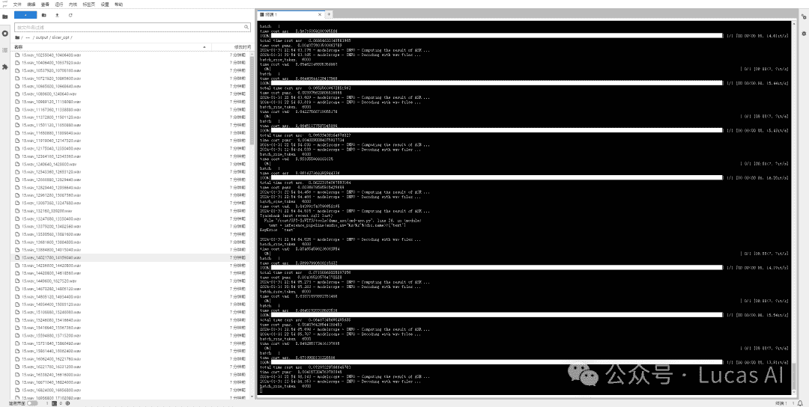

标注文件默认在`otput/asr_opt`


### 2.5.2：校对（这步比较费时间，可以跳过）

将标注文件的路径输入进去可以然后开启标注校对，就可以点终端里最下面那个链接进入校对界面了（这个教程晚点更新）先看别人的教程视频：`https://www.bilibili.com/video/BV1My4y1P7WX/`

# 3：训练

## 3.1：输出logs

填实验名也就是模型名称，不能有中文！然后第一个输入的是标注文件路径，注意是文件路径！不是文件夹路径！示例：`/root/GPT-SoVITS/output/asr_opt/slicer_opt.list`，注意后面的文件名必须要输进去！打不开就再三检查路径是否正确！必须要有`.list`的后缀！！！第二个输入的是切分音频文件夹路径 示例：`/root/GPT-SoVITS/output/slicer_opt`。注意复制的路径都不能有引号！！！千万不能有引号！然后点一键三连等结束就好了。如果有报错会在终端呈现

### 3.2：微调训练

首先设置`batch_size`，建议`batch_size`设置为显存的一半，高了会爆显存。`bs`并不是越高越快！GPT模型训练的时候可以把`bs`再调低点。

接着设置轮数，SoVITS模型轮数可以设置的高一点，反正训练的很快。GPT模型轮数千万不能高于20（一般情况下）建议设置10。然后先点开启`SoVITS`训练，训练完后再点开启`GPT`训练，不可以一起训练（除非你有两张卡）！如果中途中断了，直接再点开始训练就好了，会从最近的保存点开始训练。

训练的时候请打开`AutoPanel`看显卡占用。爆显存了就调低`bs`。或者存在过长的音频，需要回到2.4步重新制作数据集。

训练完成会显示训练完成，并且控制台显示的轮数停在设置的（总轮数-1）的轮数上。

关于学习率权重，轮数该多少好，如何制作出好模型，`Tensorboard`都在整合包教程训练章节


# 4：推理

## 4.1：开启推理界面

下拉选择模型推理，`e`代表轮数，`s`代表步数。不是轮数越高越好。选择好模型点开启`TTS`推理，还是点终端中最下面的链接。

请严格区分轮数 (`Epoch`) 和步数 (`Step`)：1 个 `Epoch` 代表训练集中的所有样本都参与了一次学习，1 `Step` 代表进行了一步学习，由于 `batch size` 的存在，每步学习可以含有数条样本，因此，`Epoch` 和 `Step` 的换算如下：

## 4.2：开始推理

最上面可以切换模型，在刚练完挑模型的时候很重要

然后上传一段参考音频，建议是数据集中的音频。最好5秒。参考音频很重要！会学习语速和语气，请认真选择。参考音频的文本是参考音频说什么就填什么，必须要填。语种也要对应

接着就是输入要合成的文本了，注意语种要对应。目前可以中英混合，语种选择中文，日英混合，语种选择日文。切分建议无脑选50字一切，低于50字的不会切。如果50字一切报错的话就是显存太小了可以按句号切。如果不切，显存越大能合成的越多，实测4090大约1000字，但已经胡言乱语了，所以哪怕你是4090也建议切分生成。合成的过长很容易胡言乱语。如果出现吞字，重复，参考音频混入的情况，这是正常现象。不是模型炼差了，不用为模型担心。改善的方法有使用较低轮数的`GPT`模型、合成文本再短点、换参考音频。官方也在努力修复这个问题。

# 5：下载模型到本地

回到`AutoPanel`—公网网盘点击上传，打开`/root/GPT-SoVITS/GPT-weights`和`SoVITS`这两个文件夹，分别将模型上传


上传成功会这样


# 6：关机

千万要记得关机！不然余额马上扣光。回到控制台点关机就好了，如果不打算再炼可以点更多—释放实例


# 7：本地推理

将`GPT`模型（`ckpt`后缀）放入`GPT_weights`文件夹，`SoVITS`模型（`pth`后缀）放入`SoVITS_weights`文件夹，刷新下模型就能选择模型推理了。

# 本地部署

## 使用条件：

训练：

1.`Windows10/11`系统，支持 `CUDA` 的8G以上显存的`nVIDIA` 显卡;

2.`macOS` 12.3或更高版本，搭载`Apple`芯片（`M`系列芯片）或`AMD GPU`的`Mac`（如2019款`Mac Pro`）

推理：

1.`Windows10/11`系统，支持 `CUDA` 的4G以上显存的`nVIDIA` 显卡;

2.`macOS` 12.3或更高版本，搭载`Apple`芯片（`M`系列芯片）或`AMD GPU`的`Mac`（如2019款`Mac Pro`）

## 下载安装

### 百度网盘链接：

链接：`https://pan.baidu.com/s/1B3Olspf8djAgdK23ZQu3WQ`

提取码：`zb9l`

压缩包解压完成后，双击`go-webui.bat`文件运行


启动`WebUI` 在浏览器中打开相应端口地址，即可在浏览器中使用`GPT-SoVITS-WebUI`界面。

#### 01 前置数据集获取

1、`人声提取：` 选择 `0a-UVR5人声伴奏分离&去混响去延迟工具` 页签。勾选 `是否开启UVR5-WebUI` 来提取声音，制作干声。


将准备的音频或者视频文件拖放到左下角的框框内。

不带和声的音频选`HP2`，带和声的音频选`HP5`，然后点击 `转换`。

转换成功后，可以在整合包`\output`路径下的`uvr5`输出目录中找到转换结果。

2、音频切分： 关闭 `是否开启UVR5-WebUI`，以释放显存。删除刚刚音频分离路径下的背景声音，并将路径复制到下面的输入框里。选择 `0b-语音切分工具` 页签。点击 `开始语音切割`。

完成后，可以在`\output\slicer_opt`路径下看到切割后的所有音频文件。

3、语音文本识别： 选择 `0c-中文批量离线ASR工具` 页签，将刚刚的分类目录路径复制到下面ASR中。点击 `开启离线批量ASR`。完成后，结果会保存在`\output\asr_opt`目录下。


4、开启标注工具： 选择 `0d-语音文本校对标注工具` 页签，把上面ASR生成的list文件的完整路径填写到下面的标注文件路径中。


点击 `是否开启打标WebUI`，会弹出新的`WebUI`窗口

在这个界面里面进行文本校对，修改标点符号与停顿一致。如果听不清，有杂音，语速乱的，建议删除，或者回去进行音源调整。


删除方式是先勾选，然后点击 `删除`。

数据会保存到`slicer_opt.list`中。至此，已经完成了前置获取数据集。

#### 02 训练模型

1、训练集格式化： 点击 `1A-训练集格式化工具`，填写训练的模型名称，填写上面数据集的list目录和音频切分的目录。

点击下面按钮 `开启一键三连`。

一键三连结束后，会在`\logs\buyansu`（你设置的模型名）文件下看见23456

2、微调训练： 点击 `1B-微调训练` 页签，进入子模型训练界面。需要开启两个微调子模型的训练，参数默认即可。推荐使用20系以上的N卡，8G以上的显存。如果显存不够，可以降低`batch_size`的数值。然后依次点击 `开始SoVITS训练` 和 `开始GPT训练`

训练完成后，微调模型就已经准备好了。

#### 03 声音合成

推理： 点击 `1C-推理` 页签，进入推理界面。首先点击 `刷新模型路径按钮`，将刚刚训练的子模型拉取进来。


然后点击 `是否开启TTS推理WebUI` 按钮，会弹出推理`WebUI`界面。


推理前我们需要给它一个目标音色参考音频，可以在之前切分的路径下取一个音频。我们将音频和文字，还有语音填入推理界面相应的位置。

然后将我们想说的文本，填写到下面。并且选择一种切分方式，或者自己手动切分。


最后点击 `合成语音`。
