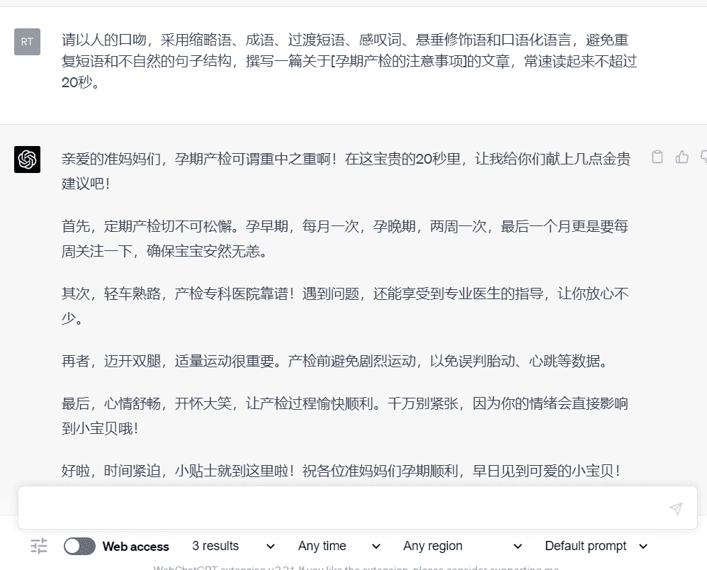
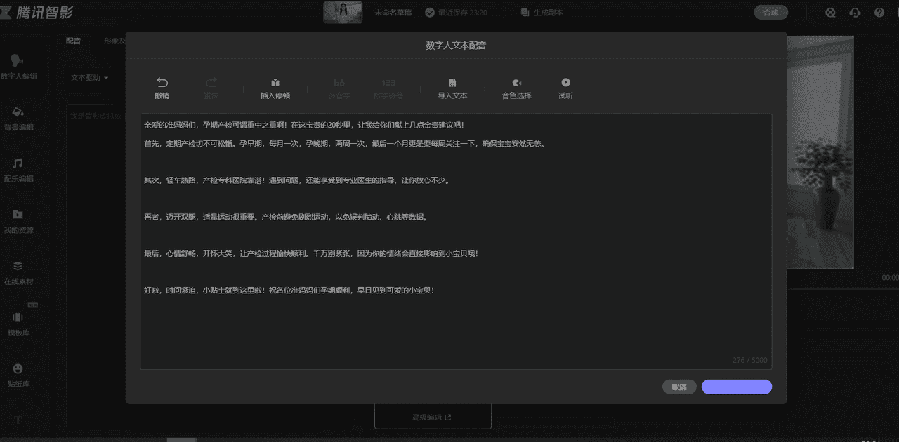
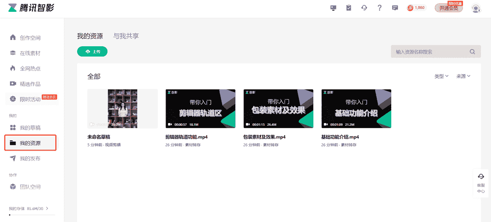
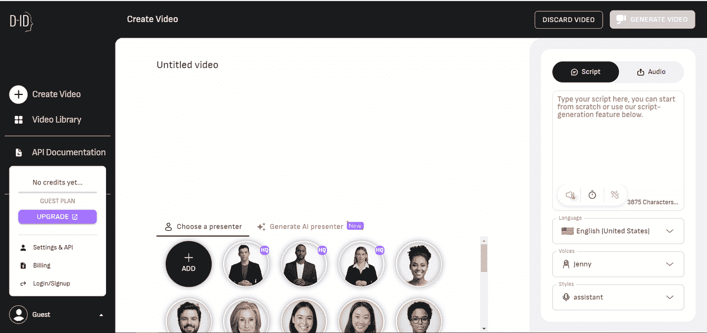

# 用ChatGPT免费做出数字人视频

> 来源：[https://xmgtoagi.feishu.cn/docx/HRgRd5Y8boLrhxxz3aycm20Ln6d](https://xmgtoagi.feishu.cn/docx/HRgRd5Y8boLrhxxz3aycm20Ln6d)

> 作者：孟祥林

操作指引

ChatGPT产生文案=》腾讯智影数字人播报=》粘贴文案=》导出视频。

说明：部分资源只有会员才能用~，非会员可生成5分钟视频。

## 一、ChatGPT产生文案

需要让ChatGPT帮我想一个数字人播报需要的文案，复制粘贴ChatGPT的回答，举例如下。

prompt：

请以人的口吻，采用缩略语、成语、过渡短语、感叹词、悬垂修饰语和口语化语言，避免重复短语和不自然的句子结构，撰写一篇关于[孕期产检的注意事项]的文章，常速读起来不超过20秒。

回答：

亲爱的准妈妈们，孕期产检可谓重中之重啊！在这宝贵的20秒里，让我给你们献上几点金贵建议吧！

首先，定期产检切不可松懈。孕早期，每月一次，孕晚期，两周一次，最后一个月更是要每周关注一下，确保宝宝安然无恙。

其次，轻车熟路，产检专科医院靠谱！遇到问题，还能享受到专业医生的指导，让你放心不少。

再者，迈开双腿，适量运动很重要。产检前避免剧烈运动，以免误判胎动、心跳等数据。

最后，心情舒畅，开怀大笑，让产检过程愉快顺利。千万别紧张，因为你的情绪会直接影响到小宝贝哦！

好啦，时间紧迫，小贴士就到这里啦！祝各位准妈妈们孕期顺利，早日见到可爱的小宝贝！

## [二、腾讯智影网站](https://zenvideo.qq.com/activity/invitee?invitation_code=D5rvF2CaS7FYFw5z)

打开注册：[腾讯智影网站](https://zenvideo.qq.com/activity/invitee?invitation_code=8nO4F1SlTAuWhJjm)，

找到数字人播报'功能入口：https://zenvideo.qq.com/smart/listVirtual

会员领取链接：https://zenvideo.qq.com/activity/invitee?invitation_code=8nO4F1SlTAuWhJjm

## 三、选择一个2D数字人

这里我选择了免费又美丽的慕瑶小姐姐

## 四、粘贴文本

将ChatGPT生成的文案粘贴到‘数字人文本配音’窗口，

还可以选择‘音色选择’与试听’功能

最后点击保存并生成音频。

## 五、编辑自定义，合成

这里还可以选择背景编辑以更换背景,虚拟人物的位置可以调整,都设置完成后,点击播放按钮,即可播放效果。(ps:未导出视频之前,数字人只是静态。)最后点击'合成'按钮,导出视频。

## 六、资源

在我的资源"里能看到导出的视频。

https://zenvideo.qq.com/my/material

## 七、其他数字人平台推荐

D-ID平台：https://studio.d-id.com/

可免费生成15分钟的视频。

## 八、生成视频预览

[未命名草稿.mp4](https://internal-api-drive-stream.feishu.cn/space/api/box/stream/download/all/Y51FbU779oZCEdxyllycG1RKnUf)