# AI换脸副业项目拆解

> 来源：[https://xmgtoagi.feishu.cn/docx/WbLrdnGe4oT17RxzdCkcoO7InAe](https://xmgtoagi.feishu.cn/docx/WbLrdnGe4oT17RxzdCkcoO7InAe)

自AI艺术二维码上线以来，已经吸引了一批粉丝前往平台注册使用了，同时加我的好友不断，看来大家对AI的兴趣还真是浓厚，更更兴趣的应该还是AI副业，废话不多说，先看成果吧！以下是学员在某鱼中的成果，才上架一天，就拿到了成绩。

AI艺术二维码副业项目可查看：[AI换脸副业项目拆解](https://xmgtoagi.feishu.cn/wiki/WNYJwxb7BibsP8kMVe0c1XIEnke)

# AI艺术二维码项目战况

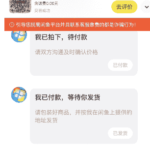

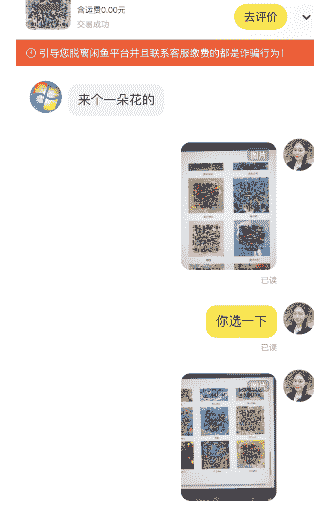

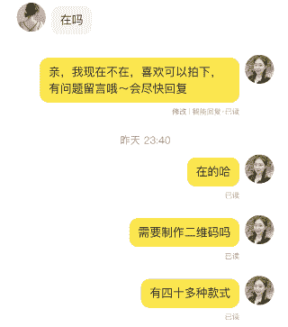

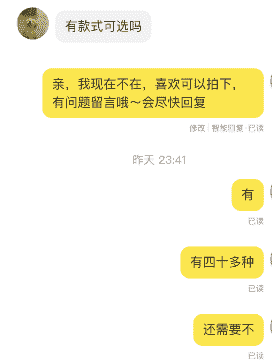

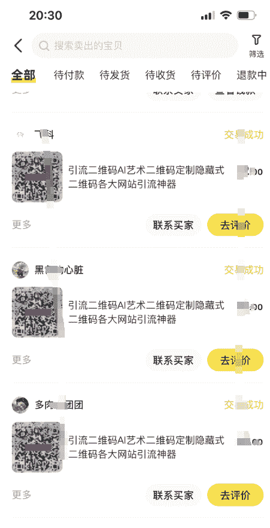

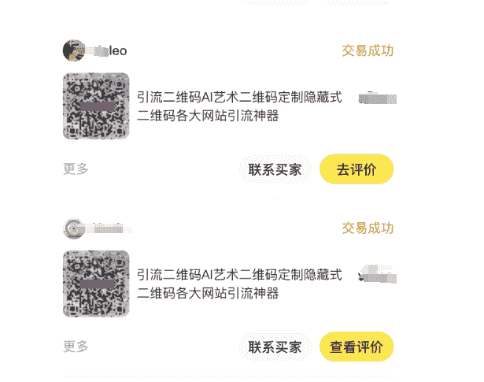

关于AI艺术二维码项目，我在上一篇文章已经讲过了，如果不了解的，可以先去读一读。

[AI副业日赚200](https://xmgtoagi.feishu.cn/wiki/UHCuwwoMRia81RkfYhLcUGn8nag)

**如果还是不会操作的，可以加我🛰️（xmgcod**e88），手把手教你通过AI实现零突破。

也有很多想学着搞AI副业的朋友，都别着急，大部分只有晚上有时间和你们细说，但都不会错过与你们交流学习的机会。

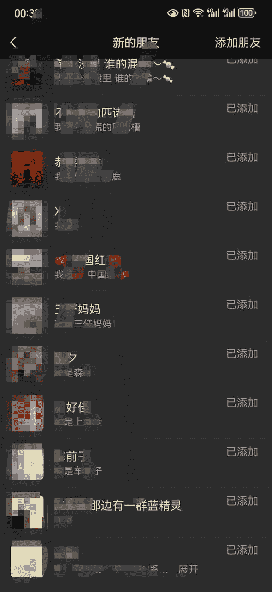

# AI换脸

体验地址：www.xmgai.cn，今天着重介绍的项目是AI换脸，经过多日的奋战，终于开发完成了AI换脸的功能，先来看看效果吧。

**   **                  原图                                                           目标图                                      成果图

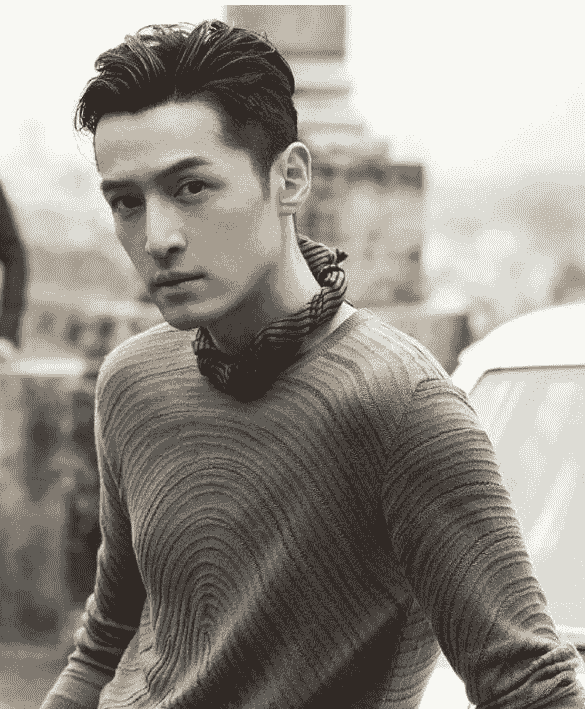

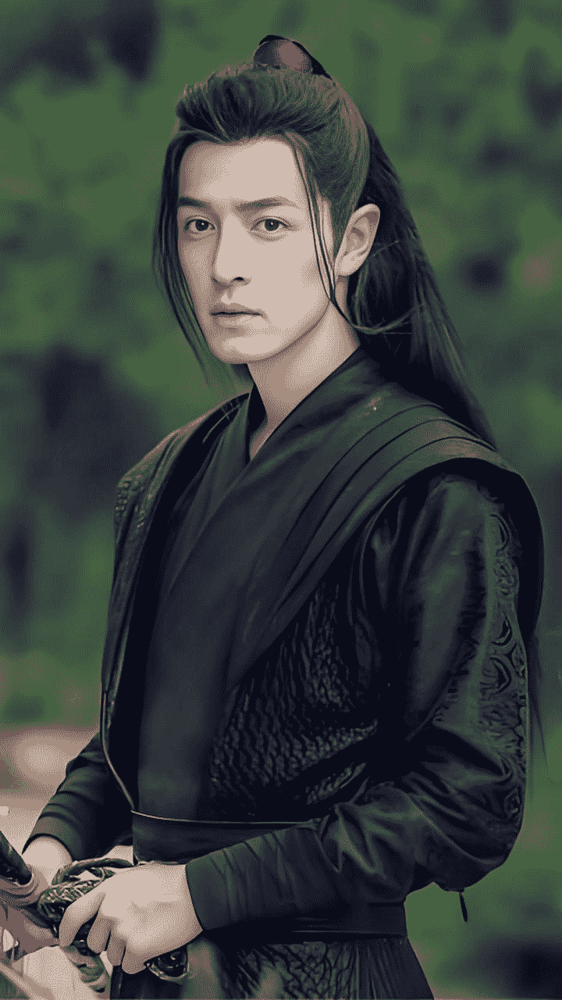

再来一组

**          原图                                                  **         目标图                                             成果图

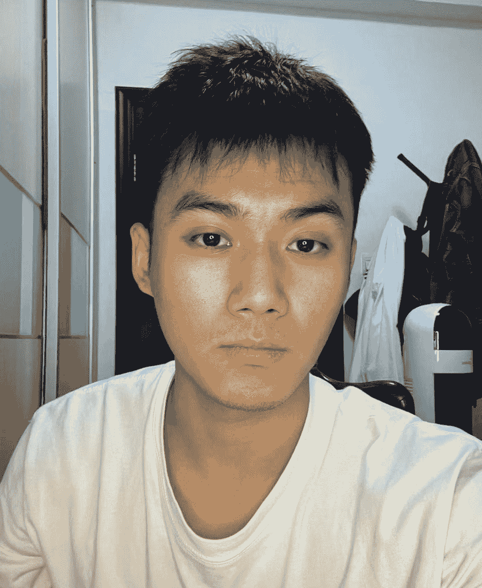

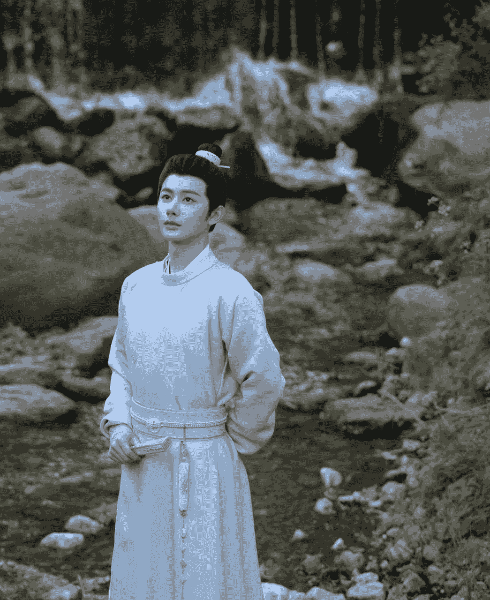

体验网址www.xmgai.cn，几十秒钟就可以生成结果，可以找站长免费领取体验点数。

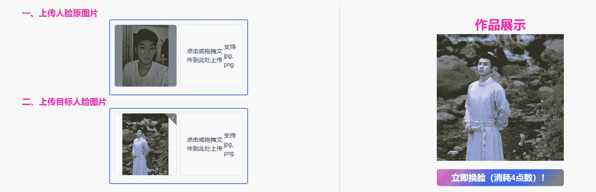

这玩意看着好玩，到底能怎么赚钱呢，以下是搞钱的几种场景：

1.  **社交媒体个性化内容**：

利用AI换脸，用户可以将自己的面孔替换到名人、历史人物或流行文化角色上，制作成有趣的图片，用于个人资料图片或社交媒体帖子。这种服务可以吸引大量用户，尤其是在特殊节日或事件期间。

1.  **虚拟试妆服务**：

提供虚拟试妆服务，用户可以上传自己的照片，通过AI换脸技术预览不同妆容效果。这种服务特别适合化妆品品牌推广新产品，或为个人用户提供试妆体验，帮助他们决定购买哪些产品。

1.  **个性化艺术肖像**：

将用户的照片通过AI技术转换成艺术风格的肖像画。这种服务可以吸引艺术爱好者和收藏家，他们希望拥有独一无二的艺术作品。用户可以选择不同的艺术风格，如油画、水彩或漫画风格。

1.  **定制化广告素材制作**：

为小型企业和个人品牌提供定制化的广告素材。通过AI换脸技术，将客户的形象融入到广告中，制作出更具吸引力和个性化的广告内容。这种服务可以帮助企业在竞争激烈的市场中脱颖而出。

1.  **个人形象改造服务**：

提供个人形象改造服务，用户可以上传自己的照片，通过AI换脸技术预览不同的发型、妆容或服饰搭配。这种服务特别适合那些希望在重要场合或日常生活中改变形象的用户。

1.  **肖像画定制**：

为需要定制肖像画的客户提供服务，将现代照片通过AI技术转换成古典肖像画风格。这种服务可以吸引那些希望拥有传统艺术风格肖像的用户，适合作为礼物或家庭装饰。

# 搭建自己的AI项目

小码哥AI才上线不到一个星期，已经有好几个朋友问我搭建自己的AI平台了，每个人的能量场不一样，用户不一样，真正实现躺赚，只有通过自己的AI平台，不断的实现收益。只需要保证平台的稳定运行，去不断的引流和引导用户，帮助用户了解AI、会用AI，才能实现利益的最大化。

不会技术没关系，我提供免费的技术服务，免费帮你部署你自己的AI平台

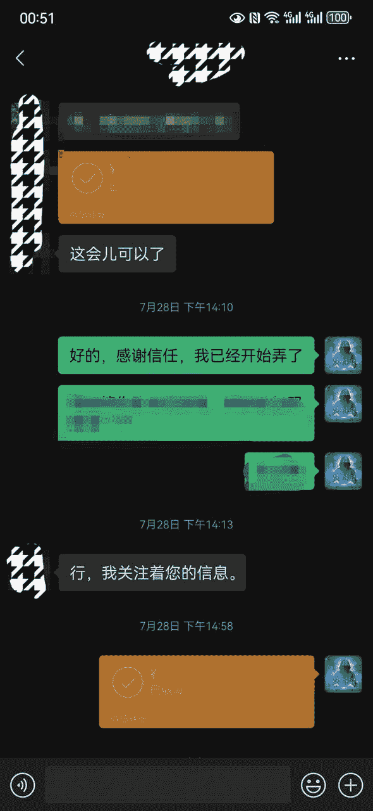

不会技术没关系，我提供免费的技术服务，免费帮你部署你自己的AI平台

半夜给用户远程部署AI项目，一起努力，一起搞钱！

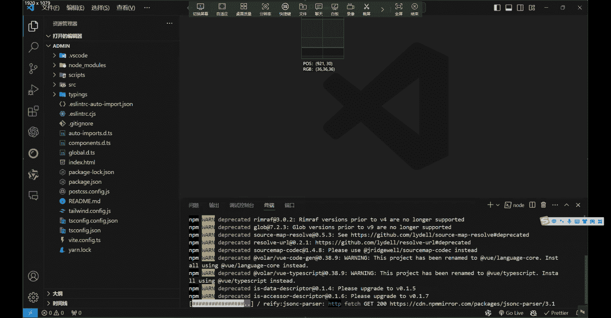

# AI学习基地

另外赠送免费的AI学习基地，里面包含了AI入门、AI绘画教程、AI音乐、AI数字人、AI副业破局、AI报告等，也欢迎广大AI爱好者投稿。

访问链接：[小码哥AGI启航](https://xmgtoagi.feishu.cn/wiki/S9BwwRcXciCz8BkA4uoc67UBnBf)

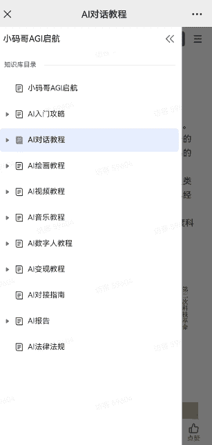

**AI副业搞钱，欢迎加我🛰️（xmgcod**e88），一起交流学习，也可以🛰️扫码。

