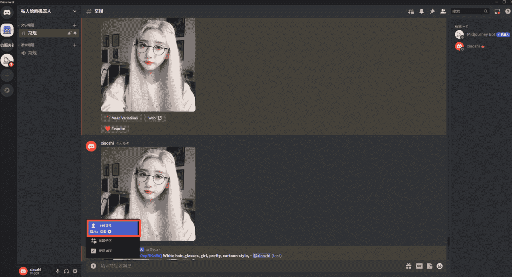
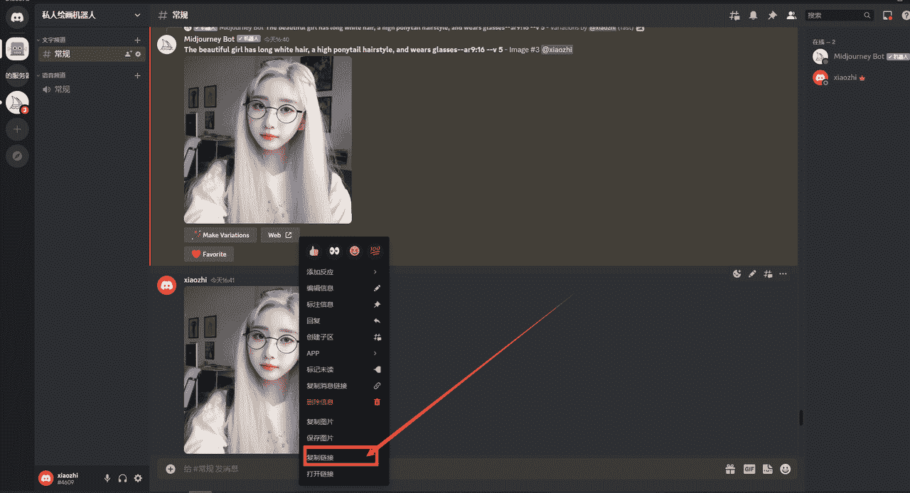
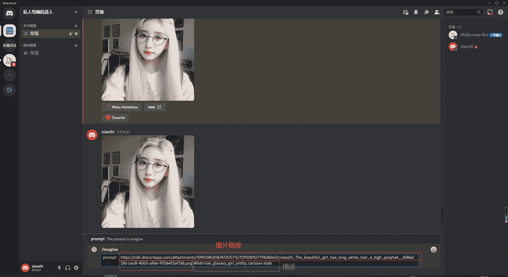
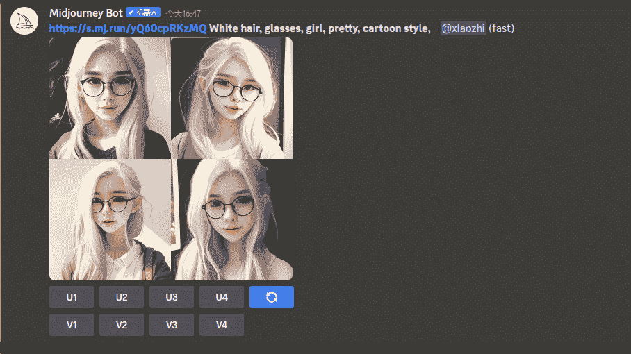
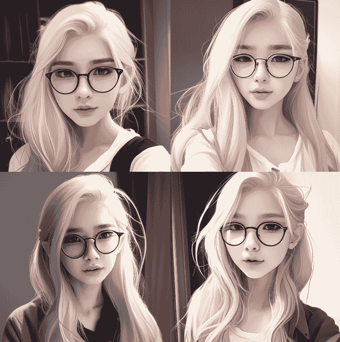
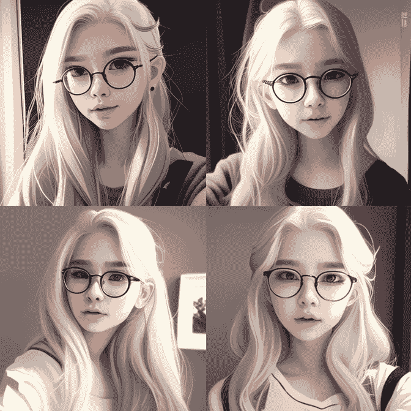
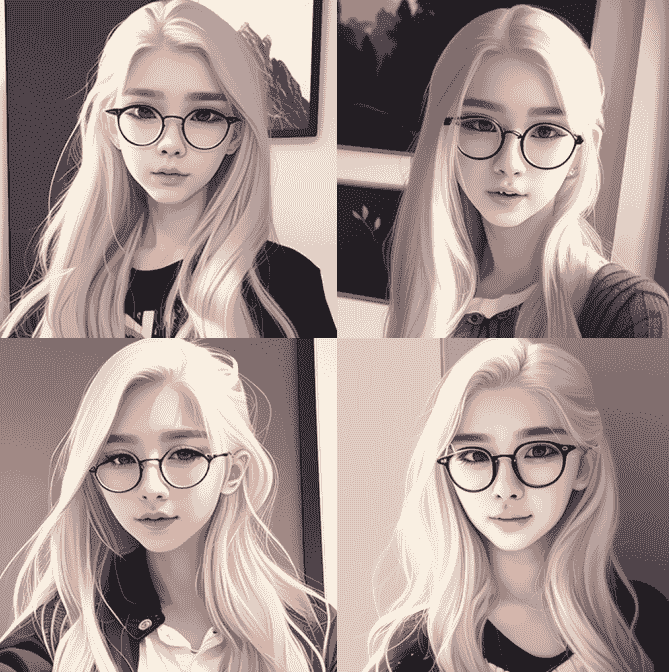

# Midjourney 制订专属AI头像

> 来源：[https://xmgtoagi.feishu.cn/docx/QMXUdIs9coj68ExXcAZcZhIQnWf](https://xmgtoagi.feishu.cn/docx/QMXUdIs9coj68ExXcAZcZhIQnWf)

前面有跟大家分享过定制AI头像变现的案例，今天就来教大家怎么生成自己的AI头像。

打开我们的Midjourney，点击左下角的+号，上传文件，上传自己的照片，按回车发送。

发送照片之后，右键点击照片，复制链接。

然后输入图片生成命令 /imagine prompt:粘贴图片链接 空格 描述（描述按照自己想要的风格写就行），可以尝试多几种风格，版本选择 v4。

然后就能生成属于自己的AI头像了，不是很像没关系，我们多尝试几次就行。

