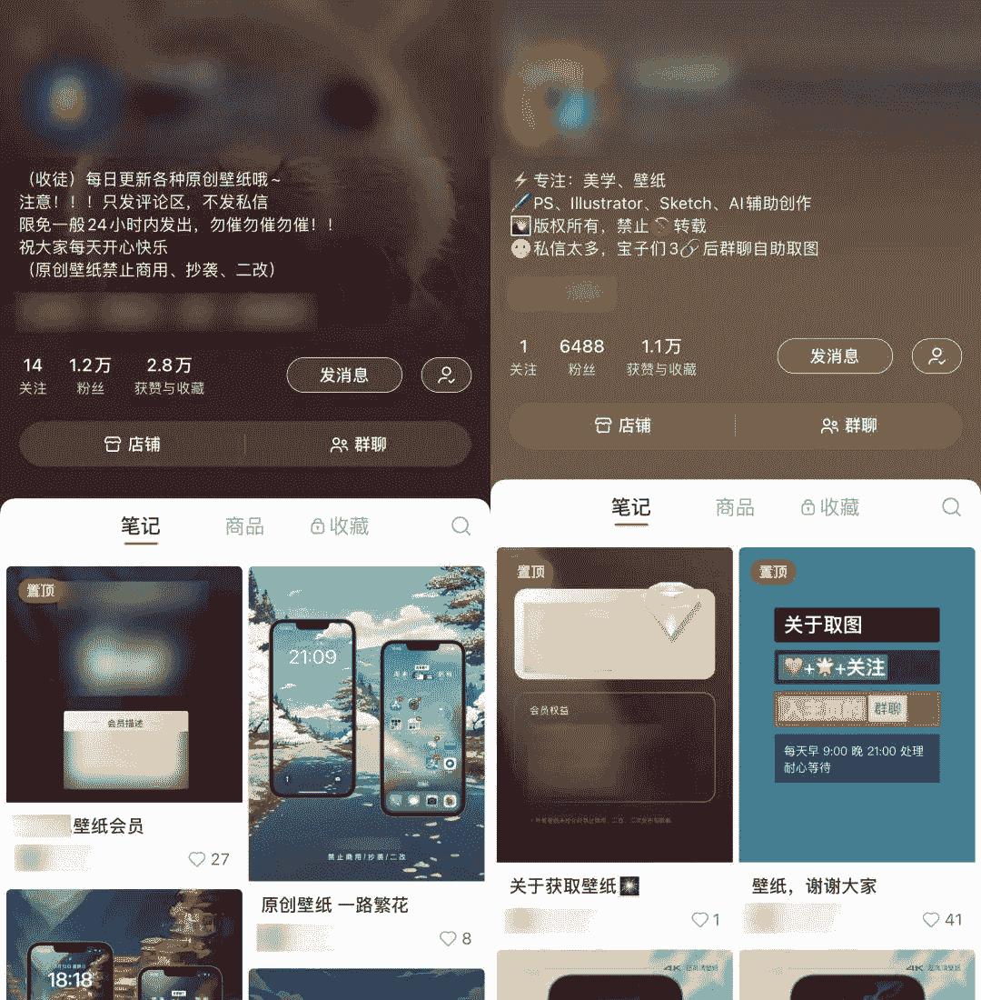
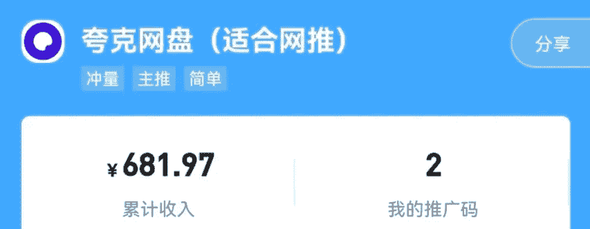
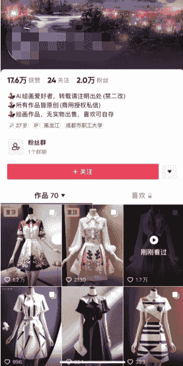
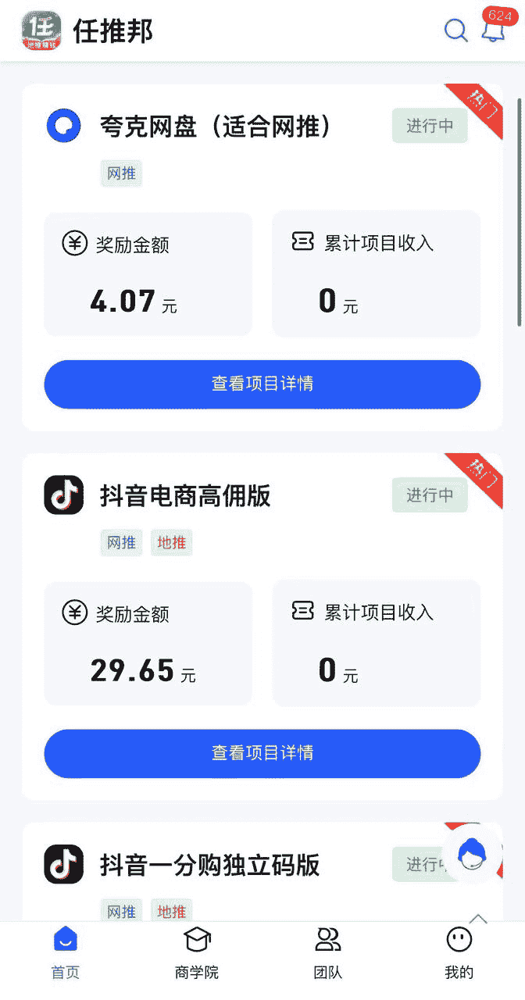
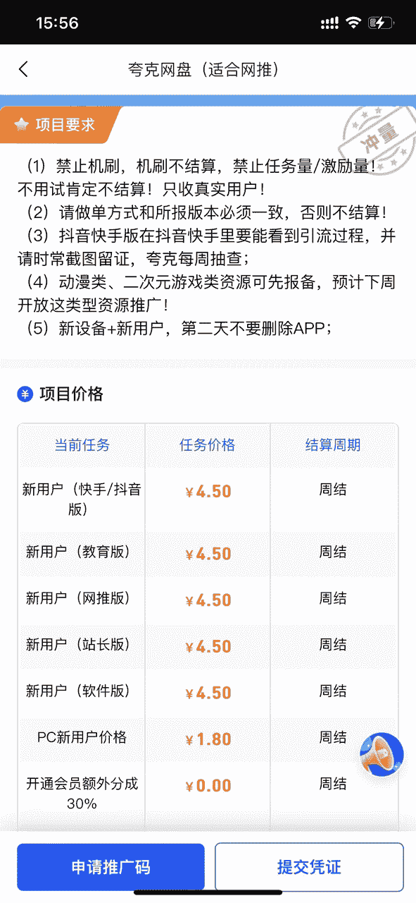

# AI壁纸号一周增加上千粉丝，轻松变现的成功案例分享

> 来源：[https://xmgtoagi.feishu.cn/docx/KDpyd2Q2RoI7XCxHygscGXbYnBd](https://xmgtoagi.feishu.cn/docx/KDpyd2Q2RoI7XCxHygscGXbYnBd)

# 前言

随着AI绘画技术的发展，传统的互联网副业壁纸号在新的技术加持下迎来了第二春。本文将分享一位壁纸号创作者的成功案例，并为大家提供创作门槛和硬件要求等相关信息。

该项目的创作门槛极低，基本上可以由AI完成内容创作。不过，为了获得更好的创作效果，需要使用具有8GB显存的NVIDIA显卡一张。

通过本文的案例分享，希望对那些有兴趣从事AI壁纸创作的人提供帮助。



# 壁纸号的变现方式：

抖音和小红书上的AI壁纸号可以通过以下三种方式进行变现：

1.  **网盘拉新**
这是主要的变现途径之一。当用户私信要求获取高清原图时，我们可以通过提供拉新网盘链接的方式，邀请他们注册新账户。每当我们成功邀请一个新用户注册时，我们就可以获取一定的佣金，整个流程非常顺畅。



1.  **广告变现**：通过在壁纸小程序或网站中投放广告来获得收益。微信小程序，抖音小程序，快手小程序，每个平台都有对应的广告联盟，接入就可以。这个方法要你先搭建部署一套系统。当然也有现成的小程序平台，你可以入驻。

1.  **定制头像和海报等**
借助ChatGPT等AI技术，现在可以轻松地完成定制任务。我们可以根据用户的需求和喜好，为他们制作定制头像和海报等设计作品，并收取一定的费用。

1.  **原创设计授权**
壁纸号可以将自己的原创设计授权给相关公司或品牌，以获得授权费用。如下面这个账号



1.  **付费壁纸**：提供一些高品质的、独特的付费壁纸，吸引一部分用户购买，从中获得收益。

1.  **粉丝打赏**
壁纸号可以通过小红书平台的“鼓励”功能向粉丝发起打赏，粉丝可以通过打赏表达对壁纸号的喜爱和支持。

1.  **直播变现**
小红书平台支持直播功能，壁纸号可以通过直播介绍自己的壁纸作品，通过直播间销售相关商品或服务。

1.  **项目收徒**
当我们的壁纸号达到一定程度后，可以考虑通过收徒的方式获取更多收益。具体而言，我们可以带领新手壁纸作者，分享我们的经验和技巧，以获取一定的报酬。

以上是对抖音和小红书AI壁纸号变现途径的优化说明。下面我们着重讲解下网盘拉新，以及如何使用AI绘画，完成高效高清的图片。

## **Ai绘画工具下载和安装**

除了stable diffusion以外，市面上还有很多AI绘画的程序及软件可以使用，不过有些次数会受到限制或者收费等等。

而本地部署的stable diffusion可以一劳永逸解决问题。

## 如何生成好的图片

在AI绘图中，生成优质作品就像开启盲盒或进行炼丹一样，关键在于使用好的“丹炉”和“材料”。

“丹炉”指的是Stable Diffusion所使用的模型。在C站上有很多开源免费的模型可供下载，其中我们推荐使用XXX（AI仿真虚拟人）和XXX（二次元动漫）模型。

而“材料”则是指提示词（Prompt）。在Stable Diffusion中，提示词的使用有一定的规则，例如越靠前的提示词权重越高。许多初学者不了解这些规则，导致生成的作品质量难以控制，甚至可能会画出与预期不符的怪异背景或生物。


合适模型及参数下的长腿美女，提示词：mix420dsolo,long hair,shirtdress,high heelsfull body

look at viewer,8k,RAW photo,best qualitymasterpiece:12)realistic,photo-realistic:1.37)professional lighting,photon mapping,radiosity,physically-based rendering，

Negative prompt: paintingssketches,(worst quality:2)lowquality:2)(normalquality:2),lowres, normal quality.(monochrome))((grayscale))skin spots,acnes,skin blemishes,age spotqlans,(worst quality:2)(low quality:2)(normal quality:2)lowres,normal quality((monochrome))((grayscale)skin spots, acnes skin blemishes, age spot,glansextra fingersfewer fingersstrange fingersbad hand(low qualityworst quality:14)(bad prompt:0.8)(monochrome)(greyscale)


为了帮助大家写出更优秀的提示词，我们总结了一些常用的“语法结构”。只要按照这些结构调整你的提示词，就能够获得更好的生成结果。你可以试试看！

```
提示词语法
1. 主体+细节描述+标签词
2. 否定词（过滤不需要的标签）
常用且易被忽略的标签词 
1. 景别
2. 画风
3. 质量
4. 艺术家（风格）
5. 软件/材料
修饰符：在提示词中使用英文()会增加对应提示词的权重，使用[]则会减少权重，重复使用修饰符会按照乘法逻辑增加或减少权重。
除此之外，重复使用修饰符也可以用(text:数字)的简便写法。举例如下： 
a (word)-提高word的权重1.1倍
a ((word))-提高word的权重1.21倍（1.1*1.1）
a [word]-降低word的权重1.1倍
a (word:1.5)-提高word的权重1.5倍
a (word:0.25)-降低word的权重4倍（1/0.25）
```

[你想仔细深入研究的话可以参](https://guide.novelai.dev/guide/configuration/param-basic)考这篇教程：调参基础 | AiDraw

## 如何网盘拉新变现：

我这里使用的是任推邦，是一个发布各种推广拉新任务的平台，它本身是邀请制的，不对外开放，这里使用星球的链接：https://dt.bd.cn/#/pages/login/register?invite_code=971276



首页找到夸克网盘拉新项目，点击申请推广码就可以申请拉新权限。



申请完后，通过夸克网盘把壁纸分享给未注册用户，对方注册成功，我们即可获得4块多的佣金。

# 总结

该项目的逻辑比较容易理解，通过ai产出高质量内容撬动抖音、小红书等平台的流量算法，再通过网盘拉新的形式进行变现，比较适合新手小白。

该项目的逻辑简单易懂，通过AI技术产生高质量内容，从而吸引抖音、小红书等平台的流量。通过网盘拉新的形式进行变现，非常适合新手。另外，流量作为任何项目的基石，掌握引流逻辑对于接触互联网项目的新手来说意义重大。将壁纸粉引流到私域，可以探索更多高级玩法，如私域电商、知识付费等。

创作不易，如果你喜欢本篇内容，点个赞支持一下呗~~，谢谢