# Midjourney｜头像壁纸定制项目详细拆解

> 来源：[https://xmgtoagi.feishu.cn/docx/BLn6dJbmlo1Zjpxb6yfcsk6LnIg](https://xmgtoagi.feishu.cn/docx/BLn6dJbmlo1Zjpxb6yfcsk6LnIg)

# **1.项目介绍**

个性化头像在如今的社交媒体时代变得越来越重要。传统头像照片有时显得普通，而AI绘画头像则能为自己的社交账号增加独特性和吸引力。通过AI绘画工具制作头像，可以获得一个充满创意和个性的头像，让自己在社交平台上脱颖而出。

而壁纸更是一个蓝海项目，因为永远都有人对这些头像壁纸有需求，无论是看到喜欢的图片要保存，还是用作自己的头像壁纸。也就是说，这个项目一定是长期可做的，不过能否做到高上限，会吃平台和时机以及运营，随着AI绘画技术面世之后，头像壁纸变得更加容易产出，不需要自己到处无版权地搬运或者自己动手画，只需要用AI绘画软件生成即可，所以这个项目是可以入局的

## **2.项目原理**

主要是通过midjourney 或者stable diffusion等AI绘画工具，根据用户需要定制或者随机出一组某一类风格相关的头像。

通过发布作品及教程到公域平台，吸引粉丝或者顾客来进行付费购买，或者引导粉丝在指定平台上下载，指定平台会根据下载量进行付费。如果粉丝量较多的话，还可以通过卖教程做培训变现。

但有多种做法:第一种做法就是画出用户喜欢的头像，然后引导用户进行购买或者下载。第二种做法就是定制头像，使用用户发过来的图片，之后生成不同样式;如果会换脸插件，证件照、结婚照、婴儿照都是可以探索的方向。

# **3.项目实操：**

## **a.“抄”爆款和异常值**

1）爆款都是重复的，比起自己琢磨研究，“抄”爆款会更快见效

这里的“抄”不是直接抄袭搬运别人的照片，而是找到别人的爆款笔记，尝试拆解他的关键词，然后复刻出来一样风格的头像

2）异常值是什么？指的是那些普通的数据中不普通的存在

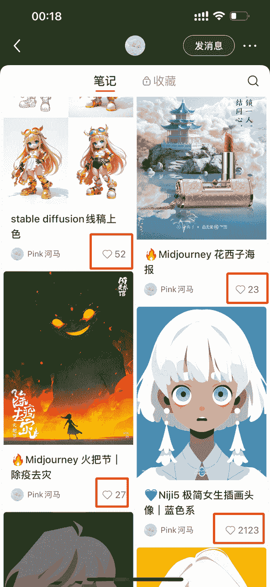

一个笔记平均在20-30赞的博主，突然做出了一个2000赞的内容，博主本人没有在意这个异常值

**你就要知道，你发现宝藏了，**这个内容能脱颖而出，一定是做对了某些这个博主平时没做对的点

你去挖掘出来，复制，就能大大提升你的成功概率

## **b.以量取胜**

**爆款也是有概率性的**，可能同一个东西，别人发就火，你发就凉

这时候利用数量去对冲概率，相当于用数学思想对抗不确定性

**试想一下，你的作品都是爆款一样的类型和质量**，你发的量又大，长期来看，不可能起不来的

## **c.使用工具**

一般这种AI绘画头像壁纸号，我们都是用MJ做的，这里3种📕热门风格的头像关键词，我都已经帮大家拆解好了，大家可以自行选择

### **1.极简风格**

关键词：

**A girl, cold expression, white hair, **black clothes, earrings, blue background,minimalist art, plat illustration,vector illustration --niji

一个女孩，冷静的表情，白头发，黑衣服，耳环，蓝色背景，极简主义艺术，平面插图，矢量插图—— niji

加粗字体可以自由改主体，服装，背景等

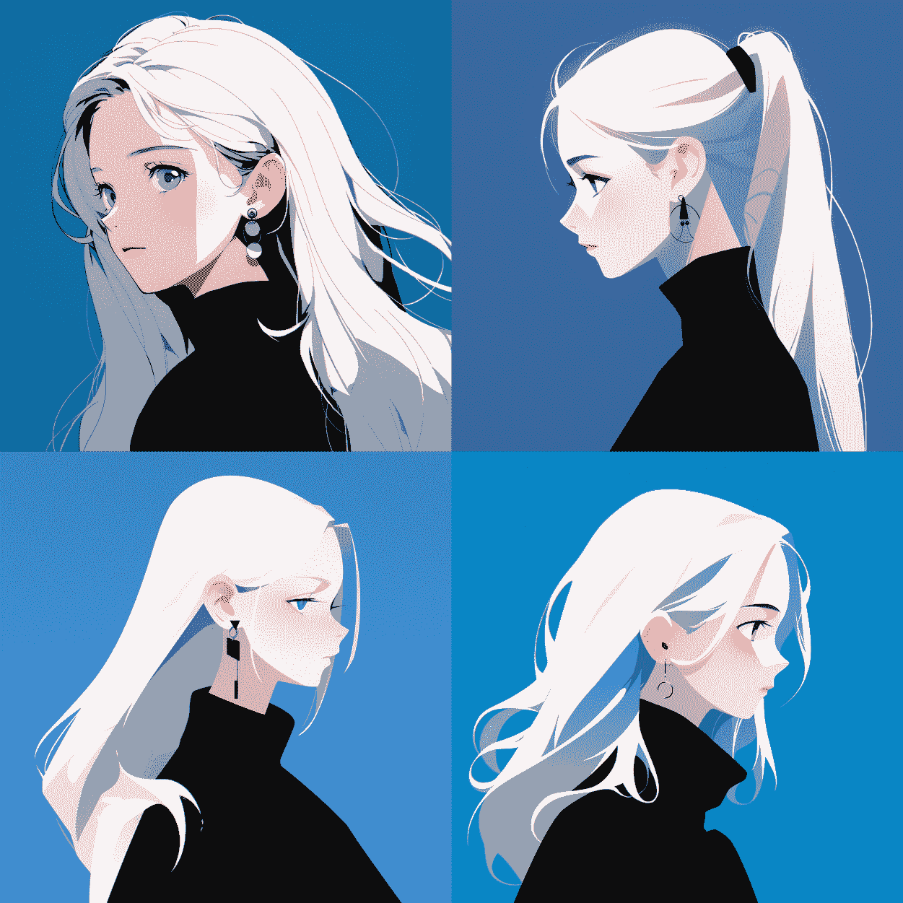

### **2.动漫风格**

Cartoon **Gir**l, naive and cute, watery big eyes, long black hair, red bow hair accessories, wearing a white shirt, looking at the sky, nostalgic works, retro style, Disney Animation, Shinkai style, top Quality --niji 5

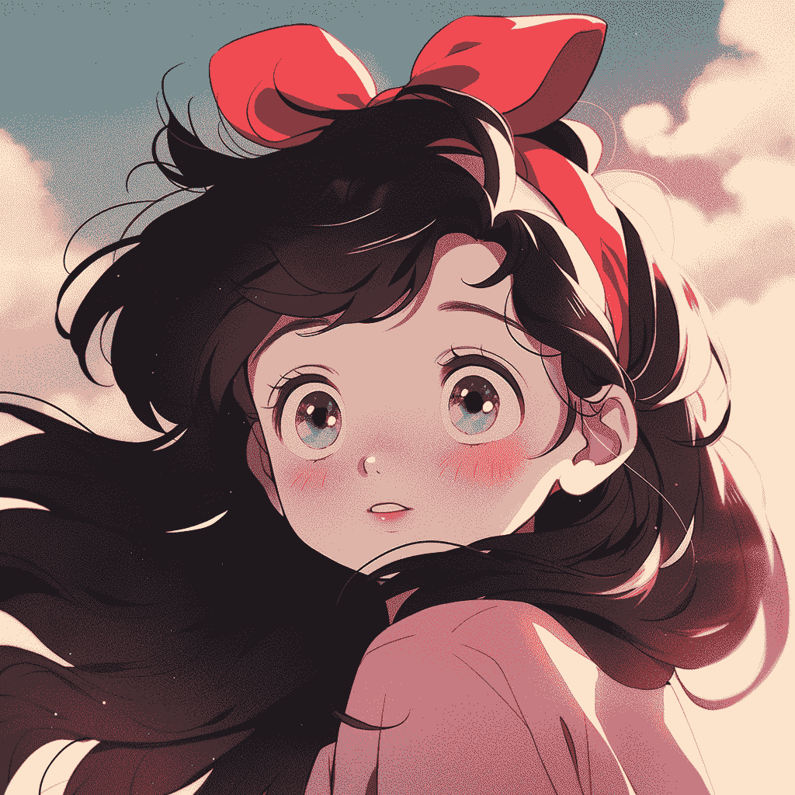

卡通女孩，天真可爱，水汪汪的大眼睛，长长的黑色头发，红色蝴蝶结发饰，穿着白色衬衫，望着天空，怀旧的作品，复古风格，迪士尼动画，新海诚风格，最高品质，加粗字体可以改人物和动作

### **3.流光女孩**

📕上还有一种叫“流光女孩”的图也非常火，一般这种图是在Stable Diffusion里面生成的

### **4.私人定制头像怎么做？**

我们发了笔记有流量之后，可能就会有观众找我们定制头像，用的就是“图生图”的功能，给AI一张照片，AI在这张照片的基础上进行创作

为了定制出来的效果更好，我们对照片是有要求的：

**1.是正脸的照片**

**2.图片比较高清**

**3.背景尽量干净**

接下来就给大家分享两种不同风格的定制头像，它们的操作步骤是一样的，只是部分关键词不一样

**具体操作流程：**

1.把图片发送到midjourney

2.写关键词

3.多刷新图片

**定制二次元头像**

这里就以刘亦菲的照片作为例子，通过midjourney的垫图功能生成一张卡通头像

把图片发送到midjourney，把图片拖动到文本框，按回车发送

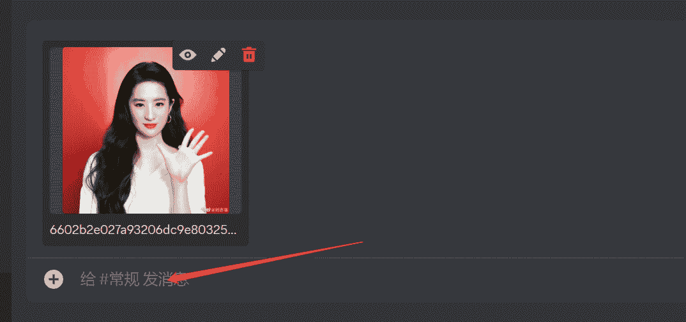

**输入关键词，关键词有三个部分**构成，分别是：原图链接+原图描述+出图风格

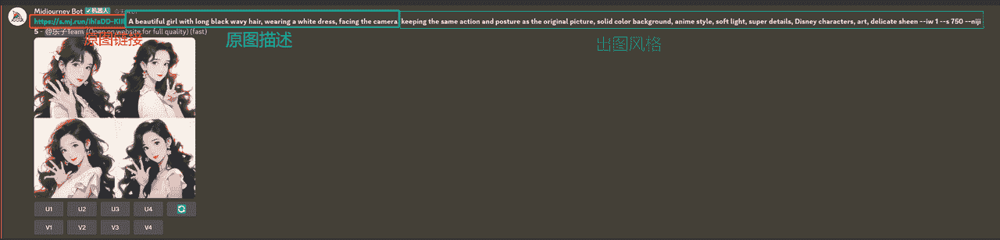

首先先把原图的链接加到prompt里面，直接拖动图片到蓝色的框框里，就会自动生成图片的链接

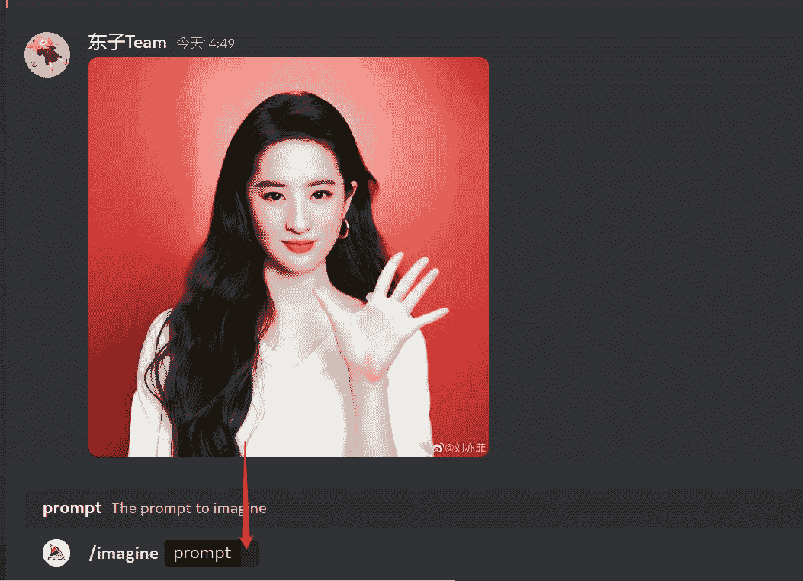

**在链接后面输入一个空格**，再往下写关键词，前半部分的关键词就是我们发给midjourney的这张图的描述

比如：一个漂亮的女生，有着黑色的波浪长发，穿着白色的裙子，面对着镜头等等...

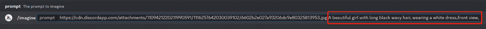

输入完描述词之后，就可以输入我们最后想要得到什么风格的图，以及一些照片细节的描写

我们现在是想要生成一张卡通头像

就可以在关键词里面输入“动画风格”之类的词

还可以输入：纯色背景，高清画质、有光泽等等让照片质量更高的词

输入完关键词就可以按回车发送

这个我用到的关键词，加粗字体可以改成自己的照片描述

**A beautiful girl with long black wav**y hair, wearing a white dress,front view,keeping the same action and posture as the original picture, solid color background, anime style, soft light, super details, Disney characters, art, delicate sheen --iw 2 --s 750 --niji 5

一个美丽的女孩，黑色的长卷发，穿着白色的裙子，面试前方，保持与原图相同的动作和姿势，纯色背景，动画风格，柔和的光线，超级细节，迪斯尼人物，艺术，精致的光泽

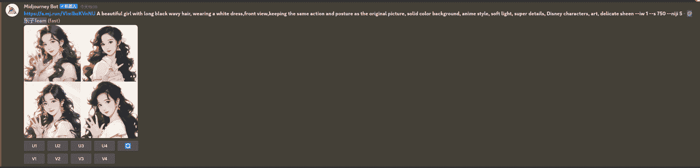

一般很难一次性就出来自己满意的照片，这时候就要多刷新，我们俗称“抽卡”就是这个意思，抽10次总有一次是你心仪的

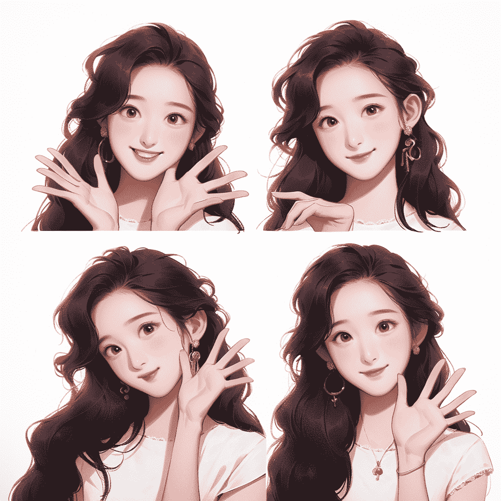

**皮克斯风格头像**

这种风格出来的照片会更偏向于本人

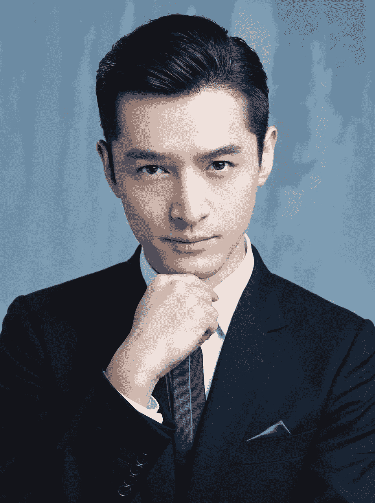

就用“我”的照片给大家看看这种风格的照片该怎么做

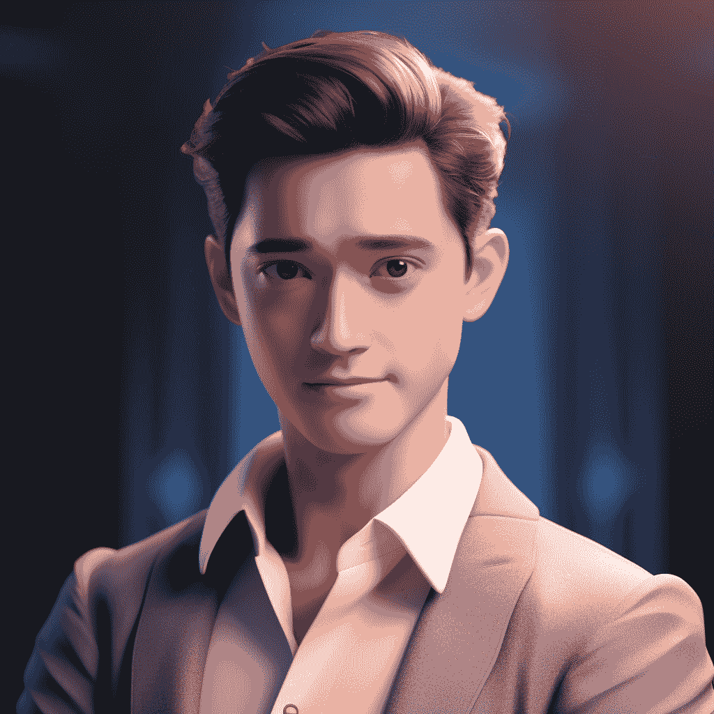

和前面的方法是一样的，只是关键词变成其他风格

比如：皮克斯风格，盲盒，这些词都可以生成出来这种风格的照片

这就是皮克斯风格的关键词，加粗字体可以随意更改

A handsome young man, keeping the consistency of action,expression,clothing, shape and appearance of the photos,3d character from Disney Pixar, super detail,blender, soft lighting, ip, blind box, cinematic edge lighting,romantic scenes --v 5.1 --s 750 --q 2 --style raw

一个帅气的年轻人，和图片保持一致的动作，表情，服装，形状和外观，3D 人物，迪斯尼皮克斯，超级细节，渲染，柔和的灯光，IP，盲盒，电影边缘照明，浪漫的场景

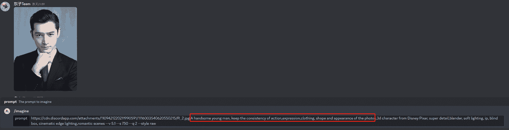

生成出来的照片多刷新几次，总会找到一张比较像本人的照片

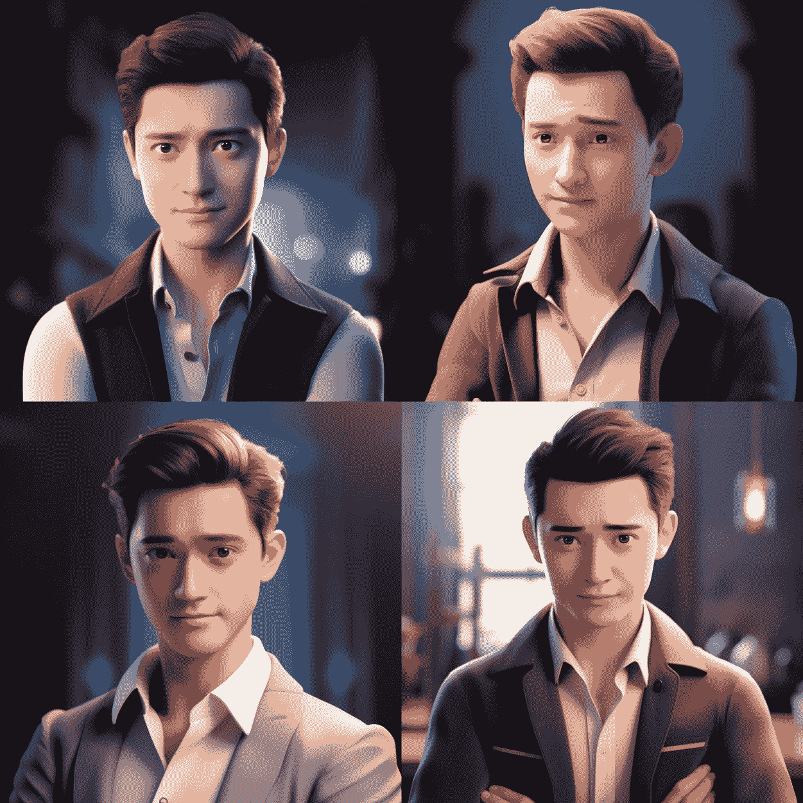

**让AI头像更像本人的方法**

在midjourney里面，哪怕已经给AI喂图了，出来的照片人物还是太过于随机了，而且经常会不像本人

这时候我们就可以用到一个叫InsightFace的换脸插件。换脸后的图片会更倾向于本人的样子

具体操作步骤：

1.用图生图的方法先生成一张照片

2.把换脸机器人邀请到自己的频道

3.上传人脸照片

4.进行人脸的替换

> 1.在midjourney里面垫图生成照片

> 这一步跟文章的第五部分是一样的，这里就不展示具体操作了

> 目的是先生成出来一张自己想要的风格、跟本人外形比较相似的照片

> **2.邀请机器人**

> 这个换脸机器人不是midjourney本身的插件，不能直接在MJ里面搜索

> 点击下面的链接可以把机器人邀请到自己的服务器

> https://discord.com/api/oauth2/authorize?client_id=1090660574196674713&permissions=274877945856&scope=bot

> 邀请完了之后回到midjourney，点击右上角的人形图标，就可以看到换脸机器人已经邀请进来了

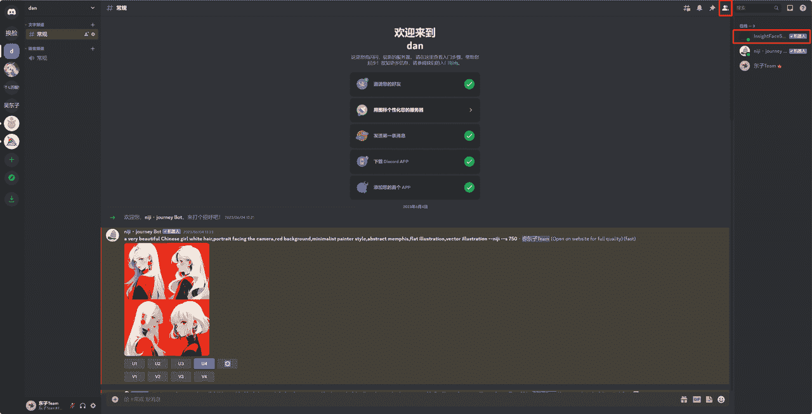

> **3.上传人脸照片**

> 接下来就上传我们要替换的人脸照片

> 最好是正脸没有遮挡的高清照片

> 在最下面的文本框输入“/”

> 点击左边换脸机器人的图标

> 选择 “**/saveid**” 的命令

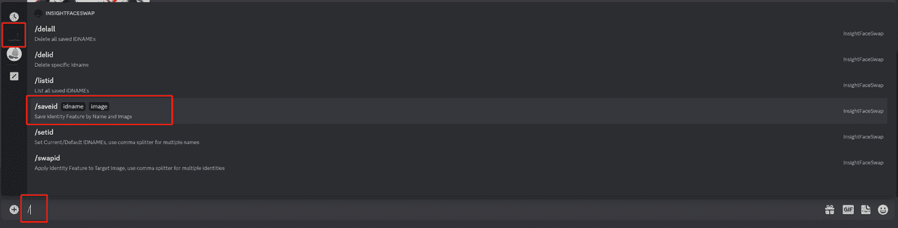

> 把照片拖动进来

> 然后在下面的“idname”输入这张照片的名字

> 按回车发送

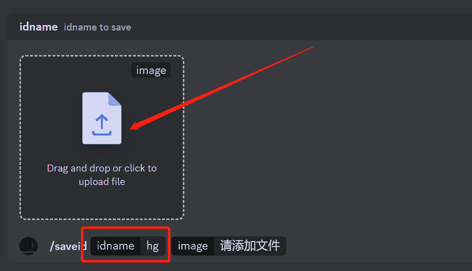

> 看到这个机器人回复“idname hg created”，就代表人脸上传成功了

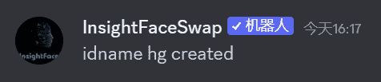

> **4.替换人脸**

> 接下来我们就可以进行人脸的替换了

> 输入“/swapid”的指令（和上面上传人脸的指令“/saveid”有点像，别搞乱了噢）

> 上传一张需要换脸的照片

> 下面输入刚刚上传的人脸的名字

> 回车发送

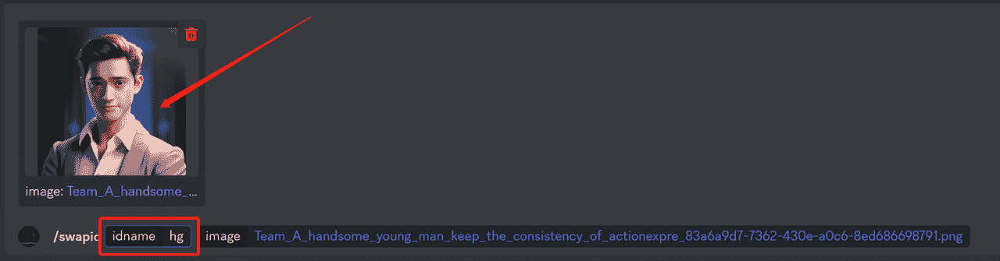

> 这样就换脸成功啦

# **4.变现思路**

## **a挂载平台**

如果我们发布的头像足够吸引人，观众看到了就会想要下载保存原图，这时候我们就在评论区或者主页引流（注意各平台安全引流法）：搜索xxx小程序输入xxx口令，就可以保存原图，将观众引流到小程序，他们下载图片需要看一次广告，每看一次广告，我们就会有收益

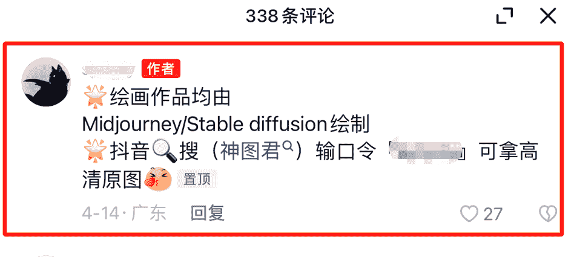

挂载平台的变现方式是最简单的，只要我们做的作品有流量，有人下载，我们就会有收益，但是这种方式一个号的收益是比较低的，如果有能力有时间，可以同时做几个号，来搏一个爆款的几率

## **b.私人定制头像**

如果你的内容足够吸引，观众会有定制个人头像的需求，这时候我们就可以通过接单满足他们的需求

在平台店铺挂上商品，等观众下单（或者引流到🛰️、咸鱼、淘宝等平台下单）我们根据客户发的照片和要求做出定制化的头像，这一类单价跨度还比较大

•可以做1元钱的引流产品——这里又有引流私域变现的玩法

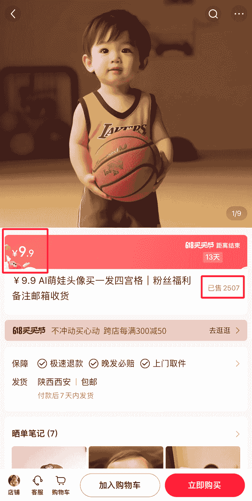

•可以做9.9元的薄利多销

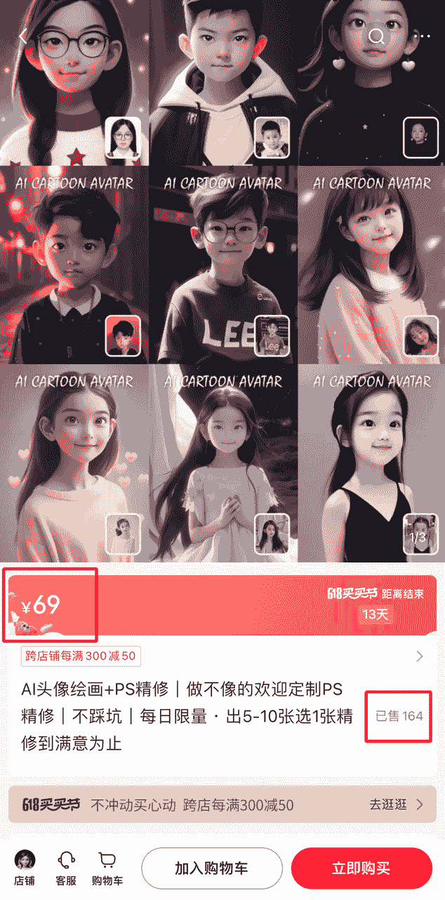

•也可以定更高的价格，相应的就要提供更多更好的服务

## **c.收徒卖课 **

通过作品本身吸引观众，这里面会有一部分人也想学习这是怎么做的，这时就可以进行知识付费，产品可以是最简单的关键词、资料包，进阶一点的视频课，或者更高阶的陪跑训练营

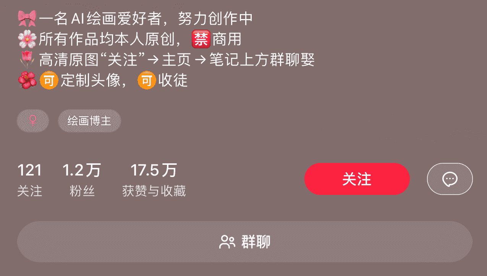