# 搭建自己的AI绘画平台

> 来源：[https://xmgtoagi.feishu.cn/docx/ZXXqd320no3ne9xpxBOcrHWXn0b](https://xmgtoagi.feishu.cn/docx/ZXXqd320no3ne9xpxBOcrHWXn0b)

大家好，我是小码哥，一名互联网创业者，自AI项目上线以来，受到很多粉丝的关注，让加快研发进度，今天dalle3绘画终于上线啦，文末可以获取项目源码。

首先讲一下目前已经上线的功能

# 一、艺术二维码

什么是艺术二维码呢，为什么会有这个项目呢？艺术二维码是一种通过AI技术将普通的二维码转化为具有艺术美感和创意性图案的技术。这种技术不仅提升了二维码的美观度，还增加了用户的扫码体验和粘性。比如以下这些

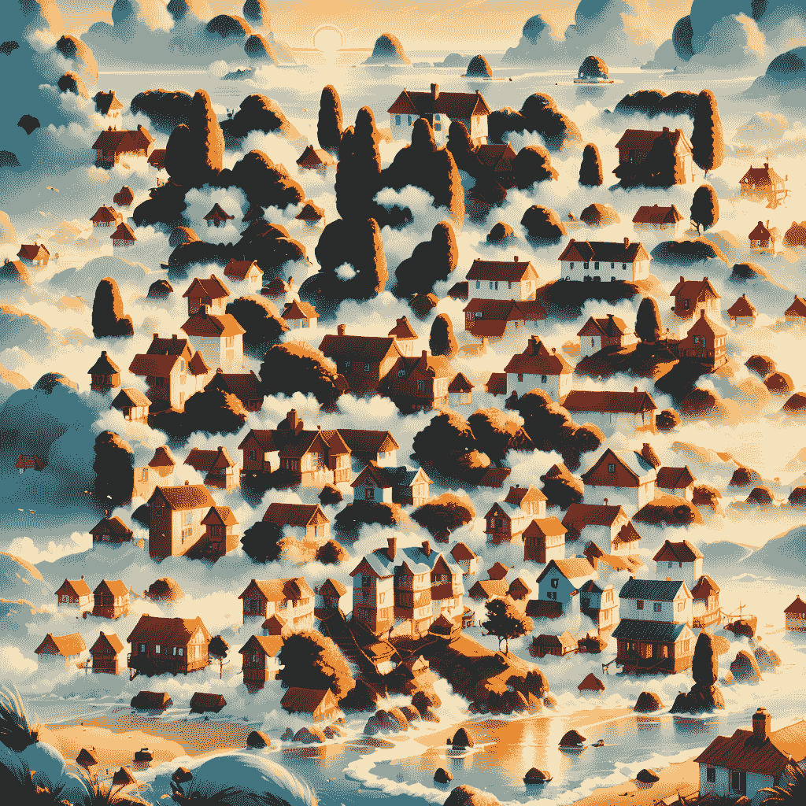

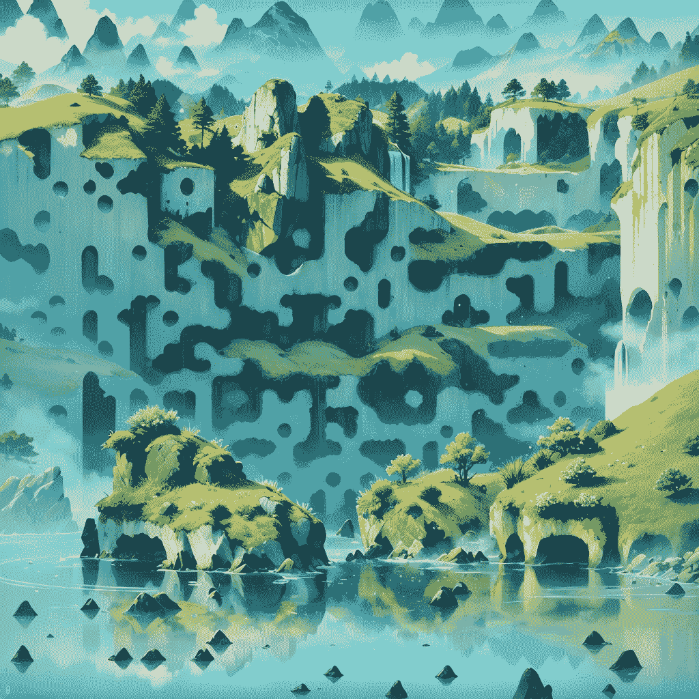

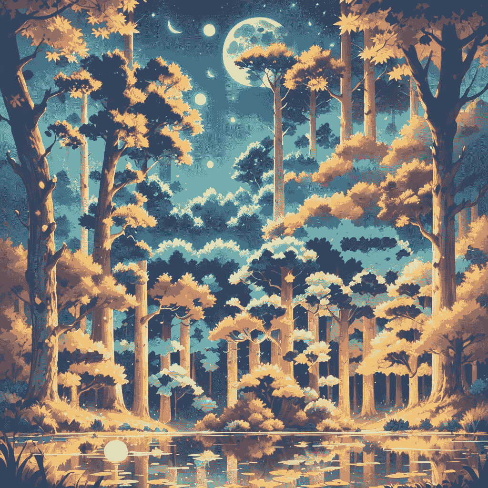

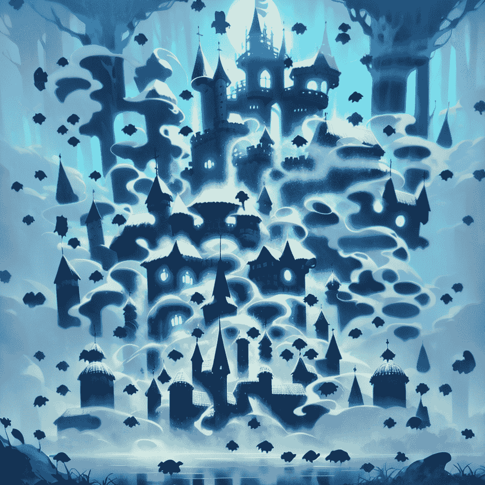

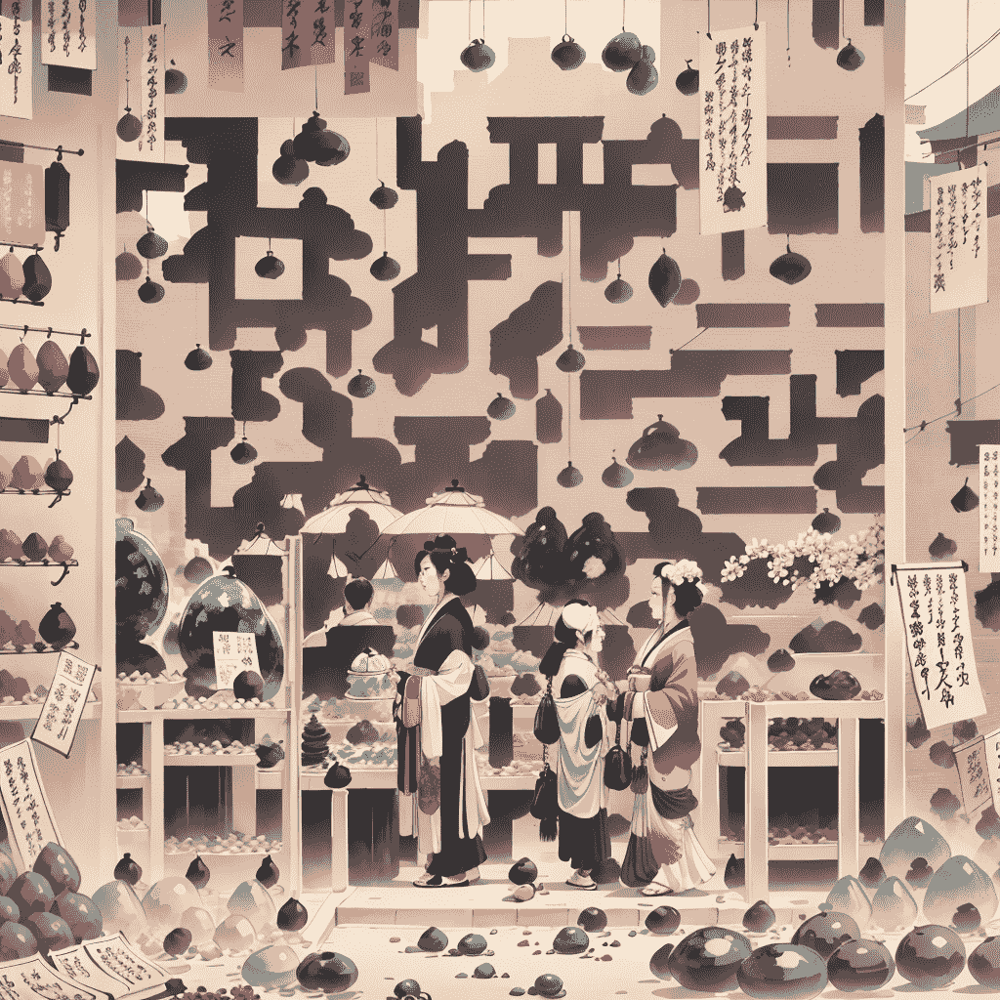

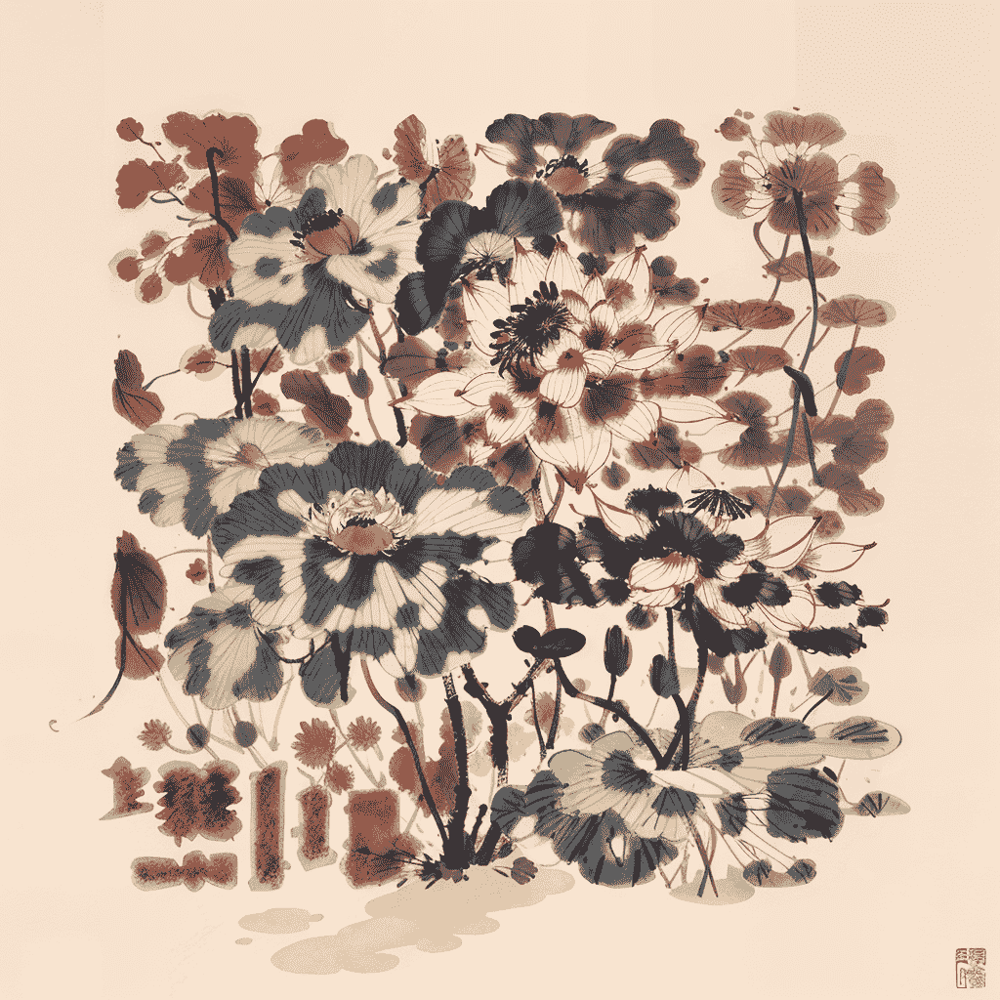

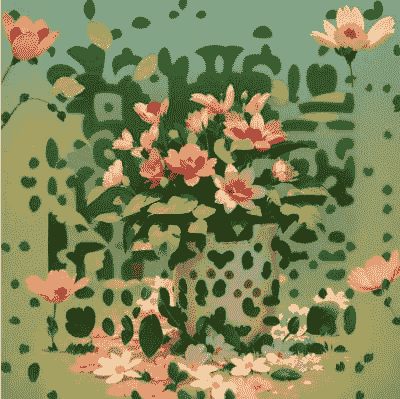

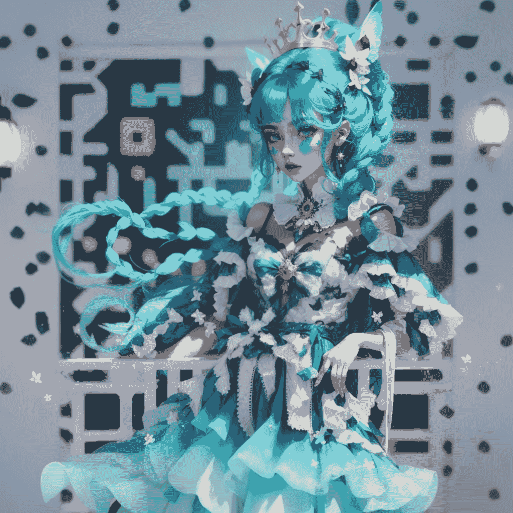

### 1、艺术二维码的特点

**美观与实用性的结合**：艺术二维码不仅美观大方，还具有很强的实用性。它们可以作为信息展示的方式，同时保持二维码的基本功能。

**个性化和创意性**：通过AI技术，可以将二维码与艺术品或自然风景进行融合，生成具有独特美感的图案。

**多样化的应用场景**：艺术二维码可以应用于个人名片、网站链接、收款码、广告宣传等多种场景。

### 2、艺术二维码的应用

艺术二维码作为一种创新的营销工具，能够以独特的视觉吸引力和创意性，帮助各大平台在激烈的市场竞争中脱颖而出，实现有效的用户引流和品牌推广。

**社交媒体引流**：在社交媒体平台上，艺术二维码可以作为一种新颖的互动方式，吸引用户扫描并关注品牌或个人账号，从而增加粉丝量和提高用户参与度。

**内容营销**：通过艺术二维码链接到特定的博客文章、视频或播客，可以为内容创作者带来更多的流量和曝光机会。

**电子商务**：电商平台可以利用艺术二维码展示产品详情、促销活动或优惠券，吸引用户扫码后直接跳转到购买页面，提高转化率。

**品牌宣传**：艺术二维码可以作为品牌宣传的一部分，通过独特的设计和创意，加深用户对品牌的印象，提升品牌形象。

**个性化推荐**：根据用户的兴趣和行为，推送个性化的艺术二维码，引导用户访问特定的内容或服务，提高用户满意度和忠诚度。

# 二、AI换脸

AI变得越来越有趣，那通过AI换脸，如何获取变现呢，主要有以下有以下几种方式

**生日或纪念日惊喜**：为客户的朋友或家人制作特别的生日或纪念日视频，将他们的脸替换到特定的场景中，作为惊喜礼物。

**搞笑或创意内容**：制作有趣的换脸视频或图片，发布在社交媒体上，吸引粉丝和流量，通过广告、赞助或粉丝打赏等方式变现。

**品牌合作**：与品牌合作，制作带有品牌元素的换脸内容，进行品牌推广。

**虚拟试穿**：为服装或配饰品牌提供虚拟试穿服务，让消费者看到自己穿着特定服装的样子。

**肖像修复**：使用AI换脸技术修复或更新老旧照片中的人物肖像，为客户提供修复服务。

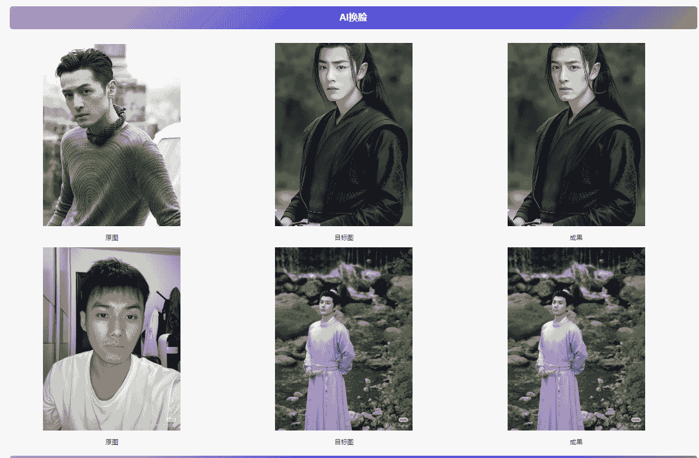

# 三、DALLE3绘画

DALL-E 3 是由OpenAI开发的一种先进的文本到图像生成模型，它可以根据用户的文本描述创造出逼真的图像和艺术作品。DALL-E 3 是继DALL-E和DALL-E 2之后的最新版本，它在图像质量、细节处理和创意表达上都有显著的提升。

**变现路径：**

**个性化艺术品**：为客户定制个性化的艺术作品，如家庭肖像、宠物画像、风景画等。

**商业插图**：为企业和品牌制作商业插图，用于广告、产品包装、网站设计等。

**数字艺术销售**：创作独特的数字艺术作品，通过在线平台进行销售，如NFT市场。

**版权授权**：将生成的图像授权给其他创作者或企业使用，获取版权费用。

**社交媒体内容**：利用DALL-E 3 生成的图像吸引社交媒体上的关注，通过广告、赞助和品牌合作变现。

**博客和文章配图**：为博客、新闻网站等提供高质量的配图，增加内容的吸引力和阅读量。

## 提示词

拿到即用

提示词1：一直头戴王冠呆有着漂亮鱼尾巴的可爱白色猫咪，猫咪有着像美人鱼一样的白色尾巴，尾巴如宝石一样闪闪发光，呆萌可爱，超详细，画面温暖干净，情感饱满，唯美，立体光线，高分辨率，8k， --q 5 --v 6 --ar 9:16

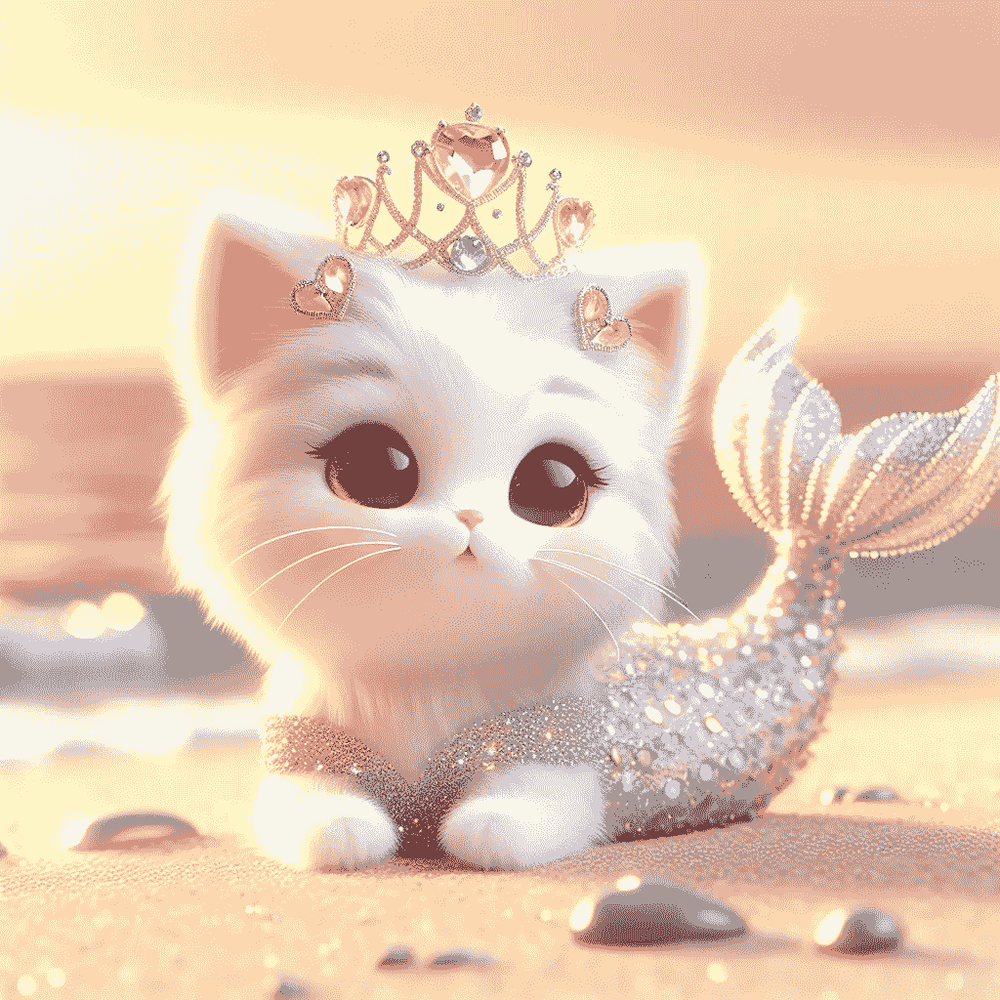

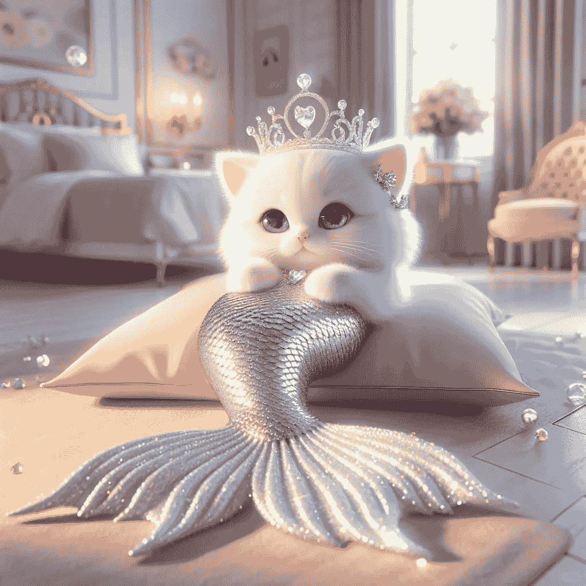

提示词2：Crystal lighting effect colorful small stome made of The lighting is combined with the human-shaped bunchy layer of fretsaw , and the shape of a kind and tender scene of a man who accidentally brings an umbrella to a girl who is sitting sadly in the rain is intricately created with the thin lines of light.background the gloosy black wall.

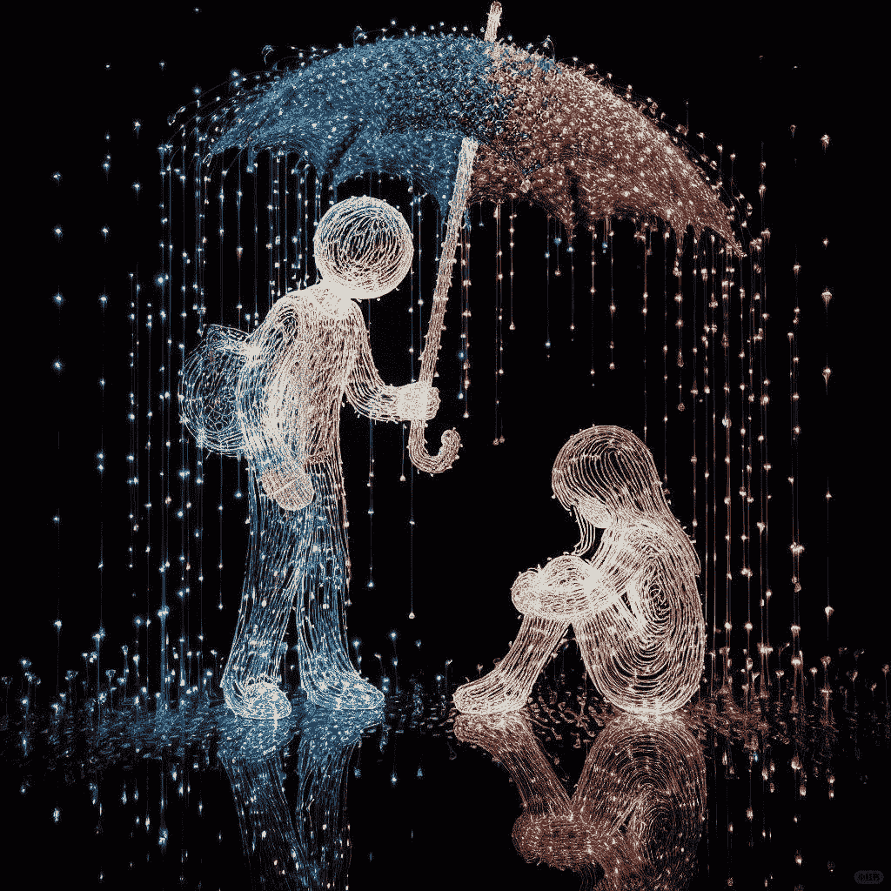

提示词3：Create an image featuring two anthropomorphic glass cute dolls with long legs and smiling faces, holding hands, in a vibrant natural setting with sunlight filtering through the foliage, casting a soft glow on the scene. The dolls should have a translucent quality with light reflecting off them, and a sparkling effect. Both dolls are standing on leaves that are attached to thin branches or stems, with additional water droplets on the leaves and branches, some of which are falling, adding dynamic motion to the image.

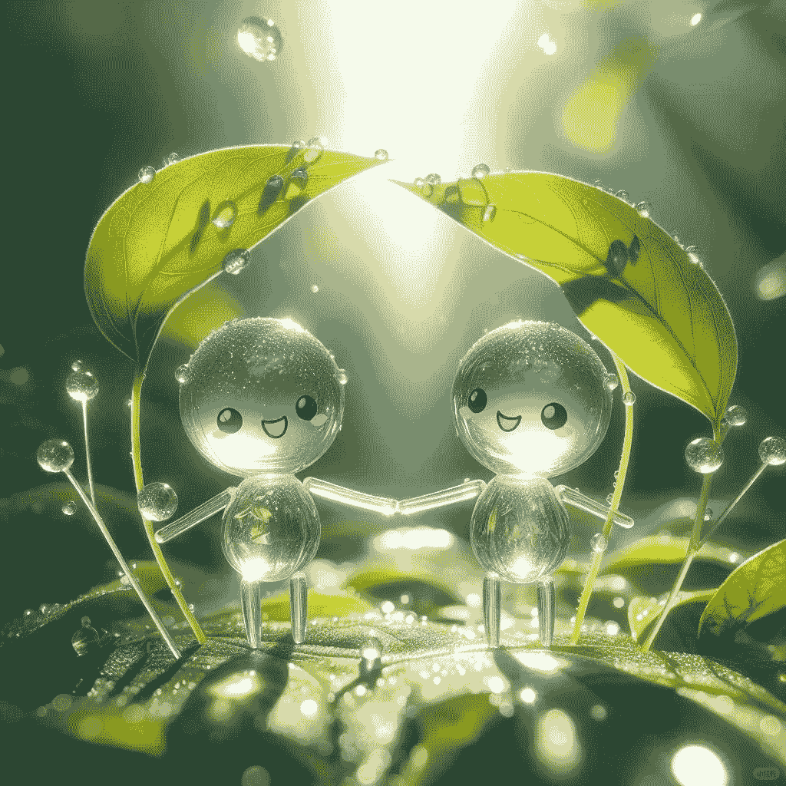

如下一样输入关键词即可：

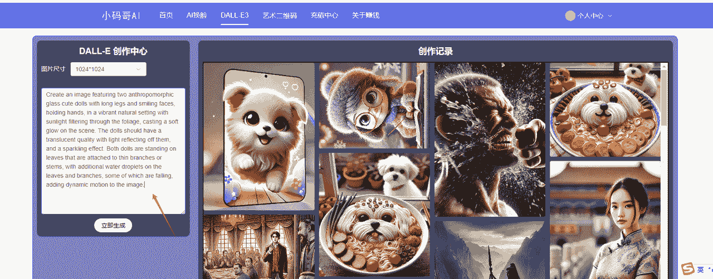

# 四、源码获取

接下里会研发midjourney绘画，地表最强的AI绘画，大家可以搭建自己跌AI平台，在线收款功能已经开通。

更多副业知识，请点击访问http://www.xmgai.cn获取。

获取源码，请扫码备注“源码”

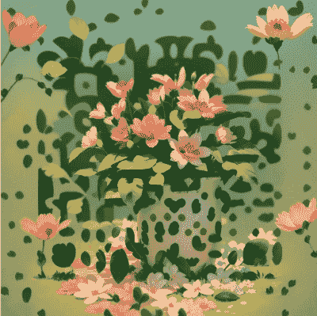