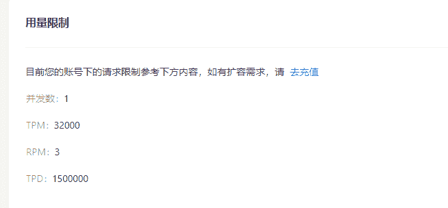
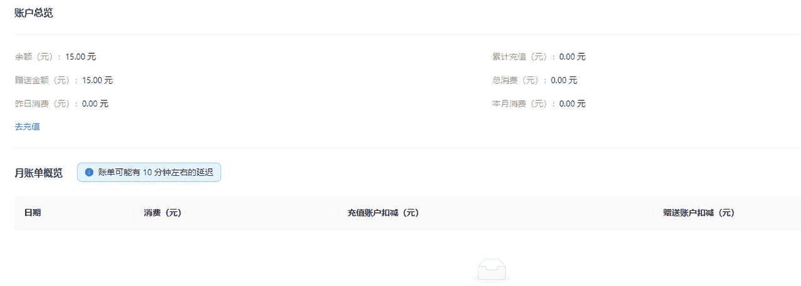

# AI对接指南

> 来源：[https://xmgtoagi.feishu.cn/docx/XPildffPso5Ag4xcsqsctdZln6f](https://xmgtoagi.feishu.cn/docx/XPildffPso5Ag4xcsqsctdZln6f)

# PYTHON对接月之暗面KIMI


# 一、申请API key

申请地址：https://platform.moonshot.cn/console/api-keys

最多可以保留 5 个 API 密钥，密钥只会在新建后显示一次，请妥善保存。不要与他人共享 API Key，或将其暴露在客户端代码中。为了账户安全，一旦 API 密钥被发现泄露，Moonshot AI 可能会将其禁用。

默认token数量如下：





# 二、python对接

## 基本信息

### 公开的服务地址

```
https://api.moonshot.cn
```

Moonshot 提供基于 HTTP 的 API 服务接入。对 Chat API，我们兼容了 OpenAI 的相关 API 的输入和输出。

## 快速开始

### Python 调用方法

对 python 用户，可以简单复用 openai 的 sdk。

```
pip install --upgrade &#x27;openai&gt;=1.0&#x27;
```

> 您需要确保使用的 python 版本至少为 3.7.1， openai 的 sdk 版本不低于 1.0.0

> 我们可以这样简单检验下自己库的版本：

```
python -c &#x27;import openai; print(&quot;version =&quot;,openai.__version__)&#x27;
# 输出可能是 version = 1.10.0，表示当前 python 实际使用了 openai 的 v1.10.0 的库
```

一个简单的例子如下：

```
from openai import OpenAI
 
client = OpenAI(
    api_key=&quot;MOONSHOT_API_KEY&quot;,
    base_url=&quot;https://api.moonshot.cn/v1&quot;,
)
 
completion = client.chat.completions.create(
  model=&quot;moonshot-v1-8k&quot;,
  messages=[
    {&quot;role&quot;: &quot;system&quot;, &quot;content&quot;: &quot;你是 Kimi，由 Moonshot AI 提供的人工智能助手，你更擅长中文和英文的对话。你会为用户提供安全，有帮助，准确的回答。同时，你会拒绝一切涉及恐怖主义，种族歧视，黄色暴力等问题的回答。Moonshot AI 为专有名词，不可翻译成其他语言。&quot;},
    {&quot;role&quot;: &quot;user&quot;, &quot;content&quot;: &quot;你好，我叫李雷，1+1等于多少？&quot;}
  ],
  temperature=0.3,
)
 
print(completion.choices[0].message)
```

其中 MOONSHOT_API_KEY 需要替换为您在平台上创建的 API Key。

上面的代码中语言模型将用户信息列表作为输入，并将模型生成的信息作为输出返回。 下面是一组简单的实现多轮对话的例子：

```
from openai import OpenAI
 
client = OpenAI(
    api_key=&quot;MOONSHOT_API_KEY&quot;,
    base_url=&quot;https://api.moonshot.cn/v1&quot;,
)
 
history = [
    {&quot;role&quot;: &quot;system&quot;, &quot;content&quot;: &quot;你是 Kimi，由 Moonshot AI 提供的人工智能助手，你更擅长中文和英文的对话。你会为用户提供安全，有帮助，准确的回答。同时，你会拒绝一切涉及恐怖主义，种族歧视，黄色暴力等问题的回答。Moonshot AI 为专有名词，不可翻译成其他语言。&quot;}
]
 
def chat(query, history):
    history += [{
        &quot;role&quot;: &quot;user&quot;, 
        &quot;content&quot;: query
    }]
    completion = client.chat.completions.create(
        model=&quot;moonshot-v1-8k&quot;,
        messages=history,
        temperature=0.3,
    )
    result = completion.choices[0].message.content
    history += [{
        &quot;role&quot;: &quot;assistant&quot;,
        &quot;content&quot;: result
    }]
    return result
 
print(chat(&quot;地球的自转周期是多少？&quot;, history))
print(chat(&quot;月球呢？&quot;, history))
```

值得注意的是，随着对话的进行，模型每次需要传入的 token 都会线性增加，必要时，需要一些策略进行优化，例如只保留最近几轮对话。

### CURL 调用方法

同样的，我们也可以基于 curl 直接调用，实现一致的效果。

```
curl https://api.moonshot.cn/v1/chat/completions \
  -H &quot;Content-Type: application/json&quot; \
  -H &quot;Authorization: Bearer $MOONSHOT_API_KEY&quot; \
  -d &#x27;{
     &quot;model&quot;: &quot;moonshot-v1-8k&quot;,
     &quot;messages&quot;: [
        {&quot;role&quot;: &quot;system&quot;, &quot;content&quot;: &quot;你是 Kimi，由 Moonshot AI 提供的人工智能助手，你更擅长中文和英文的对话。你会为用户提供安全，有帮助，准确的回答。同时，你会拒绝一切涉及恐怖主义，种族歧视，黄色暴力等问题的回答。Moonshot AI 为专有名词，不可翻译成其他语言。&quot;},
        {&quot;role&quot;: &quot;user&quot;, &quot;content&quot;: &quot;你好，我叫李雷，1+1等于多少？&quot;}
     ],
     &quot;temperature&quot;: 0.3
   }&#x27;
```

其中 $MOONSHOT_API_KEY 部分需要替换为您自己的 API Key。或者在调用前给它设置好环境变量。

## API 说明

### Chat Completion

#### 请求地址

```
POST https://api.moonshot.cn/v1/chat/completions
```

#### 请求内容

##### 示例

```
{
    &quot;model&quot;: &quot;moonshot-v1-8k&quot;,
    &quot;messages&quot;: [
        {
            &quot;role&quot;: &quot;system&quot;,
            &quot;content&quot;: &quot;你是 Kimi，由 Moonshot AI 提供的人工智能助手，你更擅长中文和英文的对话。你会为用户提供安全，有帮助，准确的回答。同时，你会拒绝一切涉及恐怖主义，种族歧视，黄色暴力等问题的回答。Moonshot AI 为专有名词，不可翻译成其他语言。&quot;
        },
        { &quot;role&quot;: &quot;user&quot;, &quot;content&quot;: &quot;你好，我叫李雷，1+1等于多少？&quot; }
    ],
    &quot;temperature&quot;: 0.3
}
```

##### 字段说明

#### 返回内容

对非 stream 格式的，返回类似如下：

```
{
    &quot;id&quot;: &quot;cmpl-04ea926191a14749b7f2c7a48a68abc6&quot;,
    &quot;object&quot;: &quot;chat.completion&quot;,
    &quot;created&quot;: 1698999496,
    &quot;model&quot;: &quot;moonshot-v1-8k&quot;,
    &quot;choices&quot;: [
        {
            &quot;index&quot;: 0,
            &quot;message&quot;: {
                &quot;role&quot;: &quot;assistant&quot;,
                &quot;content&quot;: &quot; 你好，李雷！1+1等于2。如果你有其他问题，请随时提问！&quot;
            },
            &quot;finish_reason&quot;: &quot;stop&quot;
        }
    ],
    &quot;usage&quot;: {
        &quot;prompt_tokens&quot;: 19,
        &quot;completion_tokens&quot;: 21,
        &quot;total_tokens&quot;: 40
    }
}
```

对 stream 格式的，返回类似如下：

```
data: {&quot;id&quot;:&quot;cmpl-1305b94c570f447fbde3180560736287&quot;,&quot;object&quot;:&quot;chat.completion.chunk&quot;,&quot;created&quot;:1698999575,&quot;model&quot;:&quot;moonshot-v1-8k&quot;,&quot;choices&quot;:[{&quot;index&quot;:0,&quot;delta&quot;:{&quot;role&quot;:&quot;assistant&quot;,&quot;content&quot;:&quot;&quot;},&quot;finish_reason&quot;:null}]}
 
data: {&quot;id&quot;:&quot;cmpl-1305b94c570f447fbde3180560736287&quot;,&quot;object&quot;:&quot;chat.completion.chunk&quot;,&quot;created&quot;:1698999575,&quot;model&quot;:&quot;moonshot-v1-8k&quot;,&quot;choices&quot;:[{&quot;index&quot;:0,&quot;delta&quot;:{&quot;content&quot;:&quot;你好&quot;},&quot;finish_reason&quot;:null}]}
 
...
 
data: {&quot;id&quot;:&quot;cmpl-1305b94c570f447fbde3180560736287&quot;,&quot;object&quot;:&quot;chat.completion.chunk&quot;,&quot;created&quot;:1698999575,&quot;model&quot;:&quot;moonshot-v1-8k&quot;,&quot;choices&quot;:[{&quot;index&quot;:0,&quot;delta&quot;:{&quot;content&quot;:&quot;。&quot;},&quot;finish_reason&quot;:null}]}
 
data: {&quot;id&quot;:&quot;cmpl-1305b94c570f447fbde3180560736287&quot;,&quot;object&quot;:&quot;chat.completion.chunk&quot;,&quot;created&quot;:1698999575,&quot;model&quot;:&quot;moonshot-v1-8k&quot;,&quot;choices&quot;:[{&quot;index&quot;:0,&quot;delta&quot;:{},&quot;finish_reason&quot;:&quot;stop&quot;,&quot;usage&quot;:{&quot;prompt_tokens&quot;:19,&quot;completion_tokens&quot;:13,&quot;total_tokens&quot;:32}}]}
 
data: [DONE]
```

#### 调用示例

##### Python 流式调用

对简单调用，见前面。对流式调用，可以参考如下代码片段：

```
import os
from openai import OpenAI
 
client = OpenAI(
    api_key=&quot;MOONSHOT_API_KEY&quot;,
    base_url=&quot;https://api.moonshot.cn/v1&quot;,
)
 
response = client.chat.completions.create(
    model=&quot;moonshot-v1-8k&quot;,
    messages=[
        {
            &quot;role&quot;: &quot;system&quot;,
            &quot;content&quot;: &quot;你是 Kimi，由 Moonshot AI 提供的人工智能助手，你更擅长中文和英文的对话。你会为用户提供安全，有帮助，准确的回答。同时，你会拒绝一切涉及恐怖主义，种族歧视，黄色暴力等问题的回答。Moonshot AI 为专有名词，不可翻译成其他语言。&quot;,
        },
        {&quot;role&quot;: &quot;user&quot;, &quot;content&quot;: &quot;你好，我叫李雷，1+1等于多少？&quot;},
    ],
    temperature=0.3,
    stream=True,
)
 
collected_messages = []
for idx, chunk in enumerate(response):
    # print(&quot;Chunk received, value: &quot;, chunk)
    chunk_message = chunk.choices[0].delta
    if not chunk_message.content:
        continue
    collected_messages.append(chunk_message)  # save the message
    print(f&quot;#{idx}: {&#x27;&#x27;.join([m.content for m in collected_messages])}&quot;)
print(f&quot;Full conversation received: {&#x27;&#x27;.join([m.content for m in collected_messages])}&quot;)
```

### 列出文件

> 本功能用于列举出用户已上传的所有文件。

#### 请求地址

```
GET https://api.moonshot.cn/v1/files
```

#### 调用示例

##### Python 调用

```
file_list = client.files.list()
 
for file in file_list.data:
    print(file) # 查看每个文件的信息
```

### 上传文件

> 注意，单个用户最多只能上传 1000 个文件，单文件不超过 100MB，同时所有已上传的文件总和不超过 10G 容量。如果您要抽取更多文件，需要先删除一部分不再需要的文件。

#### 请求地址

```
POST https://api.moonshot.cn/v1/files
```

文件上传成功后，我们会开始抽取文件信息。

#### 调用示例

##### Python 调用

```
# file 可以是多种类型
# purpose 目前只支持 &quot;file-extract&quot;
file_object = client.files.create(file=Path(&quot;xlnet.pdf&quot;), purpose=&quot;file-extract&quot;)
```

### 删除文件

> 本功能可以用于删除不再需要使用的文件。

#### 请求地址

```
DELETE https://api.moonshot.cn/v1/files/{file_id}
```

#### 调用示例

##### Python 调用

```
client.files.delete(file_id=file_id)
```

### 获取文件信息

> 本功能用于获取指定文件的文件基础信息。

#### 请求地址

```
GET https://api.moonshot.cn/v1/files/{file_id}
```

#### 调用示例

##### Python 调用

```
client.files.retrieve(file_id=file_id)
# FileObject(
# id=&#x27;clg681objj8g9m7n4je0&#x27;,
# bytes=761790,
# created_at=1700815879,
# filename=&#x27;xlnet.pdf&#x27;,
# object=&#x27;file&#x27;,
# purpose=&#x27;file-extract&#x27;,
# status=&#x27;ok&#x27;, status_details=&#x27;&#x27;) # status 如果为 error 则抽取失败
```

### 获取文件内容

> 本功能支持获取指定文件的文件抽取结果。通常的，它是一个合法的 JSON 格式的 string，并且对齐了我们的推荐格式。 如需抽取多个文件，您可以在某个 message 中用换行符 \n 隔开，拼接为一个大字符串，role 设置为 system 的方式加入历史记录。

#### 请求地址

```
GET https://api.moonshot.cn/v1/files/{file_id}/content
```

#### 调用示例

##### Python 调用

```
# file_content = client.files.retrieve_content(file_id=file_object.id)
# type of file_content is `str`
# 注意，之前 retrieve_content api 在最新版本标记了 warning, 可以用下面这行代替
# 如果是旧版本，可以用 retrieve_content
file_content = client.files.content(file_id=file_object.id).text
# 我们的输出结果目前是一个内部约定好格式的 json, 但是在 message 中应该以 text 格式放进去
```

### 计算 Token

#### 请求地址

```
POST https://api.moonshot.cn/v1/tokenizers/estimate-token-count
```

#### 请求内容

estimate-token-count 的输入结构体和 chat completion 基本一致。

##### 示例

```
{
    &quot;model&quot;: &quot;moonshot-v1-8k&quot;,
    &quot;messages&quot;: [
        {
            &quot;role&quot;: &quot;system&quot;,
            &quot;content&quot;: &quot;你是 Kimi，由 Moonshot AI 提供的人工智能助手，你更擅长中文和英文的对话。你会为用户提供安全，有帮助，准确的回答。同时，你会拒绝一切涉及恐怖主义，种族歧视，黄色暴力等问题的回答。Moonshot AI 为专有名词，不可翻译成其他语言。&quot;
        },
        { &quot;role&quot;: &quot;user&quot;, &quot;content&quot;: &quot;你好，我叫李雷，1+1等于多少？&quot; }
    ]
}
```

##### 字段说明

#### 调用示例

```
curl &#x27;https://api.moonshot.cn/v1/tokenizers/estimate-token-count&#x27; \
  -H &quot;Content-Type: application/json&quot; \
  -H &quot;Authorization: Bearer $MOONSHOT_API_KEY&quot; \
  -d &#x27;{
    &quot;model&quot;: &quot;moonshot-v1-8k&quot;,
    &quot;messages&quot;: [
        {
            &quot;role&quot;: &quot;system&quot;,
            &quot;content&quot;: &quot;你是 Kimi，由 Moonshot AI 提供的人工智能助手，你更擅长中文和英文的对话。你会为用户提供安全，有帮助，准确的回答。同时，你会拒绝一切涉及恐怖主义，种族歧视，黄色暴力等问题的回答。Moonshot AI 为专有名词，不可翻译成其他语言。&quot;
        },
        {
            &quot;role&quot;: &quot;user&quot;,
            &quot;content&quot;: &quot;你好，我叫李雷，1+1等于多少？&quot;
        }
    ]
}&#x27;
```

#### 返回内容

```
{
    &quot;data&quot;: {
        &quot;total_tokens&quot;: 80
    }
}
```

当没有 error 字段，可以取 data.total_tokens 作为计算结果

### 查询余额

#### 请求地址

```
GET https://api.moonshot.cn/v1/users/me/balance
```

#### 调用示例

```
curl https://api.moonshot.cn/v1/users/me/balance -H &quot;Authorization: Bearer $MOONSHOT_API_KEY&quot;
```

#### 返回内容

```
{
  &quot;code&quot;: 0,
  &quot;data&quot;: {
    &quot;available_balance&quot;: 49.58894,
    &quot;voucher_balance&quot;: 46.58893,
    &quot;cash_balance&quot;: 3.00001
  },
  &quot;scode&quot;: &quot;0x0&quot;,
  &quot;status&quot;: true
}
```

#### 返回内容说明

### 其它语言示例

几乎所有的编程语言都可以兼容上面的接口，可以参考我们的开源仓库(opens in a new tab)中提供的范例工程，例如：

+   Java SDK(opens in a new tab)

+   Golang(opens in a new tab)

### 错误说明

下面是主要的几个错误

Last updated on April 3, 2024

# 三、价格说明

### 计费基本概念

#### 计费单元

Token：代表常见的字符序列，每个汉字使用的 Token 数目可能是不同的。例如，单个汉字"夔"可能会被分解为若干 Token 的组合，而像"中国"这样短且常见的短语则可能会使用单个 Token。

大[致来说，对于一段通常的](https://platform.moonshot.cn/docs/api-reference#%E8%AE%A1%E7%AE%97-token)中文文本，1 个 Token 大约相当于 1.5-2 个汉字。具体每次调用实际产生的 Tokens 数量可以通过调用计算Token API 来获得。

#### 计费逻辑

我们对 Input 和 Output 均实行按量计费。如果您上传并抽取文档内容，并将抽取的文档内容作为 Input 传输给模型，那么文档内容也将按量计费。

但如果您只上传并抽取文档，这个API本身不会产生费用。

#### 为什么要做限速？

速率限制是API接口的常见做法，主要有以下几个考量：

+   有助于防止滥用或误用API。例如，恶意行为者可能会通过大量请求来淹没API，试图使其过载或导致服务中断。通过设置速率限制，我们可以防范这样的行为。

+   速率限制有助于确保每个人都能公平地访问API。如果一个人或组织发出过多的请求，可能会拖慢所有人的API。通过限制单个用户可以发出的请求数量，那么尽可能多的人有机会使用API而不会遇到速度减慢的问题。

+   速率限制可以帮助我们管理集群总负载。如果对API的请求急剧增加，可能会给服务器带来压力并导致性能问题。通过设置速率限制将可以帮助为所有用户维护一个平稳且一致的体验。

### 产品定价

#### 文本生成模型 Moonshot-v1

此处 1M = 1,000,000

以上模型的区别在于它们的最大上下文长度，这个长度包括了输入消息和生成的输出，在效果上并没有什么区别。

### 充值与限速

为了整体资源分配的公平性，同时防止恶意攻击，我们目前将基于账户的累计充值金额进行速率限制，具体如下表，如有更高需求请联系人工客服：

#### 限速概念解释

+   并发: 同一时间内我们最多处理的来自您的请求数

+   RPM: request per minute 指一分钟内您最多向我们发起的请求数

+   TPM: token per minute 指一分钟内您最多和我们交互的token数

+   TPD: token per day 指一天内您最多和我们交互的token数

# 四、java对接请直接看源码

https://github.com/MoonshotAI/MoonshotAI-Cookbook/tree/master/examples/java_sdk