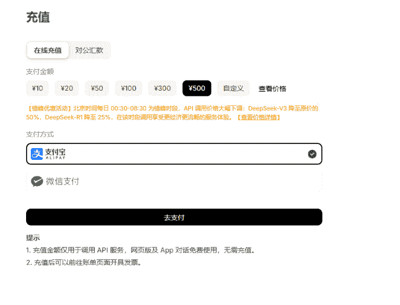
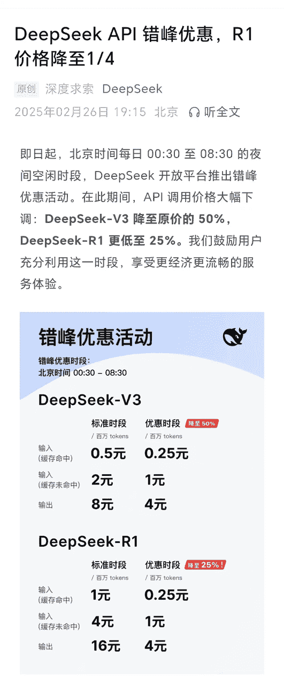
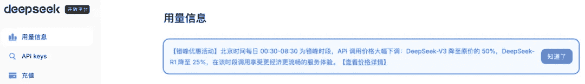
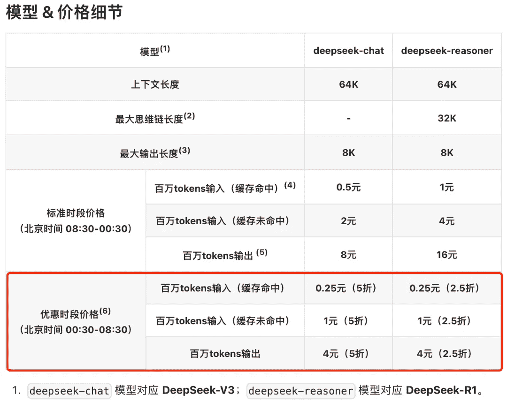
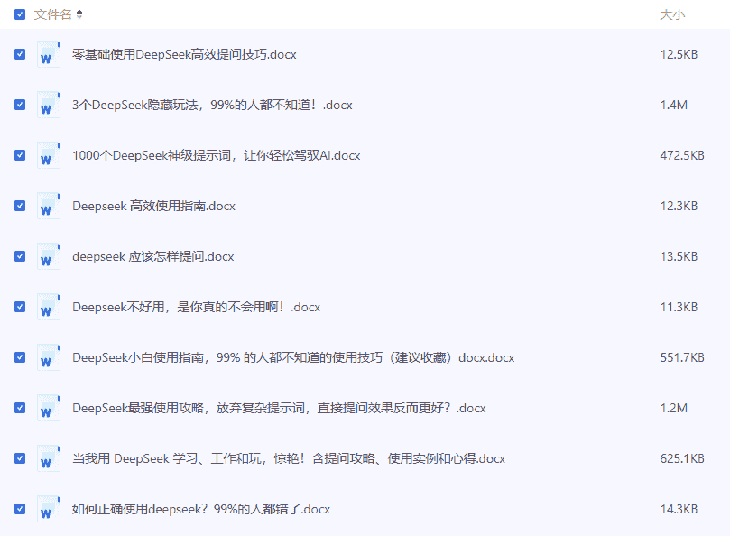
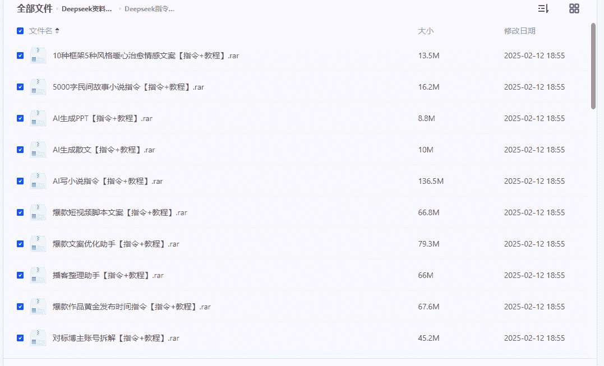
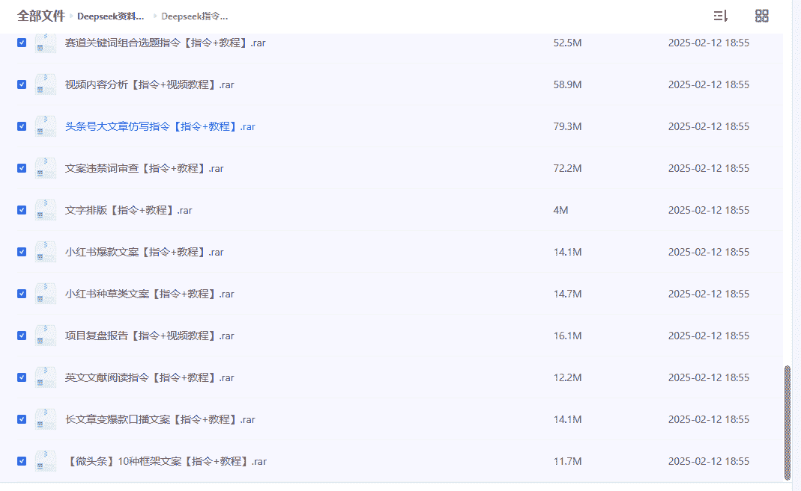
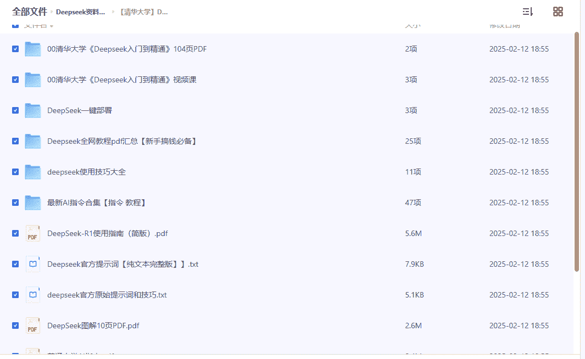
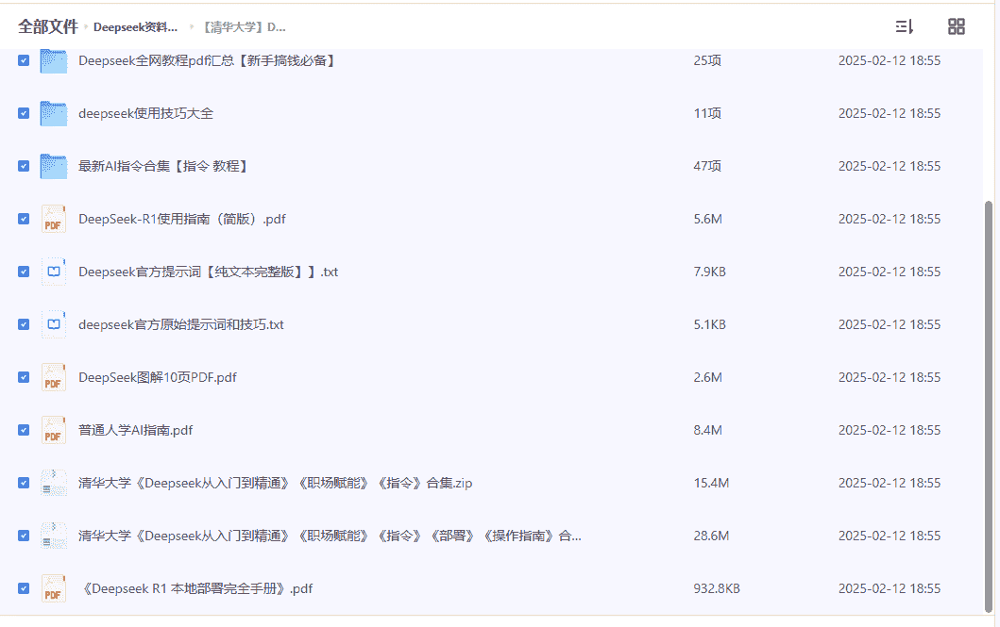

# 深夜重磅！DeepSeek降价了！

> 来源：[https://xmgtoagi.feishu.cn/docx/WaizdbhRporOCMxk37VcsB5Knmh](https://xmgtoagi.feishu.cn/docx/WaizdbhRporOCMxk37VcsB5Knmh)

#

大家好，我是小码哥，国产 AI 大模型 DeepSeek 在 2 月 26 日晚间突然宣布大动作！

# 开放充值

deepseek2月初因服务器资源紧张，关闭了充值窗口，昨晚上，deepseek宣布开发充值了。

## API 调用价格 “错峰” 优惠来袭

DeepSeek 正式推出 API 调用价格错峰优惠活动，北京时间每天 00:30 到 08:30 的夜间空闲时段，API 调用价格大跳水！**DeepSeek - V3 打 5 折，DeepSeek - R1 更是狂打 2.5 折**，这优惠力度，简直大到让人尖叫！

DeepSeek 官方表示，搞这个优惠活动，就是想鼓励宝子们充分利用夜间空闲时段，用更少的钱，享受更丝滑的 AI 服务体验。毕竟，白天大家都忙着上班、上学，AI 使用高峰期服务器压力也大，这错峰优惠，不仅让大家省钱，还能让服务器 “喘口气”，一举两得！

## 回顾 DeepSeek 的 “价格战”

其实，DeepSeek 在 API 定价上一直很 “卷”。早在 2024 年 4 月，它就把 API 定价定在 1 元 / 百万输入 tokens、2 元 / 百万输出 tokens，这在当时就已经很亲民了。没想到，2024 年 8 月，DeepSeek 更是 “卷” 出新高度，直接把 API 输入费用砍到 0.1 元 / 百万 tokens，输出费用维持 2 元 / 百万 tokens。

不过，2025 年 2 月初，DeepSeek 官方突然发布消息称，由于服务器资源紧张，API 服务充值暂时按下 “暂停键”，不过已经充值的金额还能继续用。好在，2 月 25 日，DeepSeek 官方又传来好消息，API 充值重新开放，DeepSeek - Chat 模型调用价格也调整为每百万输入 tokens 2 元，每百万输出 tokens 8 元。

## DeepSeek “开源周” 启动，App 下载量破亿！

1 月 11 日，DeepSeek 官方 App 正式上线 iOS 和安卓应用市场，1 月 20 日，DeepSeek 就迫不及待地开源了推理模型 DeepSeek - R1。这模型性能可不是吹的，能和 OpenAI 最强推理模型 o1 正面刚！也正因为如此，DeepSeek 下载量一路 “狂飙”，数据分析平台 QuestMobile 最新数据显示，从上线到 2 月 9 日，DeepSeek App 累计下载量已经突破 1.1 亿次，周活跃用户规模最高接近 9700 万，这人气，简直爆棚！

2 月 24 日，DeepSeek 又搞了个大动作，宣布启动 “开源周”，发布了 DeepEP，这是一款用于混合专家（MoE，Mixture of Experts）模型训练和推理的开源 EP 通信库，有高效的 all - to - all 通信，还支持节点内和节点间（intranode and internode）NVLink 和 RDMA，技术含量满满！

宝子们，DeepSeek 这一系列操作，真的是诚意满满！无论是错峰优惠、价格调整，还是开源周的启动，都能看出它在努力为大家提供更好的 AI 服务。

全网最全的deepseek 系列文档，扫码回复“dp”，免费赠送啦。

