# 惊！患者自带 DeepSeek 看病，医生直呼“压力山大”

> 来源：[https://xmgtoagi.feishu.cn/docx/AGr8dUsF3oBPtQxARyecFpXpndb](https://xmgtoagi.feishu.cn/docx/AGr8dUsF3oBPtQxARyecFpXpndb)

“天都塌了！患者用 DeepSeek 查完病，直接质疑我的治疗方案，气得我赶紧重新查阅了最新指南，才发现自己竟遗漏了更新……” 近日，广东一位医学博主 “孤芳自赏” 在网上发出的这番感慨，犹如一颗石子投入平静的湖面，激起了千层浪，引发众多网友的热烈讨论。

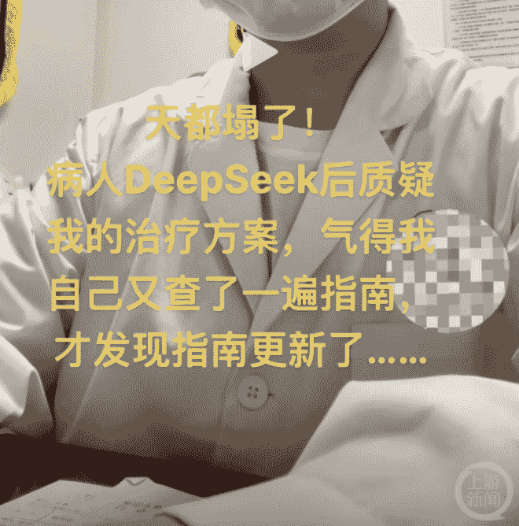

在评论区，不少医护人员纷纷 “现身说法”，分享自己类似的经历。有的医生表示，患者拿着 DeepSeek 的查询结果来就诊，和自己解释的病情完全一致，还夸医生专业负责，这让他既欣慰又感到一丝 “危机” —— 感觉 AI 都能 “抢饭碗” 了。还有医生调侃道，现在出门诊，不仅要和疾病 “斗智斗勇”，还得和 AI “一较高下”，稍有不慎，就可能被患者用 DeepSeek “挑刺”。

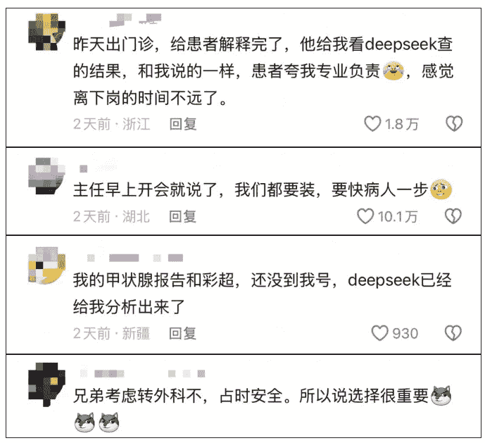

### DeepSeek

DeepSeek 作为一个新兴的人工智能工具，在医疗领域的应用逐渐受到关注。它能够为患者提供一些基础的医疗信息和建议，方便患者初步了解自身病情。然而，当患者带着 DeepSeek 的结果来看病时，医生们却有着不同的反应。

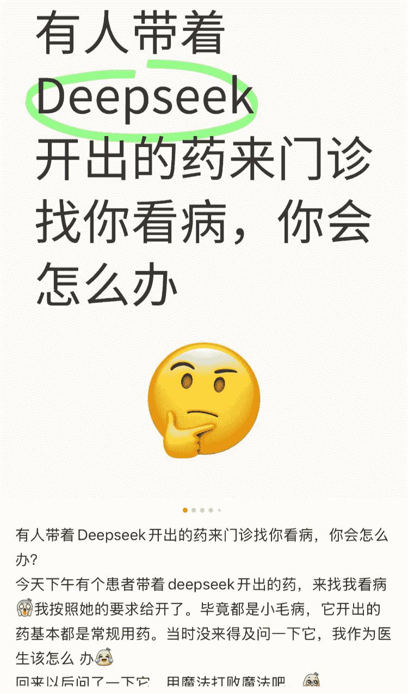

### 医生：AI 是辅助，而非替代

面对患者带来的 DeepSeek 结果，许多医生表示，AI 可以作为一种辅助工具，帮助患者更好地了解病情，但绝不能替代专业的医疗诊断。医生们强调，医疗诊断是一个复杂的过程，需要综合考虑患者的具体情况、病史、体检结果等多方面因素，而 AI 目前还无法完全做到这一点。

例如，有医生指出，DeepSeek 给出的诊断结果可能是基于一般情况，但在实际临床中，患者可能存在一些特殊情况，需要医生根据经验进行判断和调整。此外，AI 也无法像医生一样与患者进行面对面的沟通和交流，了解患者的心理状态和需求。

### 湖南：严禁互联网医院用 AI 开处方

在 AI 技术逐渐渗透到医疗领域的同时，相关部门也在加强对 AI 使用的监管。近日，湖南省医疗保障局发布通知，明确规定互联网医院严禁使用人工智能等自动生成处方。

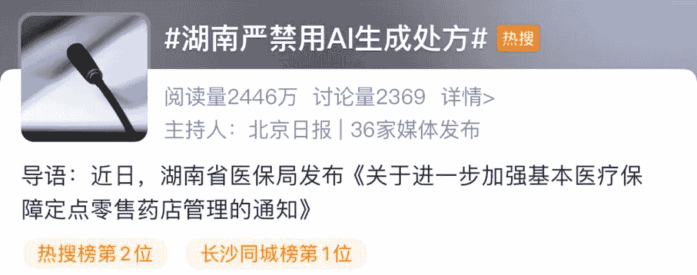

这一规定得到了不少网友的支持。有网友表示，AI 可以作为医生的辅助工具，帮助医生更好地为患者服务，但不能直接替代医生开处方。如果 AI 可以随意开处方，那患者的用药安全将无法得到保障。

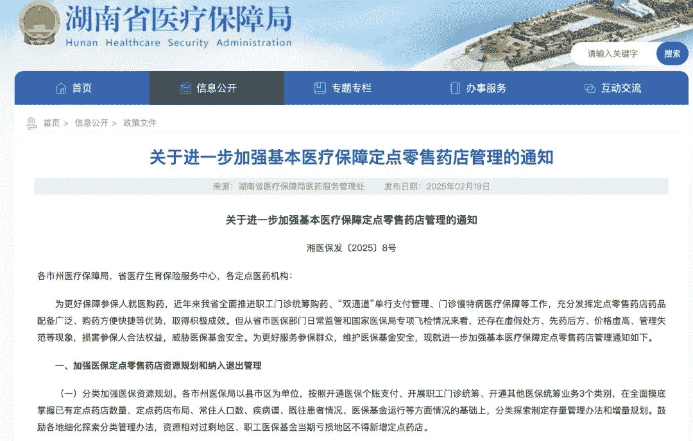

### 误诊责任归谁？

随着 AI 在医疗领域的应用越来越广泛，一个重要的问题也随之而来：如果患者根据 DeepSeek 等 AI 工具的建议进行治疗，出现误诊或医疗事故，责任该由谁来承担？

对此，法律专家表示，目前我国的法律规定，医疗处方必须由具备资质的医疗机构和专业医生开具。如果患者自行按照 AI 的建议进行治疗，而未经专业医生的确认，一旦出现问题，AI 通常不承担法律责任，患者需要自行承担因使用该建议而产生的风险。

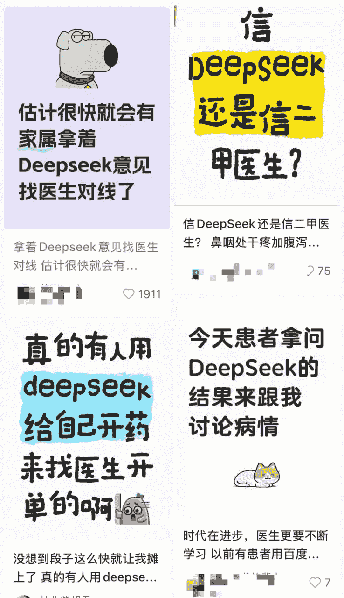

同时，医生如果将 AI 给出的处方直接给患者使用，也需承担相应的责任。因为医生在使用 AI 作为辅助工具时，有责任对 AI 的建议进行审核和判断，确保其符合患者的实际病情和治疗需求。

### 最后

AI 技术的发展无疑为医疗领域带来了新的机遇和挑战。它可以帮助患者更好地了解病情，为医生提供一些参考建议，但绝不能替代专业的医疗诊断和治疗。在享受 AI 带来的便利的同时，我们也需要保持理性和谨慎，确保医疗安全和患者权益。

感谢粉丝们对小码哥的支持，全网最全的deepseek 系列文档，扫码回复“dp”，免费赠送啦。

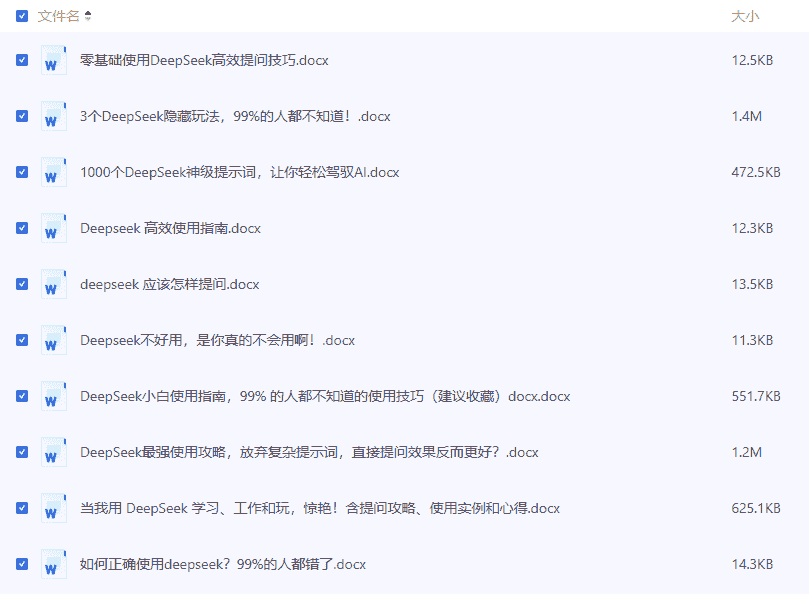

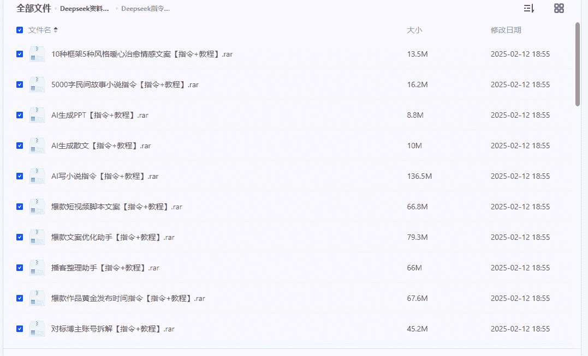

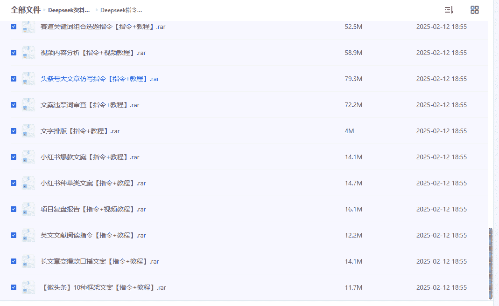

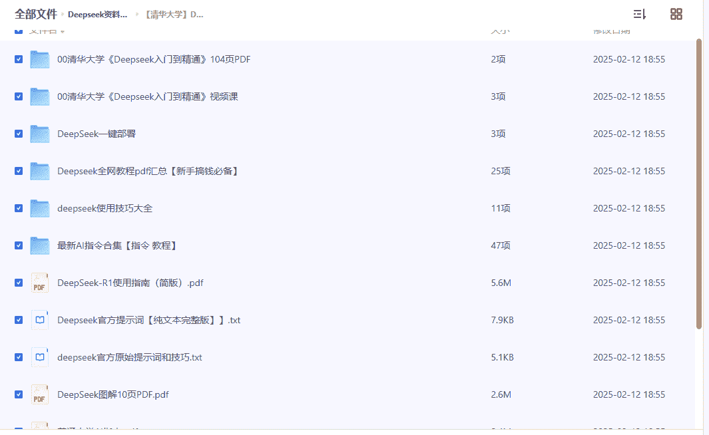

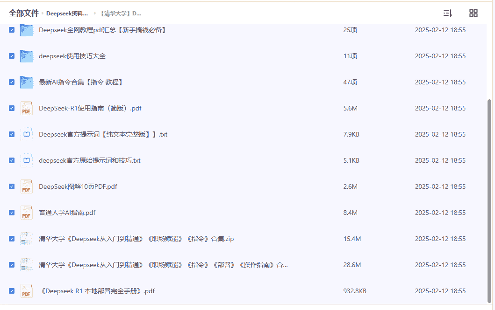